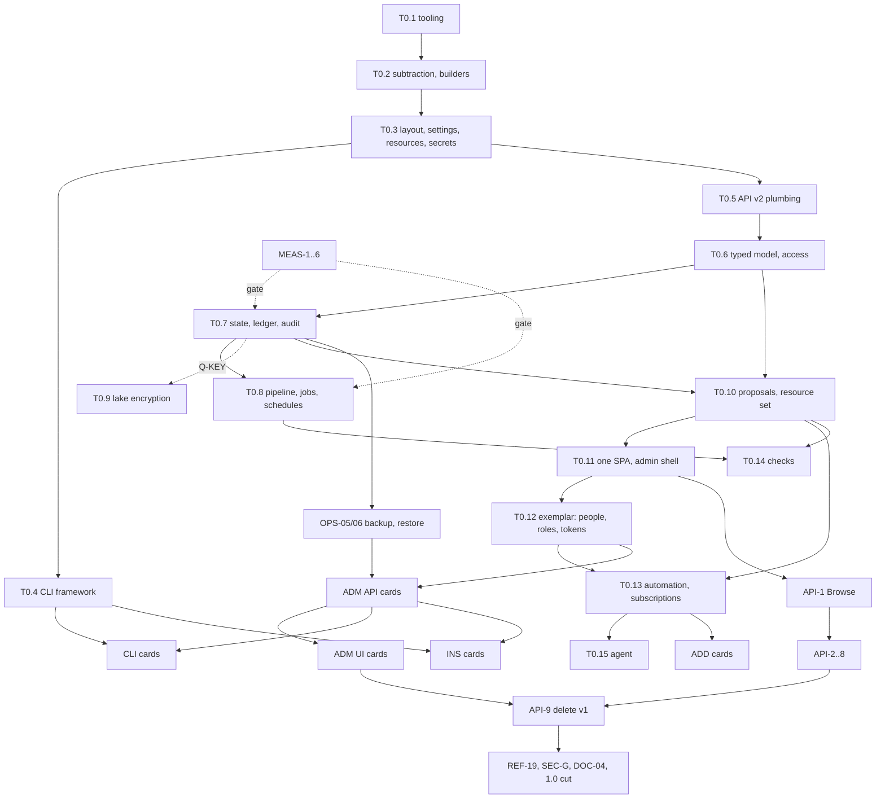

# Elysium production roadmap

**The one planning file, written 3 November 2026 and accepted by the owner the
same day, including every new design decision N1 to N21.** It merges every
roadmap source into one ordered list of work, with one goal: an Elysium that a
stranger can install, run, back up, upgrade and audit. It replaces the file
that used to hold the step list and the questions that wait on a person: section
8 keeps that file's text in full, and section 5 holds the questions for the
owner. Nothing else plans work.

**Status (3 November 2026).** Accepted. Tier 0 has not started; the owner says
when it does. S0, S1 (partly) and S2 are done (section 6.1 has the commits).

How to read it:

- **Tier 0** (section 3) is the core-wide work that every later card stands on.
  A strong model does it, in order, one item at a time. Each item ends with a
  **contract**: the module names, signatures, file locations, route shapes and
  registries that later cards build on without redesigning anything.
- **Tier 1+** (section 4) is task cards for efficient models (Sonnet-class,
  some Haiku). Every design choice is already made here. A card names the files
  it owns, so cards in the same wave never touch the same file.
- Section 7 is the brief a worker gets with its card.
- **F** = fact, with the path it was read from. **J** = judgement. **E** =
  estimate. Anything not labelled is a specification (what to build), not a
  claim about the present.
- Elysium's own name for the platform it models is "the precedent". This file
  never names a vendor or its products, and a test makes sure the repository
  doesn't either (T0.1).

Sources (paths are absolute unless they start with a repository directory):

| Tag | Source |
|---|---|
| BLK | Section 8 of this file (item 4 there holds S0-S20, I1-I8, M1-M14, D1-D23) |
| PLAN | `/home/claude/reports/Breaking refactor plan for Elysium.md` |
| CS | `/home/claude/research_notes/Production readiness for Elysium/current_state_and_sources.md` |
| IS | `.../Production readiness for Elysium/install_and_setup.md` |
| CLI | `.../Production readiness for Elysium/cli_design.md` |
| CIO | `.../Production readiness for Elysium/config_in_out.md` |
| SEC | `/home/claude/elysium/FINDINGS_security.csv` |
| AUD | `/home/claude/elysium/AUDIT_CHECKLIST.csv` |
| AST | `/home/claude/elysium-globe/ROADMAP.md` (E1-E14, R1-R10), `/home/claude/elysium-globe/FORK.md` |
| HEL | `/home/claude/elysium-heliograph/docs/research/elysium-slice1.md` (asks 1-8) |
| RULES | `elysium/CLAUDE.md`, `elysium/AGENTS.md` (rewritten 3 Nov: no deployment exists, break freely, replace in place) |

---

## 1. Goal, and what "production ready" means

**Goal.** An operator who has never seen Elysium installs it in minutes,
finishes setup in a browser, and runs it day to day from the web UI. The
terminal covers the same tasks as well as the ones that must work while the
server is down. Configuration that Elysium reads is kept apart from artefacts
that Elysium writes for others, and both are documented. Every security
invariant is proved by a test that fails when the guarantee is broken.

**Where it stands (F, CS §2-3).** Installing is a root-only shell script plus
about 17 manual steps (`install/install.sh`, 213 lines, "not an upgrade
mechanism"). Configuration is seven YAML files in four hand-kept copies
(`deployment/etc`, `templates`, two test fixture sets). The first user can
only be created by `python -m elysium.scripts.bootstrap_root`, and nobody holds
`manage:deployment` until a second ritual has been done. Erasure, backup and
restore, audit reading and first-run setup have no UI. There are 45 scripts in
`src/elysium/scripts/`, and `elysium` is a stub (`src/elysium/cli.py`, 36
lines). `api/routes.py` is 10,645 lines. S0, S1 and S2 are done (commits
a9f99a0b, a91bcaa1, 0f83252b, 93b03f0b, 502d74ba).

**The checklist.** The owner ticks each box when the cards named beside it are
merged and their acceptance commands pass.

| # | Production ready when | Proved by | Cards |
|---|---|---|---|
| P1 | **Install in minutes**: `docker compose up -d` (or a `.deb`/`.rpm`, or `uv tool install`) and a browser, with no hand-edited file | CI starts the container from nothing and completes setup over HTTP | INS-02, INS-03, INS-04, INS-05, INS-06, CI-06 |
| P2 | **First-run web setup**: a one-time setup URL, then a wizard that creates the first administrator, connects a source, picks the model server, sets schedules, and locks itself when done | e2e test of the wizard; API test that the token is single-use and expires | ADM-01, ADM-02, CLI-SETUP |
| P3 | **Every admin task in the UI**: people, roles, tokens, service principals, sources, configuration and the LLM, sync, rebuild, erasure requests, backup and restore, audit, logs, health, apps | An e2e test per section; a test that each admin route has a UI caller | T0.12, ADM-03 to ADM-26, API-* |
| P4 | **A coherent CLI**: one `elysium` command with noun-verb subcommands, one exit-code table, `--json` on every command, and the same API as the UI | CLI tests per noun; the help and exit-code reference is generated and kept current | T0.4, CLI-* |
| P5 | **Documented IN and OUT**: one settings file, versioned resource files with published JSON Schemas, an exports directory, a generated reference | `elysium export --check` and the reference-currency test pass in CI | T0.3, ADM-22, DOC-03 |
| P6 | **Backups and restore tested**: scheduled encrypted backups; restore from the UI and the CLI; erasures survive a restore | A CI round trip: back up, wipe, restore, verify counts and erasures | OPS-05, OPS-06, OPS-07, CI-06 |
| P7 | **Upgrades with migrations** (from 1.0): an automatic backup before migrating, numbered migrations, refusal to run on a newer schema | An upgrade test from the previous release's image | OPS-08, OPS-09 |
| P8 | **Health and doctor**: `/health/live`, `/health/ready`, a detailed health page, and `elysium doctor [--fix]` all running one set of checks | Each check has a test that makes it fail | T0.5, OPS-01 to OPS-04, ADM-18 |
| P9 | **Audit readable**: an audit view with filters and export, an append-only hash chain, `elysium audit verify` | A tamper test (change one byte and verification fails) | T0.7, ADM-14, ADM-15 |
| P10 | **Security findings closed**: every row of SEC and every open HIGH or MED row of AUD is FIXED, or OUT OF SCOPE with a reason | A CSV status check in CI: no row is left `open` | SEC-A to SEC-G |
| P11 | **Invariants proven**: I1-I8 each have at least one control that fires, mapped in a coverage table | `tools/check_controls.py --coverage` fails when an invariant has no live control | T0.1, REF-19 |
| P12 | **Supported surface stated**: platforms, source databases, model servers, and their versions | A support matrix in the docs, tested in CI where a machine allows | DOC-01, Q-SUPPORT (section 5) |

---

## 2. Decisions

### 2.1 Already taken (owner, 2-3 November 2026; plan section 5 in 8.4)

| # | Decision | Lands in |
|---|---|---|
| D1 | The ontology is versioned data in `elysium.db` (`model_versions`), with YAML import and export (option A) | T0.6, T0.10 |
| D2 | Immutable element ids `ely.<kind>.<uuid>`; names stay unique and can be renamed; objects stay `(type, pk)` | T0.6 |
| D3 | Storage binding written inline as `backing:`, last in each type | T0.6 |
| D4 | Three state files: `elysium.db`, `erasure.db`, `scratch.db` (M8 confirms) | T0.7 |
| D5 | "property", not "field", in the model, the API and the UI | T0.6 |
| D6 | "app", not "module"; collapse to one SPA; keep add-on supervision, the proxy and scoped tokens | T0.11 |
| D7 | Roles are additive (a union, no deny rules); escalation is checked on the union | T0.6 |
| D8 | No deprecate-first; keep the "used by" guard and `drop_edits\|move_edits\|cast` | T0.10 |
| D9 | Silver is a transient stage, if M1-M3 confirm it | T0.8 |
| D10 | Findings layers become SQLite tables in `elysium.db`, if M6 shows they are small | T0.7 |
| D11 | `ingest_undeclared_columns` removed | T0.2 |
| D12 | Local lake only (the object-store lake is dropped) | T0.7 |
| D13 | Simulator becomes an in-tree package with its own pyproject and CI job | REF-18A |
| D14 | Enrichment and prediction re-expressed as `edit_proposer` functions only if wanted, otherwise deleted; inferred identity moves to an add-on | REF-14B, Q-D14 |
| D15 | Label enforcement always on | T0.2 |
| D16 | Write-back to a source database deleted, after M5 | T0.8 |
| D17 | Approval policy per action: `none\|confirm\|second_person`; agent and automation calls are at least `confirm` | T0.10 |
| D18 | Automations may propose an action; it always stages and runs as a real owner account | T0.13 |
| D19 | Email notices carry no content and are off by default | T0.13 |
| D20 | Service principals are real user records with explicit grants; a token's power is its scopes AND its grants | T0.5, T0.12, ADM-19 |
| D21 | One security attribute for now; `UserRecord` holds a mapping so a second can be added later | T0.6 |
| D22 | Keep `/api/v2` as the path once v1 is gone | T0.5 |
| D23 | `filter_operators` on; `search_result_cap` a constant; other agent switches deleted unless M11 shows value; one inference server | T0.15 |

Also decided earlier and still binding (BLK): Elysium-held lake encryption
with a key that can be moved (27 Oct; build is gated on the two points in
Q-KEY); no question leaves the machine; no fine-tuning; no separate vector
server; no MCP server; no REST catalog; DuckDB rejected; the lake's manifest is
never configuration; writes only through actions; SSE only; single machine,
single tenant.

### 2.2 New decisions this roadmap makes (DECIDED, owner, 3 November 2026: all accepted)

Each row gives the reason from the research and the option chosen. The owner
accepted all of N1 to N21 as written on 3 November 2026; Tier 0 builds them.
Changing one later costs the amount shown in the last column.

| # | Decision | Research reason | Recommendation | If reversed later |
|---|---|---|---|---|
| **N1** | **Distribution** (DECIDED, owner, 3 November 2026: accepted) | Comparable self-hosted apps document a container with Compose as the primary path; one large Python app ended end-user support for its venv install in 2025, citing "poor first experiences" (IS §1). System packages that create a user and a systemd unit are the norm for single-process servers (IS §1, §3). `uv tool install` gives each tool an isolated environment and is right for developers (IS §1). | Primary: an OCI image and a 15-line `compose.yml` (one service, port bound to 127.0.0.1, `/config` and `/data` volumes, HEALTHCHECK, non-root user), also published as a `docker load` tarball for hosts with no network. Secondary: a `.deb` and an `.rpm` that install a bundled environment under `/opt/elysium` and a hardened systemd unit. Developers: `uv tool install`. No single-binary build. **This changes BLK S17, which made `pipx install` primary.** | INS cards only |
| **N2** | **First run** (DECIDED, owner, 3 November 2026: accepted) | The common pattern is to start the service, open a browser and create the admin there. The risk that whoever reaches the port first claims admin is closed by a one-time secret that only the host can read (IS §2). A wizard that cannot be locked again is a known pain point (IS §2). | On a first start with no users, the server stores the hash of a random token and prints `Open http://<listen>/setup#token=<t>` to stdout (journal, `docker compose logs`). The token sits in the URL fragment, so it never reaches access logs or a `Referer` header. It is single-use and expires after 24 hours. `elysium setup url` (local mode) issues a fresh one. The wizard locks for good once the first administrator exists. Recovery afterwards is `elysium user reset-password` (local mode), never the token. A built-in `administrator` role holds every `manage:` grant, so the `manage:deployment` ritual (CS §2.2 steps 11-13) disappears. | ADM-01/02 |
| **N3** | **Settings file** (DECIDED, owner, 3 November 2026: accepted) | Settings differ from resource definitions: settings belong in one small file with environment overrides, resources in typed files (CIO §1). TOML has no indentation traps and Python 3.11 reads it with the standard library; the usual order is flag > env > file > default, with a prefix and `__` for nesting (CIO §3, §7). Never fall back silently to a relative path (BLK S17). | One file, `elysium.toml`, holding only what must be known before the database opens or must never change from the web: listen address, public URL, paths, trusted proxies, cookie security, worker count, log level, key references. Order: CLI flag > `ELYSIUM_<SECTION>__<KEY>` > the file > built-in default. The file is found from `--config`, then `ELYSIUM_CONFIG`, then `$CONFIGURATION_DIRECTORY/elysium.toml`, then `/etc/elysium/elysium.toml`, then `$XDG_CONFIG_HOME/elysium/elysium.toml`; if none exists, the command stops and tells you to run `elysium init`. `ELYSIUM_STATE` is kept as a short alias for `paths.state`. **This replaces BLK §1.4's "`elysium.yaml`, about 10 lines" and the three `*_DIR` variables.** | One loader module |
| **N4** | **Resource files and one versioned resource set** (DECIDED, owner, 3 November 2026: accepted) | Resource files use an `apiVersion/kind/metadata/spec` envelope; derived fields never appear in input files; JSON Schemas with a modeline give editor checking (CIO §1-2). A file-provisioned item is read-only in the UI unless it is detached; ownership is tracked per provider (CIO §5). D1 already folds role and configuration changes into model changes (BLK §1.4, PLAN). | `apiVersion: elysium/v1`. Kinds: `ObjectType`, `LinkType`, `ActionType`, `Role`, `Function`, `Automation`, `Silo`, `App`, `Configuration`. There may be one or several documents per file, anywhere under `resources/`. The pair (kind, name) must be unique. ALL resources, the model together with silos, apps and configuration, make up **one versioned resource set** in `elysium.db`: one history, one diff, one restore, one proposal kind (`resource_change`). Every resource records `origin: ui \| file:<path>`. A file-origin resource is read-only in the UI. Files are applied at start and by `elysium resource apply`; each application becomes one version, audited, written as `system:file-provisioner`. A file that claims a resource the UI created takes it over, loudly (audited, and a banner on Admin > Overview), never silently. `elysium resource adopt` hands a resource back to the UI. | Medium: one loader and one provisioner |
| **N5** | **Each setting lives in one place** (DECIDED, owner, 3 November 2026: accepted) | A database value that silently overrides the file is a documented footgun (CIO §3, §5). | A key is either a boot setting (`elysium.toml`) or a runtime setting (the `Configuration` resource, editable in the UI) and never both. Runtime settings: the LLM block, agent tuning, sync, backup and retention schedules, notifications, limits, password and session policy. | Small |
| **N6** | **Secrets by reference only** (DECIDED, owner, 3 November 2026: accepted) | Prefer systemd credentials and secret files to environment variables, which child processes inherit (CIO §4, IS §3). A setting can say where its secret is kept (`file:`, `_URI`) instead of holding it (CIO §4). | A secret-shaped field holds `secretRef: <name>`. The name is looked up in `$CREDENTIALS_DIRECTORY/<name>`, then `<paths.secrets>/<name>` (mode 0700/0400), then the managed store `<state>/secrets/<name>.enc`, where secrets typed into the UI are kept, encrypted with the master key and never readable back through any API. A literal secret is refused at load. `${VAR}` expansion is deleted. No secret is read from an environment variable; the one exception is `ELYSIUM_TOKEN` for the CLI in CI. The master key is created by the install step (`elysium init`, `elysium service install`, or the container entrypoint), never by the server, which refuses to start without it. | Medium |
| **N7** | **Exports directory** (DECIDED, owner, 3 November 2026: accepted) | Output follows the standard each consumer already reads (ODCS, OpenAPI, JSON Schema). Output that is deterministic can be committed and checked for drift in CI. Event streams are not deterministic, so they are not committed (CIO §6). | `<state>/exports/` by default, or `--out DIR`. Every file is deterministic: sorted keys, sorted lists, LF line endings, a final newline, no timestamps, and a `# generated by elysium export; do not edit` header where the format allows one. `manifest.json` lists each file's sha256 and the resource-set version it came from. `elysium export --check` exits 8 on drift. Audit and lineage are streams under `<state>/audit/` and are never exported as snapshots. | Small |
| **N8** | **CLI** (DECIDED, owner, 3 November 2026: accepted) | Use noun-verb, flags rather than positional arguments, `--json`, stderr for messages, `NO_COLOR`, never require a prompt, and confirmations that scale with danger (CLI §1-4). Cyclopts reads configuration and environment variables natively and does not pull in Click; Typer is a pre-1.0 release whose minor versions have broken things; argparse is too thin for about 60 commands (CLI §7). Precedence is flag > env > file (CLI §5). | **Cyclopts + Rich**; Typer + Rich if Cyclopts fails the startup and completion checks in T0.4. The tree is in §2.3. Commands talk to the running server's HTTP API by default (a profile in `$XDG_CONFIG_HOME/elysium/cli.toml`, or `ELYSIUM_URL` with `ELYSIUM_TOKEN_FILE`). Local mode is used only by commands that must work while the server is down, and those say so. The exit codes and confirmation rules are in §2.3. `--json` output only ever gains fields. The CLI never checks the internet for updates. | T0.4 only |
| **N9** | **TUI** (DECIDED, owner, 3 November 2026: accepted) | A TUI is worth building only for live, navigable views, and is optional at best (CLI §8). | Deferred until after 1.0. If built: `elysium[tui]`, Textual, read-only, the same client as the CLI. | None |
| **N10** | **Schedules inside the product** (DECIDED, owner, 3 November 2026: accepted) | systemd timers do not exist in a container, and N1 makes the container primary. A schedule that can only be edited on the host is not an admin task in the UI. | The sync, backup and retention schedules live in `Configuration` and are edited in the UI. The server's timer worker (`core/timers.py` today) launches each run as a job in a subprocess. No cron jobs, no systemd timers. **This changes BLK S17's shipped sync and backup timers.** | Small |
| **N11** | **Logs** (DECIDED, owner, 3 November 2026: accepted) | Logging to stdout or the journal by default and avoiding log files is the modern idiom (IS §3). | The server writes logs to stdout only. An in-process ring buffer (last 5,000 records, redacted) feeds Admin > Logs. Audit and lineage are state under `<state>/audit/`, not logs. `ELYSIUM_LOG_DIR` and logrotate are deleted. | Small |
| **N12** | **Migrations from 1.0** (DECIDED, owner, 3 November 2026: accepted) | Upgrade by replacing the artefact; the app migrates on start, backs up first and refuses a newer schema (IS §4). | The "no migrations" rule (BLK item 4) holds until the 1.0 cut. At 1.0 the schemas are frozen as migration 0001. From then on: numbered SQL migrations in `src/elysium/db/migrations/`, an automatic backup before migrating, refusal to start on a database newer than the code, and `apiVersion: elysium/v1` frozen (a breaking format change needs `v2`). | OPS-08 only |
| **N13** | **Restore from the UI** (DECIDED, owner, 3 November 2026: accepted) | Backups are a first-class feature, with a restore built into the product rather than left to the operator (IS §4). | The CLI restores in local mode with the server stopped. The UI *stages* a restore: it writes `<state>/run/restore-pending.json` and asks for a restart; on the next start the server restores before it serves anything, and rolls back if that fails. The audit log and `erasure.db` are never rolled back, and erasures are applied again after every restore. | OPS-06 |
| **N14** | **Packaging** (DECIDED, owner, 3 November 2026: accepted) | `uv` is the tool installer (IS §1); the dependencies belong in pyproject so that `uv tool install` works. | Move the dependencies into `pyproject.toml`, replace the four `requirements*` files with one `uv.lock`, build with hatchling, ship the built UI as package data, version from the git tag. Developer tools go to `tools/` and an optional `elysium-dev` plugin package, outside the wheel (BLK §1.9). | T0.1 |
| **N15** | **Controls file format moves into Tier 0** (DECIDED, owner, 3 November 2026: accepted) | `scripts/check_controls.py` is one file of 9,726 lines holding 1,166 records (F, `grep -c "Control("`), and parallel workers would all edit it. | T0.1 converts the records to `controls/<area>/<card>.toml` and a runner in `tools/`. Pruning dead records stays at the end (REF-19). **This reorders BLK S19.** | None |
| **N16** | **Erasure is a proposal** (DECIDED, owner, 3 November 2026: accepted) | One proposal pipeline (D17, BLK §1.6); erasure is severe and cannot be undone (CLI §4). | A new proposal kind, `erasure`, with fixed policy `second_person`. A request names the type and key; the plan shows every store and table it will touch; a second holder of `manage:erasure` approves it; it runs as a job. | Small |
| **N17** | **Admin grants and built-in roles** (DECIDED, owner, 3 November 2026: accepted) | The role ritual (CS §2.2); structured grants (BLK §1.5). | `manage:` grants are structured: `users`, `roles`, `deployment` (silos, apps, configuration, sync, lake, logs, health), `model`, `audit`, `backups`, `erasure`. Built-in roles: `administrator` (all of them), `operator` (deployment, backups), `auditor` (audit). They cannot be deleted, but can be copied. | Small |
| **N18** | **Geography (Astrolabe E5)** (DECIDED, owner, 3 November 2026: accepted) | BLK lists "geospatial" among the refusals; Astrolabe needs box and radius queries (AST E5). | Minimal and in Python: a `geo_point` value type and two object-set filter operators, `withinBox` and `withinDistance`, evaluated after the access check, with no spatial index until a measurement asks for one. **Partly reverses a refusal, so it needs an explicit yes.** If the answer is no, ADD-10 is out of scope. | Only ADD-10 |
| **N19** | **Admin surfaces deny uniformly** (DECIDED, owner, 3 November 2026: accepted) | I1. | A caller without the grant gets the same 404 from an admin route as from an unknown one. The UI learns which sections to show from `GET /api/v2/me`. | Small |
| **N20** | **Health endpoints** (DECIDED, owner, 3 November 2026: accepted) | Container HEALTHCHECK and systemd need a cheap probe; a diagnostic page needs detail (IS §3, §4). | `GET /api/v2/health/live` and `/health/ready` are public and say only `{status}`. `GET /api/v2/admin/health` gives detail and needs `manage:deployment`. `elysium doctor` runs the same registry of checks locally. | Small |
| **N21** | **Resource change route name** (DECIDED, owner, 3 November 2026: accepted) | The changes cover all resource kinds (N4), not only schema. | BLK's `POST /api/v2/admin/schemaChanges` becomes `POST /api/v2/admin/resourceChanges`, with the same body `{changes[], dryRun, baseVersion}`. | None |

### 2.3 The concrete target layout

#### IN: what Elysium reads

```
/etc/elysium/                     # container: /config     uv/dev: $XDG_CONFIG_HOME/elysium
  elysium.toml                    # boot settings (N3)
  secrets/                        # 0700, files 0400, owner elysium (N6)
    master-key                    #   written by `elysium init` / `service install`, never by the server
    backup-key
    silo-warehouse-password
  resources/                      # optional; file-provisioned, read-only in the UI (N4)
    silos/warehouse.yaml          #   kind: Silo
    model/customer.yaml           #   kind: ObjectType (+ LinkType, ActionType in the same or other files)
    roles/analyst.yaml            #   kind: Role
    configuration.yaml            #   kind: Configuration (only if the operator wants runtime settings pinned)
    apps/astrolabe.yaml           #   kind: App
```

`elysium.toml` (the whole file in a typical install):

```toml
# elysium.toml -- boot settings. Runtime settings live in Admin > Configuration.
# Every key can be overridden by ELYSIUM_<SECTION>__<KEY>, e.g. ELYSIUM_SERVER__LISTEN.
[server]
listen = "127.0.0.1:8000"
public_url = "https://elysium.example.org"   # used in setup URLs and links
trusted_proxies = []                          # was config.yaml trusted_proxies
cookie_secure = true                          # was ELYSIUM_COOKIE_SECURE
workers = 2

[paths]
state = "/var/lib/elysium"                    # alias: ELYSIUM_STATE
resources = "/etc/elysium/resources"
secrets = "/etc/elysium/secrets"

[storage]
volume_encrypted = false                      # was ELYSIUM_STORAGE_ENCRYPTION
master_key = { secretRef = "master-key" }

[backup]
key = { secretRef = "backup-key" }

[log]
level = "info"
```

`resources/silos/warehouse.yaml`:

```yaml
# yaml-language-server: $schema=../../schemas/silo.schema.json
apiVersion: elysium/v1
kind: Silo
metadata:
  name: warehouse
  description: Finance warehouse, read-only replica
spec:
  adapter: sqlalchemy            # sqlalchemy | csv | rest
  url: postgresql://elysium_ro@wh.internal:5432/analytics   # no password here, ever
  password: { secretRef: silo-warehouse-password }
  incremental: { column: updated_at }
  locale: en-GB
  queryTimeoutSeconds: 30
  terms: { licence: internal, attribution: "Finance team", commercial: true }   # Astrolabe E8
```

`resources/model/customer.yaml` (format from BLK §1.4: `type:` is the data
type, `derived:` is the only computed kind, links only as links, v2 operators,
`approval:` on every action, structured grants, `backing:` last):

```yaml
apiVersion: elysium/v1
kind: ObjectType
metadata: { name: Customer, description: A person or company that buys from us }
spec:
  key: customer_id
  title: full_name
  security: { property: region }          # or { via: account }, or { unrestricted: true }
  properties:
    customer_id: { type: string }
    full_name:   { type: string }
    region:      { type: string, labels: [compartment] }
    email:       { type: string, labels: [pii] }
    lifetime_value: { type: decimal, derived: { sum: { link: transactions, property: amount } } }
  checks:
    - { target: email, kind: pattern, config: { regex: "^[^@]+@[^@]+$" }, severity: moderate, on_fail: warn }
  backing: { silo: warehouse, table: customers, key_column: customer_id }
---
apiVersion: elysium/v1
kind: LinkType
metadata: { name: transactions }
spec: { from: Customer, to: Transaction, cardinality: many, backing: { foreign_key: customer_id } }
---
apiVersion: elysium/v1
kind: ActionType
metadata: { name: flag-customer }
spec:
  approval: confirm                       # none | confirm | second_person (D17)
  parameters: { customer: { type: object, objectType: Customer }, reason: { type: string } }
  effects:
    - modify: { object: $customer, set: { flagged: true, flagged_by: $user.id } }
```

`resources/roles/analyst.yaml`:

```yaml
apiVersion: elysium/v1
kind: Role
metadata: { name: analyst }
spec:
  grants:
    - { verb: read, type: Customer, properties: [customer_id, full_name, region] }
    - { verb: discover, type: Transaction }
    - { verb: apply, action: flag-customer }
  manage: []                              # users | roles | deployment | model | audit | backups | erasure
```

`resources/configuration.yaml` (runtime settings, N5; usually edited in the UI
rather than here):

```yaml
apiVersion: elysium/v1
kind: Configuration
metadata: { name: default }
spec:
  llm: { server: ollama, baseUrl: "http://127.0.0.1:11434", model: phi4-mini, timeoutSeconds: 600 }
  schedules:
    - { job: sync, cron: "17 * * * *" }
    - { job: backup, cron: "41 2 * * *", keep: 14 }
  sessions: { idleMinutes: 30, absoluteHours: 12 }
  limits: { bulkActionLimit: 20 }
```

`resources/apps/astrolabe.yaml` (replaces `addons.yaml` and `modules.yaml`):

```yaml
apiVersion: elysium/v1
kind: App
metadata: { name: astrolabe }
spec:
  enabled: true
  server: { command: ["astrolabe-server"], options: { feedKey: { secretRef: astrolabe-feed-key } } }
  offeredTo: [analyst]
  ontology: { prefix: Astro, resources: share/astrolabe/ontology/ }   # Heliograph ask 1
```

Every kind's JSON Schema is generated from its pydantic model into
`exports/schemas/<kind>.schema.json`, and `elysium init` writes the modeline
into every file it scaffolds.

#### OUT: what Elysium produces for others

| Artefact | Where | Format | Deterministic | Produced by |
|---|---|---|---|---|
| Data contracts | `exports/contracts/<Type>.odcs.yaml` | ODCS v3.x | yes | `elysium export`, `GET /api/v2/exports/contracts/{type}` |
| Resource schemas | `exports/schemas/<kind>.schema.json`, `elysium.toml.schema.json` | JSON Schema 2020-12 | yes | export |
| The resource set | `exports/resources/<kind>/<name>.yaml` | the IN envelope; can be imported again; derived fields left out | yes | export, `elysium model export` |
| API description | `exports/openapi.json` (copy of `src/elysium/api/v2/openapi.json`) | OpenAPI 3.1 | yes | export, build |
| Access review | `exports/access-review/grants.csv`, `members.csv` | CSV | yes (for a given version) | export |
| Manifest | `exports/manifest.json` | JSON: files, sha256, resource-set version | yes | export |
| Audit log | `<state>/audit/audit-YYYY-MM.jsonl` | JSONL with `v`, `category`, hash chain; OCSF as an extra export | stream | the server |
| Lineage | `<state>/audit/lineage-YYYY-MM.jsonl` | OpenLineage RunEvents | stream | sync jobs |
| Backups | `<state>/backups/<id>.elysium-backup` | encrypted archive with a manifest | n/a | backup job |
| Diagnostics | `elysium-diagnostics-<host>.tar.gz` | redacted settings, doctor output, versions, log tail | n/a | `elysium doctor --bundle`, Admin > Health |

#### State: what Elysium owns and nobody edits

```
/var/lib/elysium/                 # container: /data   uv/dev: $XDG_STATE_HOME/elysium
  elysium.db  erasure.db  scratch.db     # D4; `PRAGMA user_version` stamped
  lake/catalog.db  lake/warehouse/        # Iceberg; layers bronze, changelog, gold, gold_history (+silver if D9 says so)
  audit/                                  # audit-*.jsonl, lineage-*.jsonl; in backups, never rolled back
  backups/   exports/   addons/<app>/     # add-on data dirs are included in backups
  secrets/                                # managed store, *.enc (N6)
  run/                                    # server.lock, state.lock, restore-pending.json
```

#### Environment variables

| Variable | Status | Meaning |
|---|---|---|
| `ELYSIUM_CONFIG` | new | path of `elysium.toml` |
| `ELYSIUM_STATE` | new | alias of `paths.state` |
| `ELYSIUM_<SECTION>__<KEY>` | new | override one boot setting |
| `CREDENTIALS_DIRECTORY`, `STATE_DIRECTORY`, `CONFIGURATION_DIRECTORY` | read | set by systemd; used for lookup and defaults |
| `ELYSIUM_URL`, `ELYSIUM_PROFILE`, `ELYSIUM_TOKEN_FILE`, `ELYSIUM_NO_INPUT`, `NO_COLOR` | new, CLI | client side |
| `ELYSIUM_TOKEN` | new, CLI | CI only; documented as the one exception to N6 |
| `ELYSIUM_ADDON_START`, `PORT` | kept | set by the supervisor for add-ons |
| `ELYSIUM_CONFIG_DIR`, `ELYSIUM_DATA_DIR`, `ELYSIUM_LOG_DIR`, `ELYSIUM_COOKIE_SECURE`, `ELYSIUM_STORAGE_ENCRYPTION`, `ELYSIUM_BACKUP_KEY_FILE`, `${VAR}` references | **deleted** in T0.3 | replaced as shown in the TOML above |

#### Files that go (F: they exist today, CS §1)

`deployment/` (etc, var, logrotate), `install/install.sh`, `templates/*.yaml`
(replaced by `elysium init` templates in package data, with `--demo` generated
from them), `config.yaml`, `data_silos.yaml`, `ontology_schema.yaml`,
`source_bindings.yaml`, `policy.yaml`, `modules.yaml`, `addons.yaml`,
`example_queries.yaml` (moves to the dev plugin), every `module.json` and
`module.conformance.json` (T0.11), `requirements*.txt` and `*.lock` (N14).

#### The CLI tree (N8)

Mode: **A** = through the server's API (the default); **L** = local, reads
state directly; **L\*** = local, and refuses (exit 6) while the server runs.

```
elysium
  version                                   A/L  client version, plus the server's when reachable
  completion bash|zsh|fish|powershell       L    prints the script; never edits rc files
  init [--demo] [--system|--user|--container] [--dir D]   L   scaffold elysium.toml, resources/, secrets/, keys
  settings show|validate|path               L    resolved values and where each came from; secrets redacted
  server run                                L    the service's ExecStart (uvicorn with the settings)
  service install|uninstall|status [--user] L    systemd unit (root for --system)
  setup url|status                          L    issue a fresh one-time setup URL; wizard state
  doctor [--fix] [--bundle FILE]            L    local checks, plus the server's when reachable
  auth login|logout|status|whoami           A
  resource validate PATH                    L    schema plus file:line:col errors, all of them
  resource list|show|diff|apply|adopt       A    apply [--prune] [--dry-run]
  model versions|show|diff|export|restore   A
  source list|show|create|update|delete|test|tables   A
  configuration show|get|set                A
  sync run|status|history                   A    run [--source S] [--table T] [--full] [--rebuild TYPE] [--wait]
  job list|show|cancel|wait|logs            A
  lake status|verify|rebuild                A
  lake repair                               L*
  lake key check|export|import|rotate       L*
  user list|show|create|update|disable|enable|delete|set-password   A
  user reset-password NAME                  L    recovery when nobody can sign in
  role list|show|create|update|delete|grant|revoke   A
  token list|create|revoke                  A
  proposal list|show|approve|reject         A
  erasure request|list|show|cancel          A
  backup create|list|show|verify|download|prune   A   (create --local: L)
  backup restore FILE                       L*   (--stage: A, applied at next start, N13)
  audit list|show|export|verify             A    (verify --local: L)
  export [--out DIR] [--check] [--only KIND]   A  (--local: L)
  app list|show|enable|disable|restart|logs A
  logs [--follow] [--level L]               A
  object get|history TYPE KEY               A
  dev ...                                   only when elysium-dev is installed: reset, seed, users, openapi, docs, controls, bench, sim
```

BLK S16 names map like this: `serve` -> `server run`, `lint` -> `settings
validate` + `resource validate`, `contracts` -> `export`, `erase` -> `erasure`,
`model` -> `model` + `resource`, `init`/`doctor`/`service install`/`backup`/
`restore`/`dev` unchanged.

Global flags on every command: `--json`, `-q/--quiet`, `-v/--verbose`,
`--no-color`, `--no-input`, `--profile NAME`, `--url URL`, `--config PATH`,
`-h/--help`, `--version`. Commands that change state also take
`-n/--dry-run` and `-y/--yes`; severe ones need `--confirm SUBJECT`.

**Exit codes** (one table, `elysium help exit-codes`; follows the code set of a
widely used platform CLI and click's usage code, CLI §3):

| Code | Meaning | Examples |
|---|---|---|
| 0 | success | |
| 1 | unexpected failure | a bug; prints a bug-report hint |
| 2 | usage error | unknown flag, missing argument |
| 3 | not found (also what uniform denial looks like) | unknown or unreadable user, type, job |
| 4 | not signed in or token rejected | 401 from the server |
| 5 | unavailable | server unreachable, timeout, master key missing |
| 6 | conflict or precondition | lock held; server running for an L\* command; stale base version; confirmation needed under `--no-input` |
| 7 | partial success | some tables synced, some failed |
| 8 | check failed | `validate`, `doctor`, `verify`, `export --check` found problems |
| 130 | interrupted | Ctrl-C |

With `--json`, errors go to stderr as `{"error": {"code": "E_SYNC_LOCKED",
"message": ..., "hint": ...}}`.

**Confirmation tiers** (CLI §4):

| Tier | Commands | Rule |
|---|---|---|
| read | `list`, `show`, `status`, `verify`, `diff` | no prompt |
| reversible | `sync run`, `resource apply` without `--prune`, `export`, `backup create`, `token create` | no prompt; `--dry-run` where it means something |
| moderate | `user disable`, `role revoke`, `token revoke`, `lake rebuild`, `app disable`, `resource apply --prune`, `job cancel`, `proposal reject` | prompt on a TTY or `--yes`; `--dry-run` prints the plan; under `--no-input` without `--yes`, exit 6 with the flag to pass |
| severe | `erasure request`, `user delete`, `backup restore`, `lake key rotate|import`, `model restore` | prints the plan, then needs `--confirm <exact subject>` even with `--yes`; checked again on the server; audited; approval policy still applies |

Every command that changes state prints what changed and the web-UI URL of
the thing it changed. Every `--help` carries two examples and a "Web UI:" line.

---

## 3. Tier 0: core-wide blocking work (strong model, in order)

Tier 0 merges BLK S3 to S15 with what production needs and nothing in BLK yet
schedules: where configuration lives, a CLI framework, jobs, schedules, the
audit hash chain and the admin shell. Each item follows the BLK rules: replace
in place; delete the old in the same change; a control goes only with the code
it guards; each review lists the controls deleted and added and the invariants
touched; an item that touches I5 or I6 gets a second fresh-reader review aimed
at that invariant alone.

| # | Item | BLK step | Risk | Size (E) |
|---|---|---|---|---|
| T0.1 | Swarm tooling, packaging, controls format | S1 rest, S19 format, N14, N15 | low | 1 wk |
| T0.2 | Compatibility subtraction and test builders | S3, S4 | low | 1 wk |
| T0.3 | Layout: settings, state paths, resource envelope, secrets | new (S17 paths half) | med | 1.5 wk |
| T0.4 | CLI framework and command registry | S16 skeleton | low | 1 wk |
| T0.5 | API v2 plumbing, sessions, tokens, OpenAPI, generated clients, health | S5 | HIGH (I2, CSRF) | 2 wk |
| T0.6 | Typed model, structured grants, one policy decision point | S6, §1.5 | HIGH (I1, I3) | 3-5 wk |
| T0.7 | State files, lake layout, erasure ledger, audit with hash chain | S7 | HIGH (I6) | 2-3 wk |
| T0.8 | Pipeline in the package, jobs, schedules, SEC-01 | S8, N10 | HIGH (I7) | 2-3 wk |
| T0.9 | Lake encryption with a movable key | BLK item 1 | med | 1-1.5 wk; **gated on Q-KEY** |
| T0.10 | One proposal pipeline, versioned resource set, provisioning, actions on v2 | S9, N4, N16 | HIGHEST (I4, I5) | 3-4 wk |
| T0.11 | One SPA and the admin shell | S11, D6 | low | 1.5-2 wk |
| T0.12 | Exemplar resource end to end: people, roles, tokens (API + UI + CLI) | S10 commit 2 | HIGH (I1, I3) | 1.5 wk |
| T0.13 | One automation model and subscriptions | S12 | med (I3) | 2 wk |
| T0.14 | One checks model | S13 | med | 2 wk |
| T0.15 | Agent on the service layer | S15 | med (I2, I8) | 2 wk |

Total, done one after another: roughly 6-8 months (E; BLK's own estimate for
S3-S15 is 4-6 months, and T0.1, T0.3, T0.4, T0.9, T0.11 and T0.12 add to it).
Tier 1 cards start as soon as the Tier 0 items they depend on are merged
(section 6), so the swarm runs alongside T0.6 onwards.

**Gates for every Tier 0 item:** `./check.sh --full` (from T0.1) passes; the
controls runner reports nothing retired without a deletion; `test_openapi_is_current`
and `npm run gen:client -- --check` pass once they exist; the commit message
lists the controls deleted and added and the invariants touched.

### T0.1 Swarm tooling, packaging and the controls format

- **Why first.** Every card runs the gates, adds controls and adds
  dependencies. Today the controls are one 9,726-line Python file (F,
  `src/elysium/scripts/check_controls.py`, 1,166 `Control(` records) and the
  dependencies are four hand-synchronised files (F, `requirements.txt`,
  `requirements.lock`, `requirements-dev.txt`, `requirements-dev.lock`). Parallel
  workers would collide on both in every wave.
- **Scope.**
  1. Packaging (N14): `[project.dependencies]` and `[project.optional-dependencies]`
     (`identity`, `tui`, `dev`) in `pyproject.toml`; `uv.lock`; hatchling with
     `hatch-vcs`; a build hook that runs `npm ci && npm run build` and ships
     `ui/dist` as `elysium/ui_dist/`. Delete the four `requirements*` files and
     `scripts/check_lockfiles.py`. `./lint.sh` checks `uv lock --check`.
  2. Controls: records become `controls/<area>/<id>.toml`, one file per card or
     area (fields `id`, `invariant` (I1-I8 or none), `path`, `old`, `new`,
     `tests`, `expect = "fails"`). The runner moves to `tools/check_controls.py`
     (about 150 lines, BLK S19). It keeps the S1 behaviour: a control passes only
     if pytest exits with *failure* and every cited test exists; anchors are
     found by content; a vanished anchor is reported "retired" and needs an
     explicit deletion. New flags `--area`, `--card`, `--coverage` (a table from
     I1-I8 to live controls, failing when an invariant has none).
  3. `./check.sh [--fast|--full|--area A]`: ruff, mypy, vulture, import-linter,
     `uv lock --check`, focused or full pytest, controls, and the UI gate
     (`cd ui && npx vitest run && npm run lint`). This replaces the audit's
     proposed Makefile.
  4. `tools/heavy.sh CMD...`: runs a long command under `nice -n 10` and `timeout`
     (default 1,800 s), writes all its output to `.heavy/<utc>-<name>.log`, prints
     the last 60 lines and the exit code, and exits with that code. Every
     full-suite run in a worker brief goes through it.
  5. Name guard: `tests/unit/test_no_vendor_names.py`. It tokenises every
     tracked text file and compares the sha256 of each lower-cased word and pair
     of words with a fixed list of hashes, so the forbidden names never appear in
     the repository, not even in the test itself.
  6. Pytest markers `fast`, `api`, `lake`, `live` registered in `pytest.ini`
     (the directory split itself is REF-18B, after M10).
  7. `git rm` of `001AGENTLOOP.txt`, `001BACKEND.txt`, `001FRONTEND.txt` and
     `001SECURITY.txt`, after checking that each owner-only item they name
     (E-03, E-06, E-07, E-14, NEW-1, NEW-2, NEW-3, F-18) has a row in AUD (F: E-06,
     E-14, F-18, NEW-1..3 have rows; check E-03 and E-07 and add rows if they are
     missing). This closes SEC-06 and SEC-11: the ownership documents those
     findings are about are gone, and card ownership lives here.
- **Deletes.** `scripts/check_controls.py`; the requirements files; `check_lockfiles.py`;
  the four `001*.txt` files.
- **Invariants.** Every control that fired before still fires
  (`tools/check_controls.py` over the full set, before and after the
  conversion; the counts are equal).
- **Preconditions.** S1 (done).
- **Contract left behind.**
  - Controls: `controls/<area>/<CARD-ID>.toml`, area in {`access`, `api`,
    `cli`, `config`, `state`, `index`, `actions`, `automation`, `checks`,
    `agent`, `ops`, `ui`, `install`}. A worker adds a file; it never edits
    another card's file.
  - Commands: `./check.sh --fast` (the focused set: lint and the tests matching
    `-k`), `./check.sh --full`, `tools/heavy.sh`, `python tools/check_controls.py --card ID`. The runner's own
    tests stay in `tests/unit/test_check_controls.py`.
  - Dependencies: `uv add PKG` (or `uv add --optional EXTRA PKG`), then commit
    `pyproject.toml` and `uv.lock` together. On a lock conflict when rebasing,
    run `uv lock` again; never hand-merge the lock.

### T0.2 Compatibility subtraction and test builders (BLK S3, S4)

- **Why first.** S3 removes branches every later item would otherwise carry
  forward. S4's builders mean that later items change one helper instead of
  hundreds of literals (F, BLK S4: 120 test files mention `object_types`, 141
  `storage`, 241 `allowed_actions`, 250 `.db` paths).
- **Scope.** Exactly BLK S3 (the table of tri-states, `MOVED_MODULES`,
  `add_column_if_missing` together with the `user_version` stamp, the three
  scripts, `label_enforcement` as a switch, routes with no caller) and BLK S4
  (`make_ontology()`, the test-only grant parser, `app_db`, the route-table
  scaffold).
- **Deletes.** As listed in BLK S3, about 700-1,000 lines (E).
- **Invariants.** The `write_targets` flip (absent means *no* writes) is a
  security gain with a control. Keep `TestAdoptingALegacyTable` (BLK S3 risk).
- **Contract.** `tests/builders.py`: `make_ontology(**types) -> dict` (returns
  the typed model once T0.6 lands; callers do not change), `make_type(name,
  properties=..., security=..., backing=...)`, `grant("read:Customer.email") ->
  Grant`. `tests/conftest.py`: fixture `app_db(tmp_path) -> StatePaths` (from
  T0.3 onwards). `tests/routes_table.py`: `iter_routes(app) -> Iterator[RouteInfo]`
  with `.path`, `.method`, `.grants`, `.public`; T0.5 and every API card
  parametrise over it.

### T0.3 Layout: settings, state paths, resource envelope, secrets (N3-N7)

- **Why first.** Every card that reads configuration, writes state or adds a
  doctor check, an export, an install step or a CLI command needs to know where
  things live. T0.6 writes the model kinds into this envelope, T0.7 puts the
  state files at these paths, and the INS cards package exactly this layout. Doing
  it after them would mean rewriting each of them.
- **Scope.**
  1. `elysium.settings`: pydantic-settings models for the boot settings in §2.3;
     TOML source; `ELYSIUM_` prefix with `__` nesting; the discovery order of
     N3; a `SettingSource` recorded for each value.
  2. `elysium.paths`: `StatePaths` and `ConfigPaths`; `ensure()` creates
     directories with mode 0700 and refuses a state directory that other
     accounts can read (moving today's `make_private` check here).
  3. `elysium.resources`: the envelope; a kind registry; a YAML reader that
     keeps positions (PyYAML `compose` marks, so no ruamel); errors
     `path:line:col $.spec.properties.email.type: reason`, all collected, never
     only the first; uniqueness of (kind, name); JSON Schema export per kind.
     Kinds defined here: `Silo`, `App`, `Configuration`. T0.6 adds the model
     kinds, T0.13 `Automation`, REF-14A `Function`.
  4. `elysium.secrets`: `SecretRef`, the lookup order of N6, `SecretStr`
     everywhere, a refusal of literal secret-shaped values, the managed store.
  5. Rewire the loader: `deployment_loader.py` takes `Settings` plus the loaded
     resources. `ontology_schema.yaml` and `policy.yaml` still load from the
     resources directory as files, as they do today, until T0.6 replaces them.
     `config.yaml` is split: boot keys go to `elysium.toml`, everything else to
     `Configuration`. `data_silos.yaml` becomes `Silo` resources, and
     `addons.yaml` and `modules.yaml` become `App` resources.
  6. Logging to stdout only (N11); delete the log directory and
     `deployment/logrotate`.
  7. `elysium init` templates in `src/elysium/init_templates/` (minimal and
     demo). The test fixtures become one set: `tests/fixtures/deployment/`
     (with `elysium.toml` and `resources/`) and `tests/fixtures/other_deployment/`.
     Delete `deployment/etc`, `deployment/var` and `templates/`. CLAUDE.md's
     development-environment section is rewritten in the same commit:
     `export ELYSIUM_CONFIG=$HOME/elysium/tests/fixtures/deployment/elysium.toml`,
     `export ELYSIUM_STATE=$HOME/.local/state/elysium-dev` (under `$HOME`, so a
     reboot no longer eats the state, as CLAUDE.md asks).
  8. The manifest: `core/mirror/manifest.py` publishes the names of resources
     and never their specs. This closes the second half of SEC-05 by removing
     the code path, not by redacting it.
- **Deletes.** `resolve_runtime_paths()` and its relative fallback (F,
  `deployment_loader.py`, about line 1752); the reads of `ELYSIUM_CONFIG_DIR`,
  `ELYSIUM_DATA_DIR`, `ELYSIUM_LOG_DIR`, `ELYSIUM_COOKIE_SECURE`,
  `ELYSIUM_STORAGE_ENCRYPTION` and `ELYSIUM_BACKUP_KEY_FILE`; the `${VAR}`
  expansion in `core/secret_references.py`; `CONFIG_FILENAMES`;
  `core/config_editing.py`'s allowlist for silos and settings (the rest of it
  goes in T0.10); `deployment/`; `templates/`.
- **Invariants and proof.** "Names, never contents": a test that no response
  from `/api/...` carries a resolved secret (scan the route table with a
  fixture secret, `s3cr3t-canary`). A literal password in a `Silo` is refused at
  load (control). A settings file that cannot be found stops startup with exit
  5 and the message "no settings file; run `elysium init`" (test). The state
  directory is refused when other accounts can read it (test).
- **Preconditions.** T0.2.
- **Contract.**
  ```python
  # src/elysium/settings.py
  class Settings(BaseSettings):            # sections: server, paths, storage, backup, log
      server: ServerSettings; paths: PathSettings; storage: StorageSettings
      backup: BackupSettings; log: LogSettings
  def load_settings(config: Path | None = None, *, overrides: Mapping[str, Any] = {}) -> Settings
  def setting_sources(s: Settings) -> dict[str, SettingSource]   # "server.listen" -> SettingSource(kind="env"|"file"|"flag"|"default", where=...)
  # src/elysium/paths.py
  @dataclass(frozen=True)
  class StatePaths:
      root: Path
      elysium_db, erasure_db, scratch_db, lake, catalog, warehouse, audit, backups,
      exports, managed_secrets, addons, run, server_lock, state_lock: Path   # properties
      def ensure(self) -> None
  def state_paths(s: Settings) -> StatePaths
  # src/elysium/resources/__init__.py
  class Resource(BaseModel):  api_version: Literal["elysium/v1"]; kind: str; metadata: Metadata; spec: BaseModel
  def kind(name: str) -> Callable[[type[BaseModel]], type[BaseModel]]   # @kind("Silo") class SiloSpec(BaseModel): ...
  def load_dir(path: Path) -> LoadResult           # .resources: list[Resource]; .errors: list[ResourceError]
  def load_file(path: Path) -> LoadResult
  def json_schemas() -> dict[str, dict]            # kind -> JSON Schema 2020-12
  # src/elysium/resources/kinds/<kind>.py         one module per kind, found automatically
  # src/elysium/secrets.py
  class SecretRef(BaseModel): secretRef: str
  def resolve(ref: SecretRef, s: Settings) -> SecretStr          # raises SecretUnavailable(name, looked_in=[...])
  def store_managed(name: str, value: SecretStr, s: Settings) -> None   # write-only
  ```
  Rules for later cards: pydantic models use `extra="forbid"`, camelCase in
  YAML (`alias_generator=to_camel`), snake_case in Python; a new boot setting
  goes into a section model and the generated reference (DOC-03); a new runtime
  setting goes into `ConfigurationSpec`, never into `Settings`.

### T0.4 CLI framework and command registry (BLK S16 skeleton, N8)

- **Why first.** Every operator card adds a command. Without one framework, one
  output convention and one exit-code table, about 20 workers would make 20 CLIs.
- **Scope.** Cyclopts root app; `OperatorContext`; output (Rich tables without
  borders, `--json`, stdout for data and stderr for everything else,
  `NO_COLOR`, nothing animated off a TTY); errors and exit codes; the API client
  (httpx, profiles, token file); confirmation tiers; local-mode locking; the
  registry of command modules; lazy imports (`elysium --help` must take under
  300 ms, measured in a test with a budget); generated completion. First
  commands: `version`, `completion`, `settings show|validate|path`, `server
  run`, `init`, `doctor` (the framework and three checks: settings load, state
  directory mode, master key present). Delete the `src/elysium/cli.py` stub.
  `python -m elysium.scripts.X` keeps working until each noun card deletes its
  scripts.
- **Decision check.** If Cyclopts misses the 300 ms budget or cannot generate
  completion for nested groups, fall back to Typer + Rich (N8) and record the
  measurement in the commit.
- **Invariants.** Commands in local mode take `state.lock` (flock); L\*
  commands also need `server.lock` to be free (the server holds it from start
  to exit). Test: an L\* command run against a live server exits 6.
- **Preconditions.** T0.3.
- **Contract.**
  ```python
  # src/elysium/cli/__init__.py        main() -> int; [project.scripts] elysium = "elysium.cli:main"
  # src/elysium/cli/commands/<noun>.py  each defines:  app = cyclopts.App(name="<noun>", help="...")
  #                                     found automatically (pkgutil); a card adds one module and touches nothing else
  #                                     plugins add nouns through the entry-point group "elysium.cli" (used by elysium-dev)
  # src/elysium/cli/context.py
  @dataclass
  class OperatorContext:
      settings: Settings; out: Output; profile: Profile
      def api(self) -> ApiClient                 # raises CliError(5) if the server is unreachable
      def state(self, *, server_stopped: bool = False) -> StatePaths   # takes the locks; CliError(6) if refused
  def ctx() -> OperatorContext                  # injected into every command
  # src/elysium/cli/output.py
  class Output:
      def table(self, rows: Iterable[Mapping], columns: Sequence[str]) -> None
      def result(self, obj: Any) -> None        # JSON under --json, otherwise a key/value block
      def changed(self, what: str, url: str | None) -> None   # "Disabled user alice. Web UI: https://..."
      def note(self, text: str) -> None         # stderr
  # src/elysium/cli/errors.py
  class ExitCode(IntEnum): OK=0; FAILURE=1; USAGE=2; NOT_FOUND=3; AUTH=4; UNAVAILABLE=5; CONFLICT=6; PARTIAL=7; CHECK_FAILED=8; INTERRUPTED=130
  class CliError(Exception): def __init__(self, exit: ExitCode, code: str, message: str, hint: str | None = None)
  def from_problem(problem: dict, status: int) -> CliError    # 404->3, 401->4, 409/412/428->6, 503->5, 422->2
  # src/elysium/cli/client.py
  class ApiClient:
      def get(self, path: str, **params) -> dict; def post(self, path: str, body: dict | None = None, *, idempotency_key: str | None = None) -> dict
      def delete(self, path: str) -> None; def paginate(self, path: str, **params) -> Iterator[dict]   # follows nextPageToken
      def stream(self, path: str) -> Iterator[ServerSentEvent]
  # src/elysium/cli/confirm.py
  def confirm(tier: Literal["moderate", "severe"], *, action: str, subject: str, plan: str | None = None) -> None
  # src/elysium/ops/checks/__init__.py  (shared with the server, N20)
  def check(id: str, *, category: str, local: bool = True, server: bool = True, fixable: bool = False)   # decorator
  class CheckResult(BaseModel): id: str; status: Literal["ok", "warn", "fail", "skip"]; message: str; hint: str | None; fixed: bool = False
  def run_checks(where: Literal["local", "server"], *, fix: bool = False) -> list[CheckResult]
  # src/elysium/ops/checks/<topic>.py   one module per topic, found automatically
  ```

### T0.5 API v2 plumbing, sessions, tokens, OpenAPI, generated clients, health (BLK S5)

- **Why first.** Every UI card and every CLI card calls the API through a
  generated client. Their routes must all share one way to authenticate, check
  grants, page, report errors and pin the generation.
- **Scope.** BLK S5 in full, plus:
  - routers found automatically under `api/v2/resources/`, each declaring its
    grants;
  - `GET /api/v2/me`: the principal, a summary of grants, the admin sections and
    apps offered, and the setup state;
  - `GET /api/v2/health/live|ready` (public, `{status}` only) and
    `GET /api/v2/admin/health` (N20, using `elysium.ops.checks`);
  - W3C `traceparent` accepted, and a fresh span id always issued as the
    request id (BLK standards);
  - RFC 9457 problems including `type`, `title` and `status` beside the
    existing `errorName`, `errorInstanceId` and `parameters`;
  - `Idempotency-Key` read by the `Call` (stored by T0.10);
  - the committed spec `src/elysium/api/v2/openapi.json`, served to signed-in
    callers at `/api/v2/openapi.json` (the root `/openapi.json` stays
    disabled);
  - the TypeScript client generated with openapi-typescript and openapi-fetch,
    with one middleware for CSRF, the generation notice, 401 handling and
    problem parsing;
  - bearer tokens (argon2id hashes) and service principals (D20).
- **Deletes.** Never ported to v2: the repeated `Depends(get_current_user)`,
  `_generation()`, `_no_store` and store-builder patterns (BLK S5); v1 `/logout`
  and the `/me/*` duplicates; the v2 problem handler's fall-through to v1.
- **Invariants and proof.**
  - CSRF: a cookie request without the header gets 403; a request carrying
    both a cookie and a bearer token is refused; a bearer token alone is
    allowed.
  - The compare stays constant-time and the login throttle moves with the
    login route.
  - Route-table test: every v2 route is authenticated unless it is on the
    public list (`session` POST, `health/live`, `health/ready`, `setup/*`),
    lists its grants and sends no-store.
  - I1: unknown and denied give identical 404 bodies.
  - I2: import-linter forbids `api.v2` from importing stores or adapters.
  - **Routes never read `app.state.generation`** (the existing
    `test_generation_pin.py` scanner, extended to `api/v2/`).
- **Preconditions.** T0.3 (settings for the cookie, listen address and
  proxies), T0.2.
- **Contract.**
  ```python
  # src/elysium/api/v2/resources/<resource>.py   router = APIRouter(prefix="/<resource>", tags=["<resource>"]); found automatically
  # src/elysium/api/v2/context.py
  class Call:                                    # one per request, from Depends(call)
      principal: Principal; generation: Generation; request_id: str; idempotency_key: str | None
      settings: Settings; paths: StatePaths
      def stores(self) -> Stores                 # every store, built once per request
      def visible_type(self, name: str) -> ObjectTypeView    # raises not_found() for unknown AND hidden
      def audit(self, category: str, action: str, **detail) -> None
  def call(request: Request, response: Response) -> Call
  # src/elysium/api/v2/auth.py
  def require(*grants: Grant | ManageGrant) -> Depends   # e.g. Depends(require(Manage("deployment")))
  PUBLIC_ROUTES: frozenset[tuple[str, str]]
  # src/elysium/api/v2/problems.py
  not_found(); invalid_argument(detail, parameters=None); conflict(detail); precondition_failed(); precondition_required();
  unavailable(detail); too_many_requests()      # each -> ApiProblem, rendered as RFC 9457
  # src/elysium/api/v2/paging.py   Page[T] = {"data": list[T], "nextPageToken": str | None}; page(call, items_query, page_size, page_token)
  ```
  Route shapes for every card: a list is `GET /api/v2/<res>` returning `{data,
  nextPageToken}`; one item is `GET /api/v2/<res>/{id}` with an `ETag`; create
  is `POST` returning 201 and `Location`; delete returns 204; a named operation
  is `POST /api/v2/<res>/{id}/<verb>`; long work returns 202 with `Location:
  /api/v2/jobs/{id}`; admin resources sit under `/api/v2/admin/<res>`.
  The spec is regenerated with `elysium dev openapi --write`, checked by
  `tests/api/test_openapi_is_current.py`. The UI client lives in
  `ui/packages/shell-api/src/generated/schema.d.ts` (generated) and
  `ui/packages/shell-api/src/client.ts` (`client.GET/POST`, `useApi(path,
  params)`, `useAction(path)`), regenerated with `npm run gen:client` and
  checked with `npm run gen:client -- --check`. Generated files are never
  merged by hand; on a conflict, regenerate.

### T0.6 Typed model, structured grants, one policy decision point (BLK S6, §1.5)

- **Why first.** Every read, write, admin screen and export depends on the
  model's shape and on where access is decided. Doing it later redoes all of
  them.
- **Scope.** BLK S6 in full (the frozen pydantic models; the format changes;
  `UserRecord(user_id, security_values: Mapping[str, str], roles: frozenset,
  kind: "person" | "service")`; ids `ely.<kind>.<uuid>`; "property"; one user
  source; a generated JSON Schema; `lint_deployment.py` reduced to the shared
  validator and called by `elysium resource validate`). The model kinds are
  resources (T0.3 envelope): `ObjectType`, `LinkType`, `ActionType`, `Role`.
  Also:
  - `elysium.access.check_access` as the only decision site (BLK §1.5);
  - `manage:` grants structured per N17, with the built-in roles
    `administrator`, `operator` and `auditor` defined in code (they cannot be
    deleted);
  - a validator refusing standardisation and checks that rewrite the value of
    a property a type's `security` reads (half of SEC-01; T0.8 does the
    pipeline half);
  - SEC-08 settled per Q-SEC08 (default: `manage:deployment` sees table-level
    row counts as operational metadata, documented in SECURITY_ARCHITECTURE.md
    as the one exception, with a test pinning that no object value or grouping
    leaks).
  The read mediator is split behind one facade (audit simplification 5) only
  where the rewrite against attributes touches it anyway; the rest is REF-MED.
- **Deletes.** BLK S6's list: the raw-dict model and its 16 passes, 143 `Any`
  fields, `bindings.py`, per-field links, the `step_model`/`synthesis_model`
  split, four of the five operator vocabularies, string-prefix grants and
  `_validate_one_grant`, `role_name`, `policy.yaml users:`, `tools:` and the
  `tool:` grant, `core/role_store.py` and `roles.db` (roles are resources; this
  removes the cause of SEC-19).
- **Invariants and proof.** The oracle (BLK S6): for each old configuration
  set, `visible_schema` and the effective grants are identical before and after
  the translation script. I1 per endpoint; I3 (a type needs `security` or
  `unrestricted: true`); the escalation check runs on the union of roles; an
  unknown role is logged and denied; `discover` stays strictly weaker than
  `read`; import-linter allows only `elysium.access` to call `authorize`.
- **Preconditions.** T0.2, T0.3, T0.5. D1, D2, D3, D5, D7, D21.
- **Contract.**
  ```python
  # src/elysium/metadata/model.py   (frozen pydantic; ids stable, names renameable)
  class Ontology: types: Mapping[str, ObjectType]; links; actions; roles; functions; automations
  class ObjectType: id; name; key; title; properties: Mapping[str, Property]; security: Security; backing: Backing; checks: tuple[Check, ...]; lifecycle: Lifecycle | None
  class Property: id; name; type: DataType; labels: frozenset[str]; value_type: str | None; derived: Derived | None; backing: str | None
  class ActionType: id; name; approval: Literal["none", "confirm", "second_person"]; parameters; criteria; effects
  class Role: id; name; grants: frozenset[Grant]; manage: frozenset[ManageArea]
  class Grant: verb: Literal["discover", "read", "apply"]; type: str | None; property: str | None; action: str | None
  # src/elysium/metadata/load.py
  def build_ontology(resources: Sequence[Resource]) -> tuple[Ontology | None, list[ResourceError]]
  # src/elysium/access/__init__.py   (the only decision site)
  class Principal: user_id; kind; roles: frozenset[str]; security_values: Mapping[str, str]; token_scopes: frozenset[str] | None
  def check_access(principal: Principal, verb: str, resource: ResourceRef) -> Decision   # Decision.allowed: bool, .reason (for the audit only, never the caller)
  def visible_schema(principal: Principal) -> SchemaView
  def may_manage(principal: Principal, area: ManageArea) -> bool
  ```
  Later cards never read raw configuration dictionaries. They take an
  `Ontology` or a `SchemaView` from `Call`, and they decide access only through
  `elysium.access`.

### T0.7 State files, lake layout, erasure ledger, audit with hash chain (BLK S7)

- **Why first.** Backup, restore, erasure, audit view, doctor and upgrade cards
  all need the final set of files and the audit format. Building them on
  today's 32 databases would mean building them twice.
- **Scope.** BLK S7 in full (three files, `schema.sql`, `lake.py`, the ledger,
  the `Erasable` registry, `state/audit/` with `v` and `category` and monthly
  segments). Also:
  - a **hash chain** on audit events (`prev` and `hash`, sha256 over the
    canonical JSON; each segment opens with the hash that closed the previous
    one), which is BLK item 2's "audit integrity";
  - the tables later cards need, so `schema.sql` changes once: `jobs`,
    `setup_tokens`, `api_tokens`, `sessions`, `backups`, `restore_log`,
    `resource_versions`, `proposals`;
  - findings tables in SQLite if M6 says so (D10).
- **Deletes.** BLK S7's list, including `connection_with_schema`,
  `OWNED_DATABASES`, `internal_storage.py`, `lake_names.py`, the adopt
  machinery and the hand-written list of nine stores in
  `forget_beyond_the_mirror`.
- **Invariants and proof.** I6: the `Erasable` registry test fails when a table
  with a column holding a data subject's id is neither registered nor exempted;
  the keys of every lake table can be derived from the ledger plus the schema;
  `layer_of`/`iter_tables` is table-driven over every namespace; the never-narrow
  union rule holds; the ledger is written before any sync uses a new mapping, on
  every path (loader, build, reload, restore, CLI). Audit: changing one byte
  makes `audit.verify` fail (control); append-only and fail-closed stay.
  `user_version` mismatch refuses startup and names the file.
- **Preconditions.** T0.6. M6, M7, M8 (MEAS-3, MEAS-4). D4, D10, D12.
- **Contract.**
  ```python
  # src/elysium/db/__init__.py
  def connect(which: Literal["main", "erasure", "scratch"], paths: StatePaths, *, read_only: bool = False) -> sqlite3.Connection
  # schema in src/elysium/db/{main,erasure,scratch}.sql; a card that needs a table adds it there in the same change (no migrations before 1.0, N12)
  # src/elysium/audit/__init__.py
  def record(category: str, action: str, *, actor: str, resource: str | None, outcome: Literal["ok", "denied", "error"], detail: Mapping[str, Any] = {}) -> None   # fail-closed
  def query(q: AuditQuery) -> Page[AuditEvent]          # time range, actor, category prefix, resource, outcome
  def verify(paths: StatePaths, *, segment: str | None = None) -> VerifyReport
  # categories are dotted strings "<area>.<event>", e.g. "backup.created"; there is no central enum; DOC-03 generates the list
  # src/elysium/erasure/registry.py
  def erasable(store: str, *, subject_columns: Mapping[str, str]) -> Callable   # class decorator on a store
  class Erasable(Protocol): def plan(self, subject: SubjectKey) -> ErasurePlan; def erase(self, subject: SubjectKey) -> ErasureReport
  # src/elysium/index/lake.py
  class Layer(Enum): BRONZE; CHANGELOG; GOLD; GOLD_HISTORY   # (+ SILVER if D9 keeps it)
  def identifier(layer: Layer, name: str) -> tuple[str, str]; def layer_of(identifier) -> Layer; def iter_tables(catalog, layer: Layer | None = None) -> Iterator[TableRef]
  ```

### T0.8 Pipeline in the package, jobs, schedules, SEC-01 (BLK S8, N10)

- **Why first.** Sync, rebuild, backup, export and erasure are long-running
  tasks. Each needs progress, cancellation and a record that outlives the
  browser tab. The add-ons ask for the same thing ("jobs", BLK). Without one
  jobs model, every admin card would invent its own.
- **Scope.** BLK S8 in full (`elysium/index/pipeline/` with `PHASES` and
  `after=` edges; the `SyncSource` interface; `GoldConnector`; provenance as
  the bronze snapshot plus a hash of the transform; silver per D9;
  `SQLiteWriteAdapter` per D16; the read-only control on the SQLite dialect,
  I7). Also:
  - a **jobs** model: a row in `elysium.db`, a worker subprocess, progress
    events, cancellation, the last 200 lines of the job's log kept with it;
  - **schedules** from `Configuration.spec.schedules`, run by the server's
    timer worker (one worker holds the flock, as the add-on supervisor already
    does);
  - SEC-01's pipeline half: the security column (`_security`) is copied from
    the raw bronze value before any standardisation or check runs. A test feeds
    `'us-west '` and asserts the row stays invisible to the `us-west` region.
    Verify against the code before building; if it is already true, add the
    test and the control, and close the row;
  - SEC-02/SEC-03: verify `lineage.collides_with_a_system_column` (F: it
    exists) is called at load and at sync, then close the rows.
- **Deletes.** BLK S8's list: `scripts/run_sync.py` (1,374 lines), the sync
  thread in the web server, the api-to-scripts import, `sqlite_adapter.py`, the
  `_gold_only` stubs and the pushdown surface on source adapters (after M4), the
  silver machinery if D9 holds.
- **Invariants and proof.** Gold never publishes from a partial read; erasures
  run before embeddings (encoded as an edge); I7 control; a cancelled job
  leaves no half-published gold (test); SEC-01 control.
- **Preconditions.** T0.7. M1-M5 (MEAS-1, MEAS-2). D9, D16.
- **Contract.**
  ```python
  # src/elysium/jobs/__init__.py
  class Job(BaseModel): id; kind; owner; state: Literal["queued", "running", "succeeded", "failed", "cancelled", "partial"]; progress: Progress; created_at; started_at; finished_at; result: dict | None; log_tail: list[str]
  def submit(kind: str, args: Mapping[str, Any], *, owner: Principal, call: Call | None = None) -> Job   # one running job per (kind, lock_key); otherwise conflict
  def job_kind(name: str, *, lock_key: Callable[[Mapping], str] | None = None, grant: ManageArea) -> Callable   # @job_kind("sync", grant="deployment") def run(job: JobContext) -> dict
  class JobContext: args; progress(done: int, total: int | None, phase: str); log(line: str); cancelled() -> bool; principal
  # src/elysium/jobs/kinds/<kind>.py  one module per job kind, found automatically
  # routes (in T0.8): GET /api/v2/jobs, GET /api/v2/jobs/{id}, POST /api/v2/jobs/{id}/cancel, GET /api/v2/jobs/{id}/events (SSE, sse-starlette)
  # CLI (in T0.8): elysium job list|show|cancel|wait|logs ; elysium sync run|status|history
  # routes (in T0.8): POST /api/v2/admin/sync {sources?, tables?, full?, rebuild?} -> 202 + Location ; GET /api/v2/admin/sync/status ; GET /api/v2/admin/sync/history
  # src/elysium/index/pipeline/__init__.py   PHASES: tuple[Phase, ...]; run(job: JobContext, plan: SyncPlan) -> SyncResult
  ```
  Job kinds added later by cards: `backup` (OPS-05), `restore-check` (OPS-06),
  `export` (ADM-22), `erasure` (ADM-10), `lake-verify` and `lake-rebuild` (ADM-08).

### T0.9 Lake encryption with a movable key (BLK item 1) — gated on Q-KEY

- **Why here.** BLK: encryption is required from the first sync, so the layout
  and backup work must assume it. It lands after T0.7 (BLK item 1, point 3), and
  every card that reads lake files (repair, orphan removal, backup, doctor)
  needs the key path from the start.
- **Scope.** As BLK item 1's "shape to build": a FileIO that encrypts each file
  in 64 KiB AES-256-GCM chunks (chunk number in the nonce, a last-chunk flag),
  each file's key wrapped by the master key and kept in a header, so rotating
  the master key rewrites headers and not data; `lake key export|import`
  (protected by a passphrase), `rotate` and `check`; refusal to start when the
  key is missing; the recovery-key step in the setup wizard (ADM-02 uses the
  route); `catalog.db` stays plain.
- **If Q-KEY is still open when T0.7 is done:** go on to T0.10 and come back.
  Nothing else in Tier 0 depends on T0.9. OPS-05 and OPS-06 then treat the key
  as optional, behind a flag the strong model removes in T0.9.
- **Invariants and proof.** A wrong key, a flipped byte and a truncated file
  are each refused (controls); a unique value written by the test appears in no
  file on disk; the cost stays within 1.3 times plaintext on the spike's
  2,000,000-row table (F, the spike measured 0.49 s against 0.42 s for writes).
- **Contract.** `elysium.index.crypto.EncryptingFileIO` (`py-io-impl`);
  `elysium.keys.master_key(settings) -> bytes` (raises `SecretUnavailable`);
  `elysium.keys.recovery.export(passphrase) -> bytes`, `.import_(blob,
  passphrase)`; `POST /api/v2/setup/recovery-key` and
  `/setup/recovery-key/confirm`.

### T0.10 One proposal pipeline, versioned resource set, provisioning, actions on v2 (BLK S9, N4, N16)

- **Why first.** BLK names it the largest lever: seven stores and their
  duplicated four-eyes code collapse into one. Automations, checks, functions,
  the erasure flow, every admin screen that changes a resource, and the
  add-ons' ingestion all go through it.
- **Scope.** BLK S9 in full (`proposals`; kinds; shared safeguards; one write
  mediator; `POST /actions/{a}/apply|applyBatch` with a cap of 20; ETags with
  412 and 428; the queryable action log; the Inbox as one list filtered by
  kind; the Schema app moved onto the change endpoint). Also:
  - D1 widened by N4: one versioned **resource set** in `resource_versions`
    holding every kind with its origin;
  - the **file provisioner**, applied at startup and by `resource apply`;
  - file-origin resources refused in the UI with the read-only problem
    `errorName: "ResourceProvisioned"`;
  - the proposal kinds `resource_change` (absorbing model, role, silo,
    configuration and app changes), `action`, `identity_merge` and `erasure`
    (N16: shell only, so ADM-10 adds the handler; fixed policy
    `second_person`);
  - Heliograph ask 5: `$user.id` and `$approver.id` as values an effect may
    write; Heliograph ask 6: `approval: none` applies in one call;
  - `Idempotency-Key` stored with the proposal and its write, so a retry
    returns the first result;
  - R47: an edit proposed on a property labelled special-category needs
    `second_person`, whatever the action says (BLK item 3).
- **Deletes.** BLK S9's list: seven stores and `pending_write_*`;
  `auto_execute`; `config_editing.py`, `config_history.py`,
  `config_proposals.py` (D1, about 2,000 lines); the 17 preview/apply pairs; v1
  `/writes/*`, `/merge-proposals/*` and the other decide routes; the UI's five
  decision-queue tabs; the Inbox slot mechanism.
- **Invariants and proof.** Write the per-kind safeguard table first (one row
  per safeguard each old store carried, each with a control): `may_confirm`,
  `escalation_problem`, the stale digest, `_refuse_cross_compartment` with
  creates included (SEC-28, F: already fixed in `write_mediator.py`), a proposer
  disabled or deleted since proposing (SEC-14, NEW-3), held while rebuilding
  (409). I4: `resource_versions` never writes object rows. I5: for each kind,
  revoke the approver's grant between propose and approve and approval returns
  the uniform refusal. A second fresh-reader review aimed only at I5.
- **Preconditions.** T0.5, T0.6, T0.7. M13 (MEAS-2). D1, D8, D17.
- **Contract.**
  ```python
  # src/elysium/actions/__init__.py
  def apply(call: Call, action: str, params: Mapping[str, Any], *, mode: Literal["validate", "propose", "execute"] = "execute",
            expected_versions: Mapping[str, str] | None = None) -> ApplyResult   # .status: "valid"|"proposed"|"applied"; .proposal_id; .write_id; .problems
  # src/elysium/proposals/__init__.py
  def proposal_kind(name: str) -> Callable        # @proposal_kind("erasure") class ErasureKind(ProposalKind)
  class ProposalKind(ABC):
      policy: Literal["none", "confirm", "second_person"] | Callable[[Proposal], str]
      def validate(self, call: Call, payload) -> list[Problem]; def safeguards(self) -> Sequence[Safeguard]
      def apply(self, call: Call, proposal: Proposal) -> dict    # runs under the APPROVER's call, re-authorised
  def submit(call: Call, kind: str, subject: str, payload: dict, *, base_version: str | None, reason: str | None) -> Proposal
  def approve(call: Call, proposal_id: str) -> Proposal; def reject(call: Call, proposal_id: str, reason: str) -> Proposal
  # src/elysium/proposals/kinds/<kind>.py   one module per kind, found automatically
  # src/elysium/metadata/versions.py
  def current(call_or_paths) -> ResourceSetVersion          # .id, .parent, .author, .reason, .resources
  def plan_change(call: Call, changes: Sequence[ResourceChange], *, base_version: str) -> ChangeReport   # impact: used_by, who_can_see, role_impact, migrations_needed
  class ResourceChange(BaseModel): op: Literal["create", "update", "delete", "rename"]; kind: str; name: str; spec: dict | None = None; new_name: str | None = None
  # src/elysium/resources/provision.py
  def apply_dir(path: Path, *, prune: bool, dry_run: bool) -> ChangeReport   # actor "system:file-provisioner"
  ```
  Routes for cards to call (all defined here):
  `GET /api/v2/resources?kind=K` and `GET /api/v2/resources/{kind}/{name}`
  (spec, origin, `readOnly`, ETag); `POST /api/v2/admin/resourceChanges {changes,
  dryRun, baseVersion}` returning a `ChangeReport`, or 202 with a proposal when
  approval is needed; `GET /api/v2/admin/versions`, `GET
  /api/v2/admin/versions/{id}`, `GET /api/v2/admin/versions/{id}/diff?against=`,
  `POST /api/v2/admin/versions/{id}/restore` (makes a `resource_change`
  proposal); `GET /api/v2/proposals?kind&state`, `POST
  /api/v2/proposals/{id}/approve|reject`; `POST
  /api/v2/actions/{action}/apply|applyBatch|validate`; `GET /api/v2/actionLog`.
  A card that edits a resource from the UI always goes through `resourceChanges`
  and never writes a table itself.

### T0.11 One SPA and the admin shell (BLK S11, D6)

- **Why first.** Every admin UI card adds a page. Built on today's module
  platform (import maps, per-module bundles, `module.json`, conformance files),
  each would be redone at the collapse.
- **Scope.** BLK S11 in full (one SPA with code splitting per route; delete the
  generic `shell/` indirection, import maps, CSP hashes, per-module bundles,
  `module.json`, `module.conformance.json`, `conformance_report.py`, safe mode,
  the module manager, `SYSTEM_MODULES`, `MODULE_API_VERSION`, `MODULE_API.md`,
  `module-api.report.md`; keep the add-on supervisor, the proxy and the "offered
  to you" check in one function). Also:
  - the admin information architecture: `/admin/<section>` with a left
    navigation built from a registry of sections;
  - shared admin components and hooks, so every admin card is a page that
    composes them;
  - app routes `/apps/<id>` for built-in apps (Browse, Query, Inbox, Schema,
    Notifications) and add-on pages (the sandboxed frame host itself is
    ADD-11);
  - the DEV_UI.md tokens, type scale and density rules stay authoritative
    (`test_the_ui_follows_its_design.py`).
- **Invariants.** The proxy never forwards cookies, `Authorization` or the CSRF
  token, never returns `Set-Cookie`, and serves what comes back sandboxed (BLK
  "what the add-on proxy must keep"). Controls move with it.
- **Preconditions.** T0.5 (generated client), T0.10 (the Inbox and Schema app
  already moved). D6.
- **Contract.**
  ```ts
  // ui/src/admin/sections/<id>/section.ts   found by import.meta.glob in ui/src/admin/registry.ts
  export const section: AdminSection = { id: "backups", title: "Backups", path: "backups", requires: [{ manage: "backups" }],
                                         order: 70, icon: "archive", component: lazy(() => import("./BackupsPage")) };
  // ui/src/apps/<id>/app.ts                 the same pattern for apps: { id, title, path, requires, component }
  // ui/packages/shell-api/src/admin/       shared: AdminPage, ResourceTable, ResourceForm (fields only, no schema-driven magic),
  //   ConfirmDialog (tier "moderate" | "severe" with typed subject), JobProgress (SSE /jobs/{id}/events), ProblemBanner,
  //   ProvisionedBadge (file origin, read-only), EmptyState, KeyValue, StatusDot
  // ui/packages/shell-api/src/client.ts     useApi, useAction, useJob(id), useMe()
  // ui/e2e/admin/<id>.spec.ts               one Playwright spec per section, run against the built bundle
  ```
  UI text rules for every admin card: sentence case; a verb on every button
  ("Create backup", not "OK"); internal file, table or layer names never shown
  (audit simplification 2); "not permitted" and a real null look different; no
  "Restricted" third state (BLK interface decisions); empty states say what
  would fill the page and offer the action that fills it.

### T0.12 Exemplar resource end to end: people, roles, tokens (BLK S10 commit 2)

- **Why first.** Sonnet-class workers copy a worked example more reliably than
  they follow a description. This item makes one full vertical slice (v2
  routes, generated client, admin page, CLI noun, tests at every level,
  controls, deletion of the v1 counterpart) that every ADM, API and CLI card
  then copies.
- **Scope.**
  - v2 `users` (people and service principals, D20), `roles` (a view over
    `Role` resources, edited through `resourceChanges`), `tokens` and
    `session`;
  - Admin > People, Admin > Roles, Admin > Tokens;
  - `elysium user`, `elysium role`, `elysium token`, `elysium auth`;
  - `elysium user reset-password` (local mode);
  - deletion of the v1 `/users/*`, `/roles/*` and `/me` routes, of
    `scripts/bootstrap_root.py` and of the four `create_*_user.py` scripts
    (their development use moves to `elysium dev users`);
  - SEC-22 per Q-SEC22 (default: minimum username length 3; the substring
    rule applies only to a username of 4 characters or more).
- **Invariants and proof.** I1 and I3 in the route-table test; escalation:
  granting a `manage:` area needs holding it (`_refuse_escalation` rewritten on
  the union); widening a role is a `second_person` proposal (BLK); the session
  route keeps the throttle and the constant-time compare.
- **Preconditions.** T0.5, T0.6, T0.10, T0.11.
- **Contract.** Files that act as templates (each later card names "copy
  T0.12's `<file>`"):
  `src/elysium/api/v2/resources/users.py`, `tests/api/test_users.py`,
  `ui/src/admin/sections/people/`, `ui/e2e/admin/people.spec.ts`,
  `src/elysium/cli/commands/user.py`, `tests/cli/test_user.py`,
  `controls/api/T0.12.toml`.

### T0.13 One automation model and subscriptions (BLK S12)

- **Why first.** Notifications, live updates, Astrolabe E4/E6/E13/E14 and the
  Inbox badge all depend on it, and it adds the `Automation` kind to the
  resource format.
- **Scope.** BLK S12 in full (`automation {condition, effects, recipients,
  grouping}` on timers; reminders as `schedule` automations;
  `propose_action` runs as a real owner account and always stages; evaluation
  per recipient; subscriptions as SSE CloudEvents carrying keys and never
  values, built on sse-starlette; `/automations` and `/notifications` routers;
  email content-free and off). Also:
  - conditions `added` and `modified` evaluated when a write commits, not only
    on the timer (Astrolabe E6);
  - grouping `oncePerObjectPerEntry` (E6);
  - one audit entry per subscription, opened and closed (E13);
  - a maximum stream duration, so a revoked grant stops within minutes.
- **Deletes.** BLK S12's list (11 modules, about 3,050 lines; `/api/events`;
  `change_hints.py`; `liveUpdates.ts`; the add-on file outbox once scoped
  tokens exist, together with ADD-02).
- **Invariants.** I3: keys are filtered per recipient through `check_access`
  before they are emitted; no name ever appears in a notice (BLK).
- **Preconditions.** T0.10, T0.12 (and API-1 for object sets on v2, which runs
  in parallel). M13. D18, D19.
- **Contract.** `Automation` kind; `elysium.automation.engine.evaluate(event)`;
  `@effect_kind("notify" | "propose_action")`; `PUT
  /api/v2/subscriptions/{streamId} {objectSet}`, `GET
  /api/v2/subscriptions/stream` (events of type
  `elysium.object.added|modified|removed` and `elysium.refresh`, `data:
  {objectType, keys}`); `GET /api/v2/notifications`; `POST
  /api/v2/notifications/{id}/read`.

### T0.14 One checks model (BLK S13)

- **Why first.** It changes the resource format (the `checks` list,
  `value_type`), the pipeline stages and the proposal kinds. Cards that build
  quality screens or exports need its result shape.
- **Scope.** BLK S13 in full (`value_type` expanding into checks; per-type
  `checks: [{target, kind, config, severity, on_fail}]`; six statuses;
  `check_suggestion` proposals; the stages that call it).
- **Deletes.** 20 modules (about 4,005 lines), the field keys `constraints`,
  `on_violation`, `standardise`, `outliers`, and the type keys `rules`,
  `dependencies`, `unusual`, `freshness`.
- **Invariants.** Quarantined rows stay invisible to anyone without read
  access; the refusals of invisible and misleading text stay on the display
  path; a check never rewrites a security property (T0.6 validator).
- **Preconditions.** T0.6, T0.8, T0.10.
- **Contract.** `@check_kind("not_null" | "pattern" | "range" | "unique" |
  "reference" | "freshness" | ...)`; `elysium.checks.run(stage, table, rows) ->
  CheckResults`; `GET /api/v2/admin/checks/results?type=`. Results can be
  exported in OpenLineage and ODCS quality formats (REF-STD-DQ).

### T0.15 Agent on the service layer (BLK S15)

- **Why first.** The agent is the last caller with read paths of its own (I2).
  Leaving it for later keeps the duplicate paths alive and blocks deleting the
  v1 `/query` route.
- **Scope.** BLK S15 in full (one `Step` table that generates the prompt
  fragment, the JSON Schema and the validator; handlers that call `query` and
  `actions.apply(mode="propose")` in process; `POST /api/v2/agent/sessions`
  and `/continue` over SSE; `filter_operators` as the public grammar; result
  size bounded by `pageSize`; `claude_agent_sdk_adapter.py` moved out of the
  product). Both inference server adapters stay until Q-MODEL is answered
  (D23's "one inference server" then takes one card, REF-LLM).
- **Invariants.** I8: a test that the installed wheel contains no adapter able
  to reach a hosted model. The agent acts as the calling user; its step grammar
  is generated from the caller's visible schema; it stages only.
- **Preconditions.** T0.10, T0.13. The bench (M11) waits on Q-MODEL.
- **Contract.** `elysium.agent.steps.STEPS: tuple[Step, ...]`;
  `Step(name, params_model, handler, prompt_example)`; routes as above;
  `ui/src/apps/query/` on the generated client.

---

## 4. Tier 1+: task cards for efficient models

### 4.1 Conventions every card relies on

- **Ownership.** A card owns the files it lists and creates nothing outside
  them except (a) its own `controls/<area>/<ID>.toml`, (b) regenerated
  artefacts (`src/elysium/api/v2/openapi.json`,
  `ui/packages/shell-api/src/generated/schema.d.ts`, `docs/reference/*`), and
  (c) `pyproject.toml` together with `uv.lock` when it adds a dependency.
  On a conflict in (b) or (c), regenerate; never merge by hand.
- **Tables.** A card that needs a new table adds it to `src/elysium/db/main.sql`
  (or `erasure.sql`/`scratch.sql`) in a block headed `-- <CARD-ID>`. Before 1.0
  there are no migrations (N12).
- **Registries.** Everything a card adds is found automatically: v2 routers
  (`api/v2/resources/<res>.py`), CLI nouns (`cli/commands/<noun>.py`), doctor
  checks (`ops/checks/<topic>.py`), job kinds (`jobs/kinds/<kind>.py`),
  proposal kinds (`proposals/kinds/<kind>.py`), exporters
  (`exports/<name>.py`), resource kinds (`resources/kinds/<kind>.py`), admin
  sections (`ui/src/admin/sections/<id>/section.ts`), apps
  (`ui/src/apps/<id>/app.ts`). No card edits a central list.
- **Templates.** "Copy T0.12" means: take the matching T0.12 file as the
  pattern for structure, tests, error handling and UI states (loading, empty,
  error, not permitted, read-only).
- **Standard acceptance** (every card, on top of its own list):
  `./check.sh --fast -k <card's test names>`, then `tools/heavy.sh ./check.sh --full`;
  `python tools/check_controls.py --card <ID>` (every control in the card's
  file fires); for API cards, `tests/api/test_openapi_is_current.py`, `npm run
  gen:client -- --check` and the route-table tests; for UI cards,
  `cd ui && npx tsc --noEmit && npx vitest run && npm run lint` and the card's
  Playwright spec against the built bundle; for CLI cards, `elysium <noun>
  --help` shows two examples and the "Web UI:" line.
- **Sizes.** S = up to about a day and 400 changed lines. M = one to three days.
  Nothing bigger is a card.
- **Models.** "Sonnet" = Sonnet-class. "Haiku" = small model, for mechanical
  work with an exact spec.

### 4.2 Workstreams and what each owns

| Workstream | Cards | Owns (between them) | Runs alongside |
|---|---|---|---|
| MEAS: measurements | 6 | nothing in `src/`; reports numbers in the hand-off | Wave 0 |
| SEC: security close-out | 7 | `FINDINGS_security.csv`, `src/elysium/access/session_policy.py`, `src/elysium/access/oidc.py`, `ui/src/login/oidc/` | all |
| API: the rest of v2 (S10) | 10 | `src/elysium/api/v2/resources/{objects,object_sets,links,history,stored_sets,exports_objects,notes}.py`, `ui/src/apps/browse/` | ADM, CLI |
| ADM: admin in the web UI | 26 | `src/elysium/api/v2/resources/admin_*.py`, `setup.py`, `src/elysium/ops/*.py` (one per card), `ui/src/admin/sections/*`, `ui/src/setup/` | API, CLI |
| CLI: the command tree | 17 | `src/elysium/cli/commands/*.py`, `tests/cli/*`, `tools/elysium_dev/` | ADM |
| OPS: doctor, backup, restore, upgrade | 10 | `src/elysium/ops/{checks/*,backup,restore,retention,diagnostics,migrate}.py`, `src/elysium/db/migrate.py` | ADM |
| INS: install and distribution | 8 | `Containerfile`, `compose.yml`, `packaging/`, `src/elysium/service/`, `tools/release/` | DOC |
| DOC: documentation | 8 | `INSTALL.md`, `README.md`, `docs/`, `AGENTS.md`, `CLAUDE.md`, `RULES.md`, `PRINCIPLES.md`, `SECURITY_ARCHITECTURE.md`, `ROADMAP.md` (status column only) | last waves |
| CI: pipelines | 8 | `.github/workflows/*`, `tools/smoke/*` | all |
| REF: remaining refactor, libraries, standards | 17 | as listed per card | later waves |
| ADD: add-on platform (Astrolabe, Heliograph) | 12 | `src/elysium/apps/*`, `ui/src/apps/frame/`, per card | after T0.13 |
| **Total** | **129** | | |

### 4.3 MEAS: measurements a machine can take

They gate Tier 0 items, so they run in Wave 0, beside it. Each card reports its
numbers in the hand-off; the strong model records them in `AUDIT_CHECKLIST.csv`
(a row `M<n>`) and as a comment beside the code they decide (the BLK rule).

**MEAS-1 · M1 and M3: silver cost and gold rebuild rate · S · Sonnet**
- Goal: measure what transient silver would cost, and how often gold is rebuilt with no change in bronze.
- Owns: `tools/measure/m1_m3.py` (deleted after use).
- Spec: (M1) run one full sync of the simulator's largest table (`sim/packs/field_service.yaml`) under `/usr/bin/time -v` and `tracemalloc`; report wall time and peak memory of the silver derivation against the whole sync, three runs, median. (M3) run 10 simulator drift cycles and count gold builds whose bronze snapshot ids did not change.
- Accept: a table of the numbers with the exact commands; the script reruns them.
- Depends: none. Gates T0.8 (D9).
- Do not: change product code; quote one run as a measurement.

**MEAS-2 · M2, M4, M5, M13: who calls what · S · Sonnet**
- Goal: find the real callers of silver readers, the pushdown methods on source adapters, `SQLiteWriteAdapter`, `pending_write_store.claim()` and `change_hints.py`.
- Owns: `tools/measure/calltrace.py` (deleted after use).
- Spec: record call sites with `sys.setprofile` filtered to the named functions while running `pytest tests/integration -m "not integration"` and one full fixture sync; also grep. Report each caller as file:line and whether it is reached in production (the API or a sync) or only by tests.
- Accept: four lists, with the commands used.
- Depends: none. Gates T0.8 (D16) and T0.10/T0.13 (M13).

**MEAS-3 · M6 and M7: findings sizes, rebuild cost · S · Sonnet**
- Goal: decide D10 (findings in SQLite) and where embeddings and column profiles live.
- Spec: run the simulator for 7 simulated days of drift; report rows and bytes of the quarantine, cleaning, conflicts and changelog tables; time a full rebuild of `embeddings.db` and `column_profiles.db`.
- Depends: none. Gates T0.7.

**MEAS-4 · M8: write contention · S · Sonnet**
- Goal: confirm D4's separate `scratch.db`.
- Spec: an httpx script issuing 50 requests per second for 60 s while 20 approvals run, once with request metrics in the main database and once in a separate file; report p50 and p99 of approval latency and the `SQLITE_BUSY` count.
- Depends: none. Gates T0.7.

**MEAS-5 · M9: the real v1 caller set · S · Haiku**
- Goal: list every `/api/` path the UI and tests really call, including dynamic ones.
- Owns: `tests/support/path_log.py` (a middleware enabled by `ELYSIUM_TEST_PATH_LOG=<file>`; stays in the tree until API-9).
- Spec: run the integration tests and the e2e suite with the flag set; report path templates and counts. Re-run before each v1 deletion (API-1 to API-9).
- Depends: none.

**MEAS-6 · M10: test durations · S · Haiku**
- Spec: `tools/heavy.sh python -m pytest tests -q --durations=0`; report the 50 slowest tests and the total per directory; propose the `fast/api/lake/live` split by file.
- Depends: none. Gates CI-07 and REF-18B.

M11 (agent quality) needs a model machine: Q-MODEL. M12 is run by the strong model after every Tier 0 item (`tools/check_controls.py --coverage`). M14 is done.

### 4.4 SEC: closing the security findings

Status read from the code on 3 November 2026 (F): SEC-05's manifest now keeps
only `SILO_KEYS_PUBLISHED` (`core/mirror/manifest.py:65-167`); SEC-07's
`record_failure(..., source=)` is called (`api/routes.py:952`); SEC-20's
`try_record_query` is called (`routes.py:9537`) and the `__Host-` prefix is
built (`core/auth/auth_cookies.py:94`); SEC-28 is fixed (`write_mediator.py:1389`,
AUD row SEC-28); SEC-02/03 have a guard (`core/mirror/lineage.py:44`);
SEC-19 was partly fixed in `role_store.py`, and the file is deleted in T0.6;
SEC-10 is fixed (AUD FLAKE-1). The CSV still says "open" for these. SEC-01 has
no guard in `standardise.py` (F: no "security" in the file), so T0.6 and T0.8
close it. SEC-06 and SEC-11 close in T0.1.

**SEC-A · Bring the findings files up to date · S · Haiku**
- Goal: every row of SEC and the open rows of AUD state the truth with evidence.
- Owns: `FINDINGS_security.csv`, `AUDIT_CHECKLIST.csv`.
- Spec: for SEC-02, 03, 05, 07, 10, 19, 20, 28 and AUD SWEEP-2: read the cited code; if fixed, set the status to `FIXED <date>: <file:line>, <test name>`; if not, write `OPEN: <what remains>` and report it. Mark PATCH-01 and PATCH-02 `SUPERSEDED by T0.8 (pipeline phases as data)`. Mark COORD-2 `SUPERSEDED by CI-08`. Mark the agent rows LB-1a, LB-6, LB-7, LB-9, LB-10 and AL-9 `BLOCKED: Q-MODEL (M11)`. Mark R34 and R49 `OUT OF SCOPE for 1.0: <reason>`. Mark E-21 `BLOCKED: Q-LICENCE`.
- Accept: `python -I -c` one-liner in the hand-off showing no SEC row starting `open`; each FIXED status names a test that exists (`pytest --collect-only -q | grep`).
- Depends: none (Wave 0). SEC-01/06/11 are closed by T0.1, T0.6 and T0.8.
- Do not: mark a row fixed because a commit message says so; read the code.

**SEC-B · Session controls · M · Sonnet**
- Goal: idle timeout, absolute timeout and revocation enforced, as compliance asks (BLK item 2).
- Owns: `src/elysium/access/session_policy.py`, `tests/api/test_session_policy.py`.
- Spec: the session check (T0.5 calls `session_policy.check(session, now, cfg)`) refuses a session idle longer than `Configuration.sessions.idleMinutes` (default 30) or older than `absoluteHours` (default 12) with 401 `SessionExpired`; every session of a user is revoked when that user's password changes, the user is disabled, or a role is removed from them. Each refusal is audited as `session.expired` with the reason.
- Accept: tests with a frozen clock for each rule; a control per rule.
- Depends: T0.5, T0.12. Keep: the constant-time compare; no new information in the 401 body.

**SEC-C · Round the timestamps in a caller's trace · S · Sonnet**
- Goal: close known limit 2 of the v2 reads (BLK item 4).
- Owns: the trace reader in `src/elysium/core/request_trace*.py` (or its successor) and `tests/api/test_trace_timing.py`.
- Spec: every timestamp in a trace returned to its caller is rounded down to the second, and the per-record durations are removed; the full-precision trace stays in the audit log.
- Depends: T0.5. Keep: I1.

**SEC-D · Page past the scan ceiling under a fixed budget · M · Sonnet**
- Goal: close known limit 1: a set is either complete or refused for a reason fixed by its shape, never by rows the caller cannot see.
- Owns: `src/elysium/query/scan.py`, `tests/unit/test_scan_budget.py`.
- Spec: replace the single `MAX_SEARCH_SCAN + 1` probe with paged scanning in blocks of 10,000 under a budget computed by `prepare()` from the set's shape alone; when the budget runs out, refuse with the fixed sentence "This set is too broad to evaluate; add a filter on an indexed property." whatever the data.
- Accept: a test that two lakes with 9,000 and 90,000 hidden rows give identical responses to a caller who can see none of them.
- Depends: T0.6, API-1. Keep: I1, I3.

**SEC-E · OpenID Connect sign-in (backend) · M · Sonnet**
- Goal: single sign-on (missing capability 6), authorization code with PKCE (BLK standards).
- Owns: `src/elysium/access/oidc.py`, `src/elysium/api/v2/resources/oidc.py`, `tests/api/test_oidc.py`.
- Spec: `Configuration.spec.signIn.oidc = {issuer, clientId, clientSecret: {secretRef}, usernameClaim: "preferred_username", autoCreate: false}`. Routes `GET /api/v2/session/oidc/start` (302 to the issuer with state, nonce, PKCE S256) and `GET /api/v2/session/oidc/callback` (code exchange; id-token validated with PyJWT against the issuer's JWKS, cached; signs in an existing user whose `oidcSubject` matches, or a user matched by username who has none yet; otherwise 404 uniform). The issuer must be on a private or loopback address unless `allowPublicIssuer` is true (I8: the identity flow is not a question, but say so in the docs).
- Accept: tests against a fake issuer (a fixture serving discovery, JWKS and token endpoints); controls for the nonce and state checks.
- Depends: T0.5, T0.12, ADM-05.

**SEC-F · OpenID Connect sign-in (UI) · S · Sonnet**
- Owns: `ui/src/login/oidc/`, `ui/e2e/login-oidc.spec.ts`.
- Spec: when `/api/v2/session/methods` lists OIDC, the sign-in page shows "Sign in with <issuer name>" above the password form. Admin > Configuration > Sign-in tab (a section file owned here: `ui/src/admin/sections/configuration/signin/`) edits the block.
- Depends: SEC-E, ADM-06.

**SEC-G · A gate that no finding is left open · S · Haiku**
- Owns: `tests/unit/test_findings_are_closed.py`.
- Spec: fail if a SEC row's status starts with `open` or `HALF`, or an AUD row of severity HIGH or MED has none of `FIXED`, `BUILT`, `DECIDED`, `CLOSED`, `SUPERSEDED`, `OUT OF SCOPE`, `BLOCKED: Q-`.
- Depends: SEC-A. Runs last (Wave 6), when it must pass.

### 4.5 API: the rest of v2 (BLK S10)

Each card ports one resource: the v2 router, the regenerated client, the UI
call sites, the tests (`tests/api/test_<res>.py`, split out of
`tests/integration/test_api.py`), and the deletion of the v1 routes and their
`api.ts` wrappers, all in one change. Before deleting, re-run MEAS-5; a v1 path
that still has a caller is not deleted. Copy T0.12.

**API-1 · Browse on v2 · M · Sonnet**
- Goal: Browse uses only `/api/v2` schema, objects and object sets.
- Owns: `ui/src/apps/browse/**`, `src/elysium/api/v2/resources/{schema,objects,object_sets}.py` (moved there by T0.5), `tests/api/test_objects.py`.
- Spec: replace every Browse call to `/api/objects/*`, `/api/search*` and `/api/schema*` with the generated client; delete those v1 routes and their wrappers in `api.ts`. Keep the facets, the object view as hub, search-around and paging behaviour as they are now.
- Accept: Browse e2e passes (`ui/e2e/browse*.spec.ts`); MEAS-5 shows no v1 path from Browse.
- Depends: T0.11. Keep: I1, I3; "not permitted" looks different from null.

**API-2 · Links, expand and history reads · M · Sonnet**
- Owns: `src/elysium/api/v2/resources/{links,history}.py`, `tests/api/test_links_history.py`, `ui/src/apps/browse/history/`.
- Spec: `GET /api/v2/objects/{type}/{pk}/links/{link}` (paged); `expand=<link>[,<link>]` on the object read, one level, each target checked; `GET /api/v2/objects/{type}/{pk}/history` from the write log and `gold_history`, only properties the caller can read. Delete `history_of`/`show_history` routes in v1.
- Depends: API-1. Keep: a hidden link target reads as null (BLK decision NEW-1).

**API-3 · Stored object sets · M · Sonnet**
- Goal: one `reference` set kind replaces saved views and frozen sets (BLK S10).
- Owns: `src/elysium/api/v2/resources/stored_sets.py`, `src/elysium/query/stored.py`, `tests/api/test_stored_sets.py`, `ui/src/apps/browse/saved/`.
- Spec: `POST/GET/PUT/DELETE /api/v2/objectSets/stored`; a stored set holds the definition (or static keys) with owner and sharing (`private` or a list of roles); `{type: "reference", id}` usable in any set. Delete `core/saved_views.py`, `core/frozen_sets.py`, their stores and routes. Register the store as `Erasable` (static keys can hold a data subject's id).
- Depends: API-1, T0.7. Keep: I6 (registry test), I3 (members re-checked on every read).

**API-4 · Export a set, and large results (Astrolabe E7) · M · Sonnet**
- Owns: `src/elysium/api/v2/resources/exports_objects.py`, `tests/api/test_object_set_export.py`, `tools/measure/e7_large_results.py`.
- Spec: `POST /api/v2/objectSets/export {objectSet, select[], format: "ndjson"|"csv"}` streams every row the caller can read, with `select` limiting properties; capped at 100,000 rows (problem `ExportTooLarge` with the cap in `parameters`). Measure: time and memory to load 10,000 and 50,000 objects with `select` of 3 properties through `loadObjects` paging and through export, on the simulator; report.
- Depends: API-1. Keep: I3 per row; audit one `objects.exported` event per export (type, count, filter digest).

**API-5 · Grammar: text operators, computed properties, groupings · M · Sonnet**
- Owns: `src/elysium/query/grammar_ext.py`, `tests/unit/test_grammar_ext.py`.
- Spec: operators `containsAnyTerm`, `containsAllTerms` and `phrase` over text; filtering and sorting on `derived` properties; aggregation groupings `ranges`, `fixedWidth`, `duration` (ISO 8601, aligned as `core/periods.py` aligns them) and `exactDistinct` counts. Each operator is validated against the caller's visible schema like the existing ones.
- Depends: API-1, T0.6. Keep: the closed vocabulary (no expression language).

**API-6 · `similarTo` sets · M · Sonnet**
- Owns: `src/elysium/query/similar.py`, `tests/api/test_similar_to.py`.
- Spec: set kind `{type: "similarTo", objectType, text, limit<=50}` over the embeddings in `scratch.db`; needs the grant `{verb: read, type, property}` on every embedded property AND `{verb: apply, action: "semantic-search"}` (a built-in grant name); results re-checked per id.
- Depends: API-1, T0.7.

**API-7 · Snapshot paging and pushdown · M · Sonnet**
- Owns: `src/elysium/api/v2/paging_snapshot.py`, `src/elysium/query/pushdown.py`, tests.
- Spec: `snapshot=true` on `loadObjects` pins the gold publication for the token's life; pushdown into gold for `eq`, `in`, `lt/lte/gt/gte` and `startsWith`, so a filter over a table larger than the scan ceiling is not cut short. The row check stays in Python after the engine returns (AGENTS invariant).
- Depends: SEC-D. Keep: MAC never moves into the query.

**API-8 · Notes as data · S · Sonnet**
- Owns: `src/elysium/api/v2/resources/notes.py`, `src/elysium/core/notes.py`, tests, `ui/src/apps/browse/notes/`.
- Spec: fold `core/artifact_store.py` into a `notes` table (object, author, shared-with role, text, created); `GET/POST/DELETE /api/v2/objects/{type}/{pk}/notes`; erased with the person (`Erasable`).
- Depends: API-1, T0.7.

**API-9 · Delete v1 · M · Sonnet**
- Goal: `api/routes.py` and the `/api` mount are gone.
- Owns: `src/elysium/api/routes.py` (delete), `src/elysium/api/app.py` (the mount), `ui/packages/shell-api/src/api.ts` (remnants), `tests/support/path_log.py` (delete).
- Spec: after MEAS-5 shows no caller, delete what is left: routes, `messageFromErrorBody`, the copies of `handleIfSessionExpired`, the unencoded URL interpolations, the 18 monkeypatches of `api.routes.*`.
- Depends: every API, ADM and T0 item that ports a resource. Wave 5.

**API-10 · `Link` headers for paging · S · Haiku**
- Owns: `src/elysium/api/v2/link_header.py`, test.
- Spec: every paged list also sends `Link: <...pageToken=...>; rel="next"` (ALIGN item in BLK standards). The body stays the source of truth.
- Depends: T0.5.

### 4.6 ADM: every admin task in the web UI

Pairs of cards: an **API card** (router, service module, tests, controls) and a
**UI card** (an admin section and its Playwright spec). The UI card starts when
its API card is merged. The matching CLI card (4.7) can run in parallel with the
UI card. Every API route here is under `/api/v2/admin/` unless stated, denies
with a uniform 404 (N19), audits every change as `<area>.<event>`, and changes
resources only through `resourceChanges` (T0.10).

**ADM-01 · Setup: token and first administrator (API) · M · Sonnet**
- Goal: N2's first run, on the server side.
- Owns: `src/elysium/api/v2/resources/setup.py`, `src/elysium/ops/setup.py`, `tests/api/test_setup.py`.
- Spec:
  - `ops.setup.ensure_token(paths, settings)` runs at startup. When no person user exists and no unexpired token does, it stores a sha256 hash of a 32-byte url-safe token that expires in 24 h, and prints exactly one line to stdout: `Setup: open <public_url or http://<listen>>/setup#token=<t> (expires <UTC time>; run "elysium setup url" for a new one)`.
  - `GET /api/v2/setup/state` (public) returns `{state: "needs_admin"|"in_progress"|"complete", steps: [{id, done, skipped}]}`.
  - `POST /api/v2/setup/admin {token, username, displayName, password}` (public) creates a person in the `administrator` role, uses up the token, signs in, and returns 201.
  - `POST /api/v2/setup/template {name: "minimal"|"demo"}` (`manage:deployment`, only while `in_progress`) applies an init template as a resource change.
  - `POST /api/v2/setup/steps/{id}/complete|skip` and `POST /api/v2/setup/finish` (`manage:deployment`).
  - After `finish`, every public setup route answers 404.
  - Step ids: `admin`, `recovery-key`, `source`, `model`, `llm`, `schedules`, `first-sync`.
  - Errors: a wrong, used or expired token gives 404 (no difference between them); the password policy gives 422 with `parameters.problems`; the login throttle applies to token attempts per source.
  - Audit: `setup.token_issued`, `setup.admin_created`, `setup.step_completed`, `setup.completed`.
- Accept: tests for single use, expiry (frozen clock), 404 after `finish`, constant-time comparison, throttle, that the token appears in no log record except the one stdout line (caplog), and that the route table lists exactly these public routes.
- Depends: T0.5, T0.7, T0.12. Keep: I1; no new public route.

**ADM-02 · Setup wizard (UI) · M · Sonnet**
- Owns: `ui/src/setup/**`, `ui/e2e/setup.spec.ts`.
- Spec: route `/setup`, outside the admin shell, one step per screen with a progress rail.
  1. "Create the administrator": reads the token from `location.hash`, then removes it with `history.replaceState`; fields Username, Display name, Password, Repeat password; password rules shown live from the policy; button "Create administrator". A missing or rejected token shows "This setup link has expired or was already used. On the server, run `elysium setup url` for a new one."
  2. "Recovery key" (only when the server reports encryption is on): shows the key once, asks the person to type its last 8 characters back, and has a "Download as a file" button.
  3. "Connect a source": the `SiloForm` from ADM-04, with "Skip for now".
  4. "Model": "Use the files provided by the server" (shown when there are file-origin resources, with their count), "Start from the minimal template", "Load the demo"; each with a one-line description.
  5. "Language model": the detector from ADM-05 lists the servers it found on this machine; choose one and press "Test", which shows "Answered in 3.2 s (14 tokens a second)" or the failure kind.
  6. "Schedules": sync Hourly, Daily at 02:17, or Only when I press Sync; backup Daily with 14 kept, or Off; "Run the first sync now" opens `JobProgress`.
  7. "Done": "Elysium is ready." with a "Go to Overview" button, which calls `finish`.
- Accept: e2e from a fresh server through every step, including skips; the hash removed from the URL; a reload mid-wizard resumes at the right step.
- Depends: ADM-01, ADM-04, ADM-05, T0.8.

**ADM-03 · Sources (API) · M · Sonnet**
- Owns: `src/elysium/api/v2/resources/admin_sources.py`, `src/elysium/api/v2/resources/admin_secrets.py`, `src/elysium/ops/sources.py`, `tests/api/test_admin_sources.py`.
- Spec:
  - `GET /sources` returns name, adapter, origin, readOnly, health (a failure kind from `core/source_health.FAILURE_KINDS`, never a message), lastSyncAt.
  - `GET /sources/{name}` returns the spec with secret references by name and `passwordSet: bool`.
  - `POST /sources`, `PUT /sources/{name}` (with `If-Match`) and `DELETE /sources/{name}` build a `ResourceChange` and return its `ChangeReport`, or 202 with a proposal.
  - `POST /sources/{name}/test` connects read-only with a 10 s deadline and returns `{ok, failureKind}`.
  - `GET /sources/{name}/tables` and `GET /sources/{name}/tables/{table}/columns`.
  - `PUT /secrets/{name} {value}` stores a managed secret and returns 204. Secrets can never be read back, and no route returns a value.
  - Delete v1 `/silos` and `/admin/ontology/sources/*`.
- Accept: tests that no response contains the canary secret; that a literal password in a spec is refused (422 `LiteralSecret`); that a file-origin source refuses changes (`ResourceProvisioned`); that the test connection cannot write (I7, using the SQLite dialect).
- Depends: T0.10. Keep: names, never contents; I7.

**ADM-04 · Sources (UI) · M · Sonnet**
- Owns: `ui/src/admin/sections/sources/**`, `ui/e2e/admin/sources.spec.ts`.
- Spec:
  - A table with columns Name, Type, Status (dot and words: Reachable, Unreachable, Refused credentials, Timed out, Not configured), Last synced and Managed by ("Web UI" or "File resources/silos/x.yaml").
  - "Add source" opens a form: Name; Type (Database, CSV folder, REST API); URL, with the hint "Leave the password out of the URL; enter it below."; Password (a write-only field: "Stored encrypted. It cannot be shown again."); Incremental column; Locale; Timeout.
  - "Test connection" shows the result inline. "Save" shows "Saved." or "Waiting for a second administrator to approve." with a link to the Inbox.
  - A file-origin source is read-only, with `ProvisionedBadge`: "Managed by resources/silos/warehouse.yaml. Edit the file, then run `elysium resource apply`."
  - Export `SiloForm` for ADM-02.
- Depends: ADM-03, T0.11.

**ADM-05 · Configuration and the language model (API) · M · Sonnet**
- Owns: `src/elysium/api/v2/resources/admin_configuration.py`, `src/elysium/ops/llm_probe.py`, `tests/api/test_admin_configuration.py`.
- Spec:
  - `GET /configuration` returns the spec, origin and ETag. `PUT /configuration` needs `If-Match` (428 without it, 412 when stale) and goes through `resourceChanges`.
  - `GET /configuration/llm/detect` probes only `127.0.0.1:11434` (`/api/tags`), `127.0.0.1:8080` (`/v1/models`) and, when running in a container, the host names `ollama` and `llama` on the same ports. It returns servers and models within a 2 s budget.
  - `POST /configuration/llm/test {server, baseUrl, model}` sends "Reply with the single word: ready." with a 60 s deadline and returns `{ok, seconds, tokensPerSecond, failureKind}`.
  - Validator: `baseUrl` must resolve to a loopback, private (RFC 1918 or ULA) or container-network address. Anything else is refused with 422 `PublicModelServer` (I8).
- Accept: tests for each refusal; probe tests with fake servers; I8 control.
- Depends: T0.10.

**ADM-06 · Configuration (UI) · M · Sonnet**
- Owns: `ui/src/admin/sections/configuration/**` except `signin/` (SEC-F), `ui/e2e/admin/configuration.spec.ts`.
- Spec:
  - Tabs: Language model (server, URL, model chosen from the detected list, timeout, Test), Assistant (answer length limit and the switches still present after T0.15), Schedules (sync, backup and retention, with cron presets and a "Custom" field that shows the next three run times), Sessions and passwords (idle minutes, absolute hours, minimum password length), Limits (bulk action limit).
  - Save with `If-Match`. A 412 shows "Someone else changed the configuration. Reload to see their version."
  - Read-only with `ProvisionedBadge` when it is file-provisioned.
- Depends: ADM-05, T0.11.

**ADM-07 · Sync (UI) · M · Sonnet**
- Owns: `ui/src/admin/sections/sync/**`, `ui/e2e/admin/sync.spec.ts`.
- Spec:
  - A table per source: Source, Last run, Result, Rows changed, Next scheduled.
  - "Sync now" offers All sources, This source, or Full re-read (moderate confirmation for a full re-read).
  - A running sync shows `JobProgress`; History lists the last 50 runs from `/admin/sync/history`.
  - When `/admin/lake/rebuild-owed` lists types, a banner reads "3 types need rebuilding after a type change." with "Rebuild now", which calls ADM-08.
- Depends: T0.8, ADM-08, T0.11.

**ADM-08 · Lake (API) · M · Sonnet**
- Owns: `src/elysium/api/v2/resources/admin_lake.py`, `src/elysium/jobs/kinds/{lake_verify,lake_rebuild}.py`, `src/elysium/ops/lake_status.py`, tests.
- Spec:
  - `GET /lake` returns layers, tables, row counts at table level (the documented exception of Q-SEC08), snapshots kept, bytes on disk and whether encryption is on.
  - `POST /lake/verify` starts a job that checks every metadata file and data file referenced by current snapshots, plus orphan files.
  - `GET /lake/rebuild-owed`.
  - `POST /lake/rebuild {objectType}` starts a job that rebuilds gold for that type from bronze; it is held with 409 while a proposal touching the type is being approved (BLK retype facts).
  - Delete the v1 `/admin/mirror*` routes.
- Depends: T0.8. Keep: "never a guessed zero" (a count that was not taken says so).

**ADM-09 · Jobs and Lake (UI) · M · Sonnet**
- Owns: `ui/src/admin/sections/{jobs,lake}/**`, `ui/e2e/admin/{jobs,lake}.spec.ts`.
- Spec:
  - Jobs: a filterable list (kind, state, owner, started, duration); detail with progress, the log tail and a "Cancel" button (moderate confirmation).
  - Lake: layer cards with sizes and counts, a "Verify" button with its result, and "Rebuild" per owed type.
- Depends: ADM-08, T0.8.

**ADM-10 · Erasure requests (API) · M · Sonnet** (I6; second reviewer on I6)
- Owns: `src/elysium/proposals/kinds/erasure.py`, `src/elysium/jobs/kinds/erasure.py`, `src/elysium/api/v2/resources/admin_erasure.py`, `tests/api/test_admin_erasure.py`.
- Spec:
  - `POST /erasure/requests {objectType, key, reason}` (`manage:erasure`) builds the plan from the `Erasable` registry and the ledger (stores, tables, row counts, "incomplete" when a table is unreadable) and submits an `erasure` proposal with policy `second_person`.
  - `GET /erasure/requests` and `GET /erasure/requests/{id}` return the plan, state and final report. `POST /erasure/requests/{id}/cancel` works before approval.
  - On approval, an `erasure` job runs the plan. `--write`'s refusal while any table is unreachable stays: approval of an incomplete plan is refused with 409 `ErasureIncomplete`.
  - The report says when the never-narrow rule erased more than the subject's own rows (BLK item 2 limits).
  - The behaviour of `scripts/erase.py` moves here; CLI-ERASURE deletes the script.
- Accept: I6 tests (registry, ledger); the approver must differ from the requester; the plan is recomputed at approval; after a restore, the erasure is applied again (with OPS-06).
- Depends: T0.7, T0.10.

**ADM-11 · Erasure (UI) · S · Sonnet**
- Owns: `ui/src/admin/sections/erasure/**`, `ui/e2e/admin/erasure.spec.ts`.
- Spec:
  - "New request" asks for Type, Key and Reason, then shows the plan as a table of stores and rows with the warning: "Erasure cannot be undone. Backups made before it still hold this person's data until they expire; restoring one applies this erasure again."
  - Submitting needs the key typed again (`ConfirmDialog` severe).
  - A list of requests with their state; the approval itself happens in the Inbox or here, by a second administrator.
- Depends: ADM-10.

**ADM-12 · Backups (API) · M · Sonnet**
- Owns: `src/elysium/api/v2/resources/admin_backups.py`, `tests/api/test_admin_backups.py`.
- Spec:
  - `GET /backups` returns id, createdAt, bytes, includes, verifiedAt and origin (scheduled or manual).
  - `POST /backups` returns 202 and starts a `backup` job.
  - `GET /backups/{id}/download` streams the encrypted file and is audited.
  - `POST /backups/{id}/verify` starts a job. `DELETE /backups/{id}` (moderate).
  - `POST /backups/{id}/restore {confirm: <id>}` stages a restore (N13) and returns `{restartRequired: true}`.
  - `POST /backups/upload` accepts a backup file (to restore one made elsewhere), with a 5 GiB cap.
- Depends: OPS-05, OPS-06, T0.8.

**ADM-13 · Backups (UI) · S · Sonnet**
- Owns: `ui/src/admin/sections/backups/**`, `ui/e2e/admin/backups.spec.ts`.
- Spec:
  - A table with "Create backup", "Verify", "Download" and "Delete".
  - "Restore" opens a severe confirm: "Restoring replaces the current data with this backup. The audit log and erasures are kept. Elysium restarts to apply it." It needs the backup id typed back.
  - After staging, a banner: "Restore staged. Restart Elysium to apply it." When the server runs under compose or systemd, it adds "(it restarts by itself if you press Restart now)" and a button that calls `POST /api/v2/admin/server/restart`. The restart route itself is owned here, in `src/elysium/api/v2/resources/admin_server.py`: the server exits with code 75 and the supervisor starts it again.
- Depends: ADM-12.

**ADM-14 · Audit (API) · M · Sonnet**
- Owns: `src/elysium/api/v2/resources/admin_audit.py`, `src/elysium/jobs/kinds/{audit_export,audit_verify}.py`, tests.
- Spec:
  - `GET /audit/events?from&to&actor&category&resource&outcome&pageSize&pageToken` (`manage:audit`), newest first.
  - `GET /audit/events/{id}`.
  - `POST /audit/exports {filters, format: "jsonl"|"csv"}` starts a job whose result is a download; the `ocsf` format is added by REF-STD-OCSF.
  - `POST /audit/verify` starts a job that returns `{intactThrough, brokenAt?}`.
  - Reading the audit log is itself audited (`audit.read`, with the filter and never the results).
- Depends: T0.7.

**ADM-15 · Audit (UI) · S · Sonnet**
- Owns: `ui/src/admin/sections/audit/**`, `ui/e2e/admin/audit.spec.ts`.
- Spec:
  - Filters: time range, person, category and outcome. Results in a table with a detail drawer showing the JSON.
  - "Export" and "Verify chain". The badge reads "Chain intact through 3 Nov 2026 18:40 UTC" or "Chain broken at event <id>" in the danger colour.
- Depends: ADM-14.

**ADM-16 · Logs (API) · S · Sonnet**
- Owns: `src/elysium/ops/logbuffer.py`, `src/elysium/api/v2/resources/admin_logs.py`, tests.
- Spec:
  - A `logging.Handler` writes records to a ring table in `scratch.db` (cap 5,000; shared by the workers) after redaction: secret references resolved anywhere are replaced by `***`, along with anything shaped like a token.
  - `GET /logs?level&since&logger` and `GET /logs/stream` (SSE).
  - Add-on logs stay at `/admin/apps/{id}/logs` (ADM-20).
- Depends: T0.5, T0.7.

**ADM-17 · Logs (UI) · S · Sonnet**
- Owns: `ui/src/admin/sections/logs/**`, `ui/e2e/admin/logs.spec.ts`.
- Spec: a monospace list with a level filter, text search, a "Follow" toggle (SSE) and "Copy".
- Depends: ADM-16.

**ADM-18 · Overview and Health (UI) · M · Sonnet**
- Owns: `ui/src/admin/sections/{overview,health}/**`, `ui/e2e/admin/{overview,health}.spec.ts`.
- Spec:
  - Overview (the admin home) shows version and uptime, setup state, pending approvals, last sync, last backup and a health summary.
  - It shows the N4 banner when a file took over a UI resource: "resources/roles/analyst.yaml took over the role analyst from the web UI on 3 Nov." with "Show the change".
  - Health lists `/admin/health` checks grouped by category, each with status, message and hint, plus "Run again". A fixable check has "Fix", which calls `POST /api/v2/admin/health/fix {ids}`; that route is owned by OPS-04.
- Depends: T0.5, OPS-01 to OPS-04.

**ADM-19 · Sessions (API and UI) · S · Sonnet**
- Owns: `src/elysium/api/v2/resources/admin_sessions.py`, `ui/src/admin/sections/people/sessions/` (a sub-folder handed over by T0.12), tests.
- Spec: `GET /users/{id}/sessions` (started, last seen, address with the last octet removed, method); `DELETE /users/{id}/sessions/{sid}` and `DELETE /users/{id}/sessions`. The person page gains "Sign out everywhere".
- Depends: T0.12, SEC-B.

**ADM-20 · Apps (API) · M · Sonnet**
- Owns: `src/elysium/api/v2/resources/admin_apps.py`, `tests/api/test_admin_apps.py`.
- Spec:
  - `GET /apps` combines `App` resources with the supervisor's state (running, stopped, backing off; restarts; offered to).
  - `POST /apps/{id}/enable|disable` makes a resource change.
  - `POST /apps/{id}/restart` and `GET /apps/{id}/logs`.
  - Delete v1 `/system/addons*` and `/shell/modules`.
- Depends: T0.10, T0.11.

**ADM-21 · Apps (UI) · S · Sonnet**
- Owns: `ui/src/admin/sections/apps/**`, `ui/e2e/admin/apps.spec.ts`.
- Spec: cards per app with state, an "Offered to" list, "Restart", "Enable" or "Disable" (moderate confirmation) and the log tail; file-origin apps are read-only.
- Depends: ADM-20.

**ADM-22 · Exports engine (API) · M · Sonnet**
- Owns: `src/elysium/exports/**`, `src/elysium/jobs/kinds/export.py`, `src/elysium/api/v2/resources/exports.py`, `tests/unit/test_exports_deterministic.py`.
- Spec:
  - `@exporter(name)` returns `list[ExportFile(path, bytes)]`. `export_all(out, only=None, check=False) -> ExportReport`.
  - A deterministic writer: sorted keys, LF line endings, a final newline, the header comment, and `manifest.json`.
  - Exporters: `contracts` (from `core/mirror/data_contracts.py`, ODCS v3), `schemas`, `resources`, `openapi`, `access-review` (`grants.csv`: role, verb, type, property, action; `members.csv`: user, kind, role, disabled).
  - `GET /api/v2/exports/contracts/{type}` (moved from `/api/admin/contracts`).
  - `POST /api/v2/admin/exports {only?}` returns 202 and a job whose result is a zip download.
  - Delete `scripts/export_contracts.py`.
- Accept: two runs give byte-identical output; `check` returns the drifted files; exported resources load again with no errors and give an identical `visible_schema` (round trip).
- Depends: T0.10. Keep: references only, never a resolved secret.

**ADM-23 · Exports (UI) · S · Sonnet**
- Owns: `ui/src/admin/sections/exports/**`, spec.
- Spec: checkboxes per exporter, "Create export" leading to `JobProgress` and a download; a per-type "Data contract" download link also appears in Browse's type page (an `ExportContractLink` component exported here, which API-1's folder imports after both merge).
- Depends: ADM-22.

**ADM-24 · Versions (UI) · M · Sonnet**
- Owns: `ui/src/admin/sections/versions/**`, spec.
- Spec: a list of resource-set versions (id, author, reason, time, origin); a diff between any two (grouped by kind and name, added, removed or changed, with a property-level diff); "Restore this version" makes a proposal (severe confirmation, typing the version id).
- Depends: T0.10, T0.11.

**ADM-25 · Diagnostics bundle (API and UI) · S · Sonnet**
- Owns: `src/elysium/api/v2/resources/admin_diagnostics.py`, `ui/src/admin/sections/health/diagnostics/` (a sub-folder handed over by ADM-18), test.
- Spec: `POST /diagnostics` starts a job running `ops.diagnostics.bundle()` (OPS-04) and returns a download; a Health page button "Download diagnostics".
- Depends: OPS-04, ADM-18.

**ADM-26 · Every admin route has a UI caller · S · Haiku**
- Owns: `tests/unit/test_admin_routes_have_ui_callers.py`.
- Spec: list `/api/v2/admin/*` operations from `openapi.json`; for each, require that its path template appears in `ui/src/**` through the generated client; an allowlist with a reason for each exception. This is P3's proof.
- Depends: the other ADM cards. Wave 5.

### 4.7 CLI: the command tree

Each card owns `src/elysium/cli/commands/<noun>.py`, `tests/cli/test_<noun>.py`
and `controls/cli/<ID>.toml`, deletes the scripts it replaces, and copies
T0.12's `user.py`. Tests run the command through `cyclopts`'s test helper
against a TestClient-backed `ApiClient`. Every command needs: two help
examples; the "Web UI:" line; `--json`; the right exit code for each error
(§2.3); and the confirmation tier from §2.3. Local commands take the locks
through `ctx().state(...)`.

| Card | Commands | Mode | Replaces (deleted by the card) | Depends | Size · model |
|---|---|---|---|---|---|
| CLI-SETUP | `setup url`, `setup status` | L | — | ADM-01 | S · Sonnet |
| CLI-RESOURCE | `resource validate PATH` (every error as `path:line:col message`, exit 8), `list`, `show`, `diff PATH` (a coloured unified diff; `--json` gives the ChangeReport), `apply PATH [--prune] [--dry-run]`, `adopt KIND/NAME` | L for validate, else A | `scripts/lint_deployment.py`, `preview_ontology.py` | T0.10 | M · Sonnet |
| CLI-MODEL | `model versions`, `show [ID]`, `diff A B`, `export [--out DIR]`, `restore ID --confirm ID` | A | — | T0.10 | S · Sonnet |
| CLI-SOURCE | `source list`, `show`, `create --from-file F`, `update`, `delete` (moderate), `test`, `tables [TABLE]`; `--password-file`/`--password-stdin` sets the managed secret (never a `--password` flag) | A | `source_track_record.py` (its output becomes `source show --history`) | ADM-03 | S · Sonnet |
| CLI-CONFIG | `configuration show`, `get KEY`, `set KEY VALUE` (with If-Match from a fresh GET; 412 means exit 6 and "run again") | A | — | ADM-05 | S · Sonnet |
| CLI-LAKE | `lake status`, `verify [--wait]`, `rebuild TYPE` (moderate); `lake repair` (L\*, from `repair_catalog` and `remove_orphan_files`, reporting by default and changing only with `--write`); `lake key check|export|import|rotate` (L\*, severe for import and rotate; passphrase from a TTY or `--passphrase-file`) | A / L\* | `repair_catalog.py`, `remove_orphan_files.py`, `check_mirror.py`, `reconcile.py` | ADM-08, T0.9 | M · Sonnet |
| CLI-PROPOSAL | `proposal list [--kind] [--state]`, `show`, `approve ID`, `reject ID --reason` | A | — | T0.10 | S · Sonnet |
| CLI-ERASURE | `erasure request TYPE KEY --reason R --confirm KEY`, `list`, `show`, `cancel` | A | `erase.py` | ADM-10 | S · Sonnet |
| CLI-BACKUP | `backup create [--local] [--wait]`, `list`, `show`, `verify`, `download ID -o FILE`, `prune [--keep N]`; `backup restore FILE --confirm ID` (L\*) or `--stage` (A) | A / L\* | `backup_deployment.py`, `restore_deployment.py` | OPS-05, OPS-06, ADM-12 | M · Sonnet |
| CLI-AUDIT | `audit list [filters]`, `show ID`, `export --format jsonl\|csv -o FILE`, `verify [--local]` (exit 8 if broken) | A / L | — | ADM-14 | S · Sonnet |
| CLI-EXPORT | `export [--out DIR] [--check] [--only KIND] [--local]` (exit 8 on drift, listing each file) | A / L | `export_contracts.py` (if ADM-22 left it) | ADM-22 | S · Sonnet |
| CLI-APP | `app list`, `show`, `enable`, `disable` (moderate), `restart`, `logs [--follow]` | A | — | ADM-20 | S · Sonnet |
| CLI-LOGS | `logs [--follow] [--level] [--since]` | A | — | ADM-16 | S · Haiku |
| CLI-OBJECT | `object get TYPE KEY [--select]`, `object history TYPE KEY` (add `object` to the tree) | A | `history_of.py`, `show_history.py` | API-2 | S · Sonnet |
| CLI-DEV | the `elysium-dev` plugin (`tools/elysium_dev/`, a separate package that adds the `dev` noun through the entry-point group `elysium.cli`): `dev reset`, `dev seed [--bulk N]`, `dev users` (the e2e, debug and colleague users, refusing unless `--yes-this-is-development`), `dev openapi --write`, `dev docs --write`, `dev controls`, `dev bench llm\|features\|compare\|embedding\|prompts`, `dev sim` | L | `seed_dev_silos`, `create_*_user` leftovers, `llm_bench`, `feature_bench`, `compare_models`, `embedding_bench`, `measure_prompts`, `agent_trace`, `diagnose_slow_call`, `mutation_test`, `run_deployment`, `serve_requests`, `live_world`, `evaluate_matching`, `suggest_*` | T0.4 | M · Sonnet |
| CLI-HELP | `elysium help exit-codes|settings|resources|tiers`; a man page `elysium(1)` plus `elysium-<noun>(1)` generated by walking the tree (`elysium dev docs --man`); the table "old script, new command" in `docs/reference/cli.md` | L | — | the other CLI cards | S · Haiku |
| CLI-SCRIPTS | delete what remains of `src/elysium/scripts/`; each remaining file is replaced, moved to `elysium-dev`, or deleted with a reason in the commit; `check_workers.py` becomes the doctor check `server.workers` (OPS-03) | — | the package | all of the above | S · Haiku |

T0.4 must load entry points in the group `elysium.cli` as well as
`elysium.cli.commands.*`; that is part of its registry contract.

### 4.8 OPS: doctor, backup, restore, upgrades

**OPS-01 · Doctor: configuration checks · S · Sonnet**
- Owns: `src/elysium/ops/checks/config.py`, `tests/unit/test_checks_config.py`.
- Spec: checks `settings.load` (fail with the error), `resources.validate` (fail listing the count, with the first five as file:line), `secrets.present` (every `secretRef` resolves; fail naming the missing ones), `secrets.modes` (directory 0700, files 0400 or 0600, owned by the service user; fixable), `keys.master` (present and readable), `keys.backup` (warn when absent).
- Accept: a test per check that makes it fail, and one that fixes it.
- Depends: T0.3, T0.4.

**OPS-02 · Doctor: state checks · S · Sonnet**
- Owns: `src/elysium/ops/checks/state.py`, tests.
- Spec: `db.integrity` (`PRAGMA quick_check` on the three files), `db.version` (`user_version` matches the code), `lake.catalog` (every current metadata file exists and can be decrypted), `disk.space` (warn under 10 % free, fail under 2 %), `state.permissions` (0700, owner; fixable), `audit.chain` (verify the current segment).
- Depends: T0.7.

**OPS-03 · Doctor: posture checks · S · Sonnet**
- Owns: `src/elysium/ops/checks/posture.py`, tests.
- Spec: `server.listen` (warn when not on loopback and `public_url` is not https), `cookies.secure` (fail when `cookie_secure = false` and `public_url` is https, or the other way round), `llm.local` (the model server's URL passes ADM-05's validator), `sources.reachable` (server only; a failure kind per source), `server.workers` (from `check_workers.py`), `clock.sane` (warn when the system clock is earlier than the newest audit event), `backup.recent` (warn when the last successful backup is older than twice its schedule).
- Depends: OPS-01, T0.8.

**OPS-04 · Doctor: fixes and the diagnostics bundle · S · Sonnet**
- Owns: `src/elysium/ops/diagnostics.py`, `src/elysium/api/v2/resources/admin_health_fix.py`, tests.
- Spec: `--fix` runs only checks marked `fixable` and prints what it changed. `POST /api/v2/admin/health/fix {ids}` does the same on the server. `bundle(path)` writes a tar.gz holding the resolved settings (secrets redacted), the doctor results, versions, the last 1,000 log records (redacted), the resource-set version id and a resource count by kind. It never contains a resource spec, an audit event or a lake file.
- Accept: a test that the bundle contains no canary secret and no property value.
- Depends: OPS-01 to OPS-03, ADM-16.

**OPS-05 · Backup engine · M · Sonnet** (I6 reviewer)
- Owns: `src/elysium/ops/backup.py`, `src/elysium/jobs/kinds/backup.py`, `tests/unit/test_backup.py`.
- Spec:
  - A consistent online backup:
    - `elysium.db` and `erasure.db` through the SQLite backup API;
    - the lake through `catalog.db` (backup API) plus every file referenced by the current snapshots;
    - the audit segments;
    - `addons/*`, the managed secrets (useless without the master key) and a copy of `elysium.toml` and `resources/` (for reference only, never restored over the operator's files).
  - Leaves out `scratch.db` and the master key.
  - A manifest: id, created, Elysium version, `user_version` of each file, resource-set version, files with sha256.
  - Encrypted with the backup key through `core/encrypted_archive.py`.
  - `verify(id)` decrypts to a temporary directory, checks every hash and runs `quick_check`.
- Accept: a test that a backup taken while a sync job writes still restores to a consistent lake (snapshot pinning); a canary property value is not readable in the archive without the key.
- Depends: T0.7, T0.8 (T0.9 when it lands: the lake files are already ciphertext).

**OPS-06 · Restore engine · M · Sonnet** (I6 reviewer)
- Owns: `src/elysium/ops/restore.py`, `tests/unit/test_restore.py`, `tests/unit/test_restore_roundtrip.py`.
- Spec:
  - `restore(file, paths)` (L\*) decrypts into `<state>.restore-tmp/`, verifies the files, then swaps the directories atomically. The current `audit/` and `erasure.db` are kept (never rolled back), and every erasure recorded in `erasure.db` is applied again to the restored data before the server serves anything. A `restore.completed` audit event is written. On any failure the old state stays and the temporary directory is removed.
  - `staged_restore_at_start()` runs at startup when `run/restore-pending.json` exists, then deletes the marker.
- Accept: **the round trip** (create data, back up, erase a person, write more data, restore, verify that the erased person is still erased and the counts match the backup otherwise); a failed restore leaves the state byte-identical.
- Depends: OPS-05.

**OPS-07 · Retention and pruning · S · Haiku**
- Owns: `src/elysium/ops/retention.py`, `src/elysium/jobs/kinds/backup_prune.py`, tests.
- Spec: each backup schedule's `keep` (default 14) prunes the oldest scheduled backups after a successful one; manual backups are never pruned automatically; `backup prune --keep N` prunes on request.
- Depends: OPS-05, T0.8.

**OPS-08 · Migration framework (active from 1.0) · M · Sonnet**
- Owns: `src/elysium/db/migrate.py`, `src/elysium/db/migrations/` (empty until 1.0), `tests/unit/test_migrate.py`.
- Spec: at startup, before serving: read `user_version` of each file; if it is newer than the code knows, refuse with exit 5, "This database was written by a newer Elysium (schema N). Install that version or restore a backup."; if it is older, take a local backup (OPS-05) and apply `NNNN_<name>.sql` files in order, each in a transaction, stamping `user_version`. Until 1.0 the directory is empty and a mismatch still refuses as T0.7 does. The 1.0 cut adds `0001_baseline.sql` equal to `main.sql`, with a test that they match.
- Accept: tests with fake migrations (one that fails leaves the file untouched and the backup present).
- Depends: OPS-05.

**OPS-09 · Upgrade test (from 1.0) · S · Sonnet**
- Owns: `tools/smoke/upgrade.sh`, the `upgrade` job in `.github/workflows/release.yml`.
- Spec: start the previous release's image, complete setup, sync the CSV fixture, back up; replace the image with the new one; check that it migrates, that `/health/ready` is ok, that object counts match and that the pre-migration backup exists.
- Depends: OPS-08, INS-02, CI-06.

**OPS-10 · Graceful shutdown and resumable jobs · S · Sonnet**
- Owns: `src/elysium/ops/shutdown.py`, tests.
- Spec: on SIGTERM, stop accepting requests, end SSE streams, mark running jobs `interrupted` (a new job state, which T0.8's enum gains in this card), release the locks and exit within 30 s. On start, `interrupted` sync jobs are restarted once from their last committed phase; other kinds are marked `failed` with "interrupted by shutdown".
- Depends: T0.8.

### 4.9 INS: install and distribution

**INS-01 · Release pipeline · M · Sonnet**
- Owns: `tools/release/`, `.github/workflows/release.yml`.
- Spec: on a tag `vX.Y.Z`: `uv build` (wheel and sdist, with the UI built in); the image for linux/amd64 and linux/arm64; `docker save` tarballs; `.deb` and `.rpm` (INS-05); `SHA256SUMS`; a CycloneDX SBOM per artefact; signing steps that wait on Q-SIGN (skipped while no key is configured, and the release notes say so).
- Depends: T0.1, INS-02, INS-05.

**INS-02 · Container image · M · Sonnet**
- Owns: `Containerfile`, `packaging/container/entrypoint.sh`, `packaging/container/healthcheck.py`.
- Spec: three stages: node 22 builds the UI; uv builds the wheel; a `python:3.12-slim` runtime installs the wheel and its locked dependencies with no build tools. The runtime runs as user 10001, declares volumes `/config` and `/data`, exposes 8000 and has `HEALTHCHECK CMD ["python", "/usr/local/lib/elysium-healthcheck.py"]` (GET `/api/v2/health/ready`, 3 s timeout). The entrypoint: if `/config/elysium.toml` is missing, run `elysium init --container` (`paths.state = "/data"`, `paths.secrets = "/config/secrets"`, `listen = "0.0.0.0:8000"`, and it writes the master and backup keys), then `exec elysium server run`. No compilers in the final image; a size budget of 450 MB, measured and stated.
- Accept: `docker build` succeeds; `docker run` on empty volumes prints the setup line; the container runs read-only (`--read-only` plus a tmpfs for `/tmp`).
- Depends: T0.3, T0.4, ADM-01.

**INS-03 · Compose quick start · S · Sonnet**
- Owns: `compose.yml`, `packaging/compose/README` text (referenced from DOC-01), `tools/smoke/compose.sh`.
- Spec:
  ```yaml
  services:
    elysium:
      image: ${ELYSIUM_IMAGE:-<registry>/elysium:1}     # Q-REGISTRY
      ports: ["127.0.0.1:8000:8000"]
      volumes: ["./config:/config", "elysium-data:/data"]
      restart: unless-stopped
    ollama:                                              # optional: docker compose --profile llm up -d
      profiles: [llm]
      image: ollama/ollama:<pinned>
      volumes: ["ollama:/root/.ollama"]
  volumes: { elysium-data: {}, ollama: {} }
  ```
  The model server publishes no port; Elysium reaches it as `http://ollama:11434` (allowed by ADM-05's container-network rule). The smoke script runs `docker compose up -d`, waits for ready, reads the setup URL from `docker compose logs`, completes setup through the API and checks Overview.
- Depends: INS-02.

**INS-04 · `elysium service install` and the systemd unit · M · Sonnet**
- Owns: `src/elysium/service/` (templates and installer), `tests/unit/test_service_unit.py`; deletes `install/`.
- Spec:
  - `--system` (root):
    - creates the system user `elysium` and sets `/etc/elysium` to root:elysium 0750 and `/etc/elysium/secrets` to elysium 0700;
    - runs `elysium init --system` when there is no settings file;
    - writes `/etc/systemd/system/elysium.service` and runs `daemon-reload`;
    - prints the next steps: `systemctl enable --now elysium`, then `journalctl -u elysium | grep Setup:`.
  - The unit:
    - `User=elysium`, `StateDirectory=elysium` (mode 0700), `ConfigurationDirectory=elysium`;
    - `LoadCredential=master-key:/etc/elysium/secrets/master-key`, `LoadCredential=backup-key:...`;
    - `ExecStartPre=/usr/bin/elysium settings validate`, `ExecStartPre=/usr/bin/elysium resource validate /etc/elysium/resources`, `ExecStart=/usr/bin/elysium server run`;
    - `Restart=on-failure`, `RestartForceExitStatus=75` (the staged restore);
    - `ProtectSystem=strict`, `ProtectHome=yes`, `PrivateTmp=yes`, `NoNewPrivileges=yes`, `RestrictAddressFamilies=AF_UNIX AF_INET AF_INET6`;
    - `IPAddressDeny=any` with `IPAddressAllow=localhost` plus `[service] ip_allow` from the settings (default: the RFC 1918 ranges, so internal databases stay reachable).
  - Check each directive against the systemd manual before relying on it: the research did not fetch `systemd.resource-control` (IS §3).
  - `--user`: a user unit with XDG paths and no `IPAddress*` directives.
  - `uninstall` removes the unit and never the state. `status` wraps `systemctl status`.
- Accept: a test that renders the unit and checks every directive; a test in a systemd container (CI-06) that it starts and serves ready.
- Depends: T0.3, T0.4.

**INS-05 · `.deb` and `.rpm` packages · M · Sonnet**
- Owns: `packaging/nfpm.yaml`, `packaging/scripts/{postinstall,preremove}.sh`, `tools/release/build_venv.sh`.
- Spec: nfpm builds both from one environment, relocatable and self-contained: a uv-managed Python 3.12 under `/opt/elysium` with the wheel and its locked dependencies, and `/usr/bin/elysium` linked to it. Post-install runs `elysium service install --system --no-start` and prints the next step; pre-remove stops the service. Upgrades go through the package manager, and OPS-08 migrates on start. No network is needed at install time.
- Accept: install in clean Debian 12 and Rocky 9 containers; `elysium doctor` passes; uninstall leaves `/var/lib/elysium` in place.
- Depends: INS-04.

**INS-06 · `uv tool install` for developers · S · Haiku**
- Owns: `tools/smoke/uv_tool.sh`.
- Spec: on a clean runner: `uv tool install <wheel>`, `elysium init --user`, `elysium server run &`, complete setup through the API, `elysium doctor`. Document it as user-managed (IS §1).
- Depends: T0.1, T0.4, ADM-01.

**INS-07 · Demo data for `init --demo` · S · Sonnet**
- Owns: `src/elysium/init_templates/demo/`, `src/elysium/ops/demo.py`.
- Spec: `elysium init --demo` (and the wizard's "Load the demo") writes the demo resources and builds the three demo source databases into `<state>/demo-sources/` (the logic of `seed_dev_silos.py`, without `--bulk`), so the demo works with no hand step. The demo is generated from the templates, never kept as a third copy (AGENTS "schema changes").
- Depends: T0.3, ADM-01.

**INS-08 · Offline install bundle · S · Haiku**
- Owns: `tools/release/offline_bundle.sh`.
- Spec: a tarball holding the image tarball, the `.deb`, the `.rpm`, the wheelhouse and `SHA256SUMS`, with a `README` listing the steps on a host with no network (`docker load` or `apt install ./elysium_*.deb`) and how to bring the model weights.
- Depends: INS-01.

### 4.10 DOC: documentation

**DOC-01 · INSTALL.md, rewritten · M · Sonnet**
- Owns: `INSTALL.md`.
- Spec: under 250 lines. Sections: requirements and the support matrix (from Q-SUPPORT); "Quick start with Docker Compose" (5 commands); "Debian, Ubuntu, RHEL"; "For developers (uv)"; "First run" (the setup line, the wizard, the recovery key); "Where things live" (the IN, OUT and state tables of §2.3); "Next steps" pointing to the operator guide. No `python -m elysium.scripts` anywhere.
- Depends: INS-02 to INS-06, ADM-02.

**DOC-02 · Operator guide · M · Sonnet**
- Owns: `docs/operator/*.md`.
- Spec: one page per task, written UI first, with the CLI equivalent in a box: sources, model and schema changes, people and roles, tokens and service principals, sync and schedules, rebuilds, erasure, backups and restore, upgrades, audit, logs and health, apps, exports, security hardening (TLS in front, `public_url`, `trusted_proxies`, the systemd unit, volume encryption, the recovery key), and troubleshooting by doctor check id.
- Depends: the ADM cards. Wave 5.

**DOC-03 · Generated reference · M · Sonnet**
- Owns: `tools/elysium_dev/docs.py`, `docs/reference/` (generated), `tests/unit/test_reference_is_current.py`.
- Spec: `elysium dev docs --write` generates `settings.md` (every boot setting: key, env name, type, default, description), `resources.md` (every kind, from the JSON Schemas, with one example each), `cli.md` (the tree, flags and examples), `exit-codes.md`, `audit-categories.md` (collected from `audit.record` call sites), `env.md`, `doctor-checks.md`. The test fails when the committed files differ.
- Depends: T0.3, T0.4; re-run by every card that adds settings, kinds, commands or checks (as a regenerated artefact).

**DOC-04 · README and SECURITY_ARCHITECTURE · M · Sonnet**
- Owns: `README.md`, `SECURITY_ARCHITECTURE.md`.
- Spec: README under 200 lines: what Elysium is, a screenshot list, the quick start, links. Remove the stale counts and the `write:<Type>.<field>` grant (F, README.md:315, 426, 452-455). SECURITY_ARCHITECTURE: the as-built model after Tier 0 (principals, tokens and scopes, one decision point, uniform denial, the proposal pipeline and its safeguards, secrets by reference, the audit chain, lake encryption and its stated limit, the SEC-08 exception), with I1-I8 and the controls that prove them (from REF-19).
- Depends: T0.15, REF-19. Wave 6.

**DOC-05 · Working rules said once · S · Sonnet**
- Owns: `AGENTS.md`, `CLAUDE.md`, `RULES.md`, `PRINCIPLES.md`.
- Spec: each rule appears in one file, and the others point to it; the command lists become `./check.sh` and `uv`; the development environment uses `ELYSIUM_CONFIG` and `ELYSIUM_STATE` under `$HOME`; remove the advice about a `/openapi.json` that is disabled (it becomes `/api/v2/openapi.json` for signed-in callers); remove "silver dropped" advice if D9 made silver transient.
- Depends: T0.8, T0.11. Wave 5.

**DOC-06 · ROADMAP.md kept current · S · Sonnet**
- Owns: `ROADMAP.md`, `tests/unit/test_roadmap_is_intact.py`.
- Spec: the file became the one planning file on 3 November 2026 (the former planning file was deleted in that change, with every reference rehomed). This card is the upkeep: at each wave boundary and at the end, mark merged cards in the status column, move answered questions out of section 5 into the decision that follows from them, and move any measured fact a card consumed into a comment beside its code.
- Depends: none (Wave 1), and again at the end.

**DOC-07 · Add-on developer guide · S · Sonnet**
- Owns: `docs/addons/*.md`, `sdk/python/elysium_addon.py` (docstring only).
- Spec: the `App` resource; the scoped token; ingestion through actions with `Idempotency-Key`; confirmed-action delivery; gated resources; `timeseriesRef`; the sandboxed page and its JSON-RPC bridge; tested against Heliograph's contract checks.
- Depends: ADD-01 to ADD-05, ADD-11.

**DOC-08 · Changelog and release notes · S · Haiku**
- Owns: `CHANGELOG.md`, `tools/release/notes_template.md`.
- Spec: Keep a Changelog format; each release lists migrations, resource-format changes and the upgrade steps.
- Depends: INS-01.

### 4.11 CI: pipelines

**CI-01 · Parallel jobs · S · Sonnet** — Owns `.github/workflows/ci.yml`. Jobs: `lint` (ruff, mypy, vulture, import-linter, `uv lock --check`), `unit`, `integration`, `controls`, `ui-lint`, `ui-test`, `ui-build`, `name-guard` (the T0.1 test alone, so it shows by name), each with the uv and npm caches. Keep "the tests created nothing in deployment/" as "the tests wrote nothing outside `tmp_path`". Depends: T0.1.

**CI-02 · Browser tests in CI · M · Sonnet** — Owns `.github/workflows/e2e.yml`, `tools/smoke/e2e_server.sh`. Build the UI; start `elysium server run` with the fixtures and a temporary state; `elysium dev users --yes-this-is-development`; `npm run e2e`; upload the trace and screenshots on failure. Depends: T0.11, CLI-DEV.

**CI-03 · Simulator and shell coverage · S · Sonnet** — Owns `.github/workflows/sim.yml`. Run the simulator tests (its own pyproject after REF-18A) and, until T0.11 deletes `shell/`, its vitest suite. Depends: none.

**CI-04 · Dependency audit · S · Haiku** — Owns `.github/workflows/audit.yml`. Weekly and on lock changes: `uv export --frozen | pip-audit -r /dev/stdin --strict`, `osv-scanner --lockfile ui/package-lock.json`, `npm audit --omit=dev --audit-level=high`. Depends: T0.1.

**CI-05 · Generated artefacts are current · S · Haiku** — Owns `.github/workflows/generated.yml`. `elysium dev openapi --check`, `npm run gen:client -- --check`, `elysium dev docs --check`, `elysium export --check --local` against the fixture deployment's committed exports in `tests/fixtures/exports/`. Depends: T0.5, DOC-03, ADM-22.

**CI-06 · Install smoke and the restore round trip · M · Sonnet** — Owns `.github/workflows/install.yml`, `tools/smoke/{compose,restore_roundtrip,deb,rpm}.sh`. Build the image; `tools/smoke/compose.sh`; add the CSV fixture source through the API; sync; back up; delete the data volume; start again, upload and stage the backup, restart; verify the counts and that a person erased between backup and restore is still erased. Install the `.deb` in a systemd-enabled Debian container and the `.rpm` in Rocky. Depends: INS-03, INS-05, OPS-06, ADM-12.

**CI-07 · Parallel tests · S · Sonnet** — Owns `pytest.ini` (the xdist settings) and the CI matrix by marker. After MEAS-6: `pytest -n auto` with `--dist loadfile`; the `live` marker excluded. Depends: MEAS-6, CI-01.

**CI-08 · Real source databases · M · Sonnet** — Owns `.github/workflows/sources.yml`, `tests/integration/sources/`. Run the source-adapter tests against PostgreSQL 16 and 17 and MariaDB 11 as service containers (replacing the `pgserver` gap, AUD COORD-2), including PostgreSQL's row-level-security warning and I7's read-only checks. The results back the support matrix (Q-SUPPORT). Depends: T0.8.

### 4.12 REF: remaining refactor, libraries and standards

**REF-14A · Function registry · M · Sonnet** — Owns `src/elysium/functions/**`, `src/elysium/resources/kinds/function.py`, `src/elysium/proposals/kinds/function_edit.py`, tests. The `Function` kind with a declared signature and the kinds `query` and `edit_proposer`; edits from an `edit_proposer` land as `function_edit` proposals through a system action (I4); the validator "never a classified input" (BLK S14); the agent step `use_tool` becomes `call_function`. Depends: T0.10, T0.15.

**REF-14B · Enriched and predicted properties · M · Sonnet** — Owns the deletion of the 8 modules (about 2,118 lines, BLK S14) and `compile_enrichment.py`, `propose_prediction.py`, the Inbox tabs, and scikit-learn and statsmodels from the core dependencies; inferred identity matching moves to `addons/identity-inference/` (a skeleton add-on with the matching code and its tests, D14). If Q-D14 says to keep enrichment or prediction, re-express them as `edit_proposer` functions instead of deleting them. Depends: REF-14A, Q-D14.

**REF-18A · Simulator as its own package · M · Sonnet** — Owns `sim/` (moved to `packages/elysium-sim/`, its own `pyproject.toml` and tests), `pytest.ini` (removing the sim paths), the mypy and vulture settings in `pyproject.toml` for sim. Elysium must never import the simulator (an import-linter contract). D13. Depends: T0.1. Wave 1.

**REF-18B · Tests split by cost · M · Sonnet** — Owns the moves in `tests/` into `tests/{fast,api,lake,live}/`. **A quiet wave of its own:** it moves files every other card edits, so nothing else merges while it runs; it is one mechanical commit (`git mv` and import fixes) plus the CI matrix. Depends: MEAS-6, CI-07. Wave 4b.

**REF-19 · Controls pruned; the invariant coverage table · S · Sonnet** — Owns `controls/**` (deletions only), `docs/reference/invariants.md` (generated by `tools/check_controls.py --coverage --write`). Remove the records reported "retired"; fail when any of I1-I8 has no live control. Depends: everything else. Wave 6.

**REF-MED · Read mediator behind one facade · M · Sonnet** (I2/I3 reviewer) — Owns `src/elysium/query/{reader,search,values,links}.py` and the deletion of the remains of `core/ontology/mediator.py`. Split by concern, with `elysium.query.Reader` as the only entry and `check_access` called only there; behaviour unchanged, proved by the existing tests passing with no edits except imports. Depends: T0.6, API-7.

**REF-LLM · One inference server · S · Sonnet** — Owns `src/elysium/adapters/{ollama,vllm}_adapter.py` (delete the one not chosen), `ConfigurationSpec.llm.server`'s choices, the ADM-05 detector entries. Depends: Q-MODEL.

**REF-UI-1 · Interface clean-up from the audit · M · Sonnet** — Owns `ui/packages/shell-api/src/components/EmptyState*`, the shared kit's CSS, and text-only edits across `ui/src/apps/**`. `EmptyState` used for every empty list; sub-app styles out of the shared kit; no internal file, table or layer name in any user-visible string (a test scans the built bundle's strings for `bronze`, `silver`, `gold`, `.db`, `.yaml`, `_silo`). Depends: T0.11. Run in a wave after the ADM UI cards.

**REF-UI-2 · TanStack Query pilot · S · Sonnet** — Owns `ui/src/apps/browse/list/` (with API-1 merged). Use TanStack Query for the Browse list only; measure the bundle size and the lines saved; recommend adopting or not, in the hand-off. Depends: API-1.

**REF-LIB-1 · tenacity in the REST adapter · S · Haiku** — Owns `src/elysium/adapters/rest_adapter.py`. Retries with exponential back-off and jitter, only for idempotent reads, at most 3; the LLM retry adapter is left alone (its deadline semantics are deliberate, BLK). Depends: T0.8.

**REF-LIB-2 · splink 5 · S · Haiku** — Owns `addons/identity-inference/pyproject.toml`. Try splink 5 in the identity add-on; run its tests; report. Depends: REF-14B.

**REF-LIB-3 · Standard versions · S · Haiku** — Owns `src/elysium/index/openlineage.py`, `src/elysium/exports/contracts.py`. Pin and test the OpenLineage spec version that events declare; move contracts to ODCS v3.2.0 (BLK: current). Depends: T0.8, ADM-22.

**REF-STD-OCSF · Audit as OCSF · S · Sonnet** — Owns `src/elysium/audit/ocsf.py`. An export format mapping audit events to OCSF classes (authentication, API activity, account change); JSONL stays the source of truth. Depends: ADM-14.

**REF-STD-LINKML · Model as LinkML · S · Sonnet** — Owns `src/elysium/exports/linkml.py`. An exporter writing the visible model as LinkML YAML (the bridge to OWL, SHACL and Schema.org, BLK standards). Depends: ADM-22.

**REF-STD-DPV · Labels mapped to the Data Privacy Vocabulary · S · Haiku** — Owns `src/elysium/exports/dpv.py`, `docs/reference/labels.md`. A table from Elysium's labels to DPV terms in the exports and docs. Depends: ADM-22.

**REF-STD-DQ · Check results in standard formats · S · Sonnet** — Owns `src/elysium/exports/quality.py`. Check results as the OpenLineage data-quality assertions facet on sync events and as ODCS `quality` blocks in contracts. Depends: T0.14, ADM-22.

**REF-STD-JSONSCHEMA · Action parameters as JSON Schema · S · Haiku** — Owns `src/elysium/exports/action_schemas.py`. JSON Schema 2020-12 for each action's parameters, in `exports/schemas/actions/`. Depends: ADM-22.

### 4.13 ADD: the add-on platform (Astrolabe and Heliograph)

What the add-ons asked for (F, AST ROADMAP.md lines 175-238; HEL slice 1, asks
1-8; BLK "requirements of S9, S10 and S12 from the add-ons"), and where each
lands:

| Ask | Placed in | Note |
|---|---|---|
| AST E1 observations / HEL 8 time series | ADD-05 | `timeseriesRef`; Elysium stores no series (decided, BLK) |
| AST E2 streaming and high-cadence sources | **Out of scope for 1.0** | Elysium's sources are batch mirrors on one machine. High-cadence data enters through app ingestion (ADD-02), with lifecycle (ADD-08) handling absence as "stale", so the sync's mass-deletion guard never sees it. Revisit when a second app needs a pushing source adapter. |
| AST E3 rules at the door | ADD-02 | identity mapping = the action's key; drop rules stay in the app; labels set by the action |
| AST E4 live push by type and area | T0.13 + ADD-12 | subscriptions over an object set; an area needs ADD-10 |
| AST E5 geography | ADD-10 | only if N18 is accepted |
| AST E6 triggers on arriving data | T0.13 + ADD-09 | on-commit conditions and `oncePerObjectPerEntry` |
| AST E7 large results | API-4 | measured on the simulator |
| AST E8 source terms as data | ADD-06 | |
| AST E9 feed health | ADD-07 | |
| AST E10 a page hosting a large app | ADD-11 | sandboxed frame and JSON-RPC (BLK, AST R1) |
| AST E11 one permission check for live data | ADD-12 + I3 | a test across every live path |
| AST E12 map layers that are not objects | ADD-04 | gated app resources |
| AST E13 audit per subscription | T0.13 | one entry per subscription |
| AST E14 lifecycle of objects a source created | ADD-08 | |
| HEL 1 ontology from an app | ADD-01 | |
| HEL 2 putting objects in | ADD-02 | |
| HEL 3 delivering a confirmed action | ADD-03 | |
| HEL 4 a write adapter other than SQLite | **Out of scope** | D16 deletes write-back. Writes land in Elysium's write log and reach the app through ADD-03 and subscriptions. |
| HEL 5 `user.user_id` and the approver as values | T0.10 | `$user.id`, `$approver.id` |
| HEL 6 one step for low-risk actions | T0.10 | `approval: none` (D17) |
| HEL 7 dataset access as data | ADD-04 | |
| Jobs, secret references, app data under backup | T0.8, T0.3, OPS-05 | |
| AST G1-G9, R1-R10; HEL's own open items (no Origin check in its window, the Kraken check) | **Their own lanes** | not Elysium's work (CLAUDE.md: only the Elysium lane edits core) |

**ADD-01 · Ontology from an app · M · Sonnet** — Owns `src/elysium/apps/ontology.py`, tests. `App.spec.ontology {prefix, resources}` loads the app's resource files (schema only, never data) as `origin: app:<id>`, read-only in the UI, names prefixed when `prefix` is set, validated at load like any file; disabling the app removes them through a resource change (with the "used by" guard). Depends: T0.10, ADM-20.

**ADD-02 · Scoped app tokens and ingestion · M · Sonnet** (I4 reviewer) — Owns `src/elysium/apps/tokens.py`, `src/elysium/actions/effects/upsert.py`, `src/elysium/actions/effects/retract.py`, tests; deletes the add-on file outbox with T0.13's leftovers. At each start, the supervisor mints a token for the app's service principal with scopes `apply:<action>` from `App.spec.actions`, passed on a pipe and never in the environment. An ingestion action has effect `upsert {objectType, key: $param.key, set}` (create on first sight, modify after) or `retract`. `Idempotency-Key` is required for app tokens. Depends: T0.5, T0.10, ADM-20.

**ADD-03 · Delivering a confirmed action · S · Sonnet** — Owns `src/elysium/actions/effects/notify_app.py`, tests. Effect `notifyApp {app, path}` runs after commit, best-effort, with the write id as the idempotency key, retried three times (1 s, 4 s, 16 s) through the proxy, and audited `action.delivered|delivery_failed`. Depends: ADD-02.

**ADD-04 · Gated app resources · S · Sonnet** — Owns `src/elysium/apps/resources_gate.py`, `src/elysium/api/v2/resources/app_resources.py`, tests. `App.spec.gated [{id, title}]` declares the grants `app:<app>:<id>`; `GET /api/v2/apps/{app}/gated/{id}/access` returns `{allowed}` and is audited; the proxy refuses a path under `/gated/<id>/` for anyone not allowed. Depends: ADM-20.

**ADD-05 · `timeseriesRef` · M · Sonnet** — Owns `src/elysium/api/v2/resources/timeseries.py`, the `timeseriesRef` data type in `metadata/model.py`'s type registry (an additive entry in `src/elysium/metadata/types/timeseries.py`), tests. `GET /api/v2/objects/{type}/{pk}/timeseries/{property}/points?from&to&bucket` is authorised against the owning object and property (read), then proxied to the app; no series is stored. Depends: T0.6, ADD-02.

**ADD-06 · Source terms as data · M · Sonnet** — Owns `src/elysium/index/terms.py`, the `terms` fields on `Silo` and `App` (`src/elysium/resources/kinds/{silo,app}.py` additive fields), `ui/packages/shell-api/src/components/Attribution.tsx`, tests. Objects carry `$source.terms` in v2 responses; `Configuration.sources.allowNonCommercial` (default true) pauses every source and app whose terms say `commercial: false` when it is false. Depends: T0.8, API-1.

**ADD-07 · Freshness on objects · S · Sonnet** — Owns `src/elysium/index/freshness.py`, tests. `$freshness: live|stale|unavailable` per type from the source's health and schedule (stale = more than twice the schedule since the last success), shown by Browse's type badge (`ui/src/apps/browse/freshness/`). Depends: T0.8, API-1.

**ADD-08 · Lifecycle of objects a source created · M · Sonnet** — Owns `src/elysium/automation/lifecycle.py`, tests. `ObjectType.lifecycle {retireAfter: P7D, mode: keep|inactive|remove}` (the field added by T0.6, unused until here) runs as a built-in daily schedule automation that applies the system action `retire` (marks `inactive` or records a delete in the write log; deletes never touch a source row). Depends: T0.13, ADD-02.

**ADD-09 · Triggers on arriving data · S · Sonnet** — Owns `tests/integration/test_arrival_triggers.py`. An app-shaped test: an ingestion that makes an object match an automation's set notifies once per entry and not again while it stays; with ADD-10, "a contact enters an Area". Depends: T0.13, ADD-02.

**ADD-10 · Geography (only if N18 is accepted) · M · Sonnet** — Owns `src/elysium/query/geo.py`, `src/elysium/metadata/types/geo_point.py`, tests. The value type `geo_point {lat, lon}`; operators `withinBox {minLat, minLon, maxLat, maxLon}` and `withinDistance {lat, lon, metres}` (haversine), evaluated in Python after `check_access`; a measured note on 100,000 points; no index until a measurement asks for one. Location never decides access (AST decision). Depends: API-5.

**ADD-11 · A page that hosts a large app · M · Sonnet** — Owns `ui/src/apps/frame/**`, `src/elysium/apps/frame_csp.py`, `ui/e2e/apps/frame.spec.ts`. An app page renders `<iframe sandbox="allow-scripts">` (never `allow-same-origin`) serving the app's static files through the proxy; the page keeps the session and answers JSON-RPC 2.0 over `postMessage` (`objects.load`, `objectSets.load`, `objectSets.count`, `subscribe`, `unsubscribe`), checking each call against the caller as any request is. The CSP for frame responses allows workers and WebAssembly (`'wasm-unsafe-eval'`) and nothing broader. Record the size budget of Astrolabe's bundle (AST R8). Depends: T0.11, ADM-20.

**ADD-12 · Every live path asks one question · S · Sonnet** — Owns `tests/integration/test_live_paths_deny_alike.py`. For a hidden object, a subscription, an area query (if ADD-10), an arrival trigger, a frame JSON-RPC call and the agent each reveal nothing, identically (AST E11, I3). Depends: T0.13, T0.15, ADD-11.

---

## 5. Blocked on a person

Only the owner (or money, time, or a machine) can unblock these. Each has the
exact question. Tier 0 builds the stated default until an answer arrives,
except where it says "waits".

| Id | Blocks | The exact question | Default until answered |
|---|---|---|---|
| **Q-NEW** | §2.2 | "Do you accept N1 to N21 as written? Name any you reject." | ANSWERED 3 November 2026: all accepted; built as written |
| **Q-KEY** | T0.9 | "Lake encryption (BLK item 1): (a) do you accept that setup refuses to encrypt until a recovery key has been shown once and typed back, because losing the key loses the lake and the changelog is a system of record? (b) do you accept the stated limit, that root on the running host can read the key, so this protects copied files, stolen disks, backups and other accounts, not against a hostile administrator of the live machine?" | **Waits.** T0.9 is skipped and done later; backups and doctor treat the key as optional behind a flag |
| **Q-MODEL** | M11, REF-LLM, item 3, AUD D1/D2, LB-* rows | "Provide a machine with a capable model (a GPU, or a CPU host where about an hour per four questions is acceptable) to run `elysium dev bench llm` after T0.15. Then choose one model (phi4-mini or Qwen3-4B-Instruct) and one inference server (Ollama or llama-server)." | Ship phi4-mini on Ollama; keep both adapters |
| **Q-COMPLIANCE** | BLK item 2 | "Choose the CPA firm for SOC 2, the certification body for ISO 27001, an independent penetration tester, the budget, and when the SOC 2 observation window starts." | The engineering controls are built (SEC-B, T0.7 hash chain, OPS-06 restore test, ADM-22 access review); the audits wait |
| **Q-D14** | REF-14B | "When REF-14B is reached: keep enrichment and prediction as `edit_proposer` functions, or delete them?" | Delete; inferred identity moves to an add-on either way |
| **Q-SEC08** | T0.6, ADM-08 | "May holders of `manage:deployment` see table-level row counts that span compartments (operational metadata, no values, no grouping)?" | Yes, documented as the one exception in SECURITY_ARCHITECTURE.md |
| **Q-SEC22** | T0.12 | "Minimum username length 3, and the 'password must not contain your username' rule applied only to usernames of 4 characters or more?" | Yes |
| **Q-R47** | T0.10 | "Confirm the rule for inferred special-category data: an edit proposed on a property labelled special-category always needs `second_person` approval." | Yes (the BLK answer) |
| **Q-LICENCE** | INS-01, distribution (AUD E-21) | "LICENSE says all rights reserved and unpublished. Publishing an image or a package makes it public. What licence, and is the repository to be public?" | Build artefacts, publish nothing |
| **Q-REGISTRY** | INS-01 to INS-03 | "Where do images and packages go (registry and namespace; an apt and rpm repository or release downloads only)? Is the name `elysium` free there? PyPI's `elysium` is very likely taken; choose a distribution name." | `ghcr.io/<owner>/elysium`, release downloads only, distribution name to be chosen |
| **Q-SIGN** | INS-01 | "Provide the signing keys (cosign for images, GPG for packages), or say that artefacts ship unsigned." | Unsigned, with the release notes saying so |
| **Q-SUPPORT** | P12, DOC-01, CI-08, AUD Q4 | "Which source databases come first, and which are supported at 1.0 (proposed: PostgreSQL 16-17, MariaDB 11, SQLite, CSV, REST)? Which platforms (proposed: Linux amd64 and arm64; Debian 12, Ubuntu 24.04, RHEL 9 family; Docker 24 or later, or Podman 4 or later)?" | The proposals |
| **Q-HELIO** | ADD-02 tests | "Are Heliograph's paper positions and equity Elysium objects, or a published SQLite file read as a silo?" (BLK) | Accounts, positions, signals and decisions are objects; equity history is a `timeseriesRef` |
| **Q-AST** | Astrolabe's lane only | "Host Mapterhorn terrain tiles? Check the licences still marked unverified (Mapterhorn fair use, GIBS resolutions, Copernicus commercial wording)?" | Not Elysium work |

Machine time that is not a decision: MEAS-1 to MEAS-4 need the simulator and
a few hours of CPU; CI-06 and CI-08 need runners that can run containers; the
penetration test needs a person who did not write the code.

---

## 6. Sequencing

### 6.1 Where each BLK step went

| BLK step | Here |
|---|---|
| S0 | DONE 3 November 2026: a1190049 (the roadmap), a9f99a0b (the rules) |
| S1 | PARTLY DONE: a91bcaa1 (controls anchored by content, moved/retired/ambiguous report), 0f83252b (vulture), 93b03f0b (import-linter contract for I2); the remainder is in T0.1 |
| S2 | DONE 3 November 2026: 502d74ba (packages moved into `src/elysium`) |
| S3, S4 | T0.2 |
| S5 | T0.5 |
| S6 | T0.6 |
| S7 | T0.7 |
| S8 | T0.8 |
| S9 | T0.10 |
| S10 | T0.12 (the exemplar), API-1 to API-10, the ADM API cards |
| S11 | T0.11 |
| S12 | T0.13 |
| S13 | T0.14 |
| S14 | REF-14A, REF-14B |
| S15 | T0.15, then REF-LLM |
| S16 | T0.4, then the CLI cards |
| S17 | T0.3 (paths, no fallback), INS-02 to INS-08 (changed by N1 and N10) |
| S18 | REF-18A, REF-18B, CI-07 |
| S19 | T0.1 (format, moved forward by N15), REF-19 |
| S20 | DOC-01 to DOC-08 |
| BLK item 1 | T0.9 (Q-KEY) |
| BLK item 2 | SEC-B, T0.7, OPS-06, ADM-22, Q-COMPLIANCE |
| BLK item 3 | T0.15, Q-MODEL, REF-LLM |

### 6.2 Dependency graph



### 6.3 Waves

Within a wave, no two cards own the same file (checked against the "Owns"
lines). A card may start the moment its own dependencies are merged, even
before its wave formally begins; the waves are the latest sensible start.

| Wave | Starts after | Cards (parallel) |
|---|---|---|
| **0** | now | **T0.1 to T0.15 in order (strong model)**. Alongside: MEAS-1 to MEAS-6, SEC-A, DOC-06 (first pass), CI-03 |
| **1** | T0.4 | CI-01, CI-04, REF-18A, OPS-01, DOC-03, INS-04, CLI-DEV |
| **2** | T0.8 | OPS-02, OPS-03, OPS-05, OPS-10, ADM-08, ADM-14, ADM-16, SEC-C, CI-08, API-10, REF-LIB-1 |
| **3a** | T0.12 | ADM-01, ADM-03, ADM-05, ADM-10, ADM-20, ADM-22, OPS-06, OPS-07, OPS-04, API-1, SEC-B, SEC-E, INS-02, INS-07, CI-05, CLI-RESOURCE, CLI-MODEL, CLI-PROPOSAL, CLI-AUDIT, CLI-LOGS |
| **3b** | 3a | ADM-04, ADM-06, ADM-07, ADM-09, ADM-11, ADM-12, ADM-15, ADM-17, ADM-19, ADM-21, ADM-23, ADM-24, OPS-08, INS-03, INS-05, INS-06, CI-02, CLI-SETUP, CLI-SOURCE, CLI-CONFIG, CLI-LAKE, CLI-ERASURE, CLI-APP, CLI-EXPORT |
| **4** | T0.15, 3b | ADM-02, ADM-13, ADM-18, SEC-D, SEC-F, API-2 to API-8, CLI-BACKUP, CLI-OBJECT, REF-14A, REF-MED, REF-UI-2, REF-LIB-3, REF-STD-* , ADD-01 to ADD-08, ADD-11, INS-01, INS-08, CI-06, CI-07 |
| **4b (quiet)** | 4 | REF-18B alone |
| **5** | 4b | API-9, ADM-25, ADM-26, ADD-09, ADD-10 (if N18), ADD-12, REF-14B, REF-LIB-2, REF-UI-1, CLI-HELP, CLI-SCRIPTS, DOC-01, DOC-02, DOC-05, DOC-07, OPS-09 (script only) |
| **6** | 5 | REF-19, SEC-G, DOC-04, DOC-06 (final), DOC-08, REF-LLM (if Q-MODEL is answered); then **the 1.0 cut** (strong model): freeze `apiVersion: elysium/v1`, write `0001_baseline.sql`, tick the section 1 checklist, tag `v1.0.0`, run OPS-09 for real on the next release |

Card counts per workstream: MEAS 6, SEC 7, API 10, ADM 26, CLI 17, OPS 10,
INS 8, DOC 8, CI 8, REF 17, ADD 12: **129 cards**, plus the 15 Tier 0 items.

### 6.4 Facts and judgement in this plan

- **Facts** (with sources): the current state of install, configuration,
  scripts, routes and the UI (CS §1-3, checked on 3 November with `ls`, `wc`
  and `grep` as quoted); BLK's steps, invariants, decisions and measurements;
  the security findings' status as read in the code (§4.4, file:line given);
  the add-ons' asks (AST, HEL); the research findings cited in §2.2 (IS, CLI,
  CIO, each with its own sources).
- **Judgement**: the Tier 0 order and the move of the controls format, the
  CLI skeleton, the layout and the admin shell into it; every N decision; the
  card split and the waves; the defaults in section 5.
- **Estimates**: all sizes and durations. Tier 0's 6-8 months assumes one
  strong model working serially; the swarm's cards are about 129 days of work
  that can mostly run in parallel once their Tier 0 item is merged.

---

## 7. How a swarm worker uses this file

The owner pastes the brief below, followed by one card copied whole from
section 4. The worker reads only the files the brief names unless the card
needs more.

```text
You are implementing ONE card of Elysium's production roadmap
(/home/claude/reports/ROADMAP.md, committed as ROADMAP.md). The design is
decided; do not redesign. If the card cannot be done as written, stop and
report why instead of improvising.

CARD:
<paste the card here>

READ FIRST: the card; the Tier 0 contract(s) it depends on (section 3 of the
roadmap); the T0.12 file it says to copy, if any; AGENTS.md "Commands" and
"Non-negotiable invariants"; CLAUDE.md "The loop, every change".

RULES
- No deployment exists: break freely, replace in place, delete what you
  replace in the same change, no shims, no compatibility reading, no
  migrations (until the 1.0 cut).
- Touch only the files the card owns, your controls/<area>/<ID>.toml, and
  regenerated artefacts. Need another file? Stop and report it.
- Never write a vendor or product name of the reference platform; say "the
  precedent". tests/unit/test_no_vendor_names.py enforces it.
- Security: uniform denial (unknown and not-allowed look identical, 404);
  names never contents (no secret, path or connection detail in a response
  or a log); authorization only through elysium.access.check_access; MAC
  stays in Python after the engine returns; writes only through actions;
  routes never read app.state.generation (use the Call); no question leaves
  the machine (no hosted model, no outbound call).
- Format the UI with the project's own gate (npm run lint runs oxlint, tsc,
  oxfmt, knip). Never run a bare prettier or any other formatter over the
  tree. npm ci, not npm install.
- Dependencies: uv add, then commit pyproject.toml and uv.lock together.
- Generated files (openapi.json, schema.d.ts, docs/reference/*): regenerate,
  never hand-edit or hand-merge.

GATES, in this order
1. Read the code that already does this (a feature may already exist).
2. Write it, with comments where a later reader would wonder why.
3. UI: cd ui && npx tsc --noEmit
4. Focused: ./check.sh --fast -k <your tests>
5. For each guarantee: write the test, break the code on purpose, confirm
   the test fails, restore from a copy. Record each break as a control in
   controls/<area>/<ID>.toml; then python tools/check_controls.py --card <ID>
   (it must report every control firing). Run tests/unit/test_check_controls.py
   after editing any code a control points at.
6. Full, through the heavy wrapper: tools/heavy.sh ./check.sh --full
   API cards also: python -m pytest tests/api/test_openapi_is_current.py and
   cd ui && npm run gen:client -- --check
   UI cards also: cd ui && npx vitest run && npm run lint && npm run build &&
   npm run e2e -- <your spec>   (against the built bundle; jsdom sees no layout)
7. Run the feature for real once (the CLI command, the route with curl
   against a running server, or the page in the browser test) and quote
   what it printed.

COMMITS
- Plain commits, no attribution trailer, subject <= 72 characters, body
  wrapped at 72: what changed and why, what was measured, what you got
  wrong. Numbers in the message are measurements from this session.
- One card = one to three commits. Do not push.

REPORT (your final message, nothing else)
1. Card id and title; DONE or STOPPED (and why).
2. Files changed (paths), and the files deleted.
3. Commands run, each with its exit code and the last relevant lines.
4. Controls added (ids) and what each breaks; controls deleted.
5. Invariants touched (I1-I8) and how they are proved.
6. Anything found that another card or Tier 0 must know (with file:line).
7. Measurements, if the card asked for any, as a table.
```

When a card is merged, the integrating model marks it in a status column it
keeps beside the card list (`ROADMAP.md` stays the one planning file).

---

## 8. The refactor plan and the blocked items, kept in full

This section is the text of the former planning file, carried over word for word so that no measured fact, requirement or known limit is lost (its own rule: "a measured fact in a deleted file is a measured fact lost"). Sections 1 to 7 above are the order of work and win where they differ; this section is the evidence and the design detail they cite. A tag such as BLK S6, "item 1" or "item 4" means the part of this section that carries that name. Inside 8.4, "section N" means that numbered part of the refactor plan, not a section of this file. Retired mechanics of the old file (its "Blocked on" lines and its items 1 to 3 as the list of what waits on a person) are superseded by section 5.

### 8.0 How a document leaves


1. Every item in it is checked **against the code**, not taken at its
   word. The roadmap that preceded this file found SEVEN built things
   described as open, four of them still wrong when somebody later
   built against them.
2. What can be done is done, with tests and a control.
3. What cannot is moved here, with what it is blocked on and what
   would unblock it.
4. **Anything else in the file that is worth keeping moves into the
   code it describes**, as a comment beside the thing it explains. A
   measured fact in a deleted file is a measured fact lost.
5. The file is deleted, and every reference to it is rehomed.

Step 4 is the one that costs. `SCALABILITY.md` was cited six times
from `core/`, `adapters/` and `tests/`; those citations now carry the
numbers themselves.

Removing a document is not a licence to lose what it measured. The
simulator items, the module platform, the interface notes, the Triggers
and other consumed documents were removed on 3 November 2026 (S0 of the
plan under "Converge on precedent"): what each measured moved into a
comment beside the code it describes (`core/embeddings.py`,
`core/mirror/matching.py`, `core/ontology/mediator.py`,
`scripts/check_workers.py`, `ui/playwright.config.ts`,
`ui/src/blueprintSurface.test.ts`) or into `sim/docs/REAL_SOURCES.md`, or
it is carried in the roadmap item below. The record of what was consumed,
and when, is git history of the former planning file; every finding that came out of
them is a row in `AUDIT_CHECKLIST.csv`. `DEV_UI.md` is NOT consumed and
must not be deleted: it holds the measured palette, type scale and
density ladder the interface is built from.


### 8.1 Item 1: Who can read Elysium's copied data without going through Elysium


**REWRITTEN 19 October, with the owner.** This item was "PostgreSQL
row-level security for MAC": push the row check into the customer's
database so it held for any caller. It does not fit how Elysium works.
Questions are answered from Elysium's own copy (GOLD-9); the only thing
that touches the customer's database is the sync, which must read every
row to make a whole copy -- Fivetran tells its customers to grant its
account BYPASSRLS for exactly that reason. A policy in the source would
bind the sync and nobody else. The precedent draws the line the same way: its
restricted views enforce rows on the precedent's copy, at read time.

**What was built instead:** the sync now asks PostgreSQL whether
row-level security applies to its own account on each table, and warns
-- in the run and on System -> Server -> Mirror -- when it does, because PostgreSQL
with no policy for that account "returns no rows without raising an
error" and the copy would be silently partial.

**What remains, and is this item now:** the copy itself. The mediator
applies the row check to everyone who asks through Elysium; anyone who
can read the lake's files on disk gets past it. Today file permissions
(the sync warns on a mirror directory others can read) and disk
encryption are what stand in the way. Whether that is enough, or the
lake's files need their own per-compartment protection, is the
question.

**THE OWNER'S STATED TARGET, 26 October:** only Elysium reads the lake,
and the lake is portable -- an administrator can copy it for a backup or
a move to a new computer. The two pull against each other: files that
only Elysium can read are files an administrator cannot simply copy.
What exists: a dedicated service account with a 0700 directory, a
volume-encryption check, and encrypted backups
(`scripts/backup_deployment.py`, `restore_deployment.py`), which are the
portable form. What cannot be had: protection from root on the running
host, because Elysium must read the files to serve them. What could be
built: Elysium-held encryption of the lake's own files (pyiceberg
writes without table encryption, so this means encrypting around it),
and a documented, tested migration (backup, restore elsewhere, verify)
as the supported way to move.

**DECIDED 27 OCTOBER, by the owner:** Elysium-held encryption of the
lake's own files, with a key that only Elysium holds AND that can be
moved, so an installation can move and still read its lake while a
copied lake is useless without the key.

**THE SPIKE (27 October) says it can be done, and cheaply.** Every byte
pyiceberg 0.12 reads or writes goes through `FileIO.new_input(...).open()`
and `new_output(...).create()`, and a FileIO is a configuration property
(`py-io-impl`), which `open_mirror_catalog` already passes through
(`mirror.storage`). A prototype FileIO encrypting each file in 64 KiB
AES-256-GCM chunks (a per-file key wrapped by the master key, chunk
number in the nonce, a last-chunk flag against truncation) ran a real
table: 2,000,000 rows appended, scanned and filtered correctly;
data files, manifests and metadata JSON were all ciphertext, and a
unique email address appeared nowhere on disk, catalog.db included;
a wrong key, a flipped byte and a truncated file were each refused.
Cost on that table: write 0.49s against 0.42s, full read 0.16s against
0.12s. The prototype lives only in the session's scratch space; the build
is a proper module, not that file.

**THE SHAPE TO BUILD:** a master key held by Elysium outside the data
directory (a 0400 file, a KMS later), never in a backup beside the
data; a header per file holding that file's wrapped key, so ROTATING
the master key rewrites headers and not data; `export-key` and
`import-key` carrying the master key under a passphrase, which is the
portability; a migration (backup, restore elsewhere with the key,
verify) as the supported move; and Elysium refusing to start when
encryption is configured and the key is absent, rather than writing
plaintext.

**WHAT MUST BE SAID PLAINLY, and decided with the owner before the
build:** (1) LOSING THE KEY LOSES THE LAKE, and the changelog and bronze
are systems of record -- a source holds "now", not last March -- so the
setup REQUIRES a second copy of the key (a recovery key shown once,
checked back) before it will encrypt anything. (2) Root on the running
host can still read the key from the file or the process; this guards
copied files, stolen disks, backups and other accounts, not a hostile
administrator of the live machine. (3) ENCRYPTION IS REQUIRED FROM THE FIRST SYNC (decided with the plan
under "Converge on precedent", 3 November 2026): no installed lake exists,
so there is no path for turning it on for one. It lands after S7 (the new
state and lake layout); scripts that read lake files directly
(repair_catalog, the orphan-file remover) need the key too. (4) catalog.db
holds table names and file locations, not values; it stays a plain file
with the other private files.

**Blocked on:** the owner agreeing the two points above (the required
recovery key; the limit against a hostile administrator). Nothing else.


### 8.2 Item 2: Compliance: SOC 2, ISO 27001, HIPAA, and a penetration test

**Blocked on:** the owner, and on money and calendar time rather than
engineering.

Asked for directly. Four of the five things named are not engineering
deliverables and saying so once, here, is cheaper than saying it again
each time:

- **SOC 2** is an attestation a licensed CPA firm issues after
  observing controls operating. Type II needs a 3-12 month window.
  Most of what it tests is not code -- onboarding and offboarding,
  vendor management, risk assessment, incident response, change
  management.
- **ISO 27001** is a certificate from an accredited body and requires
  an ISMS: scope statement, risk assessment, Statement of
  Applicability against 93 Annex A controls, internal audit,
  management review. Roughly a fifth of it is technical.
- **A penetration test cannot be done by whoever wrote the code.** The
  value is an adversary who did not.
- **HIPAA has no certification.** There is no issuing body; "HIPAA
  compliant" means the Security Rule safeguards are implemented and
  the vendor will sign a BAA. The obligation attaches to the operator.

**The fifth was real engineering, and is DECIDED and BUILT (14
October):** the volume encrypts and Elysium checks
(`core/storage_encryption.py`, reported at startup); backups are
AES-256-GCM envelope-encrypted files with the key kept apart
(`core/encrypted_archive.py`). SQLCipher and field-level encryption
were weighed and not taken: they guard against the same
file-leaves-the-machine threat with more machinery, and neither can
reach the mirror, which pyiceberg writes without table encryption.
INSTALL.md's "Encryption at rest" has the reasoning and the sources.

All four frameworks test an overlapping set of technical controls, and
building them is worth doing on its own merits regardless of whether
an audit is ever bought:

    encryption at rest       BUILT: volume check, encrypted backups
    key management           the backup key is a file; a KMS is next
    session controls         idle timeout, absolute timeout, revocation
    password policy          enforced rather than advised
    access review            export who holds what grant, as of when
    audit integrity          tamper-evidence on the existing log
    backup verification      restore tested rather than assumed

Months, not a patch.

**THE REGIMES, ANSWERED 26 OCTOBER:** GDPR and UK GDPR, and HIPAA. THE
OWNER THEN ASKED FOR SOC 2, ISO 27001 AND A PENETRATION TEST TO BE
ADDED to the plan (26 October, later the same day). What that makes
mine: the technical controls below, the control mapping and evidence
each audit asks for, and the policies as drafts. What stays the owner's:
choosing a CPA firm, a certification body and an independent tester,
the budget, and the observation window.
For GDPR the engineering is largely built (erasure, retention,
encrypted storage and backups). For HIPAA it is the Security Rule
safeguards above, which the operator carries, and a BAA, which is a
contract and not a patch. The list's remaining rows are therefore not
optional: key management, session controls, a password policy,
access review, audit integrity and backup verification.

Erasure, for these audits, is the ledger and the `Erasable` registry of
S7 in the roadmap below: the adopt and vouch machinery, its typed phrase
and exit codes 2 and 3 are deleted there, not extended. Three limits of
the present design are kept as requirements of that step: the record never
narrows, so a column re-pointed from one type to another keeps the old
type and erasing it also removes rows of whoever now owns those values
(erasing too much is the lesser failure, and the output must say so); a
quarantine or cleaning record of a table several types keep rows in is
matched against each of those types' ids; and a gold join table whose name
two silos share is keyed by both silos' columns. While an erasure cannot
reach a table, every erasure is reported incomplete and `--write` refuses;
that stays.

The idle timeout, the audit hash chain and the access-review export ride on
S5 and S10 of the roadmap below.


### 8.3 Item 3: Agent-loop efficiency, context rot, and which model and server to ship


`IDEAS.md`'s open investigations all need traces from a real model on
real hardware. The measurements already taken are kept because
re-taking them costs an afternoon of somebody's GPU.

**The benchmark runs again after S15 of the roadmap below**, on the new
step vocabulary (one `Step` table that generates the prompt fragment, the
JSON Schema and the validator), so the unmeasured switches below are
measured once, on the code that will ship. The two commands at the end of
this item run against the present vocabulary and are only worth running if
S15 is far off. The method lessons below (a grep or a prompt theory is not
a measurement; the refusal message is what teaches the model) move into
comments beside the code when S15 lands.

**THE ANSWER WAS NEVER TIMED** (found 19 October): every run below
timed the loop's step calls and stopped, though the answer is prose
with no length limit and a person waits for it too. The bench now
writes each trial's answer and prints, per trial, where its time went
(`step 3 calls 96.0s (reading 12.0s, writing 84.0s for 126 tokens at
1.5/s); answer 1 call ...`), from the server's own durations; every
query logs the same line. `scripts/compare_models.py` puts models side
by side on it.

**TWO ANSWER SETTINGS, 19 October** (core/llm/agent_features.py): a
LIMIT on how long an answer may run, ON at 400 tokens -- a cut answer
says it was cut, from the server's own stop reason -- and
`brief_answers`, OFF until feature_bench's `brief` arm, which compares
answers written with and without it, says the answers are shorter and
still state every fact. The bench now grades the ANSWER too
(core.agent.evaluation.answer_states): it judged only what the loop
gathered, so an answer could drop the very value it was asked for and
pass. The step replies were left alone: they are already bare JSON with
no reasoning field -- 18 characters for a finish, 86 to 119 for a
search, a read or a count, as the bench cases write them -- and
shortening them means changing the step vocabulary, which a
measurement would have to justify first.

**The agent asks too many questions to answer one.** Observed, not
inferred: "how many transactions does Ada Okafor have?" took SIX
gathered entries across FIVE model calls, two of which fetched
`transaction_date` -- a field that answers nothing about how many
transactions exist. Roughly 75 seconds of a 443-second query spent on
data the question did not need.

> This is now the bottleneck, and it is a different one from where the
> week started. The loop is cheap per step and wasteful in steps.

**Aggregates not being chosen** is worth reading for its METHOD. It
was amended twice and both amendments kept, "because the reversals are
the useful part": the original blamed prompt wording, and a live run
then surfaced `unrecognized step 'aggregate_object', finishing`.

**Do the pre-flight action verdicts earn their keep?** Honestly
unresolved -- `_sub_write_validity_for_object` costs prompt tokens on
every hop and the loop already recovers without it. "There is no
evidence either way."

**BACKLOG.md specified the session that answers all of it**, and the
specification is the useful part because it is bounded: one harness,
one-shot calls against the real prompt, varying one thing at a time,
**about an hour of machine time** for four questions.

- Does the agent over-fetch, and would a different example change it?
- Are aggregates chosen when they should be?
- Do the pre-flight action verdicts earn their keep?
- Can a small model work without the schema in the prompt?

ITERATE rather than hand-writing three prompts and picking. It has
been unblocked since `aggregate_object` became reachable; what it
lacks is the machine.

**MEASURED 2026-10-11, on the deployment's own CPU model**, with
`scripts.llm_bench` (step mode, three trials each; plan mode, one):

| case | step | plan | how it failed |
| --- | --- | --- | --- |
| one_field, one_field_other_customer, typed_field, two_constraints | 3/3 | 1/1 | -- |
| link_fanout | 0/3 | 0/1 | step: asked for Transaction `cust_001` -- a Customer id -- until stopped. plan: list in a filter, then a wrapped handle |
| dependent_choice | 0/3 | 0/1 | step: the asymmetry nudge listed what each object HAD; the model re-read the complete one. plan: 26 steps against max_hops 8 |
| count_by_aggregate | 0/3 | 0/1 | step: asked for a FIELD named `count`, refused by get_object, then asked get_field, which silently returned None |

- **Are aggregates chosen? No, 0 of 4.** `aggregate_object` was
  described in prose and shown in no example -- and this file already
  records that this model does not infer a shape from prose.
- **Every failure was identical across trials** (temperature 0), so
  `--trials 3` buys nothing here; one trial per case is the measurement.
- **Prefix reuse works (AR-1's engine half).** Warm, the per-call time
  follows the call's POSITION, not its length: call 3 (6,818 chars) ran
  36 s against call 2's 56 s (6,684 chars), every trial. Seconds track
  what the model writes, not what it re-reads. The 383-1,210 s first
  calls are model loads, not prompts.
- One plan-mode call took 934 s, over the 600 s deadline -- a query a
  user would have seen fail.

**WHAT CHANGED IN RESPONSE**, each from one failure above, each in
`tests/unit/test_bench_failures_are_answered.py` replaying the bench's
own trajectory: a fourth worked example (a count); an id seen only as
another type's is refused with the link to follow and the aggregate
that counts; get_field refuses an unknown field as get_object does,
naming `aggregate_object` when the field looks like a count; the
asymmetry nudge names the missing (object, field) pairs and the one
step that fills them.

**RE-RUN THE SAME DAY with those changes, step mode: 5 of 7.**
link_fanout now PASSES -- the model took the link the refusal named.
Two still fail, differently:

- count_by_aggregate: refused "count", it asked for `transaction_id`
  -- the id field -- and was refused; it sent that step twice more and
  was told both times "You already have this". FALSE: a refused step
  gathered nothing, but its signature stayed in the duplicate guard.
  Fixed (a refused step's signature is forgotten, so a repeat is
  refused with its reason), and asking for the id field now says the
  ids are already in hand and names the aggregate.
- dependent_choice: the nudge said "1 lacks amount" and gave the step;
  the model sent it, and it was stopped as a DUPLICATE. Some earlier
  step had claimed it -- which one, the bench's summary could not say.
  `--show-steps` now prints every step and note per trial.

**THIRD RUN, with `--show-steps`: count_by_aggregate PASSES** -- refused
`transaction_id`, it read the hint and chose `aggregate_object`.
dependent_choice's trajectory showed the cause: nudged "1 lacks
amount", it read exactly that, then read it AGAIN and ran out of hops
holding a complete answer -- the nudge stayed in `Gathered so far` as
an instruction, and nothing said it was done. A genuine finish the
nudge postponed is now granted the moment its gap closes, and the note
is rewritten to say so.

Still visible in that trajectory and NOT addressed: the model read the
same two ids twice (the link, then a search), and read three fields in
three get_field calls where one get_object would do. Eight hops for a
three-hop question.

**AR-5 IS BUILT AND OFF** (`agent.constrain_steps`): every step reply,
and every plan, can be constrained to a JSON Schema generated from the
caller's visible schema. Every refused step above -- `count`,
`transaction_id`, `*`, a list in a filter, a wrapped handle, an
invented step name, a 26-step plan -- is outside it. Whether a 4B model
answers BETTER inside a grammar is the question; "Let Me Speak Freely?"
(Tam et al., 2024) found format restrictions hurt reasoning and not
structure, and a step is structure.

**FOURTH RUN, 2026-10-12: STEP MODE 7 OF 7, FREE AND CONSTRAINED.**

| arm | passed | wall clock | hops spent on refused steps |
| --- | --- | --- | --- |
| step, free JSON | 7/7 | 20.0 min | 2 (cust_001 as a Transaction id; `transaction_id`) |
| step, constrained (AR-5) | 7/7 | 32.7 min | 3 (cust_001; a date "2"; group_by a link) |

**AR-5 STAYS OFF, on that measurement.** Constraining did not pass
anything the free arm failed, and cost 60% more wall clock --
count_by_aggregate alone took 10 minutes against 3.4. The refusal
messages had already taught the model what the grammar would have
forbidden. Its two new refused steps were ones the schema ADMITTED and
the executor refused (a non-ISO date, a link as group_by); the schema
now forbids both, so a later run would be measuring a slightly better
grammar. The time cost is the finding to re-test, not the pass rate:
llama.cpp checks the grammar per token, on a CPU.

**PLAN MODE WAS NOT MEASURED.** Both plan arms timed out warming their
prefix -- three attempts of 1,800 s each -- straight after the step
runs; the plan prompt differs from the step prompt, so it is a cold
prefill, and the last one that completed took 1,210 s.

**FIFTH RUN, 2026-10-12: PLAN MODE MEASURED AT LAST**, once the cause of
every plan timeout was found -- not prefill but a RUNAWAY: uncapped,
the model wrote JSON until the 4,096-token window was full (1,210 s at
~1.5 tokens/s). JSON replies are now capped at 768 tokens and the
warm-up forced to `{}`: plan warm-up 8 s, against 30+ minutes.

| arm | passed | wall clock |
| --- | --- | --- |
| step, free JSON | 7/7 | 20.0 min |
| step, constrained | 7/7 | 32.7 min |
| plan, free JSON | 4/7 | 22.8 min |
| plan, constrained | 2/7 | 27.5 min |

**STEP MODE IS THE ANSWER ON THIS MODEL AND HARDWARE.** Plan mode was
meant to trade adaptivity for fewer, cheaper calls; here it made fewer
calls and was no faster (a plan call median 108 s against a step's
38 s, writing more per call), and lost three cases -- link_fanout and
dependent_choice on plan FORMAT (a list in a filter, a wrapped handle,
an invented step `linear_regression`), count_by_aggregate by finishing
without an aggregate. ReWOO's authors name exactly this: plan-then-
execute "may not be the best choice for tasks requiring high
adaptability".

**THE CONSTRAINED PLAN ARM IS NOT TRUSTWORTHY AS A MEASUREMENT.** It
still produced "a list of values in 'filter'" twice -- which the plan
schema cannot express, by test. So that schema did not reach the
sampler intact: Ollama most likely dropped what its grammar converter
could not compile (the `pattern`s on handles and plan ids are the
likeliest) without saying so. A grammar that is silently half-applied
is worse than none, which is one more reason AR-5 stays off. If plan
mode is ever pursued, the first step is `--mode plan --constrain
--show-plan --cases link_fanout` to see what the server enforced.

**CLOSED AS FAR AS THIS HARDWARE GOES.** The four questions above have
answers: the agent no longer over-fetches into failure (7/7); aggregates
are chosen when the hint says so; prefix reuse works (AR-1, verified);
and constraining replies does not pay on a CPU. Pre-flight action
verdicts and running without the schema in the prompt were not
measured.

**FOUR MORE ARE BUILT AND OFF, 2026-10-14** (`core/llm/agent_features.py`,
each under `agent:` in config.yaml): filter operators (F-18/LB-2), a
search-result cap (AL-3, below), a free-text `search_text` step
(LB-8), and a `remember` step honoured only when the question itself
asks (E-14). Off, the step prompt is byte for byte what it was --
measured by its sha256 before and after. `scripts/feature_bench.py`
runs one arm per switch plus a baseline of the new cases with all of
them off (25 trials, about 75 minutes at one trial each) and prints a
verdict per switch: ON only if no original case regressed and the
switch's own case passed in no more hops than without it.

**SIXTH RUN, 2026-10-14: THE FEATURE BENCH**, one trial per case, step
mode, free JSON, 273 minutes.

| arm | passed | failed, and how |
| --- | --- | --- |
| baseline (new cases, all off) | 1/4 | operators_range (invalid filter), free_text_surname (repeated an exact-name search), remember_preference |
| filter_operators | 5/9 | link_fanout, dependent_choice (repeated get_field), count_by_aggregate (invented step `count`), operators_range (wrote `{"lt": 0}` twice, after the refusal told it the forms) |
| search_result_cap = 1 | 6/7 | dependent_choice (repeated get_field) |
| free_text_search | 3/3 | -- (free_text_surname passes on, failed off) |
| remember_from_query | 2/2 | -- (remembered when asked; nothing remembered for an ordinary question) |

The bench's verdicts: **filter_operators OFF** -- solid, because
link_fanout and count_by_aggregate passed in the cap arm and failed with
the operator section in the prompt, so the longer prompt itself costs
cases; **search_result_cap OFF**; **free_text_search ON**;
**remember_from_query ON**.

TWO VERDICTS REST ON LESS THAN THEY LOOK. The ON arms re-ran two and one
of the original seven, and the operators arm shows a prompt section can
break cases it has nothing to do with -- free text and remember have
not been run against link_fanout, dependent_choice or
count_by_aggregate, nor ever TOGETHER. And the cap's only failure,
dependent_choice, failed the same way in the operators arm too; the
comparison is with 7/7 on 2026-10-12, not a baseline run today, so
whether the cap or today's run caused it is open.

AND THE RUN WAS ABOUT FOUR TIMES SLOWER than 2026-10-12: a step call's
median was 161 s in the baseline arm against 38 s then, prefix warm-ups
took up to 708 s, and two first calls passed the 600 s timeout -- queries
a person would have seen fail. Pass and fail at temperature 0 follow the
model's choices, not its speed, so the verdicts stand; the slowdown is a
finding about that machine (load, the Ollama version, keep_alive).

**SEVENTH RUN, 2026-10-15: THE CONFIRMING RUN**, at close to
2026-10-12's speed again (a later call's median 56-64 s).

| run | passed | failed, and how |
| --- | --- | --- |
| original seven, free_text_search + remember_from_query ON | 5/7 | dependent_choice (repeated get_field), count_by_aggregate (invented step `count`) |
| dependent_choice, everything OFF | 0/1 | repeated get_field, exactly as in every arm |

TWO FINDINGS. **dependent_choice fails today with everything off** -- it
reads Transaction 2's category, then asks for it again instead of
finishing -- so it is a regression since 2026-10-12 in the baseline, not
a cost of any switch, and the cap's only failure is explained: the cap
passed the other six. **count_by_aggregate is tipped over by a longer
prompt**: it passed in the cap arm and failed with the operator section
and with free text + remember, each time by inventing `count`.

WHAT WAS FIXED, 2026-10-15: an invented step name was turned into a
FINISH and answered with a generic nudge, so the model invented it
again. It is now corrected like an invalid step -- "There is no step
'count'... To count or total objects use one aggregate_object step,
e.g. {...}" -- under the same two-strike limit, and still counted as an
unusable reply. That is the mechanism 2026-10-12 credited ("the refusal
messages had already taught the model"), applied where it was missing.
It changes model behaviour, so it is measured before anything is
switched on.


**Two decisions that wait on the same machine** (merged from the former
owner-questions item, 26 October): `D1`, whether to switch phi4-mini to
Qwen3-4B-Instruct after the bench (the shipped config is still phi4-mini;
`python -m scripts.compare_models phi4-mini <other>` runs the bench's seven
questions on each and tabulates how many each got right and where a whole
question's seconds went), and `D2`, whether to stay on Ollama or run
llama-server (the OpenAI-compatible adapter already reaches it and reads
its timings; prompt caching (AR-3) and speculative decoding (AR-8) need
it, and llama.cpp's n-gram drafting (`--spec-type ngram-simple`) needs no
second model and suits replies that copy names and values out of their
prompt). They are ONE decision, "pick one stack", taken after S15, because
the roadmap keeps one inference server and one set of switches (D23).
Decided earlier and recorded in PRINCIPLES.md section 4: no question
leaves the VM (`D3`, `AR-9`), and no fine-tuning on Elysium's traces
(`D6`, `AR-10`).

**Context rot, and a 10,000-id search behind it** (merged from its own
item). A model's effective recall degrades as the context grows, well
before the hard limit, and the agent accumulates `gathered` across every
step and feeds it back each hop, so a query touching many objects gets a
worse answer before it errors. Where that begins has never been measured.
`MAX_SEARCH_SCAN` is 10,000 in `mediator.py`, applied by asking for
`MAX_SEARCH_SCAN + 1` so that "we stopped looking" can be told from "that
was all of them" (patch 502 recorded this as an unbounded search of
200,000 ids; that was wrong, corrected in patch 505). What is true:
`_step_search_object` appends the ids whole, 10,000 ids is tens of
thousands of tokens re-sent per hop against an agent that runs eight, and
`get_object` is bounded (`MAX_OBJECT_IDS = 20`) while search output is not.
`agent.search_result_cap` (off) shows the first N ids, the exact total and a
note naming `aggregate_object`. After S15 result size is bounded by
`pageSize` and the cap disappears into a constant (D23). What a measurement
must still answer is task completion against context size at the midpoint
of a task; and the `agentic_loop.py` comment beside `MAX_OBJECT_IDS` says
why a cap chosen without measuring is dangerous: told its limit was 20 when
given 32 ids, a real model "came back asking for TWO, then spent the rest
of its hops fetching one object at a time until the duplicate guard
stopped it".

**Open owner question, now part of S9:** `R47`, review of inferred
special-category data (health, religion and so on). HIPAA and GDPR's
special categories (declared under `Q1`) are the reason. The roadmap's
answer is a rule rather than a screen: an edit proposed on a
special-category field needs `approval: second_person`.

**Blocked on:** a machine with a capable model, and two runs --

    python -m scripts.llm_bench --features free_text_search,remember_from_query --cases count_by_aggregate
    python -m scripts.llm_bench --features none --cases dependent_choice --show-steps

The first says whether the correction rescues count_by_aggregate with
both switches on; if it passes, free_text_search and remember_from_query
ship, and search_result_cap (20) with them. The second prints every step
and nudge of the baseline regression, which is what diagnosing it needs.
Beyond that, nothing on this hardware: a GPU, or a larger model, would
reopen plan mode and constrained decoding.


### 8.4 Item 4: Converge on precedent: fewer mechanisms, one breaking refactor

**Owner decision, 2 November 2026: the two lists below are the roadmap. Owner
decision, 3 November 2026: the refactor plan is accepted as the roadmap, and
all 23 recommendations in its decision list (D1 to D23) are accepted.** It
replaces the phased plan that stood here.

Research into precedent (the reference ontology platform this project
models, and the other platforms that do the same job) found that Elysium's
skeleton is right and that its complexity comes from running several
parallel mechanisms per concern where precedent uses one general mechanism
each. The goal is a monolithic Python mini-clone of that precedent that is
more usable and maintainable and simpler without losing power.

**The owner's rule, 3 November 2026.** Nobody has an Elysium deployment, so
nothing is kept for compatibility: no migrations, deprecation periods,
freezes, shims or legacy formats. Any break is allowed if it makes Elysium
more usable and maintainable, and simpler without losing power. Each break
still lands with its tests and keeps the security invariants of section 2.

**Working rule: replace in place.** Each step deletes what it replaces in
the same reviewable unit, together with its callers, its tests and its
controls. There is no build-beside, no freeze and no transition window.
This is also written into AGENTS.md and PRINCIPLES.md section 8.

**How to read the evidence.** Tags such as `[A:14]`, `[O:21]`, `[S:23]`,
`[R:90]` and `[P:96]` cite line numbers of the research notes behind the
plan (API and UI, ontology and configuration, storage and operations,
roadmap scan, precedent architecture). Those notes are kept outside the
repository, as are the audit notes; code locations (`file.py:line`) were
read from them and drift as the tree changes. Every statement is labelled:
**F** is fact (measured, or read in a note or the code), **J** is
judgement, **E** is estimate, not measured. Counts re-measured on 3
November 2026: 1,166 `Control(` records in `scripts/check_controls.py`
(the 1,097 and 490 quoted elsewhere were stale), 488 unit and 111
integration test files (599 backend test files), 51 simulator test files.

What to delete, in ranked order (the original wording said "deprecate"; the
rule now is delete in the step that replaces it):

1. The seven separate approval queues, each with its own database and approval logic. They become one proposal pipeline, which is the single biggest simplification.
2. The two-step propose-then-confirm flow. It becomes one apply call with an approval policy set per action.
3. The separate routes for combining, comparing, freezing and saving sets. They become one object-set model.
4. The 17 schema preview/apply route pairs. They become one schema-change endpoint with a dry run.
5. The six trigger-condition modules. They become one condition-plus-effects model.
6. The enriched and predicted field kinds. They become functions that propose edits.
7. The ~10 overlapping value-quality vocabularies. They become value types plus one checks model.

What's missing, in ranked order:

1. API tokens and service accounts.
2. A versioned API with a published spec.
3. Composable object sets.
4. Validate-only and batch action calls.
5. Optimistic concurrency (ETags).
6. Single sign-on and multiple roles per user.
7. An automation that can propose an action.
8. Subscriptions to object sets.
9. A queryable action log.
10. An audit read API.

Kept, because they go beyond what precedent documents: per-person erasure,
the compartment write-down check, uniform denial, and re-checking the
approver's permissions at approval time.

**Goal and invariants that do not change.** Reduce the number of mechanisms
per concern to one, without losing any capability, and expose a standard,
versioned API that matches what precedent and the common open conventions
share. Writes only through actions; MAC and RBAC both required at
`check_access()`; uniform denial; authority never stored; single machine;
single tenant; SSE only; no historian; no question leaves the VM.

**Built before the plan, slice 1 of the v2 read surface (3 November 2026).**
`core/ontology/object_sets.py` is the object-set union (`base, filter,
union, intersect, subtract, searchAround, static`) and the filter grammar
(`eq, in, lt, lte, gt, gte, isNull, contains, startsWith, and, or, not`),
with named caps for depth, node count, `in` values and static keys. It
parses to a typed tree, checks it against ONE caller's visible schema (a
field the caller cannot read is refused in the same words as an unknown
one; a type the caller cannot read is the same 404 as an unknown type), and
evaluates through the mediator only: sets come from `search_object()` and
`search_around_from()`, values for filtering and sorting from
`field_values_for_ids()`, and both re-run `check_access()` on every id they
are handed. `api/v2/` serves `GET /api/v2/schema`, `GET
/api/v2/objects/{type}` and `/{pk}`, and `POST
/api/v2/objectSets/loadObjects`, `/count` and `/aggregate` (one exact
grouping; count, sum, min, max, avg over readable numeric fields), behind
the same session, CSRF check and generation pin as `/api`. Paging is
`pageSize` (default 100, max 500) / `pageToken` / `nextPageToken`; a token
is signed to the caller and the query and expires. Errors are problem
details with `errorName`, `errorInstanceId` (the request id) and
`parameters`; denial is a uniform 404.

**Known limits of the caller-facing reads, shared by v1 and v2 (third
review, November 2026).** Two things a caller can still infer, both because
they already hold for the existing search and trace:
1. A scan that reaches the scan ceiling (`MAX_SEARCH_SCAN`) where the row
   check could not be part of the query is reported by v1 as
   `scan_truncated` and refused by v2 with a fixed sentence. Either way,
   whether a type has more rows than the ceiling turns on rows the caller
   cannot see: one bit about the total, not about any row. The proper fix
   is to page the scan past the ceiling under a budget that does not depend
   on the data, so a set is either complete or refused for a reason fixed
   by its shape.
2. The timestamps of a request's trace. The trace lists only what the caller
   was granted, but each record carries a time, and a request that took
   longer than its visible result explains is a signal. The proper fix is to
   round the timestamps in the caller's trace (to the second, or to the
   request) or to omit them.
The request budget itself IS data-independent: `prepare()` charges each
leaf from the shape of the set (a search leaf is worth the scan ceiling, a
static leaf its keys) before anything runs.

**Still to build from the v2 read surface**, now steps S5 and S10: the set
kinds `reference` (a stored, named set that replaces saved views and
frozen sets) and `similarTo` (gated by its own grant); text operators
beyond `contains` and `startsWith` and filtering on computed fields;
per-type schema discovery, `expand`, link and history reads, search and
aggregate on objects, `objectSets/export`; aggregation groupings other than
exact (ranges, fixed width, duration) and distinct counts; a snapshot paging
mode; pushing more than text equality into the search so a filter over a
table larger than the scan ceiling is not cut short before it applies;
`/api/v2/openapi.json` served to authenticated callers (safe because type
names are path parameters), with the disabled `/openapi.json` unchanged.


---

#### Plan section 1. Target architecture (one page)

##### 1.1 Packages: one distribution `elysium` (src layout), one console script

| Package | Owns | Replaces today (F) |
|---|---|---|
| `elysium.metadata` | Typed, immutable `Ontology` model (types, properties, links, actions, functions, automations, checks, roles). Validators, import/export, versions and change sets. | Dict-and-mutate loader `deployment_loader.py:655` with 16 in-place passes `:715-756` [O:14]. `config_schema.py` with 143 fields typed `Any` [O:9]. `config_editing.py` 1,666 lines, `config_history.py` 276, `config_proposals.py` 141 [O:22]. |
| `elysium.access` | Principal (user, role set, security attribute, token scope). One `decide()` / `check_access()`. Label compilation. Visible schema. | `core/intermediate_layer/` (64 refs, 314 test files import it [O:167]) and `core/auth` user resolution (two resolvers [O:19]). |
| `elysium.audit` | Append-only JSONL with `v` and `category`. Read API source. | `intermediate_layer/audit.py` 826 lines, stored in the log dir and left out of the backup [S:146]. |
| `elysium.index` | Mirror: `pipeline/` (phases as data), `lake.py` (layer registry), `SyncSource` adapters, gold, erasure ledger. | `core/mirror` 16,308 lines in 58 files [S:15]. `scripts/run_sync.py` 1,374 lines [S:133]. Four adapters, two of which duplicate each other [S:138]. |
| `elysium.query` | Object sets, filter grammar, mediator facade, search, aggregate. | `object_sets.py` 977 lines (kept) [O:122], plus the read mediator. |
| `elysium.actions` | `apply(mode=validate\|propose\|execute)`, write mediator, write log, one proposals table, ETags. | 7 approval stores (1,487 lines) plus pending writes (903 lines) [O:21]. |
| `elysium.automation` | One `{condition, effects, recipients, grouping}` model on timers. Notifications. Object-set subscriptions. | 11 modules, 3,050 lines [O:25]. `live_updates.py` 228 lines [A:77]. |
| `elysium.checks` | `value_type` plus one `checks` list. Six result statuses. | 20 modules, 4,005 lines [O:23]. |
| `elysium.functions` | Registry with declared signatures. Two kinds: `query` and `edit_proposer`. | `core/functions/registry.py` (56 lines, two hard-coded entries) and the top-level `functions/` package, which is missing from `packages` [S:23]. Enriched and predicted fields: 8 modules, 2,118 lines [O:24]. |
| `elysium.agent` | Agent loop over `query` and `actions` (the same service layer, in process). One declarative step table. LLM adapters. | `agentic_loop.py` 2,195 lines, `AgentLoop` 1,576, step vocabulary written three times [O:27, O:154]. |
| `elysium.api` | `/api/v2` only. One router file per resource. `Call` context. RFC 9457 problems. OpenAPI exported at build time. | `api/routes.py` 10,644 lines, 141 routes [A:14-15]. |
| `elysium.apps` | Add-on server supervision, same-origin proxy, scoped tokens, built UI as package data. | `addon_servers.py`, `core/modules.py` 673 lines, `/api/addons` proxy [A:103]. |
| `elysium.cli` | `elysium <group> <verb>` with a shared `OperatorContext`. | 50 scripts, 19,042 lines; 130 `python -m scripts.` mentions [S:23, S:47]. |
| `elysium.db` | `schema.sql`, connection factory, `PRAGMA user_version` check. | 31 per-store `SCHEMA` strings. `connection_with_schema` and `add_column_if_missing` with 109 call sites [S:20]. |

Dependencies run one way (J): `metadata` <- `access` <- `query` <- `actions` <- {`automation`, `functions`, `agent`, `checks`} <- {`api`, `cli`, `apps`}. Enforced by import-linter contracts (pyproject already has 16 [A:158]).

The UI (`ui/`) stays an npm workspace and talks to the API only through a client generated from the committed `openapi.json` [A:53]. The simulator leaves the product package (section 5, D13).

##### 1.2 Application state: three SQLite files (recommended), plus the lake and the audit log

| File | Holds | Why separate (F) |
|---|---|---|
| `elysium.db` | All durable application state in one schema with one `user_version`: model versions (Option A), proposals, write log, users and credentials, notifications, saved sets, automations, timers. | Makes backup atomic. Today each database is snapshotted separately and the set is not mutually consistent (`backup_deployment.py:190-205`) [S:70]. |
| `erasure.db` | The erasure register, plus the key-column ledger (section 1.3). | "THE ONE STORE A RESTORE MUST NOT ROLL BACK" (`restore_deployment.py:164-193`) [S:65]. |
| `scratch.db` | Rebuildable, write-hot data: request metrics, login attempts, sync attempts, embeddings and column profiles (if decision D4 calls them caches). Not backed up. | `request_metrics.py:81-91` inserts once per request [S:66]. SQLite allows one writer per file. |

The notes disagree on the count. `[O:143]` proposes one `elysium.db`; `[S:64-67]` proposes three. Section 5, D4 sets out the one, two and three options.

The Iceberg catalog stays as pyiceberg's `SqlCatalog` [S:67]. Audit and lineage JSONL move under `state/audit/`, segmented monthly in process. They are included in backup and are never rolled back by a restore [S:147].

Each file is stamped with `user_version` at creation. On a mismatch Elysium refuses to start and prints the path with "delete this file". There is no migrator [A:97, R:293].

##### 1.3 Lake layout

- **Namespaces are layers** (F, [S:108]): `bronze`, `changelog`, `gold`, `gold_history`, plus `silver` only if it stays persisted (D9).
- **Tables** are `<silo>__<table>` in source layers and `<ObjectType>` in gold layers.
- **One module.** `elysium/index/lake.py` holds a `Layer` enum, `identifier()`, `layer_of()` and `iter_tables()`.
- **What this deletes:**
  - the silo-name prefixes, which have caused two recorded collision bugs (`lake_names.py:6-8, 44-50`) [S:110];
  - `RESERVED_SILO_*` and `NON_SOURCE_*`;
  - about 14 copies of the namespace walk [S:114].
- **Findings tables** (`quarantine`, `cleaning`, `gold_conflicts`) move to `elysium.db` if D10 agrees. In SQLite, erasing them is one DELETE instead of a rewrite, snapshot expiry and file deletion [S:116].
- **Erasure** reads a ledger of every `(silo, table, column, object_type, kind, link_target, first_generation)` ever mapped. The ledger is written when a generation is accepted and is never narrowed [S:94]. It replaces the per-table `elysium.erasure_keys` record and the partial/complete/adopt machinery [S:85-98].

##### 1.4 The ontology: a typed model, its authoring, and its versions

**Shape (F proposal, [O:63-66]).** Frozen pydantic models:

- `Ontology{types, links, actions, functions, automations, checks, roles}`
- `ObjectType{name, key, title, properties, security, backing, status, checks}`
- `Property{name, type, labels, value_type, derived, backing, status}`

The format changes are:

- `type:` means the data type.
- `derived:` is the only computed kind.
- Links are authored only as links.
- Expressions use `$param`, `$user.<attr>` and `$proposer.id`.
- Operators are the v2 grammar: `eq ne in lt lte gt gte isNull contains startsWith`.
- Every action carries `approval: none|confirm|second_person`.
- Grants are structured (examples at [O:194-283]).

Operator settings move to one file of about 10 lines, `elysium.yaml` [O:285-293].

**Authoring and versioning.** The notes present two options; the owner chooses (D1).

| | Option A: versioned data in the database (recommended, J) | Option B: canonical whole files |
|---|---|---|
| Source of truth | A `model_versions` row in `elysium.db`: `(version, parent_version, author, reason, content_json, status)` [O:89] | `model/` directory of YAML, one file per type, link, action and role set [O:181-192] |
| Change path | `POST /api/v2/admin/schemaChanges {changes[], dryRun}` and `elysium model apply <dir>`. Both create a proposal against `base_version`; a stale base is refused. | The UI writes a whole canonical file (PyYAML dump, sorted, no comments). The same proposal pipeline runs. |
| Git | `elysium model export <dir>` writes canonical YAML. An empty table is seeded from `model/` on first start. | Files are the history. |
| Deletes (F) | `config_editing.py` 1,666 (a change-set applier of about 200 lines remains), `config_history.py` 276, `config_proposals.py` 141, `role_store.py` 215, the ruamel dependency, the 9 preview/apply route pairs. About 2,000 lines net [O:93]. | ruamel and about 1,300 of the 1,666 lines [O:92]. |
| Keeps | One authority. Diff, restore and approve share one code path. Matches the precedent, where metadata is stored as data and YAML is only import/export [P:96]. | Hand edit plus reload stays possible. The dual sources stay: roles from file vs database (D9 of [O:45]) and users from file vs database (D10). There is a hand-edit race. |
| Risk | A write to the model DB can rewrite `security:` blocks. Mitigations: one audit event per version, and `manage:deployment` as the only writer [O:95]. | A load error loses its file:line only in Option A; no new risk here. |

**Identity: immutable ids vs names.** Today YAML names do the work of id, API name and display name at once, so a rename breaks stored data, audit rows and the write log [P:67] (J inference). The precedent separates three things [P:54-63]:

- an opaque immutable id,
- a client-facing API name,
- a display name.

Objects are identified by `(type, primary key)`, never by a global id [P:55].

Recommendation (J, D2): every schema element (type, property, link, action, function, role) gets a generated id at creation, `ely.<kind>.<uuid>`. Ids are stored in the write log, audit, proposals, saved sets and resolved grants. Names stay unique, user-facing and renameable through a change set. This is cheapest to do now, while nothing is stored. It fits Option A naturally; under Option B the files must carry the ids.

##### 1.5 One policy decision point

- **One entry point.** `access.check_access(principal, verb, resource)` is the only decision site (24 audited call sites today [A:158]). It ANDs MAC (one security attribute and labels) with RBAC. RBAC is the union of the user's roles; there are no deny rules [O:103].
- **Structured grants.** Grants are `Grant(verb, type, property)` tuples. `read` implies `discover`. There are no wildcards [O:283, O:335].
- **Same rules everywhere.** Submission criteria, label gates and derived-field gating all run on the union [O:106].
- **Who must go through it.** Reads, `apply`, approval, export, subscriptions, automations, functions and the agent. An import-linter contract forbids `authorize` outside `elysium.access` [O:324].

##### 1.6 One proposal pipeline

One `proposals` table [O:111]:

`(id, kind, subject, payload_json, base_version, proposer, state, decided_by, expires_at, reason, idempotency_key)`

- **Kinds:** `action`, `model_change` (absorbs role and config changes under Option A), `identity_merge`, `check_suggestion`, `function_edit`.
- **Shared code:** atomic reservation, expiry, four-eyes, re-authorisation at approval against the current generation, stale-base refusal, erasure hook.
- **Per-kind approval policy.** Each kind keeps the safeguard its old store had: escalation check, stale digest, reason required, compartment write-down, erasure respected [O:114].
- **API:** `POST /actions/{a}/apply`, `GET /proposals`, `POST /proposals/{id}/approve|reject` [A:71].

##### 1.7 One automation model

`automation {condition: {on: <ObjectSet>, when: added|removed|modified|threshold|schedule|combined}, effects: [notify|propose_action], recipients, grouping}`, running on `timers.py` [O:120, B:2701].

- Reminders become `schedule` automations.
- An automation's `propose_action` effect runs as a real owner account and always stages [O:122].
- Every condition is evaluated per recipient, under that recipient's grants.
- Subscriptions are an SSE stream of CloudEvents that carry keys, never values [A:78].

##### 1.8 One checks model

`value_type` expands into default checks. Each type has a `checks: [{target, kind, config, severity: moderate|critical, on_fail: warn|quarantine|refuse}]` list [O:134].

- Results take one of six statuses: passed, failed, warning, error, not_applicable, not_computable.
- Rule suggestions and unusual-value reviews become `check_suggestion` proposals.

##### 1.9 One CLI; packaging and install

| Area | Target | Evidence |
|---|---|---|
| CLI | `elysium serve \| sync \| lake \| user \| erase \| backup \| restore \| lint \| doctor \| init \| service install \| model \| contracts \| dev`. One exit-code table; report by default, change only with `--write`. | [S:45] |
| Packaging | `[project.scripts] elysium = "elysium.cli:main"`. The built UI ships as package data. Extras `[identity]` and `[dev]`. | [S:43] |
| Install | `pipx install elysium`, then `elysium init [--demo]`, then `elysium service install`. Two roots, `ELYSIUM_CONFIG` and `ELYSIUM_STATE`, with no relative fallback. | [S:153] |
| Dev tools | `check_controls`, the benches and the seeders move to `elysium dev` or `tools/`, outside the wheel. About 25 files and 14,000 lines leave the shipped package (E). | [S:50] |


---

#### Plan section 2. Security invariants that must survive every step

| # | Invariant | Proved by (test or control) | Where it can break | Steps at high risk |
|---|---|---|---|---|
| I1 | **Uniform denial.** An unknown or unreadable type, key, field or proposal looks exactly like a nonexistent one. | A byte-for-byte comparison of the 404 bodies for "unknown" and "denied", with no distinguishing audit write [A:160]. A parametrised test over the generated route table: a role with no grant and a role in the wrong compartment each get the unknown-response [A:159]. Per-endpoint "hidden == nonexistent" tests for schema, proposals and change sets [O:323]. | Porting v1's "200 with null fields" (`routes.py ~9309`) [A:160]. Typed errors that are more specific than "unknown". | S6, S9, S10 |
| I2 | **Authorization in one place.** | An import-linter contract: `api`, `agent`, `automation` and `functions` may import only the `query` and `actions` facades, never stores or adapters [A:158]. Only `elysium.access` may call `authorize` [O:324]. | A new v2 router reading storage directly. The multi-role union implemented twice. | S5, S6, S10, S15 |
| I3 | **MAC and RBAC on every read.** | The existing per-id `check_access` in `search_object`, `field_values_for_ids` and `search_around_from` [A:159]. The route-table denial test from I1. A model validator requiring `security` or an explicit `unrestricted: true` [O:325]. A compartment write-down test. Subscription keys filtered through `check_access` before they are emitted [A:83]. | Subscriptions, expand, links, export and history are each a new read path. `via:` chains resolved from the DB-stored model. Label and derived gating run per role instead of on the union [O:106]. | S6, S10, S12 |
| I4 | **Writes only through actions.** | A forbidden-import contract for write APIs in `api` except through `apply` [A:161]. A test that `model_versions` never writes object rows. A test that `edit_proposer` functions and `quarantine` checks land only through a system action in the write log [O:326]. | The approve route writing directly. Function proposers. Checks that quarantine. | S9, S13, S14 |
| I5 | **Re-authorisation at approval.** | Per kind: revoke the approver's grant between propose and approve, and approval returns the uniform refusal [A:162]. One test row per safeguard each old store carried, each cited by a control [O:114]. | The unified pipeline losing a per-store check: `may_confirm` (`routes.py ~10020`), `escalation_problem`, stale digest, `_refuse_cross_compartment` [A:74, O:114]. | S9 (highest) |
| I6 | **Erasure completeness.** | An `Erasable` registry, with a test that fails when a table with a data-subject id column is neither registered nor exempted [S:71, O:175]. A test that fails if any lake table's keys cannot be derived from ledger plus schema [S:101]. A table-driven `layer_of`/`iter_tables` test over every namespace the sync writes [S:114]. Keep the never-narrow union rule (`erasure.py:542-559`). | A forgotten store or namespace. The ledger written after the first sync that uses a mapping. `erasure.db` folded into the restorable database. | S7 (highest), S8 |
| I7 | **Read-only source access.** | A control proving that a write through the SQLite dialect of the SQLAlchemy adapter is refused. That adapter has no authorizer today (`sqlalchemy_adapter.py`, no `authorizer` or `mode=ro`) [S:140]. Keep `default_transaction_read_only` and the `READ ONLY` session for PostgreSQL and MariaDB (`sqlalchemy_adapter.py:235-278`). | The SQLite adapter fold (R7). | S8 |
| I8 | **No question leaves the machine.** | A test that the installed product has no adapter able to reach a hosted model (`claude_agent_sdk_adapter.py` moves to `elysium dev` benches) [O:162]. The existing no-outbound rule; no telemetry exporter. | The agent rewrite. The LLM adapter consolidation. | S15 |

Supporting invariants, carried by the same tests:

- **CSRF.** A cookie request without the CSRF header gets 403. A request with both cookie and bearer is refused. A bearer alone is allowed [A:165].
- **Constant-time compare and login throttle.** Kept in `test_csrf_constant_time.py`, and the throttle moves with the login route [A:168].
- **Pinned generation.** The scanner is extended to the whole tree [A:163].
- **No-store.** Set as the default in `Call` [A:164].
- **Audit.** Stays fail-closed and append-only [S:148].
- **The agent stages only.** Its handlers call `apply(mode=propose)` [O:155].

**Rule for every step (J).** A step may delete a control only together with the code it guards. Each step's review lists the controls it deleted, the controls it added, and which invariants (I1-I8) it touched. A step touching I5 or I6 gets a second fresh-reader review aimed only at that invariant.

---

#### Plan section 3. Ordered refactor steps

Each step is one reviewable unit of a few commits, and each deletes what it replaces. Line counts are F where they cite a note, otherwise E. Effort figures are J.

##### Phase 0. Mechanical moves that make later steps cheaper

**S0. Rules and roadmap reset (docs only). DONE, 3 November 2026.**
- Deleted: PRINCIPLES.md section 8 as written; the AGENTS.md section "Schema changes are breaking", its three-deployments premise and the fixture-schemas sentence; the "old spellings" message rule; this item's compatibility sentences ("additive", the build-beside phases, "Freeze the v1 routes"); the stale silver-drop recipe, the "Pending writes survive a restart" narrative and the development-state recovery narrative in CLAUDE.md; the consumed-documents tables and the items that were built.
- Replaced with: the rule that no deployment exists, so break freely, replace in place, no shims, migrations or transition periods, each break landing with its tests and keeping the security invariants of section 2. Without it, agents keep asking for authorization on every break [R:368].
- Tests: `tests/unit/test_roadmap_is_intact.py` no longer pins the consumed-documents table or the "Not blocked" heading.
- Risk: none.

**S1. Tooling preconditions. PARTLY DONE, 3 November 2026** (a91bcaa1 content anchoring and the moved/retired/ambiguous report, 0f83252b vulture decorators, 93b03f0b import-linter contract for I2; the rest is T0.1).
- Deletes:
  - the `check_controls` defect that remains: a control citing a test that does not exist must not pass (only the failed-exit-code half is built);
  - the 141 `_route` names in `vulture_whitelist.py` [A:132].
- Replaces with:
  - a runner that requires pytest's failure exit code and checks that every cited test exists;
  - content anchoring: when `path` no longer holds `old`, the runner searches the package for the unique occurrence and reports a control whose anchor vanished as "retired", needing an explicit deletion. Without this, the 1,166 records (`routes.py` alone holds 198) need hand edits after every move [S:24, A:174];
  - `ignore_decorators = ["@router.*"]` in the vulture config;
  - import-linter contracts for I2.
- Together with: nothing.
- Tests: the runner gets its own tests.
- Preconditions: none.
- Risk: low.

**S2. Package rename (rename only, no behaviour change). DONE, 3 November 2026.** Kept under `src/elysium/`: `core`, `api`, `adapters`, `functions`, `scripts` (regrouping into the section 1.1 packages is the later steps); `core/intermediate_layer` is now `core/access`; `elysium.cli` is a stub. Paths elsewhere in this file still say `core/...` and mean `src/elysium/core/...`.
- Deletes: top-level `core`, `api`, `adapters`, `scripts` and `functions` (`functions` is missing from `packages` [S:23]); the name `core/intermediate_layer`.
- Replaces with: `src/elysium/...`, with `intermediate_layer` renamed `access` [O:167]; a `[project.scripts]` stub.
- Together with: 743 files of imports [S:23]; 27 `mock.patch("core....")` strings [S:56]; 1,166 control paths, handled by S1's anchoring; pyproject import-linter layers (`pyproject.toml:189-204, 405-427`) [O:167].
- Tests: import lines only. 314 test files import `intermediate_layer` [O:167].
- Preconditions: S1.
- Risk: none to invariants. Do it with a script (libcst or sed) so the diff is purely a rename.

**S3. Pure subtraction of compatibility code**
- Deletes (F):

  | Item | Evidence |
  |---|---|
  | Tri-states D5-D8, D11, D13, D15: `write_targets` absent = all writable, `ingest_undeclared_columns`, `on_type_mismatch`, default module list, `read_from_mirror`, delete `mutations: []`, required agent keys. About 105-350 lines in total. | [O:41-51, O:148, O:314] |
  | `on_suspected_rename: serve_empty` | [R:158] |
  | The gold `DATA_AS_OF` fallback for older publications | [R:160] |
  | `DEFAULT_RETAINED_PUBLICATIONS` "0 = old behaviour" | [R:371] |
  | `MOVED_MODULES` (about 45 lines), its test class, and the 124-line e2e spec | [A:105] |
  | `add_column_if_missing` (30 call sites in 10 files) and 2 inline migrations (`core/auth/database.py:81,89`) | [S:19] |
  | Older-server optionals in the UI (`api.ts` 1088, 1233, 1238, 1244, 1698, 3105; `useInboxCounts.ts:59`; `typeHealth.ts:52,88`) and old localStorage keys (`Shell.tsx:48,71-75`) | [A:96, A:140-141] |
  | `scripts/split_ontology_bindings.py` 93 lines, `find_fabricated_creates` 88, `rebuild_deleted_index` 58 | [S:49] |
  | `label_enforcement` as a switch (it becomes always on) and `scripts/label_access_diff.py` | [R:258] |
  | `/me/visible-apps`, `/logout-all`, `countObjects`, `searchAround` and their routes (no UI caller, 100-130 lines) | [A:145] |

- Replaces with: safe defaults (`write_targets` absent means no writes); a `user_version` stamp per file with refusal on mismatch [A:97].
- Together with: `add_column_if_missing` and the `user_version` rule land in one commit [A:188].
- Tests: the migration tests and the tests of the "absent" branches are deleted.
- Preconditions: owner decisions D11 (`ingest_undeclared_columns`) and D15 (label enforcement).
- Risk: low. The `write_targets` flip is a security gain [O:150]. Do not delete `TestAdoptingALegacyTable`: it tests domain behaviour, not a shim [A:100].
- Size (E): about 700-1,000 lines out.

**S4. Test builders**
- Adds:
  - `make_ontology()` and model builders;
  - a parser in `tests/` only that turns `"read:Customer.email"` into structured grants (test tooling, not product compatibility) [O:105];
  - one `app_db` fixture [S:73];
  - a route-table test scaffold.
- Why: later steps then touch helpers instead of hundreds of literals. 120 test files mention `object_types`, 141 mention `storage`, 241 mention `allowed_actions`, and 250 touch `.db` paths [O:28, O:17, S:21].
- Preconditions: S2.
- Risk: none.

**S5. v2 plumbing, the OpenAPI spec, the client generator, sessions and tokens**
- Deletes (on v2, and never ported from v1): the per-route patterns of 138 `Depends(get_current_user)`, 153 `_generation()` calls, 93 `_no_store` decorators, 22 store builders and 50 try/except blocks [A:18, A:64]; the v2 problem handler's fall-through to v1's handlers [A:17]; `/logout` and the `/me/*` duplicates.
- Replaces with:
  - router-level `authenticated` with a three-route public router;
  - `Depends(require(grant))` on each route;
  - `Call.stores` and `Call.visible_type()`;
  - pure-ASGI middleware in one ordered list;
  - a request-id middleware;
  - a build-time `openapi.json` with a test that it is current;
  - the generated client skeleton with one middleware for CSRF, generation notice, 401 handling and problem parsing [A:53, A:62-65];
  - `POST/GET/DELETE /session`;
  - bearer API tokens (argon2id) and service principals, where token power = scopes AND grants [A:87, B:2688].
- Together with: the login UI and `scripts/check_workers.py` (`/api/login`, `/api/me`) [A:25].
- Tests: the CSRF and session tests; the route-table tests (auth required, grant listed, no-store).
- Preconditions: S2. Owner decision D20 (service principals) for the token half.
- Risk: **high on the session half (I2, CSRF)**. Keep constant-time compare. Never accept a bearer token and a cookie together [A:90].

##### Phase 1. The breaking core

**S6. Typed ontology, new format, roles and renames (one program, landed together)** (HIGH RISK: I1, I3)
- Deletes:
  - the raw-dict model and its 16 mutation passes;
  - 143 `Any` fields and about 16 `_resolve_*` functions (about 370 lines) [O:65];
  - `bindings.py` 155 lines, `_merged_with_bindings` 31, the wrapper handling (D1);
  - per-field link authoring (D3);
  - the `step_model` / `synthesis_model` split (D4, 40 lines);
  - the `object_reference` / `object_reference_list` duality (D12) and action-level `submission_criteria` (D14);
  - four of five operator vocabularies (D16) and the `type` vs `data_type` overload (D17) [O:37-53];
  - string-prefix grants and `_validate_one_grant` (141 lines) [O:101];
  - single `role_name` (173 lines, 135 test files) [O:18];
  - `policy.yaml users:` with `resolve_user_record` (17 call sites) [O:19];
  - `tools:` and the `tool:` grant (50 lines) [O:128];
  - any special message for a removed or renamed key: the strict-key check already says "did you mean" [R:343].
- Replaces with:
  - the models of section 1.4;
  - `UserRecord(user_id, security_value, roles: frozenset)`;
  - immutable element ids if decision D2 says so;
  - `property` as the authored word if D5 says so;
  - one user source (the credentials database);
  - a generated JSON Schema for editors;
  - `scripts/lint_deployment.py` (405 lines) reduced to a thin CLI over the same models [O:67].
- Together with: BC1, BC2, BC4 and the renames in one window [O:307-308]. A translation layer between old and new would itself be compatibility code. The four shipped configuration sets (ontology 867 lines, policy 554 lines [O:16]) are rewritten by script, and become two (templates and test fixtures) plus a generated demo [S:153].
- Tests: about 120 + 141 + 241 + 135 test files, overlapping, through the S4 builders. `object_type_validation.py` (556), `action_types.py` (799), `link_types.py` (227), `derived_fields.py` (372), `field_types.py` (582) and the readers in `mediator.py` (3,083) and `write_mediator.py` (2,570) are rewritten against attributes, not keys [O:69].
- Oracle: for each of the four old configuration sets, diff `visible_schema` and effective grants before and after the translation [O:81].
- Preconditions: S2, S3, S4; owner decisions D1, D2, D3, D5, D7.
- Risk:
  - every `security:`, `via` and classification block must survive the translation;
  - the escalation check must evaluate the union of roles;
  - an unknown role is logged and denied;
  - `discover` stays strictly weaker than `read` [O:106].
- Size (E): about 900 lines of validators deleted [O:316]. Effort 3-5 weeks [O:69].

**S7. Application state, lake layout, erasure ledger, audit directory (one design pass)** (HIGH RISK: I6)
- Deletes:
  - 32 database files and 31 per-store schemas, moved into `schema.sql`;
  - `connection_with_schema` and `_schema_verified` (about 90 lines);
  - `OWNED_DATABASES` (28 names) and its inventory test;
  - `internal_storage.py` (73 lines) [S:61, S:76];
  - the layer-in-silo-name scheme and `lake_names.py` (58 lines);
  - the reserved-name checks and about 14 namespace walks [S:108-114];
  - from `erasure.py`, the per-table `erasure_keys` record with its three decode forms and the adopt machinery: about 400 of its 1,319 lines [S:98];
  - about 150 of the 374 lines of `scripts/erase.py` (`--adopt*`, the typed phrase, exits 2 and 3) [S:98];
  - `_record_erasure_keys_before` (`routes.py:3299-3340`) and its 3 call sites;
  - `removal.py:167-182`;
  - the hand-written list of 9 stores in `forget_beyond_the_mirror` (`erasure.py:1244-1319`) [S:71];
  - the logrotate unit [S:148].
- Replaces with: the three files of section 1.2; `lake.py`; the ledger in `erasure.db`; the `Erasable` registry; `state/audit/` with `v`, `category` and monthly segments.
- Together with: R2, R3 and R4 land together. Ledger rows are keyed by the new identifiers, and the ledger lives in the new state layout [S:178]. Findings layers move to SQLite here if D10 says so. Only tables that survive S9-S13 are squashed; there is no deployment, so `schema.sql` is simply edited later [S:78].
- Tests: `test_erasure_removed_types.py` (580 lines) and `test_erasure_after_removal.py` (585 lines) are rewritten against the ledger [S:98]; 328 layer-name mentions in 61 test files [S:22]; 250 `.db` test files through `app_db`.
- Preconditions: S3 (`ingest_undeclared_columns` false makes "partial" impossible by construction [S:91]); S6 (identifiers and types); owner decisions D4, D10, D12; measurements M6 and M7.
- Risk:
  - the ledger must be written before any sync uses a new mapping, on every path: loader, `build_generation`, reload, restore and CLI;
  - keep the write log's read-only authorizer handle (`sqlite_connection.py:133`);
  - keep `incomplete` only for unreadable tables [S:101-103].
- Size (E): about 1,000-1,300 lines out.

**S8. Pipeline into the package, silver decision, source adapters** (HIGH RISK: I7)
- Deletes:
  - the pipeline living in `scripts/run_sync.py` (1,374 lines; `run_sync()` 336, `_build_gold` 260);
  - `IcebergMirrorSync.sync_table`'s 577 lines and 12 parameters;
  - the sync thread inside the web server (`routes.py:6003-6107`);
  - the api-to-scripts import (`routes.py:6103`) [S:133, S:57];
  - if silver becomes transient (D9): the silver layer, the `rebuild` flag, the `rebuilding` state, retype's drop-silver refusal and CLAUDE.md's "CHANGING A FIELD'S data_type NEEDS SILVER DROPPED" section [S:129];
  - `sqlite_adapter.py` (728 lines);
  - the six `_gold_only` stubs and the pushdown surface on source adapters [S:138-142];
  - `SQLiteWriteAdapter`, if D16 says so;
  - the `serve_empty` remnants.
- Replaces with:
  - `elysium/index/pipeline/` with `PHASES` and `after=` edges;
  - `elysium sync`, which the panel launches as a subprocess;
  - a `SyncSource` interface implemented by SQLAlchemy (including its SQLite dialect with an authorizer or `mode=ro`), CSV and REST;
  - `GoldConnector` as the only query surface;
  - gold provenance = bronze snapshot id + transform hash [S:126].
- Together with: R5 and R6 land together, because the stage boundary is the same code [S:179].
- Tests: 247 `sync_table` call sites in 92 test files; 61 imports of `scripts.run_sync` [S:134].
- Preconditions: S7; measurements M1-M5; owner decisions D9 and D16.
- Risk:
  - gold must never publish from a partial read (`iceberg_sync.py:1533-1545`);
  - erasures run before embeddings (encoded as an edge);
  - the read-only control on SQLite (I7).
- Size (E): 700-900 lines from the adapters [S:142]; silver is unmeasured.

**S9. One proposal pipeline, model versions, the schema-change endpoint, actions and proposals on v2** (HIGHEST RISK: I4, I5)
- Deletes:
  - 7 stores (1,487 lines) and the `pending_write_*` code (903 lines) [O:21];
  - `auto_execute`, `owner_may_approve_automation` and three "absent means" defaults (`action_types.py:557, 581, 620`) [O:112];
  - Option A deletions (section 1.4, about 2,000 lines) or Option B deletions (about 1,300 lines);
  - the 17 schema preview/apply pairs (`routes.py:1942-3533`) [B:2603, O:22];
  - v1 `/writes/*`, `/merge-proposals/*`, `/enrichment-recipes/*/decide`, `/prediction-proposals/*/decide`, `/admin/rule-suggestions/*/decide`, `/unusual-review/decide`, `/admin/config-proposals/*`, `/roles/changes/*` and direct `/actions/{a}` [A:70];
  - the UI's five decision-queue tabs and their clients (`app-approvals` 1,154 lines, `app-identity` 516, `app-inbox` 165) [A:73];
  - the Inbox slot mechanism [R:59].
- Replaces with: section 1.6; `POST /api/v2/actions/{a}/apply|applyBatch` (cap 20); `GET /api/v2/proposals`; approve and reject; `POST /api/v2/admin/schemaChanges {changes[], dryRun}` over the existing impact reports (`removal.py`, `used_by.py`, `who_can_see.py`, `role_impact.py`) [O:94]; ETags with 412 and 428; one Inbox list filtered by kind; the queryable action log from `write_log.py`.
- Together with: stores, routes and the Inbox UI in one step [A:73, A:185]. Model versions are a proposal kind [O:309].
- Tests: 68 non-test call sites and 123 test files for `propose_action` and `confirm_and_execute`; 130 test files that touch pending writes [O:113]; 35 config-edit test files [O:93].
- Preconditions: S5, S6, S7; owner decisions D1, D17 (per-action approval), D8 (deprecate-first).
- Risk: write the per-kind safeguard table first, one row per safeguard, each with a control. Approve calls the same write mediator, never a write of its own [A:74].
- Size (E): net 1,500-2,000 lines from the stores [O:111], plus the Option A or B deletions.

**S10. The rest of v2, resource by resource; v1 deleted; UI on the generated client** (HIGH RISK: I1, I3)
- Deletes: `api/routes.py` (10,644 lines, 185 classes, 114 `*Response` models, 129 helpers [A:43]); `api.ts`'s 104 hand-written types and 145 wrappers (2,500-3,000 of its 3,197 lines) [A:55]; `messageFromErrorBody`; 93 copies of `handleIfSessionExpired`; 21 unencoded interpolations [A:52]; `saved_views.py` (260) and `frozen_sets.py` (239) [R:174]; the `conditions` string/JSON duality (`routes.py:8913, 9101`) [A:117]; the `/api` mount (`app.py:799`).
- Replaces with: one router per resource (`api/v2/{schema, objects, object_sets, queries, notifications, users, roles, tokens, admin_*, addons, modules, health}.py`, models next to routes [A:131]); stored object sets (`reference` kind); `{data, nextPageToken}` on every list; the audit read API; `useApi` and `useAction` hooks [A:59].
- Order of commits [A:196]:
  1. schema, objects, objectSets (moves Browse);
  2. users, roles, sessions (Admin);
  3. stored sets;
  4. admin config and history;
  5. mirror, silos, system;
  6. shell, modules, add-ons;
  7. delete `routes.py` once it is empty.
- Together with: each resource lands with its v2 router, regenerated client, UI call sites, tests and the deletion of its v1 routes [A:184].
- Tests: 87 backend test files with 1,046 path literals; `test_api.py` (4,574 lines) split by resource; 18 files that monkeypatch `api.routes.*`; 76 UI test files; `api.test.ts` (919 lines) [A:24, A:206].
- Preconditions: S5, S9; measurement M9 for each resource.
- Risk: do not port v1's three denial conventions. The route-table tests from I1 and I3 must pass for every new route before the v1 counterpart is deleted.
- Size (E): net 5,000-6,500 lines from `routes.py` [A:46]; 2,500-3,000 from `api.ts`.

**S11. UI platform collapse (only if owner decision D6 says collapse)**
- Deletes: the indirection in the generic `shell/` package (4,947 lines, 14 test files [A:112]); import maps and CSP hashes; per-module bundles; `describeModule` overrides and `module.conformance.json`; `scripts/conformance_report.py`; safe mode; the module manager; `modules.yaml`; `SYSTEM_MODULES`; `MODULE_API_VERSION`; `compatibleFeed`; `_API_RANGE`; `ui/MODULE_API.md`; `ui/module-api.report.md` (1,808 lines) and its currency test [R:54-64, A:56, A:103].
- Replaces with: one SPA with route-level code splitting; the add-on server supervisor and proxy (kept); add-on permissions as plain config [R:384].
- Together with: S10's shell and modules resources; sim/panel rebuilt [A:57].
- Tests: the conformance suite becomes a shared page helper [R:56].
- Preconditions: S10 in progress.
- Risk: low to invariants. The proxy's "offered to you" check stays in one function [A:106].
- Size: the platform beyond `shell/` is unmeasured.

**S12. One automation model and subscriptions**
- Deletes: 11 modules (3,050 lines): triggers, declared_triggers, trigger_states, trigger_runs, trigger_windows, count_condition, projected_condition, reminders, deprecation_alerts (plus `deprecation.py` and the `deprecation_lead_days` key if D8 says so) [O:25, R:383]; `api/trigger_checks.py`, `api/reminders.py`, `api/deprecation_alerts.py`; `GET /api/events` with its hint vocabulary, `core/change_hints.py`, and `liveUpdates.ts` (107 lines) [A:77]; the add-on file outbox (150-250 lines), once scoped tokens exist [A:107].
- Replaces with: section 1.7; `PUT /subscriptions/{streamId}` and an SSE `GET /subscriptions/stream`, both built on sse-starlette; `/automations` and `/notifications` routers.
- Together with: the UI consumers of the hints (Browse refresh, Inbox badge) in one commit [A:187]; outbox removal together with add-on back-calls on tokens [A:186].
- Tests: 49 test files [O:25]; the live-update tests.
- Preconditions: S9 (`proposal.decided`, `propose_action`), S10 (object sets); owner decisions D18 and D19.
- Risk: I3. Keys are filtered per recipient before emission. The stream keeps a maximum duration so a revoked grant stops within minutes [A:79]. Notification bodies stay free of unreadable data.
- Size (E): about 1,500 lines net [O:316].

**S13. One checks model**
- Deletes: 20 modules (4,005 lines) of overlapping vocabularies; the field keys `constraints`, `on_violation`, `standardise`, `outliers`; the type keys `rules`, `dependencies`, `unusual`, `freshness` [O:23, O:133]; `rule_suggestions` and `unusual_flags` (already gone as stores in S9).
- Replaces with: section 1.8; a checks engine (about 800 lines, E); `check_suggestion` proposals.
- Together with: the silver and gold stages that call these (`expectations.py`, `standardise.py`, `outliers.py`, `integrity.py` 687, `freshness.py` 240) [O:135].
- Tests: more than 40 test files.
- Preconditions: S6, S8, S9.
- Risk: quarantined rows stay invisible to anyone without read access. The invisible-text and misleading-text refusals stay on the display path [O:135].
- Size (E): about 2,000 lines net [O:316].

**S14. Functions in place of enriched and predicted fields**
- Deletes: the `enriched:` and `predicted:` blocks and 8 modules (2,118 lines) [O:24]; scikit-learn and statsmodels as core dependencies (they become extras); the scripts `propose_prediction`, `compile_enrichment` and the `suggest_*` reports, unless the owner keeps those features [S:49]; inferred identity matching from the main line (to an add-on, per D14).
- Replaces with: the function registry with declared signatures and the kinds `query` and `edit_proposer`. Edits from an `edit_proposer` land as `function_edit` proposals through a system action [O:127]. The agent step `use_tool` becomes `call_function`.
- Together with: removal of the Inbox Enrichment and Predictions tabs (already merged in S9).
- Tests: 25 test files.
- Preconditions: S9; owner decision D14.
- Risk: I4. The "never a classified input" rule becomes a validator on the function declaration [O:129].
- Size (E): about 1,800 lines net [O:316].

**S15. Agent on the same service layer** (I2, I8)
- Deletes:
  - the agent's direct mediator calls (about 12 methods) [O:154];
  - the step vocabulary written three times (prompt text, `step_schema.py` 257 lines, validators);
  - `agent_features.py` (108 lines) with its six switches and the byte-for-byte prompt check [A:121, R:90];
  - `/query` with its NDJSON streaming and the 499 convention (`_answer_query` 229 lines, `_streamed_query` 67) [A:126];
  - `claude_agent_sdk_adapter.py` (300 lines) from the product [O:162];
  - the inference server adapter the owner does not choose [R:34].
- Replaces with: one `Step` table that generates the prompt fragment, the JSON Schema and the validator; handlers that call `query` and `actions.apply(mode=propose)` in process, which is the same service layer, not an HTTP loopback [R:341]; `POST /agent/sessions` and `/continue` over SSE; `filter_operators` as the public grammar; result size bounded by `pageSize`, so the search-result cap of item 3 disappears [R:100].
- Together with: QueryPanel (718 lines) [A:126].
- Tests: the agent tests; the bench on the new vocabulary (M11).
- Preconditions: S9, S10, S12 (one streaming idiom); owner decision D19 (which switches); a model machine for M11.
- Risk: the agent acts as the calling user; the step grammar is generated from the caller's visible schema; the re-verification after the answer is preserved [A:126, O:157].

##### Phase 2. Operations

**S16. One CLI**
- Deletes: about 17 operator scripts as separate entry points; 11 triple-setups; 130 mentions of `python -m scripts.` [S:47-54]; four user-creation scripts plus the ceremony of `--yes-this-is-development` (collapsed to `elysium user create --dev-fixture`); the developer recovery scripts, collapsed into `elysium dev reset` [R:365].
- Replaces with: section 1.9 and `OperatorContext`, which makes the `show_history.py:64` class of bug impossible [S:45].
- Tests: the script tests become CLI tests.
- Preconditions: S8 (the pipeline lives in the package).
- Risk: `erase` keeps `--write` gating and the sync lock [S:56].

**S17. Install**
- Deletes: `install/install.sh` (213 lines); `deployment/var`; `deployment/logrotate`; the demo-as-production template; the silent relative fallback in `resolve_runtime_paths()` (`deployment_loader.py:1752-1764`); the third environment variable (64 mentions) [S:152-154]; the install-inventory tests [S:166].
- Replaces with: `pipx install`, `elysium init [--demo]`, `elysium service install` (a unit file with `EnvironmentFile=` and `ExecStartPre=elysium lint`, plus sync and backup timers), and `elysium doctor`.
- Tests: the install tests are rewritten.
- Preconditions: S16, S7.
- Risk: `secrets_dir` stays at mode 700 [S:154]. Lake encryption (item 1 above) can now be required from the first sync, if the owner agrees [R:110].

**S18. Simulator and test layout**
- Deletes: `sim/` as part of the product tree's configuration (the shared `pytest.ini:8-25`, the mypy list, the vulture paths, 85 controls) [S:170].
- Replaces with: `packages/elysium-sim/` (own pyproject, own test job) or a separate repository (D13). Tests are split by cost (`tests/fast`, `tests/api`, `tests/lake`, `tests/live`) and run in parallel in CI after M10 [S:166].
- Preconditions: S2.
- Risk: none to invariants. Elysium must never import the simulator.

##### Phase 3. Cleanup

**S19. Controls regenerated**
- Deletes: `scripts/check_controls.py` as 9,726 lines of Python records [S:24], and the records whose target code is gone (150-250, E) [S:161].
- Replaces with: TOML under `controls/<area>.toml` and a runner of about 150 lines, kept as a dev tool. Records are anchored by exact string, with an optional marker [S:159].
- Preconditions: everything else is done.
- Risk: every invariant in section 2 must still have at least one control. A coverage table from I1-I8 to controls is part of this step.

**S20. Docs and planning file**
- Rewrites:
  - the planning file, which became this one (ROADMAP.md) on 3 November 2026: the cards and Tier 0 are the unfinished steps of this item, and section 5 holds what needs a person;
  - AGENTS.md, SECURITY_ARCHITECTURE.md and README.md (stale counts, and the `write:` grant at README.md:315, 426, 452-455 [R:312]);
  - INSTALL.md (619 lines, down to the CLI flow) [S:152];
  - `templates/README.md`;
  - the SDK docstring, and the add-on contract as part of the OpenAPI document.
- Risk: none.

---

#### Plan section 5. Decided (owner, 3 November 2026: all recommendations accepted)

One line each: the question and the chosen option. Conditional choices
say what settles them; the measurements are in section 6.

- **D1** Where the ontology lives: versioned data in the database (`model_versions` in `elysium.db`), with YAML import and export (option A). Blocks S6, S9.
- **D2** Schema element ids: immutable generated ids (`ely.<kind>.<uuid>`) for types, properties, links, actions, functions and roles; names stay unique and renameable; objects stay `(type, pk)`. Blocks S6.
- **D3** Storage bindings: inline `backing:` last in each type file. This reverses the 2 November "separate bindings file" decision. Blocks S6.
- **D4** State files: three (`elysium.db`, `erasure.db`, `scratch.db`), confirmed by measurement M8. Blocks S7.
- **D5** Naming: "property" (not "field") in the model, API and UI. Blocks S6.
- **D6** UI platform: "app" (not "module"); collapse to one SPA; keep add-on supervision, the proxy and scoped tokens. Blocks S10, S11.
- **D7** Roles: additive only, a union with no deny rules; escalation is checked on the union. Blocks S6.
- **D8** Schema evolution: drop deprecate-first and its dated alerts; keep the "used by" guard and the migration choices `drop_edits|move_edits|cast`. Blocks S9, S12.
- **D9** Silver: a transient stage between bronze and gold, if measurements M1 to M3 confirm; otherwise stays persisted. Blocks S8.
- **D10** Findings layers (quarantine, cleaning, conflicts): SQLite tables in `elysium.db`, if M6 shows they are small. Blocks S7.
- **D11** `ingest_undeclared_columns`: removed; the lake always drops undeclared columns. Blocks S3, S7.
- **D12** S3-style lake (`mirror.storage`, `durability.py`, `lake_permissions.py`): dropped; local lake only. Blocks S7.
- **D13** Simulator: an in-tree package with its own pyproject and CI job. Blocks S18.
- **D14** Enrichment, prediction and inferred identity matching: re-express enrichment and prediction as `edit_proposer` functions only if wanted when S14 is reached, otherwise delete; inferred identity moves to an add-on; deterministic identity and survivorship stay. Blocks S9, S14.
- **D15** Label enforcement: always on; `label_access_diff.py` deleted. Blocks S3.
- **D16** Write-back to a source database (`SQLiteWriteAdapter`): deleted, after M5 confirms nothing relies on it. Blocks S8.
- **D17** Approval: a per-action policy, `approval: none|confirm|second_person`; agent and automation calls are always at least `confirm`. Blocks S9.
- **D18** Automations: may propose an action (`propose_action` effect); it always stages and runs as a real owner account. Blocks S12.
- **D19** Email notices: content-free only, off by default. Blocks S12.
- **D20** Service principals: yes, as real user records with explicit grants; token power is scopes AND grants. Blocks S5.
- **D21** Security attributes: one for now; `UserRecord` holds a mapping so a second is additive later. Blocks S6.
- **D22** Path: keep `/api/v2` once v1 is gone. Blocks S5.
- **D23** Agent switches and server: `filter_operators` on; `search_result_cap` becomes a constant; the other switches are deleted unless M11 shows value; one inference server. Blocks S15.


---

#### Plan section 6. Measurements to take before specific steps

| # | Measure | How | Decides | Before |
|---|---|---|---|---|
| M1 | Silver derivation cost: wall time and peak memory for the largest table, compared with the whole sync. A known data point: 200 MB of a 650 MB peak for 200,000 rows held as dicts [S:128]. | Profile one sync on the simulator's largest table. | D9: is a transient silver affordable? | S8 |
| M2 | Readers of silver other than gold (`suggest_*`, `quarantine_report`, `profiles.py`, `duplicates.py`, `retype_count.py`). | A call trace during a full sync and the test suite, plus grep. | D9: what must read bronze plus transform, or gold, instead. | S8 |
| M3 | How often gold is rebuilt with no bronze change. | Count over simulator runs. | Whether a fingerprint skip (bronze snapshot plus transform hash) is needed. | S8 |
| M4 | Whether any production path reaches the pushdown methods on source adapters (`_clause_for`, `find_ids`, reverse links). | A runtime call trace over the API tests and a live run [S:139]. | Delete the query surface from source adapters. | S8 |
| M5 | Whether `SQLiteWriteAdapter` write-back is relied on (`write_mediator.py:621, 650, 950`). | Call trace. | D16. | S8 |
| M6 | Row counts and bytes of the quarantine, cleaning, conflicts and changelog tables on a realistic lake. | Simulator lake after a week of drift. | D10. | S7 |
| M7 | Rebuild cost of `embeddings.db` and `column_profiles.db`. | Time a rebuild. | Whether they go in `scratch.db` or `elysium.db`. | S7 |
| M8 | Write contention with one file: per-request inserts against the approval path. | Load test with and without `scratch.db`. | D4. | S7 |
| M9 | The real v1 caller set: dynamic paths and test helpers missed by the literal grep [A:220-221]. | Log every `/api/` path during the e2e and integration runs. | Whether each resource can be deleted in its S10 commit. | each S10 commit |
| M10 | Test durations. | `pytest --durations`. | The test split and pytest-xdist. | S18 |
| M11 | Agent quality and latency on the new step vocabulary (needs a model machine). | `scripts/llm_bench.py` after S15. | D23 and the stack choice in item 3. | after S15 |
| M12 | Controls that die with deleted code, counted per record. | Runner report after each step (S1's "retired" list). | The size of S19; checks that no invariant lost its last control. | every step, S19 |
| M13 | Callers of `pending_write_store.claim()` [A:144] and of `change_hints.py` outside `live_updates.py` [A:223]. | grep and call trace. | Whether either is deleted outright in S9 and S12. | S9, S12 |
| M14 | Recount of stale numbers. DONE 3 November 2026: 1,166 `Control(` records; 488 unit and 111 integration test files (599, not 604); 51 simulator test files. | Commands. | Accurate baselines in the commit messages. | S0 |

---

#### Plan section 7. Estimated size of the change

**Every figure in this section is an estimate (E).** The inputs are measured section sizes from the notes, not trial refactors. Product Python today is about 97,000 lines (core 60,238, api 14,639, adapters 3,355, scripts 19,042) [S:15].

| Area | Deleted | Added | Net | Source |
|---|---|---|---|---|
| v1 API (`routes.py` 10,644, F) | 10,644 | 4,000-5,500 | -5,000 to -6,500 | [A:46] |
| v2 plumbing | (about 600 lines of repetition never ported) | about 150 | — | [A:65] |
| UI `api.ts` (3,197, F) | 2,500-3,000 | generated code (not counted) | -2,500 to -3,000 | [A:55] |
| UI decision queues and live updates | about 2,000 (approvals 1,154, identity 516, inbox 165, `liveUpdates.ts` 107: F) | about 800 | about -1,200 | [A:73, A:77] |
| Module platform (if D6 = collapse) | `shell/` 4,947 (F) plus unmeasured parts | small | about -5,000 or more | [A:112] |
| Core: loader and validators | 600-900 | — | -600 to -900 | [O:68] |
| Core: config editing, history, proposals, `role_store` | about 2,300 | about 200 | about -2,000 | [O:93] |
| Core: proposal stores | 2,390 (F) | about 500-800 | -1,500 to -2,000 | [O:111] |
| Core: automation | 3,050 (F) | about 1,500 | about -1,500 | [O:316] |
| Core: checks | 4,005 (F) | about 800-2,000 | about -2,000 | [O:316] |
| Core: enriched and predicted | 2,118 (F) | about 300 | about -1,800 | [O:316] |
| LLM adapters and agent switches | about 400-550 | — | -250 to -550 | [O:163] |
| Migrations and compatibility branches | 700-1,000 | about 50 | about -800 | S3 |
| Erasure adopt machinery | about 550 | about 150 (ledger) | about -400 | [S:98] |
| State and lake plumbing | about 300 (`lake_names`, `internal_storage`, `connection_with_schema`, walks) | about 300 (`lake.py`, `db/`) | about 0 to -300 | [S:76, S:114] |
| Source adapters | 700-900 | — | -700 to -900 | [S:142] |
| Silver (if transient) | unmeasured | — | unmeasured | [S:129] |
| Scripts: deleted | about 240 or more (F for three scripts) | — | -240 or more | [S:49] |
| Scripts: moved out of the wheel | about 14,000 moved, not deleted (`check_controls` 9,726: F) | — | 0 | [S:50] |
| `install.sh` and logrotate | 213 or more (F) | about 200 (`init`, `service`) | about 0 | [S:154] |
| Simulator moved out | 33,069 moved (F) | — | 0 | [S:15] |
| **Product total** | | | **about -20,000 to -27,000 lines net (20-28% of product Python plus UI client code), about 47,000 lines moved** | |

**Files.** About 740 Python files see the rename (S2) [S:23]. About 300-400 product files change in substance. About 60 UI source files change import (63 import `shell-api` [A:56]).

**Tests.** Most of the 599 backend test files are edited at least mechanically, because the overlapping sets are large: 241 use `allowed_actions`, 250 touch `.db` paths, 141 mention `storage`, 135 use `role_name`, 130 touch pending writes, 123 call propose or confirm, 120 mention `object_types`, and 87 hold v1 paths [O:17-28, S:21, A:24]. About 2,500 test lines are rewritten in substance for erasure and the API split alone: `test_api.py` 4,574 split, the erasure tests 1,165 rewritten. Across everything, perhaps 20,000-35,000 test lines change. On the UI side, 76 test files are re-mocked [A:23]. Controls: 150-250 of 1,166 retire, about 50-100 are added for new guards, and all are converted to TOML in S19 [S:161].

**Effort (J).** About 6-8 weeks of focused work for S6-S9 alone, using the notes' figures: S6 3-5 weeks [O:69], S9 3 weeks [O:314]. S10 is the largest piece by line count [A:48]. The whole plan is roughly 4-6 months of sequential steps, with S16-S18 able to run in parallel after S8.


---

#### Facts and requirements carried from items removed on 3 November 2026

Items 2 (enrichment and statistics), 3 (modules), 4 (the interface), 9
(the UI kit), 10 and 11 (the simulator) and the consumed-documents tables
were built, and left this file by its own rule. What they measured and
decided, and that a step above must keep, is here; the rest is in the code
and in `sim/docs/REAL_SOURCES.md`.

**Requirements of S9, S10 and S12 from the add-ons (Astrolabe, Heliograph).**
Where both ask, the signal is strong; one asking is weak and waits. Ranked
for design: live push through the add-on proxy; the kit's time-series chart
(OHLC, zoom, several series); event subscription and triggers on arriving
data; audit for live data (per subscription, not per row); jobs (a record
with owner, state, progress, cancel and result, outliving the tab); source
terms and feed health as data; large results; secret references and add-on
data under backup. What an add-on's first slice found Elysium lacks: a way
to put objects in (idempotency key, retract); delivery of a confirmed
action back to the add-on; `user.user_id` and the approver as a mutation
value so `decided_by` can be stored; a single-step action for low-risk
single-user actions; a module declaring a gated resource and asking
whether a person may open it, the answer audited. Open owner questions:
whether paper positions and equity are Elysium objects or only a published
SQLite read as a silo (the decision so far: accounts, positions, signals
and decisions are objects, the equity history is a time series that
references the account). Already decided: a signal is an object a source
creates and "took it" and "skipped" are actions on it; Elysium governs
ACCESS to market data and does not hold the bars. Time-series reads that
exist: `duration` (ISO 8601, aligned as TimescaleDB aligns its buckets from
midnight on 3 January 2000, in the zone asked for, `core/periods.py`),
`time_zone`, `first` and `last` per bucket, the assistant's `period`, and
`measures`. Still to build: a declared time property per type, a tail
cursor, and `timeseries_ref` (points read through
`/objects/{t}/{pk}/timeseries/{field}/points`, authorised against the owning
object and proxied to the add-on; Elysium stores no series; not a type-wide
as-of read, because erasure drops older snapshots and gold keeps 30
publications). WebSocket pass-through and timer callbacks wait for an
add-on that calls them. The add-on contract also needs: `module.json`
`ontology:` fragments (schema only, never data, validated at load,
optional type-name prefix); add-ons calling `/api/v2` with scoped tokens,
ingestion as an action applied with an idempotency key; confirmed-action
delivery (an action may name a loopback add-on effect, invoked after
commit, best-effort, keyed by write id).

**What the add-on proxy must keep when the module platform collapses
(S11).** The server is started, watched, restarted with back-off (1 s
doubling to 60 s) and stopped (SIGTERM then SIGKILL at `stopSeconds`) by one
supervising worker chosen by flock, with another taking over if it dies;
standard input is a pipe whose closing tells the server Elysium has gone.
`/api/addons/{id}/...` forwards only for someone the add-on is offered to,
adds `X-Elysium-Identity` (a JWT, a secret per add-on per start, good for a
minute), never forwards cookies, `Authorization` or the CSRF token, never
returns `Set-Cookie`, and serves what comes back sandboxed. Event streams
pass (at most 8 open per worker, each ended after 10 minutes). Declared
permissions are granted as `module:<id>:<permission>` and shown by the role
editor; a grant from a module no longer listed is kept, grants nothing, and
is shown as such. Untrusted third-party code is a different question: module
federation is the wrong answer ("a federated module runs in your page, in
your origin"); the isolation layer is a sandboxed iframe (`allow-scripts`
WITHOUT `allow-same-origin`) speaking the same API as JSON-RPC 2.0 over
`postMessage`. A third-party data source is a silo and an ontology fragment
is data, not code. Measured when the shared-library import map existed:
sharing Blueprint's core and the router took the first load from 131 KB to
229 KB compressed, and sharing `@blueprintjs/icons` put 1.4 MB on every
first load. A conformance suite checks a page, and "a check on a page is a
check on everything the page mounts": a hand-over of an expired session
that a nested panel makes by itself hides a page that ignores it.

**Interface decisions to keep (S10, S11).** The diagnosis that the
interface is BOTH unfinished (a craft problem) and disjointed (a structure
problem), and that treating them as one fails. The refusals: no
app-building platform, no analysis notebooks, no model management,
marketplace, time-series infrastructure or geospatial; the precedent has
thousands of engineers on those and Elysium's edge is the agent, the
security model and governed writes. "Not permitted" and a real null look
different on every surface; "Restricted" is deliberately not a third state,
because MAC withholds whole objects and a link to a hidden object reads as
null (marking it would disclose that it exists). A change to access
labels, or a configuration version put back, that lets anyone read, know of
or run more waits for a second holder of `manage:roles`; anything else
applies at once. Retype refusals: not retypable from the screen are a link
field, a computed field, a type's identifier and the field its row security
reads, judged on the loaded schema and per column (a column that is any
sync target's id or security column, or that a link joins on, is refused
whatever it is called).

**Facts for S7, S8 and S9 from the retype and rebuild work.**
`gold_history` keeps each row as JSON in one text column, so retyping a
field breaks nothing there and old entries keep their old-typed values; the
gold rebuild a type change causes drops only `gold.<Type>`, publication
tags restart, the first publication afterwards records no diff, and the
changelog stays. While silver is refused for a changed declared type the
sync SKIPS gold of that type, so gold keeps its old column type and tags
while reads already use the new declared type. The "values that will not
convert" count is taken in bronze with the rebuild's own conversion and is
never a guessed zero (a missing table or column, an unreadable mirror and a
table over 2,000,000 rows are each said to be not counted). Approving a
proposal while any type it touches is rebuilding is held with a 409 and the
reservation released; a state that cannot be told holds the write. These
rules go with silver if D9 makes it transient; the held-while-rebuilding
rule and the "never a guessed zero" rule stay in some form either way. The
deprecation alert design (daily timer, content-free: a count of references,
never names, because a name in a notice reaches people who may not be
allowed to discover it) is dropped by D8, but the "never a name in a
notice" rule is S12's. A "used by" report lists configuration references
only; saved views, frozen sets, recipes, proposals and notes were never
listed and should be, in S9.

**Surviving rules from the enrichment, prediction and statistics work
(S14).** Never a classified input; served everywhere and marked inferred;
approved before it applies; one model per security compartment (a guess
must not be shaped by records its reader cannot see, and the rule stays
absolute unless a compartment proves too small to learn from); an answer
resting on an inference says so by code. The unusual-record score is the
modified z-score above 3.5, chosen over an Isolation Forest after measuring
both (`core/unusual.py`). None of enrichment, prediction or forecasts was
measured on a real deployment's records.

**Decided NOs, so they are not re-argued.** No separate vector server
(measured in `core/embeddings.py`; revisit near a million declared rows). No
MCP server letting outside models call Elysium's search: a question does not
leave the VM; if ever reopened, every call as the asking person under the
same checks as the routes (MCP's own record, tool poisoning, CVE-2025-6514
and the NSA's May 2026 note that its spread "outpaced the development of
its security model", is the reason to start from that rule). No REST
catalog for the lake until a SECOND process writes to it. The lake's
manifest is read-only input and must never become configuration. DuckDB was
considered for the changelog diff and rejected: profiling found 200,023
SQLite connections behind a 35-second count, not a slow query engine
(`core/ontology/write_log.py`).

**The ELT dependency order, kept because it was derived rather than
guessed.** The changelog diff needs a query engine (it is an anti-join);
the changelog needs durable storage because it becomes a system of record (a
source holds "now", and has no record that a customer's region was us-west
last March), which is the REVERSIBILITY LINE where the mirror stops being a
cache; a materialised MAC column needs somewhere to put it, which is the
transform stage. Folding `sqlite_adapter.py` into the SQLAlchemy adapter
(LIB-3) adds no dependency; 75 files reference the SQLite adapter, mostly
tests using it as the cheap real database, and the write path is where a
mistake reaches a customer's database, so the existing tests are the parity
check. Quoting is closed (`tests/unit/test_identifier_quoting.py`; SQLite's
double-quoted-string misfeature is off on every connection).

**Details of the earlier phased plan that the steps above do not repeat.**
Submission criteria gain `all/any/none` nesting and a `current_user` check
with the operator set fixed (S6). Per-object ETag is the gold publication
plus the latest write-log entry; `If-Match` or `expectedVersions` gives 412
and `require_versions` gives 428; approval re-validates (S9). A later
single-object undo of the most recent edit comes from the queryable action
log (S9). An automation's `propose_action` carries an idempotency key on
the event id and is at-least-once; recipients are users, roles or a
user-reference field, evaluated per recipient (S12). Schema changes encode
precedent's breaking changes (datasource change, key change, type change,
and rename, delete or retype of a field that has write-log edits) and
require a migration choice (`drop_edits | move_edits | cast`) before apply;
an edit and source merge policy per type, `edits: win` (default) or
`edits: most_recent` with a timestamp field (S9). `artifact_store.py` folds
into a notes table and the help assistant into the agent loop (S15).
Subscriptions are `PUT /api/v2/subscriptions/{streamId}` with
CloudEvents-shaped events carrying keys and change state, never values, and
a `refresh` event (S12).

**Blocked on:** nothing from the owner; every decision is made. Each step
needs its listed measurements (section 6) and its preconditions, and the
owner's agreement to a step's shape before it is built (CLAUDE.md: agree the
shape for anything larger than one commit). Step S0 (the rules and this
file) is done.

**Further findings from the same research (owner, 2 November 2026: add to the
roadmap).**

1. Fourteen API conventions are shared by three or more precedents and are adopted wholesale in S5, S9 and S10: field selection; a structured filter with and/or/not; sort; paging that returns a continuation (cursor); expanding along links; named operations separate from create/read/update/delete; a validate-only dry run; optimistic concurrency (If-Match, 412 on mismatch, 428 when required and missing); batch requests; 201 with Location on create, 204 on delete, 202 with Location for work that completes later; one structured error body (RFC 9457 problem details); a change feed; a typed event envelope (id, type, time, source); discoverable schema. The last shared convention, permissions enforced on the caller inside the API, is already Elysium's strongest point.
2. The deliberate refusals mostly survive: single machine, SSE only, writes only through actions, no general expression language, single tenant, and row security evaluated in Python rather than pushed into storage are all supported by precedent. No historian also survives: precedent's own time-series property is a reference to data held elsewhere, so the fit is a `timeseries_ref` field whose points an add-on serves, authorised against the owning object, with Elysium storing no series.
3. Four refusals were put to the owner and are decided (D17 to D21): approval is a per-action policy (precedent applies a person's own edits directly and stages only agent and automation edits); an automation may propose an action that a person still approves; service principals are real user records with explicit grants, which does not break "nothing synthesised"; email is content-free ("you have 3 items") and off by default.
4. Schema change: precedent names seven breaking changes (datasource change, key change, data type change, and rename, delete or retype of a field or struct field that has user edits) and refuses to save until a migration is chosen for each (drop edits, move edits, cast, backfill or revert), with a cap of 500 migrations at once and none on the primary key. An active item cannot be removed or renamed until it has been deprecated, with a reason and a deadline; D8 keeps the migration choices and the "used by" guard and drops the deprecation clock. The retype work (R1 to R4) already follows this pattern; S9 extends it to every schema change.
5. The agent should be a client of the public service layer. Today it has read paths of its own beside the UI's; S15 moves it onto `query` and `actions` in process, which removes the duplicate paths and gives it the same permission checks for free.
6. Not worth building yet: interfaces (precedent's own support is partial), an app builder (Browse already does the the object browser's job), and a pipeline builder (the fixed bronze/silver/gold pipeline is enough).
7. Storage, judgement rather than precedent and therefore "measure first": about 32 separate SQLite files sit beside the lake; D4 merges them into three, and D9 makes silver a transient stage rather than a stored layer, subject to M1 to M3.
8. Built but switched off and waiting on a measurement: six agent-loop switches, label enforcement, identity inference, enrichment, prediction and semantic search. D15 turns label enforcement on for good, D14 moves inferred identity to an add-on and decides enrichment and prediction, and D23 removes the unmeasured switches.
9. README.md was stale: it gave 459 unit files, 82 integration files and 490 controls, named a `tools/` directory that is `functions/`, and documented a `write:<Type>.<field>` grant that the code rejects. The counts and the directory were fixed in 5e79226e; measured on 3 November 2026 the counts are 488 unit files, 111 integration files and 1,166 controls. The `write:` grant text at README.md lines 315, 426 and 452 to 455 is rewritten in S20.
10. The largest single lever is S9: one proposal pipeline removes seven stores and their duplicated four-eyes code, and both the automation work (S12) and the add-ons' requests depend on it.

**Audit of the codebase for simplifications that keep every function (2 November 2026; owner: fix the defects now, add the rest to the roadmap).** Evidence with file and line is in the audit notes kept outside the repository; the counts here were measured.

Defects, all six BUILT (3 November 2026):

1. BUILT, 395bb6bd. An action-level `submission_criteria` loaded cleanly and was never enforced; it is refused at load.
2. BUILT, 1593944a. `Cache-Control: no-store` is the default for every `/api` response. (S5 still replaces the per-route `_no_store` decorators with the default in `Call`.)
3. BUILT, a25f4e00. `scripts/check_controls.py` counted any non-zero pytest exit as "fires"; only a failed test counts now. (S1 still adds the existence check and content anchoring.)
4. BUILT, b146cc91 and 5e79226e. `install/install.sh` copies `functions/` and installs from the lockfiles. (S17 deletes the script.)
5. BUILT, 8e9ce837. One list of the names the pipeline reserves; a silo named for any is refused.
6. BUILT, c102d6be. Unknown or misspelt keys are refused in the configuration files, naming the nearest valid key. (S6 carries this to the typed model with file and line.)

Naming, decided (owner, 2 November 2026: unify and break now, no transition period): one comparison-operator vocabulary, the one the `/api/v2` filter grammar uses (`eq`, `in`, `lt`, `lte`, `gt`, `gte`, `isNull`, `contains`, `startsWith`); one model setting (`llm.model` versus `step_model` and `synthesis_model`); storage bindings inline as `backing:` in each type (D3 reverses the earlier choice of a separate bindings file); one name for callable functions (`functions`, replacing `tools:` and the `tool:` grant); one name for what plugs into the shell: "app" (D6). A misspelt or removed key is refused by the strict-key check, whose "did you mean" names the new spelling; there is no special old-spelling message.

Simplifications, in a suggested order, each now landing in the step named:

1. API (S5, S10): authentication as the router default with a small public router (the login dependency is repeated 138 times); one request-context dependency in place of 153 `_generation()` calls and 22 store-builder helpers; domain errors mapped once (50 hand-written try/except blocks); a request-id middleware so every response carries an id; then replace `api/routes.py` (10,644 lines) resource by resource.
2. UI (S10): one data-loading hook in place of four patterns and 93 copies of the session-expiry catch; `getJson` and `sendJson` helpers in `shell-api/src/api.ts`, which also fix 21 calls that put names into URLs unencoded; one shared change dialog in place of eight schema dialogs (2,860 lines); the shared `EmptyState` used everywhere; sub-app styles out of the shared kit; internal file and layer names kept out of user-facing text.
3. Operator surface (S16, S17): one `elysium` command with subcommands in place of 45 scripts, with one dry-run and exit-code convention; the four user-creation scripts become one command; install reduced from 17 manual steps (an environment file, shipped sync and backup timers, a configuration lint before start, a `doctor` command); production no longer installed from the demo configuration; no silent fallback to a relative runtime tree.
4. Mirror (S7, S8): one layer registry and one table iterator in place of 14 copies of the namespace walk and hand-built layer names; `sync_table` (577 lines, 12 parameters) takes one target; the pipeline moves from `scripts/run_sync.py` into the package and its post-sync steps become data; the panel's "sync now" stops running the sync inside the web server, as the documented separate-process design says; one read-only view of the storage layout; table property names in one registry.
5. Core (S6, S7, S9): erasure fans out through a registry of stores, with a test that fails if a store that holds personal data is left out; configuration errors collected all at once with file and line, shared by startup and the lint script, and a JSON Schema generated for editors; defaults for the three required agent keys so a minimal `config.yaml` is about ten lines, and the two undocumented options documented; the read mediator (2,665 lines) split behind one facade that stays the single access-check site.
6. Tooling and docs (S1, S18, S19, S20): one root `./check.sh`; unit and integration tests as parallel jobs; the simulator tests and `shell/` covered by CI; controls that find their anchor by content, since 198 of them sit in `api/routes.py`; rules that repeat across AGENTS.md, RULES.md, PRINCIPLES.md and CLAUDE.md said once; stale statements corrected.

**Libraries and standards (research, 3 November 2026; owner: add them all).** Library facts rest on registry release dates and licences; the notes behind this paragraph are kept outside the repository. Most hand-written code here is tied to Elysium's own model or its single-machine rule and stays.

Libraries. Adopt: PyJWT in place of the hand-built HS256 token in `core/addons.py` (`sign_identity()`), BUILT first (0a693d06). Consider: one place in the request function for session expiry (about 149 hand-written catches in the UI), then a pilot of TanStack Query on one screen; a typed client generated by openapi-typescript and openapi-fetch from a `/api/v2` spec exported at build time and committed rather than served; sse-starlette for disconnect and ping handling in live updates; tenacity for the REST adapter's retries only (the LLM retry adapter's deadline semantics are deliberate); one schema-version rule for the SQLite stores: stamp `PRAGMA user_version` at creation and refuse to start on a mismatch, with no upgrade path (71 `CREATE TABLE` statements in 35 files have no version today, which has already caused one shipped bug; Alembic is too heavy and nothing is installed that would need migrating); pytest-xdist once slow tests have been measured with `--durations`; pip-audit and npm audit or OSV-Scanner as a scheduled CI job; the browser tests in CI; a small Makefile over `lint.sh`, pytest and the UI scripts. Check: the splink 5 upgrade (Elysium pins below 5). Keep ours: the CLI parsing, login lockout and rate limiting (SQLite-backed so workers share state; the library alternative needs Redis), timers, file locking, add-on supervision, in-product notifications, the closed filter vocabulary, the audit log, data quality (no library fits), no OpenTelemetry exporter (no outbound network), the ontology canvas.

Standards. Already used: OpenLineage events (`core/mirror/openlineage.py`; check the pinned schema version) and ODCS v3 data contracts (`core/mirror/data_contracts.py`; current is v3.2.0). Adopt: OpenAPI 3.1 for `/api/v2`; RFC 9110 conditional requests (ETag, If-Match, 412, 428); RFC 9457 problem details, including its `type`, `title` and `status` members; the Idempotency-Key header, labelled an IETF draft until it is an RFC; CloudEvents 1.0 envelopes on the SSE stream; OpenID Connect login with the authorization-code flow and PKCE (OAuth 2.1 is still a draft, so it is not claimed); W3C Trace Context for request ids (accept an incoming `traceparent`, always issue a fresh span id so a caller cannot forge log correlation); JSON Schema 2020-12 as an export of object types and action parameters. Align, as exports only: LinkML as a bridge to OWL, SHACL and Schema.org; an OCSF export of the audit log, with JSONL kept as the source of truth; the W3C Data Privacy Vocabulary for classification labels; data-quality results in the OpenLineage and ODCS quality formats; optional `Link` headers for paging. Not adopted: OData, JSON:API and GraphQL as wire formats (a second parallel surface works against one mechanism per concern); JSON Patch and Merge Patch (writes go through actions); SCIM for now; Cedar, OPA and XACML as policy engines (a second evaluator beside `check_access()` would drift from it, and the compartment write-down check and uniform denial need Elysium's own logic), though Cedar's principal, action and resource vocabulary is borrowed in the docs and the audit log; CADF and ISO/IEC 27701 as engineering formats.
