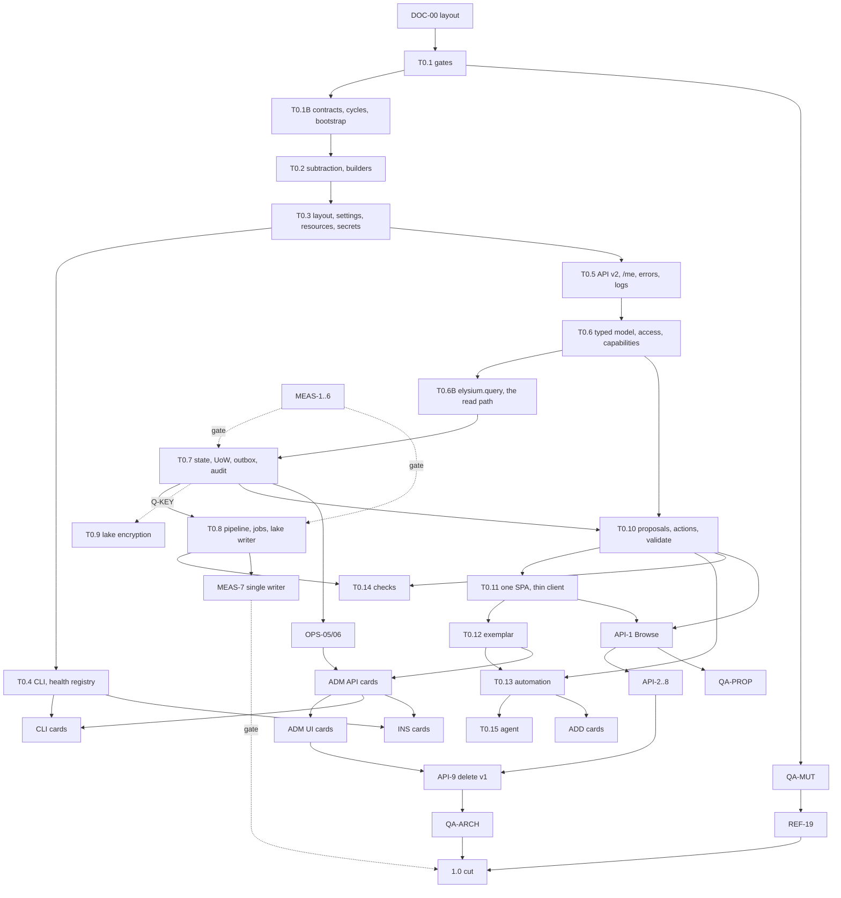

# Elysium roadmap

**The one planning file.** It holds open work only: the design rules, the
production-ready checklist, the invariants, Tier 0, the task cards, what waits
on the owner, the order of work and the worker brief. Decisions are in
`docs/decisions.md` (cited by id: B1, D4, N23); history, measured runs and
consumed lists are in `docs/archive/planning-history.md` (cited as
`archive S6`, `archive item 1`). Finalised 3 November 2026 under the owner's
design direction (N22).

**Status (3 November 2026).** S0, S1 (partly) and S2 are done (commits in the
archive). DOC-00, the repository layout cleanup, is IN PROGRESS. Every other
item is OPEN. Tier 0 starts when the owner says.

**Who builds.** Sonnet-class models, several in parallel (N45). Tier 0 items
are done one at a time, in order, each split into numbered steps that are one
commit each. Cards (section 5) run in parallel inside a wave; no two cards in
a wave own the same file. Every design choice is made here: a worker that
finds a choice not made stops and reports it (section 8).

**Ids.** T0.n (Tier 0), card ids (MEAS-3, ADM-14), decisions (D4, N23), design
rules (DR1-DR7), invariants (I1-I8), checklist rows (P1-P13), owner questions
(Q-KEY). Section titles move; ids do not. Never renumber.

**Labels.** F = fact, with its source. J = judgement. E = estimate.
Unlabelled text is specification. The platform Elysium models is called "the
precedent".

**The name rule (N62).** The name of the precedent's vendor and the names of
that vendor's products must not appear anywhere in the repository (code,
tests, documents, commit messages, file names); write "the precedent". Other
product names (databases, tools, standards, libraries: PostgreSQL, systemd,
Ollama, OpenAPI, Iceberg) are fine. One exception, by an explicit allowlist
entry in the guard: the UI component toolkit Elysium depends on is published
under that vendor's npm scope, so the scope may appear in `ui/package.json`,
`ui/package-lock.json` and in `import` statements under `ui/` and `shell/`,
and nowhere else, because a dependency's package name cannot be changed by
Elysium and renaming the import would break the build. Enforced by
`tests/unit/test_no_vendor_names.py` (T0.1 step 4(e)).

**Design settlement (3 November 2026, pass 1).** The open designs X1-X14 of
the final review are resolved in place (each marked "Resolved: X<n>") with
decisions N46-N65; X8 waits on Q-KEY with both candidate designs written in
T0.9. Missing contracts (C1-C18) are written into the Tier 0 contracts.

Paths: `src/elysium/...` for the package, `docs/...` for documents (N42).
Paths named `core/...` in older text mean `src/elysium/core/...`.

---

## 1. Design philosophy

**The direction (owner, 3 November 2026).** Keep the precedent's defining,
powerful principles, and build a better, more refined system by simplifying
and expanding the power of a few simple parts. The owner illustrated it with
history: Unix took the defining ideas of Multics, a system too massive and
complicated for its own good, and made something more refined by giving a few
simple parts more power. That analogy is an illustration only. Elysium is not
an operating system and borrows none of that vocabulary as design; the rules
below are stated in Elysium's own terms.

**What is kept from the precedent.** Typed objects and links as the model;
actions as the only write; object sets as the query; one place that decides
access, applying mandatory (security attribute, labels) and role-based rules
together; approval before risky change; automations, checks and functions
over the same model; a versioned, discoverable API.

**What Elysium does differently.** Fewer mechanisms, each general; one API
shape for everything; configuration and exports as plain versioned text; a
browser that only renders what the server decided; a small core.

### The design rules

Every Tier 0 item and card names the rules it applies (`DR: 1, 5`). Each rule
has a test, so a rule is a gate and not advice.

**DR1. A few orthogonal primitives, each doing one thing, composing through one
uniform API.**

| Primitive | It is the only way to | Lives in | Not allowed beside it |
|---|---|---|---|
| Object type and link type | describe data | `elysium.metadata` (`ObjectType`, `LinkType`) | per-field links, computed kinds other than `derived` |
| Action | change data | `elysium.actions.apply` | direct writes, write routes, special apply paths |
| Object set | ask for objects (read, count, aggregate, export, subscribe, stored set, automation condition, agent search, similarity) | `elysium.query` | saved views, frozen sets, ad hoc search routes |
| Policy decision point | decide access | `elysium.access.check_access` | grant parsing or role logic anywhere else, including the client |
| Proposal | approve anything | `elysium.proposals` | separate approval queues or stores |
| Automation (condition + effects) | react to change or time | `elysium.automation` | triggers, reminders, alerts as separate modules |
| Check | judge data quality | `elysium.checks` | constraints, standardise, outliers, rules vocabularies |
| Function | compute or propose with code | `elysium.functions` | enriched and predicted property kinds |

Three plumbing primitives carry them: the **resource** (one envelope, one
versioned resource set, N4), the **job** (all long-running work, T0.8) and
the **audit event** (all records of who did what, T0.7).
*Test:* `tests/unit/test_primitives_are_pinned.py` lists every registry
decorator (`@kind`, `@job_kind`, `@proposal_kind`, `@effect_kind`,
`@check_kind`, `@exporter`, `@health_check`, `@function_kind`,
`@outbox_handler`, `@erasable`) and fails when a new registry appears without
a decision id in its docstring (N63). Action effects register with
`@effect_kind` in `elysium.actions.effects`; automation effects are a closed
two-value vocabulary inside `elysium.automation.engine` (no registry); the
agent's `STEPS` is a tuple, not a decorator; set kinds and filter operators
are a closed table in `elysium.query.sets` (no registry).

**DR2. Everything is a resource with the same verbs and the same conventions.**
A list is `GET /api/v2/<res>` returning `{data, nextPageToken}`; one item is
`GET /api/v2/<res>/{id}` with an `ETag`; create is `POST` (201 + `Location`);
update is `PUT` with `If-Match`; delete returns 204; any other operation is
`POST /api/v2/<res>/{id}/<verb>`; long work returns 202 + `Location:
/api/v2/jobs/{id}`; admin resources sit under `/api/v2/admin/<res>`. Lists take
`pageSize`, `pageToken` and, where they filter, the object-set filter grammar
(objects) or flat query parameters named after response fields (everything
else). Errors are RFC 9457 problems with `errorName`, `errorInstanceId`,
`parameters`. Every change is audited as `<area>.<event>` by the router layer,
not by hand in each route.
An operation on a collection or a singleton is `POST /api/v2/<res>/<verb>`.
A singleton (`configuration`, `server`, `lake`, `health`, `setup`,
`overview`) is `GET /api/v2/<res>` and `PUT /api/v2/<res>` with `If-Match`;
`tests/routes_table.py::SINGLETONS` lists them. A write that goes through
`resourceChanges` answers `201 + Location` (create), `200` (update) or `204`
(delete) with the `ChangeReport` as the body when it was applied, and `202 +
Location: /api/v2/proposals/{id}` with the `Proposal` as the body when it was
staged (C5 shapes in T0.10). Path segments are camelCase (`resourceChanges`,
`rebuildOwed`, `recoveryKey`); ids inside paths keep their own spelling. A
write-only secret (`PUT /api/v2/admin/secrets/{name}`) answers 204 and has
no GET. A list never carries a total; `count` on an object set is the one way
to count (N64).
*Test:* `tests/api/test_route_conventions.py`, parametrised over
`tests/routes_table.py::iter_routes(app)`: shape, paging fields, problem
bodies, no-store, audit on every non-GET.

**DR3. Text in, text out.** What Elysium reads is versioned text: one boot
settings file (N3) and resource files with published JSON Schemas (N4). What
it writes for others is deterministic text (N7). The CLI follows modern CLI
conventions: data on stdout, messages on stderr, `--json` on every command,
one exit-code table, `-` reads standard input, `NO_COLOR`, no prompt under
`--no-input`.
*Test:* `tests/cli/test_cli_conventions.py`, parametrised over every
registered command: `--help` has two examples and a "Web UI:" line, `--json`
output parses, errors go to stderr, exit codes come from `ExitCode`.
`tests/unit/test_exports_deterministic.py`: two runs are byte-identical.

**DR4. Mechanism in the core, policy in configuration; a small core, capabilities
in apps and add-ons.** The core knows no role name, label name, section list,
schedule or source; those are resources. Built-in roles are shipped resources
(N27). Anything a single user population needs (geography beyond N18,
inferred identity, time series, market data) is an app or add-on using the
same API.
*Test:* `tests/unit/test_core_holds_no_policy.py` parses `src/elysium/**.py`
outside `init_templates/` and `builtin/` and fails on a string literal exactly
equal to a built-in role name (`"administrator"`, `"operator"`, `"auditor"`)
or a fixture label name (`"pii"`, `"compartment"`); known uses (for example
`"operator"` as a filter key) sit in an allowlist with a reason, which may
only shrink.

**DR5. The server decides, the client renders.** The browser receives only
objects and properties the caller may read, the visible schema, and
server-computed capability booleans and reasons. It never receives grant
grammar, role names, the caller's security attribute value, label names
(unless the caller manages the model or roles, N24), or the `security` rule of
a type. It never infers, filters or re-checks access (N23, N25, N26).
*Test:* `ui/scripts/check_bundle.mjs`, run by `npm run lint` after `npm run
build`: the built `ui/dist/**/*.js` contains none of `manage:`, `read:`,
`discover:`, `execute:`, `apply:`, `module:`, `tool:`, `role_name`,
`mac_value`, `security_values`, and none of the internal names `bronze`,
`silver`, `gold_history`, `.db`, `.yaml`, `_silo` in user-visible strings.
`tests/api/test_me_shape.py` pins `/api/v2/me`'s keys.

**DR6. Prefer deletion.** Every new mechanism replaces or absorbs an existing
one, in the same change. A new primitive, registry or resource kind is allowed
only when all three hold: (a) two or more planned features cannot be expressed
with the existing primitives, written down as the attempt that failed; (b) the
change deletes more lines than it adds, or the owner accepts why not; (c) a
decision entry exists in `docs/decisions.md` before the code merges.
*Test:* the DR1 test (registries pinned); `tools/diffsize.py` prints added and
deleted lines per commit and per card in the hand-off; the reviewer brief
(section 8) asks "what did this delete?".

**DR7. Simpler where it buys simplicity, never at the cost of I1-I8.** Accept
the simpler design when the cost is speed, features or elegance: one SQLite
writer, polling relays, MAC in Python after the engine returns, no spatial
index, no cache until a measurement asks for one, a fixed vocabulary instead
of an expression language. Never accept it when the cost is an invariant:
uniform denial, one decision point, MAC and RBAC on every read, writes only
through actions, re-authorisation at approval, erasure completeness,
read-only sources, no question leaving the machine.
*Test:* `python tools/check_controls.py --coverage` fails when any of I1-I8
has no live control (T0.1, REF-19).

### What the rules changed in this plan

| Was | Now | Rule |
|---|---|---|
| Admin section descriptors carried `requires: [{manage: "backups"}]` (T0.11) | descriptors carry no grants; `/api/v2/me.adminSections` lists ids; bundle guard test | DR5 (N23) |
| `/me` returned "a summary of grants" | named capability booleans only | DR5 (N23) |
| Built-in roles defined in code (N17) | shipped resource files, `origin: builtin` | DR4 (N27) |
| `similarTo` needed a pseudo-action grant | read on embedded properties plus type opt-in | DR1, DR6 (N28) |
| `app:<app>:<id>` string grants and a special access route (ADD-04) | structured grant on an app resource; "may I open" is a GET | DR1, DR2 (N30) |
| `Link` paging headers (API-10) | deleted | DR6 (N29) |
| JSON Schema of action parameters as its own card (REF-STD-JSONSCHEMA) | one more output of the `schemas` exporter (ADM-22) | DR6 |
| Diagnostics bundle as its own card (ADM-25) | route in OPS-04, button in ADM-18 | DR6 |
| Simulator CI job twice (CI-03 and REF-18A) | REF-18A owns it | DR6 |
| `cli.md` generated by both CLI-HELP and DOC-03 | DOC-03 generates every reference page | DR6 |
| Internal-name scan of the bundle (REF-UI-1) and grant scan (T0.11) | one bundle guard (`ui/scripts/check_bundle.mjs`) | DR6 |
| Doctor "checks" beside data "checks" | doctor and server diagnostics are `@health_check` (N31) | DR1 |
| Approval and sync code that mixes decisions with I/O | pure planning functions plus a unit of work and an outbox (N34) | DR1, DR7 |
| ~1,166 hand controls proving everything | mutation score for mechanics, hand controls for invariants (N39) | DR6, DR7 |

---

## 2. Goal, checklist and invariants

**Goal.** An operator who has never seen Elysium installs it in minutes,
finishes setup in a browser and runs it from the web UI; the CLI covers the
same tasks plus those that must work while the server is down. What Elysium
reads is kept apart from what it writes for others, and both are documented.
Every invariant is proved by a test that fails when the guarantee breaks.

**Where it stands (F, 3 November 2026).** Install is a root-only script plus
about 17 manual steps (`install/install.sh`). Configuration is seven YAML
files in four copies. The first user needs `python -m
elysium.scripts.bootstrap_root`. There are 45 scripts in
`src/elysium/scripts/` and `elysium` is a stub (`src/elysium/cli.py`).
`src/elysium/api/routes.py` is 10,646 lines; five more modules exceed 2,000.
Engineering measurements (F, research of 3 November): 186 broad exception
handlers, 52 of them turning failure into absence; 32% of functions partly
annotated, mypy not strict; 3 import cycles; `deployment_loader` has fan-in 45
and fan-out 65; 17 property tests of 6,972; no coverage gate; no stored
mutation score; unit plus integration suite about 31 minutes on 2 CPUs.

**Production ready when** (the owner ticks a row when the named items are
merged and their acceptance commands pass):

| # | Production ready when | Proved by | Items |
|---|---|---|---|
| P1 | **Install in minutes**: `docker compose up -d` (or `.deb`/`.rpm`, or `uv tool install`) and a browser, no hand-edited file | CI starts the container from nothing and completes setup over HTTP | INS-02..06, CI-06 |
| P2 | **First-run web setup**: one-time setup URL, wizard creates the first administrator, connects a source, picks the model server, sets schedules, locks itself | e2e wizard test; API test that the token is single-use and expires | ADM-01, ADM-02, CLI-SETUP |
| P3 | **Every admin task in the UI** | an e2e spec per section; ADM-26 (every admin route has a UI caller) | T0.12, ADM-*, API-* |
| P4 | **A coherent CLI** | `tests/cli/test_cli_conventions.py`; generated reference current | T0.4, CLI-* |
| P5 | **Documented IN and OUT** | `elysium export --check` and the reference-currency test in CI | T0.3, ADM-22, DOC-03 |
| P6 | **Backups and restore tested**; erasures survive a restore | CI round trip | OPS-05..07, CI-06 |
| P7 | **Upgrades with migrations** (from 1.0) | upgrade test from the previous release's image | OPS-08, OPS-09 |
| P8 | **Health and doctor** on one registry | each health check has a test that makes it fail | T0.5, OPS-01..04, ADM-18 |
| P9 | **Audit readable**, hash chain, `elysium audit verify` | tamper test | T0.7, ADM-14, ADM-15 |
| P10 | **Security findings closed** in `docs/security/findings.csv` and `docs/security/audit-checklist.csv` | `tests/unit/test_findings_are_closed.py` | SEC-A..G |
| P11 | **Invariants proven**: I1-I8 each have a live control | `tools/check_controls.py --coverage` | T0.1, REF-19 |
| P12 | **Supported surface stated** | support matrix in `docs/install.md`, tested where a machine allows | DOC-01, Q-SUPPORT |
| P13 | **Design rules and quality gates enforced**: DR1-DR7 tests green; import-contract ignore list empty; strict-typing list covers every package outside `core/`; coverage and mutation scores stored and not below their ratchet; comment-lint baseline empty; bundle guard green | `./check.sh --full` and `tools/quality_report.py` | T0.1, T0.1B, QA-*, REF-19 |

### Security invariants (every item and card keeps them)

| # | Invariant | Proved by |
|---|---|---|
| I1 | **Uniform denial.** Unknown and unreadable look identical (types, keys, properties, proposals, actions, admin routes, validate calls). | byte-equal 404 bodies for unknown and denied, parametrised over the route table; no distinguishing audit write visible to the caller |
| I2 | **Authorisation in one place.** | import-linter (T0.1B layers, N48): `api`, `agent`, `automation`, `functions`, `apps`, `cli` read objects only through `elysium.query` and write only through `elysium.actions` (and stage through `elysium.proposals`); only `elysium.query.reader` calls `check_access` for objects; only `elysium.access` calls `authorize`; only `elysium.access` produces `readable`, `executable` or `can*` booleans |
| I3 | **MAC and RBAC on every read**, including expand, links, history, export, aggregate, subscriptions, automations, frames and the agent. | per-id `check_access` in the reader; route-table denial test; model validator (`security` or `unrestricted: true`); subscription keys filtered per recipient |
| I4 | **Writes only through actions.** | forbidden-import contract; `resource_versions` never writes object rows; function proposals and quarantining checks land through a system action |
| I5 | **Re-authorisation at approval.** | per proposal kind: revoke the approver's grant between propose and approve; approval returns the uniform refusal; one row per safeguard in the safeguard table |
| I6 | **Erasure completeness.** | `Erasable` registry test; lake keys derivable from ledger plus schema; table-driven `layer_of`/`iter_tables`; never-narrow rule |
| I7 | **Read-only source access.** | a write through the SQLite dialect is refused; PostgreSQL and MariaDB read-only sessions |
| I8 | **No question leaves the machine.** | the installed wheel has no adapter able to reach a hosted model; no exporter |

Supporting invariants, carried by the same tests: CSRF (cookie without header
403; cookie plus bearer refused; bearer alone allowed); constant-time compare
and login throttle; routes never read `app.state.generation`; no-store by
default; audit fail-closed and append-only; the agent stages only.

**Rule for every item (J).** A control is deleted only with the code it
guards. Each commit lists controls added and deleted and invariants touched.
An item touching I5 or I6 gets a second fresh-reader review aimed at that
invariant only. Security work starts with a threat note and failing negative
tests (N32).

---

## 3. Layout

### 3.1 The repository (DOC-00: DONE-in-progress, a worker does it next)

```
README.md            short introduction: what Elysium is, quick start, links (under 80 lines)
LICENSE  AGENTS.md  CLAUDE.md
pyproject.toml  pytest.ini  .gitignore  .github/  check.sh (T0.1; lint.sh until then)
uv.lock (T0.1; the requirements* files until then)  vulture_whitelist.py
docs/
  roadmap.md                 this file (was ROADMAP.md)
  decisions.md               every decision, ADR-lite (new)
  principles.md              was PRINCIPLES.md
  rules.md                   was RULES.md
  install.md                 was INSTALL.md
  security/architecture.md   was SECURITY_ARCHITECTURE.md
  security/findings.csv      was FINDINGS_security.csv
  security/audit-checklist.csv   was AUDIT_CHECKLIST.csv
  ui/development.md          was DEV_UI.md (holds the measured palette, type scale, density; never delete)
  archive/planning-history.md    old ROADMAP.md section 8 and other history
  reference/                 generated (DOC-03)
  operator/  addons/         written by DOC-02, DOC-07
src/ tests/ ui/ sim/ sdk/ shell/ (until T0.11) deployment/ install/ templates/ (until T0.3, INS-04)
```

The four `001*.txt` briefs leave in DOC-00, after checking that E-03, E-06,
E-07, E-14, NEW-1, NEW-2, NEW-3 and F-18 each have a row in
`docs/security/audit-checklist.csv` (F: E-06, E-14, F-18, NEW-1..3 have rows;
add E-03 and E-07 if missing). That closes SEC-06 and SEC-11.

### 3.2 IN: what Elysium reads

```
/etc/elysium/                     # container: /config     uv/dev: $XDG_CONFIG_HOME/elysium
  elysium.toml                    # boot settings (N3)
  secrets/                        # 0700, files 0400 (N6): master-key, backup-key, silo-<name>-password
  resources/                      # optional, file-provisioned, read-only in the UI (N4)
    silos/warehouse.yaml          #   kind: Silo
    object-types/customer.yaml    #   kind: ObjectType (a file may also hold its LinkTypes and ActionTypes)
    link-types/  action-types/  functions/  automations/
    roles/analyst.yaml            #   kind: Role
    apps/astrolabe.yaml           #   kind: App
    configuration.yaml            #   kind: Configuration
  schemas/                        # written by `elysium init` and `elysium resource schemas --write`
    silo.schema.json ...          #   one per kind, the target of each file's modeline
```

**One layout for IN and OUT (N65, C18).** `<dir>/<plural kind>/<name>.yaml`
with plurals `silos`, `object-types`, `link-types`, `action-types`, `roles`,
`functions`, `automations`, `apps`, and `configuration.yaml` at the top.
`resources.load_dir` reads every `*.yaml` under the directory recursively
(an operator may group a type with its links in one file); the `resources`
exporter writes the canonical layout, one resource per file, so
`exports/resources/` is a valid `resources/` directory. `elysium init` writes
`<config>/schemas/`; `elysium resource validate` warns (`E_SCHEMAS_STALE`,
exit 0) when those schemas differ from the running version's. Builtin- and
app-origin resources are never exported. Proof:
`tests/unit/test_exports_roundtrip.py::test_export_then_apply_is_a_no_op`.

`elysium.toml` (a typical install, complete):

```toml
# elysium.toml -- boot settings. Runtime settings live in Admin > Configuration.
# Every key can be overridden by ELYSIUM_<SECTION>__<KEY>, e.g. ELYSIUM_SERVER__LISTEN.
[server]
listen = "127.0.0.1:8000"
public_url = "https://elysium.example.org"
trusted_proxies = []
cookie_secure = true
workers = 2                                    # web worker processes (N47); the runner is one more
ip_allow = ["10.0.0.0/8", "172.16.0.0/12", "192.168.0.0/16"]   # INS-04's IPAddressAllow

[paths]
state = "/var/lib/elysium"                    # alias: ELYSIUM_STATE
resources = "/etc/elysium/resources"
secrets = "/etc/elysium/secrets"

[storage]
volume_encrypted = false
lake_encryption = false                       # removed by T0.9 (encryption always on)
master_key = { secretRef = "master-key" }

[backup]
key = { secretRef = "backup-key" }

[log]
level = "info"
```

Resource examples (the format of `archive` plan section 1.4: `type:` is the
data type, `derived:` the only computed kind, links only as links, v2
operators, `approval:` on every action, structured grants, `backing:` last):

```yaml
# yaml-language-server: $schema=../../schemas/silo.schema.json
apiVersion: elysium/v1
kind: Silo
metadata: { name: warehouse, description: Finance warehouse, read-only replica }
spec:
  adapter: sqlalchemy            # sqlalchemy | csv | rest
  url: postgresql://elysium_ro@wh.internal:5432/analytics   # never a password
  password: { secretRef: silo-warehouse-password }
  incremental: { column: updated_at }
  locale: en-GB
  queryTimeoutSeconds: 30
  terms: { licence: internal, attribution: "Finance team", commercial: true }
---
apiVersion: elysium/v1
kind: ObjectType
metadata: { name: Customer, description: A person or company that buys from us }
spec:
  key: customer_id
  title: full_name
  security: { property: region }          # or { via: account }, or { unrestricted: true }
  properties:
    customer_id: { type: string }
    full_name:   { type: string }
    region:      { type: string, labels: [compartment] }
    email:       { type: string, labels: [pii] }
    lifetime_value: { type: decimal, derived: { sum: { link: transactions, property: amount } } }
  checks:
    - { target: email, kind: pattern, config: { regex: "^[^@]+@[^@]+$" }, severity: moderate, onFail: warn }
  similarity: { properties: [full_name] }   # opt-in for similarTo (N28); absent = not searchable by similarity
  backing: { silo: warehouse, table: customers, key_column: customer_id }
---
apiVersion: elysium/v1
kind: LinkType
metadata: { name: transactions }
spec: { from: Customer, to: Transaction, cardinality: many, backing: { foreign_key: customer_id } }
---
apiVersion: elysium/v1
kind: ActionType
metadata: { name: flag-customer }
spec:
  approval: confirm                       # none | confirm | second_person (D17)
  parameters: { customer: { type: object, objectType: Customer }, reason: { type: string } }
  criteria: [ { all: [ { eq: [ "$customer.region", "$user.region" ] } ], message: "Only customers in your region can be flagged." } ]
  effects:
    - modify: { object: $customer, set: { flagged: true, flagged_by: $user.id } }
---
apiVersion: elysium/v1
kind: Role
metadata: { name: analyst }
spec:
  grants:
    - { verb: read, type: Customer, properties: [customer_id, full_name, region] }
    - { verb: discover, type: Transaction }
    - { verb: apply, action: flag-customer }
    - { verb: read, appResource: astrolabe/terrain }   # N30
  manage: []                              # users | roles | deployment | model | audit | backups | erasure
---
apiVersion: elysium/v1
kind: Configuration
metadata: { name: default }
spec:
  llm: { server: ollama, baseUrl: "http://127.0.0.1:11434", model: phi4-mini, timeoutSeconds: 600 }
  timeZone: Europe/London                 # IANA; schedules and automation times are read in it (N53)
  schedules:
    - { job: sync, when: { hourly: { minute: 17 } } }
    - { job: backup, when: { daily: { time: "02:41" } }, keep: 14 }
  sessions: { idleMinutes: 30, absoluteHours: 12 }
  limits: { bulkActionLimit: 20 }
---
apiVersion: elysium/v1
kind: App
metadata: { name: astrolabe }
spec:
  enabled: true
  server: { command: ["astrolabe-server"], options: { feedKey: { secretRef: astrolabe-feed-key } } }
  offeredTo: [analyst]
  ontology: { prefix: Astro, resources: share/astrolabe/ontology/ }
  gated: [ { id: terrain, title: Terrain tiles } ]
```

Every kind's JSON Schema is generated from its pydantic model into
`exports/schemas/<kind>.schema.json`; `elysium init` writes the modeline into
every file it scaffolds. Built-in roles ship as
`src/elysium/builtin/roles/{administrator,operator,auditor}.yaml` (N27).

### 3.3 OUT: what Elysium produces for others

| Artefact | Where | Format | Deterministic | Produced by |
|---|---|---|---|---|
| Data contracts | `exports/contracts/<Type>.odcs.yaml` | ODCS v3.2 | yes | `elysium export`, `GET /api/v2/exports/contracts/{type}` |
| Schemas | `exports/schemas/<kind>.schema.json`, `elysium.toml.schema.json`, `exports/schemas/actions/<action>.schema.json` | JSON Schema 2020-12 | yes | export |
| The resource set | `exports/resources/<kind>/<name>.yaml` | the IN envelope, importable, no derived fields | yes | export, `elysium model export` |
| API description | `exports/openapi.json` (copy of `src/elysium/api/v2/openapi.json`) | OpenAPI 3.1 | yes | export, build |
| Access review | `exports/access-review/grants.csv`, `members.csv` | CSV | yes, per version | export (`manage:audit`) |
| Manifest | `exports/manifest.json` | files, sha256, resource-set version | yes | export |
| Audit log | `<state>/audit/audit-YYYY-MM.jsonl` | JSONL, `v`, `category`, hash chain; OCSF as an extra export | stream | server |
| Lineage | `<state>/audit/lineage-YYYY-MM.jsonl` | OpenLineage RunEvents | stream | sync jobs |
| Backups | `<state>/backups/<id>.elysium-backup` | encrypted archive with manifest | n/a | backup job |
| Diagnostics | `elysium-diagnostics-<host>.tar.gz` | redacted settings, health results, versions, log tail | n/a | `elysium doctor --bundle`, Admin > Health |

### 3.4 State: what Elysium owns and nobody edits

```
/var/lib/elysium/                 # container: /data   uv/dev: $XDG_STATE_HOME/elysium
  elysium.db  erasure.db  scratch.db     # D4; WAL; PRAGMA user_version stamped (N35)
  lake/catalog.db  lake/warehouse/        # Iceberg; bronze, changelog, gold, gold_history (+silver if D9 keeps it)
  audit/                                  # audit-*.jsonl, lineage-*.jsonl; backed up, never rolled back
  backups/  exports/  addons/<app>/  secrets/ (*.enc, N6; page-token.key, X1)
  run/                                    # server.lock, runner.lock, state.lock, lake-writer.lock,
                                          # restore-pending.json, restore-journal.json (N47, N55)
  .restore-new/  .restore-old/            # exist only during a restore (N55)
```

**Locks (N47).** Every lock is an exclusive `flock` on a file in `run/`,
released by the kernel when its holder dies. `server.lock`: held by the
`elysium server run` supervisor for its lifetime. `runner.lock`: held by the
runner process. `lake-writer.lock`: held by a job while it writes the lake
(and by a backup while it copies it). `state.lock`: held by a local (L) CLI
command while it runs; two local commands serialise on it; the server never
takes it. An L\* command also takes `server.lock` non-blocking and keeps it
for its run (exit 6, `E_SERVER_RUNNING`, when held), so the server cannot
start under it.

### 3.5 Environment variables

| Variable | Status | Meaning |
|---|---|---|
| `ELYSIUM_CONFIG`, `ELYSIUM_STATE`, `ELYSIUM_<SECTION>__<KEY>` | new | settings file, state alias, one override |
| `CREDENTIALS_DIRECTORY`, `STATE_DIRECTORY`, `CONFIGURATION_DIRECTORY` | read | set by systemd |
| `ELYSIUM_URL`, `ELYSIUM_PROFILE`, `ELYSIUM_TOKEN_FILE`, `ELYSIUM_NO_INPUT`, `NO_COLOR` | new, CLI | client side |
| `ELYSIUM_TOKEN` | new, CLI | CI only; the one exception to N6 |
| `ELYSIUM_ADDON_START`, `PORT` | kept | set by the supervisor for add-ons |
| `ELYSIUM_SUPERVISED` | new, set by the service manager | `1` under INS-02's entrypoint and INS-04's unit: exit code 75 means "restart me", so `GET /api/v2/admin/server` reports `restartable: true` |
| `ELYSIUM_CONFIG_DIR`, `ELYSIUM_DATA_DIR`, `ELYSIUM_LOG_DIR`, `ELYSIUM_COOKIE_SECURE`, `ELYSIUM_STORAGE_ENCRYPTION`, `ELYSIUM_BACKUP_KEY_FILE`, `${VAR}` | **deleted** in T0.3 | replaced by the TOML above |

Files that go (F, they exist today): `deployment/` (etc, var, logrotate),
`install/install.sh`, `templates/*.yaml` (replaced by `elysium init`
templates), `config.yaml`, `data_silos.yaml`, `ontology_schema.yaml`,
`source_bindings.yaml`, `policy.yaml`, `modules.yaml`, `addons.yaml`,
`example_queries.yaml` (to the dev plugin), every `module.json` and
`module.conformance.json` (T0.11), `requirements*.txt` and `*.lock` (T0.1).

### 3.6 The CLI tree (N8)

Mode: **A** = through the server's API (default); **L** = local; **L\*** =
local and refuses (exit 6) while the server runs.

```
elysium
  version                                   A/L
  completion bash|zsh|fish|powershell       L    prints the script; never edits rc files
  init [--demo] [--system|--user|--container] [--dir D]   L
  settings show|validate|path               L    values and their source; secrets redacted
  server run                                L
  service install|uninstall|status [--user] L
  setup url|status                          L
  doctor [--fix] [--bundle FILE]            L    local health checks, plus the server's when reachable
  auth login|logout|status|whoami           A
  resource validate PATH                    L
  resource list|show|diff|apply|adopt       A    apply [--prune] [--dry-run]
  model versions|show|diff|export|restore   A
  source list|show|create|update|delete|test|tables   A
  configuration show|get|set                A
  sync run|status|history                   A    run [--source S] [--table T] [--full] [--rebuild TYPE] [--wait]
  job list|show|cancel|wait|logs            A
  lake status|verify|rebuild                A
  lake repair                               L*
  lake key check|export|import|rotate       L*
  user list|show|create|update|disable|enable|delete|set-password   A
  user reset-password NAME                  L
  role list|show|create|update|delete|grant|revoke   A
  token list|create|revoke                  A    create NAME [--read TYPE[.PROP]]... [--discover TYPE]... [--apply ACTION]... [--manage AREA]... [--expires-in-days N] [--for USER] (N50)
  proposal list|show|approve|reject         A
  erasure request|list|show|cancel          A
  backup create|list|show|verify|download|prune   A   (create --local: L)
  backup restore FILE                       L*   (--stage: A, applied at next start, N13)
  audit list|show|export|verify             A    (verify --local: L)
  export [--out DIR] [--check] [--only KIND]   A  (--local: L)
  app list|show|enable|disable|restart|logs A
  logs [--follow] [--level L]               A
  object get|history TYPE KEY               A
  help exit-codes|settings|resources|tiers  L
  dev ...                                   only with elysium-dev: reset, seed, users, openapi, docs, controls, bench, sim
```

Global flags: `--json`, `-q`, `-v`, `--no-color`, `--no-input`, `--profile`,
`--url`, `--config`, `-h`, `--version`. State-changing commands also take
`-n/--dry-run` and `-y/--yes`; severe ones need `--confirm SUBJECT`.

**Exit codes** (`elysium help exit-codes`):

| Code | Meaning | Examples |
|---|---|---|
| 0 | success | |
| 1 | unexpected failure | a bug; prints a bug-report hint |
| 2 | usage error | unknown flag, missing argument |
| 3 | not found (also uniform denial) | unknown or unreadable user, type, job |
| 4 | not signed in or token rejected | 401 |
| 5 | unavailable | server unreachable, timeout, master key missing, no settings file |
| 6 | conflict or precondition | lock held; server running for L\*; stale base version; confirmation needed under `--no-input` |
| 7 | partial success | some tables synced, some failed |
| 8 | check failed | `validate`, `doctor`, `verify`, `export --check` found problems |
| 130 | interrupted | Ctrl-C |

With `--json`, errors go to stderr as `{"error": {"code": "E_SYNC_LOCKED",
"message": ..., "hint": ...}}`.

**Confirmation tiers:**

| Tier | Commands | Rule |
|---|---|---|
| read | `list`, `show`, `status`, `verify`, `diff` | no prompt |
| reversible | `sync run`, `resource apply` without `--prune`, `export`, `backup create`, `token create` | no prompt; `--dry-run` where meaningful |
| moderate | `user disable`, `role revoke`, `token revoke`, `lake rebuild`, `app disable`, `resource apply --prune`, `job cancel`, `proposal reject` | prompt on a TTY or `--yes`; under `--no-input` without `--yes`: exit 6 naming the flag |
| severe | `erasure request`, `user delete`, `backup restore`, `lake key rotate\|import`, `model restore` | prints the plan, needs `--confirm <exact subject>` even with `--yes`; checked again on the server; audited; approval policy still applies |

Every state-changing command prints what changed and the web-UI URL of it.

---
## 4. Tier 0: core-wide work, in order

Tier 0 is the work every card stands on. One worker does one item at a time,
in the order below, one numbered step per commit; the next step starts when
the previous one's acceptance passes. Each item ends with a **contract** that
later cards build on without redesign. Line-level evidence for each item
(file:line, counts, what each deletion weighs) is in the archive under the
step named in the "Archive" line; the scope here is authoritative.

| # | Item | Archive | DR | Risk | Size (E) |
|---|---|---|---|---|---|
| T0.1 | Gates, packaging, controls format, working rules as scripts | S1 rest, S19 format | 6, 7 | low | 1.5 wk |
| T0.1B | Architecture contracts, import cycles, composition root | new (N33) | 1, 4 | low | 1 wk |
| T0.2 | Compatibility subtraction and test builders | S3, S4 | 6 | low | 1 wk |
| T0.3 | Layout: settings, state paths, resource envelope, secrets | S17 paths half | 3, 4 | med | 1.5 wk |
| T0.4 | CLI framework, command registry, health-check registry | S16 skeleton | 2, 3 | low | 1 wk |
| T0.5 | API v2 plumbing, `/me`, errors, logs, tokens, OpenAPI, clients, health | S5 | 2, 5 | HIGH (I2, CSRF) | 2 wk |
| T0.6 | Typed model, structured grants, one policy decision point, capabilities | S6 | 1, 4, 5 | HIGH (I1, I3) | 3-5 wk |
| T0.6B | Object sets: `elysium.query`, the only read path | new (N46; absorbs REF-MED) | 1, 7 | HIGH (I1, I2, I3) | 2 wk |
| T0.7 | State: SQLite discipline, unit of work, outbox, audit chain, erasure ledger | S7 | 1, 7 | HIGH (I6) | 2-3 wk |
| T0.8 | Pipeline, jobs, schedules, single lake writer, SEC-01 | S8 | 1, 7 | HIGH (I7) | 2-3 wk |
| T0.9 | Lake encryption with a movable key (gated on Q-KEY) | item 1 | 7 | med | 1-1.5 wk |
| T0.10 | Proposals, resource set, provisioning, actions with validate | S9 | 1, 2, 5 | HIGHEST (I4, I5) | 3-4 wk |
| T0.11 | One SPA and the admin shell, thin client | S11 | 5 | low | 1.5-2 wk |
| T0.12 | Exemplar resource end to end: people, roles, tokens | S10 commit 2 | 2, 3 | HIGH (I1, I3) | 1.5 wk |
| T0.13 | One automation model and subscriptions | S12 | 1 | med (I3) | 2 wk |
| T0.14 | One checks model | S13 | 1 | med | 2 wk |
| T0.15 | Agent on the service layer | S15 | 1, 2 | med (I2, I8) | 2 wk |

Total serial (E): 7-9 months. Cards start as soon as the items they depend on
are merged (section 7).

**Gates for every Tier 0 step:** `./check.sh --fast -k <tests of the step>`
then `tools/heavy.sh ./check.sh --full` pass; `python tools/check_controls.py`
reports nothing retired without a deletion; once they exist,
`tests/api/test_openapi_is_current.py` and `cd ui && npm run gen:client --
--check` pass; every new module is strict through T0.1's package globs (N38,
N59; nobody edits a list);
`tools/diffsize.py` is within N32 or the commit carries `Large-change:`; the
commit lists controls added and deleted and invariants touched. A step that
touches I1-I8 first commits its threat note (`docs/security/threats/<item>.md`,
at most one page: what an attacker could do, which test proves it cannot) and
its failing negative tests, then the code.

### T0.1 Gates, packaging, controls format, working rules as scripts

- **Why first.** Every later step runs the gates and adds controls and
  dependencies. The controls are one 9,893-line file
  (`src/elysium/scripts/check_controls.py`, 1,166 records); dependencies are
  four hand-synchronised files; the working rules are prose that gets skipped.
- **DR:** 6, 7. **Decisions:** N14, N15, N32, N37, N38, N39, N40.
- **Steps.**
  1. **`./check.sh` and the run wrappers.** `check.sh [--fast|--full|--area A] [-k EXPR]`:
     POSIX `sh` is not enough for `pipefail`; write it in bash with `set -euo
     pipefail`; it runs every step even after a failure (collects statuses),
     prints a summary table `step | exit | seconds`, and exits non-zero if any
     step failed. Steps: ruff, mypy, vulture, import-linter, `uv lock --check`
     (after step 2), `tools/lint_comments.py --check`, `tools/diffsize.py`
     (report only in `--fast`), pytest (focused with `-k` in `--fast`, all in
     `--full`), controls, and the UI gate (`cd ui && npx vitest run && npm run
     lint`). `lint.sh` is deleted; every reference to it (AGENTS.md, CLAUDE.md,
     `.github/workflows/ci.yml`, `docs/rules.md`) points to `./check.sh`.
     `tools/heavy.sh NAME CMD...`: runs under `nice -n 10` and `timeout`
     (default 1,800 s), writes all output to `.heavy/<utc>-<NAME>.log` and the
     exit code to `.heavy/<utc>-<NAME>.exit`, prints the last 60 lines and the
     exit code, exits with it. `.heavy/` is git-ignored. No other way to run a
     long command in the background is allowed (worker brief, section 8).
     Accept: `tests/unit/test_check_sh.py::test_failing_step_fails_the_run`
     (a fake step that exits 3 inside a pipe makes `check.sh` exit non-zero),
     `::test_summary_lists_every_step`; `tests/unit/test_heavy_sh.py::test_exit_code_is_recorded`.
  2. **Packaging (N14).** `[project.dependencies]` and
     `[project.optional-dependencies]` (`identity`, `tui`, `dev`) in
     `pyproject.toml`; `uv.lock`; hatchling with `hatch-vcs`; a build hook
     running `npm ci && npm run build` that ships `ui/dist` as
     `elysium/ui_dist/`. Delete `requirements.txt`, `requirements.lock`,
     `requirements-dev.txt`, `requirements-dev.lock` and
     `src/elysium/scripts/check_lockfiles.py`. Accept: `uv lock --check`; `uv
     build` produces a wheel containing `elysium/ui_dist/index.html`
     (`tests/unit/test_wheel_contents.py`, marker `live`).
  3. **Controls format.** Records become `controls/<area>/<ID>.toml` (areas:
     `access api cli config state index actions automation checks agent ops ui
     install`; legacy records go to `controls/legacy/<module>.toml`). Fields:
     `id`, `invariant` (`I1`..`I8`, a supporting invariant name, or `none`),
     `kind` (`semantic` or `mechanical`), `path`, `old`, `new`, `tests`,
     `expect = "fails"`. `kind` is set by `tools/classify_controls.py`:
     `mechanical` when the edit is a condition forced to `True`/`False`, a
     statement replaced by `pass` or a bare `return`, or a single-token swap
     (F: about 470-600 of 1,166); otherwise `semantic`. The runner moves to
     `tools/check_controls.py` (about 150 lines) and keeps today's behaviour: a
     control passes only if pytest exits with *failure* and every cited test
     exists; anchors are found by content; a vanished anchor is "retired" and
     needs an explicit deletion. Flags: `--area`, `--card`, `--coverage` (table
     I1-I8 to live controls; fails when an invariant has none), `--kind`.
     Accept: the full set fires before and after conversion with equal counts
     (`python tools/check_controls.py --summary` before, quoted in the commit);
     `tests/unit/test_check_controls.py` moved and passing.
  4. **Quality gates as configuration.** (a) ruff `select` adds `BLE`, `S`,
     `C901` (max complexity 15 for new code); today's offenders are listed per
     file in `[tool.ruff.lint.per-file-ignores]`, generated by
     `tools/ruff_baseline.py --write`; `tests/unit/test_ruff_ignores_shrink.py`
     fails when the generated list gains an entry (baseline in
     `quality/ruff-ignores.txt`). The 173 inert `noqa: BLE001` comments become
     live. (b) Strict typing by package glob, written once here and never
     edited by a card (N59): one `[[tool.mypy.overrides]]` block with
     `strict = true` and `module = ["elysium.access.*", "elysium.query.*",
     "elysium.actions.*", "elysium.proposals.*", "elysium.metadata.*",
     "elysium.resources.*", "elysium.db.*", "elysium.audit.*",
     "elysium.jobs.*", "elysium.runner.*", "elysium.ops.*",
     "elysium.exports.*", "elysium.cli.*", "elysium.erasure.*",
     "elysium.index.*", "elysium.automation.*", "elysium.checks.*",
     "elysium.agent.*", "elysium.apps.*", "elysium.keys.*",
     "elysium.functions.*", "elysium.service.*", "elysium.builtin.*",
     "elysium.settings", "elysium.paths", "elysium.paging", "elysium.secrets", "elysium.errors",
     "elysium.bootstrap", "elysium.logging_json", "elysium.api.v2.*"]`. A
     package that does not exist yet costs nothing. `quality/strict-modules.txt`
     lists only legacy `elysium.core.*` and `elysium.api.*` (v1) modules made
     strict, feeds a second override block generated by `tools/mypy_strict.py
     --write`, and may only grow (`tests/unit/test_strict_modules_only_grow.py`);
     cards never edit it. `quality/ruff-ignores.txt` and
     `quality/comment-lint-baseline.txt` are generated files
     (`tools/ruff_baseline.py --write`, `tools/lint_comments.py
     --write-baseline`): a merge conflict in them is resolved by regenerating,
     like `openapi.json`. mypy's `files` gains `tests/` with
     `check_untyped_defs = false` for tests. (c)
     `tools/lint_comments.py`: flags in `src/**.py` comments and docstrings the
     patterns `\b(GOLD|WIRED|DEP|AUD|SEC|AL|BLK|R|E|LB|NEW|F)-\d+`, dates (`\d{1,2}
     (January|...|December)`, ISO dates), names of planning files (`ROADMAP`,
     `BLOCKING`, `HOT_RELOAD`, `SCALABILITY`, `planning file`, `step \d+[a-z]?`),
     and conversation (`the owner`, `I said`, `this session`, `reviewer said`);
     current hits go to `quality/comment-lint-baseline.txt` (path:line-hash);
     `--check` fails on a hit not in the baseline. (d) `[tool.coverage]` with
     branch coverage, `source = ["src/elysium"]`; measured only (the gate is
     QA-COV). (e) Name guard (N62): `tests/unit/test_no_vendor_names.py`
     tokenises every tracked text file, every tracked path and, in the
     `commit-msg` hook, the message, and compares the sha256 of each
     lower-cased word and word pair with a fixed list of hashes (the vendor's
     name and its product names), so the forbidden names never appear, not
     even in the test. `ALLOWED = {"<sha256 of the toolkit scope>":
     ("ui/package.json", "ui/package-lock.json", "import:ui/**",
     "import:shell/**")}`: the one entry, with the comment "the UI component
     toolkit is published under this scope; a dependency's package name cannot
     be changed here", lets the hashed scope token pass only in those two files
     and on lines that are `import`/`export ... from` statements in `.ts`,
     `.tsx`, `.css` files under `ui/` and `shell/`; anywhere else it fails. The
     two test files named after the toolkit are renamed in this step
     (`ui/src/toolkit-smoke.test.tsx`, `ui/src/toolkitSurface.test.ts`). The
     allowlist may only shrink (`::test_allowlist_has_one_entry`). Accept:
     each of (a)-(e) has a test that
     fails when its gate is broken on purpose (a new broad `except`, a module
     removed from the strict list, a comment `# see GOLD-9`, a coverage config
     missing, a planted forbidden word in a temp file).
  5. **Hooks and size.** `tools/diffsize.py [--base REF]`: added and deleted
     lines per commit excluding generated paths (`*.lock`, `openapi.json`,
     `schema.d.ts`, `docs/reference/**`, `controls/**`); exits 8 when one commit
     changes more than 1,000 lines unless its message has a `Large-change:`
     line. `.githooks/pre-commit` runs the name guard, `lint_comments.py
     --check --staged` and ruff on staged files; `.githooks/commit-msg` runs
     the 72-column check and `diffsize.py --commit-msg`; `git config
     core.hooksPath .githooks` is printed by `tools/setup_dev.sh`.
     `.claude/settings.json` declares the same checks as agent hooks
     (PreToolUse on `git commit`). Accept: `tests/unit/test_diffsize.py`,
     `tests/unit/test_hooks.py::test_pre_commit_refuses_vendor_name`.
  6. **Pytest markers by directory (N58).** Resolved: X14. `fast`, `api`,
     `lake`, `live` registered in `pytest.ini`; `tests/conftest.py::
     pytest_collection_modifyitems` adds them by path: `tests/unit/`,
     `tests/cli/`, `tests/property/` -> `fast`; `tests/api/` -> `api`;
     `tests/integration/` -> `lake`; a test explicitly marked `live` keeps
     only `live`. No test moves directory, ever; CI-07 splits the matrix with
     `-m`. Accept: `tests/unit/test_markers_by_directory.py` (a fixture tree
     collects with the expected markers).
- **Deletes.** `src/elysium/scripts/check_controls.py`, the requirements files,
  `check_lockfiles.py`, `lint.sh`.
- **Invariants.** Every control that fired before still fires (equal counts).
- **Preconditions.** S1 (done), DOC-00 (paths in `docs/`).
- **Out of scope.** Pruning controls (REF-19); running mutmut (QA-MUT);
  fixing the baselined ruff, comment or typing findings (they burn down with
  each item and in QA-*). There is no tests directory split (N58).
- **Contract.**
  - `controls/<area>/<CARD-ID>.toml`; a worker adds a file and never edits
    another card's file.
  - Commands: `./check.sh --fast -k EXPR`, `./check.sh --full`, `tools/heavy.sh
    NAME CMD`, `python tools/check_controls.py --card ID`, `tools/diffsize.py`.
  - Baselines in `quality/` only shrink: `ruff-ignores.txt`,
    `strict-modules.txt` (only grows), `comment-lint-baseline.txt`, and later
    `contracts-ignores.txt` (T0.1B), `coverage.json`, `mutation.json` (QA-*).
    `ruff-ignores.txt` and `comment-lint-baseline.txt` are regenerated, never
    hand-merged. New code is strict by package glob; no card edits a typing
    list.
  - Test markers come from the directory (`tests/unit` fast, `tests/api` api,
    `tests/integration` lake); a card writes its tests where its card says.
  - Dependencies: `uv add PKG` (or `uv add --optional EXTRA PKG`), commit
    `pyproject.toml` and `uv.lock` together; on a lock conflict, run `uv lock`
    again, never hand-merge.

### T0.1B Architecture contracts, import cycles, composition root

- **Why now.** Retrofitting layers is cheapest early, and every later item
  moves code into the target packages; a contract makes each move provable.
  F: 3 import cycles; `deployment_loader` fan-in 45, fan-out 65, in a cycle
  with `agentic_loop`, and outside the core layering contract; `api/routes.py`
  imports 11 stores directly and no contract forbids it.
- **DR:** 1, 4. **Decisions:** N33.
- **Steps.**
  1. **Measurement tools.** `tools/import_graph.py` (grimp): `cycles` prints
     every strongly connected component of modules including function-level
     imports; `fan MODULE` prints fan-in and fan-out. Accept:
     `tests/unit/test_import_graph_tool.py` on a fixture package with a known
     cycle.
  2. **Target contracts (N48).** Resolved: X3. In `[tool.importlinter]`:
     contract `target-layers` (type `layers`, `containers = ["elysium"]`),
     top to bottom; `|` separates independent siblings (they may not import
     each other), `:` siblings that may:
     ```text
     L10 bootstrap | runner
     L9  cli | api | service
     L8  apps | agent | automation | functions | ops | exports
     L7  jobs
     L6  proposals
     L5  actions
     L4  query
     L3  index | audit
     L2  erasure | checks
     L1  access
     L0  metadata
     L-1 resources : db : keys : secrets : settings : paths : paging : errors : logging_json : builtin : init_templates
     ```
     (`erasure` is below `index` because the lake's `Erasable` lives in
     `index` and registers into `erasure`; the erasure job reaches `index`
     through the kind-directory wildcard. `checks` is below `index` because
     the pipeline stages call `checks.run`; a quarantine reaches `actions`
     through the `system_action` outbox row.)
     plus `core` and `adapters` (legacy) outside the contract until QA-ARCH.
     Packages that do not exist yet are written as optional layers
     (`"(elysium.query)"`; import-linter 2.15 is installed and supports them);
     if `lint-imports` rejects that syntax, STOP and report.
     **The registry rule.** A registry (decorator plus lookup) is defined in
     the lowest package that must look kinds up; a kind module lives in the
     package of the lowest layer that can import everything the kind needs,
     and registers itself into the lower registry when imported. Discovery
     (`pkgutil` over `<pkg>/kinds/`) is done by `elysium.bootstrap`, never by
     the registry package, so no registry imports upward. Concretely:
     - `actions` never imports `proposals`. `actions.apply(..., mode=
       "execute")` returns `ApplyResult(status="needs_proposal", plan,
       policy)` when the policy says stage (X4); the caller (an API route,
       the agent, an automation, all at L8-L9) calls `proposals.submit(...,
       kind="action", ...)`. `proposals/kinds/action.py` imports `actions`
       (L6 over L5) to apply an approved proposal.
     - `jobs` defines `@job_kind`, `submit`, the queue and the runner loop
       and imports no kind. Every job kind is `src/elysium/jobs/kinds/<kind>.py`
       (the paths the cards own) and may import upward through exactly one
       wildcard ignore per target: `elysium.jobs.kinds.* -> elysium.ops.*`,
       `-> elysium.exports.*`, `-> elysium.index.*`, `-> elysium.erasure.*`;
       QA-ARCH keeps exactly these four ("zero ignores except the
       kind-directory wildcards").
     - `proposals/kinds/*.py` may import `actions`, `metadata`, `erasure`,
       `access`, `index`. A proposal kind that must start a job (erasure)
       does not import `jobs`: its `apply` adds an outbox row
       `db.outbox.add(uow, "start_job", key=<proposal id>, payload={kind,
       args, owner})` in the approval's unit of work, and the runner's
       handler `jobs/outbox.py::start_job` submits it (idempotent on the
       key).
     - `index` (pipeline, lake) is below `query` (the reader reads gold
       through `index.lake`) and never imports `query`, `actions` or `jobs`;
       its quarantine and retire effects reach `actions` through an outbox
       row (`db.outbox`, kind `system_action`) handled at L5 by
       `actions/system.py`.
     - `audit` is L3: anything above may record; `audit` imports only `db`,
       `paths`, `settings`.
     - `api.v2.context.Call` is constructed in `api`; packages below `api`
       take a `Principal` plus explicit arguments, never a `Call` (the
       signatures in T0.6B, T0.8, T0.10 say `caller: Caller`, the protocol in
       `elysium.access.principal`: `principal`, `request_id`,
       `idempotency_key`, `paths`, `settings`; `Call` satisfies it).
     Contract `api-reaches-only-facades` (type `forbidden`): `elysium.api`
     must not import the 11 stores, by full module path:
     `elysium.core.timers`, `elysium.core.artifact_store`,
     `elysium.core.identity_decisions`, `elysium.core.frozen_sets`,
     `elysium.core.pending_write_store`, `elysium.core.saved_views`,
     `elysium.core.triggers`, `elysium.core.role_changes`,
     `elysium.core.notifications`, `elysium.core.role_store`,
     `elysium.core.role_impact`; nor `elysium.adapters`; nor (from T0.6B)
     `elysium.core.ontology.mediator`, `elysium.query.reader`,
     `elysium.index`, `elysium.db` (routes use facades: `query`, `actions`,
     `proposals`, `jobs`, `audit`, `metadata.versions`, `ops.*`). Today's
     edges go in `ignore_imports`. Both contracts set
     `unmatched_ignore_imports_alerting = "error"`, so a fixed edge must leave
     the list. `quality/contracts-ignores.txt` holds the count;
     `tests/unit/test_import_contracts_shrink.py` fails when the count grows.
     Accept: `lint-imports` passes; the test fails when an ignore is added.
  3. **Cycle 1: `core.agent.agentic_loop` <-> `core.deployment_loader`.** Run
     `tools/import_graph.py cycles`; move the names `agentic_loop` takes from
     the loader into parameters of its constructor (the loader, or the new
     `elysium.bootstrap`, passes them), and move any type both use into
     `src/elysium/core/deployment_types.py` (pure: dataclasses and enums only,
     no `elysium` imports except other pure type modules).
  4. **Cycle 2: `core.mirror.{erasure, gold, gold_arrow, gold_stream,
     iceberg_sync}`.** Move the definitions shared across the five (constants,
     dataclasses, small pure helpers) into `src/elysium/core/mirror/gold_types.py`,
     which imports none of the five; function-level imports among the five are
     replaced by imports of `gold_types`.
  5. **Cycle 3: `core.count_condition`, `projected_condition`,
     `trigger_states`.** Merge the three modules into one,
     `src/elysium/core/trigger_conditions.py` (they are deleted in T0.13; a
     merge is the cheapest break). Update imports and controls anchors.
  6. **Composition root.** `src/elysium/bootstrap.py`:
     `build_generation(settings_or_config_dir) -> Generation` and
     `build_app() -> FastAPI` take over every place `deployment_loader` and
     `api/app.py` choose an adapter or construct a store (the 8 listed
     `core -> adapters` exceptions move here). Modules that import
     `deployment_loader` only for types import `deployment_types` instead.
     Only `bootstrap`, `api/app.py`, `api/reload.py`, CLI entry points and
     tests may import `deployment_loader`.
  7. **DR1 registry pin.** `tests/unit/test_primitives_are_pinned.py` (see
     DR1), with the registries that exist today listed and the future ones
     listed as expected names.
- **Deletes.** The 8 `deployment_loader` ignore entries from the old contract;
  the three cyclic module boundaries.
- **Invariants and proof.** `tests/unit/test_no_import_cycles.py`:
  `import_graph.cycles()` is empty. `tools/import_graph.py fan
  elysium.core.deployment_loader` reports fan-in at most 8 (record the before
  and after numbers in the commit). Behaviour unchanged: the full suite passes
  with only import edits in tests.
- **Preconditions.** T0.1.
- **Out of scope.** Moving code into `elysium.access`, `query`, `actions` and
  the other target packages (each Tier 0 item does its own); splitting
  `routes.py`; any behaviour change.
- **Contract.** The two contracts and the layer table of step 2 (N48);
  the registry rule (registries low, kinds in the lowest package that can
  import what they need, discovery in `elysium.bootstrap`; `actions` never
  imports `proposals`; `jobs` never imports a kind; the four kind-directory
  wildcards); `elysium.bootstrap` as the only wiring module, with
  `bootstrap.discover() -> None` importing every `*/kinds/*.py`,
  `actions/effects/*.py`, `ops/health/*.py`, `exports/*.py`,
  `api/v2/resources/*.py` and `cli/commands/*.py` once per process;
  `deployment_types` as the pure type module; the shrinking ignore list.
  Every later item that removes an ignored edge removes its line.

### T0.2 Compatibility subtraction and test builders

- **Why now.** S3 removes branches every later item would carry; S4's builders
  let later items change one helper instead of hundreds of literals (F: 120
  test files mention `object_types`, 141 `storage`, 241 `allowed_actions`, 250
  `.db` paths).
- **DR:** 6. **Decisions:** D11, D15, B19.
- **Steps.** (1) Delete the tri-states (`write_targets` absent now means *no*
  writes; `ingest_undeclared_columns`; `on_type_mismatch`; the default module
  list; `read_from_mirror`; `mutations: []`; required agent keys),
  `on_suspected_rename: serve_empty`, the gold `DATA_AS_OF` fallback,
  `DEFAULT_RETAINED_PUBLICATIONS` "0 = old behaviour", `MOVED_MODULES` with its
  test class and 124-line e2e spec. (2) `add_column_if_missing` (30 call sites)
  and the 2 inline migrations in `src/elysium/core/auth/database.py`, together
  with a `PRAGMA user_version` stamp per file and refusal on mismatch (one
  commit). (3) The older-server optionals in the UI and old localStorage keys
  (archive S3 lists the lines). (4) Scripts `split_ontology_bindings.py`,
  `find_fabricated_creates.py`, `rebuild_deleted_index.py`,
  `label_access_diff.py`; `label_enforcement` as a switch. (5) Routes with no
  caller: `/me/visible-apps`, `/logout-all`, `countObjects`, `searchAround`
  and their clients. (6) Builders.
- **Invariants.** The `write_targets` flip has a control (security gain). Keep
  `TestAdoptingALegacyTable` (domain behaviour).
- **Preconditions.** T0.1B.
- **Out of scope.** Anything not in the list; changing formats (T0.3, T0.6).
- **Contract.** `tests/builders.py`: `make_ontology(**types) -> dict` (returns
  the typed model once T0.6 lands; callers do not change), `make_type(name,
  properties=..., security=..., backing=...)`, `grant(text: str) -> str` (in
  T0.2 returns the string grant unchanged; T0.6 changes it to parse
  `"read:Customer.email"` into a `Grant` and updates its callers in the same
  commit). `tests/conftest.py`: fixture `app_db(tmp_path) -> Path` (a
  configuration directory copied from today's fixture set; T0.3 changes its
  return type to `StatePaths` and updates its callers in the same commit).
  `tests/routes_table.py`:
  ```python
  @dataclass(frozen=True)
  class RouteInfo:
      path: str; method: str; public: bool; name: str
      grants: tuple[object, ...]   # T0.2: names of the route's Depends callables; T0.5: the Grant | Manage objects passed to require()
  def iter_routes(app: FastAPI) -> Iterator[RouteInfo]
  SINGLETONS: frozenset[str]       # T0.5 fills it (DR2)
  ```

### T0.3 Layout: settings, state paths, resource envelope, secrets

- **Why now.** Every card that reads configuration, writes state or adds a
  health check, export, install step or CLI command needs to know where things
  live.
- **DR:** 3, 4. **Decisions:** N3, N4, N5, N6, N7, N11, B8.
- **Steps.**
  1. `src/elysium/settings.py`: pydantic-settings models for section 3.2;
     TOML source; `ELYSIUM_` prefix with `__`; discovery order of N3; a
     `SettingSource` per value. Pure: `resolve_settings(sources: Sequence[Mapping],
     env: Mapping[str,str]) -> Settings`; the shell reads files and
     `os.environ` and calls it.
  2. `src/elysium/paths.py`: `StatePaths`, `ConfigPaths`; `ensure()` creates
     directories 0700 and refuses a state directory other accounts can read.
  3. `src/elysium/resources/`: envelope, kind registry, YAML reader keeping
     positions (PyYAML compose marks), errors `path:line:col
     $.spec.properties.email.type: reason`, all collected; (kind, name)
     uniqueness; JSON Schema export. Kinds here: `Silo`, `App`,
     `Configuration`.
  4. `src/elysium/secrets.py`: `SecretRef`, N6's lookup, `SecretStr`
     everywhere, refusal of literal secret-shaped values, the managed store.
  5. Rewire: `deployment_loader.py` takes `Settings` plus loaded resources;
     `ontology_schema.yaml` and `policy.yaml` still load from the resources
     directory until T0.6; `config.yaml` splits into `elysium.toml` and
     `Configuration`; `data_silos.yaml` becomes `Silo` resources; the
     `addons.yaml`/`modules.yaml` reading code (`api/addon_servers.py`)
     reads `App` resources instead (no such file is tracked, so there is
     nothing to translate).
  6. Logging to stdout only; delete the log directory and `deployment/logrotate`.
  7. `src/elysium/init_templates/{minimal,demo}/`; one fixture set
     `tests/fixtures/deployment/` (with `elysium.toml` and `resources/`) and
     `tests/fixtures/other_deployment/`; delete `deployment/etc`,
     `deployment/var`, `templates/`; rewrite CLAUDE.md's development
     environment: `export ELYSIUM_CONFIG=$HOME/elysium/tests/fixtures/deployment/elysium.toml`,
     `export ELYSIUM_STATE=$HOME/.local/state/elysium-dev`.
  8. `src/elysium/core/mirror/manifest.py` publishes resource names, never
     specs (closes SEC-05's second half by removing the code path).
- **Deletes.** `resolve_runtime_paths()` and its relative fallback; reads of
  the six deleted variables (section 3.5); `${VAR}` expansion in
  `src/elysium/core/secret_references.py`; `CONFIG_FILENAMES`;
  `core/config_editing.py`'s allowlist for silos and settings; `deployment/`;
  `templates/`.
- **Invariants and proof.** `tests/api/test_no_resolved_secret_in_responses.py`
  (scan the route table with fixture secret `s3cr3t-canary`);
  `tests/unit/test_settings.py::test_missing_file_exits_5`,
  `::test_env_overrides_file`, `::test_flag_overrides_env`;
  `tests/unit/test_secrets.py::test_literal_password_refused` (control);
  `tests/unit/test_paths.py::test_world_readable_state_refused`.
- **Preconditions.** T0.2.
- **Out of scope.** Model kinds (T0.6); `Automation` (T0.13); `Function`
  (REF-14A); the CLI commands that use this (T0.4).
- **Contract.**
  ```python
  # src/elysium/settings.py
  class Settings(BaseSettings):            # sections: server, paths, storage, backup, log
      server: ServerSettings; paths: PathSettings; storage: StorageSettings; backup: BackupSettings; log: LogSettings
  def load_settings(config: Path | None = None, *, overrides: Mapping[str, Any] = {}) -> Settings
  def setting_sources(s: Settings) -> dict[str, SettingSource]   # "server.listen" -> SettingSource(kind="env"|"file"|"flag"|"default", where=...)
  # src/elysium/paths.py
  @dataclass(frozen=True)
  class StatePaths:
      root: Path   # properties: elysium_db, erasure_db, scratch_db, lake, catalog, warehouse, audit, backups,
                   # exports, managed_secrets, addons, run, server_lock, state_lock, lake_writer_lock
      def ensure(self) -> None
  def state_paths(s: Settings) -> StatePaths
  # src/elysium/resources/__init__.py
  class Resource(BaseModel): api_version: Literal["elysium/v1"]; kind: str; metadata: Metadata; spec: BaseModel
  def kind(name: str) -> Callable[[type[BaseModel]], type[BaseModel]]   # @kind("Silo") class SiloSpec(BaseModel): ...
  def load_dir(path: Path) -> LoadResult           # .resources: list[Resource]; .errors: list[ResourceError]
  def load_file(path: Path) -> LoadResult
  def json_schemas() -> dict[str, dict]            # kind -> JSON Schema 2020-12
  # src/elysium/resources/kinds/<kind>.py           one module per kind, found by bootstrap.discover()
  # src/elysium/secrets.py
  class SecretRef(BaseModel): secretRef: str
  def resolve(ref: SecretRef, s: Settings) -> SecretStr          # raises SecretUnavailable(name, looked_in=[...])
  def store_managed(name: str, value: SecretStr, s: Settings) -> None   # write-only
  ```
  **The complete resource specs (C3).** Every field any later card reads is
  declared here, so no card edits a kind file; a card that "adds" a field
  implements its behaviour only. Fields marked with a card id are accepted
  and validated from T0.3 and do nothing until that card lands.
  ```python
  # src/elysium/settings.py (sections; field names snake_case, TOML keys the same)
  class ServerSettings(BaseModel):  listen: str = "127.0.0.1:8000"; public_url: AnyHttpUrl | None = None; trusted_proxies: list[str] = []
                                    cookie_secure: bool = True; workers: int = Field(2, ge=1, le=16)
                                    ip_allow: list[str] = ["10.0.0.0/8", "172.16.0.0/12", "192.168.0.0/16"]   # INS-04
  class PathSettings(BaseModel):    state: Path; resources: Path | None = None; secrets: Path
  class StorageSettings(BaseModel): volume_encrypted: bool = False; lake_encryption: bool = False (T0.9 deletes the field); master_key: SecretRef
  class BackupSettings(BaseModel):  key: SecretRef
  class LogSettings(BaseModel):     level: Literal["debug", "info", "warning", "error"] = "info"
  # src/elysium/resources/envelope.py
  class Metadata(BaseModel): name: str; description: str = ""
  #   names: ObjectType ^[A-Z][A-Za-z0-9]{0,62}$; LinkType and property names ^[a-z][a-z0-9_]{0,62}$ (used like fields in sets);
  #   every other kind ^[a-z][a-z0-9-]{0,62}$; refused with path:line:col $.metadata.name: <rule in words>
  class Terms(BaseModel): licence: str; attribution: str = ""; commercial: bool = True        # ADD-06
  # src/elysium/resources/kinds/silo.py
  class Incremental(BaseModel): column: str
  class SiloSpec(BaseModel):
      adapter: Literal["sqlalchemy", "csv", "rest"]
      url: str | None = None              # sqlalchemy, rest; never carries a password (refused: LiteralSecret)
      path: str | None = None             # csv: a directory
      password: SecretRef | None = None
      headers: dict[str, SecretRef] = {}  # rest only
      incremental: Incremental | None = None
      locale: str = "en-GB"; queryTimeoutSeconds: int = Field(30, ge=1, le=600)
      terms: Terms | None = None          # ADD-06
      # the remaining adapter keys today's data_silos.yaml accepts per adapter (core/config_schema.py) are carried over
      # camelCased, one field each, in this model; T0.3 lists them in the commit; nothing else is accepted
  # src/elysium/resources/kinds/app.py
  class AppServer(BaseModel): command: list[str]; options: dict[str, str | SecretRef] = {}
  class AppOntology(BaseModel): prefix: str | None = None; resources: str          # ADD-01: a path inside the app's package
  class GatedResource(BaseModel): id: str (^[a-z][a-z0-9-]{0,62}$); title: str     # ADD-04
  class AppSpec(BaseModel):
      enabled: bool = True; server: AppServer | None = None; offeredTo: list[str] = []   # role names
      ontology: AppOntology | None = None     # ADD-01
      actions: list[str] = []                 # ADD-02: the app token's scopes are [{verb: apply, action: a} for a in actions]
      gated: list[GatedResource] = []         # ADD-04
      terms: Terms | None = None              # ADD-06
  # src/elysium/resources/kinds/configuration.py   (exactly one, metadata.name "default")
  class LlmConfig(BaseModel): server: Literal["ollama", "llama-server"] = "ollama"; baseUrl: str = "http://127.0.0.1:11434"; model: str = "phi4-mini"
                              timeoutSeconds: int = Field(600, ge=10, le=3600)
  class AssistantConfig(BaseModel): maxAnswerTokens: int = Field(1024, ge=64, le=8192); filterOperators: bool = True   # D23, T0.15
  class Schedule(BaseModel): job: Literal["sync", "backup"]; when: When; keep: int | None = Field(None, ge=1, le=365)  # keep: backup only (OPS-07)
  #   When is T0.8's fixed schedule vocabulary (N53), defined in src/elysium/resources/when.py so Automation can use it too
  class SessionConfig(BaseModel): idleMinutes: int = Field(30, ge=5, le=1440); absoluteHours: int = Field(12, ge=1, le=720)   # SEC-B
  class PasswordConfig(BaseModel): minLength: int = Field(12, ge=8, le=128); minUsernameLength: int = 3; forbidUsernameFrom: int = 4   # SEC-22
  class Limits(BaseModel): bulkActionLimit: int = Field(20, ge=1, le=100); validatePerMinute: int = 60; exportRowCap: int = 100_000
                           concurrentJobs: int = Field(2, ge=1, le=8)        # N47
  class OidcConfig(BaseModel): issuer: AnyHttpUrl; clientId: str; clientSecret: SecretRef; usernameClaim: str = "preferred_username"
                               autoCreate: Literal[False] = False; allowPublicIssuer: bool = False   # SEC-E
  class SignInConfig(BaseModel): oidc: OidcConfig | None = None
  class SourcesConfig(BaseModel): allowNonCommercial: bool = True             # ADD-06
  class ConfigurationSpec(BaseModel):
      timeZone: str = "UTC"                   # IANA, validated with zoneinfo (N53)
      llm: LlmConfig = LlmConfig(); assistant: AssistantConfig = AssistantConfig(); schedules: list[Schedule] = []
      sessions: SessionConfig = SessionConfig(); passwords: PasswordConfig = PasswordConfig(); limits: Limits = Limits()
      signIn: SignInConfig = SignInConfig(); sources: SourcesConfig = SourcesConfig()
  ```
  Kinds registered later, each in its own file and item: `ObjectType`,
  `LinkType`, `ActionType`, `Role` (T0.6, `src/elysium/resources/kinds/
  {object_type,link_type,action_type,role}.py`), `Automation` (T0.13),
  `Function` (REF-14A).
  Rules: pydantic models use `extra="forbid"`, camelCase in YAML
  (`alias_generator=to_camel`), snake_case in Python; a new boot setting goes
  into a section model and the generated reference (DOC-03); a new runtime
  setting goes into `ConfigurationSpec`, never into `Settings`. Layout of
  resource directories and exports: N65 (section 3.2).

### T0.4 CLI framework, command registry, health-check registry

- **Why now.** About 20 workers would otherwise make 20 CLIs.
- **DR:** 2, 3. **Decisions:** N8, N20, N31.
- **Steps.** (1) Cyclopts root app, `OperatorContext`, `Output`, errors and
  exit codes, confirmation tiers, local-mode locks. (2) API client (httpx,
  profiles, token file). (3) Registry of command modules plus the entry-point
  group `elysium.cli`; lazy imports; generated completion. (4) Health-check
  registry `elysium.ops.health` and `doctor` with three checks: settings load,
  state directory mode, master key present. (5) First commands: `version`,
  `completion`, `settings show|validate|path`, `server run` (the supervisor
  of N47; T0.4 starts the web workers only, T0.8 adds the runner), `init`,
  `doctor`, `help`. `elysium init [--system|--user|--container] [--demo]
  [--dir D]` writes into the configuration directory (`--system`
  `/etc/elysium`, `--user` `$XDG_CONFIG_HOME/elysium`, `--container`
  `/config`, `--dir` overrides): `elysium.toml` from
  `src/elysium/init_templates/elysium.<mode>.toml` (container: `listen =
  "0.0.0.0:8000"`, `paths.state = "/data"`, `paths.secrets =
  "/config/secrets"`); `secrets/master-key` and `secrets/backup-key` (32
  random bytes, base64, mode 0400, directory 0700); `resources/` from
  `init_templates/minimal/` (or `demo/`); `schemas/` with every kind's JSON
  Schema (N65). It refuses with exit 6 when `elysium.toml` exists and prints
  the next command (`elysium server run`). Delete `src/elysium/cli.py`.
  `python -m elysium.scripts.X` keeps working until each noun card deletes
  its scripts. (6) DR3 test.
- **Decision check.** If Cyclopts misses 300 ms for `elysium --help` (measured
  in `tests/cli/test_startup_budget.py`) or cannot complete nested groups,
  use Typer + Rich (N8) and record the measurement in the commit.
- **Invariants.** Locks as in section 3.4 (N47): `elysium server run` holds
  `run/server.lock` for its lifetime and never takes `run/state.lock`; a
  local (L) command holds `run/state.lock` while it runs; an L\* command also
  takes `run/server.lock` non-blocking (exit 6, `E_SERVER_RUNNING`, when
  held) and keeps it for its run.
  `tests/cli/test_local_locks.py::test_lstar_refuses_while_server_runs`
  (exit 6), `::test_server_refuses_while_lstar_runs`,
  `::test_two_local_commands_serialise`.
- **Preconditions.** T0.3.
- **Out of scope.** Any noun beyond the first commands (CLI cards).
- **Contract.**
  ```python
  # src/elysium/cli/__init__.py        main() -> int; [project.scripts] elysium = "elysium.cli:main"
  # src/elysium/cli/commands/<noun>.py  app = cyclopts.App(name="<noun>", help="..."); found by pkgutil; plugins via entry points "elysium.cli"
  # src/elysium/cli/context.py
  @dataclass
  class OperatorContext:
      settings: Settings; out: Output; profile: Profile
      def api(self) -> ApiClient                 # raises CliError(5) if unreachable
      def state(self, *, server_stopped: bool = False) -> StatePaths   # takes the locks; CliError(6) if refused
  def ctx() -> OperatorContext
  # src/elysium/cli/output.py
  class Output:
      def table(self, rows: Iterable[Mapping], columns: Sequence[str]) -> None   # borderless; JSON array under --json
      def result(self, obj: Any) -> None        # JSON under --json, else a key/value block; stdout
      def changed(self, what: str, url: str | None) -> None   # "Disabled user alice. Web UI: https://..."
      def note(self, text: str) -> None         # stderr
  # src/elysium/cli/errors.py
  class ExitCode(IntEnum): OK=0; FAILURE=1; USAGE=2; NOT_FOUND=3; AUTH=4; UNAVAILABLE=5; CONFLICT=6; PARTIAL=7; CHECK_FAILED=8; INTERRUPTED=130
  class CliError(Exception): def __init__(self, exit: ExitCode, code: str, message: str, hint: str | None = None)
  def from_problem(problem: dict, status: int) -> CliError    # 404->3, 401->4, 409/412/428->6, 503->5, 422->2
  # src/elysium/cli/client.py
  class ApiClient:
      def get(self, path: str, **params) -> dict
      def post(self, path: str, body: dict | None = None, *, idempotency_key: str | None = None) -> dict
      def put(self, path: str, body: dict, *, if_match: str | None = None) -> dict
      def delete(self, path: str) -> None
      def paginate(self, path: str, **params) -> Iterator[dict]   # follows nextPageToken
      def stream(self, path: str) -> Iterator[ServerSentEvent]
  # src/elysium/cli/confirm.py
  def confirm(tier: Literal["moderate", "severe"], *, action: str, subject: str, plan: str | None = None) -> None
  # src/elysium/cli/profiles.py
  @dataclass(frozen=True)
  class Profile: name: str; url: str | None; token_file: Path   # from $XDG_CONFIG_HOME/elysium/cli.toml [profiles.<name>] url = ...
  #   default token_file $XDG_STATE_HOME/elysium/token-<name> (0600); profile "default" when --profile and ELYSIUM_PROFILE are unset
  def server_url(profile: Profile, settings: Settings | None, flag: str | None) -> str
  #   order: --url, ELYSIUM_URL, the profile's url, the local settings' server.public_url, then http://<server.listen>
  # src/elysium/ops/health/__init__.py   (shared with the server, N20, N31)
  @dataclass(frozen=True)
  class HealthContext: settings: Settings; paths: StatePaths; where: Literal["local", "server"]
  def health_check(id: str, *, category: Literal["config", "state", "posture"], local: bool = True, server: bool = True, fixable: bool = False)
  #   decorates  def check(ctx: HealthContext, *, fix: bool = False) -> CheckResult ; with fix=True a fixable check repairs and returns fixed=True;
  #   a check that raises is reported as status "fail", message "This check could not run.", and the exception logged
  class CheckResult(BaseModel): id: str; status: Literal["ok", "warn", "fail", "skip"]; message: str; hint: str | None = None; fixed: bool = False
  def run_checks(ctx: HealthContext, *, ids: Collection[str] | None = None, fix: bool = False) -> list[CheckResult]   # sorted by id
  # src/elysium/ops/health/<topic>.py   one module per topic; T0.4 writes settings.load and keys.master in config.py
  #   and state.permissions in state.py; OPS-01 and OPS-02 own those files afterwards and add to them
  ```

### T0.5 API v2 plumbing, `/me`, errors, logs, tokens, OpenAPI, clients, health

- **Why now.** Every UI and CLI card calls the API through a generated client
  and shares one way to authenticate, authorise, page, fail, log and pin the
  generation.
- **DR:** 2, 5. **Decisions:** D20, D22, N19, N20, N23, N37, N43, B17.
- **Steps.**
  0. **Split v1 by area (mechanical, N60).** Before any card deletes v1
     code. `tools/split_v1.py` moves each route of `src/elysium/api/routes.py`
     into `src/elysium/api/v1/<area>.py` by URL prefix (areas: `session`,
     `me`, `users`, `roles`, `tokens`, `objects`, `search`, `schema`,
     `history`, `notes`, `saved_views`, `frozen_sets`, `writes`,
     `proposals`, `silos`, `ontology_admin`, `mirror`, `contracts`, `addons`,
     `events`, `triggers`, `reminders`, `notifications`, `requests`,
     `config`, `system`; shared helpers into `api/v1/_shared.py`;
     `api/v1/__init__.py` builds the one v1 router from the area modules in
     the old order); it prints any route it could not place, which STOPs the
     step. The same for `ui/packages/shell-api/src/api.ts` into
     `ui/packages/shell-api/src/v1/<area>.ts` re-exported from `api.ts` (so
     no import changes in the apps), and for `tests/integration/test_api.py`
     into `tests/integration/v1/test_<area>.py` with its fixtures in
     `tests/integration/v1/conftest.py`. Accept:
     `tests/unit/test_v1_split_is_pure.py` compares `iter_routes(app)` (path,
     method, name, dependencies) before, stored in the commit as
     `tests/fixtures/v1_routes_before.json`, and after; the full suite passes
     with import edits only; the commit carries `Large-change: mechanical
     split`. From here on a card that "deletes v1 `/x`" owns
     `src/elysium/api/v1/<area>.py`, `shell-api/src/v1/<area>.ts` and
     `tests/integration/v1/test_<area>.py` for its area (and deletes them);
     where two cards share an area the card names which routes it deletes
     and the later wave deletes the file. API-9 deletes `api/v1/`,
     `shell-api/src/v1/` and the mount.
  1. **Errors (N37).** `src/elysium/errors.py`: `DomainError(Exception)` with
     subclasses `NotFound`, `InvalidArgument(detail, parameters)`,
     `Conflict(detail)`, `PreconditionFailed`, `PreconditionRequired`,
     `Unavailable(detail)`, `TooManyRequests`, `Forbidden` (rendered as
     `NotFound` for callers, I1); one `exception_handler(DomainError)` in
     `api/v2/problems.py` mapping each to RFC 9457 (`type`, `title`, `status`,
     `errorName`, `errorInstanceId`, `parameters`); validation errors rendered
     without file or line. Stores and services raise `DomainError`, never
     `HTTPException`.
  2. **Request context and logs (N43).** Pure-ASGI middleware list in one
     ordered tuple (`api/v2/middleware.py::MIDDLEWARE`); W3C `traceparent`
     accepted, a fresh span id always issued as the request id; a
     `contextvars.ContextVar[RequestContext]` holds `request_id`, `trace_id`,
     `principal_id`; `src/elysium/logging_json.py` formats every log record as
     one JSON line with those fields; no object values or names are logged.
  3. **Routers and `Call`.** (3a) `git mv`
     `src/elysium/api/v2/{schema,objects,object_sets}.py` into
     `src/elysium/api/v2/resources/` (imports only; `loading.py` moves into
     `elysium.query` in T0.6B; `paging.py` and `problems.py` stay). (3b)
     Replace today's `Call(request, user, generation, context)` in
     `api/v2/context.py` with the contract's `Call` and `Principal` (built
     from today's `UserRecord`: `roles = {role_name}` or empty,
     `security_values = {<attribute>: security_value}` or empty); there is
     no `Call.stores()` and no `Call.mediator` (I2: routes reach data only
     through the facades of N48). (3c) Routers found under
     `api/v2/resources/`, each declaring grants; router-level authentication
     with a public router (`POST /session`, `POST /session/token`,
     `health/live`, `health/ready`, `setup/*`); no-store by default. (3d)
     Audit by the router layer: every non-GET route declares
     `dependencies=[audited("<area>.<event>")]`
     (`src/elysium/api/v2/audit.py`); the dependency records the event after
     the response with `outcome` from the status (2xx `ok`, a 404 raised from
     a denial `denied`, other 4xx and 5xx `error`);
     `tests/api/test_route_conventions.py` fails when a non-GET route has no
     `audited(...)`. A GET that must be audited (downloads, `audit.read`,
     app-resource checks) calls `call.audit(...)` itself. Event names are
     past tense: `users.created`, `setup.admin_created`. Until T0.7, `audit`
     writes to today's audit store; T0.7 swaps the backend under the same
     signature.
  4. **Sessions and tokens (N50).** Resolved: X5. `POST/GET/DELETE
     /api/v2/session`; `POST /api/v2/session/token {username, password,
     name, expiresInDays (1..90, default 30)}` (public, throttled like `POST
     /session`) returns `{token, id, expiresAt}` once and creates a token with
     `scopes = None` for the person (used by `elysium auth login`, which
     writes it to the profile's token file; `auth logout` calls `DELETE
     /api/v2/tokens/{id}`). Bearer tokens and service principals (D20) per
     the token contract below; CSRF rules (cookie without the CSRF header 403;
     cookie plus bearer refused; bearer alone allowed). The login throttle and
     the validate rate limit share one module, moved here:
     `src/elysium/access/rate_limit.py::hit(key: str, *, limit: int,
     per_seconds: int) -> None` (raises `TooManyRequests`; keys
     `login:<source>`, `validate:<principal id>`), SQLite-backed in
     `scratch.db` as today.
  5. **`/me` (N23).** `GET /api/v2/me` returns exactly
     `{user: {id, username, displayName, kind}, mustChangePassword, setup:
     "needs_admin"|"in_progress"|"complete", apps: [id], adminSections: [id],
     capabilities: {canApprove, canManageUsers, canManageRoles,
     canManageModel, canManageDeployment, canReadAudit, canManageBackups,
     canRequestErasure}}`. Computed by
     `src/elysium/core/access/capabilities.py::capabilities(principal) ->
     Capabilities` over today's rbac (T0.6 re-implements it on the typed model
     without changing the response). The admin section ids and the area each
     needs live only on the server: `src/elysium/api/v2/admin_sections.py`,
     `ADMIN_SECTIONS: tuple[AdminSectionSpec(id: str, manage: ManageArea,
     order: int), ...]`, written complete by T0.11 (C11); T0.5 creates the
     module with the empty tuple. `setup` comes from
     `src/elysium/ops/setup.py::setup_state(paths) -> Literal["needs_admin",
     "in_progress", "complete"]` (T0.5: `needs_admin` when no person user
     exists, else `complete`; ADM-01 owns the module afterwards and adds
     `in_progress`). v1 `/me` stops returning `mac_value` in this step.
  6. **Health (N20).** `GET /api/v2/health/live|ready` (public,
     `{status}`), `GET /api/v2/admin/health` over `elysium.ops.health`.
  7. **OpenAPI and clients.** Committed `src/elysium/api/v2/openapi.json`,
     served to signed-in callers at `/api/v2/openapi.json` (root
     `/openapi.json` stays disabled); TypeScript client by openapi-typescript
     and openapi-fetch with one middleware (CSRF, generation notice, 401,
     problem parsing).
  8. **DR2 conventions test** over the route table.
- **Deletes.** Never ported to v2: repeated `Depends(get_current_user)`,
  `_generation()`, `_no_store`, store-builder helpers and hand-written
  try/except-to-HTTPException blocks; v1 `/logout` and `/me/*` duplicates; the
  v2 problem handler's fall-through to v1.
- **Invariants and proof.** `tests/api/test_csrf.py` (three rules);
  `tests/api/test_route_table.py::test_every_route_authenticated_or_public`,
  `::test_every_route_lists_grants`, `::test_no_store`;
  `tests/api/test_uniform_denial.py::test_unknown_and_denied_bodies_equal`
  (I1); `tests/api/test_me_shape.py::test_keys_exactly`,
  `::test_no_role_name_mac_value_or_grant_string` (DR5);
  `tests/unit/test_log_json.py::test_request_id_on_every_record`; import-linter
  forbids `api.v2` importing stores or adapters (I2); routes never read
  `app.state.generation` (`test_generation_pin.py` extended to `api/v2/`);
  constant-time compare and login throttle move with the login route.
- **Preconditions.** T0.3, T0.2.
- **Out of scope.** Porting v1 resources (API, ADM cards, T0.12); the
  validate route (T0.10); capability hints on objects (T0.10, API-1).
- **Contract.**
  ```python
  # src/elysium/api/v2/resources/<resource>.py   router = APIRouter(prefix="/<resource>", tags=["<resource>"]); found by bootstrap.discover()
  # src/elysium/access/principal.py        (created here; T0.6 extends it, same names and fields)
  @dataclass(frozen=True)
  class Principal:
      user_id: str; username: str; kind: Literal["person", "service"]
      roles: frozenset[str]                     # role resource names; T0.5: {today's role_name} or frozenset()
      security_values: Mapping[str, str]        # T0.5: {"<attribute>": today's security_value} or {}
      token_scopes: frozenset[Scope] | None     # None = session or session/token (no narrowing); Scope below (N50)
      on_behalf_of: str | None = None           # set for the agent (the person's id) and for an automation (its owner's id); X4
      via: Literal["person", "agent", "automation", "app", "system"] = "person"   # who is acting, for approval policy (N49)
  class Caller(Protocol):                       # what packages below api take instead of a Call (N48)
      principal: Principal; request_id: str | None; idempotency_key: str | None; settings: Settings; paths: StatePaths
  # src/elysium/access/areas.py
  ManageArea = Literal["users", "roles", "deployment", "model", "audit", "backups", "erasure"]
  @dataclass(frozen=True)
  class Manage: area: ManageArea
  # src/elysium/api/v2/context.py           (REPLACES today's Call)
  @dataclass(frozen=True)
  class Call:                                   # satisfies Caller
      principal: Principal; generation: DeploymentGeneration; request_id: str
      idempotency_key: str | None; settings: Settings; paths: StatePaths
      def visible_type(self, name: str) -> TypeView   # T0.5: wraps today's visible schema; T0.6: access.visible_schema; NotFound for unknown AND hidden
      def audit(self, event: str, *, resource: str | None = None, outcome: Literal["ok", "denied", "error"] = "ok", **detail: Any) -> None
  def call(request: Request, response: Response) -> Call
  # src/elysium/api/v2/auth.py
  def require(*grants: Grant | Manage) -> Depends   # Depends(require(Manage("deployment")))
  PUBLIC_ROUTES: frozenset[tuple[str, str]]
  # src/elysium/api/v2/audit.py
  def audited(event: str) -> Depends              # every non-GET route (step 3d)
  # src/elysium/api/v2/middleware.py
  MIDDLEWARE: tuple[type, ...]                    # ordered; includes timing
  observe_request: Callable[[str, int, float], None] | None = None   # (route template, status, ms); set by OPS-11's ops.metrics.install()
  # src/elysium/api/v2/paging.py   Page[T] = {"data": list[T], "nextPageToken": str | None}; page_size(n) clamps to 1..500 (default 100)
  #   T0.6B moves Page, page_size and the signed tokens to src/elysium/paging.py (layer L-1) for every list (N46)
  # src/elysium/errors.py   DomainError family (above); Problem (C5) is the wire form of one problem
  @dataclass(frozen=True)
  class Problem: name: str; message: str; parameters: Mapping[str, Any] = {}   # JSON {name, message, parameters}
  ```
  **Tokens (N50, D20).** Resolved: X5.
  ```python
  # src/elysium/access/tokens.py
  # wire format: "ely_" + 8-char id ([a-z0-9]) + "_" + 43-char url-safe base64 secret (32 random bytes); shown once
  # table api_tokens(id TEXT PRIMARY KEY, principal_id, name, secret_hash (argon2id of the secret), scopes_json (NULL = no narrowing),
  #                  created_at, expires_at (at most 365 days; default 90), last_used_at, revoked_at)
  Scope = GrantScope | ManageScope
  @dataclass(frozen=True) class GrantScope: verb: Literal["discover", "read", "apply"]; type: str | None = None; property: str | None = None; action: str | None = None; app_resource: str | None = None
  @dataclass(frozen=True) class ManageScope: manage: ManageArea
  def create(principal_id: str, name: str, scopes: Sequence[Scope] | None, expires_in_days: int, *, by: Principal) -> tuple[str, TokenRecord]   # refuses a scope the creator does not hold
  def authenticate(raw: str) -> Principal | None   # constant-time on the secret; expired, revoked or unknown all None; updates last_used_at at most once a minute
  def revoke(token_id: str, *, by: Principal) -> None
  ```
  Effective power is the intersection (D20): `decide` allows a request only
  when the principal's grants allow it AND (`token_scopes is None` or a scope
  covers it); a scope never adds power. A `GrantScope` covers what a grant
  with the same fields covers (`read` on a type without `property` covers
  every property). App tokens (ADD-02) carry `[GrantScope(verb="apply",
  action=a) for a in App.spec.actions]`. JSON form of a scope: `{verb, type?,
  property?, action?, appResource?}` or `{manage: area}`; CLI flags in section
  3.6; no string grant grammar returns.
  Route shapes: DR2. The spec is regenerated with `elysium dev openapi
  --write` (until CLI-DEV: `python -m elysium.api.v2.openapi --write`),
  checked by `tests/api/test_openapi_is_current.py`. UI client:
  `ui/packages/shell-api/src/generated/schema.d.ts` (generated) and
  `ui/packages/shell-api/src/client.ts` (`client.GET/POST`, `useApi(path,
  params)`, `useAction(path)`, `useMe()`), regenerated with `npm run
  gen:client`, checked with `npm run gen:client -- --check`. Generated files
  are never merged by hand.

### T0.6 Typed model, structured grants, one policy decision point, capabilities

- **Why now.** Every read, write, admin screen and export depends on the
  model's shape and on where access is decided.
- **DR:** 1, 4, 5. **Decisions:** D1, D2, D3, D5, D7, D21, B13, N17, N24,
  N27, N34.
- **Steps.**
  1. Frozen pydantic model (`src/elysium/metadata/model.py`) and loader
     `build_ontology(resources)`; kinds `ObjectType`, `LinkType`,
     `ActionType`, `Role` as resources; ids `ely.<kind>.<uuid>`; "property";
     generated JSON Schema; `lint_deployment.py` reduced to the shared
     validator. `build_ontology` expands a role grant with `properties: [...]`
     into one `Grant` per property; a grant without `properties` means every
     property of the type; `discover` grants take no `properties` (refused
     with `path:line:col $.spec.grants[i].properties: discover applies to the
     whole type`).
  2. Translation script `tools/translate_config.py` rewriting the fixture and
     template configuration sets into resource files; the **oracle**: for each
     old set, `visible_schema` and effective grants identical before and after
     (`tests/unit/test_translation_oracle.py`).
  3. `src/elysium/access/`: the pure core in `src/elysium/access/decide.py`
     (`decide(principal, verb, resource, model) -> Decision`, re-exported
     from `elysium.access`; no I/O, no clock, no store; it reproduces
     `core/access/access_control.py`'s MAC comparison exactly, which the
     oracle of step 2 proves) and the shell
     `check_access(principal, verb, resource) -> Decision` that loads the
     model and attributes, calls `decide`, and audits denials;
     `visible_schema`; `capabilities` (moved from T0.5, same output);
     `may_manage`. Per-type capabilities in `SchemaView`: `{search: bool}`.
     Labels appear in `SchemaView` only when the principal may manage
     `model` or `roles` (N24).
  4. Structured `manage:` areas (N17); built-in roles as
     `src/elysium/builtin/roles/*.yaml` loaded with `origin: builtin`
     (read-only, copyable, undeletable) (N27).
     `src/elysium/builtin/__init__.py` exports `ADMINISTRATOR`, `OPERATOR`,
     `AUDITOR` (the names, read from the YAML files at import); code that
     needs a built-in role (ADM-01's first administrator) imports the
     constant, so DR4's literal test stays green.
  5. Validator refusing standardisation and checks that rewrite a property a
     type's `security` reads (half of SEC-01). SEC-08 per Q-SEC08 (default:
     `manage:deployment` sees table-level row counts, documented in
     `docs/security/architecture.md` as the one exception, with
     `tests/api/test_row_counts_leak_nothing.py`).
  6. DR4 test; the "only access computes capability booleans" test.
- **Deletes.** The raw-dict model and its 16 passes; 143 `Any` fields;
  `bindings.py`; per-field links; `step_model`/`synthesis_model`; four of five
  operator vocabularies; string-prefix grants and `_validate_one_grant`;
  `role_name`; `policy.yaml users:`; `tools:` and the `tool:` grant;
  `core/role_store.py` and `roles.db` (removes SEC-19's cause).
- **Invariants and proof.** The oracle; I1 per endpoint; I3 (`security` or
  `unrestricted: true` required); escalation on the union of roles; an
  unknown role logged and denied; `discover` strictly weaker than `read`
  (`tests/unit/test_access_properties.py`, Hypothesis, QA-PROP extends it);
  import-linter: only `elysium.access` calls `authorize`;
  `tests/unit/test_only_access_computes_capabilities.py` (AST scan: no module
  outside `elysium.access` assigns a key or attribute named `readable`,
  `executable` or starting `can` in a response model);
  import-linter contract `decide-is-pure` (type `forbidden`): the module
  `elysium.access.decide` imports nothing from `elysium.db`,
  `elysium.audit`, `elysium.adapters`, `elysium.index`, `elysium.core`.
- **Preconditions.** T0.2, T0.3, T0.5.
- **Out of scope.** The read path (T0.6B moves and splits it); proposals
  (T0.10).
- **Contract.**
  ```python
  # src/elysium/metadata/model.py   (frozen pydantic; ids stable, names renameable)
  class Ontology: types: Mapping[str, ObjectType]; links; actions; roles; functions; automations
  class ObjectType: id; name; key; title; properties: Mapping[str, Property]; security: Security; backing: Backing; checks: tuple[Check, ...]; lifecycle: Lifecycle | None; similarity: Similarity | None
  class Property: id; name; type: DataType; labels: frozenset[str]; value_type: str | None; derived: Derived | None; backing: str | None
  class ActionType: id; name; approval: Literal["none", "confirm", "second_person"]; parameters; criteria; effects
  class Role: id; name; origin: Literal["builtin", "ui"] | str; grants: frozenset[Grant]; manage: frozenset[ManageArea]
  class Grant: verb: Literal["discover", "read", "apply"]; type: str | None; property: str | None; action: str | None; app_resource: str | None
  # src/elysium/metadata/load.py
  def build_ontology(resources: Sequence[Resource]) -> tuple[Ontology | None, list[ResourceError]]
  # src/elysium/access/__init__.py   (the only decision site; Principal, Manage, ManageArea, Scope from T0.5)
  def decide(principal: Principal, verb: Verb, resource: ResourceRef, model: Ontology) -> Decision   # pure (access/decide.py)
  def check_access(principal: Principal, verb: Verb, resource: ResourceRef) -> Decision   # loads the model; audits denials
  def visible_schema(principal: Principal) -> SchemaView     # labels only for manage:model|roles holders (N24)
  def capabilities(principal: Principal) -> Capabilities     # the /me booleans
  def may_manage(principal: Principal, area: ManageArea) -> bool
  # src/elysium/access/refs.py
  @dataclass(frozen=True) class TypeRef: type: str
  @dataclass(frozen=True) class PropertyRef: type: str; property: str
  @dataclass(frozen=True) class ObjectRef: type: str; key: str; security: Mapping[str, str | None]   # the row's security values, loaded by the reader
  @dataclass(frozen=True) class ActionRef: action: str
  @dataclass(frozen=True) class AppResourceRef: app: str; id: str
  ResourceRef = TypeRef | PropertyRef | ObjectRef | ActionRef | AppResourceRef
  Verb = Literal["discover", "read", "apply"]
  @dataclass(frozen=True) class Decision: allowed: bool; reason: str      # reason for the audit log only, never sent to a caller
  # src/elysium/access/schema_view.py
  class TypeCapabilities(BaseModel): search: bool; similarity: bool
  class PropertyView(BaseModel): name: str; type: str; readable: bool; derived: bool; labels: tuple[str, ...] | None   # None unless manage:model|roles (N24)
  class TypeView(BaseModel): name: str; title: str; key: str; properties: Mapping[str, PropertyView]; links: tuple[str, ...]
                             actions: tuple[str, ...]; capabilities: TypeCapabilities
  class SchemaView(BaseModel): types: Mapping[str, TypeView]   # only types the principal may discover
  # src/elysium/access/capabilities.py
  class Capabilities(BaseModel): canApprove: bool; canManageUsers: bool; canManageRoles: bool; canManageModel: bool
                                 canManageDeployment: bool; canReadAudit: bool; canManageBackups: bool; canRequestErasure: bool
  # src/elysium/builtin/__init__.py
  ADMINISTRATOR: str; OPERATOR: str; AUDITOR: str
  ```
  `ObjectTypeView` does not exist: the name is `TypeView`. `Grant` with
  `property=None` and `verb="read"` covers every property of the type.
  Later cards never read raw configuration dictionaries; they take an
  `Ontology` or a `SchemaView` from `Call` and decide access only through
  `elysium.access`.

### T0.6B Object sets: `elysium.query`, the only read path

Resolved: X1 (N46). Absorbs REF-MED (deleted).

- **Why now.** DR1 names `elysium.query` as the object-set primitive and I2
  makes it the only read facade, but today reads live in
  `src/elysium/core/ontology/object_sets.py` (977 lines),
  `src/elysium/core/ontology/mediator.py` (3,091 lines, read and write
  halves) and `src/elysium/api/v2/loading.py`. T0.7's erasure, T0.10's
  planning, T0.13's conditions, T0.15's agent and every API card read
  through it; building it once here stops each of them binding to the
  mediator.
- **DR:** 1, 7. **Decisions:** N46, N26, N28, D7.
- **Steps.** Each one commit; behaviour unchanged until step 4, proved by
  the existing tests passing with import edits only.
  1. **Move the set grammar.** `git mv src/elysium/core/ontology/object_sets.py
     src/elysium/query/sets.py`; the class `SchemaView` in it is renamed
     `FieldIndex` (it is the caller's resolved fields with storage names,
     never exported from `elysium.query`, and must not clash with
     `elysium.access.SchemaView`); `FieldIndex.build(model: Ontology, view:
     SchemaView)` replaces its dict constructor. The three stages stay
     (`parse_object_set`, `prepare`, `run`). Add the node classes
     `Reference(id)` and `SimilarTo(object_type, text, limit)` with parse
     branches; their evaluation calls `query/stored.py::resolve_reference
     (caller, id) -> ObjectSet` and `query/similar.py::similar_keys(caller,
     node) -> list[str]`, created here as stubs that raise
     `InvalidArgument("This kind of object set is not available.")`; API-3
     and API-6 own those two files and never edit `sets.py`.
  2. **Split the reader.** The read half of `mediator.py` moves by concern,
     names unchanged: `query/reader.py` (`Reader`: `get_object`,
     `get_field`, `field_values_for_ids`, `readable_subset`, the security
     prefetch and `security_cache_scope`; the ONLY module that calls
     `check_access` for objects), `query/search.py` (`search_object`,
     `search_object_free_text`, `free_text_searchable_fields`,
     `may_search_by_meaning`, the condition translation and Python
     fallback), `query/links.py` (`search_around`, `search_around_from`,
     `_follow_link`, `link_counts`, `_withhold_hidden_link_targets`),
     `query/values.py` (`count_objects`, `aggregate_by_field`,
     `aggregate_measures`, `_measured`), `query/history.py`
     (`filter_published_history`, `edit_history`), `query/scan.py` (the
     scan ceiling, `MAX_SEARCH_SCAN`; SEC-D owns it afterwards). What stays
     in `mediator.py` is its write half (locks, write limiters, overlay of
     pending writes), which T0.10 moves into `elysium.actions`.
  3. **Paging tokens.** `src/elysium/paging.py` (bottom layer, so `query`,
     `audit`, `proposals`, `jobs` and `api` all use it) takes
     `api/v2/paging.py`'s token functions unchanged in behaviour (offset
     position, 15-minute expiry, HMAC over principal id, query fingerprint
     and payload, one uniform refusal) with two changes: the key file moves
     from the data directory's `v2_page_token.key` to
     `<state>/secrets/page-token.key` (`StatePaths.page_token_key`, created
     with the same exclusive-link trick, mode 0600, shared by every worker),
     and an object set's fingerprint is `sha256` of the canonical JSON of
     (parsed set, `orderBy`, `select`, `pageSize`). The token is **not**
     bound to the gold snapshot by default: paging is the precedent's
     "latest results" (the code's documented behaviour), and binding the
     snapshot would invalidate every open token at each sync; the payload
     reserves the optional key `s` (a snapshot id) which API-7's
     `snapshot=true` fills and checks. A bad, expired, foreign or edited
     token answers `InvalidArgument("This page token is not valid.")` with
     `errorName: "InvalidPageToken"`, the same for every reason. A
     non-object list (proposals, jobs, versions) signs its position with the
     same functions and its own fingerprint (its filters); the audit log
     signs `(segment, byte offset)` (N54). `api/v2/paging.py` is deleted;
     `Page` and `page_size()` move to `elysium.paging`.
  4. **The facade.** `src/elysium/query/__init__.py` exports the contract
     below; `query/load.py` takes `api/v2/loading.py`'s page assembly
     (`loading.py` deleted); `api/v2/resources/{objects,object_sets}.py`
     call only the facade.
  5. **Callers switch.** `core/agent/*`, `core/functions/ontology_access.py`,
     the trigger evaluation in `core/trigger_conditions.py`, export
     (`core/export.py`) and erasure planning read through `elysium.query`;
     v1 routes keep their current imports as listed ignores (each API card
     removes its own).
  6. **Close the door.** Import-linter: `api-reaches-only-facades` forbids
     `elysium.api` importing `elysium.core.ontology.mediator`,
     `elysium.query.reader`, `elysium.query.search`, `elysium.query.links`,
     `elysium.query.values`; contract `one-reader` (type `forbidden`): no
     module outside `elysium.query.reader` imports
     `elysium.access.check_access` for an `ObjectRef` (an AST test,
     `tests/unit/test_only_reader_checks_objects.py`, because import-linter
     cannot see arguments). Delete the read remains of `mediator.py`.
- **Invariants and proof.** I1: `tests/api/test_uniform_denial.py` extended
  to `query.get` (unknown and hidden keys raise the same `NotFound`); I3:
  `tests/unit/test_query_reader_checks_every_id.py` (a spy on
  `check_access` sees every id `load`, `count`, `aggregate`, `keys` and
  `searchAround` return); paging: `tests/unit/test_page_tokens.py::
  test_foreign_principal_refused`, `::test_other_set_refused`,
  `::test_edited_token_refused`, `::test_same_message_for_every_reason`
  (controls). A second fresh-reader review aimed at I3.
- **Preconditions.** T0.6.
- **Out of scope.** New set kinds and operators (API-3, API-5, API-6,
  ADD-10); pushdown and snapshot paging (API-7); the scan budget (SEC-D);
  the write half of the mediator (T0.10).
- **Contract.**
  ```python
  # src/elysium/query/__init__.py   the only read facade (I2); every function takes a Caller (T0.5) and returns only what it may read
  ObjectSet = Base | Static | Filter | Combine | SearchAround | Reference | SimilarTo   # query/sets.py dataclasses, wire forms in its docstring
  def parse_object_set(raw: Any) -> ObjectSet                                   # InvalidArgument with the existing sentences
  @dataclass(frozen=True)
  class ObjectView: object_type: str; primary_key: str; properties: Mapping[str, Any]; links: Mapping[str, list[str]] | None = None
  #   wire: {"objectType", "primaryKey", "properties", "links"?} (today's row shape, kept)
  def get(caller: Caller, object_type: str, key: str, *, select: Sequence[str] | None = None, expand: Sequence[str] = ()) -> ObjectView   # NotFound for unknown and hidden
  def load(caller: Caller, s: ObjectSet, *, select: Sequence[str] | None = None, order_by: Sequence[OrderTerm] = (),
           page_size: int = 100, page_token: str | None = None) -> Page[ObjectView]
  def count(caller: Caller, s: ObjectSet) -> int
  def aggregate(caller: Caller, s: ObjectSet, *, group_by: str | None = None, metrics: Sequence[Metric]) -> AggregateResult
  #   AggregateResult = {"data": [{"group": value | None, "metrics": {name: number}}], "scanTruncated": bool}   (today's shape; SEC-D removes scanTruncated)
  def keys(caller: Caller, s: ObjectSet, *, limit: int) -> list[str]           # automation (per recipient), export, erasure planning
  def as_caller(principal: Principal, *, paths: StatePaths, settings: Settings, request_id: str | None = None) -> Caller   # for the runner
  # src/elysium/paging.py   (layer L-1)
  class Page(BaseModel, Generic[T]): data: list[T]; nextPageToken: str | None      # never a total (DR2)
  def page_size(requested: int | None) -> int                                     # default 100, clamped to 1..500
  def fingerprint(*parts: Any) -> str
  def issue(paths: StatePaths, principal_id: str, fingerprint: str, position: Mapping[str, Any]) -> str   # position: {"o": offset} or {"seg", "off"}; optional "s"
  def redeem(paths: StatePaths, token: str, principal_id: str, fingerprint: str) -> Mapping[str, Any]   # InvalidArgument InvalidPageToken
  # src/elysium/query/wire.py   pydantic ObjectSetJson (discriminator "type") for request bodies and OpenAPI only;
  #   routes pass body.model_dump(by_alias=True) to parse_object_set, which stays the one validator
  #   (tests/unit/test_object_set_wire_matches_parser.py: every wire kind parses, every parser kind has a wire model)
  ```
  A card that adds a set kind or operator owns its own `query/<x>.py`;
  `query/sets.py`'s filter-operator table is owned by API-5 and then ADD-10
  (different waves); nobody else edits `sets.py`.

### T0.7 State: SQLite discipline, unit of work, outbox, audit chain, erasure ledger

- **Why now.** Backup, restore, erasure, audit, health and upgrade cards need
  the final files, the transaction rules and the audit format.
- **DR:** 1, 7. **Decisions:** D4, D10, D12, N12, N34, N35.
- **Steps.**
  1. `src/elysium/db/`: `connect()` setting WAL, `busy_timeout=5000`,
     `foreign_keys=ON`, `synchronous=NORMAL` on every connection;
     `unit_of_work(which, paths)` (`BEGIN IMMEDIATE`, explicit `commit()`,
     rollback by default); one writer connection per process per file
     (`db.writer(which)` returns the process's cached writer); schema in one
     file per owner (N59): `src/elysium/db/schema/<file>/<NN>-<owner>.sql`
     (`<file>` is `main`, `erasure` or `scratch`; `NN` two digits;
     `<owner>` the item or card id in lower case), applied by `db.connect()`
     in name order inside one transaction at first open of an empty file;
     `user_version` is the sha256-derived 31-bit hash of the concatenated
     files of that directory until 1.0 (N12: no migrations; a mismatch
     refuses naming the file and says "delete the state or restore a
     backup"), then the migration number. T0.7 writes
     `main/00-core.sql`, `erasure/00-core.sql` and `scratch/00-core.sql`
     with every table Tier 0 needs; a card adds its own file (for example
     `main/50-api-3.sql`) and never edits another.
  2. Move the 31 per-store schemas into `main/00-core.sql` (and
     `scratch/00-core.sql` for request metrics, login attempts, sync
     attempts, embeddings, column profiles, the log ring of ADM-16 and the
     `change_feed` of N47); tables Tier 0 items need: `jobs`, `job_events`,
     `setup_tokens`, `api_tokens`, `sessions`, `backups`, `restore_log`,
     `resource_versions`, `proposals`, `outbox`, `lake_intents`,
     `notifications`, `idempotency_keys`; findings tables if MEAS-3 says so
     (D10). (Cards' tables, such as `notes` and `stored_sets`, are the
     cards' own files.)
  3. Outbox: table `outbox(id TEXT PRIMARY KEY, kind TEXT, key TEXT UNIQUE,
     payload_json TEXT, created_at, attempts INT, next_at, done_at,
     last_error)`; `outbox.add(uow, kind, key, payload)` inside the caller's
     unit of work; `@outbox_handler(kind)`; a relay loop run by the server's
     runner (`outbox.relay_once(limit=100) -> int`), at-least-once, with
     back-off 1 s, 4 s, 16 s, 60 s; handlers must be idempotent on `key`;
     `outbox.reconcile()` reports rows older than 1 h not done. The relay
     runs only in the runner process (N47); until T0.8 creates the runner,
     the existing timer loop (`api/timer_service.py`, one firer by flock)
     calls `relay_once`.
     **Change feed (N47).** `scratch.db` table `change_feed(seq INTEGER
     PRIMARY KEY AUTOINCREMENT, at, kind TEXT, object_type TEXT, keys_json
     TEXT)` (kinds `added`, `modified`, `removed`, `refresh`), written by the
     outbox handler `change_feed` (added in the same unit of work as the
     write) and by the lake publication; rows older than 1 h are deleted by
     the runner. `db.change_feed.since(seq, limit=500) -> list[ChangeRow]`
     and `latest_seq()`.
  4. `lake.py` (layers as namespaces), the ledger in `erasure.db`, the
     `Erasable` registry, `audit/` with the event schema, monthly segments,
     the hash chain and paging below (N54; resolved: X10).
- **Deletes.** Archive S7's list: `connection_with_schema`,
  `_schema_verified`, `OWNED_DATABASES`, `internal_storage.py`,
  `lake_names.py`, the reserved-name checks, about 14 namespace walks, the
  per-table `erasure_keys` record and adopt machinery, `--adopt*` in
  `erase.py`, `_record_erasure_keys_before`, the hand-written 9-store list in
  `forget_beyond_the_mirror`.
- **Invariants and proof.** I6: `tests/unit/test_erasable_registry.py` fails
  when a table with a subject-id column is neither registered nor exempted;
  lake keys derivable from ledger plus schema; table-driven
  `layer_of`/`iter_tables`; never-narrow union; ledger written before any sync
  uses a new mapping on every path. Audit: `tests/unit/test_audit_chain.py::test_one_byte_changed_fails_verify`
  (control); append-only and fail-closed. SQLite discipline:
  `tests/unit/test_db_connect.py::test_pragmas_set` (reads back each pragma),
  `::test_writes_use_begin_immediate` (a `set_trace_callback` records `BEGIN
  IMMEDIATE`), `tests/unit/test_no_write_txn_across_io.py` (a unit of work
  that calls the LLM adapter, httpx or the lake raises `IOInsideTransaction`
  in tests via a guard installed by the fixture). Outbox:
  `tests/unit/test_outbox.py::test_effect_runs_iff_commit`,
  `::test_retry_is_idempotent`.
- **Preconditions.** T0.6B. MEAS-3, MEAS-4.
- **Out of scope.** Migrations (OPS-08, from 1.0); backups (OPS-05).
- **Contract.**
  ```python
  # src/elysium/db/__init__.py
  def connect(which: Literal["main", "erasure", "scratch"], paths: StatePaths, *, read_only: bool = False) -> sqlite3.Connection
  @contextmanager
  def unit_of_work(which: Literal["main", "erasure", "scratch"], paths: StatePaths) -> Iterator[UnitOfWork]   # .conn; .commit(); rollback on exit without commit
  observe_lock_wait: Callable[[str, float], None] | None = None   # module attribute; unit_of_work calls it with (file, ms waited for BEGIN IMMEDIATE); OPS-11 sets it
  # src/elysium/db/outbox.py
  def add(uow: UnitOfWork, kind: str, key: str, payload: Mapping[str, Any]) -> None
  def outbox_handler(kind: str) -> Callable       # @outbox_handler("notify_app") def deliver(key, payload) -> None  (idempotent)
  def relay_once(paths: StatePaths, *, limit: int = 100) -> int
  # schema: src/elysium/db/schema/{main,erasure,scratch}/<NN>-<owner>.sql, one file per owner, applied in name order (N59, N12)
  # src/elysium/db/change_feed.py   (scratch.db; N47)
  @dataclass(frozen=True) class ChangeRow: seq: int; at: datetime; kind: Literal["added", "modified", "removed", "refresh"]; object_type: str; keys: tuple[str, ...]
  def since(paths: StatePaths, seq: int, *, limit: int = 500) -> list[ChangeRow]; def latest_seq(paths: StatePaths) -> int
  # src/elysium/audit/__init__.py   (N54)
  def record(event: str, *, actor: str, actor_kind: Literal["person", "service", "system", "local"], resource: str | None,
             outcome: Literal["ok", "denied", "error"], request_id: str | None = None, detail: Mapping[str, Any] = {}) -> None   # fail-closed; category = event.split(".")[0]
  def query(paths: StatePaths, q: AuditQuery, *, principal_id: str) -> Page[AuditEvent]
  def verify(paths: StatePaths, *, segment: str | None = None) -> VerifyReport
  class AuditEvent(BaseModel): v: Literal[1]; id: str; ts: datetime; event: str; category: str; actor: str; actorKind: str
                               resource: str | None; outcome: str; requestId: str | None; detail: dict; prev: str; hash: str
  class AuditQuery(BaseModel): from_: datetime | None = Field(None, alias="from"); to: datetime | None = None; actor: str | None = None
                               category: str | None = None; resource: str | None = None; outcome: str | None = None
                               page_size: int = 100; page_token: str | None = None      # newest first
  class VerifyReport(BaseModel): intact_through: str | None; broken_at: str | None; segments_checked: int
  # src/elysium/erasure/registry.py
  @dataclass(frozen=True) class SubjectKey: object_type: str; key: str
  @dataclass(frozen=True) class ErasurePlan: store: str; tables: list[tuple[str, int | None]]; complete: bool   # rows None and complete False when a table could not be read
  @dataclass(frozen=True) class ErasureReport: store: str; deleted: Mapping[str, int]; widened: bool          # widened: the never-narrow rule erased more than the subject's own rows
  def erasable(store: str, *, subject_columns: Mapping[str, str]) -> Callable   # @erasable("saved_views", subject_columns={"owner_id": "user"}) on a class implementing Erasable
  class Erasable(Protocol): def plan(self, subject: SubjectKey) -> ErasurePlan; def erase(self, subject: SubjectKey) -> ErasureReport
  # src/elysium/index/lake.py
  class Layer(Enum): BRONZE; CHANGELOG; GOLD; GOLD_HISTORY   # (+ SILVER if D9 keeps it)
  def identifier(layer: Layer, name: str) -> tuple[str, str]; def layer_of(identifier) -> Layer; def iter_tables(catalog, layer: Layer | None = None) -> Iterator[TableRef]
  ```
  **The audit log (N54).** Resolved: X10. One JSON object per line in
  `<state>/audit/audit-YYYY-MM.jsonl`, keys sorted, UTF-8, LF:
  ```text
  {"v": 1, "id": "<ULID>", "ts": "2026-11-03T18:40:12.345Z", "event": "users.created", "category": "users",
   "actor": "<user id> | system:<name> | local:<unix user>", "actorKind": "person|service|system|local",
   "resource": "<kind>/<name or id> | null", "outcome": "ok|denied|error", "requestId": "<id> | null",
   "detail": {...}, "prev": "<hash of the previous event; a segment's first event carries the previous segment's last hash>",
   "hash": "<sha256 hex of the canonical JSON of this object without 'hash'>"}
  ```
  Writes are serialised across processes by an exclusive `flock` on
  `audit/.lock` held for the append (read last hash, append, fsync); a failed
  append fails the caller (fail-closed). `detail` never holds an object value,
  a secret or a property name the actor may not read. CLI local commands
  record with `actorKind: "local"`, `actor: "local:<unix user>"`. **Paging:**
  `query` reads segments newest first, each segment backwards by line, and
  stops after `page_size` matches; the page token signs `{seg: "2026-11",
  off: <byte offset of the next line to read>}` with `elysium.paging` and
  the filter's fingerprint; a filter that scans 200,000 events without
  filling a page returns what it found with a token to continue (never a
  time-out, never a count). No index until a measurement asks for one
  (DR7). DOC-03 generates the event list from `record(...)` call sites.

### T0.8 Pipeline, jobs, schedules, single lake writer, SEC-01

- **Why now.** Sync, rebuild, backup, export and erasure are long-running and
  need progress, cancellation and a record that outlives the tab.
- **DR:** 1, 7. **Decisions:** D9, D16, N10, N34, N36, N43, N47, N53, N56, B6.
- **The process model (N47).** Resolved: X2. `elysium server run` is one
  **supervisor** process. It takes `run/server.lock`, binds the listening
  socket once, and starts as children: `server.workers` **web workers**
  (each a `uvicorn.Server` on the inherited socket fd; HTTP and SSE only) and
  one **runner** (`python -m elysium.runner`, which takes `run/runner.lock`
  and exits if it cannot). The supervisor restarts a child that dies
  (back-off 1 s, 4 s, 16 s, 60 s), forwards SIGTERM and SIGINT to every
  child, waits up to 30 s, then kills (OPS-10 owns `ops/shutdown.py`, called
  from the supervisor and from each child's handler); it exits 75 when a
  child asks for a restart through `run/restart-requested` (ADM-13). The
  **runner** is the only process that: runs the timer loop (schedules,
  automation timers, outbox relay, change-feed pruning, lake reconcile,
  setup-token expiry), starts jobs, supervises add-on servers (the logic of
  `api/addon_servers.py`'s supervisor, whose state files stay the meeting
  point for the web workers' proxy), and writes the lake (inside jobs). Each
  running job is a **subprocess** of the runner (`python -m elysium.jobs.run
  <job id>`), at most `Configuration.limits.concurrentJobs` (default 2) at
  once, queued FIFO beyond; a job that writes the lake takes
  `run/lake-writer.lock` for its write phases, so lake writers serialise and
  a second waits ("queued: waiting for the lake"). **Web workers** never run
  a job, the relay or a timer, and never write the lake; `jobs.submit`
  inserts a `queued` row and returns; the runner polls `jobs` every second
  (and is woken at once by a `SIGUSR1` sent to the pid in `run/runner.pid`).
  **SSE in every web worker** learns of commits by polling
  `scratch.db`'s `change_feed` (T0.7) every second from the last `seq` it
  sent (DR7: a polling relay, no bus); job progress streams poll
  `job_events` the same way. Every producer writes those rows: an action's
  unit of work adds a `change_feed` outbox row, a lake publication writes
  rows for the types it changed. Development: `elysium server run --workers
  1` behaves the same with one web worker. Tests run the runner loop in
  process (`runner.run_once(paths)`).
- **Steps.**
  1. Jobs: a row in `elysium.db` (with `request_id`), the runner and its job
     subprocesses as above, progress events in `job_events`, cancellation
     (a `cancel_requested` flag the job polls through `ctx.cancelled()`, then
     SIGTERM after 30 s), the last 200 log lines kept, `checkpoint`.
  1b. `git mv src/elysium/core/mirror src/elysium/index` (one commit, imports
     only), so `index/openlineage.py`, `index/pipeline/` and
     `index/data_contracts.py` are the paths later cards own.
  2. Pipeline into `src/elysium/index/pipeline/` with `PHASES` and `after=`
     edges; a pure `plan_sync(resources, catalog_state) -> SyncPlan`; the
     shell runs the plan; `SyncSource` (SQLAlchemy including its SQLite
     dialect with an authorizer or `mode=ro`, CSV, REST); `GoldConnector`;
     provenance = bronze snapshot id + transform hash; silver per D9;
     `SQLiteWriteAdapter` deleted per D16.
  3. **Single lake writer (N36).** Every lake write runs inside a job that
     holds `run/lake-writer.lock` (flock) for its write phases; the web server
     never writes the lake. A lake publication is recorded as an outbox-style
     intent row with key = deterministic snapshot key before the write and
     marked done after; `lake_reconcile()` lists intents without a snapshot
     and snapshots without an intent.
  4. **Schedules (N53).** Resolved: X9. A fixed vocabulary, no cron and no
     new dependency: `src/elysium/resources/when.py` (used by
     `Configuration.spec.schedules` and by `Automation`'s `schedule`
     condition) defines
     ```python
     class Hourly(BaseModel): minute: int = Field(ge=0, le=59)
     class Daily(BaseModel): time: str                        # "HH:MM", 24-hour
     class Weekly(BaseModel): days: list[Literal["mon", "tue", "wed", "thu", "fri", "sat", "sun"]] = Field(min_length=1); time: str
     class Every(BaseModel): minutes: int = Field(ge=5, le=1440)   # anchored at midnight in the time zone
     When = {"hourly": Hourly} | {"daily": Daily} | {"weekly": Weekly} | {"every": Every}   # exactly one key; "manual" = no schedule entry
     def next_runs(when: When, tz: str, after: datetime, n: int = 3) -> list[datetime]   # pure
     ```
     `next_runs` reuses `src/elysium/core/timer_rules.py`'s arithmetic (moved
     into `resources/when.py`; its DST rules stand: a time that does not
     exist fires at the first moment that does, a repeated time fires once).
     All times are read in `Configuration.spec.timeZone`. The runner's timer
     loop submits each due schedule as a job (`owner: system:scheduler`); a
     missed run (server down) runs once at start, never a backlog. The
     wizard and the Schedules tab offer exactly these shapes; the server
     computes previews (`POST /api/v2/admin/configuration/schedulePreview
     {when}` -> `{next: [iso, iso, iso]}`, ADM-05).
  5. SEC-01 pipeline half: `_security` copied from the raw bronze value
     before any standardisation or check; verify against the code first; if
     already true, add the test and control and close the row. SEC-02/03:
     verify `lineage.collides_with_a_system_column` is called at load and at
     sync, then close the rows.
- **Deletes.** `src/elysium/scripts/run_sync.py`, the sync thread in the web
  server, the api-to-scripts import, `src/elysium/adapters/sqlite_adapter.py`,
  the `_gold_only` stubs and the pushdown surface on source adapters (after
  MEAS-2), the silver machinery if D9 holds.
- **Invariants and proof.** Gold never publishes from a partial read; erasures
  run before embeddings (an edge); I7 control
  (`tests/unit/test_sqlite_source_read_only.py`); `tests/unit/test_job_cancel.py::test_cancel_leaves_no_half_published_gold`;
  `tests/unit/test_sec01_security_from_raw.py` (`'us-west '` stays invisible
  to `us-west`); `tests/unit/test_lake_single_writer.py::test_web_process_cannot_take_lake_writer_lock`,
  `::test_two_jobs_serialise_on_lake_writer`.
- **Preconditions.** T0.7. MEAS-1, MEAS-2 (and MEAS-7 before the 1.0 cut).
- **Out of scope.** Admin UI for sync (ADM-07); job kinds other than `sync`
  (cards add them).
- **Contract.**
  ```python
  # src/elysium/jobs/__init__.py
  JobState = Literal["queued", "running", "succeeded", "failed", "cancelled", "partial", "interrupted"]
  class Progress(BaseModel): done: int; total: int | None; phase: str
  class Job(BaseModel): id: str; kind: str; owner: str; request_id: str | None; state: JobState; progress: Progress
                        created_at: datetime; started_at: datetime | None; finished_at: datetime | None
                        result: dict | None; failure_kind: str | None; log_tail: list[str]
                        checkpoint: dict | None     # the last committed phase and what it needs to resume (OPS-10 reads it)
  def submit(kind: str, args: Mapping[str, Any], *, owner: Principal, request_id: str | None = None) -> Job
  #   one queued-or-running job per (kind, lock_key(args)); else Conflict("A job like this is already running.") with parameters.jobId
  def job_kind(name: str, *, grant: ManageArea, lock_key: Callable[[Mapping[str, Any]], str] | None = None,
               writes_lake: bool = False, resumable: bool = False) -> Callable
  #   @job_kind("backup", grant="backups", lock_key=lambda a: "lake-writer")
  #   def run(ctx: JobContext) -> dict: ...      # the returned dict is Job.result; raise DomainError to fail (failure_kind = its errorName)
  class JobContext:
      args: Mapping[str, Any]; principal: Principal; request_id: str | None; paths: StatePaths; settings: Settings
      def progress(self, done: int, total: int | None, phase: str) -> None
      def log(self, line: str) -> None
      def cancelled(self) -> bool
      def checkpoint(self, data: Mapping[str, Any]) -> None   # committed with the phase it ends
      def lake_writer(self) -> ContextManager[None]            # takes run/lake-writer.lock; only when writes_lake=True
  def get(caller: Caller, job_id: str) -> Job                  # NotFound unless visible (below)
  def list_jobs(caller: Caller, *, kind: str | None, state: str | None, page_size: int, page_token: str | None) -> Page[Job]
  def cancel(caller: Caller, job_id: str) -> Job
  # visibility: a job is visible to its owner and to holders of its kind's grant area; any other id is the uniform 404
  # src/elysium/jobs/kinds/<kind>.py  one module per job kind (the four kind-directory wildcards of N48 allow upward imports)
  # src/elysium/runner/__init__.py   main() for `python -m elysium.runner`; run_once(paths) for tests
  # routes: GET /api/v2/jobs, GET /api/v2/jobs/{id}, POST /api/v2/jobs/{id}/cancel, GET /api/v2/jobs/{id}/events (SSE, sse-starlette)
  #         POST /api/v2/admin/sync {sources?, tables?, full?, rebuild?} -> 202 + Location
  #         GET /api/v2/admin/sync/status -> {data: [{source, lastRun: {jobId, at, state, rowsChanged} | null, nextAt | null}]}
  #         GET /api/v2/admin/sync/history?source&pageSize&pageToken -> Page[{jobId, source, startedAt, finishedAt, state, rowsChanged, failureKind | null}]
  # CLI (built in this item, src/elysium/cli/commands/{job,sync}.py): elysium job list|show|cancel|wait|logs ; elysium sync run|status|history
  # src/elysium/index/pipeline/__init__.py   PHASES: tuple[Phase, ...] (..., "gold", "retire", ...); plan_sync(...) -> SyncPlan (pure); run(job: JobContext, plan: SyncPlan) -> SyncResult
  # src/elysium/resources/when.py   When, next_runs (step 4)
  ```
  The `retire` phase (N56) runs after `gold` for types whose
  `ObjectType.lifecycle` is set and does nothing until ADD-08 supplies
  `index/pipeline/retire.py`'s planner (T0.8 writes the phase with an empty
  planner returning no retirements).
  Job kinds added by cards: `backup` (OPS-05), `restore-check` (OPS-06),
  `export` (ADM-22), `erasure` (ADM-10), `lake-verify`, `lake-rebuild`
  (ADM-08), `backup-prune` (OPS-07), `audit-export`, `audit-verify` (ADM-14),
  `diagnostics` (OPS-04).

### T0.9 Lake encryption with a movable key (gated on Q-KEY)

- **Why here.** Encryption is required from the first sync (B1), so layout and
  backup assume it. Nothing else in Tier 0 depends on it: if Q-KEY is open when
  T0.8 is done, go on to T0.10 and come back. OPS-05 and OPS-06 then treat the
  key as optional behind `storage.lake_encryption = false`, which this item
  removes.
- **DR:** 7. **Decisions:** B1.
- **Scope.** A FileIO encrypting each file in 64 KiB AES-256-GCM chunks (chunk
  number in the nonce, a last-chunk flag), each file's key wrapped by the
  master key in a header (rotation rewrites headers, not data); `lake key
  export|import` (passphrase), `rotate`, `check`; refusal to start when the key
  is missing; the recovery-key setup step (ADM-02 uses the route);
  `catalog.db` stays plain. Spike facts: archive item 1.
- **Proof.** `tests/unit/test_lake_crypto.py::test_wrong_key_refused`,
  `::test_flipped_byte_refused`, `::test_truncated_file_refused` (controls);
  `::test_canary_value_not_on_disk`; cost within 1.3x plaintext on a
  2,000,000-row table (`tools/measure/lake_crypto_cost.py`, marker `live`).
- **Out of scope.** A KMS; per-compartment keys.
- **The recovery key: two candidate designs (X8, waits on Q-KEY).** The
  owner's answer to Q-KEY picks one; nothing below is built before it.
  - **Candidate A: a random recovery key wraps a copy of the master key.**
    At setup the server generates 32 random bytes, shows them once as 52
    base32 characters in 13 groups of four (`ABCD-EFGH-...`), and writes
    `<secrets>/master-key.recovery` (the master key wrapped with AES-256-GCM
    under a key derived from the recovery key by HKDF-SHA256). The setup
    step asks for the last 8 characters back before it marks the step done.
    `elysium lake key import --recovery` takes the 52 characters and
    re-creates `master-key` from `master-key.recovery`; a passphrase export
    (`lake key export`, Argon2id-derived key) stays as the second way.
    *Implies for ADM-02:* the "Recovery key" screen shows the groups, "Download
    as a file" (`elysium-recovery-key-<host>.txt`), and an 8-character field;
    routes `POST /api/v2/setup/recoveryKey` (returns the key once; a second
    call returns 409 `RecoveryKeyShown`) and `POST
    /api/v2/setup/recoveryKey/confirm {last8}` (422 on mismatch). *Implies for
    OPS-05:* backups never contain `master-key` but DO contain
    `master-key.recovery` (it is useless without the recovery key), so a
    backup restored on another machine is opened with the recovery key; the
    restore confirmation says "You will need the recovery key."
  - **Candidate B: no recovery key; the master key file is the only key.**
    Setup shows no key; it shows the path of `<secrets>/master-key` and asks
    the operator to tick "I have copied this file somewhere safe" (a server
    cannot verify it). `lake key export` (passphrase) is the only portable
    form. *Implies for ADM-02:* the "Recovery key" step becomes "Key file"
    with the path, a "Download an encrypted copy" button (a passphrase export,
    passphrase typed twice) and the tick box; routes `POST
    /api/v2/setup/keyExport {passphrase}` (returns the blob once) and
    `/api/v2/setup/steps/key-file/complete`. *Implies for OPS-05:* backups
    contain neither key; restoring on another machine needs the master-key
    file or a passphrase export, and `backup verify` on another machine
    without either reports "cannot decrypt the lake files" (exit 8).
  - J: A is recommended (a key a person can write down survives the loss of
    the machine and of every file on it; B depends on a file copy the server
    cannot check). Either way the master key itself is never in a backup and
    never leaves the secrets directory except wrapped.
- **Contract.** `elysium.index.crypto.EncryptingFileIO` (`py-io-impl`);
  `elysium.keys.master_key(settings) -> bytes` (raises `SecretUnavailable`);
  `elysium.keys.recovery.export(passphrase) -> bytes`, `.import_(blob,
  passphrase)`; candidate A adds `elysium.keys.recovery.create() -> str`
  (the 52 characters) and `.unwrap(recovery_key) -> bytes`; the setup routes
  of the chosen candidate (above); step id `recovery-key` (A) or `key-file`
  (B) in ADM-01's list.

### T0.10 Proposals, resource set, provisioning, actions with validate

- **Why now.** The largest lever: seven stores and their duplicated four-eyes
  code collapse into one. Automations, checks, functions, erasure, every admin
  screen that changes a resource, and add-on ingestion go through it.
- **DR:** 1, 2, 5. **Decisions:** D1, D8, D17, N4, N16, N21, N25, N34, N48, N49, N57.
- **Steps.**
  1. **Safeguard table first.** `tests/unit/test_proposal_safeguards.py`:
     one parametrised row per safeguard each old store carried, each with a
     control: `may_confirm`, `escalation_problem`, the stale digest,
     `_refuse_cross_compartment` with creates included, a proposer disabled or
     deleted since proposing (SEC-14, NEW-3), held while rebuilding (409).
     Commit failing.
  2. **Pure planning.** `actions.plan(model, principal_view, action, params,
     current_versions) -> ActionPlan | list[Problem]` (pure; criteria, effects
     to writes, safeguards); the shell loads, calls `plan`, applies writes in
     one unit of work, and adds post-commit effects to the outbox.
  3. `proposals` table and kinds `resource_change` (model, role, silo,
     configuration and app changes), `action`, `identity_merge`, `erasure`
     (shell; ADM-10 adds the handler; fixed policy `second_person`), with the
     approval semantics and the `resource_change` policy table below (N49).
  4. One versioned resource set in `resource_versions` with origin; each
     version records `author`, `reason`, `origin` and, per changed resource,
     `previousOrigin` (so a file taking over a UI resource is detectable,
     N4); the file provisioner at startup (in the supervisor, before the
     children start) and by `resource apply`; file-origin and builtin-origin
     resources refused in the UI with `errorName: "ResourceProvisioned"`.
  5. Routes (below); ETags with 412 and 428; `Idempotency-Key` stored with the
     proposal and its write; the queryable action log; the Inbox as one list
     filtered by kind; the Schema app on the change endpoint.
  6. **Validate (N25).** `POST /api/v2/actions/{action}/validate {parameters}`
     returns `{result: "VALID"|"INVALID", reasons: [str], parameters:
     {name: {result, reasons}}}`; reasons come from
     `src/elysium/actions/reasons.py::REASONS` (a fixed table of sentences:
     "This action needs a second approver.", criterion `message` texts written
     in the action, "One of the objects is not available."); an unknown action,
     a hidden action and a hidden object give byte-identical responses
     (`result: "INVALID"`, reason "One of the objects is not available." or the
     uniform 404 for an unknown action name, chosen once: **404 for an action
     the caller cannot discover, INVALID with the fixed sentence for any object
     parameter the caller cannot read**); audited as `action.validated` with
     outcome; rate-limited by `elysium.access.rate_limit.hit("validate:<principal
     id>", limit=Configuration.limits.validatePerMinute, per_seconds=60)`
     (429 after). `actions.capabilities_for(call, object_type, pks,
     action_names) -> Mapping[str, Mapping[str, bool]]` (at most 20 actions x
     100 objects) for API-1's hints.
  7. Heliograph asks: `$user.id` and `$approver.id` as effect values;
     `approval: none` applies in one call. R47 per Q-R47: an edit on a
     special-category-labelled property needs `second_person`.
- **Deletes.** Archive S9's list: seven stores and `pending_write_*`;
  `auto_execute`; `config_editing.py`, `config_history.py`,
  `config_proposals.py`; the 17 preview/apply pairs; v1 `/writes/*`,
  `/merge-proposals/*` and the other decide routes; the UI's five
  decision-queue tabs; the Inbox slot mechanism.
- **Invariants and proof.** The safeguard table; I4: `resource_versions`
  never writes object rows; I5: `tests/api/test_reauthorise_at_approval.py`,
  parametrised per kind (revoke the approver's grant between propose and
  approve: uniform refusal); `tests/api/test_validate_uniform.py::test_hidden_and_unknown_identical`,
  `::test_validate_is_audited`, `::test_validate_rate_limited`;
  `tests/unit/test_action_plan_is_pure.py` (forbidden imports). A second
  fresh-reader review aimed only at I5.
- **Preconditions.** T0.5, T0.6, T0.6B, T0.7. MEAS-2 (M13).
- **Out of scope.** Per-object hints in object responses (API-1); admin UIs
  (ADM-*); erasure handler (ADM-10).
- **Contract.**
  ```python
  # src/elysium/actions/__init__.py   (L5; never imports proposals, N48)
  def plan(model: Ontology, view: SchemaView, action: str, params: Mapping[str, Any], versions: Mapping[str, str]) -> ActionPlan | list[Problem]   # pure
  def apply(caller: Caller, action: str, params: Mapping[str, Any], *, mode: Literal["validate", "execute"] = "execute",
            expected_versions: Mapping[str, str] | None = None, approved_by: Principal | None = None) -> ApplyResult
  #   validate: never writes. execute: applies when policy_for(caller.principal, action) is "apply"; otherwise returns
  #   status "needs_proposal" with the plan and the policy, and the CALLER submits proposals.submit(caller, "action", ...).
  #   approved_by is set only by proposals/kinds/action.py when applying an approved proposal (re-authorised as the approver, I5).
  @dataclass(frozen=True)
  class ApplyResult: status: Literal["valid", "invalid", "applied", "needs_proposal"]; write_id: str | None = None
                     reasons: tuple[str, ...] = (); plan: ActionPlan | None = None; policy: Literal["confirm", "second_person"] | None = None
  def policy_for(principal: Principal, action: ActionType) -> Literal["apply", "confirm", "second_person"]   # pure; the table below
  def capabilities_for(caller: Caller, object_type: str, pks: Sequence[str], actions: Sequence[str]) -> Mapping[str, Mapping[str, bool]]
  # src/elysium/actions/effects/<effect>.py   @effect_kind("modify"|"create"|"delete"|...) (N63); post-commit effects go through db.outbox
  # src/elysium/actions/system.py             the system actions quarantine and retire, applied from the outbox kind "system_action" (N48)
  # src/elysium/proposals/__init__.py          (L6)
  def proposal_kind(name: str) -> Callable
  class ProposalKind(ABC):
      policy: Literal["confirm", "second_person"] | Callable[[ChangeReport], Literal["confirm", "second_person"]]
      def validate(self, caller: Caller, payload: dict) -> list[Problem]
      def safeguards(self) -> Sequence[Safeguard]
      def apply(self, approver: Caller, proposal: Proposal) -> dict    # under the APPROVER's principal, re-authorised (I5)
  def submit(caller: Caller, kind: str, subject: str, payload: dict, *, base_version: str | None, reason: str | None,
             policy: Literal["confirm", "second_person"] | None = None) -> Proposal
  def approve(caller: Caller, proposal_id: str) -> Proposal; def reject(caller: Caller, proposal_id: str, reason: str) -> Proposal
  def cancel(caller: Caller, proposal_id: str) -> Proposal            # the proposer, before a decision
  def list_proposals(caller: Caller, *, kind: str | None, state: str | None, page_size: int, page_token: str | None) -> Page[Proposal]
  # src/elysium/proposals/kinds/<kind>.py
  # src/elysium/metadata/versions.py
  def current(paths: StatePaths) -> ResourceSetVersion          # .id, .parent, .author, .reason, .origin, .resources
  def plan_change(caller: Caller, changes: Sequence[ResourceChange], *, base_version: str) -> ChangeReport
  class ResourceChange(BaseModel): op: Literal["create", "update", "delete", "rename"]; kind: str; name: str; spec: dict | None = None; new_name: str | None = None
  # src/elysium/resources/provision.py
  def apply_dir(path: Path, *, prune: bool, dry_run: bool) -> ChangeReport   # actor "system:file-provisioner"
  ```
  **Wire shapes (C5).** Every UI and CLI that shows a proposal or a change
  renders these and nothing else:
  ```text
  Proposal  {id, kind, subject, state: "pending"|"applied"|"rejected"|"cancelled"|"failed", policy: "confirm"|"second_person",
             proposer: {id, displayName}, onBehalfOf: {id, displayName} | null, createdAt, decidedBy: {id, displayName} | null,
             decidedAt | null, reason | null, summary: "<server sentence>",
             "$capabilities": {approve: bool, reject: bool, cancel: bool}}
             (payload is returned only by GET /proposals/{id} and only to callers whose approve or cancel is true)
  ChangeReport {baseVersion, newVersion | null (dry run or staged),
                changes: [{op, kind, name, newName?, fields: [{path, before, after}]}],
                usedBy: [{kind, name, reason}], whoCanSee: [{type, property?, roles: [label], added: bool}],
                roleImpact: [{role: label, granted: [scope JSON], revoked: [scope JSON]}],
                migrationsNeeded: [{type, property, choices: ["drop_edits", "move_edits", "cast"]}],
                problems: [Problem]}
  Problem   {name: "<ErrorName>", message: "<sentence>", parameters: {...}}      # elysium.errors.Problem
  ```
  **Approval semantics (N49).** Resolved: X4. Who is acting is
  `Principal.via` (T0.5): `person` (a signed-in person or a person's token),
  `agent` (the assistant acting for `on_behalf_of`), `automation` (an
  automation acting as its owner, `on_behalf_of` = owner), `app` (an app's
  service principal), `system` (the provisioner, the scheduler).
  | Policy | via `person` | via `agent` | via `automation` | via `app` |
  |---|---|---|---|---|
  | `none` | applies at once | stages; `confirm` rules (D17) | stages; `confirm` rules (D17) | applies at once (ingestion, ADD-02) |
  | `confirm` | applies at once; the UI shows `ConfirmDialog` moderate first; the API needs no extra flag | stages; approvable by `on_behalf_of` (self-approval allowed) or anyone allowed to approve the kind | stages; approvable by the owner or anyone allowed to approve the kind | stages; approvable by anyone allowed to approve the kind |
  | `second_person` | stages; approver differs from the proposer | stages; approver differs from the proposer and from `on_behalf_of` | stages; approver differs from the owner | stages; approver differs from the proposer |
  "Allowed to approve" = the approver's own principal passes the kind's
  re-authorisation at approval (for `action`: `apply` on the action and
  `read` on every object parameter; for `resource_change`: `manage:` of the
  area the change touches, `model` for model kinds, `roles` for `Role`,
  `deployment` for `Silo`, `Configuration`, `App`; for `erasure`:
  `manage:erasure`). A disabled or deleted proposer makes the proposal
  unapprovable (SEC-14). `system` never stages: the provisioner applies with
  the file as the authority (N4), and a scheduled job is not a change.
  **`resource_change` policy table** (`proposals/kinds/resource_change.py::policy(report)`,
  pure, one safeguard row per line in `tests/unit/test_proposal_safeguards.py`):
  | The change | Policy |
  |---|---|
  | a `Role` gains a grant, a `manage` area, or a member; a new role with any grant | `second_person` |
  | an `ObjectType`'s `security` changes, or a label is removed from a property | `second_person` |
  | a type or property with stored edits is deleted (`migrationsNeeded` not empty) | `second_person` |
  | a `Silo` is created or its `url`, `path` or `adapter` changes | `second_person` |
  | an `App` is created or enabled, or its `actions` or `offeredTo` widen | `second_person` |
  | `Configuration.signIn` changes, or `llm.baseUrl` changes | `second_person` |
  | a version restore (`POST /admin/versions/{id}/restore`) | `second_person` |
  | anything else (descriptions, titles, new types and properties, narrowing a role, disabling an app, schedules, limits) | `confirm` |
  The strictest row any change in the report matches wins. Erasure is fixed
  `second_person` (N16); `identity_merge` is `second_person`; R47's
  special-category edits are `second_person` (Q-R47).
  **Routes.** `GET /api/v2/resources?kind=K` (`{name, kind, origin,
  readOnly, changedAt, changedBy}`); `GET /api/v2/resources/{kind}/{name}`
  (spec, origin, `readOnly`, ETag; `?format=yaml` returns the resource file
  text as `text/yaml`, the IN envelope, N57); `GET /api/v2/schemas` (the kind names)
  and `GET /api/v2/schemas/{kind}` (the kind's JSON Schema; every signed-in
  caller; ADM-27's form generator reads it); `POST /api/v2/admin/resourceChanges {changes, dryRun,
  baseVersion}` (DR2 codes: 200 with the `ChangeReport` when applied or a
  dry run, 202 with the `Proposal` when staged); `GET /api/v2/admin/versions`,
  `GET /api/v2/admin/versions/{id}`, `GET
  /api/v2/admin/versions/{id}/diff?against=`, `POST
  /api/v2/admin/versions/{id}/restore` (a `resource_change` proposal); `GET
  /api/v2/proposals?kind&state`, `GET /api/v2/proposals/{id}`, `POST
  /api/v2/proposals/{id}/approve|reject|cancel`; `POST
  /api/v2/actions/{action}/apply {parameters, expectedVersions?}` -> `200
  {status: "applied", writeId}` or `202 + Location: /api/v2/proposals/{id}`
  with the `Proposal`; `POST /api/v2/actions/{action}/applyBatch {requests:
  [{parameters}] (1..Configuration.limits.bulkActionLimit)}` -> `200
  {results: [{status, writeId?, proposalId?, problems?}]}`, all-or-nothing
  when every request applies at once, otherwise each staged; `POST
  /api/v2/actions/{action}/validate`; `GET /api/v2/actionLog`. A card that
  edits a resource from the UI always goes through `resourceChanges` and
  never writes a table itself.

### T0.11 One SPA and the admin shell, thin client

- **Why now.** Every admin UI card adds a page.
- **DR:** 5. **Decisions:** D6, N19, N23.
- **Steps.** (1) One SPA with code splitting per route; move
  `ui/packages/app-*` into `ui/src/apps/<id>/`; delete the generic `shell/`
  indirection, import maps, CSP hashes, per-module bundles, `module.json`,
  `module.conformance.json`, `src/elysium/scripts/conformance_report.py`, safe
  mode, the module manager, `SYSTEM_MODULES`, `MODULE_API_VERSION`,
  `ui/MODULE_API.md`, `ui/module-api.report.md`,
  `src/elysium/scripts/module_api_report.py`; keep the add-on supervisor (it
  runs in the runner, N47), the proxy and the "offered to you" check in one
  function. Browse's extension slots (below). (2) Admin shell:
  `/admin/<section>`, left navigation built from the client registry
  **filtered by `useMe().adminSections`** (an id list) and in its order;
  `ADMIN_SECTIONS` written complete (below); a section not in the
  list is not rendered and its URL shows the not-found page; the API answers
  the uniform 404 (N19). App routes `/apps/<id>` filtered by `useMe().apps`.
  (3) Shared admin components. (4) Bundle guard `ui/scripts/check_bundle.mjs`
  added to `npm run lint` (runs after `npm run build` in CI; locally `npm run
  build && npm run lint`).
- **Invariants.** The proxy never forwards cookies, `Authorization` or the CSRF
  token, never returns `Set-Cookie`, serves responses sandboxed (archive,
  "what the add-on proxy must keep"). Bundle guard (DR5).
  `ui/src/admin/registry.test.ts::test_descriptor_has_no_requires_field`.
- **Preconditions.** T0.5, T0.10.
- **Out of scope.** Individual admin pages (ADM-*); the frame host (ADD-11);
  removing `role_name` consumers (T0.12, T0.13).
- **Contract.**
  ```ts
  // ui/src/admin/sections/<id>/section.ts   found by import.meta.glob in ui/src/admin/registry.ts
  export const section: AdminSection = { id: "backups", title: "Backups", path: "backups", icon: "archive",
                                         component: lazy(() => import("./BackupsPage")) };   // no grants, no order, ever (N23)
  // the client renders a section only when its id is in useMe().adminSections AND its section.ts exists; order comes from
  // the order of useMe().adminSections (the server's table below); an id with no client section is ignored
  // ui/src/apps/<id>/app.ts                 { id, title, path, component }   (filtered by useMe().apps)
  // ui/packages/shell-api/src/admin/       AdminPage, ResourceTable, ResourceForm (fields only), ConfirmDialog (tier "moderate"|"severe"),
  //   JobProgress (SSE /jobs/{id}/events), ProblemBanner, ProvisionedBadge (file or builtin origin), EmptyState, KeyValue, StatusDot
  // ui/packages/shell-api/src/client.ts     useApi, useAction, useJob(id), useMe()
  // ui/e2e/admin/<id>.spec.ts               one Playwright spec per section, against the built bundle
  // ui/src/apps/browse/slots.ts             Browse extension slots (C12; below)
  ```
  **`ADMIN_SECTIONS` (C11, N59).** T0.11 writes the complete table in
  `src/elysium/api/v2/admin_sections.py`; no card edits it. A section is
  listed in `/me.adminSections` when the caller holds its `manage` area.
  | id | manage | order | section owner |
  |---|---|---|---|
  | overview | deployment | 10 | ADM-18 |
  | health | deployment | 20 | ADM-18 |
  | people | users | 30 | T0.12 |
  | roles | roles | 40 | T0.12 |
  | tokens | users | 50 | T0.12 |
  | sources | deployment | 60 | ADM-04 |
  | configuration | deployment | 70 | ADM-06 |
  | sync | deployment | 80 | ADM-07 |
  | jobs | deployment | 90 | ADM-09 |
  | lake | deployment | 100 | ADM-09 |
  | resources | model | 110 | ADM-27 |
  | versions | model | 120 | ADM-24 |
  | erasure | erasure | 130 | ADM-11 |
  | backups | backups | 140 | ADM-13 |
  | audit | audit | 150 | ADM-15 |
  | logs | deployment | 160 | ADM-17 |
  | apps | deployment | 170 | ADM-21 |
  | exports | deployment | 180 | ADM-23 |
  **Browse extension slots (C12).** T0.11 (which moves Browse to
  `ui/src/apps/browse/`) writes `ui/src/apps/browse/slots.ts`:
  ```ts
  export type Slot = "objectTabs" | "typeBadges" | "typeLinks" | "objectFooter";
  export interface SlotEntry { slot: Slot; order: number; component: ComponentType<SlotProps> }
  export interface SlotProps { objectType: string; primaryKey?: string }   // the component fetches what it needs through the client
  // collects ui/src/apps/browse/slots/*/slot.ts (each `export const slot: SlotEntry`) with import.meta.glob, sorted by order
  export function useSlots(slot: Slot): SlotEntry[];
  ```
  and renders `<SlotHost slot="..." />` at the four places in the object and
  type pages. API-2 (history tab), API-3 (saved sets), API-8 (notes tab),
  ADD-06 (attribution footer), ADD-07 (freshness badge) and ADM-23 (contract
  link) each add one folder under `slots/` and never edit Browse's pages; the
  Browse owner (API-1) owns `ui/src/apps/browse/**` except `slots/*/`.
  UI text rules: sentence case; a verb on every button; state, lake, table
  and layer names are never shown, while a resource file's path relative to
  the configuration directory is (it is what the operator edits); "not
  permitted" and a real null look different; no "Restricted" third state
  (B15); empty states say what would fill the page and offer the action; the
  UI shows server reasons verbatim and never writes its own reason for a
  refusal; a button that changes state is enabled only from a server boolean
  (`$capabilities`, `/me.capabilities`, `readOnly`), never from a client-side
  rule. `docs/ui/development.md` tokens, type scale and density stay
  authoritative.

### T0.12 Exemplar resource end to end: people, roles, tokens

- **Why now.** Workers copy a worked example more reliably than a description.
  One full vertical slice that every ADM, API and CLI card copies.
- **DR:** 2, 3. **Decisions:** D20, N2, N17, N27.
- **Scope.** v2 `users` (people and service principals), `roles` (a view over
  `Role` resources, edited through `resourceChanges`; the response carries
  grants as structured objects and `grantable` options computed by the server,
  so the role editor holds no grammar), `tokens`, `session`; Admin > People,
  Roles, Tokens; `elysium user|role|token|auth`; `elysium user reset-password`
  (local); delete v1 `/users/*`, `/roles/*`, `/me`,
  `src/elysium/scripts/bootstrap_root.py` and the four `create_*_user.py`
  scripts (dev use moves to `elysium dev users`); delete
  `ui/packages/app-admin/src/roleGrants.ts`'s verb parsing; SEC-22 per Q-SEC22
  (minimum username length 3; the substring rule for usernames of 4 or more).
- **Invariants and proof.** I1 and I3 in the route table; escalation:
  granting a `manage:` area needs holding it (`_refuse_escalation` on the
  union); widening a role is a `second_person` proposal; session route keeps
  the throttle and constant-time compare. `tests/api/test_users.py`,
  `tests/api/test_roles.py::test_builtin_role_read_only`,
  `ui/e2e/admin/people.spec.ts`, `tests/cli/test_user.py`.
- **Preconditions.** T0.5, T0.6, T0.10, T0.11.
- **Out of scope.** Sessions admin (ADM-19); OIDC (SEC-E); notification
  recipients (T0.13).
- **Routes.** `/api/v2/admin/users` (people and service principals,
  `manage:users`), `/api/v2/admin/roles` (`manage:roles`; a view over `Role`
  resources, writes through `resourceChanges`, so widening a role stages a
  `second_person` proposal per N49), `/api/v2/admin/tokens` (every token,
  `manage:users`), `/api/v2/tokens` (the caller's own tokens, any signed-in
  person), `/api/v2/session`, `/api/v2/session/token`,
  `/api/v2/session/password` (change own password). A role's grants and the
  `grantable` options are scope JSON (N50: `{verb, type?, property?,
  action?, appResource?}` or `{manage: area}`) with server labels.
- **Contract.** `ui/src/admin/sections/people/PersonPage.tsx` renders
  `<PersonExtensions user={...} />`, which collects
  `ui/src/admin/sections/people/extensions/*.tsx` with `import.meta.glob`
  (ADM-19 adds `sessions.tsx` there and never edits `PersonPage.tsx`).
  Template files (cards say "copy T0.12's `<file>`"):
  `src/elysium/api/v2/resources/users.py`, `tests/api/test_users.py`,
  `ui/src/admin/sections/people/`, `ui/e2e/admin/people.spec.ts`,
  `src/elysium/cli/commands/user.py`, `tests/cli/test_user.py`,
  `controls/api/T0.12.toml`.

### T0.13 One automation model and subscriptions

- **Why now.** Notifications, live updates, Astrolabe E4/E6/E13/E14 and the
  Inbox badge depend on it, and it adds the `Automation` kind.
- **DR:** 1. **Decisions:** D18, D19, N34, B10.
- **Scope.** The `Automation` kind below (N51; resolved: X6), evaluated in
  the runner (N47): conditions `added`, `removed` and `modified` on commit
  (an outbox handler `automation.evaluate` reading the `change_feed` rows of
  the commit) and on the timer (for lake publications), `threshold` on the
  timer every 5 minutes, `schedule` at its times; reminders become
  `schedule` automations; `proposeAction` always staged (D18), idempotency
  key `<automation name>:<event id>:<object key>`; evaluation per recipient;
  subscriptions as SSE CloudEvents carrying keys, never values
  (sse-starlette), fed by each web worker polling `change_feed` (N47); one
  audit entry per subscription opened and closed; a maximum stream duration
  (10 minutes) so a revoked grant stops; email content-free and off. `GET
  /api/v2/notifications/recipients` returns the users and roles the caller may
  address, with display labels, replacing `WatchDialog`'s use of
  `role_name`.
- **The `Automation` resource (N51).**
  ```yaml
  apiVersion: elysium/v1
  kind: Automation
  metadata: { name: late-orders, description: Tell the desk when orders run late }
  spec:
    owner: alice                      # a person's username; runs as this account (D18), Principal.via "automation"
    enabled: true
    condition:                        # exactly one key:
      added:     { objectSet: {...} }                                   # an object enters the set
      removed:   { objectSet: {...} }                                   # an object leaves the set
      modified:  { objectSet: {...}, properties: [status] }             # a listed property of a member changes (at least one listed)
      threshold: { objectSet: {...}, metric: { count: {} }, op: gt, value: 100 }   # metric { count: {} } | { sum: { property: amount } }; op gt|gte|lt|lte
      schedule:  { when: { weekly: { days: [mon, tue, wed, thu, fri], time: "09:00" } } }   # T0.8's When (N53)
    effects:                          # 1..5, in order; closed vocabulary notify | proposeAction (no registry)
      - notify: { recipients: { users: [bob], roles: [analyst] }, title: "Orders are late" }   # fixed text, at most 80 characters, no object values (D19)
      - proposeAction: { action: flag-customer, parameters: { customer: $object, reason: "late" } }
    grouping: oncePerObjectPerEntry   # added/modified: oncePerObjectPerEntry (default) | oncePerRun; threshold/schedule/removed: oncePerRun only
  ```
  Validation (in `src/elysium/resources/kinds/automation.py`, refused with
  `path:line:col`): `owner` is an existing, enabled person; the owner may
  `read` the set's type (else `$.spec.condition: the owner cannot read
  this type`); `$object` only for `added`, `removed`, `modified`;
  `proposeAction.parameters` checked against the action's parameter types;
  the `properties` of `modified` readable by the owner; `combined` does not
  exist (two automations do the same, DR6). A `threshold` fires when the
  comparison becomes true and again only after it has been false. Recipients
  are evaluated per recipient: a `notify` reaches a recipient only for
  objects that recipient may `read` (`query.keys` with the recipient's
  `query.as_caller`), and a recipient who may read none of them gets
  nothing. `oncePerObjectPerEntry` keeps `(automation, object key)` in
  `automation_state` (`src/elysium/db/schema/main/40-t0.13.sql`) while the
  object stays in the set and clears it when it leaves. A disabled owner
  pauses the automation (evaluation skips it; the health check
  `automations.owner_disabled` warns).
- **Deletes.** Archive S12's list (11 modules including
  `core/trigger_conditions.py` from T0.1B; `/api/events`; `change_hints.py`;
  `liveUpdates.ts`; the add-on file outbox once ADD-02 lands).
- **Invariants.** I3: keys filtered per recipient through `check_access`
  before emission (`tests/api/test_subscription_keys_filtered.py`); no name in
  a notice (`tests/unit/test_notice_has_no_names.py`).
- **Preconditions.** T0.6B, T0.10, T0.12. MEAS-2 (M13).
- **Out of scope.** Lifecycle (a pipeline phase, N56; ADD-08); arrival-trigger app test (ADD-09).
- **Contract.** `Automation` kind (above); `elysium.automation.engine.evaluate(event:
  AutomationEvent, model: Ontology) -> list[Effect]` (pure; `AutomationEvent =
  Commit(change_rows) | Tick(now) | Scheduled(automation, at)`; `Effect =
  Notify(recipient_id, title, object_type, keys) | ProposeAction(owner_id,
  action, parameters, idempotency_key)`, a closed union, no registry); the
  shell `automation.run(event, paths)` performs effects (`Notify` into
  `notifications`, `ProposeAction` through `actions.apply` then
  `proposals.submit`, N48); `PUT
  /api/v2/subscriptions/{streamId} {objectSet}`, `GET
  /api/v2/subscriptions/stream` (types `elysium.object.added|modified|removed`
  and `elysium.refresh`, `data: {objectType, keys}`); `GET
  /api/v2/notifications`; `POST /api/v2/notifications/{id}/read`.

### T0.14 One checks model

- **DR:** 1. **Decisions:** N52, B18. **Scope.** `value_type` expanding
  into checks; per-type `checks:` in the vocabulary below (N52; resolved:
  X7); the stages that call it; the modified z-score (B18) as the `unusual`
  kind; `check_suggestion` proposals.
- **The check vocabulary (N52).** One entry of `ObjectType.spec.checks`:
  ```yaml
  - { target: email, kind: pattern, config: { regex: "^[^@]+@[^@]+$" }, severity: moderate, onFail: warn, name: email-shape }
  ```
  `target`: a property name (or omitted for type-level kinds: `unique` on
  several properties, `freshness`); `kind`: one of the closed list below;
  `config`: the kind's pydantic model, `extra="forbid"`; `severity: low |
  moderate | high` (display and health only, never behaviour); `onFail: warn
  | quarantine` (`reject` is not offered: a source row is never refused, I7;
  `quarantine` hides the row from gold through the system action
  `quarantine`, I4, and it reappears when a later sync passes); `name`:
  optional, `^[a-z][a-z0-9-]{0,62}$`, default `<target>-<kind>`, unique per
  type.
  | kind | config | applies to |
  |---|---|---|
  | `not_null` | `{}` | any property |
  | `pattern` | `{regex: str}` (Python `re`, full match, at most 200 characters, compiled at load) | string |
  | `range` | `{min?: number, max?: number}` (inclusive; at least one) | number, decimal, date, datetime |
  | `allowed` | `{values: [scalar, ...]}` (1..200) | string, number |
  | `unique` | `{properties?: [name, ...]}` (default `[target]`) | type level or one property |
  | `reference` | `{link: name}` (the target object exists) | a link's foreign key |
  | `freshness` | `{maxAge: ISO 8601 duration, property: name}` (the newest value is not older) | type level |
  | `unusual` | `{threshold: number = 3.5}` (modified z-score, B18) | number, decimal |
  | `email` | `{}` (today's `value_checks` email rule) | string |
  | `phone` | `{region: str}` (ISO 3166-1 alpha-2 for nationally written numbers; today's `value_checks.check_phone_setting`) | string |
  Statuses per check per run: `passed`, `failed`, `warning` (`onFail: warn`
  and the rule failed), `error` (the check could not run: a failure kind,
  never a message), `not_applicable` (no rows of that type in the run),
  `not_computable` (an input the check needs is missing, such as fewer than
  ten values for `unusual`). `value_type` (T0.6's `Property.value_type`,
  today's `core/ontology/value_types.py` kinds `email` and `{phone:
  <region>}`) expands to the check of the same kind at load, with `severity:
  low, onFail: warn`; an explicit check with the same name wins.
  **`check_suggestion`** is a proposal kind (`proposals/kinds/check_suggestion.py`)
  whose payload is `{objectType, check: <one checks entry>, evidence:
  {rowsSeen, rowsFailing}}`; approving it applies a `resource_change`
  adding the entry (so its policy is that table's: `confirm`). The pipeline
  creates a suggestion only through `outbox` kind `check_suggestion` from the
  runner, never more than one pending per (type, name).
- **Deletes.** 20 modules (about 4,005 lines); keys `constraints`,
  `on_violation`, `standardise`, `outliers`, `rules`, `dependencies`,
  `unusual`, `freshness`.
- **Invariants.** Quarantined rows stay invisible without read access; the
  invisible- and misleading-text refusals stay on the display path; a check
  never rewrites a security property (T0.6 validator); quarantine lands only
  through a system action (I4).
- **Preconditions.** T0.6, T0.8, T0.10.
- **Out of scope.** Standard-format exports of results (REF-STD-DQ).
- **Contract.**
  ```python
  # src/elysium/checks/__init__.py   (L2)
  def check_kind(name: str, *, config: type[BaseModel], applies_to: frozenset[str]) -> Callable   # the ten kinds above; adding one needs a decision (DR6)
  CheckStatus = Literal["passed", "failed", "warning", "error", "not_applicable", "not_computable"]
  class CheckOutcome(BaseModel): object_type: str; name: str; kind: str; status: CheckStatus; failing_keys: list[str]   # keys only, at most 100
                                 rows_checked: int; failure_kind: str | None
  class CheckResults(BaseModel): run_id: str; stage: str; outcomes: list[CheckOutcome]; quarantine: dict[str, list[str]]   # type -> keys
  def run(stage: Literal["bronze", "gold"], object_type: ObjectType, rows: pa.Table) -> CheckResults   # pure over the rows
  ```
  `GET /api/v2/admin/checks/results?type=&pageSize&pageToken`
  (`manage:model`; outcomes of the last run per check, `failingKeys` only of
  objects the caller may read, N26).

### T0.15 Agent on the service layer

- **Why now.** The agent is the last caller with read paths of its own (I2).
- **DR:** 1, 2. **Decisions:** D23, B2.
- **Scope.** One `Step` table generating the prompt fragment, the JSON Schema
  and the validator; handlers call `elysium.query` and `actions.apply` (with
  `Principal.via = "agent"`, `on_behalf_of` = the person, so every
  `needs_proposal` result is submitted with `proposals.submit`: the agent
  stages only, N49)
  in process; `POST /api/v2/agent/sessions` and `/continue` over SSE;
  `filter_operators` as the public grammar; result size bounded by `pageSize`;
  each step logged with the request id; `claude_agent_sdk_adapter.py` moved to
  `tools/elysium_dev/`. Both inference adapters stay until Q-MODEL.
- **Invariants.** I8: `tests/unit/test_wheel_has_no_hosted_adapter.py`; the
  agent acts as the calling user; its grammar comes from the caller's visible
  schema; it stages only.
- **Preconditions.** T0.10, T0.13.
- **Out of scope.** The bench (M11, Q-MODEL); choosing the server (REF-LLM).
- **Contract.** `elysium.agent.steps.STEPS: tuple[Step, ...]` (a tuple, not a
  registry, N63);
  `Step(name, params_model, handler, prompt_example)`; routes above;
  `ui/src/apps/query/` on the generated client.

---
## 5. Task cards

### 5.1 Conventions every card relies on

- **Format.** `ID · title · size · model · DR` then: Goal, Owns, Spec, Tests
  (file and test names; a worker may add tests, never drop one), Accept,
  Depends, Keep (invariants), Out of scope. Status is OPEN unless the heading
  says otherwise; DOC-06 marks a merged card `DONE <commit>` in its heading.
- **Ownership.** A card changes only the files it owns, plus (a) its own
  `controls/<area>/<ID>.toml`, (b) regenerated artefacts
  (`src/elysium/api/v2/openapi.json`,
  `ui/packages/shell-api/src/generated/schema.d.ts`, `docs/reference/*`), (c)
  `pyproject.toml` with `uv.lock` when it adds a dependency, (d) its own
  schema file `src/elysium/db/schema/<file>/<NN>-<card id>.sql`, and (e) its
  own lines removed from the `quality/` baselines (regenerated with the
  baseline tool, never hand-merged). No card edits a shared list: the admin
  section table (T0.11), the strict-typing globs (T0.1), the resource specs
  (T0.3) and the Browse pages (T0.11's slots) are complete before the cards
  start (N59). On a conflict in (b), (c) or (e), regenerate; never merge by
  hand. Needing another file: stop and report.
- **Tables.** A new table goes into the card's own file
  `src/elysium/db/schema/main/<NN>-<card id>.sql` (or `erasure/`,
  `scratch/`); `NN` is 50 for cards; no migrations before 1.0 (N12).
- **Registries.** Everything a card adds is found automatically: v2 routers
  (`src/elysium/api/v2/resources/<res>.py`), CLI nouns
  (`src/elysium/cli/commands/<noun>.py`), health checks
  (`src/elysium/ops/health/<topic>.py`), job kinds
  (`src/elysium/jobs/kinds/<kind>.py`), proposal kinds
  (`src/elysium/proposals/kinds/<kind>.py`), effects
  (`src/elysium/actions/effects/<effect>.py`), outbox handlers, exporters
  (`src/elysium/exports/<name>.py`), resource kinds
  (`src/elysium/resources/kinds/<kind>.py`), admin sections
  (`ui/src/admin/sections/<id>/section.ts`; the server's table is already
  complete), Browse slots (`ui/src/apps/browse/slots/<name>/slot.ts`),
  person-page extensions (`ui/src/admin/sections/people/extensions/*.tsx`),
  apps (`ui/src/apps/<id>/app.ts`). `elysium.bootstrap.discover()` imports
  the Python ones. No card edits a central list.
- **Templates.** "Copy T0.12" means: take the matching T0.12 file as the
  pattern for structure, tests, error handling and UI states (loading, empty,
  error, not found, read-only).
- **Every API route in a card** follows DR2, denies with the uniform 404,
  raises `DomainError` subclasses (never `HTTPException`), is audited by the
  router layer, changes resources only through `resourceChanges`, and returns
  only what the caller may read (DR5, N26).
- **Standard acceptance** (on top of the card's own tests):
  - all cards: `./check.sh --fast -k <each test file stem>`, then
    `tools/heavy.sh full ./check.sh --full`; `python tools/check_controls.py
    --card <ID>` (every control fires); `tools/diffsize.py` within N32.
  - API cards: `python -m pytest tests/api/test_openapi_is_current.py
    tests/api/test_route_conventions.py tests/api/test_uniform_denial.py -q`
    and `cd ui && npm run gen:client -- --check`.
  - UI cards: `cd ui && npx tsc --noEmit && npx vitest run && npm run build &&
    npm run lint && npm run e2e -- <the card's spec>` (the bundle guard runs in
    `npm run lint`).
  - CLI cards: `python -m pytest tests/cli/test_cli_conventions.py -q`;
    `elysium <noun> --help` shows two examples and the "Web UI:" line.
- **Sizes.** S = up to about a day and 400 changed lines. M = one to three
  days, split into commits within N32. Nothing bigger is a card.
- **Models.** "Sonnet" = Sonnet-class. "Haiku" = small model, for mechanical
  work with an exact spec.

### 5.2 Workstreams

| Workstream | Cards | Owns (between them) |
|---|---|---|
| MEAS: measurements | 7 | nothing in `src/`; `tools/measure/*` (deleted after use); numbers in the hand-off |
| SEC: security close-out | 7 | `docs/security/findings.csv`, `docs/security/audit-checklist.csv`, `src/elysium/access/session_policy.py`, `src/elysium/access/oidc.py`, `ui/src/login/oidc/` |
| API: the rest of v2 | 9 | `src/elysium/api/v2/resources/{objects,object_sets,links,history,stored_sets,exports_objects,notes}.py`, `src/elysium/query/*`, `ui/src/apps/browse/` |
| ADM: admin in the web UI | 26 | `src/elysium/api/v2/resources/admin_*.py`, `setup.py`, `src/elysium/ops/*.py`, `ui/src/admin/sections/*`, `ui/src/setup/` |
| CLI: the command tree | 17 | `src/elysium/cli/commands/*.py`, `tests/cli/*`, `tools/elysium_dev/` |
| OPS: health, backup, restore, upgrade | 11 | `src/elysium/ops/{health/*,backup,restore,retention,diagnostics,shutdown,metrics}.py`, `src/elysium/db/migrate.py` |
| INS: install and distribution | 8 | `Containerfile`, `compose.yml`, `packaging/`, `src/elysium/service/`, `tools/release/` |
| DOC: documentation | 9 | `README.md`, `docs/**` (except generated), `AGENTS.md`, `CLAUDE.md` |
| CI: pipelines | 7 | `.github/workflows/*`, `tools/smoke/*` |
| QA: engineering quality | 6 | `quality/*`, `tools/{mutation,coverage_gate,quality_report}.py`, `tests/property/*` |
| REF: remaining refactor, libraries, standards | 14 | as listed per card |
| ADD: add-on platform (Astrolabe, Heliograph) | 12 | `src/elysium/apps/*`, `ui/src/apps/frame/`, per card |
| **Total** | **133** | plus 17 Tier 0 items |

### 5.3 MEAS: measurements still to take

Each reports its numbers in the hand-off as a table with the exact commands;
the integrator records them as a row `M<n>` in
`docs/security/audit-checklist.csv` and as a comment beside the code they
decide. Every MEAS card: Model Sonnet unless stated; Owns only its
`tools/measure/<name>.py`; Out of scope: any change to `src/`.

**MEAS-1 · M1, M3: silver cost and gold rebuild rate · S · Sonnet** — Spec:
(M1) one full sync of the simulator's largest table
(`sim/packs/field_service.yaml`) under `/usr/bin/time -v` and `tracemalloc`,
wall time and peak memory of the silver derivation against the whole sync,
three runs, median; (M3) 10 simulator drift cycles, count gold builds whose
bronze snapshot ids did not change. Owns `tools/measure/m1_m3.py`. Gates T0.8
(D9). Do not quote one run as a measurement.

**MEAS-2 · M2, M4, M5, M13: who calls what · S · Sonnet** — Spec: record call
sites with `sys.setprofile` filtered to: silver readers other than gold
(`suggest_*`, `quarantine_report`, `profiles.py`, `duplicates.py`,
`retype_count.py`), the pushdown methods on source adapters (`_clause_for`,
`find_ids`, reverse links), `SQLiteWriteAdapter`, `pending_write_store.claim()`,
`change_hints.py` outside `live_updates.py`; while running `pytest
tests/integration -m "not integration"` and one full fixture sync; also grep.
Report each caller as file:line and whether production (API or sync) or tests
only. Owns `tools/measure/calltrace.py`. Gates T0.8 (D16), T0.10, T0.13.

**MEAS-3 · M6, M7: findings sizes and rebuild cost · S · Sonnet** — Spec: 7
simulated days of drift; rows and bytes of the quarantine, cleaning,
conflicts and changelog tables; time a full rebuild of `embeddings.db` and
`column_profiles.db`. Owns `tools/measure/m6_m7.py`. Gates T0.7 (D10).

**MEAS-4 · M8: write contention · S · Sonnet** — Spec: an httpx script at 50
requests per second for 60 s while 20 approvals run, once with request
metrics in the main database and once in a separate file, both with N35's
pragmas; report p50 and p99 approval latency and the `SQLITE_BUSY` count.
Owns `tools/measure/m8_contention.py`. Gates T0.7 (D4).

**MEAS-5 · M9: the real v1 caller set · S · Haiku** — Owns
`tests/support/path_log.py` (a middleware enabled by
`ELYSIUM_TEST_PATH_LOG=<file>`; stays until API-9). Spec: run the
integration tests and the e2e suite with the flag; report path templates and
counts. Re-run before each v1 deletion (API-1 to API-9).

**MEAS-6 · M10: test durations and coverage baseline · S · Haiku** — Spec:
`tools/heavy.sh durations python -m pytest tests -q --durations=0`; the 50
slowest tests and the total per directory (and so per marker, N58); then `tools/heavy.sh coverage coverage run -m pytest tests -q
&& coverage json -o quality/coverage-baseline.json` and report total and
per-package branch coverage. Gates CI-07, QA-COV.

**MEAS-7 · M15: does the Iceberg catalog ever have two writers? · S · Sonnet**
(N36) — Spec: (a) static: list every call site that commits to the catalog
(`grep -rn "commit_table\|create_table\|drop_table\|append(\|overwrite("
src/elysium`) and the process each runs in; (b) dynamic: after T0.8, run 20
simulator sync cycles while the web server serves 20 requests per second and
a backup job runs every minute, with `catalog.db` opened under an SQLite
`set_trace_callback` in each process logging `BEGIN`/`COMMIT` with pid and
time; report overlapping write transactions (expected 0) and any
`database is locked`. Accept: the table and the logs' summary; "0 overlaps
across 20 cycles" or the list of overlaps. Depends: T0.8. If overlaps occur:
report; a decision replaces N36 before the 1.0 cut.

M11 (agent quality) needs a model machine: Q-MODEL. M12 (controls retired per
step) is reported by every Tier 0 step's commit.

### 5.4 SEC: closing the security findings

Status read from the code on 3 November 2026 (F): SEC-05's manifest keeps only
`SILO_KEYS_PUBLISHED` (`src/elysium/core/mirror/manifest.py:65-167`); SEC-07's
`record_failure(..., source=)` is called (`src/elysium/api/routes.py:952`);
SEC-20's `try_record_query` is called (`routes.py:9537`) and the `__Host-`
prefix is built (`src/elysium/core/auth/auth_cookies.py:94`); SEC-28 is fixed
(`src/elysium/core/ontology/write_mediator.py:1389`); SEC-02/03 have a guard
(`src/elysium/core/mirror/lineage.py:44`); SEC-19 is partly fixed and its file
is deleted in T0.6; SEC-10 is fixed (AUD FLAKE-1). The CSV still says "open"
for these. SEC-01 is closed by T0.6 and T0.8; SEC-06 and SEC-11 by DOC-00.

**SEC-A · Bring the findings files up to date · S · Haiku · DR 7**
- Owns: `docs/security/findings.csv`, `docs/security/audit-checklist.csv`.
- Spec: for SEC-02, 03, 05, 07, 10, 19, 20, 28 and AUD SWEEP-2, read the cited
  code; if fixed, set `FIXED <date>: <file:line>, <test name>`; else `OPEN:
  <what remains>`. Mark PATCH-01 and PATCH-02 `SUPERSEDED by T0.8`; COORD-2
  `SUPERSEDED by CI-08`; LB-1a, LB-6, LB-7, LB-9, LB-10, AL-9 `BLOCKED:
  Q-MODEL (M11)`; R34, R49 `OUT OF SCOPE for 1.0: <reason>`; E-21 `BLOCKED:
  Q-LICENCE`.
- Accept: `python -I -c "import csv;r=[x for x in csv.DictReader(open('docs/security/findings.csv')) if x['status'].lower().startswith('open')];print(len(r))"`
  prints the count of rows still open with their ids; each FIXED status names a
  test that exists (`python -m pytest --collect-only -q | grep <name>`).
- Depends: DOC-00. Out of scope: fixing code. Do not mark a row fixed because
  a commit message says so.

**SEC-B · Session controls · M · Sonnet · DR 4**
- Owns: `src/elysium/access/session_policy.py`, `tests/api/test_session_policy.py`.
- Spec: `session_policy.check(session, now, cfg) -> SessionVerdict` (pure);
  T0.5's session check calls it; refuse a session idle longer than
  `Configuration.sessions.idleMinutes` (30) or older than `absoluteHours` (12)
  with 401 `SessionExpired`; revoke every session of a user when the password
  changes, the user is disabled or a role is removed; audit `session.expired`
  with the reason.
- Tests: `test_idle_timeout`, `test_absolute_timeout`,
  `test_revoked_on_password_change`, `test_revoked_on_disable`,
  `test_revoked_on_role_removal` (frozen clock); one control per rule.
- Depends: T0.5, T0.12. Keep: constant-time compare; no new information in
  the 401 body. Out of scope: the sessions admin page (ADM-19).

**SEC-C · Round the timestamps in a caller's trace · S · Sonnet**
- Owns: the trace reader in `src/elysium/core/request_context.py` (or its
  successor under `src/elysium/api/v2/`) and `tests/api/test_trace_timing.py`.
- Spec: every timestamp in a trace returned to its caller is rounded down to
  the second; per-record durations removed; full precision stays in the audit
  log.
- Tests: `test_trace_timestamps_whole_seconds`, `test_no_durations_in_trace`.
- Depends: T0.5. Keep: I1. Out of scope: the audit log format.

**SEC-D · Page past the scan ceiling under a fixed budget · M · Sonnet · DR 7**
- Owns: `src/elysium/query/scan.py`, `tests/unit/test_scan_budget.py`.
- Spec: replace the single `MAX_SEARCH_SCAN + 1` probe with paged scanning in
  blocks of 10,000 under a budget computed by `prepare()` from the set's
  shape alone; when it runs out, refuse with the fixed sentence "This set is
  too broad to evaluate; add a filter on an indexed property." whatever the
  data.
- Tests: `test_hidden_rows_do_not_change_response` (lakes with 9,000 and
  90,000 hidden rows give identical responses to a caller who sees none),
  `test_budget_from_shape_only`.
- Depends: T0.6, API-1. Keep: I1, I3. Out of scope: pushdown (API-7).

**SEC-E · OpenID Connect sign-in (backend) · M · Sonnet**
- Owns: `src/elysium/access/oidc.py`, `src/elysium/api/v2/resources/oidc.py`,
  `tests/api/test_oidc.py`, `tests/support/fake_oidc_issuer.py`.
- Spec: `Configuration.spec.signIn.oidc = {issuer, clientId, clientSecret:
  {secretRef}, usernameClaim: "preferred_username", autoCreate: false,
  allowPublicIssuer: false}`. `GET /api/v2/session/oidc/start` (302 to the
  issuer with state, nonce, PKCE S256); `GET /api/v2/session/oidc/callback`
  (code exchange; id-token validated with PyJWT against the issuer's JWKS,
  cached 10 minutes; signs in an existing user whose `oidcSubject` matches, or
  one matched by username who has none yet; otherwise the uniform 404). The
  issuer must be on a private or loopback address unless `allowPublicIssuer`.
  `GET /api/v2/session/methods` (public) lists `password` and, when set,
  `{oidc: {issuerName}}`.
- Tests: `test_state_mismatch_refused`, `test_nonce_mismatch_refused`,
  `test_pkce_required`, `test_unknown_subject_uniform_404`,
  `test_public_issuer_refused` (controls for nonce and state).
- Depends: T0.5, T0.12, ADM-05. Out of scope: auto-creating users; SCIM.

**SEC-F · OpenID Connect sign-in (UI) · S · Sonnet**
- Owns: `ui/src/login/oidc/`, `ui/src/admin/sections/configuration/signin/`,
  `ui/e2e/login-oidc.spec.ts`.
- Spec: when `/api/v2/session/methods` lists OIDC, the sign-in page shows
  "Sign in with <issuerName>" above the password form; Admin > Configuration >
  Sign-in tab edits `signIn.oidc` through ADM-05's route.
- Depends: SEC-E, ADM-06. Out of scope: other identity protocols.

**SEC-G · No finding is left open · S · Haiku**
- Owns: `tests/unit/test_findings_are_closed.py`.
- Spec: fail if a row of `docs/security/findings.csv` has a status starting
  `open` or `HALF`, or a row of `docs/security/audit-checklist.csv` with
  severity HIGH or MED has none of `FIXED`, `BUILT`, `DECIDED`, `CLOSED`,
  `SUPERSEDED`, `OUT OF SCOPE`, `BLOCKED: Q-`.
- Depends: SEC-A. Runs last (Wave 6), when it must pass.

### 5.5 API: the rest of v2

Each card ports one resource in one change: the v2 router, the regenerated
client, the UI call sites, tests (`tests/api/test_<res>.py`, split out of
`tests/integration/test_api.py`), and deletion of the v1 routes and their
`ui/packages/shell-api/src/api.ts` wrappers. Re-run MEAS-5 first; a v1 path
with a caller is not deleted. Copy T0.12.

**API-1 · Browse on v2, thin-client rendering · M · Sonnet · DR 1, 5**
- Owns: `ui/src/apps/browse/**` except `ui/src/apps/browse/slots/*/` (other
  cards' slot folders, C12), `src/elysium/api/v2/resources/{schema,objects,object_sets}.py`
  (moved there by T0.5 step 3a), `tests/api/test_objects.py`.
- Spec: replace every Browse call to `/api/objects/*`, `/api/search*`,
  `/api/schema*` with the generated client and delete those v1 routes and
  wrappers. Object reads accept `?capabilities=actions`, returning
  `"$capabilities": {"actions": {"<name>": true|false}}` from
  `actions.capabilities_for` (at most 20 actions whose parameters accept the
  type). The object view shows an action button enabled from that map and, on
  press, calls `validate` and shows the returned reasons verbatim before
  `apply`. Delete the withheld inference in `ObjectDetailPanel.tsx` (today
  `ui/packages/app-browse/src/ObjectDetailPanel.tsx`, moved under
  `ui/src/apps/browse/` by T0.11: the `!(fieldName in fields)` branch near line
  361 and its wrong comment near lines 340-360); a withheld property renders only from `readable: false` in the
  visible schema. Labels render whenever the visible schema carries them (the
  server sends them only to callers who may see them, N24); the client checks
  no capability. Keep facets, the object view as hub,
  search-around and paging.
- Tests: `tests/api/test_objects.py::test_capabilities_hint_matches_validate`,
  `::test_no_labels_for_plain_reader`, `::test_hidden_object_uniform`;
  `ui/src/apps/browse/ObjectView.test.tsx::test_withheld_from_readable_only`;
  `ui/e2e/browse.spec.ts`.
- Accept: standard (API, UI); MEAS-5 shows no v1 path from Browse.
- Depends: T0.10, T0.11. Keep: I1, I3; "not permitted" looks different from
  null. Out of scope: stored sets (API-3), export (API-4).

**API-2 · Links, expand and history reads · M · Sonnet**
- Owns: `src/elysium/api/v2/resources/{links,history}.py`,
  `tests/api/test_links_history.py`, `ui/src/apps/browse/slots/history/`
  (slot `objectTabs`).
- Spec: `GET /api/v2/objects/{type}/{pk}/links/{link}` (paged); `expand=<link>[,<link>]`
  on the object read, one level, each target checked; `GET
  /api/v2/objects/{type}/{pk}/history` from the write log and `gold_history`,
  only readable properties. Delete v1 `history_of`/`show_history` routes.
- Tests: `test_hidden_link_target_reads_null`, `test_history_only_readable_properties`,
  `test_expand_checks_each_target`.
- Depends: API-1. Keep: a hidden link target reads as null (B15).

**API-3 · Stored object sets · M · Sonnet · DR 1, 6**
- Owns: `src/elysium/api/v2/resources/stored_sets.py`,
  `src/elysium/query/stored.py` (replacing T0.6B's stub
  `resolve_reference`), `src/elysium/db/schema/main/50-api-3.sql`,
  `tests/api/test_stored_sets.py`, `ui/src/apps/browse/slots/saved/` (slot
  `typeLinks`).
- Spec: `POST/GET/PUT/DELETE /api/v2/objectSets/stored`; a stored set holds
  the definition (or static keys) with owner and sharing (`private` or a list
  of roles); `{type: "reference", id}` usable in any set. Delete
  `src/elysium/core/saved_views.py`, `src/elysium/core/frozen_sets.py`, their
  stores and routes. Register the store as `Erasable`.
- Tests: `test_members_rechecked_on_read`, `test_reference_in_union`,
  `test_registered_erasable`.
- Depends: API-1, T0.7. Keep: I6, I3.

**API-4 · Export a set, and large results · M · Sonnet · DR 3, 5**
- Owns: `src/elysium/api/v2/resources/exports_objects.py`,
  `tests/api/test_object_set_export.py`, `tools/measure/e7_large_results.py`.
- Spec: `POST /api/v2/objectSets/export {objectSet, select[], format:
  "ndjson"|"csv"}` streams every row the caller can read, only readable
  properties (a `select` naming an unreadable property is refused like an
  unknown one), capped at 100,000 rows (`ExportTooLarge` with the cap in
  `parameters`); one audit event `objects.exported` (type, count, filter
  digest). Measure 10,000 and 50,000 objects with `select` of 3 properties
  through paging and through export on the simulator.
- Tests: `test_export_only_readable_rows_and_properties`,
  `test_unreadable_select_refused_like_unknown`, `test_cap`.
- Depends: API-1. Keep: I3 per row (N26). Out of scope: scheduled exports.

**API-5 · Grammar: text operators, derived properties, groupings · M · Sonnet**
- Owns: `src/elysium/query/grammar_ext.py`, `tests/unit/test_grammar_ext.py`.
- Spec: operators `containsAnyTerm`, `containsAllTerms`, `phrase`; filtering
  and sorting on `derived` properties; aggregation groupings `ranges`,
  `fixedWidth`, `duration` (ISO 8601, aligned as `src/elysium/core/periods.py`
  aligns) and `exactDistinct`; every operator validated against the caller's
  visible schema; group keys only from readable properties and counts only
  over readable rows (N26).
- Tests: one per operator and grouping; `test_group_by_unreadable_refused`.
- Depends: API-1, T0.6. Keep: closed vocabulary (no expression language).

**API-6 · `similarTo` sets · M · Sonnet · DR 1, 6**
- Owns: `src/elysium/query/similar.py` (replacing T0.6B's stub
  `similar_keys`), `tests/api/test_similar_to.py`.
- Spec: set kind `{type: "similarTo", objectType, text, limit<=50}` over the
  embeddings in `scratch.db`; allowed only when the type declares
  `spec.similarity.properties` and the caller may read every listed property
  (N28); results re-checked per id.
- Tests: `test_requires_read_on_every_embedded_property`,
  `test_type_without_similarity_is_unknown`, `test_results_rechecked`.
- Depends: API-1, T0.7. Out of scope: a vector server (B4).

**API-7 · Snapshot paging and pushdown · M · Sonnet**
- Owns: `src/elysium/query/snapshot.py`, `src/elysium/query/pushdown.py`,
  `tests/unit/test_pushdown.py`, `tests/api/test_snapshot_paging.py`.
- Spec: `snapshot=true` on `loadObjects` pins the gold publication for the
  token's life (the token's reserved `s` key, T0.6B step 3; a token whose
  snapshot was expired by retention is refused with the uniform
  `InvalidPageToken`); pushdown into gold for `eq`, `in`, `lt/lte/gt/gte` and
  `startsWith`; the row check stays in Python after the engine returns.
- Depends: SEC-D. Keep: MAC never moves into the query.

**API-8 · Notes as data · S · Sonnet**
- Owns: `src/elysium/api/v2/resources/notes.py`, `src/elysium/core/notes.py`,
  `src/elysium/db/schema/main/50-api-8.sql`, `tests/api/test_notes.py`,
  `ui/src/apps/browse/slots/notes/` (slot `objectTabs`).
- Spec: fold `src/elysium/core/artifact_store.py` into the `notes` table
  (object, author, shared-with role, text, created); `GET/POST/DELETE
  /api/v2/objects/{type}/{pk}/notes`; `Erasable`.
- Depends: API-1, T0.7.

**API-9 · Delete v1 · M · Sonnet · DR 6**
- Owns: `src/elysium/api/routes.py` (delete), `src/elysium/api/app.py` (the
  mount), `ui/packages/shell-api/src/api.ts` (remnants),
  `tests/support/path_log.py` (delete).
- Spec: after MEAS-5 shows no caller, delete routes, `messageFromErrorBody`,
  the copies of `handleIfSessionExpired`, the unencoded URL interpolations, the
  18 monkeypatches of `api.routes.*`; remove the `api-reaches-only-facades`
  ignore lines that pointed at `routes.py`.
- Depends: every API, ADM and Tier 0 item that ports a resource. Wave 5.

### 5.6 ADM: every admin task in the web UI

Pairs: an **API card** (router, service module, tests, controls) and a **UI
card** (a section and its Playwright spec). A UI card starts when its API card
is merged; the matching CLI card can run in parallel with the UI card. Routes
are under `/api/v2/admin/` unless stated. The section's server line is
already in T0.11's `ADMIN_SECTIONS` (C11); a UI card adds only
`ui/src/admin/sections/<id>/`.

**ADM-01 · Setup: token and first administrator (API) · M · Sonnet**
- Owns: `src/elysium/api/v2/resources/setup.py`, `src/elysium/ops/setup.py`,
  `tests/api/test_setup.py`.
- Spec: `ops.setup.ensure_token(paths, settings)` at startup: when no person
  user and no unexpired token exist, store the sha256 of a 32-byte url-safe
  token expiring in 24 h and print exactly one line to stdout: `Setup: open
  <public_url or http://<listen>>/setup#token=<t> (expires <UTC time>; run
  "elysium setup url" for a new one)`. `GET /api/v2/setup/state` (public)
  `{state: "needs_admin"|"in_progress"|"complete", steps: [{id, done,
  skipped}]}`. `POST /api/v2/setup/admin {token, username, displayName,
  password}` (public): creates a person in the built-in administrator role
  (`elysium.builtin.ADMINISTRATOR`, DR4), uses up
  the token, signs in, 201. `POST /api/v2/setup/template {name:
  "minimal"|"demo"}` (`manage:deployment`, only `in_progress`) applies an init
  template as a resource change. `POST /api/v2/setup/steps/{id}/complete|skip`
  and `POST /api/v2/setup/finish` (`manage:deployment`); after `finish` every
  public setup route answers 404. Step ids: `admin`, `recovery-key` (or
  `key-file`, per Q-KEY's candidate, T0.9), `source`, `model`, `llm`,
  `schedules`, `first-sync`. `GET /api/v2/setup/state` also returns
  `passwordRules: [{id, text}]` (the server's sentences from
  `Configuration.passwords`). A wrong, used or expired token
  gives 404 (no difference); password policy 422 with `parameters.problems`;
  the login throttle applies per source. Audit `setup.token_issued`,
  `setup.admin_created`, `setup.step_completed`, `setup.completed`.
- Tests: `test_token_single_use`, `test_token_expires` (frozen clock),
  `test_404_after_finish`, `test_constant_time_compare`, `test_throttle`,
  `test_token_only_in_stdout_line` (caplog), `test_public_routes_exactly`.
- Depends: T0.5, T0.7, T0.12. Keep: I1; no other public route.

**ADM-02 · Setup wizard (UI) · M · Sonnet**
- Owns: `ui/src/setup/**`, `ui/e2e/setup.spec.ts`.
- Spec: route `/setup`, outside the admin shell, one step per screen with a
  progress rail. (1) "Create the administrator": read the token from
  `location.hash`, remove it with `history.replaceState`; fields Username,
  Display name, Password, Repeat password; the rules shown as the server's
  sentences from `GET /api/v2/setup/state` (`passwordRules`); on submit a 422
  lists the failed rule ids in `parameters.problems` and the form marks those
  rules (the client evaluates no rule);
  button "Create administrator"; a missing or rejected token shows "This setup
  link has expired or was already used. On the server, run `elysium setup url`
  for a new one." (2) "Recovery key" (only when encryption is on): the
  screen of the candidate Q-KEY chooses (T0.9, X8). (3) "Connect a source":
  `SiloForm` from ADM-04, "Skip for now". (4) "Model": "Use the files provided
  by the server" (when file-origin resources exist, with their count), "Start
  from the minimal template", "Load the demo". (5) "Language model": servers
  ADM-05 detected; "Test" shows "Answered in 3.2 s (14 tokens a second)" or the
  failure kind. (6) "Schedules": sync Hourly (`{hourly: {minute: 17}}`),
  Daily at 02:17 (`{daily: {time: "02:17"}}`), or Only when I press Sync (no
  entry); backup Daily at 02:41 with 14 kept (`{daily: {time: "02:41"}},
  keep: 14`), or Off; the next run shown from ADM-05's `schedulePreview`; "Run the first sync now" opens
  `JobProgress`. (7) "Done": "Elysium is ready." and "Go to Overview" (calls
  `finish`).
- Tests: e2e from a fresh server through every step including skips; the hash
  removed from the URL; a reload mid-wizard resumes at the right step.
- Depends: ADM-01, ADM-04, ADM-05, T0.8.

**ADM-03 · Sources (API) · M · Sonnet**
- Owns: `src/elysium/api/v2/resources/admin_sources.py`,
  `src/elysium/api/v2/resources/admin_secrets.py`, `src/elysium/ops/sources.py`,
  `tests/api/test_admin_sources.py`.
- Spec: `GET /sources` (name, adapter, origin, readOnly, health as a failure
  kind from `src/elysium/core/source_health.py::FAILURE_KINDS`, never a message,
  lastSyncAt); `GET /sources/{name}` (spec with secret references by name and
  `passwordSet: bool`); `POST /sources`, `PUT /sources/{name}` (If-Match),
  `DELETE /sources/{name}` build a `ResourceChange` and return its
  `ChangeReport` or 202 with a proposal; `POST /sources/{name}/test` connects
  read-only with a 10 s deadline, returns `{ok, failureKind}`; `GET
  /sources/{name}/tables`, `GET /sources/{name}/tables/{table}/columns`; `PUT
  /secrets/{name} {value}` stores a managed secret, 204, never readable back.
  Delete v1 `/silos` and `/admin/ontology/sources/*`.
- Tests: `test_no_response_contains_canary`, `test_literal_password_refused`
  (422 `LiteralSecret`), `test_file_origin_refused` (`ResourceProvisioned`),
  `test_test_connection_cannot_write` (I7, SQLite dialect).
- Depends: T0.10. Keep: names never contents; I7.

**ADM-04 · Sources (UI) · M · Sonnet**
- Owns: `ui/src/admin/sections/sources/**`, `ui/e2e/admin/sources.spec.ts`.
- Spec: table Name, Type, Status (dot and words: Reachable, Unreachable,
  Refused credentials, Timed out, Not configured), Last synced, Managed by ("Web
  UI" or "File resources/silos/x.yaml"). "Add source" form: Name; Type
  (Database, CSV folder, REST API); URL with hint "Leave the password out of
  the URL; enter it below."; Password (write-only: "Stored encrypted. It
  cannot be shown again."); Incremental column; Locale; Timeout. "Test
  connection" inline; "Save" shows "Saved." or "Waiting for a second
  administrator to approve." with an Inbox link. File-origin sources read-only
  with `ProvisionedBadge`: "Managed by resources/silos/warehouse.yaml. Edit
  the file, then run `elysium resource apply`." Export `SiloForm` for ADM-02.
- Depends: ADM-03, T0.11.

**ADM-05 · Configuration and the language model (API) · M · Sonnet**
- Owns: `src/elysium/api/v2/resources/admin_configuration.py`,
  `src/elysium/ops/llm_probe.py`, `tests/api/test_admin_configuration.py`.
- Spec: `GET /configuration` (spec, origin, ETag); `PUT /configuration`
  (If-Match: 428 without, 412 stale) through `resourceChanges`; `GET
  /configuration/llm/detect` probes only `127.0.0.1:11434` (`/api/tags`),
  `127.0.0.1:8080` (`/v1/models`) and, in a container, hosts `ollama` and
  `llama` on the same ports, within 2 s; `POST /configuration/llm/test {server,
  baseUrl, model}` sends "Reply with the single word: ready." with a 60 s
  deadline, returns `{ok, seconds, tokensPerSecond, failureKind}`; validator:
  `baseUrl` must resolve to loopback, private (RFC 1918 or ULA) or
  container-network addresses, else 422 `PublicModelServer` (I8). `POST
  /configuration/schedulePreview {when}` returns `{next: [iso, iso, iso]}`
  in `timeZone` (T0.8's `next_runs`), or 422 with the field's problem; the
  client never computes a time.
- Tests: `test_412_when_stale`, `test_428_without_if_match`,
  `test_public_model_server_refused`, probe tests with fake servers.
- Depends: T0.10.

**ADM-06 · Configuration (UI) · M · Sonnet**
- Owns: `ui/src/admin/sections/configuration/**` except `signin/` (SEC-F),
  `ui/e2e/admin/configuration.spec.ts`.
- Spec: tabs Language model (server, URL, model from the detected list,
  timeout, Test), Assistant (`assistant.maxAnswerTokens`,
  `assistant.filterOperators`), Schedules (time zone; per schedule the
  shapes of N53: Hourly at minute, Daily at time, Weekly on days at time,
  Every N minutes, Off; backup's `keep`; the next three runs from
  `schedulePreview`), Sessions and passwords (`sessions.*`, `passwords.*`),
  Limits (`limits.*`). Save with
  If-Match; 412 shows "Someone else changed the configuration. Reload to see
  their version." Read-only with `ProvisionedBadge` when file-provisioned.
- Depends: ADM-05, T0.11.

**ADM-07 · Sync (UI) · M · Sonnet**
- Owns: `ui/src/admin/sections/sync/**`, `ui/e2e/admin/sync.spec.ts`.
- Spec: a table per source (Source, Last run, Result, Rows changed, Next
  scheduled); "Sync now" offers All sources, This source, Full re-read
  (moderate confirmation for a full re-read); a running sync shows
  `JobProgress`; History lists the last 50 runs from `/admin/sync/history`;
  when `/admin/lake/rebuildOwed` lists types, a banner "3 types need
  rebuilding after a type change." with "Rebuild now" (ADM-08).
- Depends: T0.8, ADM-08, T0.11.

**ADM-08 · Lake (API) · M · Sonnet**
- Owns: `src/elysium/api/v2/resources/admin_lake.py`,
  `src/elysium/jobs/kinds/{lake_verify,lake_rebuild}.py`,
  `src/elysium/ops/lake_status.py`, `tests/api/test_admin_lake.py`.
- Spec: `GET /lake` (layers, tables, table-level row counts per Q-SEC08,
  snapshots kept, bytes, encryption on or off); `POST /lake/verify` (a job:
  every metadata and data file referenced by current snapshots, plus orphans);
  `GET /lake/rebuildOwed`; `POST /lake/rebuild {objectType}` (a job rebuilding
  gold from bronze, `writes_lake=True`; 409 while a proposal touching the type
  is being approved). Delete v1 `/admin/mirror*`.
- Tests: `test_uncounted_says_not_counted` (never a guessed zero),
  `test_rebuild_held_during_approval`, `test_rebuild_takes_lake_writer_lock`.
- Depends: T0.8.

**ADM-09 · Jobs and Lake (UI) · M · Sonnet**
- Owns: `ui/src/admin/sections/{jobs,lake}/**`, `ui/e2e/admin/{jobs,lake}.spec.ts`.
- Spec: Jobs: filterable list (kind, state, owner, started, duration); detail
  with progress, log tail, "Cancel" (moderate). Lake: layer cards with sizes
  and counts, "Verify" with its result, "Rebuild" per owed type.
- Depends: ADM-08, T0.8.

**ADM-10 · Erasure requests (API) · M · Sonnet** (second reviewer on I6)
- Owns: `src/elysium/proposals/kinds/erasure.py`, `src/elysium/jobs/kinds/erasure.py`,
  `src/elysium/api/v2/resources/admin_erasure.py`, `tests/api/test_admin_erasure.py`.
- Spec: `POST /erasure/requests {objectType, key, reason}` (`manage:erasure`)
  builds the plan from the `Erasable` registry and the ledger (stores,
  tables, row counts, "incomplete" when a table is unreadable) and submits an
  `erasure` proposal (`second_person`); `GET /erasure/requests`, `GET
  /erasure/requests/{id}` (plan, state, final report); `POST
  /erasure/requests/{id}/cancel` before approval; on approval an `erasure`
  job runs the plan; approval of an incomplete plan is refused with 409
  `ErasureIncomplete`; the report says when the never-narrow rule erased more
  than the subject's own rows. `src/elysium/scripts/erase.py`'s behaviour
  moves here (CLI-ERASURE deletes the script).
- Tests: `test_registry_complete`, `test_approver_differs`,
  `test_plan_recomputed_at_approval`, `test_incomplete_refused`; with OPS-06:
  `tests/unit/test_restore_roundtrip.py::test_erasure_reapplied`.
- Depends: T0.7, T0.10.

**ADM-11 · Erasure (UI) · S · Sonnet**
- Owns: `ui/src/admin/sections/erasure/**`, `ui/e2e/admin/erasure.spec.ts`.
- Spec: "New request" (Type, Key, Reason) then the plan as a table of stores
  and rows with "Erasure cannot be undone. Backups made before it still hold
  this person's data until they expire; restoring one applies this erasure
  again."; submitting needs the key typed again (`ConfirmDialog` severe); a list
  of requests with state; "Approve" and "Reject" enabled only from the
  proposal's `$capabilities` (C5), in the Inbox or here.
- Depends: ADM-10.

**ADM-12 · Backups (API) · M · Sonnet**
- Owns: `src/elysium/api/v2/resources/admin_backups.py`, `tests/api/test_admin_backups.py`.
- Spec: `GET /backups` (id, createdAt, bytes, includes, verifiedAt, origin
  scheduled or manual); `POST /backups` (202, `backup` job); `GET
  /backups/{id}/download` (streams the encrypted file, audited); `POST
  /backups/{id}/verify` (job); `DELETE /backups/{id}` (moderate); `POST
  /backups/{id}/restore {confirm: <id>}` stages a restore (N13), returns
  `{restartRequired: true}`; `POST /backups/upload` (5 GiB cap).
- Depends: OPS-05, OPS-06, T0.8.

**ADM-13 · Backups (UI) · S · Sonnet**
- Owns: `ui/src/admin/sections/backups/**`, `ui/e2e/admin/backups.spec.ts`,
  `src/elysium/api/v2/resources/admin_server.py`, `tests/api/test_admin_server.py`.
- Spec: a table with "Create backup", "Verify", "Download", "Delete";
  "Restore" opens a severe confirm ("Restoring replaces the current data with
  this backup. The audit log and erasures are kept. Elysium restarts to apply
  it.") with the id typed back; then a banner "Restore staged. Restart Elysium
  to apply it." and, when `GET /api/v2/admin/server` (owned here; `{version,
  startedAt, restartable}`) says `restartable` (`ELYSIUM_SUPERVISED=1`),
  "Restart now", which calls `POST /api/v2/admin/server/restart` (owned
  here, `manage:backups`): the web worker writes `run/restart-requested`,
  and the supervisor (N47) stops its children and exits 75, which the
  service manager restarts.
- Depends: ADM-12.

**ADM-14 · Audit (API) · M · Sonnet**
- Owns: `src/elysium/api/v2/resources/admin_audit.py`,
  `src/elysium/jobs/kinds/{audit_export,audit_verify}.py`, `tests/api/test_admin_audit.py`.
- Spec: `GET /audit/events?from&to&actor&category&resource&outcome&pageSize&pageToken`
  (`manage:audit`, newest first); `GET /audit/events/{id}`; `POST
  /audit/exports {filters, format: "jsonl"|"csv"}` (job; result a download);
  `POST /audit/verify` (job: `{intactThrough, brokenAt?}`); reading is itself
  audited (`audit.read`, with the filter, never the results).
- Depends: T0.7.

**ADM-15 · Audit (UI) · S · Sonnet**
- Owns: `ui/src/admin/sections/audit/**`, `ui/e2e/admin/audit.spec.ts`.
- Spec: filters (time range, person, category, outcome); table with a detail
  drawer showing the JSON; "Export" and "Verify chain"; badge "Chain intact
  through 3 Nov 2026 18:40 UTC" or "Chain broken at event <id>" in the danger
  colour.
- Depends: ADM-14.

**ADM-16 · Logs (API) · S · Sonnet**
- Owns: `src/elysium/ops/logbuffer.py`, `src/elysium/api/v2/resources/admin_logs.py`,
  `tests/api/test_admin_logs.py`.
- Spec: a `logging.Handler` writes the JSON records of N43 to a ring table in
  `scratch.db` (cap 5,000, shared by every process: web workers, runner,
  jobs; N61) after redaction (resolved secrets
  and token-shaped strings become `***`); `GET /logs?level&since&logger&requestId`
  and `GET /logs/stream` (SSE). Add-on logs stay at `/admin/apps/{id}/logs`.
- Tests: `test_canary_secret_redacted`, `test_filter_by_request_id`,
  `test_ring_cap`.
- Depends: T0.5, T0.7.

**ADM-17 · Logs (UI) · S · Sonnet**
- Owns: `ui/src/admin/sections/logs/**`, `ui/e2e/admin/logs.spec.ts`.
- Spec: monospace list with level filter, text search, request-id filter
  (clicking an id filters to it), "Follow" (SSE) and "Copy".
- Depends: ADM-16.

**ADM-18 · Overview and Health (UI) · M · Sonnet**
- Owns: `ui/src/admin/sections/{overview,health}/**`, `ui/e2e/admin/{overview,health}.spec.ts`.
- Spec: Overview: version and uptime, setup state, pending approvals, last
  sync, last backup, health summary; the N4 banner when a file took over a UI
  resource ("resources/roles/analyst.yaml took over the role analyst from the
  web UI on 3 Nov." with "Show the change"). Health: `/admin/health` checks
  grouped by category with status, message, hint, "Run again"; "Fix" on
  fixable checks (OPS-04's route); the metrics of OPS-11; "Download
  diagnostics" (OPS-04's route, a job, then the download).
- Depends: T0.5, OPS-01..04, OPS-11.

**ADM-19 · Sessions (API and UI) · S · Sonnet**
- Owns: `src/elysium/api/v2/resources/admin_sessions.py`,
  `ui/src/admin/sections/people/extensions/sessions.tsx` (T0.12's
  person-page extension point),
  `tests/api/test_admin_sessions.py`.
- Spec: `GET /users/{id}/sessions` (started, last seen, address with the last
  octet removed, method); `DELETE /users/{id}/sessions/{sid}` and `DELETE
  /users/{id}/sessions`; the person page shows them and "Sign out everywhere"
  through the extension (T0.12's `PersonPage.tsx` is not edited).
- Depends: T0.12, SEC-B.

**ADM-20 · Apps (API) · M · Sonnet**
- Owns: `src/elysium/api/v2/resources/admin_apps.py`, `tests/api/test_admin_apps.py`.
- Spec: `GET /apps` (App resources with the supervisor's state: running,
  stopped, backing off; restarts; offered to); `POST /apps/{id}/enable|disable`
  (a resource change); `POST /apps/{id}/restart`; `GET /apps/{id}/logs`. Delete
  v1 `/system/addons*` and `/shell/modules`.
- Depends: T0.10, T0.11.

**ADM-21 · Apps (UI) · S · Sonnet**
- Owns: `ui/src/admin/sections/apps/**`, `ui/e2e/admin/apps.spec.ts`.
- Spec: cards per app with state, "Offered to", "Restart", "Enable"/"Disable"
  (moderate), log tail; file-origin apps read-only.
- Depends: ADM-20.

**ADM-22 · Exports engine (API) · M · Sonnet · DR 3**
- Owns: `src/elysium/exports/**`, `src/elysium/jobs/kinds/export.py`,
  `src/elysium/api/v2/resources/exports.py`, `tests/unit/test_exports_deterministic.py`.
- Spec: `@exporter(name)` returning `list[ExportFile(path, bytes)]`;
  `export_all(out, only=None, check=False) -> ExportReport`; a deterministic
  writer (sorted keys, LF, final newline, header comment, `manifest.json`).
  Exporters: `contracts` (from `src/elysium/core/mirror/data_contracts.py`,
  ODCS v3), `schemas` (every kind, `elysium.toml`, and one JSON Schema 2020-12
  per action's parameters under `schemas/actions/`), `resources`, `openapi`,
  `access-review` (`grants.csv`: role, verb, type, property, action;
  `members.csv`: user, kind, role, disabled; `manage:audit` only). `GET
  /api/v2/exports/contracts/{type}` (moved from `/api/admin/contracts`; only
  readable properties, N26); `POST /api/v2/admin/exports {only?}` (202, job,
  zip). Delete `src/elysium/scripts/export_contracts.py`.
- Tests: `test_two_runs_byte_identical`, `test_check_lists_drift`,
  `test_resources_roundtrip_visible_schema`, `test_contract_only_readable_properties`,
  `test_action_parameter_schemas`.
- Depends: T0.10. Keep: references only, never a resolved secret.

**ADM-23 · Exports (UI) · S · Sonnet**
- Owns: `ui/src/admin/sections/exports/**`, `ui/e2e/admin/exports.spec.ts`,
  `ui/src/apps/browse/slots/contract-link/` (slot `typeLinks`, C12).
- Spec: checkboxes per exporter, "Create export" leading to `JobProgress` and
  a download; the contract-link slot (a per-type "Data contract" link to `GET
  /api/v2/exports/contracts/{type}`).
- Depends: ADM-22.

**ADM-24 · Versions (UI) · M · Sonnet**
- Owns: `ui/src/admin/sections/versions/**`, `ui/e2e/admin/versions.spec.ts`.
- Spec: resource-set versions (id, author, reason, time, origin); a diff
  between any two (grouped by kind and name; added, removed, changed; a
  property-level diff); "Restore this version" makes a proposal (severe
  confirm, version id typed).
- Depends: T0.10, T0.11.

**ADM-26 · Every admin route has a UI caller · S · Haiku**
- Owns: `tests/unit/test_admin_routes_have_ui_callers.py`.
- Spec: list `/api/v2/admin/*` operations from `openapi.json`; require each
  path template to appear in `ui/src/**` through the generated client; an
  allowlist with a reason per exception. P3's proof.
- Depends: the other ADM cards. Wave 5.

**ADM-27 · Resources (UI) · M · Sonnet · DR 1, 3** (N57; resolved: X13)
- Owns: `ui/src/admin/sections/resources/**`, `ui/e2e/admin/resources.spec.ts`.
- Spec: one generic page for every resource kind, driven by the kind's JSON
  Schema; bespoke sections stay only where a form needs domain help that a
  schema cannot express (Sources: test connection and table pickers, ADM-04;
  Configuration: model detection and schedule previews, ADM-06; Roles: the
  grantable picker, T0.12). The kinds it covers: `ObjectType`, `LinkType`,
  `ActionType`, `Automation`, `Function`, and any kind added later without a
  bespoke section (`useMe().adminSections` decides visibility; the page
  lists the kinds from `GET /api/v2/schemas`). A list per kind from `GET
  /api/v2/resources?kind=K` (Name, Origin, Last changed, read-only badge); a
  detail page showing the spec as YAML from the server (`GET
  /api/v2/resources/{kind}/{name}?format=yaml`, shown in a read-only code
  view); "Edit" opens `ResourceForm` generated from `GET
  /api/v2/schemas/{kind}` (objects as fieldsets, arrays as repeatable rows,
  enums as selects, `secretRef` as a secret picker, unknown shapes as a YAML
  field validated by the server); "Show changes" runs a dry-run
  `resourceChanges` and shows the `ChangeReport` (`usedBy`, `whoCanSee`,
  `roleImpact`, `migrationsNeeded`); "Save" sends it with `baseVersion`; a
  staged change shows "Waiting for a second administrator to approve." with
  the Inbox link. File-origin and builtin-origin resources are read-only
  with `ProvisionedBadge`. A second tab "Check results" lists `GET
  /api/v2/admin/checks/results` by type (after T0.14). The client never
  interprets a spec beyond rendering the schema's shapes.
- Tests: `ui/e2e/admin/resources.spec.ts` (create an automation through the
  form; a file-origin type is read-only; a widening change shows the staged
  banner); `ui/src/admin/sections/resources/SchemaForm.test.tsx` (each JSON
  Schema shape renders its control).
- Depends: T0.10, T0.11, T0.13 (Automation kind), T0.14 (results tab).

(ADM-25 was merged into OPS-04 and ADM-18.)

### 5.7 CLI: the command tree

Each card owns `src/elysium/cli/commands/<noun>.py`, `tests/cli/test_<noun>.py`
and `controls/cli/<ID>.toml`, deletes the scripts it replaces, copies T0.12's
`user.py`, runs commands through cyclopts' test helper against a
TestClient-backed `ApiClient`, and meets DR3 (two help examples, "Web UI:",
`--json`, exit codes and tiers from section 3.6). Local commands take locks
through `ctx().state(...)`. Out of scope for every CLI card: server routes
(the ADM or API card owns them).

| Card | Commands | Mode | Deletes | Depends | Size · model |
|---|---|---|---|---|---|
| CLI-SETUP | `setup url`, `setup status` | L | — | ADM-01 | S · Sonnet |
| CLI-RESOURCE | `resource validate PATH` (every error `path:line:col message`, exit 8), `list`, `show`, `diff PATH` (unified diff; `--json` gives the ChangeReport), `apply PATH [--prune] [--dry-run]`, `adopt KIND/NAME` | L for validate, else A | `src/elysium/scripts/lint_deployment.py`, `preview_ontology.py` | T0.10 | M · Sonnet |
| CLI-MODEL | `model versions`, `show [ID]`, `diff A B`, `export [--out DIR]`, `restore ID --confirm ID` | A | — | T0.10 | S · Sonnet |
| CLI-SOURCE | `source list`, `show`, `create --from-file F`, `update`, `delete` (moderate), `test`, `tables [TABLE]`; `--password-file`/`--password-stdin` (never `--password`) | A | `source_track_record.py` (becomes `source show --history`) | ADM-03 | S · Sonnet |
| CLI-CONFIG | `configuration show`, `get KEY`, `set KEY VALUE` (If-Match from a fresh GET; 412 is exit 6 with "run again") | A | — | ADM-05 | S · Sonnet |
| CLI-LAKE | `lake status`, `verify [--wait]`, `rebuild TYPE` (moderate); `lake repair` (L\*, from `repair_catalog` and `remove_orphan_files`; reports by default, changes only with `--write`); `lake key check\|export\|import\|rotate` (L\*, severe for import and rotate; passphrase from a TTY or `--passphrase-file`) | A / L\* | `repair_catalog.py`, `remove_orphan_files.py`, `check_mirror.py`, `reconcile.py` | ADM-08, T0.9 | M · Sonnet |
| CLI-PROPOSAL | `proposal list [--kind] [--state]`, `show`, `approve ID`, `reject ID --reason` | A | — | T0.10 | S · Sonnet |
| CLI-ERASURE | `erasure request TYPE KEY --reason R --confirm KEY`, `list`, `show`, `cancel` | A | `erase.py` | ADM-10 | S · Sonnet |
| CLI-BACKUP | `backup create [--local] [--wait]`, `list`, `show`, `verify`, `download ID -o FILE`, `prune [--keep N]`; `backup restore FILE --confirm ID` (L\*) or `--stage` (A) | A / L\* | `backup_deployment.py`, `restore_deployment.py` | OPS-05, OPS-06, ADM-12 | M · Sonnet |
| CLI-AUDIT | `audit list [filters]`, `show ID`, `export --format jsonl\|csv -o FILE`, `verify [--local]` (exit 8 if broken) | A / L | — | ADM-14 | S · Sonnet |
| CLI-EXPORT | `export [--out DIR] [--check] [--only KIND] [--local]` (exit 8 on drift, listing each file) | A / L | — | ADM-22 | S · Sonnet |
| CLI-APP | `app list`, `show`, `enable`, `disable` (moderate), `restart`, `logs [--follow]` | A | — | ADM-20 | S · Sonnet |
| CLI-LOGS | `logs [--follow] [--level] [--since] [--request-id]` | A | — | ADM-16 | S · Haiku |
| CLI-OBJECT | `object get TYPE KEY [--select]`, `object history TYPE KEY` | A | `history_of.py`, `show_history.py` | API-2 | S · Sonnet |
| CLI-DEV | the `elysium-dev` plugin (`tools/elysium_dev/`, separate package, entry-point group `elysium.cli`): `dev reset`, `dev seed [--bulk N]`, `dev users` (e2e, debug and colleague users; refuses without `--yes-this-is-development`), `dev openapi --write\|--check`, `dev docs --write\|--check`, `dev controls`, `dev bench llm\|features\|compare\|embedding\|prompts`, `dev sim`, `dev mutation` (QA-MUT's runner) | L | `seed_dev_silos`, `create_*_user` leftovers, `llm_bench`, `feature_bench`, `compare_models`, `embedding_bench`, `measure_prompts`, `agent_trace`, `diagnose_slow_call`, `mutation_test`, `run_deployment`, `serve_requests`, `live_world`, `evaluate_matching`, `suggest_*` | T0.4 | M · Sonnet |
| CLI-HELP | `elysium help exit-codes\|settings\|resources\|tiers`; man pages `elysium(1)` and `elysium-<noun>(1)` generated by walking the tree (`elysium dev docs --man`) | L | — | the other CLI cards, DOC-03 | S · Haiku |
| CLI-SCRIPTS | delete what remains of `src/elysium/scripts/`; each file replaced, moved to `elysium-dev`, or deleted with a reason in the commit; `check_workers.py` becomes the health check `server.workers` (OPS-03) | — | the package | all of the above | S · Haiku |

### 5.8 OPS: health, backup, restore, upgrades

**OPS-01 · Health checks: configuration · S · Sonnet**
- Owns: `src/elysium/ops/health/config.py`, `tests/unit/test_health_config.py`.
- Spec: `settings.load`, `resources.validate` (fail with the count and the
  first five as file:line), `secrets.present` (every `secretRef` resolves;
  names the missing ones), `secrets.modes` (directory 0700, files 0400 or
  0600, owner; fixable), `keys.master`, `keys.backup` (warn when absent).
- Tests: one that makes each check fail; one that fixes `secrets.modes`.
- Depends: T0.3, T0.4.

**OPS-02 · Health checks: state · S · Sonnet**
- Owns: `src/elysium/ops/health/state.py`, `tests/unit/test_health_state.py`.
- Spec: `db.integrity` (`PRAGMA quick_check` on the three files), `db.version`
  (`user_version` matches), `db.pragmas` (WAL and foreign keys on, N35),
  `db.sqlite_version` (warn below 3.51.3 unless the build is a patched
  backport: 3.44.6+ in the 3.44 line or 3.50.7+ in the 3.50 line), `lake.catalog`
  (every current metadata file exists and decrypts), `disk.space` (warn under
  10 % free, fail under 2 %), `state.permissions` (fixable), `audit.chain`
  (current segment), `outbox.backlog` (warn when rows older than 1 h are not
  done).
- Depends: T0.7.

**OPS-03 · Health checks: posture · S · Sonnet**
- Owns: `src/elysium/ops/health/posture.py`, `tests/unit/test_health_posture.py`.
- Spec: `server.listen` (warn when not loopback and `public_url` is not
  https), `cookies.secure` (fail when it disagrees with `public_url`'s scheme),
  `llm.local` (ADM-05's validator), `sources.reachable` (server only; a failure
  kind per source), `server.workers` (from `check_workers.py`), `clock.sane`
  (warn when earlier than the newest audit event), `backup.recent` (warn when
  older than twice its schedule).
- Depends: OPS-01, T0.8.

**OPS-04 · Health fixes and the diagnostics bundle · S · Sonnet**
- Owns: `src/elysium/ops/diagnostics.py`, `src/elysium/jobs/kinds/diagnostics.py`,
  `src/elysium/api/v2/resources/admin_health_fix.py`, `tests/unit/test_diagnostics.py`.
- Spec: `--fix` runs only fixable checks and prints what changed; `POST
  /api/v2/admin/health/fix {ids}` does the same on the server; `POST
  /api/v2/admin/diagnostics` starts a `diagnostics` job whose result is a
  download; `bundle(path)` writes a tar.gz with resolved settings (secrets
  redacted), health results, versions, the last 1,000 log records (redacted),
  the resource-set version id and a resource count by kind, never a resource
  spec, audit event or lake file.
- Tests: `test_bundle_has_no_canary_secret`, `test_bundle_has_no_property_value`.
- Depends: OPS-01..03, ADM-16.

**OPS-05 · Backup engine · M · Sonnet** (I6 reviewer)
- Owns: `src/elysium/ops/backup.py`, `src/elysium/jobs/kinds/backup.py`,
  `tests/unit/test_backup.py`.
- Spec: `elysium.db` and `erasure.db` by `VACUUM INTO` a temporary file each,
  then `PRAGMA integrity_check` on the copy (N35); the lake as `catalog.db`
  (same) plus every file referenced by the current snapshots: the backup job
  declares `lock_key=lambda a: "lake-writer"` and holds `run/lake-writer.lock`
  (exclusive) from listing the current snapshots until the last referenced
  data file is copied, so a sync waiting for the lock queues (there is no
  shared mode, N47); the audit segments;
  `addons/*`, the managed secrets (useless without the master key) and a copy
  of `elysium.toml` and `resources/` for reference only. Leaves out
  `scratch.db` and the master key (with Q-KEY candidate A it includes
  `master-key.recovery`, T0.9). Backup-key rotation is out of scope for 1.0. Manifest: id, created, version,
  `user_version` per file, resource-set version, files with sha256. Encrypted
  through `src/elysium/core/encrypted_archive.py`. `verify(id)` decrypts to a
  temporary directory, checks every hash and runs `quick_check`.
- Tests: `test_backup_during_sync_restores_consistent`,
  `test_canary_unreadable_without_key`, `test_vacuum_into_copy_passes_integrity_check`.
- Depends: T0.7, T0.8 (T0.9 when it lands).

**OPS-06 · Restore engine · M · Sonnet** (I6 reviewer)
- Owns: `src/elysium/ops/restore.py`, `tests/unit/test_restore.py`,
  `tests/unit/test_restore_roundtrip.py`.
- Spec (N55; resolved: X11): `restore(file, paths)` (L\*) works inside the
  state directory, never beside it, because `/data` is a volume mount point
  and the container's root file system is read-only (INS-02), and systemd's
  `StateDirectory=` is owned by the unit: the directory itself is never
  renamed. (1) Decrypt into `<state>/.restore-new/` and verify (hashes,
  `quick_check`); on failure delete it and stop, the state untouched. (2)
  Write `run/restore-journal.json` `{backupId, entries: ["elysium.db",
  "lake", "addons", "secrets"], done: []}` with fsync. (3) For each entry:
  rename `<state>/<e>` to `<state>/.restore-old/<e>`, then
  `<state>/.restore-new/<e>` to `<state>/<e>` (same file system, so each
  rename is atomic), append it to `done`, fsync the journal. `audit/`,
  `erasure.db`, `backups/`, `exports/` and `run/` are never swapped. (4)
  Re-apply every erasure in the ledger to the restored data before serving.
  (5) Record `restore.completed`; delete `.restore-old/`, `.restore-new/` and
  the journal. At start (`ops.restore.resume_at_start(paths)`, called by the
  supervisor before any child starts) an existing journal means a crash
  mid-swap: finish the remaining renames from the journal, then steps 4-5.
  `staged_restore_at_start()` runs a staged restore when
  `run/restore-pending.json` exists, then deletes the marker. On a fresh
  install, setup is finished with a temporary administrator, the backup
  uploaded and staged, and the restored users replace the temporary one
  (said on the restore confirmation).
- Tests: `test_roundtrip` (create data, back up, erase a person, write more,
  restore: the person stays erased, other counts match the backup),
  `test_failed_restore_leaves_state_identical`,
  `test_crash_after_each_rename_resumes` (parametrised over the journal's
  entries: kill after each rename, start, state equals a clean restore),
  `test_state_directory_never_renamed`.
- Depends: OPS-05.

**OPS-07 · Retention and pruning · S · Haiku**
- Owns: `src/elysium/ops/retention.py`, `src/elysium/jobs/kinds/backup_prune.py`,
  `tests/unit/test_retention.py`.
- Spec: each backup schedule's `keep` (14) prunes the oldest scheduled backups
  after a successful one; manual backups never pruned automatically; `backup
  prune --keep N` on request.
- Depends: OPS-05, T0.8.

**OPS-08 · Migration framework (active from 1.0) · M · Sonnet**
- Owns: `src/elysium/db/migrate.py`, `src/elysium/db/migrations/` (empty until
  1.0), `tests/unit/test_migrate.py`.
- Spec: before serving, read `user_version` of each file; newer than the code:
  exit 5 with "This database was written by a newer Elysium (schema N).
  Install that version or restore a backup."; older: local backup (OPS-05),
  then apply `NNNN_<name>.sql` in order, each in a unit of work, stamping
  `user_version`. The 1.0 cut adds `0001_baseline.sql` equal to `main.sql`,
  with `test_baseline_matches_schema`.
- Tests: fake migrations; one that fails leaves the file untouched and the
  backup present.
- Depends: OPS-05.

**OPS-09 · Upgrade test (from 1.0) · S · Sonnet**
- Owns: `tools/smoke/upgrade.sh`, the `upgrade` job in `.github/workflows/release.yml`.
- Spec: start the previous release's image, complete setup, sync the CSV
  fixture, back up; replace the image; check it migrates, `/health/ready` is
  ok, object counts match, the pre-migration backup exists.
- Depends: OPS-08, INS-02, CI-06.

**OPS-10 · Graceful shutdown and resumable jobs · S · Sonnet**
- Owns: `src/elysium/ops/shutdown.py`, `tests/unit/test_shutdown.py`.
- Spec: the supervisor (N47) forwards SIGTERM to its children; a web worker
  stops accepting requests and ends SSE streams; the runner stops starting
  jobs, sends SIGTERM to each job subprocess, and marks a job that has not
  finished within 25 s `interrupted` (T0.8's state); locks are released by
  exit; the supervisor exits within 30 s. On start the runner restarts each
  `interrupted` job of a kind declared `resumable=True` (sync) once from
  `Job.checkpoint`; other kinds are marked `failed` with failure kind
  `InterruptedByShutdown`.
- Depends: T0.8.

**OPS-11 · Runtime metrics on Health · S · Sonnet** (N43)
- Owns: `src/elysium/ops/metrics.py`, `src/elysium/api/v2/resources/admin_metrics.py`,
  `tests/unit/test_metrics.py`; absorbs and deletes
  `src/elysium/core/request_metrics.py` and
  `src/elysium/api/request_metrics_middleware.py` (DR6).
- Spec: in-process counters and histograms kept in `scratch.db` (one row per
  minute per metric, 24 h kept): `jobs.queue_depth`, `db.write_lock_wait_ms`
  (from T0.7's `db.observe_lock_wait` hook), `http.request_ms` (p50, p95 per
  route template, from T0.5's `middleware.observe_request` hook),
  `agent.step_ms` (recorded once T0.15 exists). `ops.metrics.install()`,
  called from `elysium.bootstrap.build_app` and the runner, sets both hooks;
  OPS-11 edits neither T0.5's nor T0.7's files. `GET
  /api/v2/admin/metrics?name&since` (`manage:deployment`). No exporter.
- Tests: `test_write_lock_wait_recorded`, `test_route_template_not_raw_path`
  (no ids or keys in metric labels).
- Depends: T0.7, T0.8.

### 5.9 INS: install and distribution

**INS-01 · Release pipeline · M · Sonnet**
- Owns: `tools/release/`, `.github/workflows/release.yml`.
- Spec: on a tag `vX.Y.Z`: `uv build` (wheel and sdist with the UI); images for
  linux/amd64 and linux/arm64; `docker save` tarballs; `.deb` and `.rpm`
  (INS-05); `SHA256SUMS`; a CycloneDX SBOM per artefact; signing steps that
  wait on Q-SIGN (skipped without a key; the release notes say so).
- Depends: T0.1, INS-02, INS-05. Out of scope: publishing (Q-LICENCE, Q-REGISTRY).

**INS-02 · Container image · M · Sonnet**
- Owns: `Containerfile`, `packaging/container/entrypoint.sh`,
  `packaging/container/healthcheck.py`.
- Spec: stages node 22 (UI), uv (wheel), `python:3.12-slim` runtime with the
  wheel and its locked dependencies, no build tools; user 10001; volumes
  `/config`, `/data`; port 8000; `HEALTHCHECK CMD ["python",
  "/usr/local/lib/elysium-healthcheck.py"]` (GET `/api/v2/health/ready`, 3 s).
  Entrypoint: if `/config/elysium.toml` is missing, `elysium init --container`
  (`paths.state = "/data"`, `paths.secrets = "/config/secrets"`, `listen =
  "0.0.0.0:8000"`, writes the master and backup keys), then `exec elysium
  server run`. Size budget 450 MB, measured and stated.
- Accept: `docker build`; `docker run` on empty volumes prints the setup line;
  runs with `--read-only` plus a tmpfs for `/tmp`.
- Depends: T0.3, T0.4, ADM-01.

**INS-03 · Compose quick start · S · Sonnet**
- Owns: `compose.yml`, `packaging/compose/README.md`, `tools/smoke/compose.sh`.
- Spec:
  ```yaml
  services:
    elysium:
      image: ${ELYSIUM_IMAGE:-<registry>/elysium:1}     # Q-REGISTRY
      ports: ["127.0.0.1:8000:8000"]
      volumes: ["./config:/config", "elysium-data:/data"]
      restart: unless-stopped
    ollama:                                              # docker compose --profile llm up -d
      profiles: [llm]
      image: ollama/ollama:<pinned>
      volumes: ["ollama:/root/.ollama"]
  volumes: { elysium-data: {}, ollama: {} }
  ```
  The smoke script runs `docker compose up -d`, waits for ready, reads the setup
  URL from `docker compose logs`, completes setup through the API, checks
  Overview.
- Depends: INS-02.

**INS-04 · `elysium service install` and the systemd unit · M · Sonnet**
- Owns: `src/elysium/service/`, `tests/unit/test_service_unit.py`; deletes `install/`.
- Spec: `--system` (root): create user `elysium`; `/etc/elysium` root:elysium
  0750, `/etc/elysium/secrets` elysium 0700; `elysium init --system` when no
  settings file; write `/etc/systemd/system/elysium.service`; `daemon-reload`;
  print the next steps. Unit: `User=elysium`, `StateDirectory=elysium` (0700),
  `ConfigurationDirectory=elysium`, `LoadCredential=master-key:...`,
  `LoadCredential=backup-key:...`, `ExecStartPre=/usr/bin/elysium settings
  validate`, `ExecStartPre=/usr/bin/elysium resource validate
  /etc/elysium/resources`, `ExecStart=/usr/bin/elysium server run`,
  `Restart=on-failure`, `RestartForceExitStatus=75`, `ProtectSystem=strict`,
  `ProtectHome=yes`, `PrivateTmp=yes`, `NoNewPrivileges=yes`,
  `RestrictAddressFamilies=AF_UNIX AF_INET AF_INET6`, `IPAddressDeny=any` with
  `IPAddressAllow=localhost` plus `[service] ip_allow` (default the RFC 1918
  ranges). Check each directive against the systemd manual (`systemd.exec`,
  `systemd.resource-control`) and quote it in the commit. `--user`: a user
  unit with XDG paths and no `IPAddress*`. `uninstall` never removes state.
- Tests: render the unit and check every directive; CI-06 starts it in a
  systemd container.
- Depends: T0.3, T0.4.

**INS-05 · `.deb` and `.rpm` packages · M · Sonnet**
- Owns: `packaging/nfpm.yaml`, `packaging/scripts/{postinstall,preremove}.sh`,
  `tools/release/build_venv.sh`.
- Spec: nfpm builds both from one relocatable environment: a uv-managed Python
  3.12 under `/opt/elysium` with the wheel and locked dependencies;
  `/usr/bin/elysium` linked; post-install runs `elysium service install
  --system --no-start` and prints the next step; pre-remove stops the service;
  no network at install time.
- Accept: install in clean Debian 12 and Rocky 9 containers; `elysium doctor`
  passes; uninstall leaves `/var/lib/elysium`.
- Depends: INS-04.

**INS-06 · `uv tool install` for developers · S · Haiku**
- Owns: `tools/smoke/uv_tool.sh`.
- Spec: on a clean runner: `uv tool install <wheel>`, `elysium init --user`,
  `elysium server run &` through `tools/heavy.sh`, complete setup through the
  API, `elysium doctor`. Document as user-managed.
- Depends: T0.1, T0.4, ADM-01.

**INS-07 · Demo data for `init --demo` · S · Sonnet**
- Owns: `src/elysium/init_templates/demo/`, `src/elysium/ops/demo.py`.
- Spec: `elysium init --demo` (and the wizard's "Load the demo") writes the
  demo resources and builds the three demo source databases into
  `<state>/demo-sources/` (the logic of `seed_dev_silos.py` without `--bulk`);
  generated from the templates, never a third copy.
- Depends: T0.3, ADM-01.

**INS-08 · Offline install bundle · S · Haiku**
- Owns: `tools/release/offline_bundle.sh`.
- Spec: a tarball with the image tarball, `.deb`, `.rpm`, wheelhouse and
  `SHA256SUMS`, and a `README` with the offline steps (`docker load` or `apt
  install ./elysium_*.deb`) and how to bring model weights.
- Depends: INS-01.

### 5.10 DOC: documentation

**DOC-00 · Repository layout cleanup · S · Sonnet** — **IN PROGRESS (a worker does it next)** (N42)
- Owns: the moves of section 3.1; `README.md`; every file that cites a moved
  document by path (found with `grep -rln "ROADMAP.md\|PRINCIPLES.md\|RULES.md\|INSTALL.md\|SECURITY_ARCHITECTURE.md\|FINDINGS_security.csv\|AUDIT_CHECKLIST.csv\|DEV_UI.md" --exclude-dir=node_modules --exclude-dir=.git .`),
  including `tests/unit/test_roadmap_is_intact.py`,
  `tests/unit/test_the_readme_matches_the_code.py`, `ui/src/roadmapClaims.test.ts`,
  `ui/src/readme.test.ts`, `AGENTS.md`, `CLAUDE.md`; the four `001*.txt`.
- Spec: `git mv` each file to its `docs/` path; add `docs/decisions.md` and
  `docs/archive/planning-history.md` (provided); replace `ROADMAP.md` by
  `docs/roadmap.md` (this file); rewrite `README.md` to under 80 lines (what
  Elysium is in one paragraph, the quick start as it works today, links to
  `docs/install.md`, `docs/roadmap.md`, `docs/principles.md`,
  `docs/security/architecture.md`); update every path reference; rewrite
  `test_roadmap_is_intact.py` to check that `docs/roadmap.md` has sections 1-8,
  that every id cited in it is defined once, and that every decision id it
  cites exists in `docs/decisions.md`; check the AUD rows for the `001*.txt`
  items (section 3.1) then `git rm` the four files; update the planning-file
  paragraph of `AGENTS.md` and the reading list of `CLAUDE.md`.
- Accept: `./lint.sh` (or `./check.sh` if T0.1 is merged), `python -m pytest
  tests/unit -q -k "roadmap or readme"`, `cd ui && npx vitest run src/roadmapClaims.test.ts src/readme.test.ts`;
  the grep above returns only `docs/` paths and git history.
- Depends: none. Out of scope: rewriting the content of moved documents
  (DOC-01, DOC-04, DOC-05).

**DOC-01 · `docs/install.md`, rewritten · M · Sonnet**
- Owns: `docs/install.md`.
- Spec: under 250 lines: requirements and support matrix (Q-SUPPORT); "Quick
  start with Docker Compose" (5 commands); "Debian, Ubuntu, RHEL"; "For
  developers (uv)"; "First run" (setup line, wizard, recovery key); "Where
  things live" (sections 3.2-3.4); "Next steps". No `python -m
  elysium.scripts`.
- Depends: INS-02..06, ADM-02.

**DOC-02 · Operator guide · M · Sonnet**
- Owns: `docs/operator/*.md`.
- Spec: one page per task, UI first, the CLI equivalent in a box: sources,
  model and schema changes, people and roles, tokens and service principals,
  sync and schedules, rebuilds, erasure, backups and restore, upgrades, audit,
  logs and health, apps, exports, hardening (TLS in front, `public_url`,
  `trusted_proxies`, the unit, volume encryption, recovery key),
  troubleshooting by health-check id.
- Depends: the ADM cards. Wave 5.

**DOC-03 · Generated reference · M · Sonnet**
- Owns: `tools/elysium_dev/docs.py`, `docs/reference/` (generated),
  `tests/unit/test_reference_is_current.py`.
- Spec: `elysium dev docs --write` generates `settings.md`, `resources.md`,
  `cli.md` (the tree, flags, examples, and the table "old script, new
  command"), `exit-codes.md`, `audit-categories.md` (from `audit.record` call
  sites), `env.md`, `health-checks.md`, `decisions-index.md` (ids and one line
  each, from `docs/decisions.md`); the test fails when committed files differ.
- Depends: T0.3, T0.4; re-run by every card that adds settings, kinds,
  commands or checks.

**DOC-04 · Security architecture · M · Sonnet**
- Owns: `docs/security/architecture.md`, `README.md` (facts only).
- Spec: the as-built model after Tier 0: principals, tokens and scopes, one
  decision point and its pure core, uniform denial, the thin-client rule
  (N23-N26), the proposal pipeline and its safeguards, secrets by reference,
  the audit chain, the outbox and what it guarantees, lake encryption and its
  limit, the SEC-08 exception; I1-I8 with the controls that prove them (from
  REF-19). README: remove any stale count and any `write:<Type>.<field>` grant.
- Depends: T0.15, REF-19. Wave 6.

**DOC-05 · Working rules said once · S · Sonnet**
- Owns: `AGENTS.md`, `CLAUDE.md`, `docs/rules.md`, `docs/principles.md`.
- Spec: each rule in one file, the others point to it; rules enforced by a
  script or hook are stated as "enforced by `<script>`" in one line; command
  lists become `./check.sh` and `uv`; development environment uses
  `ELYSIUM_CONFIG` and `ELYSIUM_STATE` under `$HOME`; `/openapi.json` advice
  becomes `/api/v2/openapi.json` for signed-in callers; silver advice removed
  if D9 made silver transient; `docs/principles.md` gains a pointer to DR1-DR7.
- Depends: T0.8, T0.11. Wave 5.

**DOC-06 · Roadmap kept current · S · Sonnet**
- Owns: `docs/roadmap.md`, `docs/decisions.md` (appending only),
  `docs/archive/planning-history.md` (appending only),
  `tests/unit/test_roadmap_is_intact.py`.
- Spec: at each wave boundary and at the end: mark merged items `DONE
  <commit>` in their headings; move an answered owner question into a new
  decision entry and delete its row; move a finished measurement's numbers into
  a comment beside its code and a one-line entry in the archive; keep the
  roadmap open-work only.
- Depends: DOC-00. Wave 1 and every boundary.

**DOC-07 · Add-on developer guide · S · Sonnet**
- Owns: `docs/addons/*.md`, `sdk/python/elysium_addon.py` (docstring only).
- Spec: the `App` resource; the scoped token; ingestion through actions with
  `Idempotency-Key`; confirmed-action delivery; gated resources (N30);
  `timeseriesRef`; the sandboxed page and its JSON-RPC bridge; checked against
  Heliograph's contract checks.
- Depends: ADD-01..05, ADD-11.

**DOC-08 · Changelog and release notes · S · Haiku**
- Owns: `CHANGELOG.md`, `tools/release/notes_template.md`.
- Spec: Keep a Changelog format; each release lists migrations,
  resource-format changes and upgrade steps.
- Depends: INS-01.

### 5.11 CI: pipelines

**CI-01 · Parallel jobs · S · Sonnet** — Owns `.github/workflows/ci.yml`. Jobs:
`lint` (ruff, mypy, vulture, import-linter, `uv lock --check`, comment lint),
`unit`, `integration`, `controls`, `ui-lint`, `ui-test`, `ui-build` (with the
bundle guard), `name-guard`, each with uv and npm caches; every job runs its
steps through `bash -euo pipefail`. Keep "the tests wrote nothing outside
`tmp_path`". Until T0.11 deletes `shell/`, `ui-test` also runs its vitest
suite. Depends: T0.1.

**CI-02 · Browser tests in CI · M · Sonnet** — Owns `.github/workflows/e2e.yml`,
`tools/smoke/e2e_server.sh`. Build the UI; start `elysium server run` with the
fixtures and a temporary state; `elysium dev users --yes-this-is-development`;
`npm run e2e`; upload trace and screenshots on failure. Depends: T0.11, CLI-DEV.

**CI-04 · Dependency audit · S · Haiku** — Owns `.github/workflows/audit.yml`.
Weekly and on lock changes: `uv export --frozen | pip-audit -r /dev/stdin
--strict`, `osv-scanner --lockfile ui/package-lock.json`, `npm audit
--omit=dev --audit-level=high`. Depends: T0.1.

**CI-05 · Generated artefacts are current · S · Haiku** — Owns
`.github/workflows/generated.yml`. `elysium dev openapi --check`, `npm run
gen:client -- --check`, `elysium dev docs --check`, `elysium export --check
--local` against `tests/fixtures/exports/`. Depends: T0.5, DOC-03, ADM-22.

**CI-06 · Install smoke and the restore round trip · M · Sonnet** — Owns
`.github/workflows/install.yml`, `tools/smoke/{compose,restore_roundtrip,deb,rpm}.sh`.
Build the image; `tools/smoke/compose.sh`; add the CSV fixture source through
the API; sync; back up; delete the data volume; start again, upload and stage
the backup, restart; verify counts and that a person erased between backup and
restore is still erased. Install the `.deb` in a systemd Debian container and
the `.rpm` in Rocky. Depends: INS-03, INS-05, OPS-06, ADM-12.

**CI-07 · Parallel tests and the speed budget · S · Sonnet** — Owns `pytest.ini`
(xdist settings), the CI matrix by marker, `tests/unit/test_speed_budget.py`.
After MEAS-6: `pytest -n auto --dist loadfile`; the matrix splits by the
directory markers of T0.1 step 6 (`-m fast`, `-m api`, `-m lake`); `live`
excluded from CI's default; the budget: `./check.sh --fast` under 120 s and the `fast` marker set
under 300 s on CI's runner, measured and enforced by reading the junit report
of the job (fail when exceeded by 20 %). Depends: MEAS-6, CI-01.

**CI-08 · Real source databases · M · Sonnet** — Owns `.github/workflows/sources.yml`,
`tests/integration/sources/`. Source-adapter tests against PostgreSQL 16 and 17
and MariaDB 11 as service containers, including PostgreSQL's row-level-security
warning and I7's read-only checks; results back Q-SUPPORT. Depends: T0.8.

(CI-03 was merged into REF-18A and CI-01.)

### 5.12 QA: engineering quality

**QA-MUT · Mutation testing with a stored score · M · Sonnet** (N39)
- Owns: `tools/mutation.py`, `[tool.mutmut]` in `pyproject.toml`,
  `quality/mutation.json`, `.github/workflows/mutation.yml`,
  `tests/unit/test_mutation_score_ratchet.py`.
- Spec: `tools/mutation.py run --module M` runs mutmut on one module with the
  tests selected by `--tests` (default: tests importing it), filtering invalid
  mutants with mypy; `--changed BASE` runs every module changed since BASE;
  writes `{module: {killed, survived, timeout, score, commit}}` into
  `quality/mutation.json`; `report` prints survivors as file:line with the
  mutation. CI: weekly full run of `elysium.access`, `elysium.query`,
  `elysium.actions`, `elysium.proposals`, `elysium.erasure`, `elysium.audit`
  (once they exist; before that the matching `core/` modules) and a
  per-pull-request run with `--changed`. Ratchet: a module's score may not drop
  by more than 2 points; a new module in those packages needs 80 %.
- Tests: the ratchet test on a fixture JSON.
- Accept: a first full run of `src/elysium/core/access/` recorded with its
  score and survivor list in the hand-off.
- Depends: T0.1 (and CLI-DEV adds `elysium dev mutation` as a wrapper). Out of
  scope: deleting controls (REF-19 uses the scores).

**QA-COV · Coverage gate · S · Sonnet**
- Owns: `tools/coverage_gate.py`, `quality/coverage.json`,
  `tests/unit/test_coverage_gate.py`.
- Spec: after a `--full` run with coverage (`./check.sh --full --coverage`,
  flag added here), compare total and per-package branch coverage with
  `quality/coverage.json`; fail when the total drops by more than 0.5 points
  or a package by more than 2; new packages need 85 % line coverage; update the
  baseline only with `--write` in a commit that says why.
- Depends: MEAS-6, T0.1.

**QA-PROP · Property-based tests for filters, sets, paging and policy · M · Sonnet** (DR7)
- Owns: `tests/property/` (new: `test_filter_grammar.py`,
  `test_object_sets.py`, `test_paging_tokens.py`, `test_policy.py`),
  `tests/property/strategies.py`.
- Spec (Hypothesis, `max_examples=200` in CI, `derandomize=True`):
  filter grammar: parse(print(tree)) == tree; every generated filter either
  validates against a generated visible schema or is refused with the same
  words for unknown and unreadable properties; evaluation equals a naive
  oracle over a small in-memory table. Object sets: union, intersect, subtract
  satisfy set laws against the oracle; `searchAround` results are a subset of
  readable objects. Paging: concatenating pages equals the unpaged result; a
  token from one caller or query is refused for another. Policy: `discover`
  strictly weaker than `read`; adding a role never removes access (union
  monotonicity); denial of an unknown and a hidden resource give equal
  responses; escalation check: a principal cannot grant a `manage:` area it
  lacks.
- Depends: T0.6, API-1 (paging and sets on v2). Out of scope: stateful tests
  of the proposal pipeline (a later card if wanted).

**QA-ERR · The failure-to-absence handlers · M · Sonnet** (N37)
- Owns: the files listed by `tools/ruff_baseline.py --rule BLE001` at the
  time the card starts (in Wave 5 most are gone), `quality/ruff-ignores.txt`.
- Spec: for each remaining broad handler: re-raise a `DomainError`, record a
  failure kind (`source_health.FAILURE_KINDS` or a new kind in the same
  table), or keep it with `# noqa: BLE001 -- <the rule it enforces>` when a
  listener must never break a request; remove the file's entry from the
  per-file ignores. Same for `S` findings (`S608` with constant identifiers
  gets the reason; anything else is fixed).
- Accept: `quality/ruff-ignores.txt` has no `BLE` or `S` entry; ruff passes.
- Depends: T0.15; runs in Wave 5 (it touches many files: alone or with cards
  whose files it does not list).

**QA-COMMENTS · Comments carry rules · S · Haiku** (N40)
- Owns: the files in `quality/comment-lint-baseline.txt` when it starts,
  and the baseline.
- Spec: for each hit, rewrite the comment as the rule it states (keep any
  measured number with its unit and how it was measured) or delete it; never
  keep a ticket code, a date or a planning-document reference.
- Accept: the baseline is empty; `tools/lint_comments.py --check` passes.
- Depends: T0.15. Wave 5 (with QA-ERR in a different file set, or after it).

**QA-ARCH · Contract ignore list at zero · S · Sonnet** (N33)
- Owns: `[tool.importlinter]` in `pyproject.toml`, `quality/contracts-ignores.txt`.
- Spec: after API-9 and CLI-SCRIPTS, remove every remaining ignore; for each
  edge that still exists, move the code to the right layer or invert the
  dependency (a parameter or a registry); delete the `core.*` legacy entries
  that point at deleted modules; make `target-layers` `exhaustive = true`.
- Accept: `lint-imports` passes with zero ignores; `tests/unit/test_no_import_cycles.py` passes.
- Depends: API-9, CLI-SCRIPTS. Wave 6.

### 5.13 REF: remaining refactor, libraries and standards

**REF-14A · Function registry · M · Sonnet** — Owns `src/elysium/functions/**`,
`src/elysium/resources/kinds/function.py`, `src/elysium/proposals/kinds/function_edit.py`,
`tests/unit/test_functions.py`. The `Function` kind with a declared signature
and the kinds `query` and `edit_proposer`; `edit_proposer` edits land as
`function_edit` proposals through a system action (I4); validator "never a
classified input"; the agent step `use_tool` becomes `call_function`. Depends:
T0.10, T0.15. Out of scope: arbitrary user code (functions are registered
Python in the package or an add-on).

**REF-14B · Enriched and predicted properties · M · Sonnet** — Owns the deletion
of the 8 modules (about 2,118 lines), `compile_enrichment.py`,
`propose_prediction.py`, the Inbox tabs, scikit-learn and statsmodels from the
core dependencies; inferred identity matching moves to
`addons/identity-inference/` (a skeleton add-on with the matching code and its
tests, D14). If Q-D14 says keep, re-express enrichment and prediction as
`edit_proposer` functions instead. Depends: REF-14A, Q-D14.

**REF-18A · Simulator as its own package and CI job · M · Sonnet** — Owns `sim/`
(moved to `packages/elysium-sim/` with its own `pyproject.toml` and tests),
`pytest.ini` (removing sim paths), the mypy and vulture settings for sim,
`.github/workflows/sim.yml`. Elysium never imports the simulator (an
import-linter contract). Depends: T0.1. Wave 1.

(REF-18B was deleted: test markers come from the directory, T0.1 step 6,
N58.)

**REF-19 · Controls pruned; the invariant coverage table · S · Sonnet** — Owns
`controls/**` (deletions only), `docs/reference/invariants.md` (generated by
`tools/check_controls.py --coverage --write`). Delete records reported
"retired"; delete every `kind = "mechanical"` control with `invariant = "none"`
whose module has a score in `quality/mutation.json` of at least 70 % and whose
mutation survivors list does not include the control's line; keep every control
tagged I1-I8 or a supporting invariant and every `semantic` one; fail when any
of I1-I8 has no live control. Report counts deleted and kept. Depends: QA-MUT,
everything else. Wave 6.

(REF-MED was absorbed into Tier 0 item T0.6B, N46.)

**REF-LLM · One inference server · S · Sonnet** — Owns
`src/elysium/adapters/{ollama,vllm}_adapter.py` (delete the one not chosen),
`ConfigurationSpec.llm.server`'s choices, ADM-05's detector entries. Depends:
Q-MODEL.

**REF-UI-1 · Interface clean-up · M · Sonnet** — Owns
`ui/packages/shell-api/src/components/EmptyState*`, the shared kit's CSS,
text-only edits across `ui/src/apps/**`. `EmptyState` for every empty list;
sub-app styles out of the shared kit; any user-visible internal name the
bundle guard reports is rewritten in words. Depends: T0.11; after the ADM UI
cards.

**REF-UI-2 · TanStack Query pilot · S · Sonnet** — Owns
`ui/src/apps/browse/list/`. TanStack Query for the Browse list only; measure
bundle size and lines saved; recommend adopting only if it would replace
`useApi` everywhere (DR6), in the hand-off. Depends: API-1.

**REF-LIB-1 · tenacity in the REST adapter · S · Haiku** — Owns
`src/elysium/adapters/rest_adapter.py`. Retries with exponential back-off and
jitter, idempotent reads only, at most 3; the LLM retry adapter untouched.
Depends: T0.8.

**REF-LIB-2 · splink 5 · S · Haiku** — Owns `addons/identity-inference/pyproject.toml`.
Try splink 5 in the identity add-on; run its tests; report. Depends: REF-14B.

**REF-LIB-3 · Standard versions · S · Haiku** — Owns
`src/elysium/index/openlineage.py`, `src/elysium/exports/contracts.py`. Pin
and test the OpenLineage spec version events declare; contracts to ODCS
v3.2.0. Depends: T0.8, ADM-22.

**REF-STD-OCSF · Audit as OCSF · S · Sonnet** — Owns `src/elysium/audit/ocsf.py`.
An export format mapping audit events to OCSF classes (authentication, API
activity, account change); JSONL stays the source of truth. Depends: ADM-14.

**REF-STD-LINKML · Model as LinkML · S · Sonnet** — Owns
`src/elysium/exports/linkml.py`. An exporter writing the visible model as
LinkML YAML. Depends: ADM-22.

**REF-STD-DPV · Labels mapped to the Data Privacy Vocabulary · S · Haiku** —
Owns `src/elysium/exports/dpv.py`, `docs/reference/labels.md`. A table from
Elysium's labels to DPV terms in the exports (only for `manage:model`
holders, N24) and docs. Depends: ADM-22.

**REF-STD-DQ · Check results in standard formats · S · Sonnet** — Owns
`src/elysium/exports/quality.py`. Check results as the OpenLineage
data-quality assertions facet on sync events and as ODCS `quality` blocks.
Depends: T0.14, ADM-22.

(REF-STD-JSONSCHEMA was merged into ADM-22's `schemas` exporter.)

### 5.14 ADD: the add-on platform (Astrolabe and Heliograph)

Where each add-on ask lands (F: Astrolabe roadmap E1-E14, Heliograph slice-1
asks 1-8):

| Ask | Placed in | Note |
|---|---|---|
| AST E1 observations / HEL 8 time series | ADD-05 | `timeseriesRef`; no series stored (B14) |
| AST E2 streaming, high-cadence sources | **Out of scope for 1.0** | data enters by app ingestion (ADD-02) with lifecycle (ADD-08) treating absence as stale |
| AST E3 rules at the door | ADD-02 | identity = the action's key; drop rules stay in the app |
| AST E4 live push by type and area | T0.13 + ADD-12 | an area needs ADD-10 |
| AST E5 geography | ADD-10 | N18 |
| AST E6 triggers on arriving data | T0.13 + ADD-09 | on-commit conditions, `oncePerObjectPerEntry` |
| AST E7 large results | API-4 | measured |
| AST E8 source terms as data | ADD-06 | |
| AST E9 feed health | ADD-07 | |
| AST E10 a page hosting a large app | ADD-11 | sandboxed frame and JSON-RPC |
| AST E11 one permission check for live data | ADD-12 + I3 | |
| AST E12 map layers that are not objects | ADD-04 | gated app resources (N30) |
| AST E13 audit per subscription | T0.13 | |
| AST E14 lifecycle of source-created objects | ADD-08 | |
| HEL 1 ontology from an app | ADD-01 | |
| HEL 2 putting objects in | ADD-02 | |
| HEL 3 delivering a confirmed action | ADD-03 | |
| HEL 4 a write adapter other than SQLite | **Out of scope** | D16 |
| HEL 5 user and approver as values | T0.10 | `$user.id`, `$approver.id` |
| HEL 6 one step for low-risk actions | T0.10 | `approval: none` |
| HEL 7 dataset access as data | ADD-04 | |
| Jobs, secret references, app data under backup | T0.8, T0.3, OPS-05 | |
| AST G1-G9, R1-R10; HEL's own items | **their own lanes** | only the Elysium lane edits core |

**ADD-01 · Ontology from an app · M · Sonnet** — Owns `src/elysium/apps/ontology.py`,
`tests/unit/test_app_ontology.py`. `App.spec.ontology {prefix, resources}`
loads the app's resource files (schema only) as `origin: app:<id>`, read-only
in the UI, names prefixed when `prefix` is set, validated at load; disabling the
app removes them through a resource change (with the "used by" guard). Depends:
T0.10, ADM-20.

**ADD-02 · Scoped app tokens and ingestion · M · Sonnet** (I4 reviewer) — Owns
`src/elysium/apps/tokens.py`, `src/elysium/actions/effects/{upsert,retract}.py`,
`tests/api/test_app_ingestion.py`; deletes the add-on file outbox with T0.13's
leftovers. At each start the supervisor mints a token for the app's service
principal with scopes `[{verb: apply, action: a} for a in App.spec.actions]`
(N50; `Principal.via = "app"`, so `approval: none` ingestion applies at once,
N49), passed on a pipe, never in the environment. Effects `upsert {objectType, key: $param.key,
set}` (create on first sight, modify after) and `retract`. `Idempotency-Key`
required for app tokens. Depends: T0.5, T0.10, ADM-20.

**ADD-03 · Delivering a confirmed action · S · Sonnet** — Owns
`src/elysium/actions/effects/notify_app.py`, `tests/unit/test_notify_app.py`.
Effect `notifyApp {app, path}` adds an outbox row (key = write id) in the
action's unit of work; the outbox handler POSTs through the proxy with the
write id as `Idempotency-Key`, retried by the relay (1 s, 4 s, 16 s, then
failed), audited `action.delivered|delivery_failed`. Depends: ADD-02, T0.7.

**ADD-04 · Gated app resources · S · Sonnet** (N30) — Owns
`src/elysium/apps/gated.py`, `src/elysium/api/v2/resources/app_resources.py`,
`tests/api/test_app_gated.py`. `App.spec.gated [{id, title}]` declares app
resources; a role grants `{verb: read, appResource: "<app>/<id>"}` (T0.6's
`Grant.app_resource`); `GET /api/v2/apps/{app}/resources/{id}` returns `{id,
title}` or the uniform 404, decided by `check_access`, audited; the proxy
refuses a path under `/gated/<id>/` for anyone the same check refuses. No
string grants. Depends: ADM-20, T0.6.

**ADD-05 · `timeseriesRef` · M · Sonnet** — Owns
`src/elysium/api/v2/resources/timeseries.py`, `src/elysium/metadata/types/timeseries.py`,
`tests/api/test_timeseries.py`. `GET
/api/v2/objects/{type}/{pk}/timeseries/{property}/points?from&to&bucket` is
authorised against the owning object and property (read), then proxied to the
app; no series stored. Depends: T0.6, ADD-02.

**ADD-06 · Source terms as data · M · Sonnet** — Owns `src/elysium/index/terms.py`,
`ui/src/apps/browse/slots/attribution/` (slot `objectFooter`),
`tests/unit/test_terms.py` (the `terms` fields on `Silo` and `App` already
exist, T0.3). Objects carry `$source.terms` in v2 responses;
`Configuration.sources.allowNonCommercial` (default true) pauses every source
and app whose terms say `commercial: false` when false. Depends: T0.8, API-1.

**ADD-07 · Freshness on objects · S · Sonnet** — Owns `src/elysium/index/freshness.py`,
`ui/src/apps/browse/slots/freshness/` (slot `typeBadges`), `tests/unit/test_freshness.py`.
`$freshness: live|stale|unavailable` per type from the source's health and
schedule (stale = more than twice the schedule since the last success), shown
by Browse's type badge. Depends: T0.8, API-1.

**ADD-08 · Lifecycle of source-created objects · M · Sonnet** (N56;
resolved: X12) — Owns `src/elysium/index/pipeline/retire.py`,
`tests/unit/test_lifecycle.py`. `ObjectType.lifecycle {retireAfter: P7D,
mode: keep|inactive|remove}` is applied by the pipeline phase `retire` (T0.8's
`PHASES`, after `gold`), not by an automation: no synthetic owner is needed
and D18 ("automations run as a real owner") stays true. The phase plans the
retirements purely from the gold snapshot and the last-seen times, and
applies the system action `retire` through the `system_action` outbox row
like quarantine (marks `inactive` or records a delete in the write log;
never touches a source row; I4). Depends: T0.8, ADD-02.

**ADD-09 · Triggers on arriving data · S · Sonnet** — Owns
`tests/integration/test_arrival_triggers.py`. An app-shaped test: an ingestion
that makes an object match an automation's set notifies once per entry and not
again while it stays; with ADD-10, "a contact enters an Area". Depends: T0.13,
ADD-02.

**ADD-10 · Geography (N18) · M · Sonnet** — Owns `src/elysium/query/geo.py`,
`src/elysium/metadata/types/geo_point.py`, `tests/unit/test_geo.py`. Value type
`geo_point {lat, lon}`; operators `withinBox {minLat, minLon, maxLat, maxLon}`
and `withinDistance {lat, lon, metres}` (haversine) in Python after
`check_access`; a measured note on 100,000 points; no index. Location never
decides access. Depends: API-5.

**ADD-11 · A page that hosts a large app · M · Sonnet** — Owns
`ui/src/apps/frame/**`, `src/elysium/apps/frame_csp.py`, `ui/e2e/apps/frame.spec.ts`.
`<iframe sandbox="allow-scripts">` (never `allow-same-origin`) serving the
app's static files through the proxy; the page keeps the session and answers
JSON-RPC 2.0 over `postMessage` (`objects.load`, `objectSets.load`,
`objectSets.count`, `subscribe`, `unsubscribe`), each checked as a request
would be; frame CSP allows workers and `'wasm-unsafe-eval'` and nothing
broader; record Astrolabe's bundle size. Depends: T0.11, ADM-20.

**ADD-12 · Every live path asks one question · S · Sonnet** — Owns
`tests/integration/test_live_paths_deny_alike.py`. For a hidden object: a
subscription, an area query (ADD-10), an arrival trigger, a frame JSON-RPC
call, a validate call and the agent each reveal nothing, identically (I3).
Depends: T0.13, T0.15, ADD-11.

---
## 6. Blocked on the owner

Only the owner (or money, time, or a machine) can unblock these. Each row has
the exact question and the default built meanwhile; "waits" means nothing is
built until it is answered. An answered question becomes a decision entry and
its row is deleted (DOC-06).

| Id | Blocks | The exact question | Default until answered |
|---|---|---|---|
| **Q-N22** | N23-N44, N46-N65 | "The finalised roadmap applies your 3 November direction through decisions N23 to N44, and the design settlement through N46 to N65, in `docs/decisions.md`. Do you veto any of them?" | All built as written |
| **Q-NAME** | the name, Q-REGISTRY, the 1.0 cut | See below. "Do you want to rename Elysium, and to what? If 'Melzar' is the candidate, will you commission the clearance search listed below?" | Keep "Elysium" (N44); nothing renamed |
| **Q-KEY** | T0.9 | "Lake encryption: (a) do you accept that setup refuses to encrypt until a recovery key has been shown once and typed back, because losing the key loses the lake and the changelog is a system of record? (b) do you accept the stated limit, that root on the running host can read the key, so this protects copied files, stolen disks, backups and other accounts, not against a hostile administrator of the live machine? (c) which recovery design: candidate A (a random recovery key, shown once as 52 characters, wraps a copy of the master key) or candidate B (no recovery key; the master-key file and an optional passphrase export are the only keys)? Both are written out in T0.9 with what each means for ADM-02 and OPS-05." | **Waits.** T0.9 skipped and done later; backups and health checks treat the key as optional behind a flag |
| **Q-MODEL** | M11, REF-LLM, AUD D1/D2, LB-* rows | "Provide a machine with a capable model (a GPU, or a CPU host where about an hour per four questions is acceptable) to run `elysium dev bench llm` after T0.15. Then choose one model (phi4-mini or Qwen3-4B-Instruct) and one inference server (Ollama or llama-server)." | phi4-mini on Ollama; both adapters kept. The bench commands and the measured runs so far: archive item 3 |
| **Q-COMPLIANCE** | archive item 2 | "Choose the CPA firm for SOC 2, the certification body for ISO 27001, an independent penetration tester, the budget, and when the SOC 2 observation window starts." | Engineering controls are built (SEC-B, T0.7 chain, OPS-06 restore test, ADM-22 access review); audits wait |
| **Q-D14** | REF-14B | "Keep enrichment and prediction as `edit_proposer` functions, or delete them?" | Delete; inferred identity moves to an add-on either way |
| **Q-SEC08** | T0.6, ADM-08 | "May holders of `manage:deployment` see table-level row counts that span compartments (operational metadata, no values, no grouping)?" | Yes, the one documented exception |
| **Q-SEC22** | T0.12 | "Minimum username length 3, and the 'password must not contain your username' rule only for usernames of 4 or more characters?" | Yes |
| **Q-R47** | T0.10 | "An edit proposed on a property labelled special-category always needs `second_person` approval?" | Yes |
| **Q-LICENCE** | INS-01, AUD E-21 | "LICENSE says all rights reserved and unpublished. Publishing an image or a package makes it public. What licence, and is the repository to be public?" | Build artefacts, publish nothing |
| **Q-REGISTRY** | INS-01..03 | "Where do images and packages go (registry and namespace; an apt and rpm repository or release downloads only)? PyPI's `elysium` is very likely taken; choose a distribution name (this interacts with Q-NAME)." | `ghcr.io/<owner>/elysium`, release downloads only |
| **Q-SIGN** | INS-01 | "Provide signing keys (cosign for images, GPG for packages), or say artefacts ship unsigned." | Unsigned, said in the release notes |
| **Q-SUPPORT** | P12, DOC-01, CI-08 | "Which source databases are supported at 1.0 (proposed: PostgreSQL 16-17, MariaDB 11, SQLite, CSV, REST)? Which platforms (proposed: Linux amd64 and arm64; Debian 12, Ubuntu 24.04, RHEL 9 family; Docker 24+ or Podman 4+)?" | The proposals |
| **Q-HELIO** | ADD-02 tests | "Are Heliograph's paper positions and equity Elysium objects, or a published SQLite file read as a silo?" | Accounts, positions, signals and decisions are objects; equity history is a `timeseriesRef` |
| **Q-AST** | Astrolabe's lane only | "Host Mapterhorn terrain tiles? Check the licences still marked unverified (Mapterhorn fair use, GIBS resolutions, Copernicus commercial wording)?" | Not Elysium work |

**Q-NAME: what the screen of "Melzar" found (3 November 2026; screening, not
legal advice).**
- *Trademarks.* Identical MELZAR filings exist in **class 30 (coffee)**: US
  serial 97130891 (an individual, filed 2021-11-18) and serial 98961712
  "MELZAR COFE" (an LLC, filed 2025-01-14, citing prior registration
  7375027). A close variant MOLZAR (98780785) is in class 9 for hardware
  accessories. **No MELZAR mark in classes 9 or 42 was found by web search**,
  which is weak evidence. The official registers (USPTO, EUIPO, UKIPO, WIPO)
  **were unreachable** from the tools and remain unsearched.
- *Domains and packages.* `melzar.com` is an active coffee-brand site.
  `melzar.io`, `.dev`, `.ai`, `.app`: unknown. PyPI, npm and crates.io names
  were free; GitHub, Docker Hub and Homebrew unchecked.
- *Meaning.* Biblical: the steward placed over Daniel (Daniel 1:11, 1:16), a
  fitting connotation. **Modern Hebrew מלצר (meltzar) means "waiter".** Also
  the RuneScape character "Melzar the Mad" (Dragon Slayer quest), which
  dominates search with Bible dictionaries.
- *Judgement of the screen.* US trademark risk medium; EU, UK and WIPO
  unknown; discoverability medium.
- **Steps before any rename** (owner): (1) attorney clearance, identical and
  phonetic (MELZAR, MELSAR, MELTZAR, MELZARR, MELZER), classes 9 and 42 (and
  35, 41 if services), in the US, EU, UK and Madrid designations, with the
  current status and owners of 97130891, 98961712, 7375027 and 98780785; (2)
  registrar check of `melzar.io/.dev/.ai/.app` and variants; (3) claim the
  GitHub organisation, PyPI and npm names, Docker Hub namespace and social
  handles once decided; (4) a Hebrew-market review if Israel matters.
- **How a rename is done** (N44): one mechanical change, like S2. A script
  (libcst for Python imports, `sed` for text) renames the distribution and
  package (`src/elysium` to the new name), the console script, the
  `ELYSIUM_` environment prefix, `apiVersion: elysium/v1`, the `/etc` and
  `/var/lib` paths, the systemd unit, the image name, the UI title and the
  docs; the diff is a pure rename and the full suite passes with no other
  edit. It is cheapest **before the 1.0 cut**, when `apiVersion`, the
  environment prefix and the paths freeze (N12). It becomes a card
  (REF-RENAME, S, Haiku, a quiet wave of its own) only when Q-NAME
  is answered.

Machine time that is not a decision: MEAS-1 to MEAS-4 and MEAS-7 need the
simulator and a few hours of CPU; CI-06 and CI-08 need runners that run
containers; QA-MUT's weekly run needs about an hour of CI; the penetration
test needs a person who did not write the code.

---

## 7. Sequencing

### 7.1 Dependency graph



### 7.2 Waves

Within a wave no two cards own the same file (checked against the "Owns"
lines). A card may start the moment its own dependencies are merged; the
waves are the latest sensible start. Tier 0 runs one item at a time through
Waves 0 to 4, beside the cards.

| Wave | Starts after | Cards (parallel) |
|---|---|---|
| **0** | now | DOC-00 (in progress, first), then **T0.1, T0.1B, T0.2 ... T0.6, T0.6B, T0.7 ... T0.15 in order**. Alongside: MEAS-1..6, SEC-A, DOC-06 (first pass) |
| **1** | T0.4 | CI-01, CI-04, REF-18A, OPS-01, DOC-03, INS-04, CLI-DEV, QA-MUT, QA-COV (after MEAS-6) |
| **2** | T0.8 | OPS-02, OPS-03, OPS-05, OPS-10, OPS-11, ADM-08, ADM-14, ADM-16, SEC-C, CI-08, REF-LIB-1, MEAS-7 |
| **3a** | T0.12 | ADM-01, ADM-03, ADM-05, ADM-10, ADM-20, ADM-22, OPS-04, OPS-06, OPS-07, API-1, SEC-B, SEC-E, INS-02, INS-07, CI-05, CLI-RESOURCE, CLI-MODEL, CLI-PROPOSAL, CLI-AUDIT, CLI-LOGS |
| **3b** | 3a | ADM-04, ADM-06, ADM-07, ADM-09, ADM-11, ADM-12, ADM-15, ADM-17, ADM-19, ADM-21, ADM-23, ADM-24, OPS-08, INS-03, INS-05, INS-06, CI-02, CLI-SETUP, CLI-SOURCE, CLI-CONFIG, CLI-LAKE, CLI-ERASURE, CLI-APP, CLI-EXPORT, QA-PROP |
| **4** | T0.15, 3b | ADM-02, ADM-13, ADM-18, ADM-27, SEC-D, SEC-F, API-2..8, CLI-BACKUP, CLI-OBJECT, REF-14A, REF-UI-2, REF-LIB-3, REF-STD-OCSF, REF-STD-LINKML, REF-STD-DPV, REF-STD-DQ, ADD-01..08, ADD-11, INS-01, INS-08, CI-06, CI-07 |
| **4b** | 4 | none (REF-18B was deleted, N58; REF-MED is T0.6B) |
| **5** | 4b | API-9, ADM-26, ADD-09, ADD-10, ADD-12, REF-14B, REF-LIB-2, REF-UI-1, CLI-HELP, CLI-SCRIPTS, DOC-01, DOC-02, DOC-05, DOC-07, OPS-09 (script only) |
| **5b (quiet)** | 5 | QA-ERR, then QA-COMMENTS (they edit many files; nothing else merges) |
| **6** | 5b | QA-ARCH, REF-19, SEC-G, DOC-04, DOC-06 (final), DOC-08, REF-LLM (if Q-MODEL is answered); REF-RENAME if Q-NAME is answered (quiet, before the cut); then **the 1.0 cut** |

**The 1.0 cut** (one worker, serial; S, Sonnet): MEAS-7 shows no overlap (or
a decision replaced N36); freeze `apiVersion: elysium/v1`; write
`src/elysium/db/migrations/0001_baseline.sql` with
`test_baseline_matches_schema`; tick section 2's checklist with the command
output for each row; tag `v1.0.0`; run OPS-09 for real on the next release.

**Counts.** MEAS 7, SEC 7, API 9, ADM 25, CLI 17, OPS 11, INS 8, DOC 9, CI 7,
QA 6, REF 14, ADD 12: **133 cards**, plus **17 Tier 0 items** and the 1.0 cut.
Changes from 3 November: new ADM-27 (N57) and Tier 0 item T0.6B (N46); deleted REF-MED (into T0.6B) and REF-18B (N58); new MEAS-7, OPS-11, DOC-00, QA-MUT, QA-COV, QA-PROP,
QA-ERR, QA-COMMENTS, QA-ARCH and Tier 0 item T0.1B; deleted API-10 (N29);
merged ADM-25 (into OPS-04, ADM-18), CI-03 (into REF-18A, CI-01),
REF-STD-JSONSCHEMA (into ADM-22); T0.1's `001*.txt` removal moved into DOC-00.

**Estimates (E).** Tier 0 serial: 7-9 months. Cards: about 140 days of work
that mostly runs in parallel once their Tier 0 item is merged.

---

## 8. How a worker uses this file

The owner pastes the brief below, then either one card copied whole from
section 5, or one Tier 0 item with the step number to do. The worker reads
only what the brief names unless the card needs more.

```text
You are implementing ONE card (or ONE step of one Tier 0 item) of Elysium's
roadmap, docs/roadmap.md. The design is decided; do not redesign. If the card
cannot be done as written, or a choice it needs is not made, STOP and report
why instead of improvising.

CARD (or "T0.n step k"):
<paste here>

READ FIRST: the card; the Tier 0 contract(s) it depends on (section 4); the
T0.12 file it says to copy, if any; section 1's design rules it cites (DR);
section 2's invariants; AGENTS.md "Commands" and "Non-negotiable
invariants"; CLAUDE.md "The loop, every change". Decisions it cites are in
docs/decisions.md.

RULES
- No deployment exists: break freely, replace in place, delete what you
  replace in the same change; no shims, no compatibility reading, no
  migrations (until the 1.0 cut).
- Touch only the files the card owns, your controls/<area>/<ID>.toml, the
  regenerated artefacts, and your own lines in quality/ baselines. Need
  another file: stop and report it. Respect the card's "Out of scope" line.
- Design rules: no new primitive, registry or resource kind (DR6); the server
  decides and the client renders, so no grant, role or label logic in ui/
  (DR5); every route follows DR2.
- Never write the name of the precedent's vendor or of any of its products,
  anywhere (code, tests, documents, file names, commit messages); say "the
  precedent". Other product names (databases, tools, standards) are fine.
  The one allowed exception is the UI toolkit's npm scope in
  ui/package.json, ui/package-lock.json and import lines (N62).
  tests/unit/test_no_vendor_names.py and the hooks enforce it.
- Security: uniform denial (unknown and not-allowed identical, 404); names
  never contents; authorisation only through elysium.access.check_access;
  MAC stays in Python after the engine returns; writes only through actions;
  routes never read app.state.generation; no outbound call, no hosted model.
- Security work (anything touching I1-I8): first commit the threat note and
  the negative tests, failing; then the code.
- Errors: raise elysium.errors.DomainError subclasses; never a bare
  `except Exception` without `# noqa: BLE001 -- <rule>`.
- New modules are mypy --strict automatically (package globs in
  pyproject.toml, T0.1); never edit a typing list.
- Comments state rules and measured facts, never history: no ticket codes,
  dates, planning-file references or conversation in src/.
- Long or background commands ONLY through tools/heavy.sh NAME CMD (it logs
  and records the exit code). Never `&`, nohup or an untracked background
  run. Never pipe a test run into tail/grep without `set -o pipefail`.
- Keep each commit within about 400 changed non-generated lines; over 1,000
  needs a `Large-change: <reason>` line (tools/diffsize.py checks).
- UI: format only with npm run lint (oxlint, tsc, oxfmt, knip, bundle guard).
  npm ci, not npm install.
- Dependencies: uv add; commit pyproject.toml and uv.lock together.
- Generated files (openapi.json, schema.d.ts, docs/reference/*): regenerate,
  never hand-edit or hand-merge.

GATES, in this order
1. Read the code that already does this (it may exist already).
2. Write the failing tests named in the card.
3. Write the code. UI: cd ui && npx tsc --noEmit.
4. Focused: ./check.sh --fast -k <your test file stems>
5. For each guarantee tied to I1-I8, or a semantic break mutation testing
   cannot express: break the code on purpose, confirm the test fails, restore
   from a copy, record it in controls/<area>/<ID>.toml with its invariant;
   then python tools/check_controls.py --card <ID>.
6. Full: tools/heavy.sh full ./check.sh --full, plus the standard acceptance
   for the card's kind (section 5.1).
7. Run the feature for real once (the CLI command, the route with curl
   against a running server, or the page in the browser test) and quote what
   it printed.

COMMITS
- Plain commits, subject <= 72 characters, body wrapped at 72: what changed
  and why, the design rules and decisions applied, what was measured, what
  you got wrong. Numbers are measurements from this session.
- One card = one to three commits. Do not push.

REPORT (your final message, nothing else)
1. Card id and title; DONE or STOPPED (and why).
2. Files changed and files deleted; lines added and deleted (tools/diffsize.py).
3. Every command run, with its exit code and the last relevant lines.
4. Controls added (ids, invariant) and what each breaks; controls deleted.
5. Invariants touched and how they are proved; design rules applied.
6. What this deleted or absorbed (DR6), or why nothing.
7. Anything another card or Tier 0 item must know (file:line).
8. Measurements, if asked, as a table.
```

**The integrator** (whoever merges): re-runs every command in section 3 of the
report and compares exit codes before merging (N32); starts a fresh reader
(below) on the diff; marks the card `DONE <commit>` (DOC-06).

**Fresh-reader review brief:**

```text
Review this diff against the card (pasted) and docs/roadmap.md sections 1-2.
Report correctness gaps only, skip style. For each: file:line, what breaks,
which invariant or design rule, and the smallest fix. Check in particular:
does every test fail when the code it guards is broken; does anything decide
access outside elysium.access or in ui/; does any response or log carry a
value, secret, path or name the caller may not see; did the change add a
mechanism without deleting one; does it stay inside the card's files.
```
