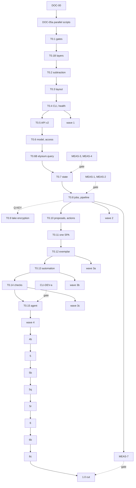

# Elysium roadmap

**The one planning file.** It holds open work only: how to take a card
(section 1), the design rules, checklist and invariants (2), the contracts
cards build on (3), Tier 0 (4), the task cards (5), the waves (6), what waits
on the owner (7) and pointers to history (8). Decisions are in
`docs/decisions.md` (cited by id: B1, D4, N23); history, measured runs and
consumed lists are in `docs/archive/planning-history.md` (cited as
`archive S6`, `archive item 1`). Finalised 3 November 2026 under the owner's
design direction (N22); made executable by Sonnet-class workers in parallel
in pass 2 (N66-N71).

**Status (3 November 2026).** S0, S1 (partly), S2 and most of DOC-00 are done
(commits in the archive and in DOC-00's card). Every other item is OPEN. Tier 0
starts when the owner says.

**Who builds.** Sonnet-class models, several in parallel (N45, N66, N67). Tier 0
items are done one at a time, in order, each split into numbered steps that
are one commit each. Cards (section 5) run in parallel inside a wave; no two
cards in a wave own the same file, and no card depends on a card in its own
wave (`tools/plan_check.py` checks both). Every design choice is made here: a
worker that finds a choice not made stops and reports it.

**Ids.** T0.n (Tier 0), card ids (MEAS-3, ADM-14, ADM-03a), contracts (C-API),
decisions (D4, N23), design rules (DR1-DR7), invariants (I1-I8), checklist rows
(P1-P13), owner questions (Q-KEY). Section titles move; ids do not. Never
renumber; a split card keeps its id with a letter (ADM-03a, ADM-03b).

**Labels.** F = fact, with its source. J = judgement. E = estimate.
Unlabelled text is specification. The platform Elysium models is called "the
precedent".

**The name rule (N62).** The name of the precedent's vendor and the names of
that vendor's products must not appear anywhere in the repository (code,
tests, documents, commit messages, file names); write "the precedent". Other
product names (databases, tools, standards, libraries: PostgreSQL, systemd,
Ollama, OpenAPI, Iceberg) are fine. One exception, by an explicit allowlist
entry in the guard: the UI component toolkit Elysium depends on is published
under that vendor's npm scope, so the scope may appear in `ui/package.json`,
`ui/package-lock.json` and in `import` statements under `ui/` and `shell/`,
and nowhere else. Enforced by `tests/unit/test_no_vendor_names.py` (T0.1 step
4(e)).

Paths: `src/elysium/...` for the package, `docs/...` for documents (N42).
Paths named `core/...` in older text mean `src/elysium/core/...`.

---

## 1. Start here: how to take a card

You are a worker given ONE card (or ONE step of one Tier 0 item) and this
section. This section is complete: with the card, its workstream's
introduction and the contracts its header names, you need nothing else.
`python tools/card_packet.py <ID>` prints exactly that bundle (T0.1 step 7);
until it exists, the integrator pastes this section, the card and the named
contracts. `AGENTS.md` and `CLAUDE.md` are the project's background; their
"Working as a swarm worker" passages agree with this section, and where any
other passage seems to differ, this section wins for a card.

### 1.1 The worker brief

```text
You are implementing ONE card (or ONE step of one Tier 0 item) of Elysium's
roadmap, docs/roadmap.md. The design is decided; do not redesign. If the card
cannot be done as written, or a choice it needs is not made, STOP and report
why instead of improvising.

WHERE YOU WORK
- In the git worktree ../elysium-wt/<ID> on branch card/<ID>, created for
  you by the integrator from `dev` (section 1.3). Commit only there. Never
  commit to `dev`, never merge, never rebase another branch, never push,
  never make a patch.
- Use your own state: export ELYSIUM_STATE="$PWD/.heavy/state" (and, until
  T0.3 lands, ELYSIUM_DATA_DIR="$PWD/.heavy/state"). Never use another
  worktree's files or a shared running server.

READ FIRST, in this order: the card (its header block is authoritative for
wave, depends, owns); the contracts its header names (section 3); its
workstream's introduction; the T0.12 file it says to copy, if any
(C-EXEMPLAR); the design rules it cites (section 2.2) and the invariants
(section 2.4). Decision ids it cites (B1, D4, N23) are in docs/decisions.md.

RULES
- No deployment exists: break freely, replace in place, delete what you
  replace in the same change; no shims, no compatibility reading, no
  migrations (until the 1.0 cut).
- Touch only the paths in the card's `owns` list, plus: your own
  controls/<area>/<ID>.toml, regenerated artefacts (section 1.4), pyproject.toml
  with uv.lock when you add a dependency, your own schema file, and your own
  lines in the quality/ baselines (regenerated). Need another file: STOP and
  report it. Respect the card's "Out of scope" line.
- A card whose header says `status: BLOCKED Q-<id>` is not started.
- Design rules: no new primitive, registry or resource kind (DR6); the server
  decides and the client renders, so no grant, role or label logic in ui/
  (DR5); every route follows DR2.
- Never write the name of the precedent's vendor or of any of its products,
  anywhere (code, tests, documents, file names, commit messages); say "the
  precedent". Other product names (databases, tools, standards) are fine.
  The one allowed exception is the UI toolkit's npm scope in
  ui/package.json, ui/package-lock.json and import lines (N62).
  tests/unit/test_no_vendor_names.py and the hooks enforce it.
- Security: uniform denial (unknown and not-allowed identical, 404); names
  never contents; authorisation only through elysium.access.check_access
  (objects only through elysium.query); MAC stays in Python after the engine
  returns; writes only through actions; routes never read
  app.state.generation; no outbound call, no hosted model.
- Security work (anything touching I1-I8): first commit the threat note
  (docs/security/threats/<ID>.md, at most one page) and the negative tests,
  failing; then the code.
- Errors: raise elysium.errors.DomainError subclasses; never a bare
  `except Exception` without `# noqa: BLE001 -- <rule>`.
- New modules are mypy --strict automatically (package globs in
  pyproject.toml, T0.1); never edit a typing list.
- Comments state rules and measured facts, never history: no ticket codes,
  dates, planning-file references or conversation in src/.
- Long or background commands ONLY through tools/heavy.sh NAME CMD (it logs,
  records the exit code and queues `full` runs machine-wide). Never `&`,
  nohup or an untracked background run. Never pipe a test run into tail or
  grep without `set -o pipefail`. Until T0.1 step 1 lands, run long commands
  in the foreground under `timeout 1800`.
- Keep each commit within about 400 changed non-generated lines; over 1,000
  needs a `Large-change: <reason>` trailer (tools/diffsize.py checks).
- UI: format only with npm run lint (oxlint, tsc, oxfmt, knip, bundle guard).
  npm ci, not npm install (npm install only when the card adds a dependency).
- Dependencies: uv add; commit pyproject.toml and uv.lock together.
- Generated files (openapi.json, schema.d.ts, docs/reference/*,
  quality/ruff-ignores.txt, quality/comment-lint-baseline.txt): regenerate,
  never hand-edit or hand-merge.

GATES, in this order
1. Read the code that already does this (it may exist already).
2. Write the failing tests named in the card.
3. Write the code. UI: cd ui && npx tsc --noEmit.
4. Focused: ./check.sh --fast -k <your test file stems>
   (before T0.1: ./lint.sh and python -m pytest <your test files> -q).
5. For each guarantee tied to I1-I8, or a semantic break mutation testing
   cannot express: break the code on purpose, confirm the test fails, restore
   from a copy, record it in controls/<area>/<ID>.toml with its invariant;
   then python tools/check_controls.py --card <ID>.
6. Full: tools/heavy.sh full ./check.sh --full, plus the standard acceptance
   for the card's kind (section 1.4) and the card's own Accept line.
7. Run the feature for real once and quote what it printed: the CLI command;
   or the route with curl through
   tools/heavy.sh probe tools/with_server.sh -- curl -s "$ELYSIUM_URL/..."
   (your own server on a free port with a temporary state); or the page
   through its Playwright spec. A card with no running feature (a document,
   a test-only card) says so.

COMMITS
- Plain commits, subject <= 72 characters, body wrapped at 72: what changed
  and why, the design rules and decisions applied, what was measured, what
  you got wrong. Numbers are measurements from this session.
- Trailers, last paragraph, one per line, exactly these keys (the
  commit-msg hook refuses others, including any attribution trailer):
    Card: <ID>                      (or: Card: T0.5 step 3b)
    Controls-Added: <ids or none>   (every commit that changes src/)
    Controls-Deleted: <ids or none> (every commit that changes src/)
    Invariants: <I1..I8 or none>    (every commit that changes src/)
    Large-change: <reason>          (only when diffsize asks)
- One card = one to three commits (a card with Steps: one commit per step).

REPORT (your final message, nothing else)
1. Card id and title; DONE or STOPPED (and why).
2. Branch card/<ID>, its commits (sha and subject); files changed and
   deleted; lines added and deleted (tools/diffsize.py).
3. Every command run, one per line, as `<command>` -> exit <N>, then its last
   relevant lines indented. (The integrator re-runs these.)
4. Controls added (ids, invariant) and what each breaks; controls deleted.
5. Invariants touched and how they are proved; design rules applied.
6. What this deleted or absorbed (DR6), or why nothing.
7. Anything another card or Tier 0 item must know (file:line).
8. Measurements, if asked, as a table.
```

### 1.2 The card header (N67)

Every card and every Tier 0 item starts with one fenced block in exactly this
format (keys in this order, one per line; `tools/plan_check.py` and
`tests/unit/test_roadmap_is_intact.py` refuse anything else):

````text
```card
id: ADM-03a
wave: 3a
status: OPEN
size: M
model: Sonnet
depends: T0.12
contracts: C-API, C-RESOURCE-SET
owns:
  - src/elysium/api/v2/resources/admin_sources.py
  - ui/src/admin/sections/sources/**
  - !ui/src/admin/sections/sources/legacy/
  - pyproject.toml#tool.mutmut
```
````

- `id`: the card id (Tier 0: `T0.n`). `wave`: a wave of section 6 (Tier 0:
  `T0`). `status`: `OPEN`, `IN PROGRESS`, `DONE <sha>` or `BLOCKED Q-<id>`.
  `size`: `S` (up to about a day and 400 changed lines) or `M` (one to three
  days, split into commits within N32). `model`: `Sonnet` (Sonnet-class) or
  `Haiku` (a small model, for mechanical work with an exact spec).
- `depends`: ids that must be DONE before the card starts, comma-separated,
  or `-`. `contracts`: the section 3 contracts the card builds on.
- `owns`: every path the card may change, one per line: a file, a directory
  glob (`dir/**`), an exclusion of a path another card owns (`!path`), or one
  section of a TOML or workflow file (`file#section`). Deleting a file means
  owning it.
- After the block, a card has bullets: `Spec`, then `Tests`, `Accept`,
  `Steps` (one commit each), `Keep` (invariants), `Out of scope`, `Note`,
  `DR`, as needed.

### 1.3 Working in parallel (N66; DOC-05a builds the two scripts)

Roles. The **owner** answers the questions of section 7, applies patches and
pushes. The **integrator** (one session) hands out cards, merges them,
closes waves and makes the patches. A **worker** does one card. The **Tier 0
worker** does one Tier 0 step at a time, in order, with the same mechanics.

1. **Starting a card.** A card starts when its wave is open (section 6) and
   every id in its `depends` is DONE; `python tools/plan_check.py --next`
   lists them. The integrator runs `tools/card_worktree.sh <ID>`: a worktree
   `../elysium-wt/<ID>` on a new branch `card/<ID>` from the current `dev`,
   and the packet in `../elysium-wt/<ID>/.heavy/packet.md`. The worker gets
   the packet and nothing else.
2. **Working.** The worker commits only on `card/<ID>` in its worktree, with
   its own state directory and its own server port (`tools/with_server.sh`
   picks a free one). It never touches `dev`, another branch or another
   worktree.
3. **Handing back.** The hand-off is the branch plus the report (section 1.1).
   The integrator saves the report as `.heavy/reports/<ID>.md` in the main
   worktree, runs `python tools/rerun_report.py .heavy/reports/<ID>.md
   --worktree ../elysium-wt/<ID>` (every claimed exit code must match), and
   starts the fresh-reader review (section 1.5) on `git diff dev...card/<ID>`.
4. **Merging.** One card at a time, as each passes review:
   `tools/integrate_card.sh <ID>` rebases `card/<ID>` onto `dev`, fast-forwards
   `dev` (history stays linear, so patches apply one commit at a time) and runs
   `./check.sh --fast`. Within a wave no card depends on another, so the order
   of merges does not change the result; Tier 0 steps merge in step order.
   After the merge: `git worktree remove ../elysium-wt/<ID>`, `git branch -d
   card/<ID>`, and the card's header gets `status: DONE <sha>` (DOC-06).
5. **Conflicts.** In a regenerated file, `integrate_card.sh` regenerates it.
   In a `file#section` path, keep both sides' sections. Any other conflict
   means two cards own one file: the script aborts the rebase and exits 6;
   the integrator does not resolve it by hand, records the ownership fix in
   the roadmap (DOC-06), and the later card's worker runs `git rebase dev` in
   its worktree and repeats gates 4-6.
6. **Full suites.** The worker runs `tools/heavy.sh full ./check.sh --full`
   once before handing back (`heavy.sh` queues full runs across worktrees).
   The integrator runs `./check.sh --fast` after every merge and
   `tools/heavy.sh full ./check.sh --full` on `dev` when a wave's last card is
   merged; the wave closes only when that passes. When it fails, the
   integrator finds the card with `git bisect run ./check.sh --fast -k
   <failing test>`, reverts that card's commits with `git revert`, and reopens
   the card.
7. **The owner's apply flow.** The machine the swarm runs on has no push
   credentials. When a wave closes (or when the owner asks), the integrator
   makes one patch per commit of `dev` since `origin/dev` with
   `scripts/make_patch.sh <name>-<date><suffix> <number of commits>` (it
   dry-runs them on a throwaway branch and prints `DRYRUN_OK`), and gives the
   owner the command `cd ~/elysium && scripts/apply_patch.sh
   ~/Downloads/<the-patch-file>.patch`, whether the server needs restarting,
   and what to look at. The owner applies and pushes; the integrator confirms
   with `git ls-remote origin dev` before the next wave's patches. Workers
   never make patches.

### 1.4 Conventions every card relies on

- **Ownership.** A card changes only its `owns` paths, plus (a) its own
  `controls/<area>/<ID>.toml`, (b) regenerated artefacts
  (`src/elysium/api/v2/openapi.json`,
  `ui/packages/shell-api/src/generated/schema.d.ts`, `docs/reference/*`), (c)
  `pyproject.toml` with `uv.lock` when it adds a dependency, (d) its own
  schema file `src/elysium/db/schema/<file>/50-<id in lower case>.sql`, and (e)
  its own lines removed from the `quality/` baselines (regenerated with the
  baseline tool). No card edits a shared list: the admin section table
  (C-ADMIN-SECTIONS), the strict-typing globs (C-GATES), the resource specs
  (C-RESOURCES) and the Browse pages (C-BROWSE-SLOTS) are complete before the
  cards start (N59). On a conflict in (b), (c) or (e), regenerate.
- **Registries.** Everything a card adds is found automatically: v2 routers
  (`src/elysium/api/v2/resources/<res>.py`), CLI nouns
  (`src/elysium/cli/commands/<noun>.py`), health checks
  (`src/elysium/ops/health/<topic>.py`), job kinds
  (`src/elysium/jobs/kinds/<kind>.py`), proposal kinds
  (`src/elysium/proposals/kinds/<kind>.py`), action effects
  (`src/elysium/actions/effects/<effect>.py`), outbox handlers, exporters
  (`src/elysium/exports/<name>.py`), resource kinds
  (`src/elysium/resources/kinds/<kind>.py`), admin sections
  (`ui/src/admin/sections/<id>/section.ts`), Browse slots
  (`ui/src/apps/browse/slots/<name>/slot.ts`), person-page extensions
  (`ui/src/admin/sections/people/extensions/*.tsx`), sign-in methods
  (`ui/src/login/<name>/method.tsx`), setup steps
  (`ui/src/setup/steps/<id>/step.ts`), configuration tabs
  (`ui/src/admin/sections/configuration/<id>/tab.ts`), apps
  (`ui/src/apps/<id>/app.ts`). `elysium.bootstrap.discover()` imports the
  Python ones; `import.meta.glob` collects the UI ones.
- **Every API route** follows DR2, denies with the uniform 404, raises
  `DomainError` subclasses (never `HTTPException`), declares
  `audited("<area>.<event>")` on every non-GET route, changes resources only
  through `resourceChanges`, and returns only what the caller may read (DR5,
  N26). Routes named relative to a section (`GET /sources`) are under
  `/api/v2/admin/`.
- **Deleting a v1 route** (T0.5 step 0 split v1 into areas): re-run MEAS-5
  first; delete the route from `src/elysium/api/v1/<area>.py`, its wrapper
  from `ui/packages/shell-api/src/v1/<area>.ts` and its tests from
  `tests/integration/v1/test_<area>.py`, and each file when it is empty; a
  path that still has a caller is not deleted and is reported with the
  caller.
- **Standard acceptance** (on top of the card's own tests and Accept line):
  - every card: `./check.sh --fast -k <each test file stem>`, then
    `tools/heavy.sh full ./check.sh --full`; `python tools/check_controls.py
    --card <ID>` (every control fires); `tools/diffsize.py` within N32.
  - API cards (owning `src/elysium/api/`): `python -m pytest
    tests/api/test_openapi_is_current.py tests/api/test_route_conventions.py
    tests/api/test_uniform_denial.py -q` and `cd ui && npm run gen:client --
    --check`.
  - UI cards (owning `ui/`): `cd ui && npx tsc --noEmit && npx vitest run &&
    npm run build && npm run lint && npm run e2e -- <the card's spec>` (the
    bundle guard runs in `npm run lint`).
  - CLI cards (owning `src/elysium/cli/commands/`): `python -m pytest
    tests/cli/test_cli_conventions.py -q`; `elysium <noun> --help` shows two
    examples and the "Web UI:" line.
  - Before T0.1 lands (wave 0): `./lint.sh` and `python -m pytest tests/ -q
    -m "not integration"`.
- **Tests** named in a card are the minimum; a worker may add tests, never
  drop one. A test named `test_x` under a file means `<file>::test_x`.
- **Measurements** (MEAS cards and any card asked to measure) report a table
  with the exact commands; the integrator records each as a row `M<n>` in
  `docs/security/audit-checklist.csv` and as a comment beside the code it
  decides.

### 1.5 The integrator and the review

The integrator re-runs every command in section 3 of the report
(`tools/rerun_report.py`) before merging (N32), starts a fresh reader on the
diff with the brief below, checks each finding against the code, sends real
ones back to the worker, and marks the card `DONE <sha>` (DOC-06). An item
touching I5 or I6 gets a second fresh reader aimed at that invariant only.

```text
Review this diff against the card (pasted) and docs/roadmap.md sections 1-2.
Report correctness gaps only, skip style. For each: file:line, what breaks,
which invariant or design rule, and the smallest fix. Check in particular:
does every test fail when the code it guards is broken; does anything decide
access outside elysium.access or in ui/; does any response or log carry a
value, secret, path or name the caller may not see; did the change add a
mechanism without deleting one; does it stay inside the card's owns list.
```

---

## 2. Design rules, checklist and invariants

### 2.1 Design philosophy

**The direction (owner, 3 November 2026).** Keep the precedent's defining,
powerful principles, and build a better, more refined system by simplifying
and expanding the power of a few simple parts. The owner illustrated it with
history: Unix took the defining ideas of Multics, a system too massive and
complicated for its own good, and made something more refined by giving a few
simple parts more power. That analogy is an illustration only. Elysium is not
an operating system and borrows none of that vocabulary as design; the rules
below are stated in Elysium's own terms.

**What is kept from the precedent.** Typed objects and links as the model;
actions as the only write; object sets as the query; one place that decides
access, applying mandatory (security attribute, labels) and role-based rules
together; approval before risky change; automations, checks and functions
over the same model; a versioned, discoverable API.

**What Elysium does differently.** Fewer mechanisms, each general; one API
shape for everything; configuration and exports as plain versioned text; a
browser that only renders what the server decided; a small core.

### 2.2 The design rules

Every Tier 0 item and card names the rules it applies (`DR: 1, 5`). Each rule
has a test, so a rule is a gate and not advice.

**DR1. A few orthogonal primitives, each doing one thing, composing through one
uniform API.**

| Primitive | It is the only way to | Lives in | Not allowed beside it |
|---|---|---|---|
| Object type and link type | describe data | `elysium.metadata` (`ObjectType`, `LinkType`) | per-field links, computed kinds other than `derived` |
| Action | change data | `elysium.actions.apply` | direct writes, write routes, special apply paths |
| Object set | ask for objects (read, count, aggregate, export, subscribe, stored set, automation condition, agent search, similarity) | `elysium.query` | saved views, frozen sets, ad hoc search routes |
| Policy decision point | decide access | `elysium.access.check_access` | grant parsing or role logic anywhere else, including the client |
| Proposal | approve anything | `elysium.proposals` | separate approval queues or stores |
| Automation (condition + effects) | react to change or time | `elysium.automation` | triggers, reminders, alerts as separate modules |
| Check | judge data quality | `elysium.checks` | constraints, standardise, outliers, rules vocabularies |
| Function | compute or propose with code | `elysium.functions` | enriched and predicted property kinds |

Three plumbing primitives carry them: the **resource** (one envelope, one
versioned resource set, N4), the **job** (all long-running work, T0.8) and
the **audit event** (all records of who did what, T0.7).
*Test:* `tests/unit/test_primitives_are_pinned.py` lists every registry
decorator (`@kind`, `@job_kind`, `@proposal_kind`, `@effect_kind`,
`@check_kind`, `@exporter`, `@health_check`, `@function_kind`,
`@outbox_handler`, `@erasable`) and fails when a new registry appears without
a decision id in its docstring (N63). Action effects register with
`@effect_kind` in `elysium.actions.effects`; automation effects are a closed
two-value vocabulary inside `elysium.automation.engine` (no registry); the
agent's `STEPS` is a tuple, not a decorator; set kinds and filter operators
are a closed table in `elysium.query.sets` (no registry).

**DR2. Everything is a resource with the same verbs and the same conventions.**
A list is `GET /api/v2/<res>` returning `{data, nextPageToken}`; one item is
`GET /api/v2/<res>/{id}` with an `ETag`; create is `POST` (201 + `Location`);
update is `PUT` with `If-Match`; delete returns 204; any other operation is
`POST /api/v2/<res>/{id}/<verb>`; long work returns 202 + `Location:
/api/v2/jobs/{id}`; admin resources sit under `/api/v2/admin/<res>`. Lists take
`pageSize`, `pageToken` and, where they filter, the object-set filter grammar
(objects) or flat query parameters named after response fields (everything
else). Errors are RFC 9457 problems with `errorName`, `errorInstanceId`,
`parameters`. Every change is audited as `<area>.<event>` by the router layer,
not by hand in each route.
An operation on a collection or a singleton is `POST /api/v2/<res>/<verb>`.
A singleton (`configuration`, `server`, `lake`, `health`, `setup`,
`overview`) is `GET /api/v2/<res>` and `PUT /api/v2/<res>` with `If-Match`;
`tests/routes_table.py::SINGLETONS` lists them. A resource-backed route (one that turns
its request into a `resourceChanges` call, such as `POST
/api/v2/admin/sources`) answers `201 + Location` (create) or `200` (update)
with the `ChangeReport` as the body, or `204` with no body (delete), when the
change was applied, and `202 + Location: /api/v2/proposals/{id}` with the
`Proposal` as the body when it was staged. `POST
/api/v2/admin/resourceChanges` itself answers `200` with the `ChangeReport`
(applied or dry run) or `202` with the `Proposal` (staged). Shapes in
C-PROPOSALS (N64, N70). Path segments are camelCase (`resourceChanges`,
`rebuildOwed`, `recoveryKey`); ids inside paths keep their own spelling. A
write-only secret (`PUT /api/v2/admin/secrets/{name}`) answers 204 and has
no GET. A list never carries a total; `count` on an object set is the one way
to count (N64).
*Test:* `tests/api/test_route_conventions.py`, parametrised over
`tests/routes_table.py::iter_routes(app)`: shape, paging fields, problem
bodies, no-store, audit on every non-GET.

**DR3. Text in, text out.** What Elysium reads is versioned text: one boot
settings file (N3) and resource files with published JSON Schemas (N4). What
it writes for others is deterministic text (N7). The CLI follows modern CLI
conventions: data on stdout, messages on stderr, `--json` on every command,
one exit-code table, `-` reads standard input, `NO_COLOR`, no prompt under
`--no-input`.
*Test:* `tests/cli/test_cli_conventions.py`, parametrised over every
registered command: `--help` has two examples and a "Web UI:" line, `--json`
output parses, errors go to stderr, exit codes come from `ExitCode`.
`tests/unit/test_exports_deterministic.py`: two runs are byte-identical.

**DR4. Mechanism in the core, policy in configuration; a small core, capabilities
in apps and add-ons.** The core knows no role name, label name, section list,
schedule or source; those are resources. Built-in roles are shipped resources
(N27). Anything a single user population needs (geography beyond N18,
inferred identity, time series, market data) is an app or add-on using the
same API.
*Test:* `tests/unit/test_core_holds_no_policy.py` parses `src/elysium/**.py`
outside `init_templates/` and `builtin/` and fails on a string literal exactly
equal to a built-in role name (`"administrator"`, `"operator"`, `"auditor"`)
or a fixture label name (`"pii"`, `"compartment"`); known uses (for example
`"operator"` as a filter key) sit in an allowlist with a reason, which may
only shrink.

**DR5. The server decides, the client renders.** The browser receives only
objects and properties the caller may read, the visible schema, and
server-computed capability booleans and reasons. It never receives grant
grammar, role names, the caller's security attribute value, label names
(unless the caller manages the model or roles, N24), or the `security` rule of
a type. It never infers, filters or re-checks access (N23, N25, N26).
*Test:* `ui/scripts/check_bundle.mjs`, run by `npm run lint` after `npm run
build`: the built `ui/dist/**/*.js` contains none of `manage:`, `read:`,
`discover:`, `execute:`, `apply:`, `module:`, `tool:`, `role_name`,
`mac_value`, `security_values`, and none of the internal names `bronze`,
`silver`, `gold_history`, `.db`, `.yaml`, `_silo` in user-visible strings.
`tests/api/test_me_shape.py` pins `/api/v2/me`'s keys.

**DR6. Prefer deletion.** Every new mechanism replaces or absorbs an existing
one, in the same change. A new primitive, registry or resource kind is allowed
only when all three hold: (a) two or more planned features cannot be expressed
with the existing primitives, written down as the attempt that failed; (b) the
change deletes more lines than it adds, or the owner accepts why not; (c) a
decision entry exists in `docs/decisions.md` before the code merges.
*Test:* the DR1 test (registries pinned); `tools/diffsize.py` prints added and
deleted lines per commit and per card in the hand-off; the reviewer brief
(section 1) asks "what did this delete?".

**DR7. Simpler where it buys simplicity, never at the cost of I1-I8.** Accept
the simpler design when the cost is speed, features or elegance: one SQLite
writer, polling relays, MAC in Python after the engine returns, no spatial
index, no cache until a measurement asks for one, a fixed vocabulary instead
of an expression language. Never accept it when the cost is an invariant:
uniform denial, one decision point, MAC and RBAC on every read, writes only
through actions, re-authorisation at approval, erasure completeness,
read-only sources, no question leaving the machine.
*Test:* `python tools/check_controls.py --coverage` fails when any of I1-I8
has no live control (T0.1, REF-19).

### 2.3 Goal and the production-ready checklist

**Goal.** An operator who has never seen Elysium installs it in minutes,
finishes setup in a browser and runs it from the web UI; the CLI covers the
same tasks plus those that must work while the server is down. What Elysium
reads is kept apart from what it writes for others, and both are documented.
Every invariant is proved by a test that fails when the guarantee breaks.

**Where it stands (F, 3 November 2026).** Install is a root-only script plus
about 17 manual steps (`install/install.sh`). Configuration is seven YAML
files in four copies. The first user needs `python -m
elysium.scripts.bootstrap_root`. There are 45 scripts in
`src/elysium/scripts/` and `elysium` is a stub (`src/elysium/cli.py`).
`src/elysium/api/routes.py` is 10,645 lines; five more modules exceed 2,000.
Engineering measurements (F, research of 3 November): 186 broad exception
handlers, 52 of them turning failure into absence; 32% of functions partly
annotated, mypy not strict; 3 import cycles; `deployment_loader` has fan-in 45
and fan-out 65; 17 property tests of 6,972; no coverage gate; no stored
mutation score; unit plus integration suite about 31 minutes on 2 CPUs.

**Production ready when** (the owner ticks a row when the named items are
merged and their acceptance commands pass):

| # | Production ready when | Proved by | Items |
|---|---|---|---|
| P1 | **Install in minutes**: `docker compose up -d` (or `.deb`/`.rpm`, or `uv tool install`) and a browser, no hand-edited file | CI starts the container from nothing and completes setup over HTTP | INS-02..06, CI-06 |
| P2 | **First-run web setup**: one-time setup URL, wizard creates the first administrator, connects a source, picks the model server, sets schedules, locks itself | e2e wizard test; API test that the token is single-use and expires | ADM-01a, ADM-01b, ADM-02a, ADM-02b, ADM-28, CLI-SETUP |
| P3 | **Every admin task in the UI** | an e2e spec per section; ADM-26 (every admin route has a UI caller) | T0.12, ADM-*, API-* |
| P4 | **A coherent CLI** | `tests/cli/test_cli_conventions.py`; generated reference current | T0.4, CLI-* |
| P5 | **Documented IN and OUT** | `elysium export --check` and the reference-currency test in CI | T0.3, ADM-22a, ADM-22b, DOC-03 |
| P6 | **Backups and restore tested**; erasures survive a restore | CI round trip | OPS-05..07, CI-06 |
| P7 | **Upgrades with migrations** (from 1.0) | upgrade test from the previous release's image | OPS-08, OPS-09 |
| P8 | **Health and doctor** on one registry | each health check has a test that makes it fail | T0.5, OPS-01..04, ADM-18a, ADM-18b |
| P9 | **Audit readable**, hash chain, `elysium audit verify` | tamper test | T0.7, ADM-14, ADM-15 |
| P10 | **Security findings closed** in `docs/security/findings.csv` and `docs/security/audit-checklist.csv` | `tests/unit/test_findings_are_closed.py` | SEC-A..G |
| P11 | **Invariants proven**: I1-I8 each have a live control | `tools/check_controls.py --coverage` | T0.1, REF-19 |
| P12 | **Supported surface stated** | support matrix in `docs/install.md`, tested where a machine allows | DOC-01, Q-SUPPORT |
| P13 | **Design rules and quality gates enforced**: DR1-DR7 tests green; import-contract ignore list empty; strict-typing list covers every package outside `core/`; coverage and mutation scores stored and not below their ratchet; comment-lint baseline empty; bundle guard green | `./check.sh --full` and `tools/quality_report.py` | T0.1, T0.1B, QA-*, REF-19 |

### 2.4 Security invariants (every item and card keeps them)

| # | Invariant | Proved by |
|---|---|---|
| I1 | **Uniform denial.** Unknown and unreadable look identical (types, keys, properties, proposals, actions, admin routes, validate calls). | byte-equal 404 bodies for unknown and denied, parametrised over the route table; no distinguishing audit write visible to the caller |
| I2 | **Authorisation in one place.** | import-linter (T0.1B layers, N48): `api`, `agent`, `automation`, `functions`, `apps`, `cli` read objects only through `elysium.query` and write only through `elysium.actions` (and stage through `elysium.proposals`); only `elysium.query.reader` calls `check_access` for objects; only `elysium.access` calls `authorize`; only `elysium.access` produces `readable`, `executable` or `can*` booleans |
| I3 | **MAC and RBAC on every read**, including expand, links, history, export, aggregate, subscriptions, automations, frames and the agent. | per-id `check_access` in the reader; route-table denial test; model validator (`security` or `unrestricted: true`); subscription keys filtered per recipient |
| I4 | **Writes only through actions.** | forbidden-import contract; `resource_versions` never writes object rows; function proposals and quarantining checks land through a system action |
| I5 | **Re-authorisation at approval.** | per proposal kind: revoke the approver's grant between propose and approve; approval returns the uniform refusal; one row per safeguard in the safeguard table |
| I6 | **Erasure completeness.** | `Erasable` registry test; lake keys derivable from ledger plus schema; table-driven `layer_of`/`iter_tables`; never-narrow rule |
| I7 | **Read-only source access.** | a write through the SQLite dialect is refused; PostgreSQL and MariaDB read-only sessions |
| I8 | **No question leaves the machine.** | the installed wheel has no adapter able to reach a hosted model; no exporter |

Supporting invariants, carried by the same tests: CSRF (cookie without header
403; cookie plus bearer refused; bearer alone allowed); constant-time compare
and login throttle; routes never read `app.state.generation`; no-store by
default; audit fail-closed and append-only; the agent stages only.

**Rule for every item (J).** A control is deleted only with the code it
guards. Each commit lists controls added and deleted and invariants touched.
An item touching I5 or I6 gets a second fresh-reader review aimed at that
invariant only. Security work starts with a threat note and failing negative
tests (N32).

---

## 3. Contracts

What every card builds on. Each contract is made true by the item named in
its heading; a card's header lists the contracts it needs and
`tools/card_packet.py` prints them with the card. A contract changes only
through its Tier 0 item (or a decision entry); a card that finds a contract
wrong stops and reports it.

| Contract | What | Made true by |
|---|---|---|
| [C-REPO](#c-repo) | The repository layout | DOC-00 |
| [C-IN](#c-in) | What Elysium reads | T0.3 |
| [C-OUT](#c-out) | What Elysium produces for others | ADM-22a, ADM-22b |
| [C-STATE](#c-state) | State: what Elysium owns, and the locks | T0.3, T0.7, T0.8 |
| [C-ENV](#c-env) | Environment variables | T0.3 |
| [C-CLI-TREE](#c-cli-tree) | The CLI tree, exit codes and confirmation tiers | T0.4 and the CLI cards |
| [C-GATES](#c-gates) | Gates, controls, baselines, trailers | T0.1 |
| [C-LAYERS](#c-layers) | Layers, registries and the composition root | T0.1B |
| [C-BUILDERS](#c-builders) | Test builders and the route table | T0.2 |
| [C-SETTINGS](#c-settings) | Settings, paths, resources and secrets | T0.3 |
| [C-RESOURCES](#c-resources) | The complete resource specs | T0.3 |
| [C-CLI](#c-cli) | The CLI framework | T0.4 |
| [C-HEALTH](#c-health) | The health-check registry | T0.4 |
| [C-API](#c-api) | API v2 plumbing, the caller and errors | T0.5 |
| [C-TOKENS](#c-tokens) | Tokens and scopes | T0.5 |
| [C-ACCESS](#c-access) | Typed model and the one decision point | T0.6 |
| [C-QUERY](#c-query) | Object sets: `elysium.query` and paging | T0.6B |
| [C-DB](#c-db) | SQLite, unit of work, outbox, change feed | T0.7 |
| [C-AUDIT](#c-audit) | The audit log | T0.7 |
| [C-ERASURE](#c-erasure) | The erasure registry and the lake layers | T0.7 |
| [C-PROCESS](#c-process) | The process model | T0.8 |
| [C-JOBS](#c-jobs) | Jobs, schedules and the pipeline | T0.8 |
| [C-KEYS](#c-keys) | Lake encryption and the recovery key | T0.9 |
| [C-ACTIONS](#c-actions) | Actions | T0.10 |
| [C-PROPOSALS](#c-proposals) | Proposals, wire shapes and approval | T0.10 |
| [C-RESOURCE-SET](#c-resource-set) | The resource set, versions and resource routes | T0.10 |
| [C-UI-SHELL](#c-ui-shell) | One SPA, the admin shell and the UI rules | T0.11 |
| [C-ADMIN-SECTIONS](#c-admin-sections) | The admin section table | T0.11 |
| [C-BROWSE-SLOTS](#c-browse-slots) | Browse extension slots | T0.11 |
| [C-EXEMPLAR](#c-exemplar) | The exemplar: what "copy T0.12" means | T0.12 |
| [C-AUTOMATION](#c-automation) | The automation model | T0.13 |
| [C-CHECKS](#c-checks) | The checks model | T0.14 |
| [C-AGENT](#c-agent) | The agent | T0.15 |

<a id="c-repo"></a>

### C-REPO · The repository layout (DOC-00)

DOC-00 made this true except its remainder card; later items create the
trees marked with their id.

```
README.md            short introduction: what Elysium is, quick start, links (under 80 lines)
LICENSE  AGENTS.md  CLAUDE.md  CHANGELOG.md (DOC-08)
pyproject.toml  pytest.ini  .gitignore  .github/  check.sh (T0.1; lint.sh until then)
uv.lock (T0.1; the requirements* files until then)  vulture_whitelist.py
Containerfile  compose.yml (INS-02, INS-03)  packaging/ (INS-02..05)
docs/
  README.md                  index of every document
  roadmap.md  decisions.md   this file; every decision, ADR-lite
  principles.md  rules.md  install.md
  architecture.md  configuration.md  development.md  limitations.md   the manual's pages
  security/architecture.md  security/findings.csv  security/audit-checklist.csv
  ui/development.md          the measured palette, type scale, density; never delete
  archive/planning-history.md    history, measured runs, consumed lists
  reference/                 generated (DOC-03)
  operator/  addons/         written by DOC-02a..c, DOC-07
src/elysium/                 the package (target packages in C-LAYERS)
tests/                       unit/ cli/ api/ (T0.3) property/ (QA-PROP) integration/ support/ (MEAS-5) fixtures/ (T0.3)
ui/                          one SPA from T0.11 (ui/src/apps/<id>/, ui/src/admin/, ui/e2e/)
tools/                       T0.1's scripts, tools/measure/, tools/smoke/, tools/release/, tools/elysium_dev/ (CLI-DEV-a)
controls/  quality/  .githooks/  .claude/   (T0.1)
scripts/                     make_patch.sh, apply_patch.sh, make_bundle.sh, apply_bundle.sh: the owner's patch flow (section 1.3); stays
site/                        the public website; lints and tests itself (`bash site/check.sh`, CI-01's `site` job); stays
sim/                         the simulator until REF-18A moves it to packages/elysium-sim/
sdk/                         the add-on SDK
addons/identity-inference/   REF-14B-2
shell/                       deleted by T0.11
deployment/  install/  templates/   deleted by T0.3 and INS-04
```

<a id="c-in"></a>

### C-IN · What Elysium reads (T0.3)

```
/etc/elysium/                     # container: /config     uv/dev: $XDG_CONFIG_HOME/elysium
  elysium.toml                    # boot settings (N3)
  secrets/                        # 0700, files 0400 (N6): master-key, backup-key, silo-<name>-password
  resources/                      # optional, file-provisioned, read-only in the UI (N4)
    silos/warehouse.yaml          #   kind: Silo
    object-types/customer.yaml    #   kind: ObjectType (a file may also hold its LinkTypes and ActionTypes)
    link-types/  action-types/  functions/  automations/
    roles/analyst.yaml            #   kind: Role
    apps/astrolabe.yaml           #   kind: App
    configuration.yaml            #   kind: Configuration
  schemas/                        # written by `elysium init` and `elysium resource schemas --write`
    silo.schema.json ...          #   one per kind, the target of each file's modeline
```

**One layout for IN and OUT (N65).** `<dir>/<plural kind>/<name>.yaml`
with plurals `silos`, `object-types`, `link-types`, `action-types`, `roles`,
`functions`, `automations`, `apps`, and `configuration.yaml` at the top.
`resources.load_dir` reads every `*.yaml` under the directory recursively
(an operator may group a type with its links in one file); the `resources`
exporter writes the canonical layout, one resource per file, so
`exports/resources/` is a valid `resources/` directory. `elysium init` writes
`<config>/schemas/`; `elysium resource validate` warns (`E_SCHEMAS_STALE`,
exit 0) when those schemas differ from the running version's. Builtin- and
app-origin resources are never exported. Proof:
`tests/unit/test_exports_roundtrip.py::test_export_then_apply_is_a_no_op`.

`elysium.toml` (a typical install, complete):

```toml
# elysium.toml -- boot settings. Runtime settings live in Admin > Configuration.
# Every key can be overridden by ELYSIUM_<SECTION>__<KEY>, e.g. ELYSIUM_SERVER__LISTEN.
[server]
listen = "127.0.0.1:8000"
public_url = "https://elysium.example.org"
trusted_proxies = []
cookie_secure = true
workers = 2                                    # web worker processes (N47); the runner is one more
ip_allow = ["10.0.0.0/8", "172.16.0.0/12", "192.168.0.0/16"]   # INS-04's IPAddressAllow

[paths]
state = "/var/lib/elysium"                    # alias: ELYSIUM_STATE
resources = "/etc/elysium/resources"
secrets = "/etc/elysium/secrets"

[storage]
volume_encrypted = false
lake_encryption = false                       # removed by T0.9 (encryption always on)
master_key = { secretRef = "master-key" }

[backup]
key = { secretRef = "backup-key" }

[log]
level = "info"
```

Resource examples (the format of `archive` plan section 1.4: `type:` is the
data type, `derived:` the only computed kind, links only as links, v2
operators, `approval:` on every action, structured grants, `backing:` last):

```yaml
# yaml-language-server: $schema=../../schemas/silo.schema.json
apiVersion: elysium/v1
kind: Silo
metadata: { name: warehouse, description: Finance warehouse, read-only replica }
spec:
  adapter: sqlalchemy            # sqlalchemy | csv | rest
  url: postgresql://elysium_ro@wh.internal:5432/analytics   # never a password
  password: { secretRef: silo-warehouse-password }
  incremental: { column: updated_at }
  locale: en-GB
  queryTimeoutSeconds: 30
  terms: { licence: internal, attribution: "Finance team", commercial: true }

<a id="c-out"></a>

### C-OUT · What Elysium produces for others (ADM-22a, ADM-22b)

| Artefact | Where | Format | Deterministic | Produced by |
|---|---|---|---|---|
| Data contracts | `exports/contracts/<Type>.odcs.yaml` | ODCS v3.2 | yes | `elysium export`, `GET /api/v2/exports/contracts/{type}` |
| Schemas | `exports/schemas/<kind>.schema.json`, `elysium.toml.schema.json`, `exports/schemas/actions/<action>.schema.json` | JSON Schema 2020-12 | yes | export |
| The resource set | `exports/resources/<kind>/<name>.yaml` | the IN envelope, importable, no derived fields | yes | export, `elysium model export` |
| API description | `exports/openapi.json` (copy of `src/elysium/api/v2/openapi.json`) | OpenAPI 3.1 | yes | export, build |
| Access review | `exports/access-review/grants.csv`, `members.csv` | CSV | yes, per version | export (`manage:audit`) |
| Manifest | `exports/manifest.json` | files, sha256, resource-set version | yes | export |
| Audit log | `<state>/audit/audit-YYYY-MM.jsonl` | JSONL, `v`, `category`, hash chain; OCSF as an extra export | stream | server |
| Lineage | `<state>/audit/lineage-YYYY-MM.jsonl` | OpenLineage RunEvents | stream | sync jobs |
| Backups | `<state>/backups/<id>.elysium-backup` | encrypted archive with manifest | n/a | backup job |
| Diagnostics | `elysium-diagnostics-<host>.tar.gz` | redacted settings, health results, versions, log tail | n/a | `elysium doctor --bundle`, Admin > Health |

<a id="c-state"></a>

### C-STATE · State: what Elysium owns, and the locks (T0.3, T0.7, T0.8)

```
/var/lib/elysium/                 # container: /data   uv/dev: $XDG_STATE_HOME/elysium
  elysium.db  erasure.db  scratch.db     # D4; WAL; PRAGMA user_version stamped (N35)
  lake/catalog.db  lake/warehouse/        # Iceberg; bronze, changelog, gold, gold_history (+silver if D9 keeps it)
  audit/                                  # audit-*.jsonl, lineage-*.jsonl; backed up, never rolled back
  backups/  exports/  addons/<app>/  secrets/ (*.enc, N6; page-token.key, N46)
  run/                                    # server.lock, runner.lock, state.lock, lake-writer.lock,
                                          # restore-pending.json, restore-journal.json (N47, N55)
  .restore-new/  .restore-old/            # exist only during a restore (N55)
```

**Locks (N47).** Every lock is an exclusive `flock` on a file in `run/`,
released by the kernel when its holder dies. `server.lock`: held by the
`elysium server run` supervisor for its lifetime. `runner.lock`: held by the
runner process. `lake-writer.lock`: held by a job while it writes the lake
(and by a backup while it copies it). `state.lock`: held by a local (L) CLI
command while it runs; two local commands serialise on it; the server never
takes it. An L\* command also takes `server.lock` non-blocking and keeps it
for its run (exit 6, `E_SERVER_RUNNING`, when held), so the server cannot
start under it.

<a id="c-env"></a>

### C-ENV · Environment variables (T0.3)

| Variable | Status | Meaning |
|---|---|---|
| `ELYSIUM_CONFIG`, `ELYSIUM_STATE`, `ELYSIUM_<SECTION>__<KEY>` | new | settings file, state alias, one override |
| `CREDENTIALS_DIRECTORY`, `STATE_DIRECTORY`, `CONFIGURATION_DIRECTORY` | read | set by systemd |
| `ELYSIUM_URL`, `ELYSIUM_PROFILE`, `ELYSIUM_TOKEN_FILE`, `ELYSIUM_NO_INPUT`, `NO_COLOR` | new, CLI | client side |
| `ELYSIUM_TOKEN` | new, CLI | CI only; the one exception to N6 |
| `ELYSIUM_ADDON_START`, `PORT` | kept | set by the supervisor for add-ons |
| `ELYSIUM_SUPERVISED` | new, set by the service manager | `1` under INS-02's entrypoint and INS-04's unit: exit code 75 means "restart me", so `GET /api/v2/admin/server` reports `restartable: true` |
| `ELYSIUM_CONFIG_DIR`, `ELYSIUM_DATA_DIR`, `ELYSIUM_LOG_DIR`, `ELYSIUM_COOKIE_SECURE`, `ELYSIUM_STORAGE_ENCRYPTION`, `ELYSIUM_BACKUP_KEY_FILE`, `${VAR}` | **deleted** in T0.3 | replaced by the TOML above |

Files that go (F, they exist today, checked with `git ls-files`):
`deployment/` (etc, var, logrotate), `install/install.sh`, `templates/*.yaml`
(replaced by `elysium init` templates), the configuration files
`config.yaml`, `data_silos.yaml`, `ontology_schema.yaml`, `policy.yaml`,
`example_queries.yaml` (to the dev plugin) in `deployment/etc/` and
`templates/`, `source_bindings.yaml` (in `deployment/etc/` only), every
`module.json` and `module.conformance.json` (T0.11), `requirements*.txt` and
`requirements*.lock` (T0.1). `modules.yaml` and `addons.yaml` are not tracked
anywhere; only the code that would read them goes (T0.3 step 5c).

<a id="c-cli-tree"></a>

### C-CLI-TREE · The CLI tree, exit codes and confirmation tiers (T0.4 and the CLI cards)

Mode: **A** = through the server's API (default); **L** = local; **L\*** =
local and refuses (exit 6) while the server runs.

```
elysium
  version                                   A/L
  completion bash|zsh|fish|powershell       L    prints the script; never edits rc files
  init [--demo] [--system|--user|--container] [--dir D]   L
  settings show|validate|path               L    values and their source; secrets redacted
  server run                                L
  service install|uninstall|status [--user] L
  setup url|status                          L
  doctor [--fix] [--bundle FILE]            L    local health checks, plus the server's when reachable
  auth login|logout|status|whoami           A
  resource validate PATH                    L
  resource list|show|diff|apply|adopt       A    apply [--prune] [--dry-run]
  model versions|show|diff|export|restore   A
  source list|show|create|update|delete|test|tables   A
  configuration show|get|set                A
  sync run|status|history                   A    run [--source S] [--table T] [--full] [--rebuild TYPE] [--wait]
  job list|show|cancel|wait|logs            A
  lake status|verify|rebuild                A
  lake repair                               L*
  lake key check|export|import|rotate       L*
  user list|show|create|update|disable|enable|delete|set-password   A
  user reset-password NAME                  L
  role list|show|create|update|delete|grant|revoke   A
  token list|create|revoke                  A    create NAME [--read TYPE[.PROP]]... [--discover TYPE]... [--apply ACTION]... [--manage AREA]... [--expires-in-days N] [--for USER] (N50)
  proposal list|show|approve|reject         A
  erasure request|list|show|cancel          A
  backup create|list|show|verify|download|prune   A   (create --local: L)
  backup restore FILE                       L*   (--stage: A, applied at next start, N13)
  audit list|show|export|verify             A    (verify --local: L)
  export [--out DIR] [--check] [--only KIND]   A  (--local: L)
  app list|show|enable|disable|restart|logs A
  logs [--follow] [--level L]               A
  object get|history TYPE KEY               A
  help exit-codes|settings|resources|tiers  L
  dev ...                                   only with elysium-dev: reset, seed, users, openapi, docs, controls, bench, sim
```

Global flags: `--json`, `-q`, `-v`, `--no-color`, `--no-input`, `--profile`,
`--url`, `--config`, `-h`, `--version`. State-changing commands also take
`-n/--dry-run` and `-y/--yes`; severe ones need `--confirm SUBJECT`.

**Exit codes** (`elysium help exit-codes`):

| Code | Meaning | Examples |
|---|---|---|
| 0 | success | |
| 1 | unexpected failure | a bug; prints a bug-report hint |
| 2 | usage error | unknown flag, missing argument |
| 3 | not found (also uniform denial) | unknown or unreadable user, type, job |
| 4 | not signed in or token rejected | 401 |
| 5 | unavailable | server unreachable, timeout, master key missing, no settings file |
| 6 | conflict or precondition | lock held; server running for L\*; stale base version; confirmation needed under `--no-input` |
| 7 | partial success | some tables synced, some failed |
| 8 | check failed | `validate`, `doctor`, `verify`, `export --check` found problems |
| 130 | interrupted | Ctrl-C |

With `--json`, errors go to stderr as `{"error": {"code": "E_SYNC_LOCKED",
"message": ..., "hint": ...}}`.

**Confirmation tiers:**

| Tier | Commands | Rule |
|---|---|---|
| read | `list`, `show`, `status`, `verify`, `diff` | no prompt |
| reversible | `sync run`, `resource apply` without `--prune`, `export`, `backup create`, `token create` | no prompt; `--dry-run` on `resource apply`, `sync run` and `export` |
| moderate | `user disable`, `role revoke`, `token revoke`, `lake rebuild`, `app disable`, `resource apply --prune`, `job cancel`, `proposal reject` | prompt on a TTY or `--yes`; under `--no-input` without `--yes`: exit 6 naming the flag |
| severe | `erasure request`, `user delete`, `backup restore`, `lake key rotate\|import`, `model restore` | prints the plan, needs `--confirm <exact subject>` even with `--yes`; checked again on the server; audited; approval policy still applies |

Every state-changing command prints what changed and the web-UI URL of it.

<a id="c-gates"></a>

### C-GATES · Gates, controls, baselines, trailers (T0.1)

- `controls/<area>/<CARD-ID>.toml`; a worker adds a file and never edits
  another card's file.
- Commands: `./check.sh --fast -k EXPR`, `./check.sh --full`, `tools/heavy.sh
  NAME CMD`, `python tools/check_controls.py --card ID`, `tools/diffsize.py`.
- Baselines in `quality/` only shrink: `ruff-ignores.txt`,
  `strict-modules.txt` (only grows), `comment-lint-baseline.txt`, and later
  `contracts-ignores.txt` (T0.1B), `coverage.json`, `mutation.json` (QA-*).
  `ruff-ignores.txt` and `comment-lint-baseline.txt` are regenerated, never
  hand-merged. New code is strict by package glob; no card edits a typing
  list.
- Test markers come from the directory (`tests/unit` fast, `tests/api` api,
  `tests/integration` lake); a card writes its tests where its card says.
- Dependencies: `uv add PKG` (or `uv add --optional EXTRA PKG`), commit
  `pyproject.toml` and `uv.lock` together; on a lock conflict, run `uv lock`
  again, never hand-merge.

<a id="c-layers"></a>

### C-LAYERS · Layers, registries and the composition root (T0.1B)

The two contracts and the layer table of step 2 (N48);
the registry rule (registries low, kinds in the lowest package that can
import what they need, discovery in `elysium.bootstrap`; `actions` never
imports `proposals`; `jobs` never imports a kind; the four kind-directory
wildcards); `elysium.bootstrap` as the only wiring module, with
`bootstrap.discover() -> None` importing every `*/kinds/*.py`,
`actions/effects/*.py`, `ops/health/*.py`, `exports/*.py`,
`api/v2/resources/*.py` and `cli/commands/*.py` once per process;
`deployment_types` as the pure type module; the shrinking ignore list.
Every later item that removes an ignored edge removes its line.

<a id="c-builders"></a>

### C-BUILDERS · Test builders and the route table (T0.2)

`tests/builders.py`: `make_ontology(**types) -> dict` (returns
the typed model once T0.6 lands; callers do not change), `make_type(name,
properties=..., security=..., backing=...)`, `grant(text: str) -> str` (in
T0.2 returns the string grant unchanged; T0.6 changes it to parse
`"read:Customer.email"` into a `Grant` and updates its callers in the same
commit). `tests/conftest.py`: fixture `app_db(tmp_path) -> Path` (a
configuration directory copied from today's fixture set; T0.3 changes its
return type to `StatePaths` and updates its callers in the same commit).
`tests/routes_table.py`:
```python
@dataclass(frozen=True)
class RouteInfo:
    path: str; method: str; public: bool; name: str
    grants: tuple[object, ...]   # T0.2: names of the route's Depends callables; T0.5: the Grant | Manage objects passed to require()
def iter_routes(app: FastAPI) -> Iterator[RouteInfo]
SINGLETONS: frozenset[str]       # T0.5 fills it (DR2)
```

<a id="c-settings"></a>

### C-SETTINGS · Settings, paths, resources and secrets (T0.3)

```python
# src/elysium/settings.py
class Settings(BaseSettings):            # sections: server, paths, storage, backup, log
    server: ServerSettings; paths: PathSettings; storage: StorageSettings; backup: BackupSettings; log: LogSettings
def load_settings(config: Path | None = None, *, overrides: Mapping[str, Any] = {}) -> Settings
def setting_sources(s: Settings) -> dict[str, SettingSource]   # "server.listen" -> SettingSource(kind="env"|"file"|"flag"|"default", where=...)
# src/elysium/paths.py
@dataclass(frozen=True)
class StatePaths:
    root: Path   # properties: elysium_db, erasure_db, scratch_db, lake, catalog, warehouse, audit, backups,
                 # exports, managed_secrets, addons, run, server_lock, state_lock, lake_writer_lock
    def ensure(self) -> None
def state_paths(s: Settings) -> StatePaths
# src/elysium/resources/__init__.py
class Resource(BaseModel): api_version: Literal["elysium/v1"]; kind: str; metadata: Metadata; spec: BaseModel
def kind(name: str) -> Callable[[type[BaseModel]], type[BaseModel]]   # @kind("Silo") class SiloSpec(BaseModel): ...
def load_dir(path: Path) -> LoadResult           # .resources: list[Resource]; .errors: list[ResourceError]
def load_file(path: Path) -> LoadResult
def json_schemas() -> dict[str, dict]            # kind -> JSON Schema 2020-12
# src/elysium/resources/kinds/<kind>.py           one module per kind, found by bootstrap.discover()
# src/elysium/secrets.py
class SecretRef(BaseModel): secretRef: str
def resolve(ref: SecretRef, s: Settings) -> SecretStr          # raises SecretUnavailable(name, looked_in=[...])
def store_managed(name: str, value: SecretStr, s: Settings) -> None   # write-only
```

<a id="c-resources"></a>

### C-RESOURCES · The complete resource specs (T0.3)

**The complete resource specs.** Every field any later card reads is
declared here, so no card edits a kind file; a card that "adds" a field
implements its behaviour only. Fields marked with a card id are accepted
and validated from T0.3 and do nothing until that card lands.
```python
# src/elysium/settings.py (sections; field names snake_case, TOML keys the same)
class ServerSettings(BaseModel):  listen: str = "127.0.0.1:8000"; public_url: AnyHttpUrl | None = None; trusted_proxies: list[str] = []
                                  cookie_secure: bool = True; workers: int = Field(2, ge=1, le=16)
                                  ip_allow: list[str] = ["10.0.0.0/8", "172.16.0.0/12", "192.168.0.0/16"]   # INS-04
class PathSettings(BaseModel):    state: Path; resources: Path | None = None; secrets: Path
class StorageSettings(BaseModel): volume_encrypted: bool = False; lake_encryption: bool = False (T0.9 deletes the field); master_key: SecretRef
class BackupSettings(BaseModel):  key: SecretRef
class LogSettings(BaseModel):     level: Literal["debug", "info", "warning", "error"] = "info"
# src/elysium/resources/envelope.py
class Metadata(BaseModel): name: str; description: str = ""
#   names: ObjectType ^[A-Z][A-Za-z0-9]{0,62}$; LinkType and property names ^[a-z][a-z0-9_]{0,62}$ (used like fields in sets);
#   every other kind ^[a-z][a-z0-9-]{0,62}$; refused with path:line:col $.metadata.name: <rule in words>
class Terms(BaseModel): licence: str; attribution: str = ""; commercial: bool = True        # ADD-06
# src/elysium/resources/kinds/silo.py
class Incremental(BaseModel): column: str
class SiloSpec(BaseModel):
    adapter: Literal["sqlalchemy", "csv", "rest"]
    url: str | None = None              # sqlalchemy, rest; never carries a password (refused: LiteralSecret)
    path: str | None = None             # csv: a directory
    password: SecretRef | None = None
    headers: dict[str, SecretRef] = {}  # rest only
    incremental: Incremental | None = None
    locale: str = "en-GB"; queryTimeoutSeconds: int = Field(30, ge=1, le=600)
    terms: Terms | None = None          # ADD-06
    # the remaining adapter keys today's data_silos.yaml accepts per adapter (core/config_schema.py) are carried over
    # camelCased, one field each, in this model; T0.3 lists them in the commit; nothing else is accepted
# src/elysium/resources/kinds/app.py
class AppServer(BaseModel): command: list[str]; options: dict[str, str | SecretRef] = {}
class AppOntology(BaseModel): prefix: str | None = None; resources: str          # ADD-01: a path inside the app's package
class GatedResource(BaseModel): id: str (^[a-z][a-z0-9-]{0,62}$); title: str     # ADD-04
class AppSpec(BaseModel):
    enabled: bool = True; server: AppServer | None = None; offeredTo: list[str] = []   # role names
    ontology: AppOntology | None = None     # ADD-01
    actions: list[str] = []                 # ADD-02: the app token's scopes are [{verb: apply, action: a} for a in actions]
    gated: list[GatedResource] = []         # ADD-04
    terms: Terms | None = None              # ADD-06
# src/elysium/resources/kinds/configuration.py   (exactly one, metadata.name "default")
class LlmConfig(BaseModel): server: Literal["ollama", "llama-server"] = "ollama"; baseUrl: str = "http://127.0.0.1:11434"; model: str = "phi4-mini"
                            timeoutSeconds: int = Field(600, ge=10, le=3600)
class AssistantConfig(BaseModel): maxAnswerTokens: int = Field(1024, ge=64, le=8192); filterOperators: bool = True   # D23, T0.15
class Schedule(BaseModel): job: Literal["sync", "backup"]; when: When; keep: int | None = Field(None, ge=1, le=365)  # keep: backup only (OPS-07)
#   When is T0.8's fixed schedule vocabulary (N53), defined in src/elysium/resources/when.py so Automation can use it too
class SessionConfig(BaseModel): idleMinutes: int = Field(30, ge=5, le=1440); absoluteHours: int = Field(12, ge=1, le=720)   # SEC-B
class PasswordConfig(BaseModel): minLength: int = Field(12, ge=8, le=128); minUsernameLength: int = 3; forbidUsernameFrom: int = 4   # SEC-22
class Limits(BaseModel): bulkActionLimit: int = Field(20, ge=1, le=100); validatePerMinute: int = 60; exportRowCap: int = 100_000
                         concurrentJobs: int = Field(2, ge=1, le=8)        # N47
class OidcConfig(BaseModel): issuer: AnyHttpUrl; clientId: str; clientSecret: SecretRef; usernameClaim: str = "preferred_username"
                             autoCreate: Literal[False] = False; allowPublicIssuer: bool = False   # SEC-E1, SEC-E2
class SignInConfig(BaseModel): oidc: OidcConfig | None = None
class SourcesConfig(BaseModel): allowNonCommercial: bool = True             # ADD-06
class ConfigurationSpec(BaseModel):
    timeZone: str = "UTC"                   # IANA, validated with zoneinfo (N53)
    llm: LlmConfig = LlmConfig(); assistant: AssistantConfig = AssistantConfig(); schedules: list[Schedule] = []
    sessions: SessionConfig = SessionConfig(); passwords: PasswordConfig = PasswordConfig(); limits: Limits = Limits()
    signIn: SignInConfig = SignInConfig(); sources: SourcesConfig = SourcesConfig()
```
Kinds registered later, each in its own file and item: `ObjectType`,
`LinkType`, `ActionType`, `Role` (T0.6, `src/elysium/resources/kinds/
{object_type,link_type,action_type,role}.py`), `Automation` (T0.13),
`Function` (REF-14A).
Rules: pydantic models use `extra="forbid"`, camelCase in YAML
(`alias_generator=to_camel`), snake_case in Python; a new boot setting goes
into a section model and the generated reference (DOC-03); a new runtime
setting goes into `ConfigurationSpec`, never into `Settings`. Layout of
resource directories and exports: N65 (C-IN).

<a id="c-cli"></a>

### C-CLI · The CLI framework (T0.4)

```python
# src/elysium/cli/__init__.py        main() -> int; [project.scripts] elysium = "elysium.cli:main"
# src/elysium/cli/commands/<noun>.py  app = cyclopts.App(name="<noun>", help="..."); found by pkgutil; plugins via entry points "elysium.cli"
# src/elysium/cli/context.py
@dataclass
class OperatorContext:
    settings: Settings; out: Output; profile: Profile
    def api(self) -> ApiClient                 # raises CliError(5) if unreachable
    def state(self, *, server_stopped: bool = False) -> StatePaths   # takes the locks; CliError(6) if refused
def ctx() -> OperatorContext
# src/elysium/cli/output.py
class Output:
    def table(self, rows: Iterable[Mapping], columns: Sequence[str]) -> None   # borderless; JSON array under --json
    def result(self, obj: Any) -> None        # JSON under --json, else a key/value block; stdout
    def changed(self, what: str, url: str | None) -> None   # "Disabled user alice. Web UI: https://..."
    def note(self, text: str) -> None         # stderr
# src/elysium/cli/errors.py
class ExitCode(IntEnum): OK=0; FAILURE=1; USAGE=2; NOT_FOUND=3; AUTH=4; UNAVAILABLE=5; CONFLICT=6; PARTIAL=7; CHECK_FAILED=8; INTERRUPTED=130
class CliError(Exception): def __init__(self, exit: ExitCode, code: str, message: str, hint: str | None = None)
def from_problem(problem: dict, status: int) -> CliError    # 404->3, 401->4, 409/412/428->6, 503->5, 422->2
# src/elysium/cli/client.py
class ApiClient:
    def get(self, path: str, **params) -> dict
    def post(self, path: str, body: dict | None = None, *, idempotency_key: str | None = None) -> dict
    def put(self, path: str, body: dict, *, if_match: str | None = None) -> dict
    def delete(self, path: str) -> None
    def paginate(self, path: str, **params) -> Iterator[dict]   # follows nextPageToken
    def stream(self, path: str) -> Iterator[ServerSentEvent]
# src/elysium/cli/confirm.py
def confirm(tier: Literal["moderate", "severe"], *, action: str, subject: str, plan: str | None = None) -> None
# src/elysium/cli/profiles.py
@dataclass(frozen=True)
class Profile: name: str; url: str | None; token_file: Path   # from $XDG_CONFIG_HOME/elysium/cli.toml [profiles.<name>] url = ...
#   default token_file $XDG_STATE_HOME/elysium/token-<name> (0600); profile "default" when --profile and ELYSIUM_PROFILE are unset
def server_url(profile: Profile, settings: Settings | None, flag: str | None) -> str
#   order: --url, ELYSIUM_URL, the profile's url, the local settings' server.public_url, then http://<server.listen>
```

<a id="c-health"></a>

### C-HEALTH · The health-check registry (T0.4)

```python
# src/elysium/ops/health/__init__.py   (shared with the server, N20, N31)
@dataclass(frozen=True)
class HealthContext: settings: Settings; paths: StatePaths; where: Literal["local", "server"]
def health_check(id: str, *, category: Literal["config", "state", "posture"], local: bool = True, server: bool = True, fixable: bool = False)
#   decorates  def check(ctx: HealthContext, *, fix: bool = False) -> CheckResult ; with fix=True a fixable check repairs and returns fixed=True;
#   a check that raises is reported as status "fail", message "This check could not run.", and the exception logged
class CheckResult(BaseModel): id: str; status: Literal["ok", "warn", "fail", "skip"]; message: str; hint: str | None = None; fixed: bool = False
def run_checks(ctx: HealthContext, *, ids: Collection[str] | None = None, fix: bool = False) -> list[CheckResult]   # sorted by id
# src/elysium/ops/health/<topic>.py   one module per topic; T0.4 writes settings.load and keys.master in config.py
#   and state.permissions in state.py; OPS-01 and OPS-02 own those files afterwards and add to them
```

<a id="c-api"></a>

### C-API · API v2 plumbing, the caller and errors (T0.5)

```python
# src/elysium/api/v2/resources/<resource>.py   router = APIRouter(prefix="/<resource>", tags=["<resource>"]); found by bootstrap.discover()
#   optional public_router = APIRouter(...) in the same file: mounted without authentication; PUBLIC_ROUTES is computed from them
#   every non-GET route: dependencies=[audited("<area>.<event>")], event past tense (users.created); see T0.5 step 3d
# src/elysium/access/session_policy.py   check(session, now, cfg) -> SessionVerdict; revoke_user_sessions(user_id, reason) -> int (SEC-B owns it after T0.5)
# src/elysium/access/principal.py        (created here; T0.6 extends it, same names and fields)
@dataclass(frozen=True)
class Principal:
    user_id: str; username: str; kind: Literal["person", "service"]
    roles: frozenset[str]                     # role resource names; T0.5: {today's role_name} or frozenset()
    security_values: Mapping[str, str]        # T0.5: {"<attribute>": today's security_value} or {}
    token_scopes: frozenset[Scope] | None     # None = session or session/token (no narrowing); Scope below (N50)
    on_behalf_of: str | None = None           # set for the agent (the person's id) and for an automation (its owner's id); N49
    via: Literal["person", "agent", "automation", "app", "system"] = "person"   # who is acting, for approval policy (N49)
class Caller(Protocol):                       # what packages below api take instead of a Call (N48)
    principal: Principal; request_id: str | None; idempotency_key: str | None; settings: Settings; paths: StatePaths
# src/elysium/access/areas.py
ManageArea = Literal["users", "roles", "deployment", "model", "audit", "backups", "erasure"]
@dataclass(frozen=True)
class Manage: area: ManageArea
# src/elysium/api/v2/context.py           (REPLACES today's Call)
@dataclass(frozen=True)
class Call:                                   # satisfies Caller
    principal: Principal; generation: DeploymentGeneration; request_id: str
    idempotency_key: str | None; settings: Settings; paths: StatePaths
    def visible_type(self, name: str) -> TypeView   # T0.5: wraps today's visible schema; T0.6: access.visible_schema; NotFound for unknown AND hidden
    def audit(self, event: str, *, resource: str | None = None, outcome: Literal["ok", "denied", "error"] = "ok", **detail: Any) -> None
def call(request: Request, response: Response) -> Call
# src/elysium/api/v2/auth.py
def require(*grants: Grant | Manage) -> Depends   # Depends(require(Manage("deployment")))
PUBLIC_ROUTES: frozenset[tuple[str, str]]
# src/elysium/api/v2/audit.py
def audited(event: str) -> Depends              # every non-GET route (step 3d)
# src/elysium/api/v2/middleware.py
MIDDLEWARE: tuple[type, ...]                    # ordered; includes timing
observe_request: Callable[[str, int, float], None] | None = None   # (route template, status, ms); set by OPS-11's ops.metrics.install()
# src/elysium/api/v2/paging.py   Page[T] = {"data": list[T], "nextPageToken": str | None}; page_size(n) clamps to 1..500 (default 100)
#   T0.6B moves Page, page_size and the signed tokens to src/elysium/paging.py (layer L-1) for every list (N46)
# src/elysium/errors.py   DomainError family (above); Problem (C-PROPOSALS) is the wire form of one problem
@dataclass(frozen=True)
class Problem: name: str; message: str; parameters: Mapping[str, Any] = {}   # JSON {name, message, parameters}
```

Route shapes: DR2. The spec is regenerated with `elysium dev openapi
--write` (until CLI-DEV-a: `python -m elysium.api.v2.openapi --write`),
checked by `tests/api/test_openapi_is_current.py`. UI client:
`ui/packages/shell-api/src/generated/schema.d.ts` (generated) and
`ui/packages/shell-api/src/client.ts` (`client.GET/POST`, `useApi(path,
params)`, `useAction(path)`, `useMe()`), regenerated with `npm run
gen:client`, checked with `npm run gen:client -- --check`. Generated files
are never merged by hand.

<a id="c-tokens"></a>

### C-TOKENS · Tokens and scopes (T0.5)

**Tokens (N50, D20).**
```python
# src/elysium/access/tokens.py
# wire format: "ely_" + 8-char id ([a-z0-9]) + "_" + 43-char url-safe base64 secret (32 random bytes); shown once
# table api_tokens(id TEXT PRIMARY KEY, principal_id, name, secret_hash (argon2id of the secret), scopes_json (NULL = no narrowing),
#                  created_at, expires_at (at most 365 days; default 90), last_used_at, revoked_at)
Scope = GrantScope | ManageScope
@dataclass(frozen=True) class GrantScope: verb: Literal["discover", "read", "apply"]; type: str | None = None; property: str | None = None; action: str | None = None; app_resource: str | None = None
@dataclass(frozen=True) class ManageScope: manage: ManageArea
def create(principal_id: str, name: str, scopes: Sequence[Scope] | None, expires_in_days: int, *, by: Principal) -> tuple[str, TokenRecord]   # refuses a scope the creator does not hold
def authenticate(raw: str) -> Principal | None   # constant-time on the secret; expired, revoked or unknown all None; updates last_used_at at most once a minute
def revoke(token_id: str, *, by: Principal) -> None
```
Effective power is the intersection (D20): `decide` allows a request only
when the principal's grants allow it AND (`token_scopes is None` or a scope
covers it); a scope never adds power. A `GrantScope` covers what a grant
with the same fields covers (`read` on a type without `property` covers
every property). App tokens (ADD-02) carry `[GrantScope(verb="apply",
action=a) for a in App.spec.actions]`. JSON form of a scope: `{verb, type?,
property?, action?, appResource?}` or `{manage: area}`; CLI flags in section
3.6; no string grant grammar returns.

<a id="c-access"></a>

### C-ACCESS · Typed model and the one decision point (T0.6)

```python
# src/elysium/metadata/model.py   (frozen pydantic; ids stable, names renameable)
class Ontology: types: Mapping[str, ObjectType]; links; actions; roles; functions; automations
class ObjectType: id; name; key; title; properties: Mapping[str, Property]; security: Security; backing: Backing; checks: tuple[Check, ...]; lifecycle: Lifecycle | None; similarity: Similarity | None
class Property: id; name; type: DataType; labels: frozenset[str]; value_type: str | None; derived: Derived | None; backing: str | None
class ActionType: id; name; approval: Literal["none", "confirm", "second_person"]; parameters; criteria; effects
class Role: id; name; origin: Literal["builtin", "ui"] | str; grants: frozenset[Grant]; manage: frozenset[ManageArea]
class Grant: verb: Literal["discover", "read", "apply"]; type: str | None; property: str | None; action: str | None; app_resource: str | None
# src/elysium/metadata/load.py
def build_ontology(resources: Sequence[Resource]) -> tuple[Ontology | None, list[ResourceError]]
# src/elysium/access/__init__.py   (the only decision site; Principal, Manage, ManageArea, Scope from T0.5)
def decide(principal: Principal, verb: Verb, resource: ResourceRef, model: Ontology) -> Decision   # pure (access/decide.py)
def check_access(principal: Principal, verb: Verb, resource: ResourceRef) -> Decision   # loads the model; audits denials
def visible_schema(principal: Principal) -> SchemaView     # labels only for manage:model|roles holders (N24)
def capabilities(principal: Principal) -> Capabilities     # the /me booleans
def may_manage(principal: Principal, area: ManageArea) -> bool
# src/elysium/access/refs.py
@dataclass(frozen=True) class TypeRef: type: str
@dataclass(frozen=True) class PropertyRef: type: str; property: str
@dataclass(frozen=True) class ObjectRef: type: str; key: str; security: Mapping[str, str | None]   # the row's security values, loaded by the reader
@dataclass(frozen=True) class ActionRef: action: str
@dataclass(frozen=True) class AppResourceRef: app: str; id: str
ResourceRef = TypeRef | PropertyRef | ObjectRef | ActionRef | AppResourceRef
Verb = Literal["discover", "read", "apply"]
@dataclass(frozen=True) class Decision: allowed: bool; reason: str      # reason for the audit log only, never sent to a caller
# src/elysium/access/schema_view.py
class TypeCapabilities(BaseModel): search: bool; similarity: bool
class PropertyView(BaseModel): name: str; type: str; readable: bool; derived: bool; labels: tuple[str, ...] | None   # None unless manage:model|roles (N24)
class TypeView(BaseModel): name: str; title: str; key: str; properties: Mapping[str, PropertyView]; links: tuple[str, ...]
                           actions: tuple[str, ...]; capabilities: TypeCapabilities
class SchemaView(BaseModel): types: Mapping[str, TypeView]   # only types the principal may discover
# src/elysium/access/capabilities.py
class Capabilities(BaseModel): canApprove: bool; canManageUsers: bool; canManageRoles: bool; canManageModel: bool
                               canManageDeployment: bool; canReadAudit: bool; canManageBackups: bool; canRequestErasure: bool
# src/elysium/builtin/__init__.py
ADMINISTRATOR: str; OPERATOR: str; AUDITOR: str
```
`ObjectTypeView` does not exist: the name is `TypeView`. `Grant` with
`property=None` and `verb="read"` covers every property of the type.
Later cards never read raw configuration dictionaries; they take an
`Ontology` or a `SchemaView` from `Call` and decide access only through
`elysium.access`.

<a id="c-query"></a>

### C-QUERY · Object sets: `elysium.query` and paging (T0.6B)

```python
# src/elysium/query/__init__.py   the only read facade (I2); every function takes a Caller (T0.5) and returns only what it may read
ObjectSet = Base | Static | Filter | Combine | SearchAround | Reference | SimilarTo   # query/sets.py dataclasses, wire forms in its docstring
def parse_object_set(raw: Any) -> ObjectSet                                   # InvalidArgument with the existing sentences
@dataclass(frozen=True)
class ObjectView: object_type: str; primary_key: str; properties: Mapping[str, Any]; links: Mapping[str, list[str]] | None = None
#   wire: {"objectType", "primaryKey", "properties", "links"?} (today's row shape, kept)
def get(caller: Caller, object_type: str, key: str, *, select: Sequence[str] | None = None, expand: Sequence[str] = ()) -> ObjectView   # NotFound for unknown and hidden
def load(caller: Caller, s: ObjectSet, *, select: Sequence[str] | None = None, order_by: Sequence[OrderTerm] = (),
         page_size: int = 100, page_token: str | None = None) -> Page[ObjectView]
def count(caller: Caller, s: ObjectSet) -> int
def aggregate(caller: Caller, s: ObjectSet, *, group_by: str | None = None, metrics: Sequence[Metric]) -> AggregateResult
#   AggregateResult = {"data": [{"group": value | None, "metrics": {name: number}}], "scanTruncated": bool}   (today's shape; SEC-D removes scanTruncated)
def keys(caller: Caller, s: ObjectSet, *, limit: int) -> list[str]           # automation (per recipient), export, erasure planning
def as_caller(principal: Principal, *, paths: StatePaths, settings: Settings, request_id: str | None = None) -> Caller   # for the runner
# src/elysium/paging.py   (layer L-1)
class Page(BaseModel, Generic[T]): data: list[T]; nextPageToken: str | None      # never a total (DR2)
def page_size(requested: int | None) -> int                                     # default 100, clamped to 1..500
def fingerprint(*parts: Any) -> str
def issue(paths: StatePaths, principal_id: str, fingerprint: str, position: Mapping[str, Any]) -> str   # position: {"o": offset} or {"seg", "off"}; optional "s"
def redeem(paths: StatePaths, token: str, principal_id: str, fingerprint: str) -> Mapping[str, Any]   # InvalidArgument InvalidPageToken
# src/elysium/query/wire.py   pydantic ObjectSetJson (discriminator "type") for request bodies and OpenAPI only;
#   routes pass body.model_dump(by_alias=True) to parse_object_set, which stays the one validator
#   (tests/unit/test_object_set_wire_matches_parser.py: every wire kind parses, every parser kind has a wire model)
```
A card that adds a set kind or operator owns its own `query/<x>.py`;
`query/sets.py`'s filter-operator table is owned by API-5 and then ADD-10
(different waves); nobody else edits `sets.py`.

<a id="c-db"></a>

### C-DB · SQLite, unit of work, outbox, change feed (T0.7)

```python
# src/elysium/db/__init__.py
def connect(which: Literal["main", "erasure", "scratch"], paths: StatePaths, *, read_only: bool = False) -> sqlite3.Connection
@contextmanager
def unit_of_work(which: Literal["main", "erasure", "scratch"], paths: StatePaths) -> Iterator[UnitOfWork]   # .conn; .commit(); rollback on exit without commit
observe_lock_wait: Callable[[str, float], None] | None = None   # module attribute; unit_of_work calls it with (file, ms waited for BEGIN IMMEDIATE); OPS-11 sets it
# src/elysium/db/outbox.py
def add(uow: UnitOfWork, kind: str, key: str, payload: Mapping[str, Any]) -> None
def outbox_handler(kind: str) -> Callable       # @outbox_handler("notify_app") def deliver(key, payload) -> None  (idempotent)
def relay_once(paths: StatePaths, *, limit: int = 100) -> int
# schema: src/elysium/db/schema/{main,erasure,scratch}/<NN>-<owner>.sql, one file per owner, applied in name order (N59, N12)
#   NN: 00 for T0.7's core files, 40 for a later Tier 0 item (40-t0.13.sql), 50 for a card (50-adm-01b.sql); owner in lower case.
#   user_version = first 31 bits of sha256 of the directory's files concatenated in name order (until 1.0; a mismatch refuses
#   to open, naming the file: "delete the state or restore a backup"); from 1.0 the migration number (OPS-08).
# src/elysium/db/change_feed.py   (scratch.db; N47)
@dataclass(frozen=True) class ChangeRow: seq: int; at: datetime; kind: Literal["added", "modified", "removed", "refresh"]; object_type: str; keys: tuple[str, ...]
def since(paths: StatePaths, seq: int, *, limit: int = 500) -> list[ChangeRow]; def latest_seq(paths: StatePaths) -> int
```

<a id="c-audit"></a>

### C-AUDIT · The audit log (T0.7)

```python
# src/elysium/audit/__init__.py   (N54)
def record(event: str, *, actor: str, actor_kind: Literal["person", "service", "system", "local"], resource: str | None,
           outcome: Literal["ok", "denied", "error"], request_id: str | None = None, detail: Mapping[str, Any] = {}) -> None   # fail-closed; category = event.split(".")[0]
def query(paths: StatePaths, q: AuditQuery, *, principal_id: str) -> Page[AuditEvent]
def verify(paths: StatePaths, *, segment: str | None = None) -> VerifyReport
class AuditEvent(BaseModel): v: Literal[1]; id: str; ts: datetime; event: str; category: str; actor: str; actorKind: str
                             resource: str | None; outcome: str; requestId: str | None; detail: dict; prev: str; hash: str
class AuditQuery(BaseModel): from_: datetime | None = Field(None, alias="from"); to: datetime | None = None; actor: str | None = None
                             category: str | None = None; resource: str | None = None; outcome: str | None = None
                             page_size: int = 100; page_token: str | None = None      # newest first
class VerifyReport(BaseModel): intact_through: str | None; broken_at: str | None; segments_checked: int
```
**The audit log (N54).** One JSON object per line in
`<state>/audit/audit-YYYY-MM.jsonl`, keys sorted, UTF-8, LF:
```text
{"v": 1, "id": "<ULID>", "ts": "2026-11-03T18:40:12.345Z", "event": "users.created", "category": "users",
 "actor": "<user id> | system:<name> | local:<unix user>", "actorKind": "person|service|system|local",
 "resource": "<kind>/<name or id> | null", "outcome": "ok|denied|error", "requestId": "<id> | null",
 "detail": {...}, "prev": "<hash of the previous event; a segment's first event carries the previous segment's last hash>",
 "hash": "<sha256 hex of the canonical JSON of this object without 'hash'>"}
```
Writes are serialised across processes by an exclusive `flock` on
`audit/.lock` held for the append (read last hash, append, fsync); a failed
append fails the caller (fail-closed). `detail` never holds an object value,
a secret or a property name the actor may not read. CLI local commands
record with `actorKind: "local"`, `actor: "local:<unix user>"`. **Paging:**
`query` reads segments newest first, each segment backwards by line, and
stops after `page_size` matches; the page token signs `{seg: "2026-11",
off: <byte offset of the next line to read>}` with `elysium.paging` and
the filter's fingerprint; a filter that scans 200,000 events without
filling a page returns what it found with a token to continue (never a
time-out, never a count). No index until a measurement asks for one
(DR7). DOC-03 generates the event list from `record(...)` call sites.

<a id="c-erasure"></a>

### C-ERASURE · The erasure registry and the lake layers (T0.7)

```python
# src/elysium/erasure/registry.py
@dataclass(frozen=True) class SubjectKey: object_type: str; key: str
@dataclass(frozen=True) class ErasurePlan: store: str; tables: list[tuple[str, int | None]]; complete: bool   # rows None and complete False when a table could not be read
@dataclass(frozen=True) class ErasureReport: store: str; deleted: Mapping[str, int]; widened: bool          # widened: the never-narrow rule erased more than the subject's own rows
def erasable(store: str, *, subject_columns: Mapping[str, str]) -> Callable   # @erasable("saved_views", subject_columns={"owner_id": "user"}) on a class implementing Erasable
class Erasable(Protocol): def plan(self, subject: SubjectKey) -> ErasurePlan; def erase(self, subject: SubjectKey) -> ErasureReport
# src/elysium/index/lake.py
class Layer(Enum): BRONZE; CHANGELOG; GOLD; GOLD_HISTORY   # (+ SILVER if D9 keeps it)
def identifier(layer: Layer, name: str) -> tuple[str, str]; def layer_of(identifier) -> Layer; def iter_tables(catalog, layer: Layer | None = None) -> Iterator[TableRef]
```

<a id="c-process"></a>

### C-PROCESS · The process model (T0.8)

`elysium server run` is one
**supervisor** process. It takes `run/server.lock`, binds the listening
socket once, and starts as children: `server.workers` **web workers**
(each a `uvicorn.Server` on the inherited socket fd; HTTP and SSE only) and
one **runner** (`python -m elysium.runner`, which takes `run/runner.lock`
and exits if it cannot). The supervisor restarts a child that dies
(back-off 1 s, 4 s, 16 s, 60 s), forwards SIGTERM and SIGINT to every
child, waits up to 30 s, then kills (OPS-10 owns `ops/shutdown.py`, called
from the supervisor and from each child's handler); it exits 75 when a
child asks for a restart through `run/restart-requested` (ADM-13). The
**runner** is the only process that: runs the timer loop (schedules,
automation timers, outbox relay, change-feed pruning, lake reconcile,
setup-token expiry), starts jobs, supervises add-on servers (the logic of
`api/addon_servers.py`'s supervisor, whose state files stay the meeting
point for the web workers' proxy), and writes the lake (inside jobs). Each
running job is a **subprocess** of the runner (`python -m elysium.jobs.run
<job id>`), at most `Configuration.limits.concurrentJobs` (default 2) at
once, queued FIFO beyond; a job that writes the lake takes
`run/lake-writer.lock` for its write phases, so lake writers serialise and
a second waits ("queued: waiting for the lake"). **Web workers** never run
a job, the relay or a timer, and never write the lake; `jobs.submit`
inserts a `queued` row and returns; the runner polls `jobs` every second
(and is woken at once by a `SIGUSR1` sent to the pid in `run/runner.pid`).
**SSE in every web worker** learns of commits by polling
`scratch.db`'s `change_feed` (T0.7) every second from the last `seq` it
sent (DR7: a polling relay, no bus); job progress streams poll
`job_events` the same way. Every producer writes those rows: an action's
unit of work adds a `change_feed` outbox row, a lake publication writes
rows for the types it changed. Development: `elysium server run --workers
1` behaves the same with one web worker. Tests run the runner loop in
process (`runner.run_once(paths)`).

**Start order (T0.8 step 8, N69).** Before any child starts, the supervisor calls,
in this order: `db.migrate.migrate_at_start(paths)` (a no-op until 1.0;
OPS-08 owns `src/elysium/db/migrate.py`), `ops.restore.resume_at_start(paths)`
and `ops.restore.staged_restore_at_start(paths)` (no-ops until OPS-06, which
owns `src/elysium/ops/restore.py`), the file provisioner
(`resources.provision.apply_dir`, T0.10), and `ops.setup.at_start(paths,
settings)` (a no-op until ADM-01a fills it). On SIGTERM it calls
`ops.shutdown.stop_children(children)`; each child's handler calls
`ops.shutdown.stop_web_worker()` or `ops.shutdown.stop_runner()` (T0.8 writes
the plain forward-wait-kill behaviour; OPS-10 owns `src/elysium/ops/shutdown.py`).

**Optional wiring (N69).** `elysium.bootstrap.wire_optional()` (T0.8), called by
`build_app`, by the runner and by each job subprocess, installs what later
cards add without editing Tier 0 files: when `elysium.ops.metrics` exists it
sets `api.v2.middleware.observe_request`, `db.observe_lock_wait` and
`agent.steps.observe_step` to its `observe_request`, `observe_lock_wait` and
`observe_agent_step` (OPS-11); when `elysium.ops.logbuffer` exists it adds
`logbuffer.handler()` to the root logger (ADM-16). A module that does not
exist yet is skipped (`importlib.util.find_spec`).

<a id="c-jobs"></a>

### C-JOBS · Jobs, schedules and the pipeline (T0.8)

```python
# src/elysium/jobs/__init__.py
JobState = Literal["queued", "running", "succeeded", "failed", "cancelled", "partial", "interrupted"]
class Progress(BaseModel): done: int; total: int | None; phase: str
class Job(BaseModel): id: str; kind: str; owner: str; request_id: str | None; state: JobState; progress: Progress
                      created_at: datetime; started_at: datetime | None; finished_at: datetime | None
                      result: dict | None; failure_kind: str | None; log_tail: list[str]
                      checkpoint: dict | None     # the last committed phase and what it needs to resume (OPS-10 reads it)
def submit(kind: str, args: Mapping[str, Any], *, owner: Principal, request_id: str | None = None) -> Job
#   one queued-or-running job per (kind, lock_key(args)); else Conflict("A job like this is already running.") with parameters.jobId
def job_kind(name: str, *, grant: ManageArea, lock_key: Callable[[Mapping[str, Any]], str] | None = None,
             writes_lake: bool = False, resumable: bool = False) -> Callable
#   @job_kind("backup", grant="backups", lock_key=lambda a: "lake-writer")
#   def run(ctx: JobContext) -> dict: ...      # the returned dict is Job.result; raise DomainError to fail (failure_kind = its errorName)
class JobContext:
    args: Mapping[str, Any]; principal: Principal; request_id: str | None; paths: StatePaths; settings: Settings
    def progress(self, done: int, total: int | None, phase: str) -> None
    def log(self, line: str) -> None
    def cancelled(self) -> bool
    def checkpoint(self, data: Mapping[str, Any]) -> None   # committed with the phase it ends
    def lake_writer(self) -> ContextManager[None]            # takes run/lake-writer.lock; only when writes_lake=True
def get(caller: Caller, job_id: str) -> Job                  # NotFound unless visible (below)
def list_jobs(caller: Caller, *, kind: str | None, state: str | None, page_size: int, page_token: str | None) -> Page[Job]
def cancel(caller: Caller, job_id: str) -> Job
# visibility: a job is visible to its owner and to holders of its kind's grant area; any other id is the uniform 404
# src/elysium/jobs/kinds/<kind>.py  one module per job kind (the four kind-directory wildcards of N48 allow upward imports)
# src/elysium/runner/__init__.py   main() for `python -m elysium.runner`; run_once(paths) for tests
# routes: GET /api/v2/jobs, GET /api/v2/jobs/{id}, POST /api/v2/jobs/{id}/cancel, GET /api/v2/jobs/{id}/events (SSE, sse-starlette)
#         POST /api/v2/admin/sync {sources?, tables?, full?, rebuild?} -> 202 + Location
#         GET /api/v2/admin/sync/status -> {data: [{source, lastRun: {jobId, at, state, rowsChanged} | null, nextAt | null}]}
#         GET /api/v2/admin/sync/history?source&pageSize&pageToken -> Page[{jobId, source, startedAt, finishedAt, state, rowsChanged, failureKind | null}]
# CLI (built in this item, src/elysium/cli/commands/{job,sync}.py): elysium job list|show|cancel|wait|logs ; elysium sync run|status|history
# src/elysium/index/pipeline/__init__.py   PHASES: tuple[Phase, ...] (..., "gold", "retire", ...); plan_sync(...) -> SyncPlan (pure); run(job: JobContext, plan: SyncPlan) -> SyncResult
# src/elysium/resources/when.py   (N53; used by Configuration.spec.schedules and by Automation's schedule condition)
class Hourly(BaseModel): minute: int = Field(ge=0, le=59)
class Daily(BaseModel): time: str                        # "HH:MM", 24-hour
class Weekly(BaseModel): days: list[Literal["mon", "tue", "wed", "thu", "fri", "sat", "sun"]] = Field(min_length=1); time: str
class Every(BaseModel): minutes: int = Field(ge=5, le=1440)   # anchored at midnight in the time zone
When = {"hourly": Hourly} | {"daily": Daily} | {"weekly": Weekly} | {"every": Every}   # exactly one key; "manual" = no schedule entry
def next_runs(when: When, tz: str, after: datetime, n: int = 3) -> list[datetime]   # pure; times read in Configuration.spec.timeZone
```
The wizard and the Schedules tab offer exactly these shapes; the server
computes previews (`POST /api/v2/admin/configuration/schedulePreview
{when}` -> `{next: [iso, iso, iso]}`, ADM-05).
The `retire` phase (N56) runs after `gold` for types whose
`ObjectType.lifecycle` is set and does nothing until ADD-08 supplies
`index/pipeline/retire.py`'s planner (T0.8 writes the phase with an empty
planner returning no retirements).
Job kinds added by cards: `backup` (OPS-05), `restore-check` (OPS-06),
`export` (ADM-22b), `erasure` (ADM-10), `lake-verify`, `lake-rebuild`
(ADM-08), `backup-prune` (OPS-07), `audit-export`, `audit-verify` (ADM-14),
`diagnostics` (OPS-04).

<a id="c-keys"></a>

### C-KEYS · Lake encryption and the recovery key (T0.9)

**The recovery key: two candidate designs (waits on Q-KEY).** The
owner's answer to Q-KEY picks one; nothing below is built before it.
- **Candidate A: a random recovery key wraps a copy of the master key.**
  At setup the server generates 32 random bytes, shows them once as 52
  base32 characters in 13 groups of four (`ABCD-EFGH-...`), and writes
  `<secrets>/master-key.recovery` (the master key wrapped with AES-256-GCM
  under a key derived from the recovery key by HKDF-SHA256). The setup
  step asks for the last 8 characters back before it marks the step done.
  `elysium lake key import --recovery` takes the 52 characters and
  re-creates `master-key` from `master-key.recovery`; a passphrase export
  (`lake key export`, Argon2id-derived key) stays as the second way.
  *Implies for ADM-28:* the "Recovery key" screen shows the groups, "Download
  as a file" (`elysium-recovery-key-<host>.txt`), and an 8-character field;
  routes `POST /api/v2/setup/recoveryKey` (returns the key once; a second
  call returns 409 `RecoveryKeyShown`) and `POST
  /api/v2/setup/recoveryKey/confirm {last8}` (422 on mismatch). *Implies for
  OPS-05:* backups never contain `master-key` but DO contain
  `master-key.recovery` (it is useless without the recovery key), so a
  backup restored on another machine is opened with the recovery key; the
  restore confirmation says "You will need the recovery key."
- **Candidate B: no recovery key; the master key file is the only key.**
  Setup shows no key; it shows the path of `<secrets>/master-key` and asks
  the operator to tick "I have copied this file somewhere safe" (a server
  cannot verify it). `lake key export` (passphrase) is the only portable
  form. *Implies for ADM-28:* the "Recovery key" step becomes "Key file"
  with the path, a "Download an encrypted copy" button (a passphrase export,
  passphrase typed twice) and the tick box; routes `POST
  /api/v2/setup/keyExport {passphrase}` (returns the blob once) and
  `/api/v2/setup/steps/key-file/complete`. *Implies for OPS-05:* backups
  contain neither key; restoring on another machine needs the master-key
  file or a passphrase export, and `backup verify` on another machine
  without either reports "cannot decrypt the lake files" (exit 8).
- J: A is recommended (a key a person can write down survives the loss of
  the machine and of every file on it; B depends on a file copy the server
  cannot check). Either way the master key itself is never in a backup and
  never leaves the secrets directory except wrapped.

`elysium.index.crypto.EncryptingFileIO` (`py-io-impl`);
`elysium.keys.master_key(settings) -> bytes` (raises `SecretUnavailable`);
`elysium.keys.recovery.export(passphrase) -> bytes`, `.import_(blob,
passphrase)`; candidate A adds `elysium.keys.recovery.create() -> str`
(the 52 characters) and `.unwrap(recovery_key) -> bytes`; the setup routes
of the chosen candidate (above); step id `recovery-key` (A) or `key-file`
(B) in the setup step list (ADM-28 adds it).

<a id="c-actions"></a>

### C-ACTIONS · Actions (T0.10)

```python
# src/elysium/actions/__init__.py   (L5; never imports proposals, N48)
def plan(model: Ontology, view: SchemaView, action: str, params: Mapping[str, Any], versions: Mapping[str, str]) -> ActionPlan | list[Problem]   # pure
def apply(caller: Caller, action: str, params: Mapping[str, Any], *, mode: Literal["validate", "execute"] = "execute",
          expected_versions: Mapping[str, str] | None = None, approved_by: Principal | None = None) -> ApplyResult
#   validate: never writes. execute: applies when policy_for(caller.principal, action) is "apply"; otherwise returns
#   status "needs_proposal" with the plan and the policy, and the CALLER submits proposals.submit(caller, "action", ...).
#   approved_by is set only by proposals/kinds/action.py when applying an approved proposal (re-authorised as the approver, I5).
@dataclass(frozen=True)
class ApplyResult: status: Literal["valid", "invalid", "applied", "needs_proposal"]; write_id: str | None = None
                   reasons: tuple[str, ...] = (); plan: ActionPlan | None = None; policy: Literal["confirm", "second_person"] | None = None
def policy_for(principal: Principal, action: ActionType) -> Literal["apply", "confirm", "second_person"]   # pure; the table below
def capabilities_for(caller: Caller, object_type: str, pks: Sequence[str], actions: Sequence[str]) -> Mapping[str, Mapping[str, bool]]
# src/elysium/actions/effects/<effect>.py   @effect_kind("modify"|"create"|"delete"|...) (N63); post-commit effects go through db.outbox
# src/elysium/actions/system.py             the system actions quarantine and retire, applied from the outbox kind "system_action" (N48)
```

<a id="c-proposals"></a>

### C-PROPOSALS · Proposals, wire shapes and approval (T0.10)

```python
# src/elysium/proposals/__init__.py          (L6)
def proposal_kind(name: str) -> Callable
class ProposalKind(ABC):
    policy: Literal["confirm", "second_person"] | Callable[[ChangeReport], Literal["confirm", "second_person"]]
    def validate(self, caller: Caller, payload: dict) -> list[Problem]
    def safeguards(self) -> Sequence[Safeguard]
    def apply(self, approver: Caller, proposal: Proposal) -> dict    # under the APPROVER's principal, re-authorised (I5)
def submit(caller: Caller, kind: str, subject: str, payload: dict, *, base_version: str | None, reason: str | None,
           policy: Literal["confirm", "second_person"] | None = None) -> Proposal
def approve(caller: Caller, proposal_id: str) -> Proposal; def reject(caller: Caller, proposal_id: str, reason: str) -> Proposal
def cancel(caller: Caller, proposal_id: str) -> Proposal            # the proposer, before a decision
def list_proposals(caller: Caller, *, kind: str | None, state: str | None, page_size: int, page_token: str | None) -> Page[Proposal]
# src/elysium/proposals/kinds/<kind>.py
```
**Wire shapes.** Every UI and CLI that shows a proposal or a change
renders these and nothing else:
```text
Proposal  {id, kind, subject, state: "pending"|"applied"|"rejected"|"cancelled"|"failed", policy: "confirm"|"second_person",
           proposer: {id, displayName}, onBehalfOf: {id, displayName} | null, createdAt, decidedBy: {id, displayName} | null,
           decidedAt | null, reason | null, summary: "<server sentence>",
           "$capabilities": {approve: bool, reject: bool, cancel: bool}}
           (payload is returned only by GET /proposals/{id} and only to callers whose approve or cancel is true)
ChangeReport {baseVersion, newVersion | null (dry run or staged),
              changes: [{op, kind, name, newName?, fields: [{path, before, after}]}],
              usedBy: [{kind, name, reason}], whoCanSee: [{type, property?, roles: [label], added: bool}],
              roleImpact: [{role: label, granted: [scope JSON], revoked: [scope JSON]}],
              migrationsNeeded: [{type, property, choices: ["drop_edits", "move_edits", "cast"]}],
              problems: [Problem]}
Problem   {name: "<ErrorName>", message: "<sentence>", parameters: {...}}      # elysium.errors.Problem
```
**Approval semantics (N49).** Who is acting is
`Principal.via` (T0.5): `person` (a signed-in person or a person's token),
`agent` (the assistant acting for `on_behalf_of`), `automation` (an
automation acting as its owner, `on_behalf_of` = owner), `app` (an app's
service principal), `system` (the provisioner, the scheduler).
| Policy | via `person` | via `agent` | via `automation` | via `app` |
|---|---|---|---|---|
| `none` | applies at once | stages; `confirm` rules (D17) | stages; `confirm` rules (D17) | applies at once (ingestion, ADD-02) |
| `confirm` | applies at once; the UI shows `ConfirmDialog` moderate first; the API needs no extra flag | stages; approvable by `on_behalf_of` (self-approval allowed) or anyone allowed to approve the kind | stages; approvable by the owner or anyone allowed to approve the kind | stages; approvable by anyone allowed to approve the kind |
| `second_person` | stages; approver differs from the proposer | stages; approver differs from the proposer and from `on_behalf_of` | stages; approver differs from the owner | stages; approver differs from the proposer |
"Allowed to approve" = the approver's own principal passes the kind's
re-authorisation at approval (for `action`: `apply` on the action and
`read` on every object parameter; for `resource_change`: `manage:` of the
area the change touches, `model` for model kinds, `roles` for `Role`,
`deployment` for `Silo`, `Configuration`, `App`; for `erasure`:
`manage:erasure`). A disabled or deleted proposer makes the proposal
unapprovable (SEC-14). `system` never stages: the provisioner applies with
the file as the authority (N4), and a scheduled job is not a change.
**`resource_change` policy table** (`proposals/kinds/resource_change.py::policy(report)`,
pure, one safeguard row per line in `tests/unit/test_proposal_safeguards.py`):
| The change | Policy |
|---|---|
| a `Role` gains a grant, a `manage` area, or a member; a new role with any grant | `second_person` |
| an `ObjectType`'s `security` changes, or a label is removed from a property | `second_person` |
| a type or property with stored edits is deleted (`migrationsNeeded` not empty) | `second_person` |
| a `Silo` is created or its `url`, `path` or `adapter` changes | `second_person` |
| an `App` is created or enabled, or its `actions` or `offeredTo` widen | `second_person` |
| `Configuration.signIn` changes, or `llm.baseUrl` changes | `second_person` |
| a version restore (`POST /admin/versions/{id}/restore`) | `second_person` |
| anything else (descriptions, titles, new types and properties, narrowing a role, disabling an app, schedules, limits) | `confirm` |
The strictest row any change in the report matches wins. Erasure is fixed
`second_person` (N16); `identity_merge` is `second_person`; R47's
special-category edits are `second_person` (Q-R47).

<a id="c-resource-set"></a>

### C-RESOURCE-SET · The resource set, versions and resource routes (T0.10)

```python
# src/elysium/metadata/versions.py
def current(paths: StatePaths) -> ResourceSetVersion          # .id, .parent, .author, .reason, .origin, .resources
def plan_change(caller: Caller, changes: Sequence[ResourceChange], *, base_version: str) -> ChangeReport
class ResourceChange(BaseModel): op: Literal["create", "update", "delete", "rename"]; kind: str; name: str; spec: dict | None = None; new_name: str | None = None
# src/elysium/resources/provision.py
def apply_dir(path: Path, *, prune: bool, dry_run: bool) -> ChangeReport   # actor "system:file-provisioner"
```
**Routes.** `GET /api/v2/resources?kind=K` (`{name, kind, origin,
readOnly, changedAt, changedBy}`); `GET /api/v2/resources/{kind}/{name}`
(spec, origin, `readOnly`, ETag; `?format=yaml` returns the resource file
text as `text/yaml`, the IN envelope, N57); `GET /api/v2/schemas` (the kind names)
and `GET /api/v2/schemas/{kind}` (the kind's JSON Schema; every signed-in
caller; ADM-27's form generator reads it); `POST /api/v2/admin/resourceChanges {changes, dryRun,
baseVersion}` (DR2 codes: 200 with the `ChangeReport` when applied or a
dry run, 202 with the `Proposal` when staged); `GET /api/v2/admin/versions`,
`GET /api/v2/admin/versions/{id}`, `GET
/api/v2/admin/versions/{id}/diff?against=`, `POST
/api/v2/admin/versions/{id}/restore` (a `resource_change` proposal); `GET
/api/v2/proposals?kind&state`, `GET /api/v2/proposals/{id}`, `POST
/api/v2/proposals/{id}/approve|reject|cancel`; `POST
/api/v2/actions/{action}/apply {parameters, expectedVersions?}` -> `200
{status: "applied", writeId}` or `202 + Location: /api/v2/proposals/{id}`
with the `Proposal`; `POST /api/v2/actions/{action}/applyBatch {requests:
[{parameters}] (1..Configuration.limits.bulkActionLimit)}` -> `200
{results: [{status, writeId?, proposalId?, problems?}]}`, all-or-nothing
when every request applies at once, otherwise each staged; `POST
/api/v2/actions/{action}/validate`; `GET /api/v2/actionLog`. A card that
edits a resource from the UI always goes through `resourceChanges` and
never writes a table itself.

<a id="c-ui-shell"></a>

### C-UI-SHELL · One SPA, the admin shell and the UI rules (T0.11)

```ts
// ui/src/admin/sections/<id>/section.ts   found by import.meta.glob in ui/src/admin/registry.ts
export const section: AdminSection = { id: "backups", title: "Backups", path: "backups", icon: "archive",
                                       component: lazy(() => import("./BackupsPage")) };   // no grants, no order, ever (N23)
// the client renders a section only when its id is in useMe().adminSections AND its section.ts exists; order comes from
// the order of useMe().adminSections (the server's table below); an id with no client section is ignored
// ui/src/apps/<id>/app.ts                 { id, title, path, component }   (filtered by useMe().apps)
// ui/packages/shell-api/src/admin/       AdminPage, ResourceTable, ResourceForm (fields only), ConfirmDialog (tier "moderate"|"severe"),
//   JobProgress (SSE /jobs/{id}/events), ProblemBanner, ProvisionedBadge (file or builtin origin), EmptyState, KeyValue, StatusDot
// ui/packages/shell-api/src/client.ts     useApi, useAction, useJob(id), useMe()
// ui/e2e/admin/<id>.spec.ts               one Playwright spec per section, against the built bundle
// ui/src/apps/browse/slots.ts             Browse extension slots (C-BROWSE-SLOTS)
```

UI text rules: sentence case; a verb on every button; state, lake, table
and layer names are never shown, while a resource file's path relative to
the configuration directory is (it is what the operator edits); "not
permitted" and a real null look different; no "Restricted" third state
(B15); empty states say what would fill the page and offer the action; the
UI shows server reasons verbatim and never writes its own reason for a
refusal; a button that changes state is enabled only from a server boolean
(`$capabilities`, `/me.capabilities`, `readOnly`), never from a client-side
rule. `docs/ui/development.md` tokens, type scale and density stay
authoritative.

<a id="c-admin-sections"></a>

### C-ADMIN-SECTIONS · The admin section table (T0.11)

**`ADMIN_SECTIONS` (N59).** T0.11 writes the complete table in
`src/elysium/api/v2/admin_sections.py`; no card edits it. A section is
listed in `/me.adminSections` when the caller holds its `manage` area.
| id | manage | order | section owner |
|---|---|---|---|
| overview | deployment | 10 | ADM-18a |
| health | deployment | 20 | ADM-18b |
| people | users | 30 | T0.12 |
| roles | roles | 40 | T0.12 |
| tokens | users | 50 | T0.12 |
| sources | deployment | 60 | ADM-04 |
| configuration | deployment | 70 | ADM-06 |
| sync | deployment | 80 | ADM-07 |
| jobs | deployment | 90 | ADM-09a |
| lake | deployment | 100 | ADM-09b |
| resources | model | 110 | ADM-27 |
| versions | model | 120 | ADM-24 |
| erasure | erasure | 130 | ADM-11 |
| backups | backups | 140 | ADM-13 |
| audit | audit | 150 | ADM-15 |
| logs | deployment | 160 | ADM-17 |
| apps | deployment | 170 | ADM-21 |
| exports | deployment | 180 | ADM-23 |

<a id="c-browse-slots"></a>

### C-BROWSE-SLOTS · Browse extension slots (T0.11)

**Browse extension slots.** T0.11 (which moves Browse to
`ui/src/apps/browse/`) writes `ui/src/apps/browse/slots.ts`:
```ts
export type Slot = "objectTabs" | "typeBadges" | "typeLinks" | "objectFooter";
export interface SlotEntry { slot: Slot; order: number; component: ComponentType<SlotProps> }
export interface SlotProps { objectType: string; primaryKey?: string }   // the component fetches what it needs through the client
// collects ui/src/apps/browse/slots/*/slot.ts (each `export const slot: SlotEntry`) with import.meta.glob, sorted by order
export function useSlots(slot: Slot): SlotEntry[];
```
and renders `<SlotHost slot="..." />` at the four places in the object and
type pages. API-2 (history tab), API-3 (saved sets), API-8 (notes tab),
ADD-06 (attribution footer), ADD-07 (freshness badge) and ADM-23 (contract
link) each add one folder under `slots/` and never edit Browse's pages; the
Browse owner (API-1b) owns `ui/src/apps/browse/**` except `slots/*/`.

<a id="c-exemplar"></a>

### C-EXEMPLAR · The exemplar: what "copy T0.12" means (T0.12)

T0.12 is the worked example every ADM, API and CLI card copies. "Copy T0.12's
`<file>`" means: take the matching file as the pattern for structure, tests,
error handling and UI states (loading, empty, error, not found, read-only).

| Kind of work | Template file |
|---|---|
| v2 router | `src/elysium/api/v2/resources/users.py` |
| API tests | `tests/api/test_users.py` |
| Admin section | `ui/src/admin/sections/people/` (`section.ts`, the page, its tests) |
| Browser test | `ui/e2e/admin/people.spec.ts` |
| CLI noun | `src/elysium/cli/commands/user.py` |
| CLI tests | `tests/cli/test_user.py` |
| Controls | `controls/api/T0.12.toml` |

Extension points T0.12 leaves (a card adds a file and never edits T0.12's):

- `ui/src/admin/sections/people/PersonPage.tsx` renders `<PersonExtensions
  user={...} />`, which collects `ui/src/admin/sections/people/extensions/*.tsx`
  with `import.meta.glob` (ADM-19 adds `sessions.tsx`).
- `ui/src/login/LoginPage.tsx` renders every `ui/src/login/*/method.tsx`
  (`export const method = {id, order, component}`, `import.meta.glob`) above
  the password form (SEC-F adds `oidc/method.tsx`).
- `access.session_policy.revoke_user_sessions(user_id, reason)` is called on
  a password change, a disable, a removed role membership, and for every
  member of a role that is deleted or narrowed (SEC-B owns the module).

<a id="c-automation"></a>

### C-AUTOMATION · The automation model (T0.13)

**The `Automation` resource (N51).**
```yaml
apiVersion: elysium/v1
kind: Automation
metadata: { name: late-orders, description: Tell the desk when orders run late }
spec:
  owner: alice                      # a person's username; runs as this account (D18), Principal.via "automation"
  enabled: true
  condition:                        # exactly one key:
    added:     { objectSet: {...} }                                   # an object enters the set
    removed:   { objectSet: {...} }                                   # an object leaves the set
    modified:  { objectSet: {...}, properties: [status] }             # a listed property of a member changes (at least one listed)
    threshold: { objectSet: {...}, metric: { count: {} }, op: gt, value: 100 }   # metric { count: {} } | { sum: { property: amount } }; op gt|gte|lt|lte
    schedule:  { when: { weekly: { days: [mon, tue, wed, thu, fri], time: "09:00" } } }   # T0.8's When (N53)
  effects:                          # 1..5, in order; closed vocabulary notify | proposeAction (no registry)
    - notify: { recipients: { users: [bob], roles: [analyst] }, title: "Orders are late" }   # fixed text, at most 80 characters, no object values (D19)
    - proposeAction: { action: flag-customer, parameters: { customer: $object, reason: "late" } }
  grouping: oncePerObjectPerEntry   # added/modified: oncePerObjectPerEntry (default) | oncePerRun; threshold/schedule/removed: oncePerRun only
```
Validation (in `src/elysium/resources/kinds/automation.py`, refused with
`path:line:col`): `owner` is an existing, enabled person; the owner may
`read` the set's type (else `$.spec.condition: the owner cannot read
this type`); `$object` only for `added`, `removed`, `modified`;
`proposeAction.parameters` checked against the action's parameter types;
the `properties` of `modified` readable by the owner; `combined` does not
exist (two automations do the same, DR6). A `threshold` fires when the
comparison becomes true and again only after it has been false. Recipients
are evaluated per recipient: a `notify` reaches a recipient only for
objects that recipient may `read` (`query.keys` with the recipient's
`query.as_caller`), and a recipient who may read none of them gets
nothing. `oncePerObjectPerEntry` keeps `(automation, object key)` in
`automation_state` (`src/elysium/db/schema/main/40-t0.13.sql`) while the
object stays in the set and clears it when it leaves. A disabled owner
pauses the automation (evaluation skips it; the health check
`automations.owner_disabled` warns).

`Automation` kind (above); `elysium.automation.engine.evaluate(event:
AutomationEvent, model: Ontology) -> list[Effect]` (pure; `AutomationEvent =
Commit(change_rows) | Tick(now) | Scheduled(automation, at)`; `Effect =
Notify(recipient_id, title, object_type, keys) | ProposeAction(owner_id,
action, parameters, idempotency_key)`, a closed union, no registry); the
shell `automation.run(event, paths)` performs effects (`Notify` into
`notifications`, `ProposeAction` through `actions.apply` then
`proposals.submit`, N48); `PUT
/api/v2/subscriptions/{streamId} {objectSet}`, `GET
/api/v2/subscriptions/stream` (types `elysium.object.added|modified|removed`
and `elysium.refresh`, `data: {objectType, keys}`); `GET
/api/v2/notifications`; `POST /api/v2/notifications/{id}/read`.

<a id="c-checks"></a>

### C-CHECKS · The checks model (T0.14)

**The check vocabulary (N52).** One entry of `ObjectType.spec.checks`:
```yaml
- { target: email, kind: pattern, config: { regex: "^[^@]+@[^@]+$" }, severity: moderate, onFail: warn, name: email-shape }
```
`target`: a property name (or omitted for type-level kinds: `unique` on
several properties, `freshness`); `kind`: one of the closed list below;
`config`: the kind's pydantic model, `extra="forbid"`; `severity: low |
moderate | high` (display and health only, never behaviour); `onFail: warn
| quarantine` (`reject` is not offered: a source row is never refused, I7;
`quarantine` hides the row from gold through the system action
`quarantine`, I4, and it reappears when a later sync passes); `name`:
optional, `^[a-z][a-z0-9-]{0,62}$`, default `<target>-<kind>`, unique per
type.
| kind | config | applies to |
|---|---|---|
| `not_null` | `{}` | any property |
| `pattern` | `{regex: str}` (Python `re`, full match, at most 200 characters, compiled at load) | string |
| `range` | `{min?: number, max?: number}` (inclusive; at least one) | number, decimal, date, datetime |
| `allowed` | `{values: [scalar, ...]}` (1..200) | string, number |
| `unique` | `{properties?: [name, ...]}` (default `[target]`) | type level or one property |
| `reference` | `{link: name}` (the target object exists) | a link's foreign key |
| `freshness` | `{maxAge: ISO 8601 duration, property: name}` (the newest value is not older) | type level |
| `unusual` | `{threshold: number = 3.5}` (modified z-score, B18) | number, decimal |
| `email` | `{}` (today's `value_checks` email rule) | string |
| `phone` | `{region: str}` (ISO 3166-1 alpha-2 for nationally written numbers; today's `value_checks.check_phone_setting`) | string |
Statuses per check per run: `passed`, `failed`, `warning` (`onFail: warn`
and the rule failed), `error` (the check could not run: a failure kind,
never a message), `not_applicable` (no rows of that type in the run),
`not_computable` (an input the check needs is missing, such as fewer than
ten values for `unusual`). `value_type` (T0.6's `Property.value_type`,
today's `core/ontology/value_types.py` kinds `email` and `{phone:
<region>}`) expands to the check of the same kind at load, with `severity:
low, onFail: warn`; an explicit check with the same name wins.
**`check_suggestion`** is a proposal kind (`proposals/kinds/check_suggestion.py`)
whose payload is `{objectType, check: <one checks entry>, evidence:
{rowsSeen, rowsFailing}}`; approving it applies a `resource_change`
adding the entry (so its policy is that table's: `confirm`). The pipeline
creates a suggestion only through `outbox` kind `check_suggestion` from the
runner, never more than one pending per (type, name).

```python
# src/elysium/checks/__init__.py   (L2)
def check_kind(name: str, *, config: type[BaseModel], applies_to: frozenset[str]) -> Callable   # the ten kinds above; adding one needs a decision (DR6)
CheckStatus = Literal["passed", "failed", "warning", "error", "not_applicable", "not_computable"]
class CheckOutcome(BaseModel): object_type: str; name: str; kind: str; status: CheckStatus; failing_keys: list[str]   # keys only, at most 100
                               rows_checked: int; failure_kind: str | None
class CheckResults(BaseModel): run_id: str; stage: str; outcomes: list[CheckOutcome]; quarantine: dict[str, list[str]]   # type -> keys
def run(stage: Literal["bronze", "gold"], object_type: ObjectType, rows: pa.Table) -> CheckResults   # pure over the rows
```
`GET /api/v2/admin/checks/results?type=&pageSize&pageToken`
(`manage:model`; outcomes of the last run per check, `failingKeys` only of
objects the caller may read, N26).

<a id="c-agent"></a>

### C-AGENT · The agent (T0.15)

`elysium.agent.steps.STEPS: tuple[Step, ...]` (a tuple, not a
registry, N63);
`Step(name, params_model, handler, prompt_example)`; routes above;
`ui/src/apps/query/` on the generated client.

---

## 4. Tier 0: core-wide work, in order

Tier 0 is the work every card stands on. One worker does one item at a time,
in the order below, one numbered step per commit; the next step starts when
the previous one's acceptance passes. Each item makes the contracts its
header names true (section 3); later cards build on those contracts without
redesign. A Tier 0 step is taken like a card (section 1): its own worktree
and branch `card/T0.n-<step>`, the brief, the trailer `Card: T0.n step k`. Line-level evidence for each item
(file:line, counts, what each deletion weighs) is in the archive under the
step named in the "Archive" line; the scope here is authoritative.

| # | Item | Archive | DR | Risk | Size (E) |
|---|---|---|---|---|---|
| T0.1 | Gates, packaging, controls format, working rules as scripts | S1 rest, S19 format | 6, 7 | low | 1.5 wk |
| T0.1B | Architecture contracts, import cycles, composition root | new (N33) | 1, 4 | low | 1 wk |
| T0.2 | Compatibility subtraction and test builders | S3, S4 | 6 | low | 1 wk |
| T0.3 | Layout: settings, state paths, resource envelope, secrets | S17 paths half | 3, 4 | med | 1.5 wk |
| T0.4 | CLI framework, command registry, health-check registry | S16 skeleton | 2, 3 | low | 1 wk |
| T0.5 | API v2 plumbing, `/me`, errors, logs, tokens, OpenAPI, clients, health | S5 | 2, 5 | HIGH (I2, CSRF) | 2 wk |
| T0.6 | Typed model, structured grants, one policy decision point, capabilities | S6 | 1, 4, 5 | HIGH (I1, I3) | 3-5 wk |
| T0.6B | Object sets: `elysium.query`, the only read path | new (N46) | 1, 7 | HIGH (I1, I2, I3) | 2 wk |
| T0.7 | State: SQLite discipline, unit of work, outbox, audit chain, erasure ledger | S7 | 1, 7 | HIGH (I6) | 2-3 wk |
| T0.8 | Pipeline, jobs, schedules, single lake writer, SEC-01 | S8 | 1, 7 | HIGH (I7) | 2-3 wk |
| T0.9 | Lake encryption with a movable key (gated on Q-KEY) | item 1 | 7 | med | 1-1.5 wk |
| T0.10 | Proposals, resource set, provisioning, actions with validate | S9 | 1, 2, 5 | HIGHEST (I4, I5) | 3-4 wk |
| T0.11 | One SPA and the admin shell, thin client | S11 | 5 | low | 1.5-2 wk |
| T0.12 | Exemplar resource end to end: people, roles, tokens | S10 commit 2 | 2, 3 | HIGH (I1, I3) | 1.5 wk |
| T0.13 | One automation model and subscriptions | S12 | 1 | med (I3) | 2 wk |
| T0.14 | One checks model | S13 | 1 | med | 2 wk |
| T0.15 | Agent on the service layer | S15 | 1, 2 | med (I2, I8) | 2 wk |

Total serial (E): 7-9 months. Cards start as soon as their wave opens and their
dependencies are merged (section 6). Tier 0 items depend only on earlier
Tier 0 items and on the cards their header names.

**Gates for every Tier 0 step:** `./check.sh --fast -k <tests of the step>`
then `tools/heavy.sh ./check.sh --full` pass; `python tools/check_controls.py`
reports nothing retired without a deletion; once they exist,
`tests/api/test_openapi_is_current.py` and `cd ui && npm run gen:client --
--check` pass; every new module is strict through T0.1's package globs (N38,
N59; nobody edits a list);
`tools/diffsize.py` is within N32 or the commit carries `Large-change:`; the
commit lists controls added and deleted and invariants touched. A step that
touches I1-I8 first commits its threat note (`docs/security/threats/<item>.md`,
at most one page: what an attacker could do, which test proves it cannot) and
its failing negative tests, then the code.

### T0.1 Gates, packaging, controls format, working rules as scripts

```card
id: T0.1
wave: T0
status: OPEN
size: L
model: Sonnet
depends: DOC-00, DOC-05a
contracts: C-GATES
owns:
  - check.sh
  - lint.sh
  - tools/heavy.sh
  - tools/with_server.sh
  - tools/check_controls.py
  - tools/classify_controls.py
  - tools/ruff_baseline.py
  - tools/mypy_strict.py
  - tools/lint_comments.py
  - tools/diffsize.py
  - tools/plan_check.py
  - tools/card_packet.py
  - tools/rerun_report.py
  - tools/commit_msg_check.py
  - tools/qa_batches.py
  - tools/setup_dev.sh
  - controls/**
  - quality/**
  - .githooks/**
  - .claude/settings.json
  - pyproject.toml
  - uv.lock
  - pytest.ini
  - tests/conftest.py
  - requirements.txt
  - requirements.lock
  - requirements-dev.txt
  - requirements-dev.lock
  - src/elysium/scripts/check_controls.py
  - src/elysium/scripts/check_lockfiles.py
  - AGENTS.md
  - CLAUDE.md
  - docs/rules.md
  - .github/workflows/ci.yml
```
Contracts: [C-GATES](#c-gates).

- **Why first.** Every later step runs the gates and adds controls and
  dependencies. The controls are one 9,893-line file
  (`src/elysium/scripts/check_controls.py`, 1,166 records); dependencies are
  four hand-synchronised files; the working rules are prose that gets skipped.
- **DR:** 6, 7. **Decisions:** N14, N15, N32, N37, N38, N39, N40.
- **Steps.**
  1. **`./check.sh` and the run wrappers.** `check.sh [--fast|--full|--area A] [-k EXPR]`:
     POSIX `sh` is not enough for `pipefail`; write it in bash with `set -euo
     pipefail`; it runs every step even after a failure (collects statuses),
     prints a summary table `step | exit | seconds`, and exits non-zero if any
     step failed. Steps: ruff, mypy, vulture, import-linter, `uv lock --check`
     (after step 2), `tools/lint_comments.py --check`, `tools/diffsize.py`
     (report only in `--fast`), pytest (focused with `-k` in `--fast`, all in
     `--full`), controls, and the UI gate (`cd ui && npx vitest run && npm run
     lint`). `lint.sh` is deleted; every reference to it (AGENTS.md, CLAUDE.md,
     `.github/workflows/ci.yml`, `docs/rules.md`) points to `./check.sh`.
     `tools/heavy.sh NAME CMD...`: runs under `nice -n 10` and `timeout`
     (default 1,800 s), writes all output to `.heavy/<utc>-<NAME>.log` and the
     exit code to `.heavy/<utc>-<NAME>.exit`, prints the last 60 lines and the
     exit code, exits with it. `.heavy/` is git-ignored. A run named `full`
     takes an exclusive `flock` on `$(git rev-parse --git-common-dir)/heavy-full.lock`,
     so parallel worktrees queue their full suites instead of running them at
     once. No other way to run a
     long command in the background is allowed (worker brief, section 1.1).
     Accept: `tests/unit/test_check_sh.py::test_failing_step_fails_the_run`
     (a fake step that exits 3 inside a pipe makes `check.sh` exit non-zero),
     `::test_summary_lists_every_step`; `tests/unit/test_heavy_sh.py::test_exit_code_is_recorded`.
  2. **Packaging (N14).** `[project.dependencies]` and
     `[project.optional-dependencies]` (`identity`, `tui`, `dev`) in
     `pyproject.toml`; `uv.lock`; hatchling with `hatch-vcs`; a build hook
     running `npm ci && npm run build` that ships `ui/dist` as
     `elysium/ui_dist/`. Delete `requirements.txt`, `requirements.lock`,
     `requirements-dev.txt`, `requirements-dev.lock` and
     `src/elysium/scripts/check_lockfiles.py`. Accept: `uv lock --check`; `uv
     build` produces a wheel containing `elysium/ui_dist/index.html`
     (`tests/unit/test_wheel_contents.py`, marker `live`).
  3. **Controls format** (two commits: 3a the converter
     `tools/classify_controls.py` and the new runner with their tests; 3b the
     conversion itself, `Large-change: mechanical conversion`). Records become `controls/<area>/<ID>.toml` (areas:
     `access api cli config state index actions automation checks agent ops ui
     install`; legacy records go to `controls/legacy/<module>.toml`). Fields:
     `id`, `invariant` (`I1`..`I8`, a supporting invariant name, or `none`),
     `kind` (`semantic` or `mechanical`), `path`, `old`, `new`, `tests`,
     `expect = "fails"`. `kind` is set by `tools/classify_controls.py`:
     `mechanical` when the edit is a condition forced to `True`/`False`, a
     statement replaced by `pass` or a bare `return`, or a single-token swap
     (F: about 470-600 of 1,166); otherwise `semantic`. The runner moves to
     `tools/check_controls.py` (about 150 lines) and keeps today's behaviour: a
     control passes only if pytest exits with *failure* and every cited test
     exists; anchors are found by content; a vanished anchor is "retired" and
     needs an explicit deletion. Flags: `--area`, `--card`, `--coverage` (table
     I1-I8 to live controls; fails when an invariant has none), `--kind`.
     Accept: the full set fires before and after conversion with equal counts
     (`python tools/check_controls.py --summary` before, quoted in the commit);
     `tests/unit/test_check_controls.py` moved and passing.
  4. **Quality gates as configuration.** (a) ruff `select` adds `BLE`, `S`,
     `C901` (max complexity 15 for new code); today's offenders are listed per
     file in `[tool.ruff.lint.per-file-ignores]`, generated by
     `tools/ruff_baseline.py --write`; `tests/unit/test_ruff_ignores_shrink.py`
     fails when the generated list gains an entry (baseline in
     `quality/ruff-ignores.txt`). The 173 inert `noqa: BLE001` comments become
     live. (b) Strict typing by package glob, written once here and never
     edited by a card (N59): one `[[tool.mypy.overrides]]` block with
     `strict = true` and `module = ["elysium.access.*", "elysium.query.*",
     "elysium.actions.*", "elysium.proposals.*", "elysium.metadata.*",
     "elysium.resources.*", "elysium.db.*", "elysium.audit.*",
     "elysium.jobs.*", "elysium.runner.*", "elysium.ops.*",
     "elysium.exports.*", "elysium.cli.*", "elysium.erasure.*",
     "elysium.index.*", "elysium.automation.*", "elysium.checks.*",
     "elysium.agent.*", "elysium.apps.*", "elysium.keys.*",
     "elysium.functions.*", "elysium.service.*", "elysium.builtin.*",
     "elysium.settings", "elysium.paths", "elysium.paging", "elysium.secrets", "elysium.errors",
     "elysium.bootstrap", "elysium.logging_json", "elysium.api.v2.*"]`. A
     package that does not exist yet costs nothing. `quality/strict-modules.txt`
     lists only legacy `elysium.core.*` and `elysium.api.*` (v1) modules made
     strict, feeds a second override block generated by `tools/mypy_strict.py
     --write`, and may only grow (`tests/unit/test_strict_modules_only_grow.py`);
     cards never edit it. `quality/ruff-ignores.txt` and
     `quality/comment-lint-baseline.txt` are generated files
     (`tools/ruff_baseline.py --write`, `tools/lint_comments.py
     --write-baseline`): a merge conflict in them is resolved by regenerating,
     like `openapi.json`. mypy's `files` gains `tests/` with
     `check_untyped_defs = false` for tests. (c)
     `tools/lint_comments.py`: flags in `src/**.py` comments and docstrings the
     patterns `\b(GOLD|WIRED|DEP|AUD|SEC|AL|BLK|R|E|LB|NEW|F)-\d+`, dates (`\d{1,2}
     (January|...|December)`, ISO dates), names of planning files (`ROADMAP`,
     `BLOCKING`, `HOT_RELOAD`, `SCALABILITY`, `planning file`, `step \d+[a-z]?`),
     and conversation (`the owner`, `I said`, `this session`, `reviewer said`);
     current hits go to `quality/comment-lint-baseline.txt` (path:line-hash);
     `--check` fails on a hit not in the baseline. (d) `[tool.coverage]` with
     branch coverage, `source = ["src/elysium"]`; measured only (the gate is
     QA-COV). (e) Name guard (N62): `tests/unit/test_no_vendor_names.py`
     tokenises every tracked text file, every tracked path and, in the
     `commit-msg` hook, the message, and compares the sha256 of each
     lower-cased word and word pair with a fixed list of hashes (the vendor's
     name and its product names), so the forbidden names never appear, not
     even in the test. `ALLOWED = {"<sha256 of the toolkit scope>":
     ("ui/package.json", "ui/package-lock.json", "import:ui/**",
     "import:shell/**")}`: the one entry, with the comment "the UI component
     toolkit is published under this scope; a dependency's package name cannot
     be changed here", lets the hashed scope token pass only in those two files
     and on lines that are `import`/`export ... from` statements in `.ts`,
     `.tsx`, `.css` files under `ui/` and `shell/`; anywhere else it fails. The
     two test files named after the toolkit are renamed in this step
     (`ui/src/toolkit-smoke.test.tsx`, `ui/src/toolkitSurface.test.ts`). The
     allowlist may only shrink (`::test_allowlist_has_one_entry`). Accept:
     each of (a)-(e) has a test that
     fails when its gate is broken on purpose (a new broad `except`, a module
     removed from the strict list, a comment `# see GOLD-9`, a coverage config
     missing, a planted forbidden word in a temp file).
  5. **Hooks and size.** `tools/diffsize.py [--base REF]`: added and deleted
     lines per commit excluding generated paths (`*.lock`, `openapi.json`,
     `schema.d.ts`, `docs/reference/**`, `controls/**`); exits 8 when one commit
     changes more than 1,000 lines unless its message has a `Large-change:`
     line. `.githooks/pre-commit` runs the name guard, `lint_comments.py
     --check --staged` and ruff on staged files; `.githooks/commit-msg` runs
     `tools/commit_msg_check.py` (the 72-column check, `diffsize.py
     --commit-msg`, and the trailers below); `git config
     core.hooksPath .githooks` is printed by `tools/setup_dev.sh`.
     `.claude/settings.json` declares the same checks as agent hooks
     (PreToolUse on `git commit`). **Commit trailers** (the last paragraph of
     the message, `Key: value`, one per line), checked by
     `tools/commit_msg_check.py`: `Card: <id>` (a card id, or `T0.n step k`)
     on every commit made for a card or a Tier 0 step; `Controls-Added:` and
     `Controls-Deleted:` (control ids, or `none`) and `Invariants:` (`I1`..`I8`
     touched, or `none`) on every commit that changes `src/`; `Large-change:
     <reason>` when `diffsize.py` asks for it. No other trailer is accepted, so
     attribution trailers (`Co-Authored-By:` and the like) are refused; the
     owner's rule is plain messages. Accept: `tests/unit/test_diffsize.py`,
     `tests/unit/test_hooks.py::test_pre_commit_refuses_vendor_name`,
     `tests/unit/test_commit_msg_check.py::test_missing_card_trailer_refused`,
     `::test_unknown_trailer_refused`.
  6. **Pytest markers by directory (N58).** `fast`, `api`,
     `lake`, `live` registered in `pytest.ini`; `tests/conftest.py::
     pytest_collection_modifyitems` adds them by path: `tests/unit/`,
     `tests/cli/`, `tests/property/` -> `fast`; `tests/api/` -> `api`;
     `tests/integration/` -> `lake`; a test explicitly marked `live` keeps
     only `live`. No test moves directory, ever; CI-07 splits the matrix with
     `-m`. Accept: `tests/unit/test_markers_by_directory.py` (a fixture tree
     collects with the expected markers).
  7. **Planning and hand-off scripts** (N66). (a) `tools/plan_check.py`:
     parses every `card` header block of `docs/roadmap.md` (section 1.2's
     format) and the wave table; exits 1 listing each violation: a header not
     in the fixed format (keys, order, values); an id defined twice; a
     `depends` or `contracts` id that is not defined; a dependency that is not
     merged before the card's wave opens (a card in an earlier wave, or a
     Tier 0 item at or before the wave's opening item); two cards in one wave
     whose `owns` overlap (paths and globs; `!path` excludes; `file#section`
     overlaps only the same section or the whole file); a card owning a path
     that the Tier 0 item running beside its wave owns; a wave table row that
     disagrees with the headers. `--next` prints the cards whose dependencies
     are all `DONE`. (b) `tools/card_packet.py ID` prints, in order: section
     1.1 (the brief), section 1.3 (the parallel rules), section 1.4
     (conventions), the card's workstream introduction, the card itself, and
     every contract its header names (section 3 by anchor); for a Tier 0 step
     (`T0.5 3b`) the item with the step marked. (c) `tools/rerun_report.py
     REPORT [--worktree DIR]` reads section 3 of a worker's report (one
     command per line, `` `cmd` -> exit N``), re-runs each in DIR through
     `tools/heavy.sh` and prints a table command, claimed exit, actual exit;
     exits 1 on any difference. (d) `tools/qa_batches.py err|comments
     [--batch N] [--check]` groups today's `BLE`/`S` ruff hits or comment-lint
     hits into batches of one directory each, at most 15 handlers or 80 hits,
     and prints each batch's files (QA-ERR, QA-COMMENTS). (e)
     `tools/with_server.sh [--port P] -- CMD...` starts the server (`elysium
     server run` once T0.4 has it, before that `uvicorn
     elysium.api.app:app`) on a free port with a temporary state directory and
     the test fixtures, waits for `/api/v2/health/ready` (or `/api/health`
     before T0.5), runs CMD with `ELYSIUM_URL` set, stops the server and exits
     with CMD's status; it is how a worker runs gate 7, through
     `tools/heavy.sh`. Accept: `tests/unit/test_plan_check.py` (a fixture
     roadmap with each violation fails with its message; the real roadmap
     passes), `tests/unit/test_card_packet.py`,
     `tests/unit/test_rerun_report.py`, `tests/unit/test_qa_batches.py`,
     `tests/unit/test_with_server.py` (marker `live`); and
     `tests/unit/test_roadmap_is_intact.py` calls `plan_check` once it exists.
- **Deletes.** `src/elysium/scripts/check_controls.py`, the requirements files,
  `check_lockfiles.py`, `lint.sh`.
- **Invariants.** Every control that fired before still fires (equal counts).
- **Preconditions.** S1 (done), DOC-00, DOC-05a.
- **Out of scope.** Pruning controls (REF-19); running mutmut (QA-MUT);
  fixing the baselined ruff, comment or typing findings (they burn down with
  each item and in QA-*). There is no tests directory split (N58).
- **Contract.** [C-GATES](#c-gates) (section 3).

### T0.1B Architecture contracts, import cycles, composition root

```card
id: T0.1B
wave: T0
status: OPEN
size: L
model: Sonnet
depends: T0.1
contracts: C-LAYERS
owns:
  - tools/import_graph.py
  - src/elysium/bootstrap.py
  - src/elysium/core/deployment_types.py
  - src/elysium/core/deployment_loader.py
  - src/elysium/core/agent/agentic_loop.py
  - src/elysium/core/mirror/**
  - src/elysium/core/trigger_conditions.py
  - pyproject.toml#tool.importlinter
  - quality/contracts-ignores.txt
```
Contracts: [C-LAYERS](#c-layers).

- **Why now.** Retrofitting layers is cheapest early, and every later item
  moves code into the target packages; a contract makes each move provable.
  F: 3 import cycles; `deployment_loader` fan-in 45, fan-out 65, in a cycle
  with `agentic_loop`, and outside the core layering contract; `api/routes.py`
  imports 11 stores directly and no contract forbids it.
- **DR:** 1, 4. **Decisions:** N33.
- **Steps.**
  1. **Measurement tools.** `tools/import_graph.py` (grimp): `cycles` prints
     every strongly connected component of modules including function-level
     imports; `fan MODULE` prints fan-in and fan-out. Accept:
     `tests/unit/test_import_graph_tool.py` on a fixture package with a known
     cycle.
  2. **Target contracts (N48).** In `[tool.importlinter]`:
     contract `target-layers` (type `layers`, `containers = ["elysium"]`),
     top to bottom; `|` separates independent siblings (they may not import
     each other), `:` siblings that may:
     ```text
     L10 bootstrap | runner
     L9  cli | api | service
     L8  apps | agent | automation | functions | ops | exports
     L7  jobs
     L6  proposals
     L5  actions
     L4  query
     L3  index | audit
     L2  erasure | checks
     L1  access
     L0  metadata
     L-1 resources : db : keys : secrets : settings : paths : paging : errors : logging_json : builtin : init_templates
     ```
     (`erasure` is below `index` because the lake's `Erasable` lives in
     `index` and registers into `erasure`; the erasure job reaches `index`
     through the kind-directory wildcard. `checks` is below `index` because
     the pipeline stages call `checks.run`; a quarantine reaches `actions`
     through the `system_action` outbox row.)
     plus `core` and `adapters` (legacy) outside the contract until QA-ARCH.
     Packages that do not exist yet are written as optional layers
     (`"(elysium.query)"`; import-linter 2.15 is installed and supports them);
     if `lint-imports` rejects that syntax, STOP and report.
     **The registry rule.** A registry (decorator plus lookup) is defined in
     the lowest package that must look kinds up; a kind module lives in the
     package of the lowest layer that can import everything the kind needs,
     and registers itself into the lower registry when imported. Discovery
     (`pkgutil` over `<pkg>/kinds/`) is done by `elysium.bootstrap`, never by
     the registry package, so no registry imports upward. Concretely:
     - `actions` never imports `proposals`. `actions.apply(..., mode=
       "execute")` returns `ApplyResult(status="needs_proposal", plan,
       policy)` when the policy says stage (N49); the caller (an API route,
       the agent, an automation, all at L8-L9) calls `proposals.submit(...,
       kind="action", ...)`. `proposals/kinds/action.py` imports `actions`
       (L6 over L5) to apply an approved proposal.
     - `jobs` defines `@job_kind`, `submit`, the queue and the runner loop
       and imports no kind. Every job kind is `src/elysium/jobs/kinds/<kind>.py`
       (the paths the cards own) and may import upward through exactly one
       wildcard ignore per target: `elysium.jobs.kinds.* -> elysium.ops.*`,
       `-> elysium.exports.*`, `-> elysium.index.*`, `-> elysium.erasure.*`;
       QA-ARCH keeps exactly these four ("zero ignores except the
       kind-directory wildcards").
     - `proposals/kinds/*.py` may import `actions`, `metadata`, `erasure`,
       `access`, `index`. A proposal kind that must start a job (erasure)
       does not import `jobs`: its `apply` adds an outbox row
       `db.outbox.add(uow, "start_job", key=<proposal id>, payload={kind,
       args, owner})` in the approval's unit of work, and the runner's
       handler `jobs/outbox.py::start_job` submits it (idempotent on the
       key).
     - `index` (pipeline, lake) is below `query` (the reader reads gold
       through `index.lake`) and never imports `query`, `actions` or `jobs`;
       its quarantine and retire effects reach `actions` through an outbox
       row (`db.outbox`, kind `system_action`) handled at L5 by
       `actions/system.py`.
     - `audit` is L3: anything above may record; `audit` imports only `db`,
       `paths`, `settings`.
     - `api.v2.context.Call` is constructed in `api`; packages below `api`
       take a `Principal` plus explicit arguments, never a `Call` (the
       signatures in T0.6B, T0.8, T0.10 say `caller: Caller`, the protocol in
       `elysium.access.principal`: `principal`, `request_id`,
       `idempotency_key`, `paths`, `settings`; `Call` satisfies it).
     Contract `api-reaches-only-facades` (type `forbidden`): `elysium.api`
     must not import the 11 stores, by full module path:
     `elysium.core.timers`, `elysium.core.artifact_store`,
     `elysium.core.identity_decisions`, `elysium.core.frozen_sets`,
     `elysium.core.pending_write_store`, `elysium.core.saved_views`,
     `elysium.core.triggers`, `elysium.core.role_changes`,
     `elysium.core.notifications`, `elysium.core.role_store`,
     `elysium.core.role_impact`; nor `elysium.adapters`; nor (from T0.6B)
     `elysium.core.ontology.mediator`, `elysium.query.reader`,
     `elysium.index`, `elysium.db` (routes use facades: `query`, `actions`,
     `proposals`, `jobs`, `audit`, `metadata.versions`, `ops.*`). Today's
     edges go in `ignore_imports`. Both contracts set
     `unmatched_ignore_imports_alerting = "error"`, so a fixed edge must leave
     the list. `quality/contracts-ignores.txt` holds the count;
     `tests/unit/test_import_contracts_shrink.py` fails when the count grows.
     Accept: `lint-imports` passes; the test fails when an ignore is added.
  3. **Cycle 1: `core.agent.agentic_loop` <-> `core.deployment_loader`.** Run
     `tools/import_graph.py cycles`; move the names `agentic_loop` takes from
     the loader into parameters of its constructor (the loader, or the new
     `elysium.bootstrap`, passes them), and move any type both use into
     `src/elysium/core/deployment_types.py` (pure: dataclasses and enums only,
     no `elysium` imports except other pure type modules).
  4. **Cycle 2: `core.mirror.{erasure, gold, gold_arrow, gold_stream,
     iceberg_sync}`.** Move the definitions shared across the five (constants,
     dataclasses, small pure helpers) into `src/elysium/core/mirror/gold_types.py`,
     which imports none of the five; function-level imports among the five are
     replaced by imports of `gold_types`.
  5. **Cycle 3: `core.count_condition`, `projected_condition`,
     `trigger_states`.** Merge the three modules into one,
     `src/elysium/core/trigger_conditions.py` (they are deleted in T0.13; a
     merge is the cheapest break). Update imports and controls anchors.
  6. **Composition root.** `src/elysium/bootstrap.py`:
     `build_generation(settings_or_config_dir) -> Generation` and
     `build_app() -> FastAPI` take over every place `deployment_loader` and
     `api/app.py` choose an adapter or construct a store (the 8 listed
     `core -> adapters` exceptions move here). Modules that import
     `deployment_loader` only for types import `deployment_types` instead.
     Only `bootstrap`, `api/app.py`, `api/reload.py`, CLI entry points and
     tests may import `deployment_loader`.
  7. **DR1 registry pin.** `tests/unit/test_primitives_are_pinned.py` (see
     DR1), with the registries that exist today listed and the future ones
     listed as expected names.
- **Deletes.** The 8 `deployment_loader` ignore entries from the old contract;
  the three cyclic module boundaries.
- **Invariants and proof.** `tests/unit/test_no_import_cycles.py`:
  `import_graph.cycles()` is empty. `tools/import_graph.py fan
  elysium.core.deployment_loader` reports fan-in at most 8 (record the before
  and after numbers in the commit). Behaviour unchanged: the full suite passes
  with only import edits in tests.
- **Preconditions.** T0.1.
- **Out of scope.** Moving code into `elysium.access`, `query`, `actions` and
  the other target packages (each Tier 0 item does its own); splitting
  `routes.py`; any behaviour change.
- **Contract.** [C-LAYERS](#c-layers) (section 3).

### T0.2 Compatibility subtraction and test builders

```card
id: T0.2
wave: T0
status: OPEN
size: L
model: Sonnet
depends: T0.1B
contracts: C-BUILDERS
owns:
  - tests/builders.py
  - tests/routes_table.py
  - tests/conftest.py
  - src/elysium/core/auth/database.py
```
Contracts: [C-BUILDERS](#c-builders).

- **Why now.** S3 removes branches every later item would carry; S4's builders
  let later items change one helper instead of hundreds of literals (F: 120
  test files mention `object_types`, 141 `storage`, 241 `allowed_actions`, 250
  `.db` paths).
- **DR:** 6. **Decisions:** D11, D15, B19.
- **Steps.** (1) Delete the tri-states (`write_targets` absent now means *no*
  writes; `ingest_undeclared_columns`; `on_type_mismatch`; the default module
  list; `read_from_mirror`; `mutations: []`; required agent keys),
  `on_suspected_rename: serve_empty`, the gold `DATA_AS_OF` fallback,
  `DEFAULT_RETAINED_PUBLICATIONS` "0 = old behaviour", `MOVED_MODULES` with its
  test class and 124-line e2e spec. (2) `add_column_if_missing` (30 call sites)
  and the 2 inline migrations in `src/elysium/core/auth/database.py`, together
  with a `PRAGMA user_version` stamp per file and refusal on mismatch (one
  commit). (3) The older-server optionals in the UI and old localStorage keys
  (archive S3 lists the lines). (4) Scripts `split_ontology_bindings.py`,
  `find_fabricated_creates.py`, `rebuild_deleted_index.py`,
  `label_access_diff.py`; `label_enforcement` as a switch. (5) Routes with no
  caller: `/me/visible-apps`, `/logout-all`, and the client functions
  `countObjects` and `searchAround` (`ui/packages/shell-api/src/api.ts`) with
  the routes they call. (6) Builders. Each numbered part is one commit;
  accept each with `./check.sh --fast` (or `./lint.sh` and the unit suite
  before T0.1's step 1 lands) and the named control for (1).
- **Invariants.** The `write_targets` flip has a control (security gain). Keep
  `TestAdoptingALegacyTable` (domain behaviour).
- **Preconditions.** T0.1B.
- **Out of scope.** Anything not in the list; changing formats (T0.3, T0.6).
- **Contract.** [C-BUILDERS](#c-builders) (section 3).

### T0.3 Layout: settings, state paths, resource envelope, secrets

```card
id: T0.3
wave: T0
status: OPEN
size: L
model: Sonnet
depends: T0.2
contracts: C-SETTINGS, C-RESOURCES
owns:
  - src/elysium/settings.py
  - src/elysium/paths.py
  - src/elysium/resources/**
  - src/elysium/secrets.py
  - src/elysium/init_templates/**
  - tests/fixtures/**
  - deployment/**
  - templates/**
  - src/elysium/core/deployment_loader.py
  - src/elysium/core/mirror/manifest.py
  - CLAUDE.md
```
Contracts: [C-SETTINGS](#c-settings), [C-RESOURCES](#c-resources).

- **Why now.** Every card that reads configuration, writes state or adds a
  health check, export, install step or CLI command needs to know where things
  live.
- **DR:** 3, 4. **Decisions:** N3, N4, N5, N6, N7, N11, B8.
- **Steps.**
  1. `src/elysium/settings.py`: pydantic-settings models for C-IN;
     TOML source; `ELYSIUM_` prefix with `__`; discovery order of N3; a
     `SettingSource` per value. Pure: `resolve_settings(sources: Sequence[Mapping],
     env: Mapping[str,str]) -> Settings`; the shell reads files and
     `os.environ` and calls it.
  2. `src/elysium/paths.py`: `StatePaths`, `ConfigPaths`; `ensure()` creates
     directories 0700 and refuses a state directory other accounts can read.
  3. `src/elysium/resources/`: envelope, kind registry, YAML reader keeping
     positions (PyYAML compose marks), errors `path:line:col
     $.spec.properties.email.type: reason`, all collected; (kind, name)
     uniqueness; JSON Schema export. Kinds here: `Silo`, `App`,
     `Configuration`.
  4. `src/elysium/secrets.py`: `SecretRef`, N6's lookup, `SecretStr`
     everywhere, refusal of literal secret-shaped values, the managed store.
  5. Rewire, three commits: (5a) `deployment_loader.py` takes `Settings`
     plus loaded resources, and `config.yaml` splits into `elysium.toml` and
     `Configuration`; (5b) `data_silos.yaml` becomes `Silo` resources; (5c) the
     `addons.yaml`/`modules.yaml` reading code (`api/addon_servers.py`) reads
     `App` resources instead (neither file is tracked, so there is nothing to
     translate). `ontology_schema.yaml` and `policy.yaml` still load from the
     resources directory until T0.6. Accept each: the full suite with the
     fixture set rewritten in the same commit.
  6. Logging to stdout only; delete the log directory and `deployment/logrotate`.
  7. `src/elysium/init_templates/{minimal,demo}/`; one fixture set
     `tests/fixtures/deployment/` (with `elysium.toml` and `resources/`) and
     `tests/fixtures/other_deployment/`; delete `deployment/etc`,
     `deployment/var`, `templates/`; rewrite CLAUDE.md's development
     environment: `export ELYSIUM_CONFIG=$HOME/elysium/tests/fixtures/deployment/elysium.toml`,
     `export ELYSIUM_STATE=$HOME/.local/state/elysium-dev`.
  8. `src/elysium/core/mirror/manifest.py` publishes resource names, never
     specs (closes SEC-05's second half by removing the code path).
- **Deletes.** `resolve_runtime_paths()` and its relative fallback; reads of
  the six deleted variables (C-ENV); `${VAR}` expansion in
  `src/elysium/core/secret_references.py`; `CONFIG_FILENAMES`;
  `core/config_editing.py`'s allowlist for silos and settings; `deployment/`;
  `templates/`. (`tests/api/` is created by this item's first test there.)
- **Invariants and proof.** `tests/api/test_no_resolved_secret_in_responses.py`
  (scan the route table with fixture secret `s3cr3t-canary`);
  `tests/unit/test_settings.py::test_missing_file_exits_5`,
  `::test_env_overrides_file`, `::test_flag_overrides_env`;
  `tests/unit/test_secrets.py::test_literal_password_refused` (control);
  `tests/unit/test_paths.py::test_world_readable_state_refused`.
- **Preconditions.** T0.2.
- **Out of scope.** Model kinds (T0.6); `Automation` (T0.13); `Function`
  (REF-14A); the CLI commands that use this (T0.4).
- **Contract.** [C-SETTINGS](#c-settings), [C-RESOURCES](#c-resources) (section 3).

### T0.4 CLI framework, command registry, health-check registry

```card
id: T0.4
wave: T0
status: OPEN
size: L
model: Sonnet
depends: T0.3
contracts: C-CLI, C-HEALTH
owns:
  - src/elysium/cli/**
  - src/elysium/cli.py
  - src/elysium/ops/health/**
```
Contracts: [C-CLI](#c-cli), [C-HEALTH](#c-health).

- **Why now.** About 20 workers would otherwise make 20 CLIs.
- **DR:** 2, 3. **Decisions:** N8, N20, N31.
- **Steps.** (1) Cyclopts root app, `OperatorContext`, `Output`, errors and
  exit codes, confirmation tiers, local-mode locks. (2) API client (httpx,
  profiles, token file). (3) Registry of command modules plus the entry-point
  group `elysium.cli`; lazy imports; generated completion. (4) Health-check
  registry `elysium.ops.health` and `doctor` with three checks: settings load,
  state directory mode, master key present. (5) First commands: `version`,
  `completion`, `settings show|validate|path`, `server run` (the supervisor
  of N47; T0.4 starts the web workers only, T0.8 adds the runner), `init`,
  `doctor`, `help`. `elysium init [--system|--user|--container] [--demo]
  [--dir D]` writes into the configuration directory (`--system`
  `/etc/elysium`, `--user` `$XDG_CONFIG_HOME/elysium`, `--container`
  `/config`, `--dir` overrides): `elysium.toml` from
  `src/elysium/init_templates/elysium.<mode>.toml` (container: `listen =
  "0.0.0.0:8000"`, `paths.state = "/data"`, `paths.secrets =
  "/config/secrets"`); `secrets/master-key` and `secrets/backup-key` (32
  random bytes, base64, mode 0400, directory 0700); `resources/` from
  `init_templates/minimal/` (or `demo/`); `schemas/` with every kind's JSON
  Schema (N65). It refuses with exit 6 when `elysium.toml` exists and prints
  the next command (`elysium server run`). Delete `src/elysium/cli.py`.
  `python -m elysium.scripts.X` keeps working until each noun card deletes
  its scripts. (6) DR3 test.
- **Decision check.** If Cyclopts misses 300 ms for `elysium --help` (measured
  in `tests/cli/test_startup_budget.py`) or cannot complete nested groups,
  use Typer + Rich (N8) and record the measurement in the commit.
- **Invariants.** Locks as in C-STATE (N47): `elysium server run` holds
  `run/server.lock` for its lifetime and never takes `run/state.lock`; a
  local (L) command holds `run/state.lock` while it runs; an L\* command also
  takes `run/server.lock` non-blocking (exit 6, `E_SERVER_RUNNING`, when
  held) and keeps it for its run.
  `tests/cli/test_local_locks.py::test_lstar_refuses_while_server_runs`
  (exit 6), `::test_server_refuses_while_lstar_runs`,
  `::test_two_local_commands_serialise`.
- **Preconditions.** T0.3.
- **Out of scope.** Any noun beyond the first commands (CLI cards).
- **Contract.** [C-CLI](#c-cli), [C-HEALTH](#c-health) (section 3).

### T0.5 API v2 plumbing, `/me`, errors, logs, tokens, OpenAPI, clients, health

```card
id: T0.5
wave: T0
status: OPEN
size: L
model: Sonnet
depends: T0.4
contracts: C-API, C-TOKENS
owns:
  - tools/split_v1.py
  - src/elysium/api/routes.py
  - src/elysium/api/v1/**
  - ui/packages/shell-api/src/api.ts
  - ui/packages/shell-api/src/v1/**
  - tests/integration/test_api.py
  - tests/integration/v1/**
  - src/elysium/errors.py
  - src/elysium/logging_json.py
  - src/elysium/api/v2/**
  - src/elysium/access/principal.py
  - src/elysium/access/areas.py
  - src/elysium/access/tokens.py
  - src/elysium/access/rate_limit.py
  - src/elysium/access/session_policy.py
  - src/elysium/ops/setup.py
  - src/elysium/api/app.py
  - ui/packages/shell-api/src/client.ts
  - ui/packages/shell-api/src/generated/**
```
Contracts: [C-API](#c-api), [C-TOKENS](#c-tokens).

- **Why now.** Every UI and CLI card calls the API through a generated client
  and shares one way to authenticate, authorise, page, fail, log and pin the
  generation.
- **DR:** 2, 5. **Decisions:** D20, D22, N19, N20, N23, N37, N43, B17.
- **Steps.**
  0. **Split v1 by area (mechanical, N60).** Before any card deletes v1
     code. `tools/split_v1.py` moves each route of `src/elysium/api/routes.py`
     into `src/elysium/api/v1/<area>.py` by URL prefix (areas: `session`,
     `me`, `users`, `roles`, `tokens`, `objects`, `search`, `schema`,
     `history`, `notes`, `saved_views`, `frozen_sets`, `writes`,
     `proposals`, `silos`, `ontology_admin`, `mirror`, `contracts`, `addons`,
     `events`, `triggers`, `reminders`, `notifications`, `requests`,
     `config`, `system`; a route whose path ends in `/history` or
     `/published-history` goes to `history` and one ending in `/notes` to
     `notes`, before the prefix rule; shared helpers into `api/v1/_shared.py`;
     `api/v1/__init__.py` builds the one v1 router from the area modules in
     the old order; `src/elysium/api/routes.py` is deleted); it prints any
     route it could not place, which STOPs the step. The same for `ui/packages/shell-api/src/api.ts` into
     `ui/packages/shell-api/src/v1/<area>.ts` re-exported from `api.ts` (so
     no import changes in the apps), and for `tests/integration/test_api.py`
     into `tests/integration/v1/test_<area>.py` with its fixtures in
     `tests/integration/v1/conftest.py`. Accept:
     `tests/unit/test_v1_split_is_pure.py` compares `iter_routes(app)` (path,
     method, name, dependencies) before, stored in the commit as
     `tests/fixtures/v1_routes_before.json`, and after; the full suite passes
     with import edits only; the commit carries `Large-change: mechanical
     split`. From here on a card that "deletes v1 `/x`" owns
     `src/elysium/api/v1/<area>.py`, `shell-api/src/v1/<area>.ts` and
     `tests/integration/v1/test_<area>.py` for its area (and deletes them);
     where two cards share an area the card names which routes it deletes
     and the later wave deletes the file. API-9 deletes `api/v1/`,
     `shell-api/src/v1/` and the mount.
  1. **Errors (N37).** `src/elysium/errors.py`: `DomainError(Exception)` with
     subclasses `NotFound`, `InvalidArgument(detail, parameters)`,
     `Conflict(detail)`, `PreconditionFailed`, `PreconditionRequired`,
     `Unavailable(detail)`, `TooManyRequests`, `Forbidden` (rendered as
     `NotFound` for callers, I1); one `exception_handler(DomainError)` in
     `api/v2/problems.py` mapping each to RFC 9457 (`type`, `title`, `status`,
     `errorName`, `errorInstanceId`, `parameters`); validation errors rendered
     without file or line. Stores and services raise `DomainError`, never
     `HTTPException`.
  2. **Request context and logs (N43).** Pure-ASGI middleware list in one
     ordered tuple (`api/v2/middleware.py::MIDDLEWARE`); W3C `traceparent`
     accepted, a fresh span id always issued as the request id; a
     `contextvars.ContextVar[RequestContext]` holds `request_id`, `trace_id`,
     `principal_id`; `src/elysium/logging_json.py` formats every log record as
     one JSON line with those fields; no object values or names are logged.
  3. **Routers and `Call`.** (3a) `git mv`
     `src/elysium/api/v2/{schema,objects,object_sets}.py` into
     `src/elysium/api/v2/resources/` (imports only; `loading.py` moves into
     `elysium.query` in T0.6B; `paging.py` and `problems.py` stay). (3b)
     Replace today's `Call(request, user, generation, context)` in
     `api/v2/context.py` with the contract's `Call` and `Principal` (built
     from today's `UserRecord`: `roles = {role_name}` or empty,
     `security_values = {<attribute>: security_value}` or empty); there is
     no `Call.stores()` and no `Call.mediator` (I2: routes reach data only
     through the facades of N48). (3c) Routers found under
     `api/v2/resources/`, each declaring grants; router-level authentication
     with public routes declared per module (`public_router` beside `router`
     in the same file, mounted without authentication; T0.5's are `POST
     /session`, `POST /session/token`, `health/live`, `health/ready`); no-store
     by default. `tests/api/test_route_table.py::test_every_public_route_is_declared`
     fails on an unauthenticated route that is not in a `public_router`; each
     card that adds public routes asserts its own exact set in its own test. (3d)
     Audit by the router layer: every non-GET route declares
     `dependencies=[audited("<area>.<event>")]`
     (`src/elysium/api/v2/audit.py`); the dependency records the event after
     the response with `outcome` from the status (2xx `ok`, a 404 raised from
     a denial `denied`, other 4xx and 5xx `error`);
     `tests/api/test_route_conventions.py` fails when a non-GET route has no
     `audited(...)`. A GET that must be audited (downloads, `audit.read`,
     app-resource checks) calls `call.audit(...)` itself. Event names are
     past tense: `users.created`, `setup.admin_created`. Until T0.7, `audit`
     writes to today's audit store; T0.7 swaps the backend under the same
     signature.
  4. **Sessions and tokens (N50).** `POST/GET/DELETE
     /api/v2/session`; `POST /api/v2/session/token {username, password,
     name, expiresInDays (1..90, default 30)}` (public, throttled like `POST
     /session`) returns `{token, id, expiresAt}` once and creates a token with
     `scopes = None` for the person (used by `elysium auth login`, which
     writes it to the profile's token file; `auth logout` calls `DELETE
     /api/v2/tokens/{id}`). Bearer tokens and service principals (D20) per
     the token contract below; CSRF rules (cookie without the CSRF header 403;
     cookie plus bearer refused; bearer alone allowed). The login throttle and
     the validate rate limit share one module, moved here:
     `src/elysium/access/rate_limit.py::hit(key: str, *, limit: int,
     per_seconds: int) -> None` (raises `TooManyRequests`; keys
     `login:<source>`, `validate:<principal id>`), SQLite-backed in
     `scratch.db` as today. `src/elysium/access/session_policy.py` is created
     as a stub that SEC-B completes: `check(session, now, cfg) ->
     SessionVerdict` (always valid here) called by the session check, and
     `revoke_user_sessions(user_id, reason) -> int` (implemented here: deletes
     the user's rows from `sessions`).
  5. **`/me` (N23).** `GET /api/v2/me` returns exactly
     `{user: {id, username, displayName, kind}, mustChangePassword, setup:
     "needs_admin"|"in_progress"|"complete", apps: [id], adminSections: [id],
     capabilities: {canApprove, canManageUsers, canManageRoles,
     canManageModel, canManageDeployment, canReadAudit, canManageBackups,
     canRequestErasure}}`. Computed by
     `src/elysium/core/access/capabilities.py::capabilities(principal) ->
     Capabilities` over today's rbac (T0.6 re-implements it on the typed model
     without changing the response). The admin section ids and the area each
     needs live only on the server: `src/elysium/api/v2/admin_sections.py`,
     `ADMIN_SECTIONS: tuple[AdminSectionSpec(id: str, manage: ManageArea,
     order: int), ...]`, written complete by T0.11 (C-ADMIN-SECTIONS); T0.5 creates the
     module with the empty tuple. `setup` comes from
     `src/elysium/ops/setup.py::setup_state(paths) -> Literal["needs_admin",
     "in_progress", "complete"]` (T0.5: `needs_admin` when no person user
     exists, else `complete`; ADM-01a owns the module afterwards and adds
     `in_progress`). v1 `/me` stops returning `mac_value` in this step.
  6. **Health (N20).** `GET /api/v2/health/live|ready` (public,
     `{status}`), `GET /api/v2/admin/health` over `elysium.ops.health`.
  7. **OpenAPI and clients.** Committed `src/elysium/api/v2/openapi.json`,
     served to signed-in callers at `/api/v2/openapi.json` (root
     `/openapi.json` stays disabled); TypeScript client by openapi-typescript
     and openapi-fetch with one middleware (CSRF, generation notice, 401,
     problem parsing).
  8. **DR2 conventions test** over the route table.
- **Deletes.** Never ported to v2: repeated `Depends(get_current_user)`,
  `_generation()`, `_no_store`, store-builder helpers and hand-written
  try/except-to-HTTPException blocks; v1 `/logout` and `/me/*` duplicates; the
  v2 problem handler's fall-through to v1.
- **Invariants and proof.** `tests/api/test_csrf.py` (three rules);
  `tests/api/test_route_table.py::test_every_route_authenticated_or_public`,
  `::test_every_route_lists_grants`, `::test_no_store`;
  `tests/api/test_uniform_denial.py::test_unknown_and_denied_bodies_equal`
  (I1); `tests/api/test_me_shape.py::test_keys_exactly`,
  `::test_no_role_name_mac_value_or_grant_string` (DR5);
  `tests/unit/test_log_json.py::test_request_id_on_every_record`; import-linter
  forbids `api.v2` importing stores or adapters (I2); routes never read
  `app.state.generation` (`test_generation_pin.py` extended to `api/v2/`);
  constant-time compare and login throttle move with the login route.
- **Preconditions.** T0.3, T0.2.
- **Out of scope.** Porting v1 resources (API, ADM cards, T0.12); the
  validate route (T0.10); capability hints on objects (T0.10, API-1a).
- **Contract.** [C-API](#c-api), [C-TOKENS](#c-tokens) (section 3).

### T0.6 Typed model, structured grants, one policy decision point, capabilities

```card
id: T0.6
wave: T0
status: OPEN
size: L
model: Sonnet
depends: T0.5
contracts: C-ACCESS
owns:
  - src/elysium/metadata/**
  - src/elysium/access/**
  - src/elysium/builtin/**
  - src/elysium/resources/kinds/object_type.py
  - src/elysium/resources/kinds/link_type.py
  - src/elysium/resources/kinds/action_type.py
  - src/elysium/resources/kinds/role.py
  - tools/translate_config.py
  - src/elysium/core/access/**
  - src/elysium/core/role_store.py
```
Contracts: [C-ACCESS](#c-access).

- **Why now.** Every read, write, admin screen and export depends on the
  model's shape and on where access is decided.
- **DR:** 1, 4, 5. **Decisions:** D1, D2, D3, D5, D7, D21, B13, N17, N24,
  N27, N34.
- **Steps.**
  1a. Frozen pydantic model classes (`src/elysium/metadata/model.py`) and
     their generated JSON Schema; ids `ely.<kind>.<uuid>`; "property".
     Accept: `tests/unit/test_metadata_model.py`.
  1b. `build_ontology(resources)` (`metadata/load.py`) with today's
     validation passes ported; `lint_deployment.py` reduced to the shared
     validator. Accept: the ported pass tests.
  1c. Kinds `ObjectType`, `LinkType`, `ActionType`, `Role` registered as
     resources (`resources/kinds/{object_type,link_type,action_type,role}.py`). `build_ontology` expands a role grant with `properties: [...]`
     into one `Grant` per property; a grant without `properties` means every
     property of the type; `discover` grants take no `properties` (refused
     with `path:line:col $.spec.grants[i].properties: discover applies to the
     whole type`).
  2. Translation script `tools/translate_config.py` rewriting the fixture and
     template configuration sets into resource files; the **oracle**: for each
     old set, `visible_schema` and effective grants identical before and after
     (`tests/unit/test_translation_oracle.py`).
  3. `src/elysium/access/`, four commits: (3a) `refs.py` and the pure core in `src/elysium/access/decide.py`
     (`decide(principal, verb, resource, model) -> Decision`, re-exported
     from `elysium.access`; no I/O, no clock, no store; it reproduces
     `core/access/access_control.py`'s MAC comparison exactly, which the
     oracle of step 2 proves) with `tests/unit/test_access_properties.py`
     (Hypothesis); (3b) the shell
     `check_access(principal, verb, resource) -> Decision` that loads the
     model and attributes, calls `decide`, and audits denials, with every
     caller switched; (3c) `visible_schema` and `SchemaView`; (3d)
     `capabilities` (moved from T0.5, same output) and `may_manage`. Per-type capabilities in `SchemaView`: `{search: bool}`.
     Labels appear in `SchemaView` only when the principal may manage
     `model` or `roles` (N24).
  4. Structured `manage:` areas (N17); built-in roles as
     `src/elysium/builtin/roles/*.yaml` loaded with `origin: builtin`
     (read-only, copyable, undeletable) (N27).
     `src/elysium/builtin/__init__.py` exports `ADMINISTRATOR`, `OPERATOR`,
     `AUDITOR` (the names, read from the YAML files at import); code that
     needs a built-in role (ADM-01a's first administrator) imports the
     constant, so DR4's literal test stays green.
  5. Validator refusing standardisation and checks that rewrite a property a
     type's `security` reads (half of SEC-01). SEC-08 per Q-SEC08 (default:
     `manage:deployment` sees table-level row counts, documented in
     `docs/security/architecture.md` as the one exception, with
     `tests/api/test_row_counts_leak_nothing.py`).
  6. DR4 test; the "only access computes capability booleans" test.
  7. Deletions, one commit per deleted area (below).
- **Deletes.** The raw-dict model and its 16 passes; 143 `Any` fields;
  `bindings.py`; per-field links; `step_model`/`synthesis_model`; four of five
  operator vocabularies; string-prefix grants and `_validate_one_grant`;
  `role_name`; `policy.yaml users:`; `tools:` and the `tool:` grant;
  `core/role_store.py` and `roles.db` (removes SEC-19's cause).
- **Invariants and proof.** The oracle; I1 per endpoint; I3 (`security` or
  `unrestricted: true` required); escalation on the union of roles; an
  unknown role logged and denied; `discover` strictly weaker than `read`
  (`tests/unit/test_access_properties.py`, Hypothesis, QA-PROP extends it);
  import-linter: only `elysium.access` calls `authorize`;
  `tests/unit/test_only_access_computes_capabilities.py` (AST scan: no module
  outside `elysium.access` assigns a key or attribute named `readable`,
  `executable` or starting `can` in a response model);
  import-linter contract `decide-is-pure` (type `forbidden`): the module
  `elysium.access.decide` imports nothing from `elysium.db`,
  `elysium.audit`, `elysium.adapters`, `elysium.index`, `elysium.core`.
- **Preconditions.** T0.2, T0.3, T0.5.
- **Out of scope.** The read path (T0.6B moves and splits it); proposals
  (T0.10).
- **Contract.** [C-ACCESS](#c-access) (section 3).

### T0.6B Object sets: `elysium.query`, the only read path

```card
id: T0.6B
wave: T0
status: OPEN
size: L
model: Sonnet
depends: T0.6
contracts: C-QUERY
owns:
  - src/elysium/query/**
  - src/elysium/paging.py
  - src/elysium/core/ontology/object_sets.py
  - src/elysium/core/ontology/mediator.py
  - src/elysium/api/v2/loading.py
  - src/elysium/api/v2/paging.py
  - src/elysium/api/v2/resources/objects.py
  - src/elysium/api/v2/resources/object_sets.py
```
Contracts: [C-QUERY](#c-query).

Decision: N46.

- **Why now.** DR1 names `elysium.query` as the object-set primitive and I2
  makes it the only read facade, but today reads live in
  `src/elysium/core/ontology/object_sets.py` (977 lines),
  `src/elysium/core/ontology/mediator.py` (3,091 lines, read and write
  halves) and `src/elysium/api/v2/loading.py`. T0.7's erasure, T0.10's
  planning, T0.13's conditions, T0.15's agent and every API card read
  through it; building it once here stops each of them binding to the
  mediator.
- **DR:** 1, 7. **Decisions:** N46, N26, N28, D7.
- **Steps.** Each one commit; behaviour unchanged until step 4, proved by
  the existing tests passing with import edits only.
  1. **Move the set grammar.** `git mv src/elysium/core/ontology/object_sets.py
     src/elysium/query/sets.py`; the class `SchemaView` in it is renamed
     `FieldIndex` (it is the caller's resolved fields with storage names,
     never exported from `elysium.query`, and must not clash with
     `elysium.access.SchemaView`); `FieldIndex.build(model: Ontology, view:
     SchemaView)` replaces its dict constructor. The three stages stay
     (`parse_object_set`, `prepare`, `run`). Add the node classes
     `Reference(id)` and `SimilarTo(object_type, text, limit)` with parse
     branches; their evaluation calls `query/stored.py::resolve_reference
     (caller, id) -> ObjectSet` and `query/similar.py::similar_keys(caller,
     node) -> list[str]`, created here as stubs that raise
     `InvalidArgument("This kind of object set is not available.")`; API-3
     and API-6 own those two files and never edit `sets.py`.
  2. **Split the reader.** The read half of `mediator.py` moves by concern,
     names unchanged: `query/reader.py` (`Reader`: `get_object`,
     `get_field`, `field_values_for_ids`, `readable_subset`, the security
     prefetch and `security_cache_scope`; the ONLY module that calls
     `check_access` for objects), `query/search.py` (`search_object`,
     `search_object_free_text`, `free_text_searchable_fields`,
     `may_search_by_meaning`, the condition translation and Python
     fallback), `query/links.py` (`search_around`, `search_around_from`,
     `_follow_link`, `link_counts`, `_withhold_hidden_link_targets`),
     `query/values.py` (`count_objects`, `aggregate_by_field`,
     `aggregate_measures`, `_measured`), `query/history.py`
     (`filter_published_history`, `edit_history`), `query/scan.py` (the
     scan ceiling, `MAX_SEARCH_SCAN`; SEC-D owns it afterwards). What stays
     in `mediator.py` is its write half (locks, write limiters, overlay of
     pending writes), which T0.10 moves into `elysium.actions`.
  3. **Paging tokens.** `src/elysium/paging.py` (bottom layer, so `query`,
     `audit`, `proposals`, `jobs` and `api` all use it) takes
     `api/v2/paging.py`'s token functions unchanged in behaviour (offset
     position, 15-minute expiry, HMAC over principal id, query fingerprint
     and payload, one uniform refusal) with two changes: the key file moves
     from the data directory's `v2_page_token.key` to
     `<state>/secrets/page-token.key` (`StatePaths.page_token_key`, created
     with the same exclusive-link trick, mode 0600, shared by every worker),
     and an object set's fingerprint is `sha256` of the canonical JSON of
     (parsed set, `orderBy`, `select`, `pageSize`). The token is **not**
     bound to the gold snapshot by default: paging is the precedent's
     "latest results" (the code's documented behaviour), and binding the
     snapshot would invalidate every open token at each sync; the payload
     reserves the optional key `s` (a snapshot id) which API-7's
     `snapshot=true` fills and checks. A bad, expired, foreign or edited
     token answers `InvalidArgument("This page token is not valid.")` with
     `errorName: "InvalidPageToken"`, the same for every reason. A
     non-object list (proposals, jobs, versions) signs its position with the
     same functions and its own fingerprint (its filters); the audit log
     signs `(segment, byte offset)` (N54). `api/v2/paging.py` is deleted;
     `Page` and `page_size()` move to `elysium.paging`.
  4. **The facade.** `src/elysium/query/__init__.py` exports the contract
     below; `query/load.py` takes `api/v2/loading.py`'s page assembly
     (`loading.py` deleted); `api/v2/resources/{objects,object_sets}.py`
     call only the facade.
  5. **Callers switch.** `core/agent/*`, `core/functions/ontology_access.py`,
     the trigger evaluation in `core/trigger_conditions.py`, export
     (`core/export.py`) and erasure planning read through `elysium.query`;
     v1 routes keep their current imports as listed ignores (each API card
     removes its own).
  6. **Close the door.** Import-linter: `api-reaches-only-facades` forbids
     `elysium.api` importing `elysium.core.ontology.mediator`,
     `elysium.query.reader`, `elysium.query.search`, `elysium.query.links`,
     `elysium.query.values`; contract `one-reader` (type `forbidden`): no
     module outside `elysium.query.reader` imports
     `elysium.access.check_access` for an `ObjectRef` (an AST test,
     `tests/unit/test_only_reader_checks_objects.py`, because import-linter
     cannot see arguments). Delete the read remains of `mediator.py`.
- **Invariants and proof.** I1: `tests/api/test_uniform_denial.py` extended
  to `query.get` (unknown and hidden keys raise the same `NotFound`); I3:
  `tests/unit/test_query_reader_checks_every_id.py` (a spy on
  `check_access` sees every id `load`, `count`, `aggregate`, `keys` and
  `searchAround` return); paging: `tests/unit/test_page_tokens.py::
  test_foreign_principal_refused`, `::test_other_set_refused`,
  `::test_edited_token_refused`, `::test_same_message_for_every_reason`
  (controls). A second fresh-reader review aimed at I3.
- **Preconditions.** T0.6.
- **Out of scope.** New set kinds and operators (API-3, API-5, API-6,
  ADD-10); pushdown and snapshot paging (API-7); the scan budget (SEC-D);
  the write half of the mediator (T0.10).
- **Contract.** [C-QUERY](#c-query) (section 3).

### T0.7 State: SQLite discipline, unit of work, outbox, audit chain, erasure ledger

```card
id: T0.7
wave: T0
status: OPEN
size: L
model: Sonnet
depends: T0.6B, MEAS-3, MEAS-4
contracts: C-DB, C-AUDIT, C-ERASURE
owns:
  - src/elysium/db/**
  - src/elysium/audit/**
  - src/elysium/erasure/**
  - src/elysium/index/lake.py
```
Contracts: [C-DB](#c-db), [C-AUDIT](#c-audit), [C-ERASURE](#c-erasure).

- **Why now.** Backup, restore, erasure, audit, health and upgrade cards need
  the final files, the transaction rules and the audit format.
- **DR:** 1, 7. **Decisions:** D4, D10, D12, N12, N34, N35.
- **Steps.**
  1. `src/elysium/db/`: `connect()` setting WAL, `busy_timeout=5000`,
     `foreign_keys=ON`, `synchronous=NORMAL` on every connection;
     `unit_of_work(which, paths)` (`BEGIN IMMEDIATE`, explicit `commit()`,
     rollback by default); one writer connection per process per file
     (`db.writer(which)` returns the process's cached writer); schema in one
     file per owner (N59): `src/elysium/db/schema/<file>/<NN>-<owner>.sql`
     (`<file>` is `main`, `erasure` or `scratch`; `NN` two digits;
     `<owner>` the item or card id in lower case), applied by `db.connect()`
     in name order inside one transaction at first open of an empty file;
     `user_version` is the first 31 bits of the sha256 of the concatenated
     files of that directory until 1.0 (N12: no migrations; a mismatch
     refuses naming the file and says "delete the state or restore a
     backup"), then the migration number. T0.7 writes
     `main/00-core.sql`, `erasure/00-core.sql` and `scratch/00-core.sql`
     with every table Tier 0 needs up to T0.12; a later Tier 0 item adds
     `main/40-t0.<n>.sql`; a card adds its own file `50-<card id in lower
     case>.sql` (for example `main/50-api-3.sql`) and never edits another.
     Because the stamp changes with every new file, a development state made
     before a card's schema file refuses to open after it; `elysium dev reset`
     (or deleting the state directory) is the fix, and tests always start
     from an empty state.
  2. Move the 31 per-store schemas, about five stores per commit (2a-2g), into `main/00-core.sql` (and
     `scratch/00-core.sql` for request metrics, login attempts, sync
     attempts, embeddings, column profiles, the log ring of ADM-16 and the
     `change_feed` of N47); tables Tier 0 items need: `jobs`, `job_events`,
     `setup_tokens`, `api_tokens`, `sessions`, `backups`, `restore_log`,
     `resource_versions`, `proposals`, `outbox`, `lake_intents`,
     `notifications`, `idempotency_keys`; and the findings tables
     (quarantine, cleaning, conflicts) when MEAS-3's M6 meets N71's threshold
     (D10), otherwise they stay in the lake. (Cards' tables, such as `notes` and `stored_sets`, are the
     cards' own files.)
  3. Outbox: table `outbox(id TEXT PRIMARY KEY, kind TEXT, key TEXT UNIQUE,
     payload_json TEXT, created_at, attempts INT, next_at, done_at,
     last_error)`; `outbox.add(uow, kind, key, payload)` inside the caller's
     unit of work; `@outbox_handler(kind)`; a relay loop run by the server's
     runner (`outbox.relay_once(limit=100) -> int`), at-least-once, with
     back-off 1 s, 4 s, 16 s, 60 s; handlers must be idempotent on `key`;
     `outbox.reconcile()` reports rows older than 1 h not done. The relay
     runs only in the runner process (N47); until T0.8 creates the runner,
     the existing timer loop (`api/timer_service.py`, one firer by flock)
     calls `relay_once`.
     **Change feed (N47).** `scratch.db` table `change_feed(seq INTEGER
     PRIMARY KEY AUTOINCREMENT, at, kind TEXT, object_type TEXT, keys_json
     TEXT)` (kinds `added`, `modified`, `removed`, `refresh`), written by the
     outbox handler `change_feed` (added in the same unit of work as the
     write) and by the lake publication; rows older than 1 h are deleted by
     the runner. `db.change_feed.since(seq, limit=500) -> list[ChangeRow]`
     and `latest_seq()`.
  4. `lake.py` (layers as namespaces), the ledger in `erasure.db`, the
     `Erasable` registry, `audit/` with the event schema, monthly segments,
     the hash chain and paging below (N54).
- **Deletes.** Archive S7's list: `connection_with_schema`,
  `_schema_verified`, `OWNED_DATABASES`, `internal_storage.py`,
  `lake_names.py`, the reserved-name checks, about 14 namespace walks, the
  per-table `erasure_keys` record and adopt machinery, `--adopt*` in
  `erase.py`, `_record_erasure_keys_before`, the hand-written 9-store list in
  `forget_beyond_the_mirror`.
- **Invariants and proof.** I6: `tests/unit/test_erasable_registry.py` fails
  when a table with a subject-id column is neither registered nor exempted;
  lake keys derivable from ledger plus schema; table-driven
  `layer_of`/`iter_tables`; never-narrow union; ledger written before any sync
  uses a new mapping on every path. Audit: `tests/unit/test_audit_chain.py::test_one_byte_changed_fails_verify`
  (control); append-only and fail-closed. SQLite discipline:
  `tests/unit/test_db_connect.py::test_pragmas_set` (reads back each pragma),
  `::test_writes_use_begin_immediate` (a `set_trace_callback` records `BEGIN
  IMMEDIATE`), `tests/unit/test_no_write_txn_across_io.py` (a unit of work
  that calls the LLM adapter, httpx or the lake raises `IOInsideTransaction`
  in tests via a guard installed by the fixture). Outbox:
  `tests/unit/test_outbox.py::test_effect_runs_iff_commit`,
  `::test_retry_is_idempotent`.
- **Preconditions.** T0.6B. MEAS-3, MEAS-4.
- **Out of scope.** Migrations (OPS-08, from 1.0); backups (OPS-05).
- **Contract.** [C-DB](#c-db), [C-AUDIT](#c-audit), [C-ERASURE](#c-erasure) (section 3).

### T0.8 Pipeline, jobs, schedules, single lake writer, SEC-01

```card
id: T0.8
wave: T0
status: OPEN
size: L
model: Sonnet
depends: T0.7, MEAS-1, MEAS-2
contracts: C-PROCESS, C-JOBS
owns:
  - src/elysium/jobs/**
  - src/elysium/runner/**
  - src/elysium/index/**
  - src/elysium/core/mirror/**
  - src/elysium/resources/when.py
  - src/elysium/core/timer_rules.py
  - src/elysium/ops/shutdown.py
  - src/elysium/ops/restore.py
  - src/elysium/db/migrate.py
  - src/elysium/cli/commands/server.py
  - src/elysium/cli/commands/job.py
  - src/elysium/cli/commands/sync.py
  - src/elysium/api/v2/resources/jobs.py
  - src/elysium/api/v2/resources/admin_sync.py
  - src/elysium/api/app.py
  - src/elysium/api/timer_service.py
  - src/elysium/scripts/run_sync.py
  - src/elysium/adapters/sqlite_adapter.py
```
Contracts: [C-PROCESS](#c-process), [C-JOBS](#c-jobs).

- **Why now.** Sync, rebuild, backup, export and erasure are long-running and
  need progress, cancellation and a record that outlives the tab.
- **DR:** 1, 7. **Decisions:** D9, D16, N10, N34, N36, N43, N47, N53, N56, B6.
- **Steps.** Each one commit; the process model and the contract are
  C-PROCESS and C-JOBS.
  1. **Jobs and the runner:** a row in `elysium.db` (with `request_id`), the runner and its job
     subprocesses as above, progress events in `job_events`, cancellation
     (a `cancel_requested` flag the job polls through `ctx.cancelled()`, then
     SIGTERM after 30 s), the last 200 log lines kept, `checkpoint`.
  2. `git mv src/elysium/core/mirror src/elysium/index` (one commit, imports
     only), so `index/openlineage.py`, `index/pipeline/` and
     `index/data_contracts.py` are the paths later cards own.
  3. Pipeline into `src/elysium/index/pipeline/` with `PHASES` and `after=`
     edges; a pure `plan_sync(resources, catalog_state) -> SyncPlan`; the
     shell runs the plan; `SyncSource` (SQLAlchemy including its SQLite
     dialect with an authorizer or `mode=ro`, CSV, REST); `GoldConnector`;
     provenance = bronze snapshot id + transform hash; silver transient or
     persisted by N71's rule over MEAS-1 and MEAS-2 (D9);
     `SQLiteWriteAdapter` deleted (D16; N71: MEAS-2 lists no production caller).
  4. **Single lake writer (N36).** Every lake write runs inside a job that
     holds `run/lake-writer.lock` (flock) for its write phases; the web server
     never writes the lake. A lake publication is recorded as an outbox-style
     intent row with key = deterministic snapshot key before the write and
     marked done after; `lake_reconcile()` lists intents without a snapshot
     and snapshots without an intent.
  5. **Schedules (N53).** The fixed vocabulary of C-JOBS in
     `src/elysium/resources/when.py` (no cron, no new dependency);
     `next_runs` reuses `src/elysium/core/timer_rules.py`'s arithmetic (moved
     into `resources/when.py`; its DST rules stand: a time that does not
     exist fires at the first moment that does, a repeated time fires once).
     The runner's timer loop submits each due schedule as a job (`owner:
     system:scheduler`); a missed run (server down) runs once at start, never
     a backlog. Accept: `tests/unit/test_when.py` (DST both ways, `every`
     anchored at midnight), `tests/unit/test_missed_run_runs_once.py`.
  6. SEC-01 pipeline half: `_security` copied from the raw bronze value
     before any standardisation or check; verify against the code first; if
     already true, add the test and control and close the row. SEC-02/03:
     verify `lineage.collides_with_a_system_column` is called at load and at
     sync, then close the rows.
  7. **CLI** `elysium job list|show|cancel|wait|logs` and `elysium sync
     run|status|history` in `src/elysium/cli/commands/{job,sync}.py`. Accept:
     `tests/cli/test_job.py`, `tests/cli/test_sync.py`.
  8. **The supervisor's start hooks and the optional wiring (C-PROCESS):**
     the stubs `src/elysium/ops/shutdown.py`, `src/elysium/ops/restore.py`,
     `src/elysium/db/migrate.py` and `ops.setup.at_start`, and
     `bootstrap.wire_optional()`. Accept:
     `tests/unit/test_supervisor_start_order.py` (the hooks run in the order
     C-PROCESS gives, before any child starts).
- **Deletes.** `src/elysium/scripts/run_sync.py`, the sync thread in the web
  server, the api-to-scripts import, `src/elysium/adapters/sqlite_adapter.py`,
  the `_gold_only` stubs and the pushdown surface on source adapters (after
  MEAS-2), the silver machinery if D9 holds.
- **Invariants and proof.** Gold never publishes from a partial read; erasures
  run before embeddings (an edge); I7 control
  (`tests/unit/test_sqlite_source_read_only.py`); `tests/unit/test_job_cancel.py::test_cancel_leaves_no_half_published_gold`;
  `tests/unit/test_sec01_security_from_raw.py` (`'us-west '` stays invisible
  to `us-west`); `tests/unit/test_lake_single_writer.py::test_web_process_cannot_take_lake_writer_lock`,
  `::test_two_jobs_serialise_on_lake_writer`.
- **Preconditions.** T0.7. MEAS-1, MEAS-2 (and MEAS-7 before the 1.0 cut).
- **Out of scope.** Admin UI for sync (ADM-07); job kinds other than `sync`
  (cards add them).
- **Contract.** [C-PROCESS](#c-process), [C-JOBS](#c-jobs) (section 3).

### T0.9 Lake encryption with a movable key (gated on Q-KEY)

```card
id: T0.9
wave: T0
status: BLOCKED Q-KEY
size: L
model: Sonnet
depends: T0.8
contracts: C-KEYS
owns:
  - src/elysium/index/crypto.py
  - src/elysium/keys/**
```
Contracts: [C-KEYS](#c-keys).

- **Why here.** Encryption is required from the first sync (B1), so layout and
  backup assume it. Nothing else in Tier 0 depends on it: if Q-KEY is open when
  T0.8 is done, go on to T0.10 and come back after the answer. Until then
  OPS-05 and OPS-06 treat the key as optional behind `storage.lake_encryption
  = false`, which step 6 removes.
- **DR:** 7. **Decisions:** B1.
- **Steps.** Each one commit; `catalog.db` stays plain. Spike facts: archive
  item 1.
  1. **`EncryptingFileIO`** (`src/elysium/index/crypto.py`, a pyiceberg
     `py-io-impl`): each file in 64 KiB AES-256-GCM chunks, the chunk number
     in the nonce, a last-chunk flag. Accept:
     `tests/unit/test_lake_crypto.py::test_wrong_key_refused`,
     `::test_flipped_byte_refused`, `::test_truncated_file_refused`
     (controls), `::test_canary_value_not_on_disk`.
  2. **Per-file keys.** Each file's key wrapped by the master key in a
     header; `elysium.keys.rotate(settings)` rewrites headers, not data.
     Accept: `::test_rotation_rewrites_headers_only`.
  3. **The master key.** `elysium.keys.master_key(settings) -> bytes`
     (raises `SecretUnavailable`); `elysium server run` and every L\* lake
     command refuse to start without it (exit 5). Accept:
     `tests/cli/test_server_refuses_without_key.py`.
  4. **Recovery functions** of the candidate Q-KEY chose (C-KEYS), in
     `src/elysium/keys/recovery.py`, with `SETUP_STEP` set to `recovery-key`
     (A) or `key-file` (B). Functions only: the CLI is CLI-LAKE-KEY, the setup
     routes and screen are ADM-28. Accept:
     `tests/unit/test_recovery.py::test_export_import_round_trip` (and for A
     `::test_unwrap_with_recovery_key`).
  5. **Cost.** `tools/measure/lake_crypto_cost.py` (marker `live`): within
     1.3x plaintext on a 2,000,000-row table; the number in the commit.
  6. **Always on.** Delete `storage.lake_encryption` from `StorageSettings`
     and every branch on it (including OPS-05's and OPS-06's, which this step
     may edit). Accept: `grep -rn lake_encryption src tests` prints nothing.
- **Out of scope.** A KMS; per-compartment keys; the CLI (CLI-LAKE-KEY); the
  setup step (ADM-28).
- **Contract.** [C-KEYS](#c-keys) (section 3).

### T0.10 Proposals, resource set, provisioning, actions with validate

```card
id: T0.10
wave: T0
status: OPEN
size: L
model: Sonnet
depends: T0.8, MEAS-2
contracts: C-ACTIONS, C-PROPOSALS, C-RESOURCE-SET
owns:
  - src/elysium/actions/**
  - src/elysium/proposals/**
  - src/elysium/metadata/versions.py
  - src/elysium/resources/provision.py
  - src/elysium/api/v2/resources/resources.py
  - src/elysium/api/v2/resources/schemas.py
  - src/elysium/api/v2/resources/admin_resource_changes.py
  - src/elysium/api/v2/resources/admin_versions.py
  - src/elysium/api/v2/resources/proposals.py
  - src/elysium/api/v2/resources/actions.py
  - src/elysium/core/ontology/mediator.py
  - src/elysium/core/config_editing.py
  - src/elysium/core/config_history.py
  - src/elysium/core/config_proposals.py
  - src/elysium/core/pending_write_store.py
  - src/elysium/core/identity_decisions.py
  - src/elysium/core/role_changes.py
  - ui/packages/app-inbox/**
  - ui/packages/app-schema/**
```
Contracts: [C-ACTIONS](#c-actions), [C-PROPOSALS](#c-proposals), [C-RESOURCE-SET](#c-resource-set).

- **Why now.** The largest lever: seven stores and their duplicated four-eyes
  code collapse into one. Automations, checks, functions, erasure, every admin
  screen that changes a resource, and add-on ingestion go through it.
- **DR:** 1, 2, 5. **Decisions:** D1, D8, D17, N4, N16, N21, N25, N34, N48, N49, N57.
- **Steps.** Each one commit; the contracts are C-ACTIONS, C-PROPOSALS and
  C-RESOURCE-SET.
  1. **Safeguard table first.** `tests/unit/test_proposal_safeguards.py`:
     one parametrised row per safeguard each old store carried, each with a
     control: `may_confirm`, `escalation_problem`, the stale digest,
     `_refuse_cross_compartment` with creates included, a proposer disabled or
     deleted since proposing (SEC-14, NEW-3), held while rebuilding (409), and
     one row per line of the `resource_change` policy table. Commit failing.
  2a. **`actions.plan`** (pure; criteria, effects to writes, safeguards).
      Accept: `tests/unit/test_action_plan_is_pure.py` (forbidden imports) and
      the plan rows of the safeguard table.
  2b. **`actions.apply` shell and the effect registry** (`@effect_kind` in
      `src/elysium/actions/effects/`): loads, calls `plan`, applies writes in
      one unit of work, adds post-commit effects to the outbox; the write half
      of `core/ontology/mediator.py` moves here. Accept:
      `tests/unit/test_apply_writes_in_one_uow.py`.
  3a. **`proposals` table and pipeline** (`submit`, `approve`, `reject`,
      `cancel`, `list_proposals`, re-authorisation at approval). Accept:
      `tests/api/test_reauthorise_at_approval.py` for the pipeline.
  3b. **Kinds `action` and `resource_change`** with the approval semantics
      and the policy table (N49). Accept: the policy rows of the safeguard
      table pass.
  3c. **Kinds `identity_merge` and `erasure`** (the erasure kind is a shell
      with fixed policy `second_person`; ADM-10 owns it afterwards).
  4a. **`resource_versions`** with origin, `author`, `reason` and, per
      changed resource, `previousOrigin` (so a file taking over a UI resource
      is detectable, N4); the versions API. Accept:
      `tests/unit/test_resource_versions.py`.
  4b. **The file provisioner** at startup (in the supervisor's start order,
      C-PROCESS) and by `resource apply`; file-origin and builtin-origin
      resources refused in the UI with `errorName: "ResourceProvisioned"`.
      Accept: `tests/unit/test_provisioner.py::test_takeover_recorded`.
  5a. **Resource routes** (`resources`, `schemas`, `resourceChanges`,
      `versions`). Accept: `tests/api/test_resources.py`.
  5b. **Proposal and action routes** with ETags (412, 428) and
      `Idempotency-Key` stored with the proposal and its write; the queryable
      action log. Accept: `tests/api/test_proposals.py`,
      `tests/api/test_actions.py`.
  5c. **The Inbox** as one list filtered by kind and **the Schema app** on the
      change endpoint (UI). Accept: `ui/e2e/inbox.spec.ts`.
  6. **Validate (N25).** `POST /api/v2/actions/{action}/validate {parameters}`
     returns `{result: "VALID"|"INVALID", reasons: [str], parameters:
     {name: {result, reasons}}}`; reasons come from
     `src/elysium/actions/reasons.py::REASONS` (a fixed table of sentences:
     "This action needs a second approver.", criterion `message` texts written
     in the action, "One of the objects is not available."); **404 for an
     action the caller cannot discover, `INVALID` with the fixed sentence for
     any object parameter the caller cannot read**, byte-identical for unknown
     and hidden; audited as `action.validated` with outcome; rate-limited by
     `elysium.access.rate_limit.hit("validate:<principal id>",
     limit=Configuration.limits.validatePerMinute, per_seconds=60)` (429
     after). `actions.capabilities_for(caller, object_type, pks,
     action_names)` (at most 20 actions x 100 objects) for API-1a's hints.
     Accept: `tests/api/test_validate_uniform.py::test_hidden_and_unknown_identical`,
     `::test_validate_is_audited`, `::test_validate_rate_limited`.
  7. **Heliograph asks:** `$user.id` and `$approver.id` as effect values;
     `approval: none` applies in one call. R47 per Q-R47: an edit on a
     special-category-labelled property needs `second_person`.
  8. **Deletions,** one commit per deleted store (archive S9's list: seven
     stores and `pending_write_*`), then one for `auto_execute`,
     `config_editing.py`, `config_history.py`, `config_proposals.py`, the 17
     preview/apply pairs, and one for the v1 `/writes/*`, `/merge-proposals/*`
     and other decide routes with the UI's five decision-queue tabs and the
     Inbox slot mechanism.
- **Deletes.** Archive S9's list: seven stores and `pending_write_*`;
  `auto_execute`; `config_editing.py`, `config_history.py`,
  `config_proposals.py`; the 17 preview/apply pairs; v1 `/writes/*`,
  `/merge-proposals/*` and the other decide routes; the UI's five
  decision-queue tabs; the Inbox slot mechanism.
- **Invariants and proof.** The safeguard table; I4: `resource_versions`
  never writes object rows; I5: `tests/api/test_reauthorise_at_approval.py`,
  parametrised per kind (revoke the approver's grant between propose and
  approve: uniform refusal); `tests/api/test_validate_uniform.py::test_hidden_and_unknown_identical`,
  `::test_validate_is_audited`, `::test_validate_rate_limited`;
  `tests/unit/test_action_plan_is_pure.py` (forbidden imports). A second
  fresh-reader review aimed only at I5.
- **Preconditions.** T0.5, T0.6, T0.6B, T0.7. MEAS-2 (M13).
- **Out of scope.** Per-object hints in object responses (API-1a); admin UIs
  (ADM-*); erasure handler (ADM-10).
- **Contract.** [C-ACTIONS](#c-actions), [C-PROPOSALS](#c-proposals), [C-RESOURCE-SET](#c-resource-set) (section 3).

### T0.11 One SPA and the admin shell, thin client

```card
id: T0.11
wave: T0
status: OPEN
size: L
model: Sonnet
depends: T0.10
contracts: C-UI-SHELL, C-ADMIN-SECTIONS, C-BROWSE-SLOTS
owns:
  - ui/packages/app-*/**
  - ui/src/**
  - ui/package.json
  - ui/package-lock.json
  - shell/**
  - src/elysium/api/v2/admin_sections.py
  - ui/scripts/check_bundle.mjs
  - ui/packages/shell-api/src/admin/**
  - src/elysium/api/app.py
  - src/elysium/scripts/conformance_report.py
  - src/elysium/scripts/module_api_report.py
  - ui/MODULE_API.md
  - ui/module-api.report.md
```
Contracts: [C-UI-SHELL](#c-ui-shell), [C-ADMIN-SECTIONS](#c-admin-sections), [C-BROWSE-SLOTS](#c-browse-slots).

- **Why now.** Every admin UI card adds a page.
- **DR:** 5. **Decisions:** D6, N19, N23.
- **Steps.** Each one commit.
  1a. **Move the apps.** `git mv ui/packages/app-<id> ui/src/apps/<id>` for
      every app, import fixes only. Accept: `cd ui && npx tsc --noEmit &&
      npx vitest run`.
  1b. **One router with code splitting** per route (`ui/src/router.tsx`);
      each app's `ui/src/apps/<id>/app.ts` (`{id, title, path, component}`),
      filtered by `useMe().apps`. Accept: `npm run build` emits one chunk per
      app; `ui/e2e/apps.spec.ts` opens each app.
  1c. **Delete the module platform on the server:** every `module.json` and
      `module.conformance.json`, conformance, `MODULE_API_VERSION`,
      `SYSTEM_MODULES`, safe mode, the module manager, the `/shell/modules`
      route, `src/elysium/scripts/conformance_report.py`,
      `src/elysium/scripts/module_api_report.py`, `ui/MODULE_API.md`,
      `ui/module-api.report.md`; keep the add-on supervisor (it runs in the
      runner, C-PROCESS), the proxy and the "offered to you" check in one
      function. Accept: the full suite.
  1d. **Delete `shell/`**, import maps, CSP hashes, per-module bundles and
      `@shell/core` from `ui/package.json` (`npm install` once, the lock change
      in this commit). Accept: `cd ui && npm ci && npm run build && npm run lint`.
  2. **Admin shell:** `/admin/<section>`, left navigation built from the
     client registry (`ui/src/admin/registry.ts`, `import.meta.glob` of
     `ui/src/admin/sections/*/section.ts`) **filtered by
     `useMe().adminSections`** and in its order; `ADMIN_SECTIONS` written
     complete (C-ADMIN-SECTIONS); a section not in the list is not rendered
     and its URL shows the not-found page; the API answers the uniform 404
     (N19). Browse's extension slots (C-BROWSE-SLOTS) in
     `ui/src/apps/browse/slots.ts` with `<SlotHost>` at the four places.
     Accept: `ui/src/admin/registry.test.ts::test_descriptor_has_no_requires_field`,
     `::test_section_hidden_unless_listed`.
  3. **Shared admin components** in `ui/packages/shell-api/src/admin/`
     (C-UI-SHELL list), each with a vitest file. Accept: `npx vitest run
     packages/shell-api/src/admin`.
  4. **Bundle guard** `ui/scripts/check_bundle.mjs` added to `npm run lint`
     (runs after `npm run build` in CI; locally `npm run build && npm run
     lint`). Accept: a planted `"manage:"` string in a component fails it.
- **Invariants.** The proxy never forwards cookies, `Authorization` or the
  CSRF token, never returns `Set-Cookie`, serves responses sandboxed (archive,
  "what the add-on proxy must keep"). Bundle guard (DR5).
- **Preconditions.** T0.10.
- **Out of scope.** Individual admin pages (ADM-*); the frame host (ADD-11a);
  removing `role_name` consumers (T0.12, T0.13).
- **Contract.** [C-UI-SHELL](#c-ui-shell), [C-ADMIN-SECTIONS](#c-admin-sections), [C-BROWSE-SLOTS](#c-browse-slots) (section 3).

### T0.12 Exemplar resource end to end: people, roles, tokens

```card
id: T0.12
wave: T0
status: OPEN
size: L
model: Sonnet
depends: T0.11
contracts: C-EXEMPLAR
owns:
  - src/elysium/api/v2/resources/users.py
  - src/elysium/api/v2/resources/roles.py
  - src/elysium/api/v2/resources/tokens.py
  - src/elysium/api/v2/resources/session.py
  - tests/api/test_users.py
  - tests/api/test_roles.py
  - ui/src/admin/sections/people/**
  - ui/src/admin/sections/roles/**
  - ui/src/admin/sections/tokens/**
  - ui/src/login/**
  - ui/src/account/**
  - ui/e2e/admin/people.spec.ts
  - ui/e2e/admin/roles.spec.ts
  - ui/e2e/admin/tokens.spec.ts
  - src/elysium/cli/commands/user.py
  - src/elysium/cli/commands/role.py
  - src/elysium/cli/commands/token.py
  - src/elysium/cli/commands/auth.py
  - tests/cli/test_user.py
  - controls/api/T0.12.toml
  - src/elysium/proposals/kinds/resource_change.py
  - ui/src/apps/admin/roleGrants.ts
  - src/elysium/api/v1/users.py
  - src/elysium/api/v1/roles.py
  - src/elysium/api/v1/me.py
  - src/elysium/api/v1/tokens.py
  - src/elysium/api/v1/session.py
  - src/elysium/scripts/bootstrap_root.py
```
Contracts: [C-EXEMPLAR](#c-exemplar).

- **Why now.** Workers copy a worked example more reliably than a description.
  One full vertical slice that every ADM, API and CLI card copies.
- **DR:** 2, 3. **Decisions:** D20, N2, N17, N27, N49, N50.
- **Steps.** Each one commit; routes as listed under Routes.
  1. **`admin/users` API** (`src/elysium/api/v2/resources/users.py`): people
     and service principals; list (username, display name, kind, roles as
     server labels, disabled, last sign-in), create, update, disable and
     enable, delete, set a temporary password (forces a change at next
     sign-in: `/me.mustChangePassword`). Changing a password, disabling a
     user and removing a role membership call
     `access.session_policy.revoke_user_sessions(user_id, reason)`.
     Escalation: granting a `manage:` area needs holding it
     (`_refuse_escalation` on the union of roles). Accept:
     `tests/api/test_users.py` (I1 and I3 rows in the route table).
  2. **`admin/roles` API** (`roles.py`): a view over `Role` resources edited
     through `resourceChanges` (widening stages a `second_person` proposal,
     N49); the response carries grants as scope JSON (N50: `{verb, type?,
     property?, action?, appResource?}` or `{manage: area}`) with server
     labels and the `grantable` options computed by the server, so the role
     editor holds no grammar. When a `Role` change that deletes or narrows a
     role applies, `proposals/kinds/resource_change.py` calls
     `revoke_user_sessions` for each member. Accept:
     `tests/api/test_roles.py::test_builtin_role_read_only`,
     `::test_widening_is_staged`.
  3. **Tokens** (`tokens.py`): `/api/v2/admin/tokens` (every token,
     `manage:users`) and `/api/v2/tokens` (the caller's own); `POST
     /api/v2/session/token` is T0.5's. Accept: `tests/api/test_tokens.py`
     (a scope the creator lacks is refused; the secret is shown once).
  4. **People section** `ui/src/admin/sections/people/`: list, create,
     disable and enable (moderate), delete (severe, username typed), set a
     temporary password, service principals with their tokens;
     `PersonPage.tsx` renders `<PersonExtensions>` (C-EXEMPLAR). Accept:
     `ui/e2e/admin/people.spec.ts`.
  5. **Roles section** `ui/src/admin/sections/roles/`: list, the editor with
     the server's `grantable` picker, the staged banner. Accept:
     `ui/e2e/admin/roles.spec.ts`.
  6. **Tokens section** `ui/src/admin/sections/tokens/` (every token, revoke)
     and **Account > Tokens** `ui/src/account/tokens/` (the caller's own:
     create with scopes from the caller's grants, revoke). Accept:
     `ui/e2e/admin/tokens.spec.ts`, `ui/e2e/account-tokens.spec.ts`.
  7. **Sign-in and password pages on v2:** `ui/src/login/LoginPage.tsx`
     (`POST /api/v2/session`; renders every `ui/src/login/*/method.tsx`
     above the password form, C-EXEMPLAR) and `ui/src/account/password/`
     (`POST /api/v2/session/password`; forced when `mustChangePassword`).
     Accept: `ui/e2e/login.spec.ts` (a temporary password forces the change).
  8. **CLI** `elysium user|role|token|auth` and `elysium user reset-password
     NAME` (local, audited with `actorKind: "local"`), in
     `src/elysium/cli/commands/{user,role,token,auth}.py`. Accept:
     `tests/cli/test_user.py` and one file per noun.
  9. **Deletions:** the v1 areas `users`, `roles`, `me`, `tokens`, `session`
     (`src/elysium/api/v1/<area>.py`, wrappers, tests; re-run MEAS-5 first),
     `src/elysium/scripts/bootstrap_root.py`, and the verb parsing in
     `ui/src/apps/admin/roleGrants.ts` (moved there by T0.11). The four
     `create_*_user.py` scripts stay until CLI-DEV-a replaces them.
  10. **SEC-22** per Q-SEC22: minimum username length 3; the "password must
      not contain your username" rule only for usernames of 4 or more.
      Accept: `tests/api/test_users.py::test_username_rules`.
- **Invariants.** I1 and I3 in the route table; escalation on the union of
  roles; the session route keeps the throttle and constant-time compare.
- **Preconditions.** T0.11.
- **Out of scope.** Sessions admin (ADM-19); OIDC (SEC-E1, SEC-E2, SEC-F);
  notification recipients (T0.13).
- **Routes.** `/api/v2/admin/users` (people and service principals,
  `manage:users`), `/api/v2/admin/roles` (`manage:roles`), `/api/v2/admin/tokens`
  (every token, `manage:users`), `/api/v2/tokens` (the caller's own tokens,
  any signed-in person), `/api/v2/session`, `/api/v2/session/token`,
  `/api/v2/session/password` (change own password).
- **Contract.** [C-EXEMPLAR](#c-exemplar) (section 3).

### T0.13 One automation model and subscriptions

```card
id: T0.13
wave: T0
status: OPEN
size: L
model: Sonnet
depends: T0.12, MEAS-2
contracts: C-AUTOMATION
owns:
  - src/elysium/automation/**
  - src/elysium/resources/kinds/automation.py
  - src/elysium/db/schema/main/40-t0.13.sql
  - src/elysium/api/v2/resources/notifications.py
  - src/elysium/api/v2/resources/subscriptions.py
  - ui/src/apps/notifications/**
  - ui/src/apps/browse/WatchDialog.tsx
  - ui/src/apps/browse/WatchDialog.test.tsx
  - src/elysium/api/v1/events.py
  - src/elysium/api/v1/triggers.py
  - src/elysium/api/v1/reminders.py
  - src/elysium/api/v1/notifications.py
  - src/elysium/core/trigger_conditions.py
  - src/elysium/core/timers.py
  - src/elysium/core/triggers.py
  - src/elysium/core/notifications.py
  - src/elysium/core/change_hints.py
  - ui/packages/shell-api/src/liveUpdates.ts
```
Contracts: [C-AUTOMATION](#c-automation).

- **Why now.** Notifications, live updates, Astrolabe E4/E6/E13/E14 and the
  Inbox badge depend on it, and it adds the `Automation` kind.
- **DR:** 1. **Decisions:** D18, D19, N34, B10.
- **Scope.** The `Automation` kind (C-AUTOMATION, N51), evaluated in the
  runner (N47); subscriptions as SSE CloudEvents carrying keys, never values;
  notifications; reminders become `schedule` automations.
- **Steps.** Each one commit.
  1. **The kind** `src/elysium/resources/kinds/automation.py` with the
     validation of C-AUTOMATION (refused with `path:line:col`). Accept:
     `tests/unit/test_automation_kind.py` (one test per refusal).
  2. **The pure engine** `elysium.automation.engine.evaluate(event, model)
     -> list[Effect]`. Accept: `tests/unit/test_automation_engine.py`
     (Hypothesis: `oncePerObjectPerEntry` fires once per entry; a threshold
     fires again only after it was false).
  3. **Triggers in the runner:** the outbox handler `automation.evaluate`
     reading the commit's `change_feed` rows (`added`, `removed`,
     `modified`), the timer for lake publications, `threshold` every 5
     minutes, `schedule` at its times (C-JOBS's `When`); `automation_state`
     in `src/elysium/db/schema/main/40-t0.13.sql`. Accept:
     `tests/unit/test_automation_runner.py` (`runner.run_once`).
  4. **Effects** `notify` and `proposeAction` in the shell
     `automation.run(event, paths)`: `Notify` into `notifications`,
     `ProposeAction` through `actions.apply` then `proposals.submit` (N48),
     idempotency key `<automation name>:<event id>:<object key>`, always
     staged (D18). Accept: `tests/unit/test_automation_effects.py`.
  5. **Notifications:** store, `GET /api/v2/notifications`, `POST
     /api/v2/notifications/{id}/read`, `GET /api/v2/notifications/recipients`
     (the users and roles the caller may address, with display labels,
     replacing `WatchDialog`'s use of `role_name`); email content-free and
     off. Accept: `tests/unit/test_notice_has_no_names.py`,
     `tests/api/test_notifications.py`.
  6. **Subscriptions:** `PUT /api/v2/subscriptions/{streamId} {objectSet}`,
     `GET /api/v2/subscriptions/stream` (sse-starlette), fed by each web
     worker polling `change_feed` (N47); keys filtered per recipient through
     `query.keys`; one audit entry per subscription opened and closed; a
     maximum stream duration of 10 minutes so a revoked grant stops. Accept:
     `tests/api/test_subscription_keys_filtered.py` (I3).
  7. **UI:** the notifications app `ui/src/apps/notifications/` (moved there
     by T0.11) and `WatchDialog` (`ui/src/apps/browse/WatchDialog.tsx`) on the
     v2 routes; delete `ui/packages/shell-api/src/liveUpdates.ts`. Accept:
     `ui/e2e/notifications.spec.ts`.
  8. **Delete the 11 modules** (archive S12's list, including
     `core/trigger_conditions.py` from T0.1B), `/api/events` (v1 area
     `events`, and `triggers`, `reminders`, `notifications`), `change_hints.py`,
     in two commits (stores and evaluation; routes and UI).
- **Deletes.** Step 8; the add-on file outbox is deleted by ADD-02.
- **Invariants.** I3: keys filtered per recipient through `check_access`
  before emission (`tests/api/test_subscription_keys_filtered.py`); no name in
  a notice (`tests/unit/test_notice_has_no_names.py`).
- **Preconditions.** T0.12 (Tier 0 order). MEAS-2 (M13).
- **Out of scope.** Lifecycle (a pipeline phase, N56; ADD-08); arrival-trigger app test (ADD-09).
- **Contract.** [C-AUTOMATION](#c-automation) (section 3).

### T0.14 One checks model

```card
id: T0.14
wave: T0
status: OPEN
size: L
model: Sonnet
depends: T0.13
contracts: C-CHECKS
owns:
  - src/elysium/checks/**
  - src/elysium/proposals/kinds/check_suggestion.py
  - src/elysium/api/v2/resources/admin_checks.py
  - src/elysium/index/pipeline/checks.py
```
Contracts: [C-CHECKS](#c-checks).

- **Why now.** Twenty modules judge data quality in five vocabularies; the
  pipeline, quarantine, the Resources page and the standard exports need one.
- **DR:** 1. **Decisions:** N52, B18.
- **Steps.** Each one commit; the vocabulary is C-CHECKS.
  1. `src/elysium/checks/__init__.py`: `@check_kind`, `CheckOutcome`,
     `CheckResults`, the six statuses, `run(stage, object_type, rows)`
     (pure). Accept: `tests/unit/test_checks_core.py`.
  2. Port `not_null`, `pattern`, `range`, `allowed`, `unique`, `reference`,
     `email`, `phone` from today's modules (`value_checks`, constraints),
     one module each in `src/elysium/checks/kinds/`. Accept: one test file per
     kind, each with a failing and a passing case.
  3. `freshness` and `unusual` (modified z-score, B18). Accept:
     `tests/unit/test_check_unusual.py::test_fewer_than_ten_not_computable`.
  4. `value_type` expansion at load (T0.6's `Property.value_type`). Accept:
     `tests/unit/test_value_type_expands.py`.
  5. Wiring into the pipeline stages (`src/elysium/index/pipeline/checks.py`)
     and quarantine through the `system_action` outbox row. Accept:
     `tests/unit/test_quarantine_through_system_action.py` (I4).
  6. The `check_suggestion` proposal kind
     (`src/elysium/proposals/kinds/check_suggestion.py`). Accept:
     `tests/unit/test_check_suggestion.py::test_one_pending_per_type_and_name`.
  7. `GET /api/v2/admin/checks/results` (`src/elysium/api/v2/resources/admin_checks.py`).
     Accept: `tests/api/test_admin_checks.py::test_failing_keys_only_readable`.
  8. Delete the 20 old modules (about 4,005 lines) and the keys
     `constraints`, `on_violation`, `standardise`, `outliers`, `rules`,
     `dependencies`, `unusual`, `freshness`, in three commits by group
     (constraints and rules; standardise and outliers; the rest).
- **Invariants.** Quarantined rows stay invisible without read access; the
  invisible- and misleading-text refusals stay on the display path; a check
  never rewrites a security property (T0.6 validator); quarantine lands only
  through a system action (I4).
- **Preconditions.** T0.13 (Tier 0 order; needs T0.6, T0.8, T0.10).
- **Out of scope.** Standard-format exports of results (REF-STD-DQ); the
  results tab (ADM-27).
- **Contract.** [C-CHECKS](#c-checks) (section 3).

### T0.15 Agent on the service layer

```card
id: T0.15
wave: T0
status: OPEN
size: L
model: Sonnet
depends: T0.14, CLI-DEV-a
contracts: C-AGENT
owns:
  - src/elysium/agent/**
  - src/elysium/core/agent/**
  - src/elysium/api/v2/resources/agent.py
  - ui/src/apps/query/**
  - tools/elysium_dev/src/elysium_dev/hosted_adapter.py
  - tests/unit/test_wheel_has_no_hosted_adapter.py
```
Contracts: [C-AGENT](#c-agent).

- **Why now.** The agent is the last caller with read paths of its own (I2).
- **DR:** 1, 2. **Decisions:** D23, B2.
- **Steps.** Each one commit.
  1. **One `Step` table.** `src/elysium/agent/steps.py`: `STEPS: tuple[Step,
     ...]` generating the prompt fragment, the JSON Schema and the validator;
     `filter_operators` as the public grammar; `observe_step: Callable[[str,
     float], None] | None = None` called with (step name, ms) after each step
     (OPS-11's metric, wired by `bootstrap.wire_optional`). Accept:
     `tests/unit/test_agent_steps.py::test_schema_and_prompt_from_one_table`.
  2. **Handlers on the facades.** Every handler calls `elysium.query` or
     `actions.apply` with `Principal.via = "agent"` and `on_behalf_of` = the
     person; every `needs_proposal` result is submitted with
     `proposals.submit` (the agent stages only, N49); result size bounded by
     `pageSize`; each step logged with the request id. Accept:
     `tests/unit/test_agent_stages_only.py`, `tests/unit/test_agent_uses_facades.py`
     (import-linter: `elysium.agent` imports no `core.ontology` module).
  3. **Routes.** `POST /api/v2/agent/sessions` and `POST
     /api/v2/agent/sessions/{id}/continue` over SSE
     (`src/elysium/api/v2/resources/agent.py`). Accept:
     `tests/api/test_agent_routes.py`.
  4. **The query app** (`ui/src/apps/query/`) on the generated client.
     Accept: standard UI gates; `ui/e2e/query.spec.ts`.
  5. **The hosted adapter leaves the wheel.** Move
     `claude_agent_sdk_adapter.py` to
     `tools/elysium_dev/src/elysium_dev/hosted_adapter.py` (the dev plugin,
     CLI-DEV-a). Accept: `tests/unit/test_wheel_has_no_hosted_adapter.py`
     (I8, marker `live`: builds the wheel and lists it). Both local inference
     adapters stay until Q-MODEL.
  6. **Delete the old agent read paths** (`core/agent/*` readers the facades
     replaced). Accept: the full suite.
- **Invariants.** I8; the agent acts as the calling user; its grammar comes
  from the caller's visible schema; it stages only.
- **Preconditions.** T0.14 (Tier 0 order), CLI-DEV-a (the dev plugin exists).
- **Out of scope.** The bench (M11, Q-MODEL); choosing the server (REF-LLM).
- **Contract.** [C-AGENT](#c-agent) (section 3).

---

## 5. Task cards

### 5.1 Workstreams

Each workstream's introduction below is printed with each of its cards
(`tools/card_packet.py`). A card's header is authoritative for its wave,
dependencies and paths.

| Workstream | Section | Cards |
|---|---|---|
| MEAS: measurements | 5.2 | 7 |
| SEC: security close-out | 5.3 | 8 |
| API: the rest of v2 | 5.4 | 11 |
| ADM: admin in the web UI | 5.5 | 33 |
| CLI: the command tree | 5.6 | 19 |
| OPS: health, backup, restore, upgrades | 5.7 | 11 |
| INS: install and distribution | 5.8 | 8 |
| DOC: documentation | 5.9 | 12 |
| CI: pipelines | 5.10 | 7 |
| QA: engineering quality | 5.11 | 6 |
| REF: remaining refactor, libraries, standards | 5.12 | 15 |
| ADD: the add-on platform (Astrolabe, Heliograph) | 5.13 | 13 |
| **Total** | | **150** cards, plus 17 Tier 0 items and the 1.0 cut |

### 5.2 MEAS: measurements still to take

Each reports its numbers in the hand-off as a table with the exact commands;
the integrator records them as a row `M<n>` in
`docs/security/audit-checklist.csv` and as a comment beside the code they
decide. Every MEAS card owns only the paths in its header; out of scope for each: any
change to `src/`. Its numbers decide the gates of N71.

#### MEAS-1 · M1, M3: silver cost and gold rebuild rate

```card
id: MEAS-1
wave: 1
status: OPEN
size: S
model: Sonnet
depends: T0.4
contracts: C-GATES
owns:
  - tools/measure/m1_m3.py
```
Contracts: [C-GATES](#c-gates).

- Spec: (M1) one full sync of the simulator's largest table
  (`packages/elysium-sim/packs/field_service.yaml` after REF-18A; before it,
  `sim/packs/field_service.yaml`) under `/usr/bin/time -v` and `tracemalloc`:
  wall time and peak memory of the silver derivation against the whole sync,
  three runs, report the median; (M3) 10 simulator drift cycles, count gold
  builds whose bronze snapshot ids did not change.
- Gates: T0.8 (D9). One run is not a measurement.
- Accept: the hand-off table (command, three values, median) for M1 and the
  count for M3.

#### MEAS-2 · M2, M4, M5, M13: who calls what

```card
id: MEAS-2
wave: 1
status: OPEN
size: S
model: Sonnet
depends: T0.4
contracts: C-GATES
owns:
  - tools/measure/calltrace.py
```
Contracts: [C-GATES](#c-gates).

- Spec: record call sites with `sys.setprofile` filtered to: silver readers
  other than gold (`suggest_*`, `quarantine_report`, `profiles.py`,
  `duplicates.py`, `retype_count.py`), the pushdown methods on source adapters
  (`_clause_for`, `find_ids`, reverse links), `SQLiteWriteAdapter`,
  `pending_write_store.claim()`, `change_hints.py` outside `live_updates.py`;
  while running `python -m pytest tests/integration -q -m "not integration"`
  and one full fixture sync; then `grep -rn` each name under `src/` and `ui/`.
- Gates: T0.8 (D16), T0.10, T0.13.
- Accept: a table with one row per caller: file:line, production (API or
  sync) or tests only, and the command that found it.

#### MEAS-3 · M6, M7: findings sizes and rebuild cost

```card
id: MEAS-3
wave: 1
status: OPEN
size: S
model: Sonnet
depends: T0.4
contracts: C-GATES
owns:
  - tools/measure/m6_m7.py
```
Contracts: [C-GATES](#c-gates).

- Spec: 7 simulated days of drift; rows and bytes of the quarantine,
  cleaning, conflicts and changelog tables; time a full rebuild of
  `embeddings.db` and `column_profiles.db`, three runs.
- Gates: T0.7 (D10).
- Accept: the hand-off table (table, rows, bytes; rebuild seconds, median of
  three).

#### MEAS-4 · M8: write contention

```card
id: MEAS-4
wave: 1
status: OPEN
size: S
model: Sonnet
depends: T0.4
contracts: C-GATES
owns:
  - tools/measure/m8_contention.py
```
Contracts: [C-GATES](#c-gates).

- Spec: an httpx script at 50 requests per second for 60 s while 20
  approvals run, once with request metrics in the main database and once in a
  separate file, both with N35's pragmas; report p50 and p99 approval latency
  and the `SQLITE_BUSY` count.
- Gates: T0.7 (D4).
- Accept: the hand-off table with both configurations side by side.

#### MEAS-5 · M9: the real v1 caller set

```card
id: MEAS-5
wave: 1
status: OPEN
size: S
model: Haiku
depends: T0.4
contracts: C-GATES
owns:
  - tests/support/__init__.py
  - tests/support/path_log.py
  - tests/support/path_log_server.py
```
Contracts: [C-GATES](#c-gates).

- Spec: `tests/support/path_log.py` is a pytest plugin (`python -m pytest -p
  tests.support.path_log ...`) that, when `ELYSIUM_TEST_PATH_LOG=<file>` is
  set, wraps the application with a middleware appending `METHOD route
  template` per request to the file; `tests/support/path_log_server.py` starts
  the application the same way for the e2e suite. Run the integration tests and
  the e2e suite with it; report path templates and counts. Both files stay
  until API-9 deletes them; every card that deletes a v1 route re-runs this
  first.
- Accept: the table of v1 path templates with counts; `python -m pytest -p
  tests.support.path_log tests/unit -q` passes with the variable unset.

#### MEAS-6 · M10: test durations and coverage baseline

```card
id: MEAS-6
wave: 1
status: OPEN
size: S
model: Haiku
depends: T0.4
contracts: C-GATES
owns:
  - quality/coverage-baseline.json
```
Contracts: [C-GATES](#c-gates).

- Spec: `tools/heavy.sh durations python -m pytest tests -q --durations=0`;
  the 50 slowest tests and the total per directory (and so per marker, N58);
  then `tools/heavy.sh coverage sh -c "coverage run -m pytest tests -q &&
  coverage json -o quality/coverage-baseline.json"`; report total and
  per-package branch coverage.
- Gates: CI-07, QA-COV.
- Accept: `quality/coverage-baseline.json` committed; the two tables in the
  hand-off.

#### MEAS-7 · M15: does the Iceberg catalog ever have two writers?

```card
id: MEAS-7
wave: 2
status: OPEN
size: S
model: Sonnet
depends: T0.8
contracts: C-PROCESS, C-JOBS
owns:
  - tools/measure/m15_catalog_writers.py
```
Contracts: [C-PROCESS](#c-process), [C-JOBS](#c-jobs).

- Spec (N36): (a) static: list every call site that commits to the catalog
  (`grep -rn "commit_table\|create_table\|drop_table\|append(\|overwrite("
  src/elysium`) and the process each runs in (web worker, runner, job); (b)
  dynamic: run 20 simulator sync cycles while the web server serves 20
  requests per second and a backup job runs every minute, with `catalog.db`
  opened under an SQLite `set_trace_callback` in each process logging
  `BEGIN`/`COMMIT` with pid and time; report overlapping write transactions
  (expected 0) and any `database is locked`.
- Gates: the 1.0 cut. If overlaps occur, report them; a decision replaces N36
  before the cut.
- Accept: the call-site table and "0 overlaps across 20 cycles" or the list
  of overlaps.

### 5.3 SEC: closing the security findings

Status read from the code on 3 November 2026 (F): SEC-05's manifest keeps only
`SILO_KEYS_PUBLISHED` (`src/elysium/core/mirror/manifest.py:82`, the constant used up to line 167); SEC-07's
`record_failure(..., source=)` is called (`src/elysium/api/routes.py:952`);
SEC-20's `try_record_query` is called (`routes.py:9537`) and the `__Host-`
prefix is built (`src/elysium/core/auth/auth_cookies.py:94`); SEC-28 is fixed
(`src/elysium/core/ontology/write_mediator.py:1389`); SEC-02/03 have a guard
(`src/elysium/core/mirror/lineage.py:46`); SEC-19 is partly fixed and its file
is deleted in T0.6; SEC-10 is fixed (AUD FLAKE-1). The CSV still says "open"
for these. SEC-01 is closed by T0.6 and T0.8; SEC-06 and SEC-11 by DOC-00.

#### SEC-A · Bring the findings files up to date

```card
id: SEC-A
wave: 0b
status: OPEN
size: S
model: Haiku
depends: DOC-00
contracts: C-REPO
owns:
  - docs/security/findings.csv
  - docs/security/audit-checklist.csv
```
Contracts: [C-REPO](#c-repo).

- DR: 7.
- Spec: for SEC-02, 03, 05, 07, 10, 19, 20, 28 and AUD SWEEP-2, read the cited
  code; if fixed, set `FIXED <date>: <file:line>, <test name>`; else `OPEN:
  <what remains>`. Mark PATCH-01 and PATCH-02 `SUPERSEDED by T0.8`; COORD-2
  `SUPERSEDED by CI-08`; LB-1a, LB-6, LB-7, LB-9, LB-10, AL-9 `BLOCKED:
  Q-MODEL (M11)`; R34, R49 `OUT OF SCOPE for 1.0: <reason>`; E-21 `BLOCKED:
  Q-LICENCE`.
- Accept: `python -I -c "import csv;r=[x for x in csv.DictReader(open('docs/security/findings.csv')) if x['status'].lower().startswith('open')];print(len(r))"`
  prints the count of rows still open with their ids; each FIXED status names a
  test that exists (`python -m pytest --collect-only -q | grep <name>`).
- Out of scope: fixing code. Do not mark a row fixed because
  a commit message says so.

#### SEC-B · Session controls

```card
id: SEC-B
wave: 3a
status: OPEN
size: M
model: Sonnet
depends: T0.12
contracts: C-API, C-RESOURCES, C-EXEMPLAR
owns:
  - src/elysium/access/session_policy.py
  - tests/api/test_session_policy.py
```
Contracts: [C-API](#c-api), [C-RESOURCES](#c-resources), [C-EXEMPLAR](#c-exemplar).

- DR: 4.
- Spec: `src/elysium/access/session_policy.py` exists from T0.5 as a stub
  (`check` always valid; `revoke_user_sessions(user_id, reason)` deletes the
  user's rows from `sessions`) and is called by T0.5's session check, by
  T0.12's user routes and by the `resource_change` apply for roles (C-EXEMPLAR);
  this card owns it and makes `check(session, now, cfg) -> SessionVerdict`
  real (pure): refuse a session idle longer than
  `Configuration.sessions.idleMinutes` (30) or older than `absoluteHours` (12)
  with 401 `SessionExpired`; and proves the revocations: every session of a
  user ends when the password changes, the user is disabled, the user's
  membership of a role is removed, or a role the user holds is deleted or
  narrowed; audit `session.expired` and `session.revoked` with the reason.
- Tests: `test_idle_timeout`, `test_absolute_timeout`,
  `test_revoked_on_password_change`, `test_revoked_on_disable`,
  `test_revoked_on_role_removal`, `test_revoked_on_role_narrowed` (frozen clock); one control per rule.
- Keep: constant-time compare; no new information in
  the 401 body. Out of scope: the sessions admin page (ADM-19).
- Accept: the standard acceptance (section 1.4) and the tests above.

#### SEC-C · Round the timestamps in a caller's trace

```card
id: SEC-C
wave: 4
status: OPEN
size: S
model: Sonnet
depends: T0.15
contracts: C-API, C-EXEMPLAR
owns:
  - src/elysium/api/v2/resources/requests.py
  - tests/api/test_trace_timing.py
  - src/elysium/api/v1/requests.py
  - ui/packages/shell-api/src/v1/requests.ts
  - tests/integration/v1/test_requests.py
  - ui/src/apps/query/AnswerTrace.tsx
```
Contracts: [C-API](#c-api), [C-EXEMPLAR](#c-exemplar).

- Spec: port `GET /api/requests/{request_id}/trace` (today
  `src/elysium/api/routes.py:6685`, after T0.5 step 0 in
  `src/elysium/api/v1/requests.py`) to `GET /api/v2/requests/{id}/trace`
  (copy T0.12's `users.py` for the router shape): the caller sees only its
  own requests (uniform 404 otherwise, enforced in the reader as today); every
  timestamp in the returned trace is rounded down to the second and
  per-record durations are removed; full precision stays in the audit log.
  Switch `ui/src/apps/query/AnswerTrace.tsx` to the generated client; delete
  the v1 route, its `getRequestTrace` wrapper in `shell-api/src/v1/requests.ts`
  and its tests (re-run MEAS-5 first).
- Tests: `tests/api/test_trace_timing.py::test_trace_timestamps_whole_seconds`,
  `::test_no_durations_in_trace`, `::test_other_callers_trace_uniform_404`.
- Keep: I1. Out of scope: the audit log format.
- Accept: the standard acceptance (section 1.4) for API, UI cards and the tests above.

#### SEC-D · Page past the scan ceiling under a fixed budget

```card
id: SEC-D
wave: 4
status: OPEN
size: M
model: Sonnet
depends: API-1a
contracts: C-QUERY
owns:
  - src/elysium/query/scan.py
  - tests/unit/test_scan_budget.py
```
Contracts: [C-QUERY](#c-query).

- DR: 7.
- Spec: replace the single `MAX_SEARCH_SCAN + 1` probe with paged scanning in
  blocks of 10,000 under a budget computed by `prepare()` from the set's
  shape alone; when it runs out, refuse with the fixed sentence "This set is
  too broad to evaluate; add a filter on an indexed property." whatever the
  data.
- Tests: `test_hidden_rows_do_not_change_response` (lakes with 9,000 and
  90,000 hidden rows give identical responses to a caller who sees none),
  `test_budget_from_shape_only`.
- Keep: I1, I3. Out of scope: pushdown (API-7).
- Accept: the standard acceptance (section 1.4) and the tests above.

#### SEC-E1 · OpenID Connect: configuration and the fake issuer

```card
id: SEC-E1
wave: 3b
status: OPEN
size: M
model: Sonnet
depends: ADM-05
contracts: C-RESOURCES, C-SETTINGS
owns:
  - src/elysium/access/oidc.py
  - tests/support/fake_oidc_issuer.py
  - tests/unit/test_oidc_config.py
```
Contracts: [C-RESOURCES](#c-resources), [C-SETTINGS](#c-settings).

- Spec: `src/elysium/access/oidc.py` holds the configuration checks and the
  issuer client: `validate_config(cfg: OidcConfig) -> list[Problem]` (the
  issuer must resolve to a private or loopback address unless
  `allowPublicIssuer`; `clientSecret` must resolve through `secrets.resolve`;
  `autoCreate` is always false), `discover(issuer) -> ProviderMetadata`
  (`/.well-known/openid-configuration`, 5 s timeout) and `jwks(issuer)`
  cached 10 minutes. ADM-05's `PUT /configuration` already validates the
  `signIn.oidc` model's shape (C-RESOURCES); SEC-E2's start route calls
  `validate_config` and answers 503 `SignInUnavailable` when it returns a
  problem.
  `tests/support/fake_oidc_issuer.py` is a small Starlette app serving
  discovery, JWKS, `/authorize` and `/token` for tests, with keys generated
  per test session.
- Tests: `tests/unit/test_oidc_config.py::test_public_issuer_refused`,
  `::test_missing_client_secret_refused`, `::test_jwks_cached_ten_minutes`
  (frozen clock).
- Out of scope: the routes (SEC-E2); auto-creating users; SCIM.
- Accept: the standard acceptance (section 1.4) and the tests above.

#### SEC-E2 · OpenID Connect: start, callback and methods

```card
id: SEC-E2
wave: 3c
status: OPEN
size: M
model: Sonnet
depends: SEC-E1
contracts: C-API, C-TOKENS, C-EXEMPLAR
owns:
  - src/elysium/access/oidc.py
  - src/elysium/api/v2/resources/oidc.py
  - tests/api/test_oidc.py
```
Contracts: [C-API](#c-api), [C-TOKENS](#c-tokens), [C-EXEMPLAR](#c-exemplar).

- Spec: `GET /api/v2/session/oidc/start` (public; 302 to the issuer with
  `state`, `nonce` and PKCE S256, all kept in a signed, 10-minute, HttpOnly
  cookie); `GET /api/v2/session/oidc/callback` (public; code exchange; the id
  token validated with PyJWT against the issuer's JWKS from SEC-E1; signs in
  an existing user whose `oidcSubject` matches, or the user whose username
  equals the `usernameClaim` value and who has no `oidcSubject` yet, which is
  then recorded; otherwise the uniform 404); `GET /api/v2/session/methods`
  (public) returns `{methods: ["password"]}` or `{methods: ["password",
  {oidc: {issuerName}}]}`. The three public routes live in `public_router` of
  `src/elysium/api/v2/resources/oidc.py` (C-API). Audit
  `session.oidc_signed_in` and `session.oidc_refused` (reason in `detail`).
- Tests: `tests/api/test_oidc.py::test_state_mismatch_refused`,
  `::test_nonce_mismatch_refused`, `::test_pkce_required`,
  `::test_unknown_subject_uniform_404`, `::test_methods_lists_oidc_when_set`;
  controls for nonce and state.
- Out of scope: auto-creating users; SCIM; the UI (SEC-F).
- Accept: the standard acceptance (section 1.4) for API cards and the tests above.

#### SEC-F · OpenID Connect sign-in (UI)

```card
id: SEC-F
wave: 4
status: OPEN
size: S
model: Sonnet
depends: SEC-E2, ADM-06
contracts: C-UI-SHELL, C-EXEMPLAR
owns:
  - ui/src/login/oidc/**
  - ui/src/admin/sections/configuration/signin/**
  - ui/e2e/login-oidc.spec.ts
```
Contracts: [C-UI-SHELL](#c-ui-shell), [C-EXEMPLAR](#c-exemplar).

- Spec: `ui/src/login/oidc/method.tsx` (T0.12's sign-in page renders every
  `ui/src/login/*/method.tsx` above the password form, C-EXEMPLAR): when `GET
  /api/v2/session/methods` lists OIDC, a button "Sign in with <issuerName>"
  that navigates to `/api/v2/session/oidc/start`. The Admin > Configuration >
  Sign-in tab is `ui/src/admin/sections/configuration/signin/tab.ts` (ADM-06's
  page collects `*/tab.ts`) and edits `signIn.oidc` through ADM-05's `PUT
  /api/v2/admin/configuration`.
- Tests: `ui/e2e/login-oidc.spec.ts` against `tests/support/fake_oidc_issuer.py`.
- Out of scope: other identity protocols.
- Accept: the standard acceptance (section 1.4) for UI cards and the tests above.

#### SEC-G · No finding is left open

```card
id: SEC-G
wave: 6
status: OPEN
size: S
model: Haiku
depends: SEC-A, SEC-B, SEC-C, SEC-D, SEC-E2, SEC-F
contracts: C-REPO
owns:
  - tests/unit/test_findings_are_closed.py
```
Contracts: [C-REPO](#c-repo).

- Spec: fail if a row of `docs/security/findings.csv` has a status starting
  `open` or `HALF`, or a row of `docs/security/audit-checklist.csv` with
  severity HIGH or MED has none of `FIXED`, `BUILT`, `DECIDED`, `CLOSED`,
  `SUPERSEDED`, `OUT OF SCOPE`, `BLOCKED: Q-`.
- Accept: `python -m pytest tests/unit/test_findings_are_closed.py -q` passes (it is meant to pass only at the end, so it runs in wave 6).

### 5.4 API: the rest of v2

Each card ports one resource in one change: the v2 router, the regenerated
client, the UI call sites, tests (`tests/api/test_<res>.py`, split out of
`tests/integration/test_api.py`), and deletion of the v1 routes and their
`ui/packages/shell-api/src/api.ts` wrappers. Re-run MEAS-5 first; a v1 path
with a caller is not deleted. Copy T0.12.

#### API-1a · Browse on v2: the server side

```card
id: API-1a
wave: 3a
status: OPEN
size: M
model: Sonnet
depends: T0.12
contracts: C-API, C-QUERY, C-ACTIONS, C-ACCESS, C-EXEMPLAR
owns:
  - src/elysium/api/v2/resources/schema.py
  - src/elysium/api/v2/resources/objects.py
  - src/elysium/api/v2/resources/object_sets.py
  - tests/api/test_objects.py
```
Contracts: [C-API](#c-api), [C-QUERY](#c-query), [C-ACTIONS](#c-actions), [C-ACCESS](#c-access), [C-EXEMPLAR](#c-exemplar).

- Spec: the v2 object routes in `api/v2/resources/{schema,objects,object_sets}.py`
  (moved there by T0.5 step 3a) call only `elysium.query` (C-QUERY). Object
  reads accept `?capabilities=actions` and return `"$capabilities":
  {"actions": {"<name>": true|false}, "truncated": bool}` from
  `actions.capabilities_for`: the actions whose parameters accept the type,
  sorted by action name, the first 20 (`truncated` true when more exist).
  Every route the Browse app needs exists on v2 with the same data as its v1
  counterpart: object get, `loadObjects` (paged), count, aggregate, search,
  search-around, the visible schema.
- Tests: `tests/api/test_objects.py::test_capabilities_hint_matches_validate`,
  `::test_capabilities_first_twenty_sorted`, `::test_no_labels_for_plain_reader`,
  `::test_hidden_object_uniform`.
- Keep: I1, I3. Out of scope: the UI (API-1b), deleting v1 (API-1c), stored
  sets (API-3), export (API-4).
- Accept: the standard acceptance (section 1.4) for API cards and the tests above.

#### API-1b · Browse on v2: the UI, thin-client rendering

```card
id: API-1b
wave: 3b
status: OPEN
size: M
model: Sonnet
depends: API-1a
contracts: C-UI-SHELL, C-BROWSE-SLOTS, C-API
owns:
  - ui/src/apps/browse/**
  - !ui/src/apps/browse/slots/*/
  - ui/e2e/browse.spec.ts
```
Contracts: [C-UI-SHELL](#c-ui-shell), [C-BROWSE-SLOTS](#c-browse-slots), [C-API](#c-api).

- Spec: replace every Browse call to `/api/objects/*`, `/api/search*` and
  `/api/schema*` with the generated client (`useApi`, `client.POST`). The
  object view shows an action button enabled from the `$capabilities` map and,
  on press, calls `validate` and shows the returned reasons verbatim before
  `apply`. Delete the withheld inference in `ObjectDetailPanel.tsx` (today
  `ui/packages/app-browse/src/ObjectDetailPanel.tsx`, moved under
  `ui/src/apps/browse/` by T0.11: the `!(fieldName in fields)` branch near
  line 361 and its comment near lines 340-360); a withheld property renders
  only from `readable: false` in the visible schema. Labels render whenever
  the visible schema carries them (the server sends them only to callers who
  may see them, N24); the client checks no capability. Keep facets, the object
  view as hub, search-around and paging. Do not edit `ui/src/apps/browse/slots/*/`.
- Tests: `ui/src/apps/browse/ObjectView.test.tsx::test_withheld_from_readable_only`,
  `::test_action_button_from_capabilities`; `ui/e2e/browse.spec.ts`.
- Accept: also MEAS-5 (re-run) shows no `/api/objects`, `/api/search` or
  `/api/schema` request from the Browse e2e run.
- Keep: "not permitted" looks different from null.

#### API-1c · Delete the v1 object, search and schema routes

```card
id: API-1c
wave: 3c
status: OPEN
size: S
model: Sonnet
depends: API-1b, MEAS-5
contracts: C-API
owns:
  - src/elysium/api/v1/objects.py
  - src/elysium/api/v1/search.py
  - src/elysium/api/v1/schema.py
  - ui/packages/shell-api/src/v1/objects.ts
  - ui/packages/shell-api/src/v1/search.ts
  - ui/packages/shell-api/src/v1/schema.ts
  - tests/integration/v1/test_objects.py
  - tests/integration/v1/test_search.py
  - tests/integration/v1/test_schema.py
```
Contracts: [C-API](#c-api).

- Spec: re-run MEAS-5; for every path in the v1 areas `objects`, `search` and
  `schema` that no caller uses, delete the route, its wrapper in
  `ui/packages/shell-api/src/v1/<area>.ts` and its tests in
  `tests/integration/v1/test_<area>.py`; delete each file when it is empty. A
  path that still has a caller is not deleted: list it in the hand-off with
  the caller (file:line).
- Tests: the suite passes; `tests/api/test_objects.py` covers what the
  deleted integration tests covered (copy any assertion that has no v2
  equivalent into it first).
- Accept: the MEAS-5 table before and after, in the hand-off.

#### API-2 · Links, expand and history reads

```card
id: API-2
wave: 4
status: OPEN
size: M
model: Sonnet
depends: API-1a
contracts: C-API, C-QUERY, C-BROWSE-SLOTS
owns:
  - src/elysium/api/v2/resources/links.py
  - src/elysium/api/v2/resources/history.py
  - tests/api/test_links_history.py
  - ui/src/apps/browse/slots/history/**
  - src/elysium/api/v1/history.py
  - ui/packages/shell-api/src/v1/history.ts
  - tests/integration/v1/test_history.py
```
Contracts: [C-API](#c-api), [C-QUERY](#c-query), [C-BROWSE-SLOTS](#c-browse-slots).

- Spec: `GET /api/v2/objects/{type}/{pk}/links/{link}` (paged, through
  `query.load` with a `searchAround` set); `expand=<link>[,<link>]` on the
  object read, one level, each target checked; `GET
  /api/v2/objects/{type}/{pk}/history` from the write log and
  `gold_history`, only readable properties (through `query/history.py`).
  The history tab is a Browse slot (`ui/src/apps/browse/slots/history/slot.ts`,
  slot `objectTabs`). Delete the v1 routes `GET
  /api/objects/{object_type}/{object_id}/history` (today `routes.py:10524`)
  and `GET /api/objects/{object_type}/{object_id}/published-history` (today
  `routes.py:7050`), both in `src/elysium/api/v1/history.py` after T0.5 step
  0, with their wrappers and tests (re-run MEAS-5 first).
- Tests: `tests/api/test_links_history.py::test_hidden_link_target_reads_null`,
  `::test_history_only_readable_properties`, `::test_expand_checks_each_target`.
- Keep: a hidden link target reads as null (B15).
- Accept: the standard acceptance (section 1.4) for API, UI cards and the tests above.

#### API-3 · Stored object sets

```card
id: API-3
wave: 4
status: OPEN
size: M
model: Sonnet
depends: API-1a
contracts: C-API, C-QUERY, C-DB, C-ERASURE, C-BROWSE-SLOTS
owns:
  - src/elysium/api/v2/resources/stored_sets.py
  - src/elysium/query/stored.py
  - src/elysium/db/schema/main/50-api-3.sql
  - tests/api/test_stored_sets.py
  - ui/src/apps/browse/slots/saved/**
  - ui/src/apps/browse/SavedViews.tsx
  - ui/src/apps/browse/SavedViews.test.tsx
  - src/elysium/core/saved_views.py
  - src/elysium/core/frozen_sets.py
  - src/elysium/api/v1/saved_views.py
  - src/elysium/api/v1/frozen_sets.py
  - ui/packages/shell-api/src/v1/saved_views.ts
  - ui/packages/shell-api/src/v1/frozen_sets.ts
  - tests/integration/v1/test_saved_views.py
  - tests/integration/v1/test_frozen_sets.py
```
Contracts: [C-API](#c-api), [C-QUERY](#c-query), [C-DB](#c-db), [C-ERASURE](#c-erasure), [C-BROWSE-SLOTS](#c-browse-slots).

- DR: 1, 6.
- Spec: `GET /api/v2/storedObjectSets` (the caller's own and those shared
  with a role the caller holds), `POST /api/v2/storedObjectSets` (201 +
  `Location`), `GET /api/v2/storedObjectSets/{id}`, `PUT
  /api/v2/storedObjectSets/{id}` (If-Match), `DELETE
  /api/v2/storedObjectSets/{id}` (204). Body `{name, objectSet: <set> |
  {objectType, keys: [..] (1..10,000)}, sharing: "private" | {roles: [id]}}`;
  the role picker in the UI offers the entries of T0.13's `GET
  /api/v2/notifications/recipients` (labels from the server), never names typed
  by the client. The set kind `{type: "reference", id}` resolves through
  `query/stored.py::resolve_reference` (replacing T0.6B's stub), so it works in
  any set; members are re-checked on every read (a stored set grants nothing).
  Table in `src/elysium/db/schema/main/50-api-3.sql`; the store registers as
  `Erasable` (`@erasable("stored_sets", subject_columns={"owner_id": "user"})`).
  The saved-sets list is a Browse slot (`slots/saved/`, slot `typeLinks`).
  Delete `src/elysium/core/saved_views.py`, `src/elysium/core/frozen_sets.py`,
  their v1 areas (`saved_views`, `frozen_sets`), wrappers, tests and
  `ui/src/apps/browse/SavedViews.tsx` with its test.
- Tests: `tests/api/test_stored_sets.py::test_members_rechecked_on_read`,
  `::test_reference_in_union`, `::test_registered_erasable`,
  `::test_shared_set_invisible_to_other_roles`.
- Keep: I6, I3.
- Accept: the standard acceptance (section 1.4) for API, UI cards and the tests above.

#### API-4 · Export a set, and large results

```card
id: API-4
wave: 4
status: OPEN
size: M
model: Sonnet
depends: API-1a
contracts: C-API, C-QUERY, C-AUDIT
owns:
  - src/elysium/api/v2/resources/exports_objects.py
  - tests/api/test_object_set_export.py
  - tools/measure/e7_large_results.py
```
Contracts: [C-API](#c-api), [C-QUERY](#c-query), [C-AUDIT](#c-audit).

- DR: 3, 5.
- Spec: `POST /api/v2/objectSets/export {objectSet, select[], format:
  "ndjson"|"csv"}` streams every row the caller can read, only readable
  properties (a `select` naming an unreadable property is refused like an
  unknown one), capped at 100,000 rows (`ExportTooLarge` with the cap in
  `parameters`); one audit event `objects.exported` (type, count, filter
  digest). Measure 10,000 and 50,000 objects with `select` of 3 properties
  through paging and through export on the simulator.
- Tests: `test_export_only_readable_rows_and_properties`,
  `test_unreadable_select_refused_like_unknown`, `test_cap`.
- Keep: I3 per row (N26). Out of scope: scheduled exports.
- Accept: the standard acceptance (section 1.4) for API cards and the tests above.

#### API-5 · Grammar: text operators, derived properties, groupings

```card
id: API-5
wave: 4
status: OPEN
size: M
model: Sonnet
depends: API-1a
contracts: C-QUERY
owns:
  - src/elysium/query/grammar_ext.py
  - src/elysium/query/sets.py#operators
  - tests/unit/test_grammar_ext.py
```
Contracts: [C-QUERY](#c-query).

- Spec: operators `containsAnyTerm`, `containsAllTerms`, `phrase`; filtering
  and sorting on `derived` properties; aggregation groupings `ranges`,
  `fixedWidth`, `duration` (ISO 8601, aligned as `src/elysium/core/periods.py`
  aligns) and `exactDistinct`; every operator validated against the caller's
  visible schema; group keys only from readable properties and counts only
  over readable rows (N26). The evaluation code is in
  `src/elysium/query/grammar_ext.py`; the only edit to
  `src/elysium/query/sets.py` is new rows in its filter-operator table and
  grouping table (this card owns those two tables in its wave).
- Tests: one per operator and grouping in `tests/unit/test_grammar_ext.py`;
  `::test_group_by_unreadable_refused`.
- Keep: closed vocabulary (no expression language).
- Accept: the standard acceptance (section 1.4) and the tests above.

#### API-6 · `similarTo` sets

```card
id: API-6
wave: 4
status: OPEN
size: M
model: Sonnet
depends: API-1a
contracts: C-QUERY, C-RESOURCES
owns:
  - src/elysium/query/similar.py
  - tests/api/test_similar_to.py
```
Contracts: [C-QUERY](#c-query), [C-RESOURCES](#c-resources).

- DR: 1, 6.
- Spec: set kind `{type: "similarTo", objectType, text, limit<=50}` over the
  embeddings in `scratch.db`; allowed only when the type declares
  `spec.similarity.properties` and the caller may read every listed property
  (N28); results re-checked per id.
- Tests: `test_requires_read_on_every_embedded_property`,
  `test_type_without_similarity_is_unknown`, `test_results_rechecked`.
- Out of scope: a vector server (B4).
- Note: `src/elysium/query/similar.py::similar_keys` replaces T0.6B's stub; `sets.py` is not edited.
- Accept: the standard acceptance (section 1.4) and the tests above.

#### API-7 · Snapshot paging and pushdown

```card
id: API-7
wave: 4b
status: OPEN
size: M
model: Sonnet
depends: SEC-D
contracts: C-QUERY
owns:
  - src/elysium/query/snapshot.py
  - src/elysium/query/pushdown.py
  - tests/unit/test_pushdown.py
  - tests/api/test_snapshot_paging.py
```
Contracts: [C-QUERY](#c-query).

- Spec: `snapshot=true` on `loadObjects` pins the gold publication for the
  token's life (the token's reserved `s` key, T0.6B step 3; a token whose
  snapshot was expired by retention is refused with the uniform
  `InvalidPageToken`); pushdown into gold for `eq`, `in`, `lt/lte/gt/gte` and
  `startsWith`; the row check stays in Python after the engine returns.
- Keep: MAC never moves into the query.
- Tests: `tests/unit/test_pushdown.py` (each operator pushed down returns
  the same rows as the Python path); `tests/api/test_snapshot_paging.py`
  (`::test_token_pins_snapshot`, `::test_expired_snapshot_uniform_refusal`).
- Accept: the standard acceptance (section 1.4) and the tests above.

#### API-8 · Notes as data

```card
id: API-8
wave: 4
status: OPEN
size: S
model: Sonnet
depends: API-1a
contracts: C-API, C-DB, C-ERASURE, C-BROWSE-SLOTS
owns:
  - src/elysium/api/v2/resources/notes.py
  - src/elysium/core/notes.py
  - src/elysium/core/artifact_store.py
  - src/elysium/db/schema/main/50-api-8.sql
  - tests/api/test_notes.py
  - ui/src/apps/browse/slots/notes/**
  - src/elysium/api/v1/notes.py
  - ui/packages/shell-api/src/v1/notes.ts
  - tests/integration/v1/test_notes.py
```
Contracts: [C-API](#c-api), [C-DB](#c-db), [C-ERASURE](#c-erasure), [C-BROWSE-SLOTS](#c-browse-slots).

- Spec: fold `src/elysium/core/artifact_store.py` into the `notes` table
  (object, author, shared-with role, text, created); `GET/POST/DELETE
  /api/v2/objects/{type}/{pk}/notes`; `Erasable`.
- Tests: `tests/api/test_notes.py::test_notes_shared_with_role_only`,
  `::test_hidden_object_notes_uniform_404`, `::test_registered_erasable`.
- Accept: the standard acceptance (section 1.4) for API, UI cards and the tests above.

#### API-9 · Delete v1

```card
id: API-9
wave: 5
status: OPEN
size: M
model: Sonnet
depends: API-1c, API-2, API-3, API-4, API-8, ADM-03a, ADM-05, ADM-08, ADM-20, ADM-22b, SEC-C
contracts: C-API, C-LAYERS
owns:
  - src/elysium/api/v1/**
  - src/elysium/api/app.py
  - src/elysium/api/routes.py
  - ui/packages/shell-api/src/api.ts
  - ui/packages/shell-api/src/v1/**
  - tests/support/path_log.py
  - tests/support/path_log_server.py
  - tests/integration/v1/**
```
Contracts: [C-API](#c-api), [C-LAYERS](#c-layers).

- DR: 6.
- Spec: re-run MEAS-5; when it shows no caller, delete every remaining v1
  area in `src/elysium/api/v1/`, the v1 mount in `src/elysium/api/app.py`,
  `ui/packages/shell-api/src/v1/` and what remains of `api.ts`
  (`messageFromErrorBody`, the copies of `handleIfSessionExpired`, the
  unencoded URL interpolations), `tests/integration/v1/` and the test
  monkeypatches of `elysium.api.v1.*` (18 of `api.routes.*` before T0.5 step
  0), MEAS-5's two files; remove the `api-reaches-only-facades` ignore lines
  that pointed at v1 modules. A path that still has a caller stops the card:
  report it with the caller (file:line).
- Accept: MEAS-5's table is empty; `grep -rn "api/v1\|shell-api/src/v1" src ui/src ui/packages tests` prints nothing.

### 5.5 ADM: every admin task in the web UI

Pairs: an **API card** (router, service module, tests, controls) and a **UI
card** (a section and its Playwright spec). A UI card starts when its API card
is merged; the matching CLI card can run in parallel with the UI card. Routes
are under `/api/v2/admin/` unless stated. The section's server line is
already in T0.11's `ADMIN_SECTIONS` (C-ADMIN-SECTIONS); a UI card adds only
`ui/src/admin/sections/<id>/`.

#### ADM-01a · Setup: the token and the first administrator (API)

```card
id: ADM-01a
wave: 3a
status: OPEN
size: M
model: Sonnet
depends: T0.12
contracts: C-API, C-DB, C-AUDIT, C-EXEMPLAR, C-ACCESS
owns:
  - src/elysium/api/v2/resources/setup.py
  - src/elysium/ops/setup.py
  - tests/api/test_setup.py
```
Contracts: [C-API](#c-api), [C-DB](#c-db), [C-AUDIT](#c-audit), [C-EXEMPLAR](#c-exemplar), [C-ACCESS](#c-access).

- Spec: `ops.setup.ensure_token(paths, settings)`, called by the supervisor
  at startup (C-PROCESS calls `ops.setup.at_start`, which this card fills):
  when no person user and no unexpired token exist, store the sha256 of a
  32-byte url-safe token expiring in 24 h in `setup_tokens` and print exactly
  one line to stdout: `Setup: open <public_url or http://<listen>>/setup#token=<t>
  (expires <UTC time>; run "elysium setup url" for a new one)`.
  `ops.setup.new_token(paths, settings) -> str` (used by CLI-SETUP) replaces
  any unexpired token. `GET /api/v2/setup/state` (public) `{state:
  "needs_admin"|"in_progress"|"complete", steps: [{id, done, skipped}],
  passwordRules: [{id, text}]}` (the rules are the server's sentences from
  `Configuration.passwords`). `POST /api/v2/setup/admin {token, username,
  displayName, password}` (public): creates a person in the built-in
  administrator role (`elysium.builtin.ADMINISTRATOR`, DR4), uses up the
  token, sets `setup` to `in_progress`, signs in, 201. A wrong, used or
  expired token gives 404 (no difference); a password-policy failure is 422
  with the failed rule ids in `parameters.problems`; the login throttle
  applies per source (`rate_limit.hit("login:<source>", ...)`). Step ids:
  `admin`, `source`, `model`, `llm`, `schedules`, `first-sync` (and
  `recovery-key` or `key-file` once ADM-28 lands). `setup_state` gains
  `in_progress`. Audit `setup.token_issued`, `setup.admin_created`.
- Tests: `tests/api/test_setup.py::test_token_single_use`, `::test_token_expires`
  (frozen clock), `::test_constant_time_compare`, `::test_throttle`,
  `::test_token_only_in_stdout_line` (caplog), `::test_public_routes_exactly`.
- Keep: I1; no other public route.
- Accept: the standard acceptance (section 1.4) for API cards and the tests above.

#### ADM-01b · Setup: template, steps and finish (API)

```card
id: ADM-01b
wave: 3b
status: OPEN
size: M
model: Sonnet
depends: ADM-01a
contracts: C-API, C-RESOURCE-SET, C-EXEMPLAR
owns:
  - src/elysium/api/v2/resources/setup_steps.py
  - src/elysium/ops/setup_steps.py
  - src/elysium/db/schema/main/50-adm-01b.sql
  - tests/api/test_setup_steps.py
```
Contracts: [C-API](#c-api), [C-RESOURCE-SET](#c-resource-set), [C-EXEMPLAR](#c-exemplar).

- Spec: in `src/elysium/api/v2/resources/setup_steps.py` (`manage:deployment`,
  only while `setup` is `in_progress`, else the uniform 404): `POST
  /api/v2/setup/template {name: "minimal"|"demo"}` applies
  `src/elysium/init_templates/<name>/` as one `resourceChanges` call (the
  ChangeReport is the body); `POST /api/v2/setup/steps/{id}/complete` and
  `POST /api/v2/setup/steps/{id}/skip` record the step in `setup_tokens`'
  companion table `setup_steps` (in `src/elysium/db/schema/main/50-adm-01b.sql`);
  `POST /api/v2/setup/finish` sets `complete`; after it every public setup
  route answers 404 and `/me.setup` is `complete`. Audit
  `setup.step_completed`, `setup.step_skipped`, `setup.completed`.
- Tests: `tests/api/test_setup_steps.py::test_404_after_finish`,
  `::test_template_is_a_resource_change`, `::test_steps_need_manage_deployment`.
- Accept: the standard acceptance (section 1.4) for API cards and the tests above.

#### ADM-02a · Setup wizard (UI): rail, administrator and done

```card
id: ADM-02a
wave: 3c
status: OPEN
size: M
model: Sonnet
depends: ADM-01b
contracts: C-UI-SHELL, C-KEYS
owns:
  - ui/src/setup/**
  - !ui/src/setup/steps/source/
  - !ui/src/setup/steps/model/
  - !ui/src/setup/steps/llm/
  - !ui/src/setup/steps/schedules/
  - !ui/src/setup/steps/first-sync/
  - ui/e2e/setup.spec.ts
```
Contracts: [C-UI-SHELL](#c-ui-shell), [C-KEYS](#c-keys).

- Spec: route `/setup`, outside the admin shell. `ui/src/setup/SetupPage.tsx`
  shows a progress rail from `GET /api/v2/setup/state` and one step per screen;
  it collects step components from `ui/src/setup/steps/*/step.ts`
  (`export const step = {id, title, component}`, `import.meta.glob`) and shows
  a step only when the server's `steps` list has its id, in the server's
  order. This card writes the page, the rail and the steps `admin` and `done`:
  (admin) read the token from `location.hash` and remove it with
  `history.replaceState`; fields Username, Display name, Password, Repeat
  password; the rules shown as the server's `passwordRules` sentences; a 422
  marks the rules listed in `parameters.problems` (the client evaluates no
  rule); button "Create administrator"; a missing or rejected token shows
  "This setup link has expired or was already used. On the server, run
  `elysium setup url` for a new one." (done) "Elysium is ready." and "Go to
  Overview" (calls `finish`). A reload mid-wizard resumes at the first step
  that is neither done nor skipped.
- Tests: `ui/e2e/setup.spec.ts`: from a fresh server, create the
  administrator, skip every other step, finish; the hash is removed from the
  URL; a reload resumes at the right step.
- Accept: the standard acceptance (section 1.4) for UI cards and the tests above.

#### ADM-02b · Setup wizard (UI): source, model, language model, schedules, first sync

```card
id: ADM-02b
wave: 4
status: OPEN
size: M
model: Sonnet
depends: ADM-02a, ADM-04, ADM-05
contracts: C-UI-SHELL, C-JOBS
owns:
  - ui/src/setup/steps/source/**
  - ui/src/setup/steps/model/**
  - ui/src/setup/steps/llm/**
  - ui/src/setup/steps/schedules/**
  - ui/src/setup/steps/first-sync/**
  - ui/e2e/setup-steps.spec.ts
```
Contracts: [C-UI-SHELL](#c-ui-shell), [C-JOBS](#c-jobs).

- Spec: five folders under `ui/src/setup/steps/`, each with `step.ts`:
  (source) "Connect a source": ADM-04's exported `SiloForm`, "Skip for now";
  (model) "Use the files provided by the server" (when file-origin resources
  exist, with their count from `GET /api/v2/resources`), "Start from the
  minimal template", "Load the demo" (ADM-01b's template route); (llm)
  "Language model": the servers ADM-05 detected; "Test" shows "Answered in
  3.2 s (14 tokens a second)" or the failure kind; (schedules) sync Hourly
  (`{hourly: {minute: 17}}`), Daily at 02:17 (`{daily: {time: "02:17"}}`) or
  Only when I press Sync (no entry); backup Daily at 02:41 with 14 kept
  (`{daily: {time: "02:41"}}, keep: 14`) or Off; the next run shown from
  ADM-05's `schedulePreview`; (first-sync) "Run the first sync now" opens
  `JobProgress` on `POST /api/v2/admin/sync`.
- Tests: `ui/e2e/setup-steps.spec.ts`: a fresh server through every step
  without skipping, including a CSV source from `tests/fixtures/`.
- Accept: the standard acceptance (section 1.4) for UI cards and the tests above.

#### ADM-03a · Sources: list, create, change, delete, secrets (API)

```card
id: ADM-03a
wave: 3a
status: OPEN
size: M
model: Sonnet
depends: T0.12
contracts: C-API, C-RESOURCE-SET, C-RESOURCES, C-SETTINGS, C-EXEMPLAR
owns:
  - src/elysium/api/v2/resources/admin_sources.py
  - src/elysium/api/v2/resources/admin_secrets.py
  - src/elysium/ops/sources.py
  - tests/api/test_admin_sources.py
  - src/elysium/api/v1/silos.py
  - src/elysium/api/v1/ontology_admin.py
  - ui/packages/shell-api/src/v1/silos.ts
  - tests/integration/v1/test_silos.py
```
Contracts: [C-API](#c-api), [C-RESOURCE-SET](#c-resource-set), [C-RESOURCES](#c-resources), [C-SETTINGS](#c-settings), [C-EXEMPLAR](#c-exemplar).

- Spec: `GET /api/v2/admin/sources` (name, adapter, origin, readOnly, health
  as a failure kind from `src/elysium/core/source_health.py::FAILURE_KINDS`,
  never a message, lastSyncAt); `GET /api/v2/admin/sources/{name}` (spec with
  secret references by name and `passwordSet: bool`); `POST
  /api/v2/admin/sources`, `PUT /api/v2/admin/sources/{name}` (If-Match),
  `DELETE /api/v2/admin/sources/{name}` build a `ResourceChange` and answer as
  DR2 says for resource-backed writes (201/200/204 with the ChangeReport, or
  202 with the Proposal; adding a source is `second_person`, C-PROPOSALS);
  `PUT /api/v2/admin/secrets/{name} {value}` stores a managed secret, 204, no
  GET. Delete the v1 area `silos` and the `/admin/ontology/sources/*` routes of
  `src/elysium/api/v1/ontology_admin.py`, with wrappers and tests (re-run
  MEAS-5 first).
- Tests: `tests/api/test_admin_sources.py::test_no_response_contains_canary`,
  `::test_literal_password_refused` (422 `LiteralSecret`),
  `::test_file_origin_refused` (`ResourceProvisioned`), `::test_new_source_is_staged`.
- Keep: names never contents.
- Accept: the standard acceptance (section 1.4) for API, UI cards and the tests above.

#### ADM-03b · Sources: test connection, tables and columns (API)

```card
id: ADM-03b
wave: 3a
status: OPEN
size: S
model: Sonnet
depends: T0.12
contracts: C-API, C-RESOURCES, C-EXEMPLAR
owns:
  - src/elysium/api/v2/resources/admin_source_probe.py
  - src/elysium/ops/source_probe.py
  - tests/api/test_admin_source_probe.py
```
Contracts: [C-API](#c-api), [C-RESOURCES](#c-resources), [C-EXEMPLAR](#c-exemplar).

- Spec: in `src/elysium/api/v2/resources/admin_source_probe.py` (its router
  uses the prefix `/admin/sources`): `POST /api/v2/admin/sources/{name}/test`
  connects read-only with a 10 s deadline and returns `{ok, failureKind}`;
  `GET /api/v2/admin/sources/{name}/tables` and `GET
  /api/v2/admin/sources/{name}/tables/{table}/columns` list names and types
  only (never values), through `src/elysium/ops/source_probe.py`, which opens
  the source with the same read-only adapters the pipeline uses.
- Tests: `tests/api/test_admin_source_probe.py::test_test_connection_cannot_write`
  (I7, SQLite dialect), `::test_failure_kind_never_message`,
  `::test_columns_names_only`.
- Keep: I7; names never contents.
- Accept: the standard acceptance (section 1.4) for API cards and the tests above.

#### ADM-04 · Sources (UI)

```card
id: ADM-04
wave: 3b
status: OPEN
size: M
model: Sonnet
depends: ADM-03a, ADM-03b
contracts: C-UI-SHELL, C-ADMIN-SECTIONS, C-PROPOSALS, C-EXEMPLAR
owns:
  - ui/src/admin/sections/sources/**
  - ui/e2e/admin/sources.spec.ts
```
Contracts: [C-UI-SHELL](#c-ui-shell), [C-ADMIN-SECTIONS](#c-admin-sections), [C-PROPOSALS](#c-proposals), [C-EXEMPLAR](#c-exemplar).

- Spec: table Name, Type, Status (dot and words: Reachable, Unreachable,
  Refused credentials, Timed out, Not configured), Last synced, Managed by ("Web
  UI" or "File resources/silos/x.yaml"). "Add source" form: Name; Type
  (Database, CSV folder, REST API); URL with hint "Leave the password out of
  the URL; enter it below."; Password (write-only: "Stored encrypted. It
  cannot be shown again."); Incremental column; Locale; Timeout. "Test
  connection" inline; "Save" shows "Saved." or "Waiting for a second
  administrator to approve." with an Inbox link. File-origin sources read-only
  with `ProvisionedBadge`: "Managed by resources/silos/warehouse.yaml. Edit
  the file, then run `elysium resource apply`." Export `SiloForm` from
  `ui/src/admin/sections/sources/SiloForm.tsx` for ADM-02b.
- Tests: `ui/e2e/admin/sources.spec.ts` (add a CSV source, test it, see the
  staged banner; a file-origin source is read-only).
- Accept: the standard acceptance (section 1.4) for UI cards and the tests above.

#### ADM-05 · Configuration and the language model (API)

```card
id: ADM-05
wave: 3a
status: OPEN
size: M
model: Sonnet
depends: T0.12
contracts: C-API, C-RESOURCES, C-RESOURCE-SET, C-JOBS, C-EXEMPLAR
owns:
  - src/elysium/api/v2/resources/admin_configuration.py
  - src/elysium/ops/llm_probe.py
  - tests/api/test_admin_configuration.py
  - src/elysium/api/v1/config.py
  - ui/packages/shell-api/src/v1/config.ts
  - tests/integration/v1/test_config.py
```
Contracts: [C-API](#c-api), [C-RESOURCES](#c-resources), [C-RESOURCE-SET](#c-resource-set), [C-JOBS](#c-jobs), [C-EXEMPLAR](#c-exemplar).

- Spec: `GET /configuration` (spec, origin, ETag); `PUT /configuration`
  (If-Match: 428 without, 412 stale) through `resourceChanges`; `GET
  /configuration/llm/detect` probes only `127.0.0.1:11434` (`/api/tags`),
  `127.0.0.1:8080` (`/v1/models`) and, in a container, hosts `ollama` and
  `llama` on the same ports, within 2 s; `POST /configuration/llm/test {server,
  baseUrl, model}` sends "Reply with the single word: ready." with a 60 s
  deadline, returns `{ok, seconds, tokensPerSecond, failureKind}`; validator:
  `baseUrl` must resolve to loopback, private (RFC 1918 or ULA) or
  container-network addresses, else 422 `PublicModelServer` (I8). `POST
  /configuration/schedulePreview {when}` returns `{next: [iso, iso, iso]}`
  in `timeZone` (T0.8's `next_runs`), or 422 with the field's problem; the
  client never computes a time.
- Tests: `test_412_when_stale`, `test_428_without_if_match`,
  `test_public_model_server_refused`, probe tests with fake servers.
- Accept: the standard acceptance (section 1.4) for API, UI cards and the tests above.

#### ADM-06 · Configuration (UI)

```card
id: ADM-06
wave: 3b
status: OPEN
size: M
model: Sonnet
depends: ADM-05
contracts: C-UI-SHELL, C-RESOURCES, C-EXEMPLAR
owns:
  - ui/src/admin/sections/configuration/**
  - !ui/src/admin/sections/configuration/signin/
  - ui/e2e/admin/configuration.spec.ts
```
Contracts: [C-UI-SHELL](#c-ui-shell), [C-RESOURCES](#c-resources), [C-EXEMPLAR](#c-exemplar).

- Spec: `ConfigurationPage.tsx` collects its tabs from
  `ui/src/admin/sections/configuration/*/tab.ts` (`export const tab = {id,
  title, order, component}`, `import.meta.glob`) so SEC-F adds `signin/`
  without editing this card's files. Tabs Language model (server, URL, model from the detected list,
  timeout, Test), Assistant (`assistant.maxAnswerTokens`,
  `assistant.filterOperators`), Schedules (time zone; per schedule the
  shapes of N53: Hourly at minute, Daily at time, Weekly on days at time,
  Every N minutes, Off; backup's `keep`; the next three runs from
  `schedulePreview`), Sessions and passwords (`sessions.*`, `passwords.*`),
  Limits (`limits.*`). Save with
  If-Match; 412 shows "Someone else changed the configuration. Reload to see
  their version." Read-only with `ProvisionedBadge` when file-provisioned.
- Tests: `ui/e2e/admin/configuration.spec.ts` (change a schedule and see the
  preview; a stale save shows the 412 sentence).
- Accept: the standard acceptance (section 1.4) for UI cards and the tests above.

#### ADM-07 · Sync (UI)

```card
id: ADM-07
wave: 3b
status: OPEN
size: M
model: Sonnet
depends: ADM-08
contracts: C-UI-SHELL, C-JOBS, C-EXEMPLAR
owns:
  - ui/src/admin/sections/sync/**
  - ui/e2e/admin/sync.spec.ts
```
Contracts: [C-UI-SHELL](#c-ui-shell), [C-JOBS](#c-jobs), [C-EXEMPLAR](#c-exemplar).

- Spec: a table per source (Source, Last run, Result, Rows changed, Next
  scheduled); "Sync now" offers All sources, This source, Full re-read
  (moderate confirmation for a full re-read); a running sync shows
  `JobProgress`; History lists the last 50 runs from `/admin/sync/history`;
  when `/admin/lake/rebuildOwed` lists types, a banner "3 types need
  rebuilding after a type change." with "Rebuild now" (ADM-08).
- Accept: the standard acceptance (section 1.4) for UI cards and the tests above.

#### ADM-08 · Lake (API)

```card
id: ADM-08
wave: 3a
status: OPEN
size: M
model: Sonnet
depends: T0.12
contracts: C-API, C-JOBS, C-PROCESS, C-PROPOSALS, C-EXEMPLAR
owns:
  - src/elysium/api/v2/resources/admin_lake.py
  - src/elysium/jobs/kinds/lake_verify.py
  - src/elysium/jobs/kinds/lake_rebuild.py
  - src/elysium/ops/lake_status.py
  - tests/api/test_admin_lake.py
  - src/elysium/api/v1/mirror.py
  - ui/packages/shell-api/src/v1/mirror.ts
  - tests/integration/v1/test_mirror.py
```
Contracts: [C-API](#c-api), [C-JOBS](#c-jobs), [C-PROCESS](#c-process), [C-PROPOSALS](#c-proposals), [C-EXEMPLAR](#c-exemplar).

- Spec: `GET /lake` (layers, tables, table-level row counts per Q-SEC08,
  snapshots kept, bytes, encryption on or off); `POST /lake/verify` (a job:
  every metadata and data file referenced by current snapshots, plus orphans);
  `GET /lake/rebuildOwed`; `POST /lake/rebuild {objectType}` (a job rebuilding
  gold from bronze, `writes_lake=True`; 409 while a proposal touching the type
  is being approved). Delete v1 `/admin/mirror*`.
- Tests: `test_uncounted_says_not_counted` (never a guessed zero),
  `test_rebuild_held_during_approval`, `test_rebuild_takes_lake_writer_lock`.
- Accept: the standard acceptance (section 1.4) for API, UI cards and the tests above.

#### ADM-09a · Jobs (UI)

```card
id: ADM-09a
wave: 3a
status: OPEN
size: S
model: Sonnet
depends: T0.12
contracts: C-UI-SHELL, C-JOBS, C-EXEMPLAR
owns:
  - ui/src/admin/sections/jobs/**
  - ui/e2e/admin/jobs.spec.ts
```
Contracts: [C-UI-SHELL](#c-ui-shell), [C-JOBS](#c-jobs), [C-EXEMPLAR](#c-exemplar).

- Spec: Jobs section: a filterable list (kind, state, owner, started,
  duration) from `GET /api/v2/jobs`; detail with progress (`JobProgress`), log
  tail and "Cancel" (moderate `ConfirmDialog`, enabled only from the job's
  `$capabilities.cancel`; the job JSON carries it).
- Tests: `ui/e2e/admin/jobs.spec.ts` (start a sync, see it, cancel it).
- Accept: the standard acceptance (section 1.4) for UI cards and the tests above.

#### ADM-09b · Lake (UI)

```card
id: ADM-09b
wave: 3b
status: OPEN
size: S
model: Sonnet
depends: ADM-08
contracts: C-UI-SHELL, C-JOBS, C-EXEMPLAR
owns:
  - ui/src/admin/sections/lake/**
  - ui/e2e/admin/lake.spec.ts
```
Contracts: [C-UI-SHELL](#c-ui-shell), [C-JOBS](#c-jobs), [C-EXEMPLAR](#c-exemplar).

- Spec: Lake section: layer cards with sizes and counts from `GET
  /api/v2/admin/lake` ("not counted" where the server says so), "Verify" with
  its job result, "Rebuild" per type listed by `GET
  /api/v2/admin/lake/rebuildOwed` (moderate confirmation).
- Tests: `ui/e2e/admin/lake.spec.ts`.
- Accept: the standard acceptance (section 1.4) for UI cards and the tests above.

#### ADM-10 · Erasure requests (API)

```card
id: ADM-10
wave: 3a
status: OPEN
size: M
model: Sonnet
depends: T0.12
contracts: C-API, C-PROPOSALS, C-ERASURE, C-JOBS, C-DB, C-EXEMPLAR
owns:
  - src/elysium/proposals/kinds/erasure.py
  - src/elysium/jobs/kinds/erasure.py
  - src/elysium/api/v2/resources/admin_erasure.py
  - tests/api/test_admin_erasure.py
```
Contracts: [C-API](#c-api), [C-PROPOSALS](#c-proposals), [C-ERASURE](#c-erasure), [C-JOBS](#c-jobs), [C-DB](#c-db), [C-EXEMPLAR](#c-exemplar).

- Note: a second fresh-reader review aimed at I6.
- Spec: `POST /api/v2/admin/erasure/requests {objectType, key, reason}`
  (`manage:erasure`) builds the plan from the `Erasable` registry and the
  ledger (stores, tables, row counts, "incomplete" when a table is
  unreadable) and submits an `erasure` proposal (`second_person`, N16); `GET
  /api/v2/admin/erasure/requests`, `GET /api/v2/admin/erasure/requests/{id}`
  (plan, state, final report); `POST
  /api/v2/admin/erasure/requests/{id}/cancel` before approval. The proposal
  kind `src/elysium/proposals/kinds/erasure.py` (T0.10's shell, owned here)
  recomputes the plan at approval, refuses an incomplete plan with 409
  `ErasureIncomplete`, and starts the job WITHOUT importing `jobs`: its
  `apply` adds `db.outbox.add(uow, "start_job", key=<proposal id>,
  payload={"kind": "erasure", "args": {"proposalId": id}, "owner": <approver
  id>})` in the approval's unit of work, and the runner's handler
  `jobs/outbox.py::start_job` submits it (C-LAYERS, N48). The `erasure` job
  kind (`src/elysium/jobs/kinds/erasure.py`) runs the plan store by store and
  writes the final report (it says when the never-narrow rule erased more
  than the subject's own rows). `src/elysium/scripts/erase.py`'s behaviour
  moves here (CLI-ERASURE deletes the script).
- Tests: `tests/api/test_admin_erasure.py::test_registry_complete`,
  `::test_approver_differs`, `::test_plan_recomputed_at_approval`,
  `::test_incomplete_refused`, `::test_job_started_through_outbox`.
- Accept: the standard acceptance (section 1.4) for API cards and the tests above.

#### ADM-11 · Erasure (UI)

```card
id: ADM-11
wave: 3b
status: OPEN
size: S
model: Sonnet
depends: ADM-10
contracts: C-UI-SHELL, C-PROPOSALS, C-EXEMPLAR
owns:
  - ui/src/admin/sections/erasure/**
  - ui/e2e/admin/erasure.spec.ts
```
Contracts: [C-UI-SHELL](#c-ui-shell), [C-PROPOSALS](#c-proposals), [C-EXEMPLAR](#c-exemplar).

- Spec: "New request" (Type, Key, Reason) then the plan as a table of stores
  and rows with "Erasure cannot be undone. Backups made before it still hold
  this person's data until they expire; restoring one applies this erasure
  again."; submitting needs the key typed again (`ConfirmDialog` severe); a list
  of requests with state; "Approve" and "Reject" enabled only from the
  proposal's `$capabilities` (C-PROPOSALS), in the Inbox or here.
- Accept: the standard acceptance (section 1.4) for UI cards and the tests above.

#### ADM-12 · Backups (API)

```card
id: ADM-12
wave: 3c
status: OPEN
size: M
model: Sonnet
depends: OPS-05, OPS-06
contracts: C-API, C-JOBS, C-STATE, C-EXEMPLAR
owns:
  - src/elysium/api/v2/resources/admin_backups.py
  - tests/api/test_admin_backups.py
```
Contracts: [C-API](#c-api), [C-JOBS](#c-jobs), [C-STATE](#c-state), [C-EXEMPLAR](#c-exemplar).

- Spec: `GET /backups` (id, createdAt, bytes, includes, verifiedAt, origin
  scheduled or manual); `POST /backups` (202, `backup` job); `GET
  /backups/{id}/download` (streams the encrypted file, audited); `POST
  /backups/{id}/verify` (job); `DELETE /backups/{id}` (moderate); `POST
  /backups/{id}/restore {confirm: <id>}` stages a restore (N13), returns
  `{restartRequired: true}`; `POST /backups/upload` (5 GiB cap).
- Tests: `tests/api/test_admin_backups.py` (download audited; restore needs
  the id typed back; upload over the cap is 413).
- Accept: the standard acceptance (section 1.4) for API cards and the tests above.

#### ADM-13 · Backups (UI)

```card
id: ADM-13
wave: 4
status: OPEN
size: S
model: Sonnet
depends: ADM-12
contracts: C-UI-SHELL, C-PROCESS, C-ENV, C-EXEMPLAR
owns:
  - ui/src/admin/sections/backups/**
  - ui/e2e/admin/backups.spec.ts
  - src/elysium/api/v2/resources/admin_server.py
  - tests/api/test_admin_server.py
```
Contracts: [C-UI-SHELL](#c-ui-shell), [C-PROCESS](#c-process), [C-ENV](#c-env), [C-EXEMPLAR](#c-exemplar).

- Spec: a table with "Create backup", "Verify", "Download", "Delete";
  "Restore" opens a severe confirm ("Restoring replaces the current data with
  this backup. The audit log and erasures are kept. Elysium restarts to apply
  it.") with the id typed back; then a banner "Restore staged. Restart Elysium
  to apply it." and, when `GET /api/v2/admin/server` (owned here; `{version,
  startedAt, restartable}`) says `restartable` (`ELYSIUM_SUPERVISED=1`),
  "Restart now", which calls `POST /api/v2/admin/server/restart` (owned
  here, `manage:backups`): the web worker writes `run/restart-requested`,
  and the supervisor (N47) stops its children and exits 75, which the
  service manager restarts.
- Tests: `ui/e2e/admin/backups.spec.ts`; `tests/api/test_admin_server.py::test_restartable_from_env`.
- Accept: the standard acceptance (section 1.4) for API, UI cards and the tests above.

#### ADM-14 · Audit (API)

```card
id: ADM-14
wave: 2
status: OPEN
size: M
model: Sonnet
depends: T0.8
contracts: C-API, C-AUDIT, C-JOBS
owns:
  - src/elysium/api/v2/resources/admin_audit.py
  - src/elysium/jobs/kinds/audit_export.py
  - src/elysium/jobs/kinds/audit_verify.py
  - tests/api/test_admin_audit.py
```
Contracts: [C-API](#c-api), [C-AUDIT](#c-audit), [C-JOBS](#c-jobs).

- Spec: `GET /audit/events?from&to&actor&category&resource&outcome&pageSize&pageToken`
  (`manage:audit`, newest first); `GET /audit/events/{id}`; `POST
  /audit/exports {filters, format: "jsonl"|"csv"}` (job; result a download);
  `POST /audit/verify` (job: `{intactThrough, brokenAt?}`); reading is itself
  audited (`audit.read`, with the filter, never the results).
- Accept: the standard acceptance (section 1.4) for API cards and the tests above.

#### ADM-15 · Audit (UI)

```card
id: ADM-15
wave: 3a
status: OPEN
size: S
model: Sonnet
depends: ADM-14, T0.12
contracts: C-UI-SHELL, C-AUDIT, C-EXEMPLAR
owns:
  - ui/src/admin/sections/audit/**
  - ui/e2e/admin/audit.spec.ts
```
Contracts: [C-UI-SHELL](#c-ui-shell), [C-AUDIT](#c-audit), [C-EXEMPLAR](#c-exemplar).

- Spec: filters (time range, person, category, outcome); table with a detail
  drawer showing the JSON; "Export" and "Verify chain"; badge "Chain intact
  through 3 Nov 2026 18:40 UTC" or "Chain broken at event <id>" in the danger
  colour.
- Accept: the standard acceptance (section 1.4) for UI cards and the tests above.

#### ADM-16 · Logs (API)

```card
id: ADM-16
wave: 2
status: OPEN
size: S
model: Sonnet
depends: T0.8
contracts: C-API, C-DB, C-PROCESS
owns:
  - src/elysium/ops/logbuffer.py
  - src/elysium/api/v2/resources/admin_logs.py
  - tests/api/test_admin_logs.py
```
Contracts: [C-API](#c-api), [C-DB](#c-db), [C-PROCESS](#c-process).

- Spec: a `logging.Handler` writes the JSON records of N43 to a ring table in
  `scratch.db` (cap 5,000, shared by every process: web workers, runner,
  jobs; N61) after redaction (resolved secrets
  and token-shaped strings become `***`); `GET /logs?level&since&logger&requestId`
  and `GET /logs/stream` (SSE). Add-on logs stay at `/admin/apps/{id}/logs`.
- Tests: `test_canary_secret_redacted`, `test_filter_by_request_id`,
  `test_ring_cap`.
- Accept: the standard acceptance (section 1.4) for API cards and the tests above.

#### ADM-17 · Logs (UI)

```card
id: ADM-17
wave: 3a
status: OPEN
size: S
model: Sonnet
depends: ADM-16, T0.12
contracts: C-UI-SHELL, C-EXEMPLAR
owns:
  - ui/src/admin/sections/logs/**
  - ui/e2e/admin/logs.spec.ts
```
Contracts: [C-UI-SHELL](#c-ui-shell), [C-EXEMPLAR](#c-exemplar).

- Spec: monospace list with level filter, text search, request-id filter
  (clicking an id filters to it), "Follow" (SSE) and "Copy".
- Accept: the standard acceptance (section 1.4) for UI cards and the tests above.

#### ADM-18a · Overview (API and UI)

```card
id: ADM-18a
wave: 3b
status: OPEN
size: M
model: Sonnet
depends: OPS-05
contracts: C-API, C-UI-SHELL, C-PROPOSALS, C-RESOURCE-SET, C-JOBS, C-EXEMPLAR
owns:
  - ui/src/admin/sections/overview/**
  - ui/e2e/admin/overview.spec.ts
  - src/elysium/api/v2/resources/admin_overview.py
  - tests/api/test_admin_overview.py
```
Contracts: [C-API](#c-api), [C-UI-SHELL](#c-ui-shell), [C-PROPOSALS](#c-proposals), [C-RESOURCE-SET](#c-resource-set), [C-JOBS](#c-jobs), [C-EXEMPLAR](#c-exemplar).

- Spec: `GET /api/v2/admin/overview` (`manage:deployment`; a singleton, DR2)
  returns `{version, startedAt, setup, pendingProposals: int (only kinds the
  caller may approve), lastSync: {at, state} | null, lastBackup: {at,
  verifiedAt} | null, health: {ok, warn, fail}, takeovers: [{kind, name, file,
  at, versionId}]}`; `takeovers` lists resource versions whose author is
  `system:file-provisioner` and whose `previousOrigin` (C-RESOURCE-SET) was
  `ui`, newest first, at most 10. The Overview section renders it: version
  and uptime, setup state, pending approvals (link to the Inbox), last sync,
  last backup, health summary (link to Health), and per takeover the banner
  "resources/roles/analyst.yaml took over the role analyst from the web UI on
  3 Nov." with "Show the change" (to the Versions diff).
- Tests: `tests/api/test_admin_overview.py::test_pending_counts_only_approvable`,
  `::test_takeover_listed`; `ui/e2e/admin/overview.spec.ts`.
- Accept: the standard acceptance (section 1.4) for API, UI cards and the tests above.

#### ADM-18b · Health (UI)

```card
id: ADM-18b
wave: 3b
status: OPEN
size: S
model: Sonnet
depends: OPS-04, OPS-11
contracts: C-UI-SHELL, C-HEALTH, C-EXEMPLAR
owns:
  - ui/src/admin/sections/health/**
  - ui/e2e/admin/health.spec.ts
```
Contracts: [C-UI-SHELL](#c-ui-shell), [C-HEALTH](#c-health), [C-EXEMPLAR](#c-exemplar).

- Spec: Health section: `GET /api/v2/admin/health` checks grouped by
  category with status, message, hint, "Run again"; "Fix" on fixable checks
  (`POST /api/v2/admin/health/fix`, OPS-04); the metrics of OPS-11 (`GET
  /api/v2/admin/metrics`) as small tables per metric; "Download diagnostics"
  (`POST /api/v2/admin/diagnostics`, a job, then the download).
- Tests: `ui/e2e/admin/health.spec.ts` (a failing fixable check is fixed from
  the page).
- Accept: the standard acceptance (section 1.4) for UI cards and the tests above.

#### ADM-19 · Sessions (API and UI)

```card
id: ADM-19
wave: 3b
status: OPEN
size: S
model: Sonnet
depends: SEC-B
contracts: C-API, C-EXEMPLAR
owns:
  - src/elysium/api/v2/resources/admin_sessions.py
  - ui/src/admin/sections/people/extensions/sessions.tsx
  - tests/api/test_admin_sessions.py
```
Contracts: [C-API](#c-api), [C-EXEMPLAR](#c-exemplar).

- Spec: `GET /users/{id}/sessions` (started, last seen, address with the last
  octet removed, method); `DELETE /users/{id}/sessions/{sid}` and `DELETE
  /users/{id}/sessions`; the person page shows them and "Sign out everywhere"
  through the extension (T0.12's `PersonPage.tsx` is not edited).
- Tests: `tests/api/test_admin_sessions.py` (the address has no last octet;
  deleting all sessions signs the user out).
- Accept: the standard acceptance (section 1.4) for API, UI cards and the tests above.

#### ADM-20 · Apps (API)

```card
id: ADM-20
wave: 3a
status: OPEN
size: M
model: Sonnet
depends: T0.12
contracts: C-API, C-RESOURCE-SET, C-PROCESS, C-EXEMPLAR
owns:
  - src/elysium/api/v2/resources/admin_apps.py
  - tests/api/test_admin_apps.py
  - src/elysium/api/v1/addons.py
  - src/elysium/api/v1/system.py
  - ui/packages/shell-api/src/v1/addons.ts
  - ui/packages/shell-api/src/v1/system.ts
  - tests/integration/v1/test_addons.py
  - tests/integration/v1/test_system.py
```
Contracts: [C-API](#c-api), [C-RESOURCE-SET](#c-resource-set), [C-PROCESS](#c-process), [C-EXEMPLAR](#c-exemplar).

- Spec: `GET /apps` (App resources with the supervisor's state: running,
  stopped, backing off; restarts; offered to); `POST /apps/{id}/enable|disable`
  (a resource change); `POST /apps/{id}/restart`; `GET /apps/{id}/logs`. Delete
  the v1 routes `/system/addons*` (areas `addons` and `system`; T0.11 already
  deleted `/shell/modules`) with their wrappers and tests (re-run MEAS-5 first).
- Tests: `tests/api/test_admin_apps.py` (enable is a resource change;
  file-origin apps refuse with `ResourceProvisioned`).
- Accept: the standard acceptance (section 1.4) for API, UI cards and the tests above.

#### ADM-21 · Apps (UI)

```card
id: ADM-21
wave: 3b
status: OPEN
size: S
model: Sonnet
depends: ADM-20
contracts: C-UI-SHELL, C-EXEMPLAR
owns:
  - ui/src/admin/sections/apps/**
  - ui/e2e/admin/apps.spec.ts
```
Contracts: [C-UI-SHELL](#c-ui-shell), [C-EXEMPLAR](#c-exemplar).

- Spec: cards per app with state, "Offered to", "Restart", "Enable"/"Disable"
  (moderate), log tail; file-origin apps read-only.
- Accept: the standard acceptance (section 1.4) for UI cards and the tests above.

#### ADM-22a · Exports engine: writer, manifest, resources, openapi, schemas

```card
id: ADM-22a
wave: 3a
status: OPEN
size: M
model: Sonnet
depends: T0.12
contracts: C-OUT, C-IN, C-RESOURCES, C-RESOURCE-SET
owns:
  - src/elysium/exports/__init__.py
  - src/elysium/exports/writer.py
  - src/elysium/exports/manifest.py
  - src/elysium/exports/resources.py
  - src/elysium/exports/openapi.py
  - src/elysium/exports/schemas.py
  - tests/unit/test_exports_deterministic.py
  - tests/unit/test_exports_roundtrip.py
```
Contracts: [C-OUT](#c-out), [C-IN](#c-in), [C-RESOURCES](#c-resources), [C-RESOURCE-SET](#c-resource-set).

- Spec: `@exporter(name)` returning `list[ExportFile(path, bytes)]`;
  `export_all(out, only=None, check=False) -> ExportReport`; a deterministic
  writer (sorted keys, LF, final newline, header comment, `manifest.json` with
  files, sha256 and the resource-set version). Exporters: `resources` (the
  canonical IN layout of C-IN, one resource per file; builtin- and app-origin
  never exported), `openapi` (a copy of `src/elysium/api/v2/openapi.json`),
  `schemas` (every kind, `elysium.toml`, and one JSON Schema 2020-12 per
  action's parameters under `schemas/actions/`).
- Tests: `tests/unit/test_exports_deterministic.py::test_two_runs_byte_identical`,
  `::test_check_lists_drift`; `tests/unit/test_exports_roundtrip.py::test_export_then_apply_is_a_no_op`,
  `::test_resources_roundtrip_visible_schema`, `::test_action_parameter_schemas`.
- Keep: references only, never a resolved secret.
- Accept: the standard acceptance (section 1.4) and the tests above.

#### ADM-22b · Exports: contracts, access review, route and job

```card
id: ADM-22b
wave: 3b
status: OPEN
size: M
model: Sonnet
depends: ADM-22a
contracts: C-OUT, C-API, C-JOBS, C-ACCESS
owns:
  - src/elysium/exports/contracts.py
  - src/elysium/exports/access_review.py
  - src/elysium/jobs/kinds/export.py
  - src/elysium/api/v2/resources/exports.py
  - tests/unit/test_exports_contracts.py
  - tests/api/test_exports.py
  - src/elysium/api/v1/contracts.py
  - ui/packages/shell-api/src/v1/contracts.ts
  - tests/integration/v1/test_contracts.py
  - src/elysium/scripts/export_contracts.py
```
Contracts: [C-OUT](#c-out), [C-API](#c-api), [C-JOBS](#c-jobs), [C-ACCESS](#c-access).

- Spec: exporters `contracts` (from `src/elysium/index/data_contracts.py`,
  ODCS v3; only properties the exporting principal may read, N26) and
  `access-review` (`grants.csv`: role, verb, type, property, action;
  `members.csv`: user, kind, role, disabled; only for `manage:audit`). `GET
  /api/v2/exports/contracts/{type}` (moved from `/api/admin/contracts`); `POST
  /api/v2/admin/exports {only?}` (202, the `export` job, result a zip
  download). Delete `src/elysium/scripts/export_contracts.py` and the v1 area
  `contracts` with wrappers and tests.
- Tests: `tests/unit/test_exports_contracts.py::test_contract_only_readable_properties`,
  `::test_access_review_needs_manage_audit`; `tests/api/test_exports.py`.
- Accept: the standard acceptance (section 1.4) for API, UI cards and the tests above.

#### ADM-23 · Exports (UI)

```card
id: ADM-23
wave: 3c
status: OPEN
size: S
model: Sonnet
depends: ADM-22b
contracts: C-UI-SHELL, C-BROWSE-SLOTS, C-JOBS, C-EXEMPLAR
owns:
  - ui/src/admin/sections/exports/**
  - ui/e2e/admin/exports.spec.ts
  - ui/src/apps/browse/slots/contract-link/**
```
Contracts: [C-UI-SHELL](#c-ui-shell), [C-BROWSE-SLOTS](#c-browse-slots), [C-JOBS](#c-jobs), [C-EXEMPLAR](#c-exemplar).

- Spec: checkboxes per exporter, "Create export" leading to `JobProgress` and
  a download; the contract-link slot (a per-type "Data contract" link to `GET
  /api/v2/exports/contracts/{type}`).
- Accept: the standard acceptance (section 1.4) for UI cards and the tests above.

#### ADM-24 · Versions (UI)

```card
id: ADM-24
wave: 3a
status: OPEN
size: M
model: Sonnet
depends: T0.12
contracts: C-UI-SHELL, C-RESOURCE-SET, C-PROPOSALS, C-EXEMPLAR
owns:
  - ui/src/admin/sections/versions/**
  - ui/e2e/admin/versions.spec.ts
```
Contracts: [C-UI-SHELL](#c-ui-shell), [C-RESOURCE-SET](#c-resource-set), [C-PROPOSALS](#c-proposals), [C-EXEMPLAR](#c-exemplar).

- Spec: resource-set versions (id, author, reason, time, origin); a diff
  between any two (grouped by kind and name; added, removed, changed; a
  property-level diff); "Restore this version" makes a proposal (severe
  confirm, version id typed).
- Accept: the standard acceptance (section 1.4) for UI cards and the tests above.

#### ADM-26 · Every admin route has a UI caller

```card
id: ADM-26
wave: 5
status: OPEN
size: S
model: Haiku
depends: ADM-02b, ADM-04, ADM-06, ADM-07, ADM-09a, ADM-09b, ADM-11, ADM-13, ADM-15, ADM-17, ADM-18a, ADM-18b, ADM-19, ADM-21, ADM-23, ADM-24, ADM-27
contracts: C-API
owns:
  - tests/unit/test_admin_routes_have_ui_callers.py
```
Contracts: [C-API](#c-api).

- Spec: list `/api/v2/admin/*` operations from `openapi.json`; require each
  path template to appear in `ui/src/**` through the generated client; an
  allowlist with a reason per exception (the allowlist may only shrink). P3's proof.
- Accept: the standard acceptance (section 1.4) and the tests above.

#### ADM-27 · Resources (UI)

```card
id: ADM-27
wave: 3c
status: OPEN
size: M
model: Sonnet
depends: T0.14
contracts: C-UI-SHELL, C-RESOURCE-SET, C-PROPOSALS, C-CHECKS, C-AUTOMATION, C-EXEMPLAR
owns:
  - ui/src/admin/sections/resources/**
  - ui/e2e/admin/resources.spec.ts
```
Contracts: [C-UI-SHELL](#c-ui-shell), [C-RESOURCE-SET](#c-resource-set), [C-PROPOSALS](#c-proposals), [C-CHECKS](#c-checks), [C-AUTOMATION](#c-automation), [C-EXEMPLAR](#c-exemplar).

- DR: 1, 3.
- Decisions: N57.
- Spec: one generic page for every resource kind, driven by the kind's JSON
  Schema; bespoke sections stay only where a form needs domain help that a
  schema cannot express (Sources: test connection and table pickers, ADM-04;
  Configuration: model detection and schedule previews, ADM-06; Roles: the
  grantable picker, T0.12). The kinds it covers: `ObjectType`, `LinkType`,
  `ActionType`, `Automation`, `Function`, and any kind added later without a
  bespoke section (`useMe().adminSections` decides visibility; the page
  lists the kinds from `GET /api/v2/schemas`). A list per kind from `GET
  /api/v2/resources?kind=K` (Name, Origin, Last changed, read-only badge); a
  detail page showing the spec as YAML from the server (`GET
  /api/v2/resources/{kind}/{name}?format=yaml`, shown in a read-only code
  view); "Edit" opens `ResourceForm` generated from `GET
  /api/v2/schemas/{kind}` (objects as fieldsets, arrays as repeatable rows,
  enums as selects, `secretRef` as a secret picker, unknown shapes as a YAML
  field validated by the server); "Show changes" runs a dry-run
  `resourceChanges` and shows the `ChangeReport` (`usedBy`, `whoCanSee`,
  `roleImpact`, `migrationsNeeded`); "Save" sends it with `baseVersion`; a
  staged change shows "Waiting for a second administrator to approve." with
  the Inbox link. File-origin and builtin-origin resources are read-only
  with `ProvisionedBadge`. A second tab "Check results" lists `GET
  /api/v2/admin/checks/results` by type (after T0.14). The client never
  interprets a spec beyond rendering the schema's shapes.
- Tests: `ui/e2e/admin/resources.spec.ts` (create an automation through the
  form; a file-origin type is read-only; a widening change shows the staged
  banner); `ui/src/admin/sections/resources/SchemaForm.test.tsx` (each JSON
  Schema shape renders its control).
- Accept: the standard acceptance (section 1.4) for UI cards and the tests above.

#### ADM-28 · Recovery key in setup (API and UI)

```card
id: ADM-28
wave: 4
status: BLOCKED Q-KEY
size: M
model: Sonnet
depends: ADM-02a, T0.9
contracts: C-KEYS, C-UI-SHELL, C-API
owns:
  - src/elysium/api/v2/resources/setup_keys.py
  - ui/src/setup/steps/recovery-key/**
  - ui/src/setup/steps/key-file/**
  - tests/api/test_setup_keys.py
  - ui/e2e/setup-recovery.spec.ts
```
Contracts: [C-KEYS](#c-keys), [C-UI-SHELL](#c-ui-shell), [C-API](#c-api).

- Spec: the setup step of the candidate Q-KEY chooses (C-KEYS: candidate A
  `recovery-key`, candidate B `key-file`): its two routes in
  `src/elysium/api/v2/resources/setup_keys.py` (public while `setup` is
  `in_progress` and the caller is the signed-in first administrator) and its
  screen in `ui/src/setup/steps/<step id>/` (ADM-02a's step pattern). The
  step id is added to ADM-01a's list by `ops.setup.STEP_IDS` reading
  `elysium.keys.recovery.SETUP_STEP` (set by T0.9), so `ops/setup.py` is not
  edited here.
- Tests: `tests/api/test_setup_keys.py` (A: shown once, 409 `RecoveryKeyShown`
  on the second call, 422 on a wrong last 8; B: the export returned once);
  `ui/e2e/setup-recovery.spec.ts`.
- Accept: the standard acceptance (section 1.4) for API, UI cards and the tests above.

### 5.6 CLI: the command tree

Each card owns `src/elysium/cli/commands/<noun>.py`, `tests/cli/test_<noun>.py`
and `controls/cli/<ID>.toml`, deletes the scripts it replaces, copies T0.12's
`user.py`, runs commands through cyclopts' test helper against a
TestClient-backed `ApiClient`, and meets DR3 (two help examples, "Web UI:",
`--json`, exit codes and tiers from C-CLI-TREE). Local commands take locks
through `ctx().state(...)`. Out of scope for every CLI card: server routes
(the ADM or API card owns them).

#### CLI-SETUP · `elysium setup`

```card
id: CLI-SETUP
wave: 3b
status: OPEN
size: S
model: Sonnet
depends: ADM-01a
contracts: C-CLI, C-CLI-TREE, C-EXEMPLAR
owns:
  - src/elysium/cli/commands/setup.py
  - tests/cli/test_setup.py
```
Contracts: [C-CLI](#c-cli), [C-CLI-TREE](#c-cli-tree), [C-EXEMPLAR](#c-exemplar).

- Commands: `setup url`, `setup status`.
- Mode: L.
- Accept: the standard acceptance (section 1.4) for CLI cards and the tests above.

#### CLI-RESOURCE · `elysium resource`

```card
id: CLI-RESOURCE
wave: 3a
status: OPEN
size: M
model: Sonnet
depends: T0.12
contracts: C-CLI, C-CLI-TREE, C-RESOURCES, C-RESOURCE-SET, C-EXEMPLAR
owns:
  - src/elysium/cli/commands/resource.py
  - tests/cli/test_resource.py
  - src/elysium/scripts/lint_deployment.py
  - src/elysium/scripts/preview_ontology.py
```
Contracts: [C-CLI](#c-cli), [C-CLI-TREE](#c-cli-tree), [C-RESOURCES](#c-resources), [C-RESOURCE-SET](#c-resource-set), [C-EXEMPLAR](#c-exemplar).

- Commands: `resource validate PATH` (every error `path:line:col message`, exit 8), `list [--kind K]` (so `--kind Automation` and `--kind Function` list those), `show`, `diff PATH` (unified diff; `--json` gives the ChangeReport), `apply PATH [--prune] [--dry-run]`, `adopt KIND/NAME`.
- Mode: L for validate, else A.
- Deletes: `src/elysium/scripts/lint_deployment.py`, `preview_ontology.py`.
- Steps: (1) `resource validate` (local, through `elysium.resources.load_dir`) with its tests; (2) the API commands with theirs.
- Accept: the standard acceptance (section 1.4) for CLI cards and the tests above.

#### CLI-MODEL · `elysium model`

```card
id: CLI-MODEL
wave: 3a
status: OPEN
size: S
model: Sonnet
depends: T0.12
contracts: C-CLI, C-CLI-TREE, C-RESOURCE-SET, C-EXEMPLAR
owns:
  - src/elysium/cli/commands/model.py
  - tests/cli/test_model.py
```
Contracts: [C-CLI](#c-cli), [C-CLI-TREE](#c-cli-tree), [C-RESOURCE-SET](#c-resource-set), [C-EXEMPLAR](#c-exemplar).

- Commands: `model versions`, `show [ID]`, `diff A B`, `export [--out DIR]`, `restore ID --confirm ID`.
- Mode: A.
- Accept: the standard acceptance (section 1.4) for CLI cards and the tests above.

#### CLI-SOURCE · `elysium source`

```card
id: CLI-SOURCE
wave: 3b
status: OPEN
size: S
model: Sonnet
depends: ADM-03a, ADM-03b
contracts: C-CLI, C-CLI-TREE, C-EXEMPLAR
owns:
  - src/elysium/cli/commands/source.py
  - tests/cli/test_source.py
  - src/elysium/scripts/source_track_record.py
```
Contracts: [C-CLI](#c-cli), [C-CLI-TREE](#c-cli-tree), [C-EXEMPLAR](#c-exemplar).

- Commands: `source list`, `show`, `create --from-file F`, `update`, `delete` (moderate), `test`, `tables [TABLE]`; `--password-file`/`--password-stdin` (never `--password`).
- Mode: A.
- Deletes: `source_track_record.py` (becomes `source show --history`).
- Accept: the standard acceptance (section 1.4) for CLI cards and the tests above.

#### CLI-CONFIG · `elysium configuration`

```card
id: CLI-CONFIG
wave: 3b
status: OPEN
size: S
model: Sonnet
depends: ADM-05
contracts: C-CLI, C-CLI-TREE, C-EXEMPLAR
owns:
  - src/elysium/cli/commands/configuration.py
  - tests/cli/test_configuration.py
```
Contracts: [C-CLI](#c-cli), [C-CLI-TREE](#c-cli-tree), [C-EXEMPLAR](#c-exemplar).

- Commands: `configuration show`, `get KEY`, `set KEY VALUE` (If-Match from a fresh GET; 412 is exit 6 with "run again").
- Mode: A.
- Accept: the standard acceptance (section 1.4) for CLI cards and the tests above.

#### CLI-LAKE · `elysium lake`

```card
id: CLI-LAKE
wave: 3b
status: OPEN
size: M
model: Sonnet
depends: ADM-08
contracts: C-CLI, C-CLI-TREE, C-STATE, C-EXEMPLAR
owns:
  - src/elysium/cli/commands/lake.py
  - tests/cli/test_lake.py
  - src/elysium/scripts/repair_catalog.py
  - src/elysium/scripts/remove_orphan_files.py
  - src/elysium/scripts/check_mirror.py
  - src/elysium/scripts/reconcile.py
```
Contracts: [C-CLI](#c-cli), [C-CLI-TREE](#c-cli-tree), [C-STATE](#c-state), [C-EXEMPLAR](#c-exemplar).

- Commands: `lake status`, `lake verify [--wait]`, `lake rebuild TYPE`
  (moderate); `lake repair` (L\*, from `repair_catalog.py` and
  `remove_orphan_files.py`; reports by default, changes only with `--write`).
- Mode: A; `lake repair` L\*.
- Deletes: `src/elysium/scripts/repair_catalog.py`, `remove_orphan_files.py`,
  `check_mirror.py`, `reconcile.py`.
- Tests: `tests/cli/test_lake.py` (one per command, `--json` shape, exit 6 for
  `repair` while the server runs).
- Accept: the standard acceptance (section 1.4) for CLI cards and the tests above.

#### CLI-LAKE-KEY · `elysium lake key`

```card
id: CLI-LAKE-KEY
wave: 3c
status: BLOCKED Q-KEY
size: S
model: Sonnet
depends: CLI-LAKE, T0.9
contracts: C-CLI, C-CLI-TREE, C-KEYS
owns:
  - src/elysium/cli/commands/lake.py
  - tests/cli/test_lake_key.py
```
Contracts: [C-CLI](#c-cli), [C-CLI-TREE](#c-cli-tree), [C-KEYS](#c-keys).

- Commands: `lake key check`, `lake key export`, `lake key import`, `lake key
  rotate` (all L\*; severe for `import` and `rotate`; a passphrase from a TTY
  or `--passphrase-file`; with Q-KEY candidate A, `import --recovery` takes the
  52 characters). Each command calls the functions T0.9 built in
  `elysium.keys` (`master_key`, `recovery.export`, `recovery.import_`,
  `recovery.unwrap`, `rotate`) and adds a `key` subgroup to `lake.py`.
- Tests: `tests/cli/test_lake_key.py` (round trip export then import on a
  fresh state; rotate keeps every file readable; exit 6 while the server runs).
- Accept: the standard acceptance (section 1.4) for CLI cards and the tests above.

#### CLI-PROPOSAL · `elysium proposal`

```card
id: CLI-PROPOSAL
wave: 3a
status: OPEN
size: S
model: Sonnet
depends: T0.12
contracts: C-CLI, C-CLI-TREE, C-PROPOSALS, C-EXEMPLAR
owns:
  - src/elysium/cli/commands/proposal.py
  - tests/cli/test_proposal.py
```
Contracts: [C-CLI](#c-cli), [C-CLI-TREE](#c-cli-tree), [C-PROPOSALS](#c-proposals), [C-EXEMPLAR](#c-exemplar).

- Commands: `proposal list [--kind] [--state]`, `show`, `approve ID`, `reject ID --reason`.
- Mode: A.
- Accept: the standard acceptance (section 1.4) for CLI cards and the tests above.

#### CLI-ERASURE · `elysium erasure`

```card
id: CLI-ERASURE
wave: 3b
status: OPEN
size: S
model: Sonnet
depends: ADM-10
contracts: C-CLI, C-CLI-TREE, C-EXEMPLAR
owns:
  - src/elysium/cli/commands/erasure.py
  - tests/cli/test_erasure.py
  - src/elysium/scripts/erase.py
```
Contracts: [C-CLI](#c-cli), [C-CLI-TREE](#c-cli-tree), [C-EXEMPLAR](#c-exemplar).

- Commands: `erasure request TYPE KEY --reason R --confirm KEY`, `list`, `show`, `cancel`.
- Mode: A.
- Deletes: `erase.py`.
- Accept: the standard acceptance (section 1.4) for CLI cards and the tests above.

#### CLI-BACKUP · `elysium backup`

```card
id: CLI-BACKUP
wave: 4
status: OPEN
size: M
model: Sonnet
depends: ADM-12
contracts: C-CLI, C-CLI-TREE, C-STATE, C-EXEMPLAR
owns:
  - src/elysium/cli/commands/backup.py
  - tests/cli/test_backup.py
  - src/elysium/scripts/backup_deployment.py
  - src/elysium/scripts/restore_deployment.py
```
Contracts: [C-CLI](#c-cli), [C-CLI-TREE](#c-cli-tree), [C-STATE](#c-state), [C-EXEMPLAR](#c-exemplar).

- Commands: `backup create [--local] [--wait]`, `list`, `show`, `verify`, `download ID -o FILE`, `prune [--keep N]`; `backup restore FILE --confirm ID` (L\*) or `--stage` (A).
- Mode: A / L\*.
- Deletes: `backup_deployment.py`, `restore_deployment.py`.
- Accept: the standard acceptance (section 1.4) for CLI cards and the tests above.

#### CLI-AUDIT · `elysium audit`

```card
id: CLI-AUDIT
wave: 3a
status: OPEN
size: S
model: Sonnet
depends: ADM-14, T0.12
contracts: C-CLI, C-CLI-TREE, C-AUDIT, C-EXEMPLAR
owns:
  - src/elysium/cli/commands/audit.py
  - tests/cli/test_audit.py
```
Contracts: [C-CLI](#c-cli), [C-CLI-TREE](#c-cli-tree), [C-AUDIT](#c-audit), [C-EXEMPLAR](#c-exemplar).

- Commands: `audit list [filters]`, `show ID`, `export --format jsonl|csv -o FILE`, `verify [--local]` (exit 8 if broken).
- Mode: A / L.
- Accept: the standard acceptance (section 1.4) for CLI cards and the tests above.

#### CLI-EXPORT · `elysium export`

```card
id: CLI-EXPORT
wave: 3c
status: OPEN
size: S
model: Sonnet
depends: ADM-22b
contracts: C-CLI, C-CLI-TREE, C-OUT, C-EXEMPLAR
owns:
  - src/elysium/cli/commands/export.py
  - tests/cli/test_export.py
```
Contracts: [C-CLI](#c-cli), [C-CLI-TREE](#c-cli-tree), [C-OUT](#c-out), [C-EXEMPLAR](#c-exemplar).

- Commands: `export [--out DIR] [--check] [--only KIND] [--local]` (exit 8 on drift, listing each file).
- Mode: A / L.
- Accept: the standard acceptance (section 1.4) for CLI cards and the tests above.

#### CLI-APP · `elysium app`

```card
id: CLI-APP
wave: 3b
status: OPEN
size: S
model: Sonnet
depends: ADM-20
contracts: C-CLI, C-CLI-TREE, C-EXEMPLAR
owns:
  - src/elysium/cli/commands/app.py
  - tests/cli/test_app.py
```
Contracts: [C-CLI](#c-cli), [C-CLI-TREE](#c-cli-tree), [C-EXEMPLAR](#c-exemplar).

- Commands: `app list`, `show`, `enable`, `disable` (moderate), `restart`, `logs [--follow]`.
- Mode: A.
- Accept: the standard acceptance (section 1.4) for CLI cards and the tests above.

#### CLI-LOGS · `elysium logs`

```card
id: CLI-LOGS
wave: 3a
status: OPEN
size: S
model: Haiku
depends: ADM-16, T0.12
contracts: C-CLI, C-CLI-TREE, C-EXEMPLAR
owns:
  - src/elysium/cli/commands/logs.py
  - tests/cli/test_logs.py
```
Contracts: [C-CLI](#c-cli), [C-CLI-TREE](#c-cli-tree), [C-EXEMPLAR](#c-exemplar).

- Commands: `logs [--follow] [--level] [--since] [--request-id]`.
- Mode: A.
- Accept: the standard acceptance (section 1.4) for CLI cards and the tests above.

#### CLI-OBJECT · `elysium object`

```card
id: CLI-OBJECT
wave: 4b
status: OPEN
size: S
model: Sonnet
depends: API-2
contracts: C-CLI, C-CLI-TREE, C-QUERY, C-EXEMPLAR
owns:
  - src/elysium/cli/commands/object.py
  - tests/cli/test_object.py
  - src/elysium/scripts/history_of.py
  - src/elysium/scripts/show_history.py
```
Contracts: [C-CLI](#c-cli), [C-CLI-TREE](#c-cli-tree), [C-QUERY](#c-query), [C-EXEMPLAR](#c-exemplar).

- Commands: `object get TYPE KEY [--select]`, `object history TYPE KEY`.
- Mode: A.
- Deletes: `history_of.py`, `show_history.py`.
- Accept: the standard acceptance (section 1.4) for CLI cards and the tests above.

#### CLI-DEV-a · The `elysium-dev` plugin: reset, seed, users, openapi, docs, controls

```card
id: CLI-DEV-a
wave: 3a
status: OPEN
size: M
model: Sonnet
depends: T0.12
contracts: C-CLI, C-GATES, C-EXEMPLAR
owns:
  - tools/elysium_dev/pyproject.toml
  - tools/elysium_dev/src/elysium_dev/__init__.py
  - tools/elysium_dev/src/elysium_dev/reset.py
  - tools/elysium_dev/src/elysium_dev/seed.py
  - tools/elysium_dev/src/elysium_dev/users.py
  - tools/elysium_dev/src/elysium_dev/openapi.py
  - tools/elysium_dev/src/elysium_dev/docs.py
  - tools/elysium_dev/src/elysium_dev/controls.py
  - tests/cli/test_dev.py
  - src/elysium/scripts/seed_dev_silos.py
  - src/elysium/scripts/create_debug_user.py
  - src/elysium/scripts/create_e2e_users.py
  - src/elysium/scripts/create_colleague_user.py
```
Contracts: [C-CLI](#c-cli), [C-GATES](#c-gates), [C-EXEMPLAR](#c-exemplar).

- Spec: a separate package `tools/elysium_dev/` (its own `pyproject.toml`,
  distribution `elysium-dev`, entry point group `elysium.cli` naming
  `elysium_dev:app`), installed in development with `uv pip install -e
  tools/elysium_dev`. Commands: `dev reset` (delete and recreate the
  development state under `ELYSIUM_STATE`), `dev seed [--bulk N]` (the three
  demo source databases, the logic of `seed_dev_silos.py`), `dev users
  --yes-this-is-development` (the e2e users `plainuser`, `adminuser`,
  `opsuser`, plus `debug` and `colleague`; refuses without the flag), `dev
  openapi --write|--check` (calls `python -m elysium.api.v2.openapi`), `dev
  docs --write|--check` (calls `tools/gen_docs.py`), `dev controls` (calls
  `tools/check_controls.py`). Delete `seed_dev_silos.py`,
  `create_debug_user.py`, `create_e2e_users.py`, `create_colleague_user.py`
  from `src/elysium/scripts/` and point every reference to them (CLAUDE.md is
  DOC-05's; list the references there in the hand-off) at the new commands.
- Mode: L.
- Tests: `tests/cli/test_dev.py` (each command's `--help`; `dev users` refuses
  without the flag; `dev openapi --check` fails on a stale file).
- Accept: the standard acceptance (section 1.4) and the tests above.

#### CLI-DEV-b · The `elysium-dev` plugin: bench, sim, mutation

```card
id: CLI-DEV-b
wave: 3b
status: OPEN
size: M
model: Sonnet
depends: CLI-DEV-a
contracts: C-CLI, C-GATES
owns:
  - tools/elysium_dev/src/elysium_dev/bench.py
  - tools/elysium_dev/src/elysium_dev/sim.py
  - tools/elysium_dev/src/elysium_dev/mutation.py
  - tests/cli/test_dev_bench.py
  - src/elysium/scripts/llm_bench.py
  - src/elysium/scripts/feature_bench.py
  - src/elysium/scripts/compare_models.py
  - src/elysium/scripts/embedding_bench.py
  - src/elysium/scripts/measure_prompts.py
  - src/elysium/scripts/agent_trace.py
  - src/elysium/scripts/diagnose_slow_call.py
  - src/elysium/scripts/mutation_test.py
  - src/elysium/scripts/run_deployment.py
  - src/elysium/scripts/serve_requests.py
  - src/elysium/scripts/live_world.py
  - src/elysium/scripts/evaluate_matching.py
  - src/elysium/scripts/suggest_bindings.py
  - src/elysium/scripts/suggest_declarations.py
  - src/elysium/scripts/suggest_links.py
```
Contracts: [C-CLI](#c-cli), [C-GATES](#c-gates).

- Spec: `dev bench llm|features|compare|embedding|prompts` (from
  `llm_bench.py`, `feature_bench.py`, `compare_models.py`,
  `embedding_bench.py`, `measure_prompts.py`), `dev sim` (wraps
  `packages/elysium-sim/`), `dev mutation` (wraps QA-MUT's
  `tools/mutation.py`). Delete the bench scripts and `agent_trace.py`,
  `diagnose_slow_call.py`, `mutation_test.py`, `run_deployment.py`,
  `serve_requests.py`, `live_world.py`, `evaluate_matching.py`,
  `suggest_bindings.py`, `suggest_declarations.py`, `suggest_links.py`; for
  each, the commit body says which command replaces it or why it is deleted
  without one.
- Mode: L.
- Tests: `tests/cli/test_dev_bench.py` (each command's `--help`; `dev bench
  llm --dry-run` prints the plan without a model).
- Accept: the standard acceptance (section 1.4) and the tests above.

#### CLI-HELP · `elysium help` and man pages

```card
id: CLI-HELP
wave: 5
status: OPEN
size: S
model: Haiku
depends: CLI-OBJECT, CLI-BACKUP, CLI-EXPORT, CLI-DEV-b, DOC-03
contracts: C-CLI, C-CLI-TREE
owns:
  - src/elysium/cli/commands/help.py
  - tests/cli/test_help.py
  - tools/gen_man.py
```
Contracts: [C-CLI](#c-cli), [C-CLI-TREE](#c-cli-tree).

- Commands: `elysium help exit-codes|settings|resources|tiers` (from the
  tables of C-CLI-TREE and the generated reference); man pages `elysium(1)`
  and `elysium-<noun>(1)` generated by walking the command tree with
  `tools/gen_man.py --write|--check` into `docs/reference/man/`
  (`tools/gen_docs.py --check` runs every `tools/gen_*.py --check`, DOC-03).
- Mode: L.
- Tests: `tests/cli/test_help.py` (each topic prints; the man pages are
  current).
- Accept: the standard acceptance (section 1.4) for CLI cards and the tests above.

#### CLI-SCRIPTS · Delete what remains of `src/elysium/scripts/`

```card
id: CLI-SCRIPTS
wave: 5b
status: OPEN
size: S
model: Haiku
depends: CLI-HELP
contracts: C-CLI, C-HEALTH
owns:
  - src/elysium/scripts/**
```
Contracts: [C-CLI](#c-cli), [C-HEALTH](#c-health).

- Spec: for each file left in `src/elysium/scripts/`: replaced (name the
  command), moved to `elysium-dev`, or deleted with a reason, one line each in
  the commit body; `check_workers.py` becomes OPS-03's `server.workers` check
  already, so it is deleted; then delete the package and every
  `python -m elysium.scripts` reference outside `docs/archive/`.
- Mode: none.
- Tests: `tests/unit/test_no_scripts_package.py` (the directory does not
  exist; no tracked file outside `docs/archive/` contains
  `elysium.scripts`).
- Accept: the standard acceptance (section 1.4) and the tests above.

### 5.7 OPS: health, backup, restore, upgrades

#### OPS-01 · Health checks: configuration

```card
id: OPS-01
wave: 1
status: OPEN
size: S
model: Sonnet
depends: T0.4
contracts: C-HEALTH, C-SETTINGS
owns:
  - src/elysium/ops/health/config.py
  - tests/unit/test_health_config.py
```
Contracts: [C-HEALTH](#c-health), [C-SETTINGS](#c-settings).

- Spec: `settings.load`, `resources.validate` (fail with the count and the
  first five as file:line), `secrets.present` (every `secretRef` resolves;
  names the missing ones), `secrets.modes` (directory 0700, files 0400 or
  0600, owner; fixable), `keys.master`, `keys.backup` (warn when absent).
- Tests: one that makes each check fail; one that fixes `secrets.modes`.
- Accept: the standard acceptance (section 1.4) and the tests above.

#### OPS-02 · Health checks: state

```card
id: OPS-02
wave: 2
status: OPEN
size: S
model: Sonnet
depends: T0.8
contracts: C-HEALTH, C-DB, C-AUDIT
owns:
  - src/elysium/ops/health/state.py
  - tests/unit/test_health_state.py
```
Contracts: [C-HEALTH](#c-health), [C-DB](#c-db), [C-AUDIT](#c-audit).

- Spec: `db.integrity` (`PRAGMA quick_check` on the three files), `db.version`
  (`user_version` matches), `db.pragmas` (WAL and foreign keys on, N35),
  `db.sqlite_version` (warn below 3.51.3 unless the build is a patched
  backport: 3.44.6+ in the 3.44 line or 3.50.7+ in the 3.50 line), `lake.catalog`
  (every current metadata file exists and decrypts), `disk.space` (warn under
  10 % free, fail under 2 %), `state.permissions` (fixable), `audit.chain`
  (current segment), `outbox.backlog` (warn when rows older than 1 h are not
  done).
- Accept: the standard acceptance (section 1.4) and the tests above.

#### OPS-03 · Health checks: posture

```card
id: OPS-03
wave: 2
status: OPEN
size: S
model: Sonnet
depends: OPS-01, T0.8
contracts: C-HEALTH, C-PROCESS, C-JOBS
owns:
  - src/elysium/ops/health/posture.py
  - tests/unit/test_health_posture.py
```
Contracts: [C-HEALTH](#c-health), [C-PROCESS](#c-process), [C-JOBS](#c-jobs).

- Spec: `server.listen` (warn when not loopback and `public_url` is not
  https), `cookies.secure` (fail when it disagrees with `public_url`'s scheme),
  `llm.local` (ADM-05's validator), `sources.reachable` (server only; a failure
  kind per source), `server.workers` (from `check_workers.py`), `clock.sane`
  (warn when earlier than the newest audit event), `backup.recent` (warn when
  older than twice its schedule), `schedules.running` (warn when a schedule's
  last run is more than twice its interval ago, or when the server runs and
  `run/runner.lock` is not held).
- Tests: one per check that makes it fail, in `tests/unit/test_health_posture.py`.
- Accept: the standard acceptance (section 1.4) and the tests above.

#### OPS-04 · Health fixes and the diagnostics bundle

```card
id: OPS-04
wave: 3a
status: OPEN
size: S
model: Sonnet
depends: OPS-02, OPS-03, ADM-16, T0.12
contracts: C-HEALTH, C-JOBS, C-API, C-CLI
owns:
  - src/elysium/ops/diagnostics.py
  - src/elysium/jobs/kinds/diagnostics.py
  - src/elysium/api/v2/resources/admin_health_fix.py
  - src/elysium/cli/commands/doctor.py
  - tests/unit/test_diagnostics.py
```
Contracts: [C-HEALTH](#c-health), [C-JOBS](#c-jobs), [C-API](#c-api), [C-CLI](#c-cli).

- Spec: this card owns the `doctor` command (`src/elysium/cli/commands/doctor.py`,
  written by T0.4) and adds `--fix` and `--bundle FILE`: `--fix` runs only
  fixable checks and prints what changed; `POST
  /api/v2/admin/health/fix {ids}` does the same on the server; `POST
  /api/v2/admin/diagnostics` starts a `diagnostics` job whose result is a
  download; `bundle(path)` writes a tar.gz with resolved settings (secrets
  redacted), health results, versions, the last 1,000 log records (redacted),
  the resource-set version id and a resource count by kind, never a resource
  spec, audit event or lake file.
- Tests: `test_bundle_has_no_canary_secret`, `test_bundle_has_no_property_value`.
- Accept: the standard acceptance (section 1.4) for API, CLI cards and the tests above.

#### OPS-05 · Backup engine

```card
id: OPS-05
wave: 3a
status: OPEN
size: M
model: Sonnet
depends: T0.12
contracts: C-STATE, C-DB, C-JOBS, C-PROCESS, C-KEYS
owns:
  - src/elysium/ops/backup.py
  - src/elysium/jobs/kinds/backup.py
  - tests/unit/test_backup.py
```
Contracts: [C-STATE](#c-state), [C-DB](#c-db), [C-JOBS](#c-jobs), [C-PROCESS](#c-process), [C-KEYS](#c-keys).

- Note: a second fresh-reader review aimed at I6.
- Spec: `elysium.db` and `erasure.db` by `VACUUM INTO` a temporary file each,
  then `PRAGMA integrity_check` on the copy (N35); the lake as `catalog.db`
  (same) plus every file referenced by the current snapshots: the backup job
  declares `lock_key=lambda a: "lake-writer"` and holds `run/lake-writer.lock`
  (exclusive) from listing the current snapshots until the last referenced
  data file is copied, so a sync waiting for the lock queues (there is no
  shared mode, N47); the audit segments;
  `addons/*`, the managed secrets (useless without the master key) and a copy
  of `elysium.toml` and `resources/` for reference only. Leaves out
  `scratch.db` and the master key (with Q-KEY candidate A it includes
  `master-key.recovery`, T0.9). Backup-key rotation is out of scope for 1.0. Manifest: id, created, version,
  `user_version` per file, resource-set version, files with sha256. Encrypted
  through `src/elysium/core/encrypted_archive.py`. `verify(id)` decrypts to a
  temporary directory, checks every hash and runs `quick_check`.
- Tests: `test_backup_during_sync_restores_consistent`,
  `test_canary_unreadable_without_key`, `test_vacuum_into_copy_passes_integrity_check`.
- Steps: (1) the engine in `src/elysium/ops/backup.py` (copies, manifest,
  encryption, `verify`) with its tests; (2) the `backup` job kind and the
  backup schedule's use of it, with `test_backup_during_sync_restores_consistent`.
- Accept: the standard acceptance (section 1.4) and the tests above.

#### OPS-06 · Restore engine

```card
id: OPS-06
wave: 3b
status: OPEN
size: M
model: Sonnet
depends: OPS-05
contracts: C-STATE, C-DB, C-ERASURE, C-PROCESS
owns:
  - src/elysium/ops/restore.py
  - tests/unit/test_restore.py
  - tests/unit/test_restore_roundtrip.py
```
Contracts: [C-STATE](#c-state), [C-DB](#c-db), [C-ERASURE](#c-erasure), [C-PROCESS](#c-process).

- Note: a second fresh-reader review aimed at I6.
- Spec (N55): `restore(file, paths)` (L\*) works inside the
  state directory, never beside it, because `/data` is a volume mount point
  and the container's root file system is read-only (INS-02), and systemd's
  `StateDirectory=` is owned by the unit: the directory itself is never
  renamed. (1) Decrypt into `<state>/.restore-new/` and verify (hashes,
  `quick_check`); on failure delete it and stop, the state untouched. (2)
  Write `run/restore-journal.json` `{backupId, entries: ["elysium.db",
  "lake", "addons", "secrets"], done: []}` with fsync. (3) For each entry:
  rename `<state>/<e>` to `<state>/.restore-old/<e>`, then
  `<state>/.restore-new/<e>` to `<state>/<e>` (same file system, so each
  rename is atomic), append it to `done`, fsync the journal. `audit/`,
  `erasure.db`, `backups/`, `exports/` and `run/` are never swapped. (4)
  Re-apply every erasure in the ledger to the restored data before serving.
  (5) Record `restore.completed`; delete `.restore-old/`, `.restore-new/` and
  the journal. At start (`ops.restore.resume_at_start(paths)`, called by the
  supervisor before any child starts) an existing journal means a crash
  mid-swap: finish the remaining renames from the journal, then steps 4-5.
  `staged_restore_at_start()` runs a staged restore when
  `run/restore-pending.json` exists, then deletes the marker. On a fresh
  install, setup is finished with a temporary administrator, the backup
  uploaded and staged, and the restored users replace the temporary one
  (said on the restore confirmation).
- Tests: `test_roundtrip` (create data, back up, erase a person, write more,
  restore: the person stays erased, other counts match the backup),
  `test_failed_restore_leaves_state_identical`,
  `test_crash_after_each_rename_resumes` (parametrised over the journal's
  entries: kill after each rename, start, state equals a clean restore),
  `test_state_directory_never_renamed`.
- Steps: (1) `restore()` steps 1-5 with the journal and
  `test_roundtrip`, `test_failed_restore_leaves_state_identical`; (2)
  `resume_at_start`, `staged_restore_at_start` and the crash tests.
- Accept: the standard acceptance (section 1.4) and the tests above.

#### OPS-07 · Retention and pruning

```card
id: OPS-07
wave: 3b
status: OPEN
size: S
model: Haiku
depends: OPS-05
contracts: C-JOBS, C-RESOURCES
owns:
  - src/elysium/ops/retention.py
  - src/elysium/jobs/kinds/backup_prune.py
  - tests/unit/test_retention.py
```
Contracts: [C-JOBS](#c-jobs), [C-RESOURCES](#c-resources).

- Spec: each backup schedule's `keep` (14) prunes the oldest scheduled backups
  after a successful one; manual backups never pruned automatically; `backup
  prune --keep N` on request.
- Accept: the standard acceptance (section 1.4) and the tests above.

#### OPS-08 · Migration framework (active from 1.0)

```card
id: OPS-08
wave: 3b
status: OPEN
size: M
model: Sonnet
depends: OPS-05
contracts: C-DB, C-PROCESS
owns:
  - src/elysium/db/migrate.py
  - src/elysium/db/migrations/**
  - tests/unit/test_migrate.py
```
Contracts: [C-DB](#c-db), [C-PROCESS](#c-process).

- Spec: before serving, read `user_version` of each file; newer than the code:
  exit 5 with "This database was written by a newer Elysium (schema N).
  Install that version or restore a backup."; older: local backup (OPS-05),
  then apply `NNNN_<name>.sql` in order, each in a unit of work, stamping
  `user_version`. The 1.0 cut adds `0001_baseline.sql` equal to `main.sql`,
  with `test_baseline_matches_schema`.
- Tests: fake migrations; one that fails leaves the file untouched and the
  backup present.
- Accept: the standard acceptance (section 1.4) and the tests above.

#### OPS-09 · Upgrade test (from 1.0)

```card
id: OPS-09
wave: 5
status: OPEN
size: S
model: Sonnet
depends: OPS-08, CI-06
contracts: C-STATE
owns:
  - tools/smoke/upgrade.sh
  - .github/workflows/release.yml#upgrade
```
Contracts: [C-STATE](#c-state).

- Spec: start the previous release's image, complete setup, sync the CSV
  fixture, back up; replace the image; check it migrates, `/health/ready` is
  ok, object counts match, the pre-migration backup exists. The script is
  written now and runs as the `upgrade` job of `.github/workflows/release.yml`
  (INS-01's pipeline) on every release tag from the first release after 1.0;
  until then the job is present and skipped (`if:` on a tag newer than
  `v1.0.0`).
- Accept: `bash -n tools/smoke/upgrade.sh`; the job validates with
  `actionlint` (output quoted).

#### OPS-10 · Graceful shutdown and resumable jobs

```card
id: OPS-10
wave: 2
status: OPEN
size: S
model: Sonnet
depends: T0.8
contracts: C-PROCESS, C-JOBS
owns:
  - src/elysium/ops/shutdown.py
  - tests/unit/test_shutdown.py
```
Contracts: [C-PROCESS](#c-process), [C-JOBS](#c-jobs).

- Spec: the supervisor (N47) forwards SIGTERM to its children; a web worker
  stops accepting requests and ends SSE streams; the runner stops starting
  jobs, sends SIGTERM to each job subprocess, and marks a job that has not
  finished within 25 s `interrupted` (T0.8's state); locks are released by
  exit; the supervisor exits within 30 s. On start the runner restarts each
  `interrupted` job of a kind declared `resumable=True` (sync) once from
  `Job.checkpoint`; other kinds are marked `failed` with failure kind
  `InterruptedByShutdown`.
- Accept: the standard acceptance (section 1.4) and the tests above.

#### OPS-11 · Runtime metrics on Health

```card
id: OPS-11
wave: 3a
status: OPEN
size: S
model: Sonnet
depends: T0.12
contracts: C-DB, C-API, C-PROCESS, C-AGENT
owns:
  - src/elysium/ops/metrics.py
  - src/elysium/api/v2/resources/admin_metrics.py
  - tests/unit/test_metrics.py
  - src/elysium/db/schema/scratch/50-ops-11.sql
  - src/elysium/core/request_metrics.py
  - src/elysium/api/request_metrics_middleware.py
  - src/elysium/api/app.py
```
Contracts: [C-DB](#c-db), [C-API](#c-api), [C-PROCESS](#c-process), [C-AGENT](#c-agent).

- Decisions: N43.
- Spec: in-process counters and histograms kept in `scratch.db` (one row per
  minute per metric, 24 h kept): `jobs.queue_depth`, `db.write_lock_wait_ms`
  (from T0.7's `db.observe_lock_wait` hook), `http.request_ms` (p50, p95 per
  route template, from T0.5's `middleware.observe_request` hook),
  `agent.step_ms` (from T0.15's `agent.steps.observe_step`). The module
  exports `observe_request`, `observe_lock_wait` and `observe_agent_step`;
  T0.8's `bootstrap.wire_optional()` finds the module and sets the three hooks
  (C-PROCESS, N69), so OPS-11 edits no Tier 0 file except removing the v1
  `RequestMetricsMiddleware` line from `src/elysium/api/app.py` when it
  deletes `src/elysium/api/request_metrics_middleware.py` and
  `src/elysium/core/request_metrics.py` (their table moves into this card's
  `scratch.db` schema file). `GET
  /api/v2/admin/metrics?name&since` (`manage:deployment`). No exporter.
- Tests: `test_write_lock_wait_recorded`, `test_route_template_not_raw_path`
  (no ids or keys in metric labels).
- Accept: the standard acceptance (section 1.4) for API cards and the tests above.

### 5.8 INS: install and distribution

#### INS-01 · Release pipeline

```card
id: INS-01
wave: 4
status: OPEN
size: M
model: Sonnet
depends: INS-02, INS-05
contracts: C-GATES
owns:
  - tools/release/build.sh
  - tools/release/sbom.sh
  - .github/workflows/release.yml
```
Contracts: [C-GATES](#c-gates).

- Spec: `.github/workflows/release.yml` runs `tools/release/build.sh` and
  `tools/release/sbom.sh` on a tag `vX.Y.Z`: `uv build` (wheel and sdist with the UI); images for
  linux/amd64 and linux/arm64; `docker save` tarballs; `.deb` and `.rpm`
  (INS-05); `SHA256SUMS`; a CycloneDX SBOM per artefact; signing steps that
  wait on Q-SIGN (skipped without a key; the release notes say so).
- Out of scope: publishing (Q-LICENCE, Q-REGISTRY).
- Accept: the workflow runs on a test tag in a fork or with `act` (output quoted); `SHA256SUMS` verifies.

#### INS-02 · Container image

```card
id: INS-02
wave: 3b
status: OPEN
size: M
model: Sonnet
depends: ADM-01a
contracts: C-CLI, C-ENV, C-STATE
owns:
  - Containerfile
  - packaging/container/entrypoint.sh
  - packaging/container/healthcheck.py
```
Contracts: [C-CLI](#c-cli), [C-ENV](#c-env), [C-STATE](#c-state).

- Spec: stages node 22 (UI), uv (wheel), `python:3.12-slim` runtime with the
  wheel and its locked dependencies, no build tools; default user 10001, and the
  image works under any UID with group 0 (files group-readable, `/opt/elysium`
  group 0, `/config` and `/data` group-writable); volumes
  `/config`, `/data`; port 8000; `HEALTHCHECK CMD ["python",
  "/usr/local/lib/elysium-healthcheck.py"]` (GET `/api/v2/health/ready`, 3 s).
  Entrypoint: if `/config/elysium.toml` is missing, `elysium init --container`
  (`paths.state = "/data"`, `paths.secrets = "/config/secrets"`, `listen =
  "0.0.0.0:8000"`, writes the master and backup keys), then `exec elysium
  server run` with `ELYSIUM_SUPERVISED=1` (C-ENV). Size budget 450 MB, measured
  and stated.
- Accept: `docker build`; `docker run` on empty volumes prints the setup line;
  runs with `--read-only` plus a tmpfs for `/tmp`.

#### INS-03 · Compose quick start

```card
id: INS-03
wave: 3c
status: OPEN
size: S
model: Sonnet
depends: INS-02
contracts: C-ENV
owns:
  - compose.yml
  - packaging/compose/README.md
  - tools/smoke/compose.sh
```
Contracts: [C-ENV](#c-env).

- Spec:
  ```yaml
  services:
    elysium:
      image: ${ELYSIUM_IMAGE:-<registry>/elysium:1}     # Q-REGISTRY
      ports: ["127.0.0.1:8000:8000"]
      user: "${ELYSIUM_UID:-10001}:${ELYSIUM_GID:-10001}"
      volumes: ["./config:/config", "elysium-data:/data"]
      restart: unless-stopped
    ollama:                                              # docker compose --profile llm up -d
      profiles: [llm]
      image: ollama/ollama:<pinned>
      volumes: ["ollama:/root/.ollama"]
  volumes: { elysium-data: {}, ollama: {} }
  ```
  Docker creates a missing `./config` owned by root, so the quick start's first
  command is `mkdir -p config && sudo chown 10001:10001 config` (stated in
  `packaging/compose/README.md` and DOC-01). The smoke script runs those two
  commands and `docker compose up -d`, waits for ready, reads the setup URL
  from `docker compose logs`, completes setup through the API, checks
  `GET /api/v2/admin/overview`.
- Accept: `tools/smoke/compose.sh` exits 0 (output quoted).

#### INS-04 · `elysium service install` and the systemd unit

```card
id: INS-04
wave: 1
status: OPEN
size: M
model: Sonnet
depends: T0.4
contracts: C-CLI, C-SETTINGS, C-ENV
owns:
  - src/elysium/service/**
  - src/elysium/cli/commands/service.py
  - tests/unit/test_service_unit.py
  - install/**
```
Contracts: [C-CLI](#c-cli), [C-SETTINGS](#c-settings), [C-ENV](#c-env).

- Spec: `--system` (root): create user `elysium`; `/etc/elysium` root:elysium
  0750, `/etc/elysium/secrets` elysium 0700; `elysium init --system` when no
  settings file; write `/etc/systemd/system/elysium.service`; `daemon-reload`;
  print the next steps. Unit: `User=elysium`, `StateDirectory=elysium` (0700),
  `ConfigurationDirectory=elysium`, `LoadCredential=master-key:...`,
  `LoadCredential=backup-key:...`, `ExecStartPre=/usr/bin/elysium settings
  validate`, `ExecStartPre=/usr/bin/elysium resource validate
  /etc/elysium/resources`, `ExecStart=/usr/bin/elysium server run`,
  `Restart=on-failure`, `RestartForceExitStatus=75`, `ProtectSystem=strict`,
  `ProtectHome=yes`, `PrivateTmp=yes`, `NoNewPrivileges=yes`,
  `RestrictAddressFamilies=AF_UNIX AF_INET AF_INET6`, `IPAddressDeny=any` with
  `IPAddressAllow=localhost` plus `server.ip_allow` (C-SETTINGS; default the RFC 1918
  ranges). Check each directive against the systemd manual (`systemd.exec`,
  `systemd.resource-control`) and quote it in the commit. `--user`: a user
  unit with XDG paths and no `IPAddress*`. `uninstall` never removes state.
  The CLI noun `elysium service install|uninstall|status [--user]
  [--no-start]` is `src/elysium/cli/commands/service.py`; the unit sets
  `Environment=ELYSIUM_SUPERVISED=1`. Delete `install/`.
- Tests: render the unit and check every directive; CI-06 starts it in a
  systemd container.
- Accept: the standard acceptance (section 1.4) for CLI cards and the tests above.

#### INS-05 · `.deb` and `.rpm` packages

```card
id: INS-05
wave: 3a
status: OPEN
size: M
model: Sonnet
depends: INS-04
contracts: C-CLI
owns:
  - packaging/nfpm.yaml
  - packaging/scripts/postinstall.sh
  - packaging/scripts/preremove.sh
  - tools/release/build_venv.sh
```
Contracts: [C-CLI](#c-cli).

- Spec: nfpm builds both from one relocatable environment: a uv-managed Python
  3.12 under `/opt/elysium` with the wheel and locked dependencies;
  `/usr/bin/elysium` linked; post-install runs `elysium service install
  --system --no-start` and prints the next step; pre-remove stops the service;
  no network at install time.
- Accept: install in clean Debian 12 and Rocky 9 containers; `elysium doctor`
  passes; uninstall leaves `/var/lib/elysium`.

#### INS-06 · `uv tool install` for developers

```card
id: INS-06
wave: 3b
status: OPEN
size: S
model: Haiku
depends: ADM-01a
contracts: C-CLI, C-GATES
owns:
  - tools/smoke/uv_tool.sh
  - tools/smoke/uv_tool_setup.sh
```
Contracts: [C-CLI](#c-cli), [C-GATES](#c-gates).

- Spec: on a clean runner: `uv tool install <wheel>`, `elysium init --user`,
  then `tools/with_server.sh -- tools/smoke/uv_tool_setup.sh` (C-GATES: starts
  the server, runs the setup through the API, stops it) and `elysium doctor`;
  the script is the workflow step of `.github/workflows/install.yml`'s job
  `uv-tool` (CI-06 runs it). Documented as user-managed in DOC-01.
- Accept: the standard acceptance (section 1.4) and the tests above.

#### INS-07 · Demo data for `init --demo`

```card
id: INS-07
wave: 3b
status: OPEN
size: S
model: Sonnet
depends: ADM-01a
contracts: C-IN, C-CLI
owns:
  - src/elysium/init_templates/demo/**
  - src/elysium/ops/demo.py
  - tests/unit/test_demo.py
```
Contracts: [C-IN](#c-in), [C-CLI](#c-cli).

- Spec: `elysium init --demo` (and the wizard's "Load the demo") writes the
  demo resources and builds the three demo source databases into
  `<state>/demo-sources/` (the logic of `seed_dev_silos.py` without `--bulk`);
  generated from the templates, never a third copy.
- Tests: `tests/unit/test_demo.py` (the demo databases are built from the
  templates and match the fixture schemas).
- Accept: the standard acceptance (section 1.4) and the tests above.

#### INS-08 · Offline install bundle

```card
id: INS-08
wave: 4b
status: OPEN
size: S
model: Haiku
depends: INS-01
contracts: C-GATES
owns:
  - tools/release/offline_bundle.sh
```
Contracts: [C-GATES](#c-gates).

- Spec: a tarball with the image tarball, `.deb`, `.rpm`, wheelhouse and
  `SHA256SUMS`, and a `README` with the offline steps (`docker load` or `apt
  install ./elysium_*.deb`) and how to bring model weights.
- Accept: the standard acceptance (section 1.4) and the tests above.

### 5.9 DOC: documentation

#### DOC-00 · Repository layout cleanup: the remainder

```card
id: DOC-00
wave: 0a
status: IN PROGRESS
size: S
model: Sonnet
depends: -
contracts: C-REPO
owns:
  - docs/development.md
  - docs/architecture.md
```
Contracts: [C-REPO](#c-repo).

- Note: DONE in c37eff63, 5a1300b7 and 95e8a059 (the moves of C-REPO, the
  short README, the paths, the `001*.txt` briefs removed after their rows were
  checked, the roadmap test rewritten). What remains is this card.
- Spec: three stale references: `docs/development.md` lines 39 and 75 name
  `ROADMAP.md` and `DEV_UI.md` (write `docs/roadmap.md` and
  `docs/ui/development.md`); `docs/architecture.md` line 157 names
  `PRINCIPLES.md` (write `docs/principles.md`).
- Accept: `grep -rn "ROADMAP.md\|PRINCIPLES.md\|DEV_UI.md" docs --include=*.md
  | grep -v "^docs/archive/\|^docs/roadmap.md"` prints nothing; `python -m
  pytest tests/unit -q -k "roadmap or readme"` passes.

#### DOC-05a · Parallel execution scripts

```card
id: DOC-05a
wave: 0b
status: OPEN
size: S
model: Sonnet
depends: DOC-00
contracts: C-REPO
owns:
  - tools/card_worktree.sh
  - tools/integrate_card.sh
  - tests/unit/test_card_worktree.py
```
Contracts: [C-REPO](#c-repo).

- Spec: the two scripts the brief's parallel rules (section 1.3) name, in
  bash with `set -euo pipefail`. `tools/card_worktree.sh ID` creates
  `../elysium-wt/<ID>` with `git worktree add -b card/<ID> ../elysium-wt/<ID>
  dev` (refuses when the branch or directory exists), and, when
  `tools/card_packet.py` exists, writes `python tools/card_packet.py ID` to
  `../elysium-wt/<ID>/.heavy/packet.md` and prints that path.
  `tools/integrate_card.sh ID` (run by the integrator in the main worktree on
  `dev`): `git rebase dev card/<ID>`; on a conflict only in regenerated files
  (`src/elysium/api/v2/openapi.json`,
  `ui/packages/shell-api/src/generated/schema.d.ts`, `docs/reference/**`,
  `uv.lock`, `quality/ruff-ignores.txt`, `quality/comment-lint-baseline.txt`)
  it regenerates each with its tool when the tool exists, `git add`s it and
  continues; on any other conflict it runs `git rebase --abort`, prints the
  conflicting paths and exits 6; then `git checkout dev && git merge --ff-only
  card/<ID>`, then `./check.sh --fast` when it exists (else `./lint.sh` and
  `python -m pytest tests/unit -q -x`), and exits with that status.
- Tests: `tests/unit/test_card_worktree.py` (in a temporary repository:
  worktree and branch created; a second call refuses; a conflict in a
  non-generated file exits 6 and leaves `dev` unchanged; a clean card ends
  fast-forwarded).
- Accept: the standard acceptance (section 1.4) and the tests above.

#### DOC-01 · `docs/install.md`, rewritten

```card
id: DOC-01
wave: 5
status: OPEN
size: M
model: Sonnet
depends: INS-03, INS-05, INS-06, ADM-02b
contracts: C-IN, C-STATE, C-ENV
owns:
  - docs/install.md
```
Contracts: [C-IN](#c-in), [C-STATE](#c-state), [C-ENV](#c-env).

- Spec: under 250 lines: requirements and the support matrix (Q-SUPPORT; the
  evidence column names the test or CI job behind each row: CI-08 for
  PostgreSQL and MariaDB, `tests/unit/test_sqlite_source_read_only.py` for
  SQLite, the CSV and REST fixtures); "Quick start with Docker Compose" (five
  commands, the first `mkdir -p config && sudo chown 10001:10001 config`);
  "Debian, Ubuntu, RHEL"; "For developers (uv)"; "First run" (setup line,
  wizard, recovery key); "Where things live" (C-IN, C-OUT, C-STATE); "Next
  steps". No `python -m elysium.scripts`.
- Accept: `python -m pytest tests/unit -q -k readme` passes; every command in
  the file was run once and its output quoted in the hand-off.

#### DOC-02a · Operator guide: data

```card
id: DOC-02a
wave: 5
status: OPEN
size: M
model: Sonnet
depends: ADM-04, ADM-07, ADM-09b, ADM-11, ADM-27
contracts: C-IN, C-CLI-TREE
owns:
  - docs/operator/sources.md
  - docs/operator/model.md
  - docs/operator/sync.md
  - docs/operator/rebuilds.md
  - docs/operator/erasure.md
```
Contracts: [C-IN](#c-in), [C-CLI-TREE](#c-cli-tree).

- Spec: one page per task, UI first, the CLI equivalent in a box: sources,
  model and schema changes (including the generic Resources page), sync and
  schedules, rebuilds, erasure.
- Accept: every UI path named exists in an e2e spec; every CLI line runs
  (`--help` at least), quoted in the hand-off.

#### DOC-02b · Operator guide: people

```card
id: DOC-02b
wave: 5
status: OPEN
size: S
model: Sonnet
depends: ADM-15, ADM-19
contracts: C-CLI-TREE, C-TOKENS
owns:
  - docs/operator/people.md
  - docs/operator/roles.md
  - docs/operator/tokens.md
  - docs/operator/audit.md
```
Contracts: [C-CLI-TREE](#c-cli-tree), [C-TOKENS](#c-tokens).

- Spec: as DOC-02a, for people and roles, tokens and service principals,
  audit.
- Accept: as DOC-02a.

#### DOC-02c · Operator guide: operations

```card
id: DOC-02c
wave: 5
status: OPEN
size: M
model: Sonnet
depends: ADM-13, ADM-17, ADM-18b, ADM-21, ADM-23, OPS-08
contracts: C-CLI-TREE, C-STATE, C-ENV
owns:
  - docs/operator/backups.md
  - docs/operator/upgrades.md
  - docs/operator/logs.md
  - docs/operator/health.md
  - docs/operator/apps.md
  - docs/operator/exports.md
  - docs/operator/hardening.md
  - docs/operator/troubleshooting.md
  - docs/configuration.md
  - docs/limitations.md
```
Contracts: [C-CLI-TREE](#c-cli-tree), [C-STATE](#c-state), [C-ENV](#c-env).

- Spec: as DOC-02a, for backups and restore, upgrades, logs and health,
  apps, exports, hardening (TLS in front, `public_url`, `trusted_proxies`, the
  unit, volume encryption, recovery key), troubleshooting by health-check id;
  rewrite `docs/configuration.md` as a one-page guide to C-IN that links the
  generated `docs/reference/settings.md` and `resources.md` for every key; and
  rewrite `docs/limitations.md` against the built product (each limitation
  with the test or measurement that shows it).
- Accept: as DOC-02a.

#### DOC-03 · Generated reference

```card
id: DOC-03
wave: 1
status: OPEN
size: M
model: Sonnet
depends: T0.4
contracts: C-SETTINGS, C-RESOURCES, C-CLI, C-HEALTH, C-AUDIT
owns:
  - tools/gen_docs.py
  - docs/reference/**
  - tests/unit/test_reference_is_current.py
```
Contracts: [C-SETTINGS](#c-settings), [C-RESOURCES](#c-resources), [C-CLI](#c-cli), [C-HEALTH](#c-health), [C-AUDIT](#c-audit).

- Spec: `python tools/gen_docs.py --write|--check` generates under
  `docs/reference/`: `settings.md`, `resources.md`, `cli.md` (the tree, flags,
  examples, and the table "old script, new command"), `exit-codes.md`,
  `audit-categories.md` (from `audit.record` call sites), `env.md`,
  `health-checks.md`, `decisions-index.md` (ids and one line each, from
  `docs/decisions.md`); `--check` also runs every other `tools/gen_*.py
  --check` it finds and checks `docs/reference/invariants.md` (REF-19's
  generator, once it exists). Two commits: the generator with its first four
  pages, then the rest. `elysium dev docs` (CLI-DEV-a) calls this script.
- Tests: `tests/unit/test_reference_is_current.py` fails when a committed page
  differs from a fresh run.
- Note: every later card that adds a setting, kind, command or check re-runs
  `python tools/gen_docs.py --write` (a regenerated artefact).
- Accept: the standard acceptance (section 1.4) and the tests above.

#### DOC-04 · Security architecture

```card
id: DOC-04
wave: 6c
status: OPEN
size: M
model: Sonnet
depends: REF-19
contracts: C-ACCESS, C-TOKENS, C-PROPOSALS, C-AUDIT, C-KEYS
owns:
  - docs/security/architecture.md
  - docs/architecture.md
```
Contracts: [C-ACCESS](#c-access), [C-TOKENS](#c-tokens), [C-PROPOSALS](#c-proposals), [C-AUDIT](#c-audit), [C-KEYS](#c-keys).

- Spec: `docs/security/architecture.md` as built after Tier 0: principals,
  tokens and scopes, one decision point and its pure core, uniform denial, the
  thin-client rule (N23-N26), the proposal pipeline and its safeguards,
  secrets by reference, the audit chain, the outbox and what it guarantees,
  lake encryption and its limit, the SEC-08 exception; I1-I8 with the controls
  that prove them (from `docs/reference/invariants.md`, REF-19).
  `docs/architecture.md` (the manual's architecture page) is brought in line
  with C-LAYERS and C-PROCESS.
- Accept: every file:line and test name cited exists (`python -m pytest
  --collect-only -q` output quoted for the test names).

#### DOC-05 · Working rules said once

```card
id: DOC-05
wave: 5
status: OPEN
size: S
model: Sonnet
depends: DOC-05a
contracts: C-GATES, C-REPO
owns:
  - AGENTS.md
  - CLAUDE.md
  - docs/rules.md
  - docs/principles.md
  - docs/development.md
```
Contracts: [C-GATES](#c-gates), [C-REPO](#c-repo).

- Spec: each rule in one file, the others point to it; rules enforced by a
  script or hook are stated as "enforced by `<script>`" in one line; command
  lists become `./check.sh` and `uv`; the development environment uses
  `ELYSIUM_CONFIG` and `ELYSIUM_STATE` under `$HOME`; the `/openapi.json`
  advice becomes `/api/v2/openapi.json` for signed-in callers; silver advice
  removed if D9 made silver transient; references to deleted scripts replaced
  by their commands; `docs/principles.md` gains a pointer to DR1-DR7;
  `docs/development.md` matches. The swarm passages written in pass 2
  ("Working as a swarm worker" in CLAUDE.md and AGENTS.md) stay as they are.
- Accept: `python -m pytest tests/unit -q -k "roadmap or readme"`; every
  command named in the four files exists (quoted `--help` output).

#### DOC-06 · Roadmap kept current

```card
id: DOC-06
wave: 0b
status: OPEN
size: S
model: Sonnet
depends: DOC-00
contracts: C-REPO
owns:
  - docs/roadmap.md
  - docs/decisions.md
  - docs/archive/planning-history.md
  - tests/unit/test_roadmap_is_intact.py
```
Contracts: [C-REPO](#c-repo).

- Spec: at each wave boundary and at the end: set `status: DONE <commit>` in
  each merged card's header; move an answered owner question into a new
  decision entry and delete its row; move a finished measurement's numbers
  into a comment beside its code and a one-line entry in the archive; keep the
  roadmap open-work only; run `python tools/plan_check.py` (once T0.1 lands).
  Recurs at every wave boundary; the integrator runs it.
- Accept: `python -m pytest tests/unit/test_roadmap_is_intact.py -q`.

#### DOC-07 · Add-on developer guide

```card
id: DOC-07
wave: 5
status: OPEN
size: S
model: Sonnet
depends: ADD-01, ADD-02, ADD-03, ADD-04, ADD-05, ADD-11b
contracts: C-RESOURCES, C-TOKENS
owns:
  - docs/addons/**
  - sdk/python/elysium_addon.py
```
Contracts: [C-RESOURCES](#c-resources), [C-TOKENS](#c-tokens).

- Spec: the `App` resource; the scoped token; ingestion through actions with
  `Idempotency-Key`; confirmed-action delivery; gated resources (N30);
  `timeseriesRef`; the sandboxed page and its JSON-RPC bridge; checked against
  Heliograph's contract checks.
- Accept: the standard acceptance (section 1.4) and the tests above.

#### DOC-08 · Changelog and release notes

```card
id: DOC-08
wave: 6
status: OPEN
size: S
model: Haiku
depends: INS-01
contracts: C-GATES
owns:
  - CHANGELOG.md
  - tools/release/notes_template.md
```
Contracts: [C-GATES](#c-gates).

- Spec: Keep a Changelog format; each release lists migrations,
  resource-format changes and upgrade steps.
- Accept: the standard acceptance (section 1.4) and the tests above.

### 5.10 CI: pipelines

#### CI-01 · Parallel jobs

```card
id: CI-01
wave: 1
status: OPEN
size: S
model: Sonnet
depends: T0.4
contracts: C-GATES
owns:
  - .github/workflows/ci.yml
```
Contracts: [C-GATES](#c-gates).

- Spec: `.github/workflows/ci.yml` jobs: `lint` (ruff, mypy, vulture,
  import-linter, `uv lock --check`, comment lint), `unit`, `integration`,
  `controls`, `ui-lint`, `ui-test`, `ui-build` (with the bundle guard),
  `name-guard`, `plan` (`python tools/plan_check.py`), and `site` (`bash
  site/check.sh`; the public site lints and tests itself and stays in this
  repository, C-REPO), each with uv and npm caches; every job runs its steps
  through `bash -euo pipefail`. Keep "the tests wrote nothing outside
  `tmp_path`". Until T0.11 deletes `shell/`, `ui-test` also runs its vitest
  suite.
- Accept: the workflow passes on a branch (link or `act` output in the
  hand-off); a deliberately failing step fails its job.

#### CI-02 · Browser tests in CI

```card
id: CI-02
wave: 3b
status: OPEN
size: M
model: Sonnet
depends: CLI-DEV-a
contracts: C-GATES, C-UI-SHELL
owns:
  - .github/workflows/e2e.yml
  - tools/smoke/e2e_server.sh
```
Contracts: [C-GATES](#c-gates), [C-UI-SHELL](#c-ui-shell).

- Spec: `.github/workflows/e2e.yml`: build the UI; start the server with
  `tools/smoke/e2e_server.sh` (`elysium server run` with the fixtures and a
  temporary state); `elysium dev users --yes-this-is-development`; `npm run
  e2e`; upload trace and screenshots on failure.
- Accept: the workflow passes on a branch.

#### CI-04 · Dependency audit

```card
id: CI-04
wave: 1
status: OPEN
size: S
model: Haiku
depends: T0.4
contracts: C-GATES
owns:
  - .github/workflows/audit.yml
```
Contracts: [C-GATES](#c-gates).

- Spec: `.github/workflows/audit.yml`, weekly and on lock changes: `uv export
  --frozen | pip-audit -r /dev/stdin --strict`, `osv-scanner --lockfile
  ui/package-lock.json`, `npm audit --omit=dev --audit-level=high`.
- Accept: the workflow passes on a branch.

#### CI-05 · Generated artefacts are current

```card
id: CI-05
wave: 4
status: OPEN
size: S
model: Haiku
depends: DOC-03, CLI-DEV-a, CLI-EXPORT
contracts: C-GATES, C-OUT
owns:
  - .github/workflows/generated.yml
  - tests/fixtures/exports/**
```
Contracts: [C-GATES](#c-gates), [C-OUT](#c-out).

- Spec: `.github/workflows/generated.yml`: `elysium dev openapi --check`,
  `npm run gen:client -- --check`, `elysium dev docs --check`, `elysium export
  --check --local` against `tests/fixtures/exports/` (written by this card
  with `elysium export --local --out tests/fixtures/exports`).
- Accept: the workflow passes; editing one generated file by hand fails it.

#### CI-06 · Install smoke and the restore round trip

```card
id: CI-06
wave: 4
status: OPEN
size: M
model: Sonnet
depends: INS-03, INS-05, ADM-12
contracts: C-STATE, C-ENV
owns:
  - .github/workflows/install.yml
  - tools/smoke/restore_roundtrip.sh
  - tools/smoke/deb.sh
  - tools/smoke/rpm.sh
```
Contracts: [C-STATE](#c-state), [C-ENV](#c-env).

- Spec: `.github/workflows/install.yml`: build the image;
  `tools/smoke/compose.sh` (INS-03); add the CSV fixture source through the
  API; sync; back up; delete the data volume; start again on the fresh volume,
  finish setup with a temporary administrator, upload and stage the backup,
  restart (`tools/smoke/restore_roundtrip.sh`); verify counts, that the
  restored users replaced the temporary one, and that a person erased between
  backup and restore is still erased. `tools/smoke/deb.sh` installs the `.deb`
  in a systemd Debian container, `tools/smoke/rpm.sh` the `.rpm` in Rocky.
- Accept: the workflow passes on a branch.

#### CI-07 · Parallel tests and the speed budget

```card
id: CI-07
wave: 4
status: OPEN
size: S
model: Sonnet
depends: MEAS-6, CI-01
contracts: C-GATES
owns:
  - pytest.ini
  - .github/workflows/ci.yml
  - tests/unit/test_speed_budget.py
```
Contracts: [C-GATES](#c-gates).

- Spec: `pytest.ini` gains xdist settings; `pytest -n auto --dist loadfile`;
  the CI matrix in `.github/workflows/ci.yml` splits by the directory markers
  of N58 (`-m fast`, `-m api`, `-m lake`); `live` excluded from CI's default;
  the budget: `./check.sh --fast` under 120 s and the `fast` marker set under
  300 s on CI's runner, measured from the job's junit report and enforced by
  `tests/unit/test_speed_budget.py` (fails when exceeded by 20 %).
- Accept: the matrix passes; the measured times in the hand-off.

#### CI-08 · Real source databases

```card
id: CI-08
wave: 2
status: OPEN
size: M
model: Sonnet
depends: T0.8
contracts: C-JOBS
owns:
  - .github/workflows/sources.yml
  - tests/integration/sources/**
```
Contracts: [C-JOBS](#c-jobs).

- Spec: `.github/workflows/sources.yml`: source-adapter tests in
  `tests/integration/sources/` against PostgreSQL 16 and 17 and MariaDB 11 as
  service containers, including PostgreSQL's row-level-security warning and
  I7's read-only checks; results back Q-SUPPORT's matrix.
- Accept: the workflow passes on a branch; a write attempt through each
  adapter is refused (quoted).

### 5.11 QA: engineering quality

#### QA-MUT · Mutation testing with a stored score

```card
id: QA-MUT
wave: 1
status: OPEN
size: M
model: Sonnet
depends: T0.4
contracts: C-GATES
owns:
  - tools/mutation.py
  - pyproject.toml#tool.mutmut
  - quality/mutation.json
  - .github/workflows/mutation.yml
  - tests/unit/test_mutation_score_ratchet.py
```
Contracts: [C-GATES](#c-gates).

- Decisions: N39.
- Spec: `tools/mutation.py run --module M` runs mutmut on one module with the
  tests selected by `--tests` (default: tests importing it), filtering invalid
  mutants with mypy; `--changed BASE` runs every module changed since BASE;
  writes `{module: {killed, survived, timeout, score, commit}}` into
  `quality/mutation.json`; `report` prints survivors as file:line with the
  mutation. CI: weekly full run of `elysium.access`, `elysium.query`,
  `elysium.actions`, `elysium.proposals`, `elysium.erasure`, `elysium.audit`
  (once they exist; before that the matching `core/` modules) and a
  per-pull-request run with `--changed`. Ratchet: a module's score may not drop
  by more than 2 points; a new module in those packages needs 80 %.
- Tests: the ratchet test on a fixture JSON.
- Accept: a first full run of `src/elysium/core/access/` recorded with its
  score and survivor list in the hand-off.
- Out of
  scope: deleting controls (REF-19 uses the scores).

#### QA-COV · Coverage gate

```card
id: QA-COV
wave: 2
status: OPEN
size: S
model: Sonnet
depends: MEAS-6
contracts: C-GATES
owns:
  - tools/coverage_gate.py
  - quality/coverage.json
  - tests/unit/test_coverage_gate.py
  - check.sh
```
Contracts: [C-GATES](#c-gates).

- Spec: after a `--full` run with coverage (`./check.sh --full --coverage`,
  flag added here), compare total and per-package branch coverage with
  `quality/coverage.json` (first written from MEAS-6's
  `quality/coverage-baseline.json`); fail when the total drops by more than 0.5 points
  or a package by more than 2; new packages need 85 % line coverage; update the
  baseline only with `--write` in a commit that says why.
- Accept: the standard acceptance (section 1.4) and the tests above.

#### QA-PROP · Property-based tests for filters, sets, paging and policy

```card
id: QA-PROP
wave: 3b
status: OPEN
size: M
model: Sonnet
depends: API-1a
contracts: C-QUERY, C-ACCESS
owns:
  - tests/property/**
```
Contracts: [C-QUERY](#c-query), [C-ACCESS](#c-access).

- Decisions: DR7.
- Spec (Hypothesis, `max_examples=200` in CI, `derandomize=True`):
  filter grammar: parse(print(tree)) == tree; every generated filter either
  validates against a generated visible schema or is refused with the same
  words for unknown and unreadable properties; evaluation equals a naive
  oracle over a small in-memory table. Object sets: union, intersect, subtract
  satisfy set laws against the oracle; `searchAround` results are a subset of
  readable objects. Paging: concatenating pages equals the unpaged result; a
  token from one caller or query is refused for another. Policy: `discover`
  strictly weaker than `read`; adding a role never removes access (union
  monotonicity); denial of an unknown and a hidden resource give equal
  responses; escalation check: a principal cannot grant a `manage:` area it
  lacks.
- Steps: one commit per file, in the order filter grammar, object sets,
  paging tokens, policy; `tests/property/strategies.py` in the first.
- Out of scope: stateful tests of the proposal pipeline.
- Accept: the standard acceptance (section 1.4) and the tests above.

#### QA-ERR · The failure-to-absence handlers

```card
id: QA-ERR
wave: 5q
status: OPEN
size: M
model: Sonnet
depends: T0.15
contracts: C-GATES
owns:
  - quality/ruff-ignores.txt
```
Contracts: [C-GATES](#c-gates).

- Note: this card is run as batches `QA-ERR-<n>`: `python tools/qa_batches.py
  err` (T0.1) prints the batches, one directory each, at most 15 handlers;
  every batch is one worker in wave 5q, and a batch owns exactly the files the
  command prints for it plus its lines of `quality/ruff-ignores.txt`
  (regenerated).
- Spec: for each broad handler in the batch: re-raise a `DomainError`,
  record a failure kind (`source_health.FAILURE_KINDS` or a new kind in the
  same table), or keep it with `# noqa: BLE001 -- <the rule it enforces>` when
  a listener must never break a request; remove the file's entry from the
  per-file ignores. Same for `S` findings (`S608` with constant identifiers
  gets the reason; anything else is fixed).
- Accept: `python tools/qa_batches.py err --batch <n> --check` (no handler
  left in the batch's files); ruff passes.

#### QA-COMMENTS · Comments carry rules

```card
id: QA-COMMENTS
wave: 5r
status: OPEN
size: S
model: Haiku
depends: QA-ERR
contracts: C-GATES
owns:
  - quality/comment-lint-baseline.txt
```
Contracts: [C-GATES](#c-gates).

- Note: run as batches `QA-COMMENTS-<n>` from `python tools/qa_batches.py
  comments` (at most 80 hits, one directory each), in wave 5r.
- Spec: for each hit, rewrite the comment as the rule it states (keep any
  measured number with its unit and how it was measured) or delete it; never
  keep a ticket code, a date or a planning-document reference.
- Accept: `python tools/qa_batches.py comments --batch <n> --check`;
  `tools/lint_comments.py --check` passes.

#### QA-ARCH · Contract ignore list at zero

```card
id: QA-ARCH
wave: 6
status: OPEN
size: S
model: Sonnet
depends: API-9, CLI-SCRIPTS
contracts: C-LAYERS
owns:
  - pyproject.toml#tool.importlinter
  - quality/contracts-ignores.txt
```
Contracts: [C-LAYERS](#c-layers).

- Decisions: N33.
- Spec: remove every remaining ignore except the four kind-directory
  wildcards (`elysium.jobs.kinds.* -> ops|exports|index|erasure`); for each
  edge that still exists, move the code to the right layer or invert the
  dependency (a parameter or a registry); delete the `core.*` legacy entries
  that point at deleted modules; make `target-layers` `exhaustive = true`.
- Accept: `lint-imports` passes with no ignore except the four kind-directory
  wildcards of C-LAYERS; `tests/unit/test_no_import_cycles.py` passes.

### 5.12 REF: remaining refactor, libraries and standards

#### REF-14A · Function registry

```card
id: REF-14A
wave: 4
status: OPEN
size: M
model: Sonnet
depends: T0.15
contracts: C-RESOURCES, C-PROPOSALS, C-ACTIONS, C-AGENT
owns:
  - src/elysium/functions/**
  - src/elysium/core/functions/**
  - src/elysium/resources/kinds/function.py
  - src/elysium/proposals/kinds/function_edit.py
  - src/elysium/agent/steps.py
  - tests/unit/test_functions.py
```
Contracts: [C-RESOURCES](#c-resources), [C-PROPOSALS](#c-proposals), [C-ACTIONS](#c-actions), [C-AGENT](#c-agent).

- Spec: the `Function` kind (`src/elysium/resources/kinds/function.py`) with
  a declared signature and the function kinds `query` and `edit_proposer`
  registered with `@function_kind`; absorb `src/elysium/core/functions/registry.py`
  into it and delete `src/elysium/core/functions/` (`interface.py`,
  `registry.py`, `ontology_access.py`); re-register
  `src/elysium/functions/calculator.py` and `linear_regression.py` as `query`
  functions; `edit_proposer` edits land as `function_edit` proposals
  (`src/elysium/proposals/kinds/function_edit.py`) applied through a system
  action (I4); validator "never a classified input"; the agent step
  `use_tool` in `src/elysium/agent/steps.py` becomes `call_function`.
- Tests: `tests/unit/test_functions.py` (signature validated; an
  `edit_proposer` result is a proposal, never a write; a classified input is
  refused at load).
- Out of scope: arbitrary user code (functions are registered Python in the
  package or an add-on).
- Accept: the standard acceptance (section 1.4) and the tests above.

#### REF-14B-1 · Enriched and predicted properties: deletion

```card
id: REF-14B-1
wave: 5
status: OPEN
size: M
model: Sonnet
depends: REF-14A
contracts: C-RESOURCES
owns:
  - src/elysium/core/enrichment/**
  - src/elysium/core/prediction/**
  - src/elysium/scripts/compile_enrichment.py
  - src/elysium/scripts/propose_prediction.py
  - pyproject.toml#project.dependencies
```
Contracts: [C-RESOURCES](#c-resources).

- Spec: delete the 8 enrichment and prediction modules (about 2,118 lines;
  the list is archive S14, re-checked with `grep -rn "enrich\|predict"
  src/elysium/core` before deleting), `compile_enrichment.py`,
  `propose_prediction.py`, the Inbox tabs for them, and scikit-learn and
  statsmodels from the core dependencies (`uv remove`). If the owner answers
  Q-D14 "keep" before this card starts, it re-expresses enrichment and
  prediction as `edit_proposer` functions (REF-14A) instead.
- Accept: the full suite; `Large-change: deletion`.

#### REF-14B-2 · The identity-inference add-on

```card
id: REF-14B-2
wave: 5b
status: OPEN
size: M
model: Sonnet
depends: REF-14B-1
contracts: C-RESOURCES, C-API
owns:
  - addons/identity-inference/**
```
Contracts: [C-RESOURCES](#c-resources), [C-API](#c-api).

- Spec: `addons/identity-inference/` as a skeleton add-on (its own
  `pyproject.toml`, an `App` resource, the matching code moved from core with
  its tests, D14) that reaches Elysium only through the v2 API and its scoped
  token.
- Accept: `cd addons/identity-inference && python -m pytest -q`.

#### REF-18A · Simulator as its own package and CI job

```card
id: REF-18A
wave: 1
status: OPEN
size: M
model: Sonnet
depends: T0.4
contracts: C-GATES
owns:
  - sim/**
  - packages/elysium-sim/**
  - pyproject.toml#tool.mypy
  - pyproject.toml#tool.vulture
  - pytest.ini
  - .github/workflows/sim.yml
```
Contracts: [C-GATES](#c-gates).

- Spec: move `sim/` to `packages/elysium-sim/` with its own `pyproject.toml`
  and tests; remove the sim paths from `pytest.ini` and from the
  `[tool.mypy]` and `[tool.vulture]` settings; `.github/workflows/sim.yml`
  runs its tests; an import-linter `forbidden` contract stops `elysium`
  importing the simulator (one line in its own contract block,
  `pyproject.toml#tool.importlinter.contracts.sim`).
- Accept: `cd packages/elysium-sim && python -m pytest -q`; `lint-imports`.

#### REF-19 · Controls pruned; the invariant coverage table

```card
id: REF-19
wave: 6b
status: OPEN
size: S
model: Sonnet
depends: QA-MUT, QA-ARCH
contracts: C-GATES
owns:
  - controls/**
  - docs/reference/invariants.md
```
Contracts: [C-GATES](#c-gates).

- Spec: delete control records reported "retired"; delete every `kind =
  "mechanical"` control with `invariant = "none"` whose module has a score in
  `quality/mutation.json` of at least 70 % and whose mutation survivors list
  does not include the control's line; keep every control tagged I1-I8 or a
  supporting invariant and every `semantic` one; generate
  `docs/reference/invariants.md` with `tools/check_controls.py --coverage
  --write`; fail when any of I1-I8 has no live control.
- Accept: `python tools/check_controls.py --coverage`; the counts deleted and
  kept in the hand-off.

#### REF-LLM · One inference server

```card
id: REF-LLM
wave: 6
status: BLOCKED Q-MODEL
size: S
model: Sonnet
depends: T0.15
contracts: C-RESOURCES
owns:
  - src/elysium/adapters/ollama_adapter.py
  - src/elysium/adapters/vllm_adapter.py
  - src/elysium/resources/kinds/configuration.py
  - src/elysium/ops/llm_probe.py
```
Contracts: [C-RESOURCES](#c-resources).

- Spec: delete the adapter Q-MODEL did not choose
  (`src/elysium/adapters/ollama_adapter.py` or `vllm_adapter.py`), narrow
  `ConfigurationSpec.llm.server` to the chosen value, remove the other
  detector entries from `src/elysium/ops/llm_probe.py`.
- Accept: the full suite.

#### REF-UI-1 · Interface clean-up

```card
id: REF-UI-1
wave: 5
status: OPEN
size: M
model: Sonnet
depends: ADM-02b, ADM-13, ADD-11b
contracts: C-UI-SHELL
owns:
  - ui/packages/shell-api/src/components/EmptyState.tsx
  - ui/packages/shell-api/src/components/EmptyState.test.tsx
  - ui/packages/shell-api/src/styles/**
  - ui/src/apps/**
```
Contracts: [C-UI-SHELL](#c-ui-shell).

- Spec: `EmptyState` for every empty list; sub-app styles out of the shared
  kit's CSS; every user-visible internal name the bundle guard reports is
  rewritten in words; text-only edits across `ui/src/apps/**` (no logic
  change: a diff that changes anything but strings, class names or the
  `EmptyState` call is out of scope).
- Accept: standard (UI); `npm run lint` with the bundle guard reports nothing.

#### REF-UI-2 · TanStack Query pilot

```card
id: REF-UI-2
wave: 4
status: OPEN
size: S
model: Sonnet
depends: API-1b
contracts: C-UI-SHELL
owns:
  - ui/src/apps/browse/list/**
```
Contracts: [C-UI-SHELL](#c-ui-shell).

- Spec: TanStack Query for the Browse list only (`ui/src/apps/browse/list/`);
  measure bundle size and lines saved; recommend adopting only if it would
  replace `useApi` everywhere (DR6), in the hand-off.
- Accept: standard (UI); the two measurements.

#### REF-LIB-1 · tenacity in the REST adapter

```card
id: REF-LIB-1
wave: 2
status: OPEN
size: S
model: Haiku
depends: T0.8
contracts: C-GATES
owns:
  - src/elysium/adapters/rest_adapter.py
```
Contracts: [C-GATES](#c-gates).

- Spec: retries with exponential back-off and jitter in
  `src/elysium/adapters/rest_adapter.py`, idempotent reads only, at most 3;
  the LLM retry adapter untouched.
- Accept: a test that a 503 then 200 succeeds and a POST is never retried.

#### REF-LIB-2 · splink 5

```card
id: REF-LIB-2
wave: 6
status: OPEN
size: S
model: Haiku
depends: REF-14B-2
contracts: C-GATES
owns:
  - addons/identity-inference/pyproject.toml
```
Contracts: [C-GATES](#c-gates).

- Spec: try splink 5 in the identity add-on; run its tests; report.
- Accept: the add-on's tests and the report table (version, pass or fail,
  run time).

#### REF-LIB-3 · Standard versions

```card
id: REF-LIB-3
wave: 4
status: OPEN
size: S
model: Haiku
depends: ADM-22b
contracts: C-OUT
owns:
  - src/elysium/index/openlineage.py
  - src/elysium/exports/contracts.py
```
Contracts: [C-OUT](#c-out).

- Spec: pin and test the OpenLineage spec version events declare in
  `src/elysium/index/openlineage.py`; contracts to ODCS v3.2.0 in
  `src/elysium/exports/contracts.py`.
- Accept: a test per pinned version string.

#### REF-STD-OCSF · Audit as OCSF

```card
id: REF-STD-OCSF
wave: 4
status: OPEN
size: S
model: Sonnet
depends: ADM-14
contracts: C-AUDIT
owns:
  - src/elysium/audit/ocsf.py
  - src/elysium/jobs/kinds/audit_export.py
  - src/elysium/api/v2/resources/admin_audit.py
  - tests/unit/test_audit_ocsf.py
```
Contracts: [C-AUDIT](#c-audit).

- Spec: `src/elysium/audit/ocsf.py`: an export format mapping audit events to
  OCSF classes (authentication, API activity, account change), offered as
  `format: "ocsf"` by ADM-14's export job (this card adds the format to
  `src/elysium/jobs/kinds/audit_export.py` and to the route's allowed values in
  `src/elysium/api/v2/resources/admin_audit.py`); JSONL stays the source of truth.
- Tests: `tests/unit/test_audit_ocsf.py` (one event per class maps to the
  documented fields).
- Accept: the standard acceptance (section 1.4) for API cards and the tests above.

#### REF-STD-LINKML · Model as LinkML

```card
id: REF-STD-LINKML
wave: 4
status: OPEN
size: S
model: Sonnet
depends: ADM-22a
contracts: C-OUT, C-ACCESS
owns:
  - src/elysium/exports/linkml.py
  - tests/unit/test_export_linkml.py
```
Contracts: [C-OUT](#c-out), [C-ACCESS](#c-access).

- Spec: `@exporter("linkml")` in `src/elysium/exports/linkml.py` writing the
  visible model as LinkML YAML.
- Tests: `tests/unit/test_export_linkml.py` (the fixture model validates with
  the LinkML schema; deterministic).
- Accept: the standard acceptance (section 1.4) and the tests above.

#### REF-STD-DPV · Labels mapped to the Data Privacy Vocabulary

```card
id: REF-STD-DPV
wave: 4
status: OPEN
size: S
model: Haiku
depends: ADM-22a
contracts: C-OUT, C-ACCESS
owns:
  - src/elysium/exports/dpv.py
  - tests/unit/test_export_dpv.py
```
Contracts: [C-OUT](#c-out), [C-ACCESS](#c-access).

- Spec: `@exporter("dpv")` in `src/elysium/exports/dpv.py`: a table from
  Elysium's labels to DPV terms, only for `manage:model` holders (N24); the
  table is also rendered into `docs/reference/labels.md` by `tools/gen_docs.py`
  through the exporter.
- Tests: `tests/unit/test_export_dpv.py`.
- Accept: the standard acceptance (section 1.4) and the tests above.

#### REF-STD-DQ · Check results in standard formats

```card
id: REF-STD-DQ
wave: 4
status: OPEN
size: S
model: Sonnet
depends: ADM-22a
contracts: C-OUT, C-CHECKS
owns:
  - src/elysium/exports/quality.py
  - tests/unit/test_export_quality.py
```
Contracts: [C-OUT](#c-out), [C-CHECKS](#c-checks).

- Spec: `src/elysium/exports/quality.py`: check results as the OpenLineage
  data-quality assertions facet on sync events and as ODCS `quality` blocks.
- Tests: `tests/unit/test_export_quality.py`.
- Accept: the standard acceptance (section 1.4) and the tests above.

### 5.13 ADD: the add-on platform (Astrolabe and Heliograph)

Where each add-on ask lands (F: Astrolabe roadmap E1-E14, Heliograph slice-1
asks 1-8):

| Ask | Placed in | Note |
|---|---|---|
| AST E1 observations / HEL 8 time series | ADD-05 | `timeseriesRef`; no series stored (B14) |
| AST E2 streaming, high-cadence sources | **Out of scope for 1.0** | data enters by app ingestion (ADD-02) with lifecycle (ADD-08) treating absence as stale |
| AST E3 rules at the door | ADD-02 | identity = the action's key; drop rules stay in the app |
| AST E4 live push by type and area | T0.13 + ADD-12 | an area needs ADD-10 |
| AST E5 geography | ADD-10 | N18 |
| AST E6 triggers on arriving data | T0.13 + ADD-09 | on-commit conditions, `oncePerObjectPerEntry` |
| AST E7 large results | API-4 | measured |
| AST E8 source terms as data | ADD-06 | |
| AST E9 feed health | ADD-07 | |
| AST E10 a page hosting a large app | ADD-11a, ADD-11b | sandboxed frame and JSON-RPC |
| AST E11 one permission check for live data | ADD-12 + I3 | |
| AST E12 map layers that are not objects | ADD-04 | gated app resources (N30) |
| AST E13 audit per subscription | T0.13 | |
| AST E14 lifecycle of source-created objects | ADD-08 | |
| HEL 1 ontology from an app | ADD-01 | |
| HEL 2 putting objects in | ADD-02 | |
| HEL 3 delivering a confirmed action | ADD-03 | |
| HEL 4 a write adapter other than SQLite | **Out of scope** | D16 |
| HEL 5 user and approver as values | T0.10 | `$user.id`, `$approver.id` |
| HEL 6 one step for low-risk actions | T0.10 | `approval: none` |
| HEL 7 dataset access as data | ADD-04 | |
| Jobs, secret references, app data under backup | T0.8, T0.3, OPS-05 | |
| AST G1-G9, R1-R10; HEL's own items | **their own lanes** | only the Elysium lane edits core |

#### ADD-01 · Ontology from an app

```card
id: ADD-01
wave: 4
status: OPEN
size: M
model: Sonnet
depends: ADM-20
contracts: C-RESOURCES, C-RESOURCE-SET
owns:
  - src/elysium/apps/ontology.py
  - tests/unit/test_app_ontology.py
```
Contracts: [C-RESOURCES](#c-resources), [C-RESOURCE-SET](#c-resource-set).

- Spec: `App.spec.ontology {prefix, resources}` loads the app's resource files
  (schema only) as `origin: app:<id>`, read-only in the UI, names prefixed
  when `prefix` is set, validated at load; disabling the app removes them
  through a resource change (with the "used by" guard).
- Tests: `tests/unit/test_app_ontology.py`.
- Accept: the standard acceptance (section 1.4) and the tests above.

#### ADD-02 · Scoped app tokens and ingestion

```card
id: ADD-02
wave: 4
status: OPEN
size: M
model: Sonnet
depends: ADM-20
contracts: C-TOKENS, C-ACTIONS, C-PROCESS, C-PROPOSALS
owns:
  - src/elysium/apps/tokens.py
  - src/elysium/actions/effects/upsert.py
  - src/elysium/actions/effects/retract.py
  - tests/api/test_app_ingestion.py
```
Contracts: [C-TOKENS](#c-tokens), [C-ACTIONS](#c-actions), [C-PROCESS](#c-process), [C-PROPOSALS](#c-proposals).

- Note: a second fresh-reader review aimed at I4.
- Spec: at each start the supervisor's add-on start (the runner, C-PROCESS)
  calls `elysium.apps.tokens.mint(app)` for the app's service principal with
  scopes `[{verb: apply, action: a} for a in App.spec.actions]` (N50;
  `Principal.via = "app"`, so `approval: none` ingestion applies at once, N49),
  passed on a pipe, never in the environment. Effects `upsert {objectType, key:
  $param.key, set}` (create on first sight, modify after) and `retract`.
  `Idempotency-Key` required for app tokens. Delete the add-on file outbox
  with T0.13's leftovers.
- Tests: `tests/api/test_app_ingestion.py` (token scopes only the app's
  actions; replay with the same key writes once; a missing key is 428).
- Accept: the standard acceptance (section 1.4) and the tests above.

#### ADD-03 · Delivering a confirmed action

```card
id: ADD-03
wave: 4b
status: OPEN
size: S
model: Sonnet
depends: ADD-02
contracts: C-ACTIONS, C-DB
owns:
  - src/elysium/actions/effects/notify_app.py
  - tests/unit/test_notify_app.py
```
Contracts: [C-ACTIONS](#c-actions), [C-DB](#c-db).

- Spec: effect `notifyApp {app, path}` adds an outbox row (key = write id) in
  the action's unit of work; the outbox handler POSTs through the proxy with
  the write id as `Idempotency-Key`, retried by the relay (1 s, 4 s, 16 s,
  then failed), audited `action.delivered|delivery_failed`.
- Tests: `tests/unit/test_notify_app.py`.
- Accept: the standard acceptance (section 1.4) and the tests above.

#### ADD-04 · Gated app resources

```card
id: ADD-04
wave: 4
status: OPEN
size: S
model: Sonnet
depends: ADM-20
contracts: C-ACCESS, C-API, C-RESOURCES
owns:
  - src/elysium/apps/gated.py
  - src/elysium/api/v2/resources/app_resources.py
  - tests/api/test_app_gated.py
```
Contracts: [C-ACCESS](#c-access), [C-API](#c-api), [C-RESOURCES](#c-resources).

- Spec (N30): `App.spec.gated [{id, title}]` declares app resources; a role
  grants `{verb: read, appResource: "<app>/<id>"}` (T0.6's
  `Grant.app_resource`); `GET /api/v2/apps/{app}/resources/{id}` returns `{id,
  title}` or the uniform 404, decided by `check_access`, audited; the proxy
  refuses a path under `/gated/<id>/` for anyone the same check refuses. No
  string grants.
- Tests: `tests/api/test_app_gated.py`.
- Accept: the standard acceptance (section 1.4) for API cards and the tests above.

#### ADD-05 · `timeseriesRef`

```card
id: ADD-05
wave: 4b
status: OPEN
size: M
model: Sonnet
depends: ADD-02
contracts: C-ACCESS, C-API
owns:
  - src/elysium/api/v2/resources/timeseries.py
  - src/elysium/metadata/types/timeseries.py
  - tests/api/test_timeseries.py
```
Contracts: [C-ACCESS](#c-access), [C-API](#c-api).

- Spec: `GET /api/v2/objects/{type}/{pk}/timeseries/{property}/points?from&to&bucket`
  is authorised against the owning object and property (read), then proxied
  to the app; no series stored; the value type `timeseriesRef` in
  `src/elysium/metadata/types/timeseries.py`.
- Tests: `tests/api/test_timeseries.py` (hidden object uniform 404; unreadable
  property uniform 404; the proxy never forwards cookies).
- Accept: the standard acceptance (section 1.4) for API cards and the tests above.

#### ADD-06 · Source terms as data

```card
id: ADD-06
wave: 4
status: OPEN
size: M
model: Sonnet
depends: API-1b
contracts: C-RESOURCES, C-BROWSE-SLOTS, C-API
owns:
  - src/elysium/index/terms.py
  - src/elysium/api/v2/resources/terms.py
  - ui/src/apps/browse/slots/attribution/**
  - tests/unit/test_terms.py
```
Contracts: [C-RESOURCES](#c-resources), [C-BROWSE-SLOTS](#c-browse-slots), [C-API](#c-api).

- Spec: the `terms` fields on `Silo` and `App` already exist (C-RESOURCES).
  `GET /api/v2/terms/{objectType}` returns the type's source terms
  (`{licence, attribution, commercial}`), uniform 404 for a type the caller
  cannot discover; Browse shows them in the attribution slot
  (`slots/attribution/`, slot `objectFooter`);
  `Configuration.sources.allowNonCommercial` (default true) pauses every source
  and app whose terms say `commercial: false` when false
  (`src/elysium/index/terms.py`, read by the sync planner).
- Tests: `tests/unit/test_terms.py`.
- Accept: the standard acceptance (section 1.4) for API, UI cards and the tests above.

#### ADD-07 · Freshness on objects

```card
id: ADD-07
wave: 4
status: OPEN
size: S
model: Sonnet
depends: API-1b
contracts: C-BROWSE-SLOTS, C-API, C-JOBS
owns:
  - src/elysium/index/freshness.py
  - src/elysium/api/v2/resources/freshness.py
  - ui/src/apps/browse/slots/freshness/**
  - tests/unit/test_freshness.py
```
Contracts: [C-BROWSE-SLOTS](#c-browse-slots), [C-API](#c-api), [C-JOBS](#c-jobs).

- Spec: `GET /api/v2/freshness/{objectType}` returns `{freshness:
  live|stale|unavailable}` from the source's health and schedule (stale = more
  than twice the schedule since the last success), computed in
  `src/elysium/index/freshness.py`, shown by Browse's type badge
  (`slots/freshness/`, slot `typeBadges`).
- Tests: `tests/unit/test_freshness.py`.
- Accept: the standard acceptance (section 1.4) for API, UI cards and the tests above.

#### ADD-08 · Lifecycle of source-created objects

```card
id: ADD-08
wave: 4b
status: OPEN
size: M
model: Sonnet
depends: ADD-02
contracts: C-JOBS, C-ACTIONS
owns:
  - src/elysium/index/pipeline/retire.py
  - tests/unit/test_lifecycle.py
```
Contracts: [C-JOBS](#c-jobs), [C-ACTIONS](#c-actions).

- Spec (N56): `ObjectType.lifecycle {retireAfter: P7D, mode:
  keep|inactive|remove}` is applied by the pipeline phase `retire` (T0.8's
  `PHASES`, after `gold`), not by an automation: no synthetic owner is needed
  and D18 stays true. The phase's planner in
  `src/elysium/index/pipeline/retire.py` (replacing T0.8's empty planner)
  plans the retirements purely from the gold snapshot and the last-seen
  times, and applies the system action `retire` through the `system_action`
  outbox row like quarantine (marks `inactive` or records a delete in the
  write log; never touches a source row; I4).
- Tests: `tests/unit/test_lifecycle.py`.
- Accept: the standard acceptance (section 1.4) and the tests above.

#### ADD-09 · Triggers on arriving data

```card
id: ADD-09
wave: 5
status: OPEN
size: S
model: Sonnet
depends: ADD-02
contracts: C-AUTOMATION
owns:
  - tests/integration/test_arrival_triggers.py
```
Contracts: [C-AUTOMATION](#c-automation).

- Spec: an app-shaped test: an ingestion that makes an object match an
  automation's set notifies once per entry and not again while it stays.
- Tests: `tests/integration/test_arrival_triggers.py`.
- Accept: the standard acceptance (section 1.4) and the tests above.

#### ADD-10 · Geography (N18)

```card
id: ADD-10
wave: 5
status: OPEN
size: M
model: Sonnet
depends: API-5
contracts: C-QUERY
owns:
  - src/elysium/query/geo.py
  - src/elysium/query/sets.py#operators
  - src/elysium/metadata/types/geo_point.py
  - tests/unit/test_geo.py
```
Contracts: [C-QUERY](#c-query).

- Spec: value type `geo_point {lat, lon}`
  (`src/elysium/metadata/types/geo_point.py`); operators `withinBox {minLat,
  minLon, maxLat, maxLon}` and `withinDistance {lat, lon, metres}` (haversine,
  `src/elysium/query/geo.py`) evaluated in Python after `check_access`, added
  as rows of `query/sets.py`'s operator table; a measured note on 100,000
  points; no index. Location never decides access.
- Tests: `tests/unit/test_geo.py`.
- Accept: the standard acceptance (section 1.4) and the tests above.

#### ADD-11a · A page that hosts a large app: the frame

```card
id: ADD-11a
wave: 4
status: OPEN
size: M
model: Sonnet
depends: ADM-20
contracts: C-UI-SHELL, C-PROCESS
owns:
  - ui/src/apps/frame/FrameHost.tsx
  - ui/src/apps/frame/app.ts
  - src/elysium/apps/frame_csp.py
  - tests/unit/test_frame_csp.py
  - ui/e2e/apps/frame.spec.ts
```
Contracts: [C-UI-SHELL](#c-ui-shell), [C-PROCESS](#c-process).

- Spec: `ui/src/apps/frame/` (an app, `app.ts`): `<iframe
  sandbox="allow-scripts">` (never `allow-same-origin`) serving the app's
  static files through the proxy; the frame CSP from
  `src/elysium/apps/frame_csp.py` allows workers and `'wasm-unsafe-eval'` and
  nothing broader; record Astrolabe's bundle size.
- Tests: `tests/unit/test_frame_csp.py`; `ui/e2e/apps/frame.spec.ts` (the
  frame cannot read the parent's cookies or storage).
- Accept: the standard acceptance (section 1.4) for UI cards and the tests above.

#### ADD-11b · A page that hosts a large app: the JSON-RPC bridge

```card
id: ADD-11b
wave: 4b
status: OPEN
size: M
model: Sonnet
depends: ADD-11a
contracts: C-UI-SHELL, C-QUERY, C-AUTOMATION
owns:
  - ui/src/apps/frame/bridge.ts
  - ui/src/apps/frame/bridge.test.ts
  - ui/e2e/apps/frame-bridge.spec.ts
```
Contracts: [C-UI-SHELL](#c-ui-shell), [C-QUERY](#c-query), [C-AUTOMATION](#c-automation).

- Spec: `ui/src/apps/frame/bridge.ts`: the page keeps the session and
  answers JSON-RPC 2.0 over `postMessage` (`objects.load`, `objectSets.load`,
  `objectSets.count`, `subscribe`, `unsubscribe`), each sent to the v2 API as
  the signed-in person, so each is checked as a request would be; messages
  from any other origin or window are ignored.
- Tests: `ui/src/apps/frame/bridge.test.ts`; `ui/e2e/apps/frame-bridge.spec.ts`.
- Accept: the standard acceptance (section 1.4) for UI cards and the tests above.

#### ADD-12 · Every live path asks one question

```card
id: ADD-12
wave: 5b
status: OPEN
size: S
model: Sonnet
depends: ADD-09, ADD-10, ADD-11b
contracts: C-AUTOMATION, C-QUERY, C-AGENT
owns:
  - tests/integration/test_live_paths_deny_alike.py
```
Contracts: [C-AUTOMATION](#c-automation), [C-QUERY](#c-query), [C-AGENT](#c-agent).

- Spec: for a hidden object: a subscription, an area query (ADD-10), an
  arrival trigger, a frame JSON-RPC call, a validate call and the agent each
  reveal nothing, identically (I3).
- Tests: `tests/integration/test_live_paths_deny_alike.py`.
- Accept: the standard acceptance (section 1.4) and the tests above.

---

## 6. Waves

### 6.1 The wave table

Generated from the card headers and checked by `tools/plan_check.py`. Rules:
a wave opens when the Tier 0 item named in its row is merged and the
previous wave is closed (every card merged and the full suite green on
`dev`, section 1.3); a card may start as soon as its wave is open and its
own `depends` are DONE; no card depends on a card in its own or a later
wave; no two cards in a wave own the same path; no card owns a path the
Tier 0 item running beside its wave owns. Tier 0 runs strictly in order,
one step at a time, beside waves 0b to 3c. Waves 5q and 5r are quiet:
nothing else merges while they run.

| Wave | Opens when | Tier 0 beside it | Cards | Count |
|---|---|---|---|---|
| **0a** | now | - | DOC-00 | 1 |
| **0b** | wave 0a closed | T0.1, T0.1B, T0.2, T0.3, T0.4 | SEC-A, DOC-05a, DOC-06 | 3 |
| **1** | T0.4 merged and wave 0b closed | T0.5, T0.6, T0.6B, T0.7, T0.8 | MEAS-1, MEAS-2, MEAS-3, MEAS-4, MEAS-5, MEAS-6, OPS-01, INS-04, DOC-03, CI-01, CI-04, QA-MUT, REF-18A | 13 |
| **2** | T0.8 merged and wave 1 closed | T0.9, T0.10, T0.11, T0.12 | MEAS-7, ADM-14, ADM-16, OPS-02, OPS-03, OPS-10, CI-08, QA-COV, REF-LIB-1 | 9 |
| **3a** | T0.12 merged and wave 2 closed | T0.13 | SEC-B, API-1a, ADM-01a, ADM-03a, ADM-03b, ADM-05, ADM-08, ADM-09a, ADM-10, ADM-15, ADM-17, ADM-20, ADM-22a, ADM-24, CLI-RESOURCE, CLI-MODEL, CLI-PROPOSAL, CLI-AUDIT, CLI-LOGS, CLI-DEV-a, OPS-04, OPS-05, OPS-11, INS-05 | 24 |
| **3b** | T0.13 merged and wave 3a closed | T0.14 | SEC-E1, API-1b, ADM-01b, ADM-04, ADM-06, ADM-07, ADM-09b, ADM-11, ADM-18a, ADM-18b, ADM-19, ADM-21, ADM-22b, CLI-SETUP, CLI-SOURCE, CLI-CONFIG, CLI-LAKE, CLI-ERASURE, CLI-APP, CLI-DEV-b, OPS-06, OPS-07, OPS-08, INS-02, INS-06, INS-07, CI-02, QA-PROP | 28 |
| **3c** | T0.14 merged and wave 3b closed | T0.15 | SEC-E2, API-1c, ADM-02a, ADM-12, ADM-23, ADM-27, CLI-LAKE-KEY, CLI-EXPORT, INS-03 | 9 |
| **4** | T0.15 merged and wave 3c closed | - | SEC-C, SEC-D, SEC-F, API-2, API-3, API-4, API-5, API-6, API-8, ADM-02b, ADM-13, ADM-28, CLI-BACKUP, INS-01, CI-05, CI-06, CI-07, REF-14A, REF-UI-2, REF-LIB-3, REF-STD-OCSF, REF-STD-LINKML, REF-STD-DPV, REF-STD-DQ, ADD-01, ADD-02, ADD-04, ADD-06, ADD-07, ADD-11a | 30 |
| **4b** | wave 4 closed | - | API-7, CLI-OBJECT, INS-08, ADD-03, ADD-05, ADD-08, ADD-11b | 7 |
| **5** | wave 4b closed | - | API-9, ADM-26, CLI-HELP, OPS-09, DOC-01, DOC-02a, DOC-02b, DOC-02c, DOC-05, DOC-07, REF-14B-1, REF-UI-1, ADD-09, ADD-10 | 14 |
| **5b** | wave 5 closed | - | CLI-SCRIPTS, REF-14B-2, ADD-12 | 3 |
| **5q** | wave 5b closed (quiet: nothing else merges) | - | QA-ERR | 1 |
| **5r** | wave 5q closed (quiet: nothing else merges) | - | QA-COMMENTS | 1 |
| **6** | wave 5r closed | - | SEC-G, DOC-08, QA-ARCH, REF-LLM, REF-LIB-2 | 5 |
| **6b** | wave 6 closed | - | REF-19 | 1 |
| **6c** | wave 6b closed | - | DOC-04 | 1 |

After wave 6c comes **the 1.0 cut** (section 6.3).

### 6.2 Dependency graph (Tier 0 and the gates)



### 6.3 The 1.0 cut

One worker, serial; S, Sonnet. MEAS-7 shows no overlap (or a decision
replaced N36); freeze `apiVersion: elysium/v1`; write
`src/elysium/db/migrations/0001_baseline.sql` equal to the concatenated
`src/elysium/db/schema/main/*.sql` with `test_baseline_matches_schema`;
`python tools/quality_report.py --checklist` prints P1-P13 with the command and
exit code of each row's proof, and the output goes in the tag message; tag
`v1.0.0`. OPS-09's upgrade job then runs on every release tag after it.

### 6.4 Counts

MEAS 7, SEC 8, API 11, ADM 33, CLI 19, OPS 11, INS 8, DOC 12, CI 7, QA 6, REF 15, ADD 13: **150 cards**, plus **17 Tier 0 items** and the 1.0 cut.
Estimates (E): Tier 0 serial 7-9 months; cards about 140 days of work
that mostly runs in parallel once their wave opens.

---

## 7. Blocked on the owner

Only the owner (or money, time, or a machine) can unblock these. Each row has
the exact question and the default built meanwhile; "waits" means nothing is
built until it is answered. An answered question becomes a decision entry and
its row is deleted (DOC-06).

| Id | Blocks | The exact question | Default until answered |
|---|---|---|---|
| **Q-N22** | N23-N44, N46-N71 | "The finalised roadmap applies your 3 November direction through decisions N23 to N44, and the design settlement through N46 to N65, and the pass-2 execution rules in N66 to N71, in `docs/decisions.md`. Do you veto any of them?" | All built as written |
| **Q-NAME** | the name, Q-REGISTRY, the 1.0 cut | The screen of "Melzar" is in section 8.3. "Do you want to rename Elysium, and to what? If 'Melzar' is the candidate, will you commission the clearance search listed below?" | Keep "Elysium" (N44); nothing renamed |
| **Q-KEY** | T0.9 | "Lake encryption: (a) do you accept that setup refuses to encrypt until a recovery key has been shown once and typed back, because losing the key loses the lake and the changelog is a system of record? (b) do you accept the stated limit, that root on the running host can read the key, so this protects copied files, stolen disks, backups and other accounts, not against a hostile administrator of the live machine? (c) which recovery design: candidate A (a random recovery key, shown once as 52 characters, wraps a copy of the master key) or candidate B (no recovery key; the master-key file and an optional passphrase export are the only keys)? Both are written out in T0.9 with what each means for ADM-28 and OPS-05." | **Waits.** T0.9 skipped and done later; backups and health checks treat the key as optional behind a flag |
| **Q-MODEL** | M11, REF-LLM, AUD D1/D2, LB-* rows | "Provide a machine with a capable model (a GPU, or a CPU host where about an hour per four questions is acceptable) to run `elysium dev bench llm` after T0.15. Then choose one model (phi4-mini or Qwen3-4B-Instruct) and one inference server (Ollama or llama-server)." | phi4-mini on Ollama; both adapters kept. The bench commands and the measured runs so far: archive item 3 |
| **Q-COMPLIANCE** | archive item 2 | "Choose the CPA firm for SOC 2, the certification body for ISO 27001, an independent penetration tester, the budget, and when the SOC 2 observation window starts." | Engineering controls are built (SEC-B, T0.7 chain, OPS-06 restore test, ADM-22b access review); audits wait |
| **Q-D14** | REF-14B-1 | "Keep enrichment and prediction as `edit_proposer` functions, or delete them?" | Delete; inferred identity moves to an add-on either way |
| **Q-SEC08** | T0.6, ADM-08 | "May holders of `manage:deployment` see table-level row counts that span compartments (operational metadata, no values, no grouping)?" | Yes, the one documented exception |
| **Q-SEC22** | T0.12 | "Minimum username length 3, and the 'password must not contain your username' rule only for usernames of 4 or more characters?" | Yes |
| **Q-R47** | T0.10 | "An edit proposed on a property labelled special-category always needs `second_person` approval?" | Yes |
| **Q-LICENCE** | INS-01, AUD E-21 | "LICENSE says all rights reserved and unpublished. Publishing an image or a package makes it public. What licence, and is the repository to be public?" | Build artefacts, publish nothing |
| **Q-REGISTRY** | INS-01..03 | "Where do images and packages go (registry and namespace; an apt and rpm repository or release downloads only)? PyPI's `elysium` is very likely taken; choose a distribution name (this interacts with Q-NAME)." | `ghcr.io/<owner>/elysium`, release downloads only |
| **Q-SIGN** | INS-01 | "Provide signing keys (cosign for images, GPG for packages), or say artefacts ship unsigned." | Unsigned, said in the release notes |
| **Q-SUPPORT** | P12, DOC-01, CI-08 | "Which source databases are supported at 1.0 (proposed: PostgreSQL 16-17, MariaDB 11, SQLite, CSV, REST; evidence: CI-08 for PostgreSQL and MariaDB, T0.8's SQLite read-only control `tests/unit/test_sqlite_source_read_only.py`, the CSV and REST fixtures)? Which platforms (proposed: Linux amd64 and arm64; Debian 12, Ubuntu 24.04, RHEL 9 family; Docker 24+ or Podman 4+)?" | The proposals |
| **Q-HELIO** | ADD-02 tests | "Are Heliograph's paper positions and equity Elysium objects, or a published SQLite file read as a silo?" | Accounts, positions, signals and decisions are objects; equity history is a `timeseriesRef` |
| **Q-AST** | Astrolabe's lane only | "Host Mapterhorn terrain tiles? Check the licences still marked unverified (Mapterhorn fair use, GIBS resolutions, Copernicus commercial wording)?" | Not Elysium work |

Machine time that is not a decision: MEAS-1 to MEAS-4 and MEAS-7 need the
simulator and a few hours of CPU; CI-06 and CI-08 need runners that run
containers; QA-MUT's weekly run needs about an hour of CI; the penetration
test needs a person who did not write the code.

---

## 8. History and pointers

### 8.1 Where the rest is

- Decisions: `docs/decisions.md` (B, D, N groups; N66 is pass 2).
- History, measured runs, consumed lists, the older plan, line-level
  evidence per Tier 0 item: `docs/archive/planning-history.md` (cited as
  `archive S<n>` and `archive item <n>`).
- Cards merged or deleted on 3 November 2026: ADM-25 (into OPS-04 and ADM-18b),
  CI-03 (into REF-18A and CI-01), REF-STD-JSONSCHEMA (into ADM-22a's `schemas`
  exporter), API-10 (deleted, N29), REF-MED (into T0.6B, N46), REF-18B
  (deleted, N58). Pass 2 split API-1, ADM-01, ADM-02, ADM-03, ADM-09, ADM-18,
  ADM-22, SEC-E, CLI-DEV, ADD-11, DOC-02 and REF-14B into lettered or numbered
  children, split `lake key` out of CLI-LAKE into CLI-LAKE-KEY, moved the
  recovery-key setup step out of T0.9 into ADM-28, and added DOC-05a.
- The final review of the plan (3 November 2026) and both settlement passes:
  git history of this file.

### 8.2 What the design rules changed in this plan

| Was | Now | Rule |
|---|---|---|
| Admin section descriptors carried `requires: [{manage: "backups"}]` (T0.11) | descriptors carry no grants; `/api/v2/me.adminSections` lists ids; bundle guard test | DR5 (N23) |
| `/me` returned "a summary of grants" | named capability booleans only | DR5 (N23) |
| Built-in roles defined in code (N17) | shipped resource files, `origin: builtin` | DR4 (N27) |
| `similarTo` needed a pseudo-action grant | read on embedded properties plus type opt-in | DR1, DR6 (N28) |
| `app:<app>:<id>` string grants and a special access route (ADD-04) | structured grant on an app resource; "may I open" is a GET | DR1, DR2 (N30) |
| `Link` paging headers (API-10) | deleted | DR6 (N29) |
| JSON Schema of action parameters as its own card (REF-STD-JSONSCHEMA) | one more output of the `schemas` exporter (ADM-22) | DR6 |
| Diagnostics bundle as its own card (ADM-25) | route in OPS-04, button in ADM-18 | DR6 |
| Simulator CI job twice (CI-03 and REF-18A) | REF-18A owns it | DR6 |
| `cli.md` generated by both CLI-HELP and DOC-03 | DOC-03 generates every reference page | DR6 |
| Internal-name scan of the bundle (REF-UI-1) and grant scan (T0.11) | one bundle guard (`ui/scripts/check_bundle.mjs`) | DR6 |
| Doctor "checks" beside data "checks" | doctor and server diagnostics are `@health_check` (N31) | DR1 |
| Approval and sync code that mixes decisions with I/O | pure planning functions plus a unit of work and an outbox (N34) | DR1, DR7 |
| ~1,166 hand controls proving everything | mutation score for mechanics, hand controls for invariants (N39) | DR6, DR7 |

### 8.3 Q-NAME: what the screen of "Melzar" found (3 November 2026; screening, not legal advice)

- *Trademarks.* Identical MELZAR filings exist in **class 30 (coffee)**: US
  serial 97130891 (an individual, filed 2021-11-18) and serial 98961712
  "MELZAR COFE" (an LLC, filed 2025-01-14, citing prior registration
  7375027). A close variant MOLZAR (98780785) is in class 9 for hardware
  accessories. **No MELZAR mark in classes 9 or 42 was found by web search**,
  which is weak evidence. The official registers (USPTO, EUIPO, UKIPO, WIPO)
  **were unreachable** from the tools and remain unsearched.
- *Domains and packages.* `melzar.com` is an active coffee-brand site.
  `melzar.io`, `.dev`, `.ai`, `.app`: unknown. PyPI, npm and crates.io names
  were free; GitHub, Docker Hub and Homebrew unchecked.
- *Meaning.* Biblical: the steward placed over Daniel (Daniel 1:11, 1:16), a
  fitting connotation. **Modern Hebrew מלצר (meltzar) means "waiter".** Also
  the RuneScape character "Melzar the Mad" (Dragon Slayer quest), which
  dominates search with Bible dictionaries.
- *Judgement of the screen.* US trademark risk medium; EU, UK and WIPO
  unknown; discoverability medium.
- **Steps before any rename** (owner): (1) attorney clearance, identical and
  phonetic (MELZAR, MELSAR, MELTZAR, MELZARR, MELZER), classes 9 and 42 (and
  35, 41 if services), in the US, EU, UK and Madrid designations, with the
  current status and owners of 97130891, 98961712, 7375027 and 98780785; (2)
  registrar check of `melzar.io/.dev/.ai/.app` and variants; (3) claim the
  GitHub organisation, PyPI and npm names, Docker Hub namespace and social
  handles once decided; (4) a Hebrew-market review if Israel matters.
- **How a rename is done** (N44): one mechanical change, like S2. A script
  (libcst for Python imports, `sed` for text) renames the distribution and
  package (`src/elysium` to the new name), the console script, the
  `ELYSIUM_` environment prefix, `apiVersion: elysium/v1`, the `/etc` and
  `/var/lib` paths, the systemd unit, the image name, the UI title and the
  docs; the diff is a pure rename and the full suite passes with no other
  edit. It is cheapest **before the 1.0 cut**, when `apiVersion`, the
  environment prefix and the paths freeze (N12). It becomes a card
  (REF-RENAME, S, Haiku, a quiet wave of its own) only when Q-NAME
  is answered.
